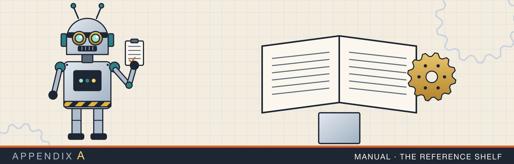

# Appendix A. The Rust cheat sheet

This appendix reproduces `rust-interview-lab/src/bin/RUST_CHEATSHEET.md`, a reference sheet of compiler diagnostics and Rust idioms that caused the most friction during the construction of the lab. Its embedded study method remains the most effective way to use it: read a section, close the file, and reproduce the idioms from memory.

Its sections correspond to the chapters of this book:

- reference levels and iterator closures: chapters 1 and 3
- `Option` and `Result` combinators: chapter 1
- collections and heaps: chapter 3
- locks and guards: chapters 12 to 14
- strings and match ergonomics: chapters 1 to 3

---

{{#include ../../rust-interview-lab/src/bin/RUST_CHEATSHEET.md}}
