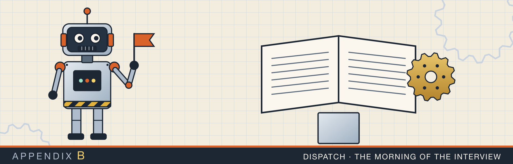

# Appendix B. The benchmark report

Chapters 4 and 9 cite measurements from the Rust lab's benchmark suite. This appendix reproduces the complete report generated from those runs (`rust-interview-lab/benchmarking_examples/benchmarking-report.md`), structured as a technical paper covering methodology, results, discussion, and threats to validity. The raw recorded output underlying the report resides in `rust-interview-lab/BENCHMARKS.md`.

> **A correction to sections 2.2 and 5.2 of the report.** Those sections attribute the enum list's slower push to a discriminant stored alongside the boxed continuation. On a 64-bit target, `std::mem::size_of::<ListNode<u64>>()` is 16 bytes, identical to `Node<u64>`: the `Box` field's non-null niche encodes `Empty`, so no separate discriminant is stored. Section 4.3 details the two remaining structural differences (the inline head moved on every push, and the extra allocation for the terminal `Empty` variant). The measured timings are unaffected.

The standalone PDF report is built with the following script and stylesheet:

<p class="listing"><b>Listing B.1</b> The report's build script. <a href="https://github.com/arpanpathak/cracking-the-systems-programming-interview/blob/prep-v2/rust-interview-lab/benchmarking_examples/build_report_pdf.py">benchmarking_examples/build_report_pdf.py</a></p>

```python
{{#include ../../rust-interview-lab/benchmarking_examples/build_report_pdf.py}}
```

<p class="listing"><b>Listing B.2</b> The report's stylesheet. <a href="https://github.com/arpanpathak/cracking-the-systems-programming-interview/blob/prep-v2/rust-interview-lab/benchmarking_examples/report.css">benchmarking_examples/report.css</a></p>

```css
{{#include ../../rust-interview-lab/benchmarking_examples/report.css}}
```

---

{{#include ../../rust-interview-lab/benchmarking_examples/benchmarking-report.md}}
