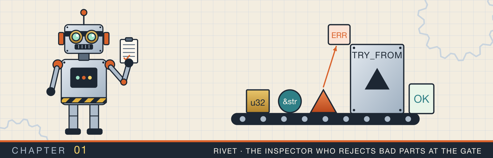
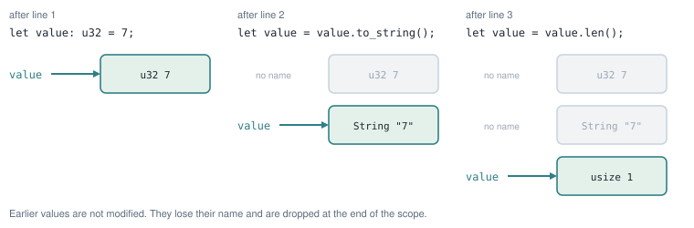
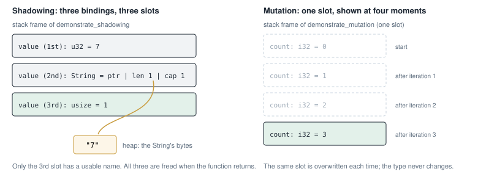
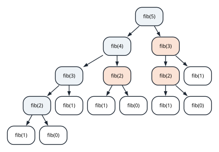
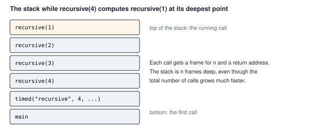
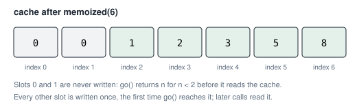

# Bindings, functions, and loops

<div class="covers" markdown="1">

This chapter covers

- How a `let` binding works and where its value resides in memory
- Shadowing an identifier, and how it differs from in-place mutation with `mut`
- Recursive functions and their stack-frame allocation behavior
- Replacing direct recursion with an iterative loop and with a memoization table
- Measuring execution time with `Instant`, and passing functions as arguments

</div>

Every compiled program maps source-level identifiers onto concrete storage locations and control-flow frames. In Rust, lexical bindings, explicit mutability, and deterministic stack-frame reclamation govern how values occupy memory across function invocations.

Two programs illustrate these foundational mechanics. The first binds a single identifier to three values of distinct types in sequence, contrasting lexical shadowing with in-place mutation of a mutable slot. The second evaluates Fibonacci numbers through direct recursion, constant-space iteration, and memoization, demonstrating how recursive call trees consume stack memory and how algorithmic structure dictates asymptotic execution time.

Four definitions establish the memory model used throughout:

- A **binding** associates an identifier with a typed value; for example, `let x = 5;` binds `x` to `5`.
- A **lexical scope** is the syntactic region in which a binding remains valid, delimited in Rust by `{` and `}`.
- The **call stack** is the contiguous LIFO memory region holding activation records for active function invocations.
- A **stack frame** (activation record) is the fixed-size slice of stack memory allocated upon entering a function to store its parameters, return address, and local bindings.

## 1.1 A binding is a name for a value

Upon function entry, the runtime allocates a stack frame sized statically from the types of its local bindings. Fixed-size scalar bindings occupy adjacent slots within that frame: a `u32` requires 4 bytes, whereas a `usize` requires 8 bytes on a 64-bit architecture.

Dynamically sized types such as `String` partition their representation across the stack and the **heap**, a dynamically managed memory pool obtained from the system allocator. Because string length varies at runtime, the UTF-8 character bytes reside in a heap-allocated buffer, while the stack frame holds a three-word header consisting of a pointer to that buffer, the current byte length, and the allocated capacity.

Upon function return, the stack frame is popped and every local binding undergoes deterministic destruction in reverse declaration order. Dropping a `String` deallocates its backing heap buffer automatically.

## 1.2 Shadowing: one name, several values

Declaring a second `let` statement with an identifier already in scope does not overwrite the original value. Instead, it creates a distinct binding that reuses the identifier, hiding the earlier value from subsequent statements. Rust terms this mechanism **shadowing**. The original value remains alive until the enclosing scope exits, though it is no longer reachable by name.

Because each shadowed binding is an independent variable, its type can differ from the previous binding. Figure 1.1 traces the identifier `value` across three bindings of three different types.

<figure>

<figcaption><b>Figure 1.1</b> Each <code>let</code> creates a new value and moves the name to it. The earlier values are not changed; they lose their name.</figcaption>
</figure>

Listing 1.1 implements this three-step sequence.

<p class="listing"><b>Listing 1.1</b> One name, three types. <a href="https://github.com/arpanpathak/cracking-the-systems-programming-interview/blob/prep-v2/rust-interview-lab/src/bin/shadowing.rs">src/bin/shadowing.rs</a>, lines 27 to 41</p>

```rust
{{#include ../../rust-interview-lab/src/bin/shadowing.rs:27:41}}
```

Tracing the three `let value` statements in order clarifies how evaluation proceeds:

1. `let value: u32 = 7;` initializes a `u32` binding.
2. `let value = value.to_string();` reads the `u32`, allocates a `String` containing its decimal representation, and binds `value` to that `String`. On the right-hand side, `value` still resolves to the `u32` because the new binding enters scope only after the initializer finishes evaluating.
3. `let value = value.len();` reads the byte length of the `String` and binds `value` to the resulting `usize`.

None of these bindings require `mut` because every value remains immutable after initialization. By contrast, `log` accumulates output lines via `push_str`, so it is declared `let mut log`, allowing the unit tests to verify all three intermediate states.

Figure 1.2 (left) depicts the conceptual stack frame after the third binding: three distinct slots exist, with only the final slot remaining accessible by name.

<figure>

<figcaption><b>Figure 1.2</b> Shadowing creates a new slot for each binding. Mutation writes new values into the same slot. The compiler may reuse a slot it can prove is unused. The picture shows what the program means.</figcaption>
</figure>

### 1.2.1 When shadowing helps

Shadowing is well suited to staged data transformations where an input arrives in one representation and must be converted into another. For example, numeric input from a user arrives as raw text; once parsed, the unparsed string is no longer needed and can be shadowed by the parsed integer:

```rust
let count = read_line_from_user();   // a String, for example "42"
let count: u32 = count.trim().parse().expect("a number");
```

After the second line, `count` has type `u32`. Subsequent code cannot accidentally reference the raw string because its identifier has been rebound.

### 1.2.2 A value captured earlier keeps its old value

A closure or reference created prior to a shadowing `let` remains bound to the original variable:

```rust
let x = 1;
let show = || println!("{x}");
let x = x + 1;   // a new x
show();          // prints 1
```

Because the second `let` allocates a new binding rather than modifying the first, the closure continues to observe the original `x`.

<div class="callout warning" markdown="1">

**WARNING:** Writing `let x = x + 1;` inside a loop body introduces a new binding scoped exclusively to that single iteration. On the next iteration, the outer `x` retains its original value. To accumulate state across iterations, declare `let mut x` outside the loop and update it with `x += 1`.

</div>

## 1.3 Mutation: one value that changes

When a single storage location must change over time, declare the binding with `mut`. The type remains fixed, and every assignment overwrites the same stack slot in place.

<p class="listing"><b>Listing 1.2</b> A counter that changes in place. <a href="https://github.com/arpanpathak/cracking-the-systems-programming-interview/blob/prep-v2/rust-interview-lab/src/bin/shadowing.rs">src/bin/shadowing.rs</a>, lines 43 to 53</p>

```rust
{{#include ../../rust-interview-lab/src/bin/shadowing.rs:43:53}}
```

The header `for _ in 0..3` executes the body three times while discarding the loop index with the wildcard `_`. Each iteration increments `count` in place and appends the updated value to `log`. Figure 1.2 (right) illustrates the single slot for `count` across its four states.

Table 1.1 summarizes the behavioral differences between shadowing and mutation.

| | Shadowing (`let x = ...` again) | Mutation (`let mut x`, then `x = ...`) |
|---|---|---|
| Creates a new variable | yes | no |
| Can change the type | yes | no |
| Needs `mut` | no | yes |
| A closure that captured `x` earlier sees | the old value | a compile error if it is still in use |

## 1.4 The first complete program

Listing 1.3 presents the complete `shadowing.rs` binary, including its entry point and unit tests.

<p class="listing"><b>Listing 1.3</b> The complete program. <a href="https://github.com/arpanpathak/cracking-the-systems-programming-interview/blob/prep-v2/rust-interview-lab/src/bin/shadowing.rs">src/bin/shadowing.rs</a></p>

```rust
{{#include ../../rust-interview-lab/src/bin/shadowing.rs}}
```

The unit tests reside in a module annotated with `#[cfg(test)]`, which instructs the compiler to compile this module exclusively during `cargo test`. Inside the module, `use super::*;` imports the parent module's items into scope, and each test verifies the formatted log output with `assert!`.

Running the binary and its test suite from the `rust-interview-lab` directory produces:

```text
$ cargo run --bin shadowing
=== Shadowing ===
integer: 7
string: 7
usize: 1

=== Mutation ===
mut count: 1 2 3

$ cargo test --bin shadowing
running 2 tests
test tests::mutation_requires_mut_binding ... ok
test tests::shadowing_allows_type_changes ... ok
```

With single-frame storage established, nested invocations introduce a second dimension of stack management: activation-record accumulation during recursion.

## 1.5 A function that calls itself

The Fibonacci sequence begins with 0 and 1, and each subsequent term is the sum of the two preceding terms:

| n | 0 | 1 | 2 | 3 | 4 | 5 | 6 | 7 | 8 |
|---|---|---|---|---|---|---|---|---|---|
| fib(n) | 0 | 1 | 1 | 2 | 3 | 5 | 8 | 13 | 21 |

This recurrence translates directly into a **recursive** function, a function that invokes itself.

<p class="listing"><b>Listing 1.4</b> Fibonacci by recursion. <a href="https://github.com/arpanpathak/cracking-the-systems-programming-interview/blob/prep-v2/rust-interview-lab/src/bin/cs_fib.rs">src/bin/cs_fib.rs</a>, lines 8 to 15</p>

```rust
{{#include ../../rust-interview-lab/src/bin/cs_fib.rs:6:6}}

{{#include ../../rust-interview-lab/src/bin/cs_fib.rs:8:15}}
```

Inputs `0` and `1` form the **base case**, returning `n` directly without further calls. For any `n >= 2`, the function makes two recursive calls and sums their results. Because `if` is an expression in Rust, its evaluated branch serves as the function's return value without an explicit `return` statement.

### 1.5.1 Counting the calls

Tracing `recursive(5)` reveals significant redundant work: `recursive(5)` invokes `recursive(4)` and `recursive(3)`, and `recursive(4)` invokes `recursive(3)` a second time. Figure 1.3 illustrates the complete call tree.

<figure>

<figcaption><b>Figure 1.3</b> The calls made by <code>recursive(5)</code>. Shaded calls repeat work that another branch already did: <code>fib(3)</code> is computed twice and <code>fib(2)</code> three times.</figcaption>
</figure>

Evaluating `n = 5` requires 15 calls. Because the call tree for `n` contains both the tree for `n - 1` and the tree for `n - 2`, the total call count grows by roughly a factor of 1.618 per increment of `n`. At `n = 30`, the function executes approximately 2.7 million calls; at `n = 90`, the call count exceeds 10<sup>19</sup>.

### 1.5.2 What each call uses on the stack

Every active invocation allocates its own stack frame containing its parameter `n` and return address, and releases that frame upon returning. Consequently, the stack never holds the entire call tree simultaneously; it holds only the active chain of pending calls. Figure 1.4 depicts the deepest stack state reached during `recursive(4)`.

<figure>

<figcaption><b>Figure 1.4</b> The stack at the deepest point of <code>recursive(4)</code>. The depth is about <code>n</code> frames, while the number of calls grows much faster.</figcaption>
</figure>

Direct recursion therefore incurs two distinct costs: exponential time complexity O(\varphi<sup>n</sup>) caused by overlapping subproblems, and linear stack depth O(n) proportional to the input parameter. Although a depth of 90 frames is negligible, linear recursion depth exhausts the call stack on large inputs.

## 1.6 The same numbers with a loop

Computing the next Fibonacci number requires only the two preceding values. An iterative loop can maintain those two values in registers or stack slots and advance them one step per iteration.

<p class="listing"><b>Listing 1.5</b> Fibonacci with a loop. <a href="https://github.com/arpanpathak/cracking-the-systems-programming-interview/blob/prep-v2/rust-interview-lab/src/bin/cs_fib.rs">src/bin/cs_fib.rs</a>, lines 17 to 24</p>

```rust
{{#include ../../rust-interview-lab/src/bin/cs_fib.rs:17:24}}
```

The declaration `let (mut previous, mut current) = (0u64, 1u64);` destructures a tuple to initialize both bindings in one statement, with the `u64` suffix fixing the integer width.

Inside the loop, `(previous, current) = (current, previous + current);` updates both bindings simultaneously. Rust evaluates the entire right-hand tuple using the pre-update values before writing to the left-hand targets, eliminating the need for an explicit temporary variable.

Tracing `iterative(5)` confirms the state transitions:

| after pass | 0 (start) | 1 | 2 | 3 | 4 | 5 |
|---|---|---|---|---|---|---|
| `previous` | 0 | 1 | 1 | 2 | 3 | 5 |
| `current` | 1 | 1 | 2 | 3 | 5 | 8 |

After five iterations, `previous` holds 5, which equals `fib(5)`. Because the loop executes `n` iterations using two fixed-size integers, its running time is linear in `n` and its memory usage is constant.

## 1.7 Recursion with a memory

To preserve the recursive formulation while eliminating redundant recomputation, each subproblem result can be recorded upon first evaluation and retrieved on subsequent visits. This technique is **memoization**, and the auxiliary lookup table storing evaluated subproblems is a **cache**.

<p class="listing"><b>Listing 1.6</b> Fibonacci with a cache. <a href="https://github.com/arpanpathak/cracking-the-systems-programming-interview/blob/prep-v2/rust-interview-lab/src/bin/cs_fib.rs">src/bin/cs_fib.rs</a>, lines 26 to 41</p>

```rust
{{#include ../../rust-interview-lab/src/bin/cs_fib.rs:26:41}}
```

Three Rust constructs appear in Listing 1.6:

- **Nested function definitions:** `go` is declared inside `memoized`, restricting its visibility to the enclosing function. Unlike a closure, a nested `fn` does not capture local variables from its enclosing scope.
- **`vec![0u64; n as usize + 1]`:** This macro allocates a heap-backed `Vec` initialized with `n + 1` zeros. The cast `n as usize` converts `u64` to `usize`, Rust's pointer-sized indexing type.
- **`&mut [u64]`:** A mutable slice provides a borrowed, writable view into the vector's contiguous elements. Passing the cache by mutable slice allows every recursive call to share one table without copying it.

On each invocation, `go` handles the base cases first and then inspects `cache[index]`. A zero entry indicates an uncomputed value, prompting two recursive calls whose sum is stored in the table before returning.

Using zero as an empty sentinel is valid here because `fib(n)` is strictly positive for all `n >= 2`, and smaller inputs return before consulting the cache. Figure 1.5 depicts the cache contents after `memoized(6)` completes.

<figure>

<figcaption><b>Figure 1.5</b> The cache after <code>memoized(6)</code>. Each slot from 2 to 6 is computed once and then read.</figcaption>
</figure>

With memoization, every subproblem from `2` to `n` is evaluated exactly once, reducing execution time to linear in `n`. Memory consumption remains linear in `n` for both the heap cache and the `n` active stack frames.

Animation 1.1 contrasts `memoized(5)` and `recursive(5)` side by side. The call tree on the left records every invocation, while the stack on the right tracks only the frames currently awaiting a return value.

<figure class="anim">
<video class="motion" src="figures/ch01-fib-calls.mp4" autoplay loop muted playsinline preload="metadata" aria-label="A call tree grows on the left and a stack of frames on the right. memoized(5) calls go(5), go(4), go(3), go(2), and go(1); the stack holds five frames. go(1) and go(0) return base values, and go(2) stores 1 in the cache. As the calls return, the cache fills with 1, 2, 3, 5 for slots 2 to 5. When go(4) calls go(2) and go(5) calls go(3), the cache already holds the answer, and they return without further calls: 9 calls in all. Then recursive(5) makes the same tree without a cache: recursive(2) and recursive(3) run again in full, shaded as repeats, for 15 calls." data-chapters="[[0.0, &quot;with a cache&quot;], [25.62, &quot;no cache&quot;]]"></video>
<figcaption><b>Animation 1.1</b> The stack is only as deep as the chain of waiting calls. With the cache, each value is computed once; without it, whole subtrees repeat.</figcaption>
</figure>

## 1.8 Timing the three versions

To compare all three implementations quantitatively, the program wraps each invocation in a timing helper.

<p class="listing"><b>Listing 1.7</b> Timing a function and printing the result. <a href="https://github.com/arpanpathak/cracking-the-systems-programming-interview/blob/prep-v2/rust-interview-lab/src/bin/cs_fib.rs">src/bin/cs_fib.rs</a>, lines 43 to 51</p>

```rust
{{#include ../../rust-interview-lab/src/bin/cs_fib.rs:43:51}}
```

The parameter `operation: impl Fn(u64) -> u64` accepts any function item or closure that maps a `u64` to a `u64`, enabling `main` to pass `recursive`, `iterative`, and `memoized` directly by name.

`Instant::now()` samples a monotonic clock that never moves backward, and `start.elapsed()` computes the interval as a `Duration`.

In `report`, format specifiers control column alignment: `{label:<10}` left-aligns the label within a 10-character field, `{n:>2}` right-aligns `n` within 2 characters, and `{elapsed:?}` invokes `Duration`'s debug formatter, which automatically scales units to nanoseconds, microseconds, or milliseconds.

## 1.9 The complete Fibonacci program

Listing 1.8 combines all three implementations, the timing harness, and the verification loop in `main`.

<p class="listing"><b>Listing 1.8</b> The complete program. <a href="https://github.com/arpanpathak/cracking-the-systems-programming-interview/blob/prep-v2/rust-interview-lab/src/bin/cs_fib.rs">src/bin/cs_fib.rs</a></p>

```rust
{{#include ../../rust-interview-lab/src/bin/cs_fib.rs}}
```

Near the end of `main`, a loop verifies that all three implementations produce identical outputs for every `n` below 20, terminating via `assert_eq!` on any discrepancy. Two final assertions validate `fib(30)` and `fib(90)` against known reference values.

Executing the default debug build with `cargo run` yields:

```text
$ cargo run --bin cs_fib
small input, all three should agree
  recursive  fib(20) = 6765                 in 90.908µs
  iterative  fib(20) = 6765                 in 567ns
  memoized   fib(20) = 6765                 in 10.826µs

recursive cost grows quickly
  recursive  fib(30) = 832040               in 11.124774ms
  iterative  fib(30) = 832040               in 542ns

large input: recursion alone would not finish
  iterative  fib(90) = 2880067194370816120  in 937ns
  memoized   fib(90) = 2880067194370816120  in 5.749µs

all checks passed
```

The recursive timings confirm the growth analysis from Section 1.5.1: increasing `n` from 20 to 30 multiplies runtime by roughly 120, matching `1.618^10 ≈ 123`. At that growth rate, `recursive(90)` would require millennia, so `main` omits it.

Although both `memoized` and `iterative` scale linearly with `n`, `memoized` runs slower because it allocates a heap `Vec` and incurs recursive call overhead, neither of which the loop pays.

<div class="callout note" markdown="1">

**NOTE:** `fib(93)` is the largest Fibonacci number representable in a `u64`; `iterative(94)` overflows. Debug builds trap integer overflow with a panic, whereas release builds wrap around in two's complement arithmetic without signaling an error.

</div>

<div class="summary" markdown="1">

## Summary

- A `let` binding associates an identifier with a fixed-size slot in the active stack frame. A `String` stores its UTF-8 bytes in a heap-allocated buffer referenced by a three-word stack header (pointer, length, capacity).
- Lexical shadowing introduces an independent binding that may assume a different type while leaving prior bindings immutable and unreachable by name. Closures capturing an earlier binding retain their reference to the original storage slot.
- Declaring a binding with `mut` enables in-place mutation of a fixed-type storage slot.
- Each active recursive invocation allocates a stack frame; unmemoized recursive Fibonacci recomputes overlapping subproblems, yielding exponential runtime and linear stack depth.
- An iterative loop maintaining only the two preceding recurrence terms computes `fib(n)` in O(n) time and O(1) auxiliary space.
- Memoization caches evaluated subproblems in an auxiliary table, reducing recursive Fibonacci to O(n) time at the cost of O(n) heap space and O(n) stack depth.
- `impl Fn(u64) -> u64` accepts any function item or closure matching that signature, and `Instant` samples a monotonic clock for elapsed-time measurement.

</div>

## Exercises

1. Add a call counter to `recursive`, print the invocation count for `n` from 1 to 25, and verify that consecutive counts grow by approximately 1.6x.
2. Modify `memoized` so the cache stores `Option<u64>` rather than treating `0` as an empty sentinel. Explain why `0` is a valid sentinel for Fibonacci numbers but unsafe for functions that can legitimately return `0`.
3. Update `iterative` to return `Option<u64>` using `checked_add`, so that `iterative(94)` returns `None` rather than overflowing.
4. Run `cargo run --release --bin cs_fib` and compare the optimized timings against the debug output above.
