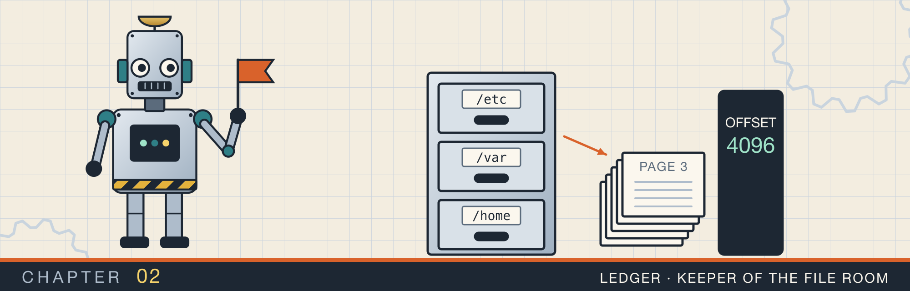
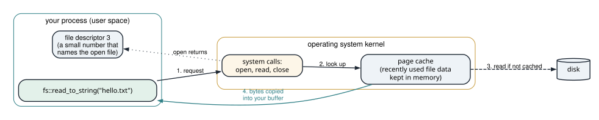
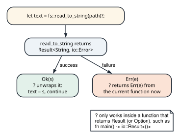
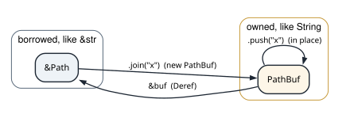
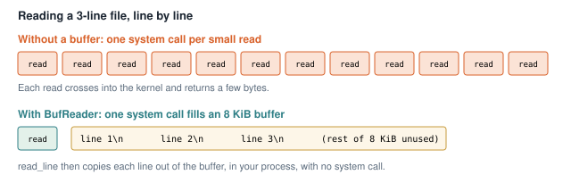
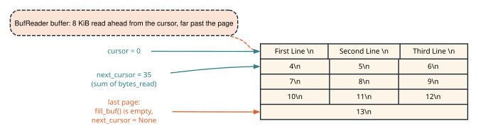
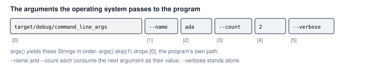

# Files, paths, and the command line

<div class="covers" markdown="1">

This chapter covers

- How a program interacts with the kernel and storage subsystem when reading a file
- `Result` and the `?` operator for structured error propagation
- `Path` and `PathBuf`, alongside whole-file and line-oriented reading strategies
- Appending, copying, renaming, and deleting files, and classifying I/O error kinds
- Listing directory entries and traversing nested directory trees
- Cursor-based file pagination and typed command-line argument parsing

</div>

Whereas Chapter 1 focused on pure in-memory computation, this chapter crosses the boundary into the operating system. The programs here read and write files, traverse directories, and parse arguments supplied on the command line.

Every interaction with the operating system can fail: a target path may be missing, or the process may lack read permissions. Rust models recoverable failures through the `Result` type, which forms the starting point of this chapter. We then examine path manipulation, buffered I/O, file mutations, and directory traversal, concluding with two complete utilities: a stateless file paginator and a typed command-line argument parser.

Three operating system concepts govern all file I/O:

- The **kernel** is the privileged core of the operating system responsible for managing hardware, memory, and storage.
- A **system call** is a controlled transition from user space into the kernel requesting a service, such as opening a file or reading a byte range.
- A **file descriptor** is a small non-negative integer assigned by the kernel to represent an open file within a process; subsequent system calls reference the file through this integer.

## 2.1 What happens when you read a file

User-space processes cannot access storage hardware directly. Every file read is mediated by the kernel through a sequence of system calls, as illustrated in Figure 2.1.

<figure>

<figcaption><b>Figure 2.1</b> A read goes through the kernel. The kernel keeps recently used file data in memory, in its page cache. A second read of the same file usually does not touch the disk.</figcaption>
</figure>

Reading a file proceeds in three stages:

1. `open` requests access to the path; the kernel verifies permissions and returns a file descriptor.
2. `read` requests bytes from that descriptor; the kernel copies data from its page cache (fetching from disk on a cache miss) into a user-space buffer.
3. `close` notifies the kernel that the process has finished with the file so the descriptor can be reclaimed.

Rust's standard library wraps these system calls in safe abstractions, reporting any kernel error through `Result`.

## 2.2 `Result` and the `?` operator

`Result` is a two-variant enum representing either a successful value or a failure:

```rust
enum Result<T, E> {
    Ok(T),    // the operation succeeded and produced a T
    Err(E),   // the operation failed with an error of type E
}
```

For I/O operations, the error type is `std::io::Error`, and `io::Result<T>` is a standard type alias for `Result<T, io::Error>`. Accordingly, `fs::read_to_string(path)` returns `io::Result<String>`, yielding either the decoded text or the underlying OS error.

Handling every fallible call with an explicit `match` quickly obscures control flow when a function chains multiple I/O operations. The `?` operator eliminates that boilerplate. Appending `?` to any `Result` expression performs one of two actions (Figure 2.2):

- On `Ok(x)`, the expression evaluates to `x` and execution continues.
- On `Err(e)`, the enclosing function immediately returns `Err(e)` to its caller.

<figure>

<figcaption><b>Figure 2.2</b> The <code>?</code> operator. It can only be used inside a function that itself returns <code>Result</code>.</figcaption>
</figure>

Because `?` performs an early return on error, the enclosing function must itself return a compatible `Result` type. For this reason, the binaries in this chapter declare `fn main() -> io::Result<()>`. When `main` returns an `Err`, the Rust runtime prints the error message to standard error and exits with status code 1.

## 2.3 Paths

A **path** identifies a file or directory, such as `/tmp/data.txt`. Rust splits path handling across two complementary types: `&Path` is an unsized, borrowed slice of a path, while `PathBuf` is an owned, heap-allocated buffer that can be mutated in place. Their relationship mirrors `&str` and `String` (Figure 2.3).

<figure>

<figcaption><b>Figure 2.3</b> <code>join</code> returns a new owned path. <code>push</code> extends a <code>PathBuf</code> in place. A <code>&amp;PathBuf</code> converts to <code>&amp;Path</code> automatically when a function asks for one.</figcaption>
</figure>

<p class="listing"><b>Listing 2.1</b> Building paths and taking them apart. <a href="https://github.com/arpanpathak/cracking-the-systems-programming-interview/blob/prep-v2/rust-interview-lab/src/bin/path_buff.rs">src/bin/path_buff.rs</a></p>

```rust
{{#include ../../rust-interview-lab/src/bin/path_buff.rs}}
```

`Path::new("/tmp")` constructs a borrowed `&Path` view without allocating. Calling `dir.join("data.txt")` allocates and returns a new `PathBuf`, whereas `PathBuf::from(dir)` copies the base path into an owned buffer that `push` extends in place.

```text
$ cargo run --bin path_buff
file: /tmp/data.txt
buf:  /tmp/nested/file.txt
parent: Some("/tmp/nested")
file_name: Some("file.txt")
ext: Some("txt")
```

Inspectors such as `parent`, `file_name`, and `extension` return `Option` because not every path contains those components; for instance, the root directory `/` has no parent. Formatting a path for display requires calling `display()`. On Unix systems (Linux and macOS), filesystem paths are arbitrary non-NUL byte sequences that need not be valid UTF-8; `display()` substitutes replacement characters for any non-UTF-8 sequences during formatting.

<div class="callout warning" markdown="1">

**WARNING:** Passing an absolute path to `join` or `push` replaces the entire base path rather than appending to it; `Path::new("/srv").join("/etc/passwd")` resolves to `/etc/passwd`. When constructing paths from untrusted input, reject absolute paths and `..` traversal components before joining.

</div>

## 2.4 Reading a file

### 2.4.1 The whole file at once

For small files, the most direct approach loads the entire file into a single `String`.

<p class="listing"><b>Listing 2.2</b> Write a file, then read it back. <a href="https://github.com/arpanpathak/cracking-the-systems-programming-interview/blob/prep-v2/rust-interview-lab/src/bin/read_write_file.rs">src/bin/read_write_file.rs</a></p>

```rust
{{#include ../../rust-interview-lab/src/bin/read_write_file.rs}}
```

`fs::write` creates the file (or truncates an existing one) and writes the provided bytes, while `fs::read_to_string` opens, reads, validates UTF-8, and closes the file in a single call. Appending `?` propagates any failure directly out of `main`.

Because `read_content_of_file` accepts `&Path`, both `PathBuf` arguments constructed via `join` and `push` coerce automatically via `Deref`, printing identical contents.

Loading an entire file into memory works well for configuration files, but is unsuitable for multi-gigabyte logs, which require streaming line by line.

### 2.4.2 One line at a time

Streaming a file line by line requires wrapping the `File` in a `BufReader`. Figure 2.4 contrasts buffered and unbuffered reads.

<figure>

<figcaption><b>Figure 2.4</b> A <code>BufReader</code> asks the kernel for a large block at once and hands out lines from it. Fewer system calls means less time spent crossing into the kernel.</figcaption>
</figure>

<p class="listing"><b>Listing 2.3</b> Numbered lines through a buffered reader. <a href="https://github.com/arpanpathak/cracking-the-systems-programming-interview/blob/prep-v2/rust-interview-lab/src/bin/readfile_line_by_line.rs">src/bin/readfile_line_by_line.rs</a></p>

```rust
{{#include ../../rust-interview-lab/src/bin/readfile_line_by_line.rs}}
```

`BufReader::new(file)` takes ownership of the `File` and pairs it with an 8 KiB user-space buffer. Because `lines` is defined on the `BufRead` trait, the trait must be brought into scope with `use std::io::BufRead;`.

Each iteration of `lines()` yields an `io::Result<String>` stripped of its trailing newline; a read error or invalid UTF-8 sequence can occur partway through the file, so each item must be checked individually. The statement `let line = line?;` unwraps the `String` by shadowing the `Result` binding, as introduced in Section 1.2. Chaining `enumerate()` pairs each line with its zero-based index, which the output shifts by one (`i + 1`).

Animation 2.1 traces this loop over a 12-byte, three-line file, counting `read` system calls with and without a buffer.

<figure class="anim">
<video class="motion" src="figures/ch02-bufreader.mp4" autoplay loop muted playsinline preload="metadata" aria-label="A program robot on one side of the kernel boundary, and log.txt in the page cache on the other, holding a=1, b=2, and c=3, each with a newline. lines asks for the first line; the empty BufReader makes one read call for up to 8 KiB, and all 12 bytes come back into its buffer. The three lines are cut from the buffer and printed with no more calls. A last read returns 0 bytes, end of file: two read calls in all. In a second run without a buffer, the reader reads one byte per call, and the count climbs to 13 calls for the same 12 bytes." data-chapters="[[0.0, &quot;BufReader&quot;], [32.22, &quot;no buffer&quot;]]"></video>
<figcaption><b>Animation 2.1</b> <code>BufReader</code> makes one large read and serves the lines from memory: 2 calls. Reading one byte at a time costs a system call per byte: 13 calls.</figcaption>
</figure>

### 2.4.3 Reusing one buffer, and skipping bad lines

Because `lines()` allocates a fresh `String` on every iteration, high-throughput scanners avoid per-line heap allocations by reading repeatedly into a single reusable buffer.

<p class="listing"><b>Listing 2.4</b> One reused buffer, with invalid lines skipped. <a href="https://github.com/arpanpathak/cracking-the-systems-programming-interview/blob/prep-v2/rust-interview-lab/src/bin/read_large_file.rs">src/bin/read_large_file.rs</a></p>

```rust
{{#include ../../rust-interview-lab/src/bin/read_large_file.rs}}
```

`reader.read_line(&mut line)` appends the next line, including its delimiter, into `line` and returns the byte count read. The loop uses the `while match ... { ... } {}` idiom, placing the `match` directly in the loop condition with an empty body `{}`; each match arm evaluates to `true` to continue scanning or `false` to terminate.

Table 2.1 summarizes the four outcomes handled by the `match`.

| `read_line` returns | Meaning | What the loop does |
|---|---|---|
| `Ok(0)` | end of the file | stops |
| `Ok(n)` | a line of `n` bytes | processes it, clears the buffer, continues |
| `Err(e)` with kind `InvalidData` | the line is not valid UTF-8 text | prints a message, clears, continues |
| any other `Err` | a real read failure | returns the error from `main` |

Because `read_line` appends to the existing string, the loop must call `line.clear()` after each iteration; omitting `clear()` would cause the buffer to accumulate the entire file while keeping its allocated capacity.

The `InvalidData` branch can resume safely because `read_line` has already consumed the malformed line up to the newline delimiter. Testing against a file containing invalid UTF-8 bytes on its second line confirms this behavior:

```text
$ printf 'ok\n\xff\xfebad\nfine\n' > large.txt
$ cargo run --bin read_large_file
ok
skipping bad line: stream did not contain valid UTF-8
fine
```

## 2.5 Writing and changing files

### 2.5.1 Appending

Whereas `fs::write` truncates and replaces a file, appending to a log requires opening the file in append mode via `OpenOptions`.

<p class="listing"><b>Listing 2.5</b> Appending lines to a file. <a href="https://github.com/arpanpathak/cracking-the-systems-programming-interview/blob/prep-v2/rust-interview-lab/src/bin/append_to_file_open_options.rs">src/bin/append_to_file_open_options.rs</a></p>

```rust
{{#include ../../rust-interview-lab/src/bin/append_to_file_open_options.rs}}
```

`OpenOptions` configures open flags before issuing the `open` system call: `create(true)` creates the file if absent, and `append(true)` sets the OS `O_APPEND` flag so the kernel positions the write offset at end-of-file and writes the payload atomically. As a result, concurrent processes appending to the same log file do not overwrite one another's records.

The `writeln!` macro formats text into any type implementing `std::io::Write` (such as `File`), requiring `use std::io::Write;` in scope.

### 2.5.2 Copying, renaming, and deleting

The standard library provides dedicated functions for copying, renaming, and removing files. Listing 2.6 creates a file, copies it, renames the copy, and deletes the original.

<p class="listing"><b>Listing 2.6</b> Copy, rename, remove. <a href="https://github.com/arpanpathak/cracking-the-systems-programming-interview/blob/prep-v2/rust-interview-lab/src/bin/copy_rename_delete_file.rs">src/bin/copy_rename_delete_file.rs</a></p>

```rust
{{#include ../../rust-interview-lab/src/bin/copy_rename_delete_file.rs}}
```

Upon completion, `a.txt` has been unlinked and `c.txt` contains `hello`. Each operation maps directly to one or two underlying system calls.

`fs::rename` provides an essential durability guarantee: when source and destination reside on the same filesystem, the rename is **atomic**. Concurrent readers observe either the complete old file or the complete new file, never a partially written state. Reliable file updates exploit this property by writing the new contents to a sibling temporary file and then renaming it over the target path.

### 2.5.3 Telling one error from another

Every `io::Error` carries a platform-independent **kind** (`io::ErrorKind`), such as `NotFound` or `PermissionDenied`, enabling callers to handle specific failure conditions distinctly from unexpected I/O errors.

<p class="listing"><b>Listing 2.7</b> Matching on the kind of an error. <a href="https://github.com/arpanpathak/cracking-the-systems-programming-interview/blob/prep-v2/rust-interview-lab/src/bin/file_error_handling.rs">src/bin/file_error_handling.rs</a></p>

```rust
{{#include ../../rust-interview-lab/src/bin/file_error_handling.rs}}
```

The second arm uses a **match guard** (`if e.kind() == ErrorKind::NotFound`) to isolate missing-file errors while letting all other errors fall through to the third arm. Because `main` returns `()` rather than `io::Result<()>`, it handles every `Result` variant explicitly instead of propagating with `?`. Executed in a directory without `missing.txt`, the program prints `File not found`.

## 2.6 Directories

A directory maps entry names to filesystem objects: regular files, subdirectories, or symbolic links. A **symbolic link** is a directory entry that stores a pathname pointing to another target path.

### 2.6.1 One level

Listing 2.8 enumerates the entries of the current working directory and distinguishes subdirectories from regular files.

<p class="listing"><b>Listing 2.8</b> Listing the current directory. <a href="https://github.com/arpanpathak/cracking-the-systems-programming-interview/blob/prep-v2/rust-interview-lab/src/bin/list_directory.rs">src/bin/list_directory.rs</a></p>

```rust
{{#include ../../rust-interview-lab/src/bin/list_directory.rs}}
```

`fs::read_dir(".")` returns an iterator yielding `io::Result<DirEntry>` items, since reading directory entries can fail mid-iteration. Calling `path.is_dir()` queries the kernel for metadata via `stat`, following symbolic links to report the type of the link target.

### 2.6.2 Every level

Traversing nested subdirectories applies the recursive pattern from Section 1.5, invoking `walk` on every subdirectory encountered.

<p class="listing"><b>Listing 2.9</b> Walking a directory tree. <a href="https://github.com/arpanpathak/cracking-the-systems-programming-interview/blob/prep-v2/rust-interview-lab/src/bin/recusrive_directory_walk.rs">src/bin/recusrive_directory_walk.rs</a></p>

```rust
{{#include ../../rust-interview-lab/src/bin/recusrive_directory_walk.rs}}
```

Here `walk` calls `entry.file_type()` rather than `path.is_dir()`. Unlike `is_dir()`, `file_type()` does not follow symbolic links, reporting a symlink to a directory as a symlink rather than a directory. Refusing to descend into symlinks prevents infinite recursion when a symlink points to an ancestor directory. On Linux, `file_type()` is also faster because the `getdents` system call typically returns the entry type alongside its name without requiring an additional `lstat` call.

Recursion depth equals the directory nesting depth. Because practical filesystem hierarchies are shallow relative to default thread stack sizes, stack overflow is rarely a hazard here.

## 2.7 Project: reading a large file one page at a time

Consider a backend service storing millions of newline-delimited job records in a flat file, serving them to clients one page at a time. Alongside each page, the service returns a **cursor**, an opaque token the client sends back to request the subsequent page.

Representing the cursor as the exact byte offset where the next page begins makes the service stateless: any server replica with access to the file can fulfill the next request directly from the cursor without retaining per-client session state.

### 2.7.1 The page type

Each response page bundles its vector of lines with the byte offset of the following page.

<p class="listing"><b>Listing 2.10</b> The <code>Page</code> type (lines 1 to 9). <a href="https://github.com/arpanpathak/cracking-the-systems-programming-interview/blob/prep-v2/rust-interview-lab/src/bin/file_pagination.rs">src/bin/file_pagination.rs</a></p>

```rust
{{#include ../../rust-interview-lab/src/bin/file_pagination.rs:1:9}}
```

`Page` stores the decoded `lines` and an `Option<u64>` for `next_cursor`, where `None` signals that the end of the file has been reached.

### 2.7.2 Counting bytes to find the next cursor

Computing the next cursor requires care. Querying the underlying `File`'s current seek position after reading three lines yields the wrong offset: as illustrated in Figure 2.4, `BufReader` prefetches up to 8 KiB on its first read, advancing the kernel's file offset well past the third line (Figure 2.5).

<figure>

<figcaption><b>Figure 2.5</b> Each row is one page. The next cursor is the sum of the bytes each <code>read_line</code> returned: 12 + 12 + 11 = 35 for the first page. The file's own position is far past that, at the end of what the buffer read.</figcaption>
</figure>

To maintain an exact byte offset, `read_page` accumulates the byte count returned by each `read_line` call (Listing 2.11).

<p class="listing"><b>Listing 2.11</b> <code>read_page</code> (lines 11 to 38).</p>

```rust
{{#include ../../rust-interview-lab/src/bin/file_pagination.rs:11:38}}
```

`read_page` opens the file, seeks directly to `SeekFrom::Start(cursor)`, and wraps the descriptor in a `BufReader`. Preallocating with `Vec::with_capacity(page_size)` avoids reallocations while collecting the page's lines.

Initialized to `cursor`, `offset` increases by the exact byte count returned by each `read_line` call, including the trailing newline bytes. Calling `line.trim_end()` strips line terminators before storing the string, while leaving `offset` aligned to the exact byte boundary of the next record.

Detecting end-of-file on a full final page requires one extra check. If the file ends immediately after the last line of the page, `next_cursor` must be `None` rather than pointing at EOF. Calling `reader.fill_buf()` exposes unread bytes in the buffer (refilling from the file if empty) without consuming them; an empty slice confirms EOF and sets `next_cursor` to `None`.

### 2.7.3 The complete program

In Listing 2.12, `main` drives the paginator as a client, requesting three-line pages until `next_cursor` becomes `None`.

<p class="listing"><b>Listing 2.12</b> The complete program. <a href="https://github.com/arpanpathak/cracking-the-systems-programming-interview/blob/prep-v2/rust-interview-lab/src/bin/file_pagination.rs">src/bin/file_pagination.rs</a></p>

```rust
{{#include ../../rust-interview-lab/src/bin/file_pagination.rs}}
```

Against a thirteen-line input file, the program emits four full pages followed by a single-line final page:

```text
$ cargo run --bin file_pagination
--- page ---
First Line
Second Line
Thrid Line
--- page ---
4
5
6
--- page ---
7
8
9
--- page ---
10
11
12
--- page ---
13
```

<div class="callout tip" markdown="1">

**TIP:** If the underlying file can be rewritten or rotated between requests, a previously issued byte offset may land mid-line. Embedding a file generation or version identifier alongside the byte offset in the cursor allows the server to detect and reject stale cursors.

</div>

## 2.8 Project: command-line arguments

When a process is launched with `command_line_args --name ada --count 2 --verbose`, the operating system passes an argument vector (`argv`) of strings (Figure 2.6). Index 0 holds the executable's path, and subsequent entries hold the remaining tokens in invocation order.

<figure>

<figcaption><b>Figure 2.6</b> The arguments as the program receives them. <code>--name</code> and <code>--count</code> each take the next string as their value.</figcaption>
</figure>

The following program parses that raw string sequence into a typed configuration struct or returns a descriptive error message.

### 2.8.1 The options and their defaults

All program configuration resides in a single struct whose `Default` implementation supplies fallback values for omitted flags.

<p class="listing"><b>Listing 2.13</b> The options (lines 1 to 17). <a href="https://github.com/arpanpathak/cracking-the-systems-programming-interview/blob/prep-v2/rust-interview-lab/src/bin/command_line_args.rs">src/bin/command_line_args.rs</a></p>

```rust
{{#include ../../rust-interview-lab/src/bin/command_line_args.rs:1:19}}
```

`Options` defines one field per supported flag. Implementing `Default` centralizes the default configuration, while `#[derive(Debug, PartialEq)]` enables assertion comparisons in unit tests.

### 2.8.2 Parsing

The parser consumes arguments sequentially and populates `Options`, rejecting unknown flags, flags missing their value, and non-numeric counts.

<p class="listing"><b>Listing 2.14</b> <code>parse</code> (lines 21 to 47).</p>

```rust
{{#include ../../rust-interview-lab/src/bin/command_line_args.rs:21:47}}
```

Accepting `impl IntoIterator<Item = String>` decouples parsing from `std::env::args`: the production binary supplies the process argument iterator, while unit tests pass in-memory string slices.

The loop drives iteration explicitly with `while let Some(argument) = arguments.next()` rather than a `for` loop. Flags such as `--name` and `--count` must consume the following token from the same iterator inside the loop body, which a `for` loop prohibits because it holds exclusive ownership of the iterator for the duration of the loop.

The expression `arguments.next().ok_or("--name needs a value")?` combines two steps: `ok_or` converts `None` into an `Err`, and `?` returns that error immediately. The `--count` arm adds integer parsing via `.parse()`, using `map_err` to attach the offending input text to the error message.

Rejecting unrecognized tokens rather than ignoring them ensures misspelled options fail loudly at startup.

### 2.8.3 The exit code

Listing 2.15 connects argument parsing, execution, and process exit status in `main`.

<p class="listing"><b>Listing 2.15</b> <code>main</code> (lines 49 to 68).</p>

```rust
{{#include ../../rust-interview-lab/src/bin/command_line_args.rs:49:68}}
```

A process communicates completion status to its parent shell via an **exit code**, where `0` denotes success and any non-zero value signals failure. Returning `ExitCode` from `main` lets the program emit custom diagnostics before exiting. `args().skip(1)` discards the executable path at index 0. On parse failure, `main` writes both the error and a usage line to standard error via `eprintln!` and returns `ExitCode::FAILURE` (1).

### 2.8.4 The complete program

<p class="listing"><b>Listing 2.16</b> The complete program, with its tests. <a href="https://github.com/arpanpathak/cracking-the-systems-programming-interview/blob/prep-v2/rust-interview-lab/src/bin/command_line_args.rs">src/bin/command_line_args.rs</a></p>

```rust
{{#include ../../rust-interview-lab/src/bin/command_line_args.rs}}
```

Inside the test module, the `parse_args` helper converts `&[&str]` literals into owned `String` iterators so each test case stays concise. The suite exercises default values, individual flags, missing values, invalid integers, and unknown options.

```text
$ cargo run --bin command_line_args -- --name ada --count 2 --verbose
[0] hello, ada
[1] hello, ada
$ cargo run --bin command_line_args -- --count many
error: --count needs a number, got "many"
usage: command_line_args [--name NAME] [--count N] [--verbose]
$ echo $?
1
```

The `--` separator instructs Cargo to stop parsing flags for itself and forward all subsequent arguments directly to the compiled binary.

<div class="summary" markdown="1">

## Summary

- User-space programs access files through kernel system calls; the kernel caches recently accessed file pages in memory.
- `Result<T, E>` encodes recoverable success or failure. The `?` operator propagates errors immediately to the caller, requiring the enclosing function to return a compatible `Result`.
- `&Path` and `PathBuf` provide borrowed and owned path representations; public functions should accept `&Path`.
- `fs::read_to_string` loads small files in one call, while `BufReader` amortizes system call overhead for large files. Calling `read_line` into a single cleared `String` eliminates per-line allocations.
- `OpenOptions` with `append(true)` delegates atomic end-of-file writes to the kernel, and same-filesystem `fs::rename` provides atomic file replacement.
- Inspecting `io::Error::kind()` enables targeted recovery for specific error conditions such as `NotFound` or `InvalidData`.
- Using `entry.file_type()` avoids following symbolic links during recursive directory traversal, preventing symlink cycles.
- Stateless byte-offset cursors must track bytes consumed by `read_line` rather than the underlying file descriptor's buffered seek position.
- Accepting an iterator in the argument parser enables direct unit testing, while returning `ExitCode` from `main` communicates failure cleanly to the invoking shell.

</div>

Chapter 3 opens Part 2, applying Rust's primary standard collections (`Vec`, `String`, and `HashMap`) to core array and text algorithms.

## Exercises

1. Rewrite `walk` iteratively using an explicit `Vec<PathBuf>` work stack, tallying file counts and total byte sizes grouped by file extension.
2. Implement `atomic_write(path, bytes)` by writing to a temporary file in the target directory, calling `sync_all()` to flush data to storage, and atomically renaming it over `path`.
3. Extend the pagination cursor with a version or modification-timestamp field, returning an error if the file changes between page requests.
4. Extend the command-line parser to accept `--name=ada` syntax in addition to `--name ada`.
