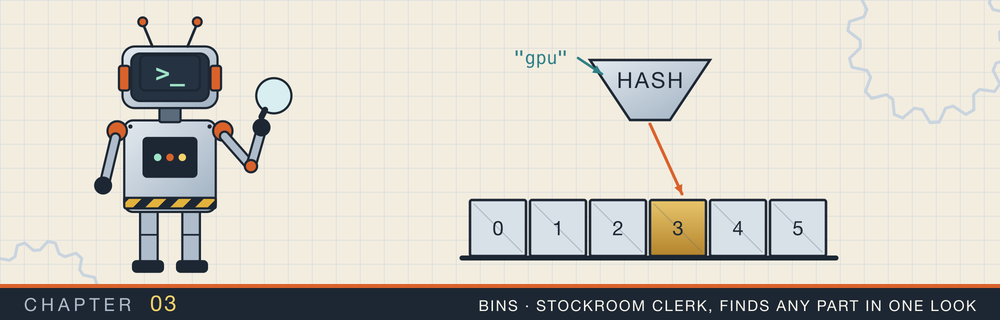

# Vectors, strings, and hash maps

<div class="covers" markdown="1">

This chapter covers

- Quantifying algorithmic work using Big-O notation
- Memory layouts of `Vec`, `String`, and `HashMap`
- Finding matching pairs in linear time with a hash map
- Using a vector as a stack to validate brackets and track a running minimum
- Traversing arrays with two indexes: in-place reversal, sliding windows, and interval merging
- Binary search on rotated arrays, in-place matrix rotation, and linear-time substring matching

</div>

Algorithmic efficiency depends jointly on asymptotic operation counts and the physical memory layout of the underlying data structures. Rust's three foundational standard collections (`Vec`, `String`, and `HashMap`) provide contiguous array storage, UTF-8-validated byte buffers, and open-addressed hash tables with predictable performance contracts.

The opening sections establish two prerequisites: asymptotic Big-O complexity notation for comparing scaling behavior, and the stack-versus-heap memory layout of each collection. With these cost models explicit, the subsequent algorithms remain concise while making their time and space bounds transparent.

The implementations are organized by reusable algorithmic paradigm rather than by surface domain. Table 3.1 maps each section to its underlying technique and target problems.

| Section | Technique | Problems |
|---|---|---|
| 3.5 | look things up in a hash map | find two numbers that add up to a target |
| 3.6 | a vector used as a stack | check brackets; a stack that knows its minimum |
| 3.7 | two indexes moving toward each other | reverse a string; find three numbers that add to zero |
| 3.8 | a window that slides along a string | longest piece of text with no repeated letter |
| 3.9 | sort, then walk once | merge overlapping ranges |
| 3.10 | halve the search each step | binary search in a rotated array |
| 3.11 | transform in place | rotate a square grid |
| 3.12 | reuse what you already matched | find text inside other text |

## 3.1 Counting the work an algorithm does

Two implementations can compute identical outputs while differing by orders of magnitude in execution time. Selecting between competing designs requires a formal notation characterizing how work scales with input size.

Algorithmic work is quantified by counting elementary constant-time operations (such as comparisons, arithmetic instructions, or array accesses) as a function of input size `n`, where `n` typically denotes the length of an array or string. Consider three operations on an array of `n` integers:

- Reading the first element requires 1 operation, independent of `n`.
- Summing every element requires `n` operations, one per entry.
- Comparing every element against every other element requires roughly `n × n` operations.

**Big-O notation** expresses asymptotic growth by retaining only the dominant term and dropping constant multipliers. The three operations above are written O(1), O(n), and O(n²), where O(n) ("order n") indicates runtime growing linearly with `n`.

Table 3.2 illustrates how sharply these complexity classes diverge at scale.

| n | O(1) | O(log n) | O(n) | O(n log n) | O(n²) |
|---|---|---|---|---|---|
| 10 | 1 | about 3 | 10 | about 33 | 100 |
| 1,000 | 1 | about 10 | 1,000 | about 10,000 | 1,000,000 |
| 1,000,000 | 1 | about 20 | 1,000,000 | about 20,000,000 | 1,000,000,000,000 |

A modern processor executes on the order of one billion simple operations per second. At one million elements, an O(n) algorithm completes in roughly a millisecond, whereas an O(n²) algorithm requires on the order of fifteen minutes.

The same notation characterizes auxiliary memory consumption. An O(n)-space algorithm allocates storage proportional to the input size, whereas an O(1)-space algorithm uses a fixed amount of extra memory regardless of `n`.

<div class="callout note" markdown="1">

**NOTE:** O(log n) arises whenever each step discards half of the remaining search space. Halving one million elements reduces the range to a single element in roughly 20 steps, since 2<sup>20</sup> ≈ 1,048,576. Section 3.10 applies this property to binary search.

</div>

## 3.2 How a `Vec` stores its elements

A `Vec<T>` is a dynamically resizable, contiguous array. Its elements occupy adjacent addresses in a single heap allocation. On the stack, the `Vec` header stores three machine words: a pointer to the heap buffer, the count of initialized elements (**length**), and the total number of elements the current allocation can hold (**capacity**). Figure 3.1 depicts a vector of four `i32` values backed by a six-slot allocation.

<figure>
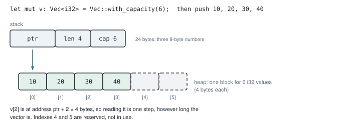
<figcaption><b>Figure 3.1</b> A <code>Vec&lt;i32&gt;</code> with length 4 and capacity 6. The elements are next to each other, so the address of any element can be computed from its index.</figcaption>
</figure>

Contiguous storage makes indexing O(1): the address of `v[i]` is computed directly as `base_ptr + i * size_of::<T>()`, independent of the vector's length.

When `push` is called on a full vector (`len == cap`), the vector must reallocate a larger heap block, as illustrated in Figure 3.2.

<figure>
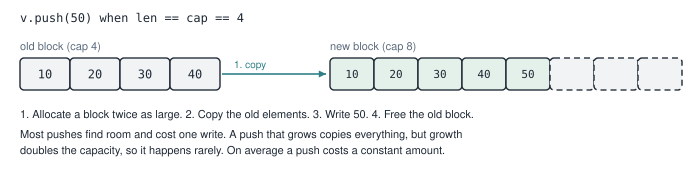
<figcaption><b>Figure 3.2</b> Pushing into a full vector. The vector allocates a block twice as large, copies the old elements, writes the new one, and frees the old block.</figcaption>
</figure>

Although an individual reallocation copies `n` elements in O(n) time, doubling capacity on each growth ensures reallocations occur infrequently. Averaged across any sequence of pushes, each `push` performs constant work, a guarantee termed **amortized O(1)**.

When the final element count is known ahead of time, `Vec::with_capacity(n)` reserves the full heap block upfront, eliminating intermediate reallocations altogether.

<div class="callout warning" markdown="1">

**WARNING:** Because `push` may reallocate and move every element to a new heap address, holding an element reference such as `&v[0]` across a `v.push(...)` would create a dangling pointer. Rust's borrow checker rejects such code at compile time.

</div>

## 3.3 How a `String` stores text

A `String` wraps a `Vec<u8>` with one additional invariant: its byte sequence must always be valid UTF-8. **UTF-8** is a variable-width character encoding in which ASCII characters occupy 1 byte while other Unicode scalar values occupy 2, 3, or 4 bytes. Figure 3.3 illustrates the byte representation of `"café"`.

<figure>
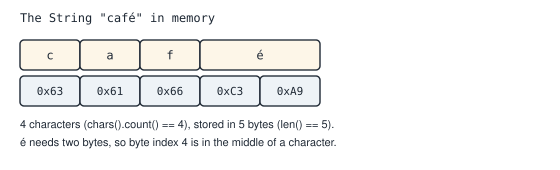
<figcaption><b>Figure 3.3</b> <code>"café"</code> has four characters and five bytes. The letter é takes two bytes.</figcaption>
</figure>

This variable-width encoding has three direct consequences in Rust:

- `s.len()` returns the byte length rather than the character count (`"café".len()` equals 5).
- `s.chars()` decodes and yields Unicode scalar values sequentially from the underlying bytes.
- Integer indexing (`s[3]`) is forbidden at compile time because an arbitrary byte offset can land in the middle of a multi-byte character (such as byte index 4 in Figure 3.3).

## 3.4 How a `HashMap` finds a key

A `HashMap<K, V>` maps keys to values with O(1) expected lookup time through three steps (Figure 3.4):

1. A **hash function** deterministically maps the key to a 64-bit integer.
2. Selected bits of that hash index into a **bucket** within an internal table.
3. The map inserts or locates the key-value pair starting from that bucket.

<figure>
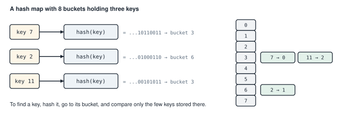
<figcaption><b>Figure 3.4</b> A map with 8 buckets. Keys 7 and 11 happen to land in the same bucket, so a lookup there compares both.</figcaption>
</figure>

Distinct keys can hash to the same bucket (a collision), as keys 7 and 11 do in Figure 3.4, requiring key equality checks to resolve the entry. By resizing the table whenever its load factor exceeds a fixed threshold, `HashMap` keeps probe chains short, maintaining O(1) expected time for `insert` and `get`.

By default, Rust's `HashMap` initializes its hasher with a per-process random seed to prevent algorithmic-complexity (HashDoS) attacks crafted to collide in a single bucket. As a consequence, iteration order over a `HashMap` is non-deterministic across executions.

With asymptotic analysis and collection memory layouts established, the following sections develop eight canonical algorithms, contrasting baseline designs against collection-accelerated implementations.

## 3.5 Finding two numbers that add up to a target

**The problem.** Given a slice of integers and a target sum, return two distinct indexes whose elements sum to the target. For `[2, 7, 11, 15]` and target 9, the result is `(0, 1)`, since `2 + 7 = 9`.

**The baseline approach.** Testing every pair `(i, j)` with `i < j` examines roughly `n(n - 1) / 2` pairs, yielding O(n²) time.

**The hash-map approach.** Scanning the slice once, each element `num` requires a known complement `target - num`. Storing previously visited values and their indexes in a `HashMap` reduces the complement query to an O(1) lookup.

Tracing `[2, 7, 11, 15]` with target 9:

| Position | Number | Partner needed | In the map? | Map afterward |
|---|---|---|---|---|
| 0 | 2 | 7 | no | {2: 0} |
| 1 | 7 | 2 | yes, at position 0 | answer: (0, 1) |

<p class="listing"><b>Listing 3.1</b> Two Sum with one pass and a hash map. <a href="https://github.com/arpanpathak/cracking-the-systems-programming-interview/blob/prep-v2/rust-interview-lab/src/problems/two_sum.rs">src/problems/two_sum.rs</a></p>

```rust
{{#include ../../rust-interview-lab/src/problems/two_sum.rs}}
```

Key details of the implementation:

- The parameter `nums: &[i32]` is a **slice**, a borrowed view over contiguous `i32` elements compatible with arrays, vectors, and subslices.
- `HashMap::with_capacity(nums.len())` preallocates enough buckets to avoid rehashing during the scan.
- `nums.iter().enumerate()` yields `(usize, &i32)` pairs, and the pattern `(idx, &num)` copies the `i32` out of its reference.
- `seen.get(&(target - num))` probes for the complement by reference.
- When the complement exists, the function returns both indexes immediately; otherwise, it inserts `(num, idx)`.

Performing the lookup before the insertion prevents an element from pairing with itself: for target 4 and `[2]`, inserting before looking up would erroneously return `(0, 0)`.

The function returns `Option<(usize, usize)>`, running in O(n) expected time and O(n) auxiliary space.

<figure class="anim">
<video class="motion" src="figures/ch03-two-sum.mp4" autoplay loop muted playsinline preload="metadata" aria-label="The array 2, 7, 11, 15 with target 9, and the map seen beside it. idx points at 2; the partner 7 is not in seen, so 2 maps to 0 is stored. idx moves to 7; the partner 2 is in seen at index 0, so the function returns Some((0, 1)). A second run moves the insert above the lookup: with target 4 and the array [2], the 2 finds itself and the result is Some((0, 0))." data-chapters="[[2.4, &quot;index 0&quot;], [22.92, &quot;index 1&quot;], [41.46, &quot;insert first&quot;]]">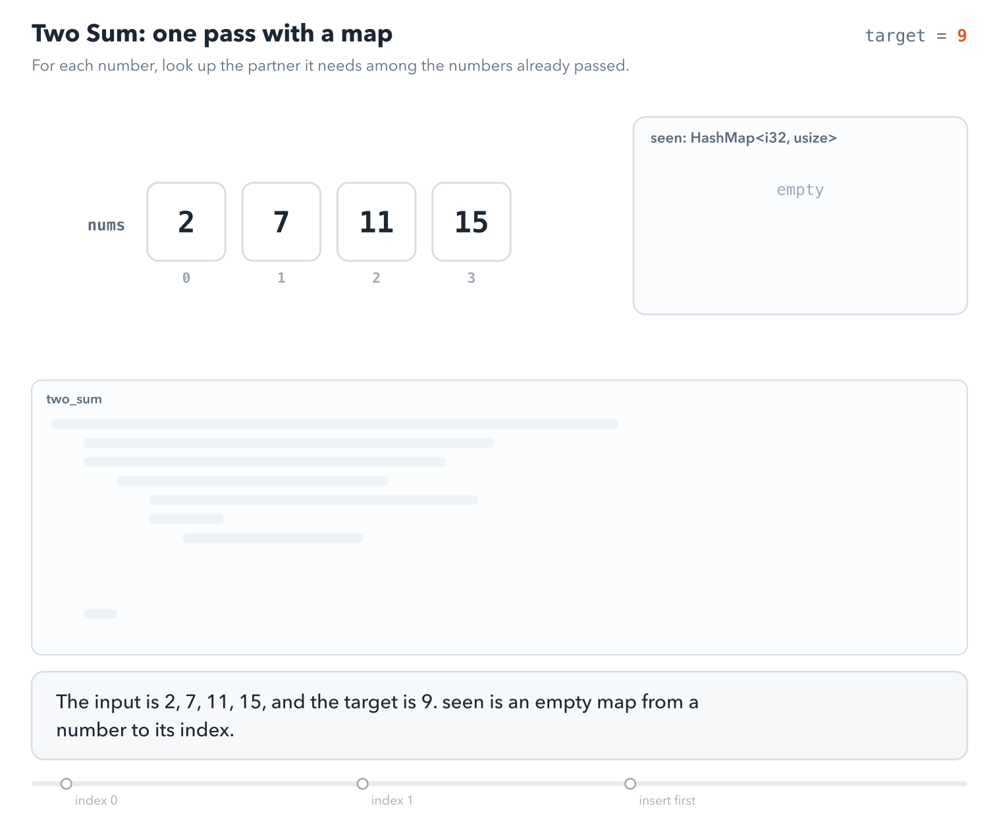</video>
<figcaption><b>Animation 3.1</b> The trace from the table, with the code line that runs at each step. The last part moves the insert above the lookup, and the single 2 pairs with itself.</figcaption>
</figure>

<div class="callout warning" markdown="1">

**WARNING:** Computing `target - num` in `i32` can overflow near the bounds of `i32` (for example, when `num == i32::MIN` and `target > 0`), causing a panic in debug builds. Widening to `i64` or calling `target.checked_sub(num)` eliminates overflow.

</div>

### 3.5.1 First repeating and first non-repeating character

**The problem.** Given a string, find the first character that appears a second time, and the first character that appears exactly once. Each answer includes the character's index. In `"swiss"`, the first repeating character is the `s` at index 3, and the first non-repeating character is the `w` at index 1.

**The baseline approach.** For each character, we could scan the rest of the string for another copy of it. Every character then costs up to `n` comparisons, so the search takes O(n²) time.

**The first repeating character.** We scan the string once and remember every character we have seen in a `HashSet<char>`. The method `HashSet::insert` returns `true` when the value is new and `false` when the set already holds it. The first `false` from `insert` therefore marks the answer. Its index is where that character appears for the second time. The trace for `"swiss"` shows each step.

| Index | Character | `insert` returns | Set afterward |
|---|---|---|---|
| 0 | `s` | `true` | {s} |
| 1 | `w` | `true` | {s, w} |
| 2 | `i` | `true` | {s, w, i} |
| 3 | `s` | `false` | answer: `(3, 's')` |

**The first non-repeating character.** One scan is not enough for this question. At index 0 of `"swiss"`, the `s` has not repeated yet, but a later copy at index 3 makes it repeat. We can decide whether a character is unique only after we have seen the whole string. We therefore make two passes. The first pass counts every character in a `HashMap<char, usize>`, which gives `s: 3`, `w: 1` and `i: 1`. The second pass walks the string again from the start and returns the first character whose count is 1. Index 0 holds `s`, with count 3, and index 1 holds `w`, with count 1, so the answer is `(1, 'w')`.

<p class="listing"><b>Listing 3.2</b> The first repeating and the first non-repeating character, with a test. <a href="https://github.com/arpanpathak/cracking-the-systems-programming-interview/blob/prep-v2/rust-interview-lab/src/bin/first_non_repeating_char.rs">src/bin/first_non_repeating_char.rs</a></p>

```rust
{{#include ../../rust-interview-lab/src/bin/first_non_repeating_char.rs}}
```

```text
$ cargo run --bin first_non_repeating_char
first repeating:     Some((3, 's'))
first non-repeating: Some((1, 'w'))
```

Key details of the implementation:

- `s.chars().enumerate()` yields pairs of an index and a `char`, so both functions can return the index together with the character.
- `if !seen.insert(ch)` both records the character and tests whether it was already present, so the first function needs one hash lookup per character.
- `*counts.entry(ch).or_default() += 1` finds the count for `ch`, creates it with the value 0 if it is missing, and adds 1.
- `counts[&ch]` reads a count by indexing the map. Indexing panics for a missing key, but every character of `s` was counted in the first pass, so the key is always present.
- Both functions return `None` when no character qualifies, for example `first_repeating_char("abcdef")`, which the test checks.

Each function runs in O(n) expected time. The set and the map hold one entry per distinct character. The extra space is therefore O(k), where `k` is the number of distinct characters.

The index from `chars().enumerate()` counts characters (Unicode scalar values), not bytes. For ASCII text, both counts are the same. For `"é!é"`, the repeat is at character index 2, but at byte offset 3, because `é` takes 2 bytes in UTF-8.

## 3.6 A vector used as a stack

A **stack** is a last-in, first-out (LIFO) sequence where insertions and removals occur exclusively at one end (the top). `Vec` serves directly as a stack: `push` appends to the top, `pop` removes and returns the top element, and `last` inspects the top without mutating the vector. All three operations run in amortized O(1) time.

### 3.6.1 Checking brackets

**The problem.** A bracket string is balanced if every opening delimiter is closed by the matching delimiter type in proper nested order. `"{[()]}"` is valid, whereas `"([)]"` is invalid because `]` closes while `(` remains open.

**The strategy.** Scan left to right, pushing every opening bracket onto a stack. Upon encountering a closing bracket, pop the top of the stack and verify that it matches the expected opener. After the scan completes, the stack must be empty. Figure 3.5 traces `"{[()]}"`.

<figure>
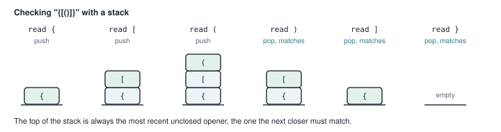
<figcaption><b>Figure 3.5</b> Checking <code>"{[()]}"</code>. Each closing bracket pops the opener on top, which must be its partner.</figcaption>
</figure>

<figure class="anim">
<video class="motion" src="figures/ch03-brackets.mp4" autoplay loop muted playsinline preload="metadata" aria-label="The string ( [ { } ] ) with a stack beside it. Each opener is pushed. Each closer pops the top, which matches, and the stack ends empty, so is_valid returns true. A second run on ( [ ) ]: the closer ) pops [, which does not match, so is_valid returns false." data-chapters="[[0.0, &quot;([{}])&quot;], [38.16, &quot;([)]&quot;]]">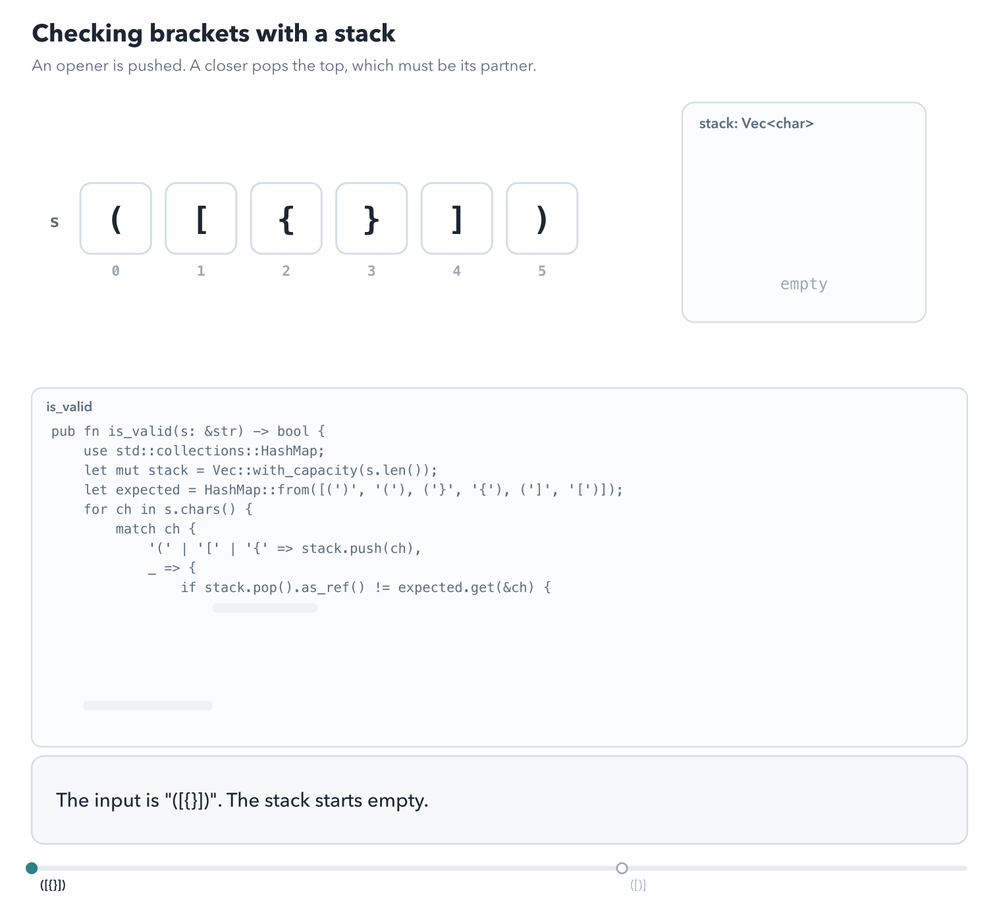</video>
<figcaption><b>Animation 3.2</b> An opener is pushed, and a closer pops the top and compares it with its partner. In the second run, <code>)</code> pops <code>[</code>, so the check fails.</figcaption>
</figure>

<p class="listing"><b>Listing 3.3</b> Valid Parentheses. <a href="https://github.com/arpanpathak/cracking-the-systems-programming-interview/blob/prep-v2/rust-interview-lab/src/problems/valid_parentheses.rs">src/problems/valid_parentheses.rs</a></p>

```rust
{{#include ../../rust-interview-lab/src/problems/valid_parentheses.rs}}
```

The lookup table `expected`, constructed via `HashMap::from([...])`, maps each closing bracket to its required opener.

The `match` expression partitions characters into two arms: the first pushes opening brackets, and the second compares two `Option<&char>` values:

- `stack.pop().as_ref()` pops the top opener and converts `Option<char>` to `Option<&char>` so both sides share the same type.
- `expected.get(&ch)` returns `Some(&opener)` for any closing bracket.

Any mismatch returns `false` immediately, including an extra closing bracket on an empty stack (`None != Some(...)`). After the loop finishes, `stack.is_empty()` rejects any unclosed openers. The unit tests cover balanced inputs, interleaved mismatches (`"([)]"`), lone closers (`")"`), and unclosed openers (`"(("`).

<div class="callout warning" markdown="1">

**WARNING:** If a non-bracket character arrives while the stack is empty, both `stack.pop().as_ref()` and `expected.get(&ch)` evaluate to `None`, causing `is_valid("a")` to return `true`. Production validators that may encounter arbitrary characters should match non-brackets in a dedicated arm to skip or reject them explicitly.

</div>

### 3.6.2 A stack that knows its minimum

**The problem.** Design a stack supporting `push`, `pop`, `top`, and `get_min` (returning the current minimum element), each in O(1) time.

**The strategy.** Scanning the stack on every `get_min` call costs O(n). Maintaining a parallel auxiliary stack (`mins`) that records the running minimum at each depth makes `get_min` an O(1) lookup: every `push` appends the updated minimum to `mins`, and every `pop` pops both stacks in lockstep.

Tracing pushes of `-2`, `0`, and `-3` followed by a `pop`:

| Operation | `values` | `mins` | `get_min()` |
|---|---|---|---|
| push -2 | [-2] | [-2] | -2 |
| push 0 | [-2, 0] | [-2, -2] | -2 |
| push -3 | [-2, 0, -3] | [-2, -2, -3] | -3 |
| pop | [-2, 0] | [-2, -2] | -2 |

<p class="listing"><b>Listing 3.4</b> Min Stack with a parallel stack of minimums. <a href="https://github.com/arpanpathak/cracking-the-systems-programming-interview/blob/prep-v2/rust-interview-lab/src/problems/min_stack.rs">src/problems/min_stack.rs</a></p>

```rust
{{#include ../../rust-interview-lab/src/problems/min_stack.rs}}
```

`#[derive(Default)]` synthesizes `MinStack::default()` with two empty vectors, which `new()` delegates to.

Inside `push`, `self.mins.last()` inspects the current minimum. The match arm `Some(&min) if min <= val` uses a **guard** to re-push `min` when the incoming value is not smaller; the fallback arm `_` covers both an empty stack and a new strictly smaller minimum, pushing `val`.

Using `<=` rather than `<` preserves correctness when duplicate minimum values are pushed: popping one copy leaves the second copy reflected on top of `mins`, a case verified by the `handles_duplicates` test.

Both `top` and `get_min` call `.copied()` to convert `Option<&i32>` into `Option<i32>`, returning owned integers to callers.

## 3.7 Two indexes moving toward each other

Problems that inspect both ends of a sequence simultaneously can maintain two indexes, `start` and `end`, advancing them inward until they cross. Because at least one index advances per iteration, the traversal completes in O(n) time.

### 3.7.1 Reversing a string in place

**The strategy.** Swap the first and last bytes, then move inward one position from each end until the two indexes meet (Figure 3.6).

<figure>
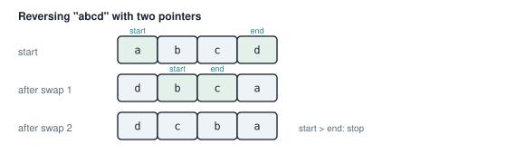
<figcaption><b>Figure 3.6</b> Reversing <code>"abcd"</code>. Two swaps, then the indexes cross.</figcaption>
</figure>

As noted in Section 3.3, a `String` must preserve valid UTF-8; reversing individual bytes of a multi-byte character would corrupt the encoding. Consequently, Rust exposes mutable byte access only through `String::as_mut_vec`, which is marked `unsafe`. An **`unsafe`** block designates code whose memory or type invariants cannot be verified statically by the compiler and must instead be upheld by the author; here, the required invariant is that the buffer remains valid UTF-8 upon exiting the block.

<p class="listing"><b>Listing 3.5</b> The reversing function (lines 1 to 14). <a href="https://github.com/arpanpathak/cracking-the-systems-programming-interview/blob/prep-v2/rust-interview-lab/src/bin/reverse_string.rs">src/bin/reverse_string.rs</a></p>

```rust
{{#include ../../rust-interview-lab/src/bin/reverse_string.rs:1:14}}
```

The function enforces the UTF-8 invariant upfront via `assert!(s.is_ascii())`, panicking if any multi-byte character is present. Because every ASCII byte is a self-contained single-byte UTF-8 sequence, any permutation of ASCII bytes remains valid UTF-8, allowing the `unsafe` block to wrap a single method call.

Inside the loop, `bytes.swap(start, end)` exchanges the two endpoints while `start < end`, leaving the center byte of an odd-length string untouched.

<p class="listing"><b>Listing 3.6</b> The complete program, with its tests. <a href="https://github.com/arpanpathak/cracking-the-systems-programming-interview/blob/prep-v2/rust-interview-lab/src/bin/reverse_string.rs">src/bin/reverse_string.rs</a></p>

```rust
{{#include ../../rust-interview-lab/src/bin/reverse_string.rs}}
```

The unit test `the_buffer_is_reused` captures the string's capacity and heap pointer before and after reversal, confirming zero reallocation. `non_ascii_input_panics` is annotated with `#[should_panic]` to verify that the ASCII precondition rejects `"café"`.

```text
$ cargo run --bin reverse_string
  abcd -> dcba
   abc -> cba
     a -> a
  rust -> tsur
```

<div class="callout warning" markdown="1">

**WARNING:** On an empty string, `bytes.len() - 1` underflows `usize`, triggering a panic in debug builds. Production implementations must return early when `s.is_empty()`.

</div>

### 3.7.2 Three numbers that add up to a target

**The problem.** Find every unique triple of integers in an array that sums to a given target, without emitting duplicate triples.

**The strategy.** Sort the slice in ascending order first. Fix the first element at index `i`, then search the remaining suffix with two converging indexes: `left = i + 1` and `right = len - 1`. Sorted order determines which pointer must move at each step:

- If the sum is below `target`, increment `left` to increase the sum.
- If the sum exceeds `target`, decrement `right` to decrease the sum.
- If the sum equals `target`, record the triple and advance both indexes past any duplicate values.

Sorting costs O(n log n), and each of the `n` fixed elements triggers an O(n) two-pointer scan, yielding O(n²) overall time.

The outer setup sorts the slice and iterates over each unique first element:

```rust
{{#include ../../rust-interview-lab/src/problems/three_sum.rs:6:21}}
        // ...
    }
}
```

- Importing `std::cmp::Ordering::{Equal, Greater, Less}` allows concise pattern matching on comparison results.
- Skipping `numbers[i] == numbers[i - 1]` prevents duplicate triples anchored on the same first element.
- `numbers.len().saturating_sub(1)` safely yields `0` on empty slices without unsigned underflow.

For each fixed index `i`, the inner loop converges `left` and `right`:

```rust
pub fn three_sum(numbers: &mut [i32], target: i32) -> Vec<(i32, i32, i32)> {
    // ...
    for i in 0..numbers.len() {
        // ...
{{#include ../../rust-interview-lab/src/problems/three_sum.rs:22:43}}
    }
    // ...
}
```

- Accumulating the triple sum in `i64` prevents signed 32-bit overflow when summing values near `i32::MAX` or `i32::MIN`, as exercised by `does_not_overflow_on_extreme_values`.
- Matching on `current_sum.cmp(&target)` maps `Less`, `Greater`, and `Equal` directly to the pointer updates.
- After recording a match, two inner `while` loops skip consecutive duplicate values at `left` and `right`.

<p class="listing"><b>Listing 3.7</b> Three Sum, with its tests. <a href="https://github.com/arpanpathak/cracking-the-systems-programming-interview/blob/prep-v2/rust-interview-lab/src/problems/three_sum.rs">src/problems/three_sum.rs</a></p>

```rust
{{#include ../../rust-interview-lab/src/problems/three_sum.rs}}
```

<figure class="anim">
<video class="motion" src="figures/ch03-three-sum.mp4" autoplay loop muted playsinline preload="metadata" aria-label="The sorted array -4, -1, -1, 0, 1, 2. The pointer i fixes one number; left and right start at the ends of the rest. Each step shows the sum: a sum below 0 moves left right, a sum above 0 moves right left. The triples (-1, -1, 2) and (-1, 0, 1) are recorded, and i = 2 is skipped because it repeats -1. Last, without the check that skips a repeated first number, i = 2 records (-1, 0, 1) a second time." data-chapters="[[2.4, &quot;i = 0&quot;], [36.6, &quot;i = 1&quot;], [67.2, &quot;i = 3&quot;], [88.44, &quot;no skip&quot;]]">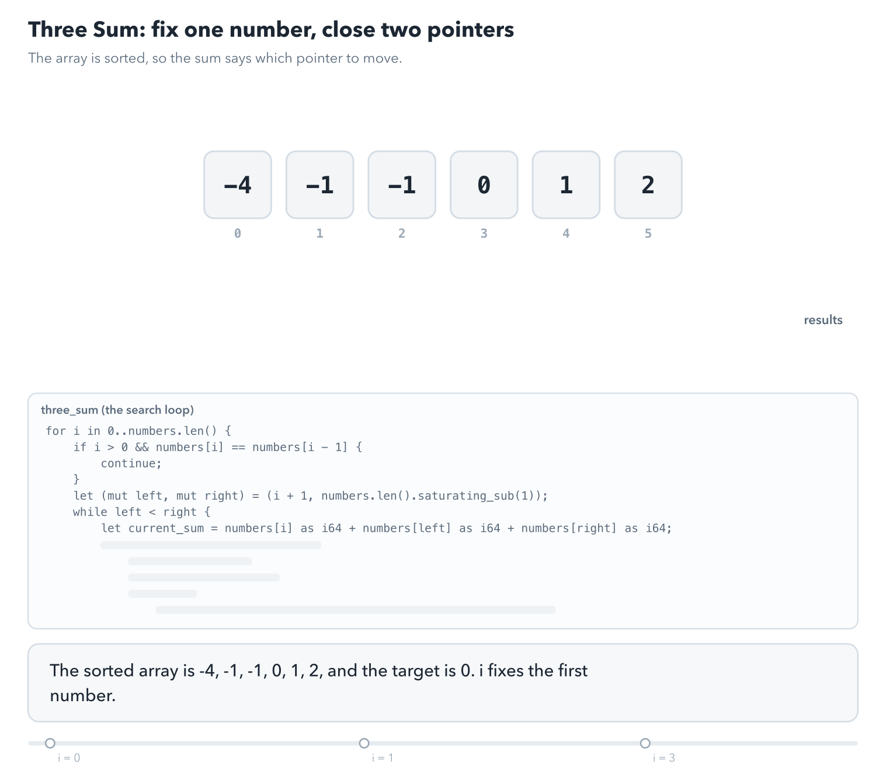</video>
<figcaption><b>Animation 3.3</b> Three Sum on <code>[-4, -1, -1, 0, 1, 2]</code>, one comparison per step. The sign of the sum decides which pointer moves. The repeated <code>-1</code> at index 2 is skipped.</figcaption>
</figure>

## 3.8 A window that slides along a string

**The problem.** Compute the length of the longest contiguous substring containing no repeated characters. For `"pwwkew"`, the maximum length is 3 (corresponding to `"wke"` or `"kew"`).

**The strategy.** Maintain a sliding **window** `start..=end` invariant to contain exclusively distinct characters. As `end` advances one character at a time, if the incoming character already lies inside the current window, advance `start` immediately past its prior occurrence. Recording the maximum window width across all positions yields the answer.

A `HashMap<char, usize>` maps each seen character to its most recent character index. Figure 3.7 depicts the window state in `"pwwkew"` when the third `w` is processed.

<figure>
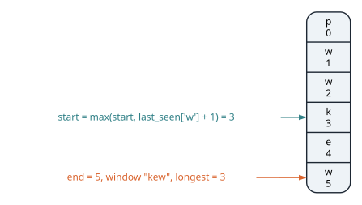
<figcaption><b>Figure 3.7</b> At <code>end = 5</code>, the <code>w</code> was last seen at index 2. <code>start</code> moves to 3, and the window is <code>"kew"</code>.</figcaption>
</figure>

<figure class="anim">
<video class="motion" src="figures/ch03-window.mp4" autoplay loop muted playsinline preload="metadata" aria-label="The string pwwkew with the window drawn as an outline from start to end, and the map last_seen beside it. end moves one character at a time. When the second w arrives, start moves to 2; when the third w arrives, start moves to 3, leaving the window kew, length 3. A second run on abba shows why start uses max: the last a was seen at 0, before the window, so start stays at 2." data-chapters="[[0.0, &quot;pwwkew&quot;], [49.48, &quot;abba&quot;]]">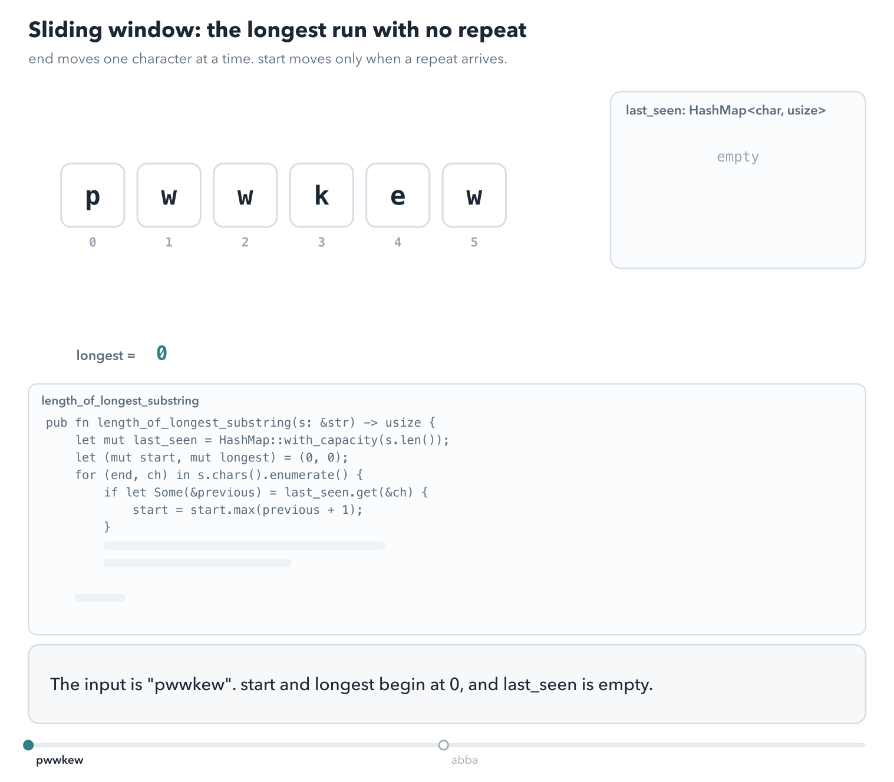</video>
<figcaption><b>Animation 3.4</b> <code>end</code> moves right one character at a time, and <code>start</code> moves only when a repeat inside the window arrives. The run on <code>"abba"</code> shows the case that <code>max</code> handles.</figcaption>
</figure>

<p class="listing"><b>Listing 3.8</b> Longest substring without a repeated character. <a href="https://github.com/arpanpathak/cracking-the-systems-programming-interview/blob/prep-v2/rust-interview-lab/src/problems/sliding_window.rs">src/problems/sliding_window.rs</a></p>

```rust
{{#include ../../rust-interview-lab/src/problems/sliding_window.rs}}
```

When `last_seen.get(&ch)` finds an earlier index `previous`, `start = start.max(previous + 1)` advances the left boundary without ever moving it backward. The `.max(...)` guard is essential for inputs like `"abba"`: when the second `'a'` arrives at index 3, `'a'` was last seen at index 0, which already falls outside the current window starting at index 2.

At each step, `end - start + 1` gives the active window length. Because both `start` and `end` advance monotonically, the algorithm runs in O(n) time. Iterating via `chars().enumerate()` counts Unicode scalar values rather than raw UTF-8 bytes, matching the problem specification.

### 3.8.1 Sliding window maximum

**The problem.** Given a slice of integers and a window width `k`, return the largest value in every run of `k` consecutive values. For `[1, 3, -1, -3, 5, 3, 6, 7]` and `k = 3`, there are six windows, and their maximums are `[3, 3, 5, 5, 6, 7]`.

**The baseline approach.** We could find the maximum of each window by scanning its `k` values. With `n - k + 1` windows, this takes O(n × k) time. Most of the work repeats, because neighboring windows share `k - 1` values.

**The deque approach.** We keep a short list of candidates, the values that can still become the maximum of some window. A value stops being a candidate when a larger value arrives after it. The larger value stays in every window that the smaller one is in, and it stays longer. The smaller value can therefore never be the largest again.

We store the candidates' indexes in a `VecDeque`, a double-ended queue that adds and removes items at both ends in O(1) time. The values at those indexes decrease from front to back, so the front always holds the index of the current window's maximum. A deque kept in sorted order in this way is called a **monotonic deque**.

For each new index `i` with value `x`, `sliding_window_max` performs three steps:

1. If the index at the front has left the window, remove it from the front. The window ending at `i` covers indexes `i - k + 1` to `i`, so the front index `front` has left the window when `front + k <= i`.
2. Remove indexes from the back while their values are less than or equal to `x`. Those values are no longer candidates, for the reason given above.
3. Add `i` at the back. Once `i + 1 >= k`, the first full window is complete, and the value at the front index is the maximum of the current window.

The trace below follows the example. The deque column lists indexes, with their values in parentheses.

| `i` | Value | Deque after the step | Window maximum |
|---|---|---|---|
| 0 | 1 | 0 (1) | |
| 1 | 3 | 1 (3) | |
| 2 | -1 | 1 (3), 2 (-1) | 3 |
| 3 | -3 | 1 (3), 2 (-1), 3 (-3) | 3 |
| 4 | 5 | 4 (5) | 5 |
| 5 | 3 | 4 (5), 5 (3) | 5 |
| 6 | 6 | 6 (6) | 6 |
| 7 | 7 | 7 (7) | 7 |

At `i = 1`, the value 3 removes index 0, because 1 is smaller and leaves the window earlier. At `i = 4`, two steps happen. First, index 1 leaves from the front, because the window is now indexes 2 to 4. After that, the value 5 removes indexes 3 and 2 from the back, because -3 and -1 are smaller.

<p class="listing"><b>Listing 3.9</b> The maximum of every window with a monotonic deque. <a href="https://github.com/arpanpathak/cracking-the-systems-programming-interview/blob/prep-v2/rust-interview-lab/src/bin/sliding_window_maximum.rs">src/bin/sliding_window_maximum.rs</a></p>

```rust
{{#include ../../rust-interview-lab/src/bin/sliding_window_maximum.rs}}
```

```text
$ cargo run --bin sliding_window_maximum
[3, 3, 5, 5, 6, 7]
```

Key details of the implementation:

- `dq.front().is_some_and(|&f| f + k <= i)` is `true` only when the deque is not empty and its front index has left the window.
- The front check is an `if`, not a loop. The window moves forward by one index per step, so at most one index can leave the window per step.
- The back check is a `while` loop, because one large value can remove several smaller candidates, as the value 5 does at `i = 4`.
- `dq[0]` reads the front index. The deque is never empty at that point, because `i` was added in the step before.
- The comparison `f + k <= i` is used instead of `f <= i - k`, because `i - k` would underflow in `usize` while `i < k`.

Every index is added to the deque once and removed at most once. The whole pass therefore takes O(n) time, even though one step can remove several indexes. The deque holds at most `k` indexes, and the output holds `n - k + 1` values.

## 3.9 Sort, then walk once: merging ranges

**The problem.** Given a list of closed intervals such as `[1,3] [2,6] [8,10] [15,18]`, merge all overlapping intervals into disjoint ranges (`[1,6] [8,10] [15,18]`).

**The strategy.** Sort the intervals by their start coordinate, then perform a single linear pass. In sorted order, each interval either overlaps the most recently merged interval (extending its end coordinate) or starts a new disjoint interval (Figure 3.8).

<figure>
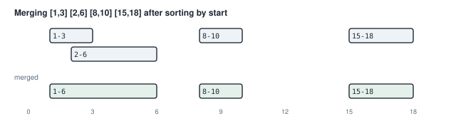
<figcaption><b>Figure 3.8</b> After sorting, a range overlaps the previous merged range exactly when its start is not after that range's end.</figcaption>
</figure>

<figure class="anim">
<video class="motion" src="figures/ch03-merge-intervals.mp4" autoplay loop muted playsinline preload="metadata" aria-label="Four ranges drawn as bars over a number line. They are sorted by start: 1-3, 2-6, 8-10, 15-18. Then each range is compared with the last merged range: 2-6 overlaps 1-3 and extends it to 1-6, and the other two start new merged ranges. The result is 1-6, 8-10, 15-18. A last part shows the input unsorted, where 1-3 and 2-6 would not meet." data-chapters="[[0.0, &quot;sort&quot;], [6.42, &quot;walk&quot;], [45.36, &quot;no sort&quot;]]">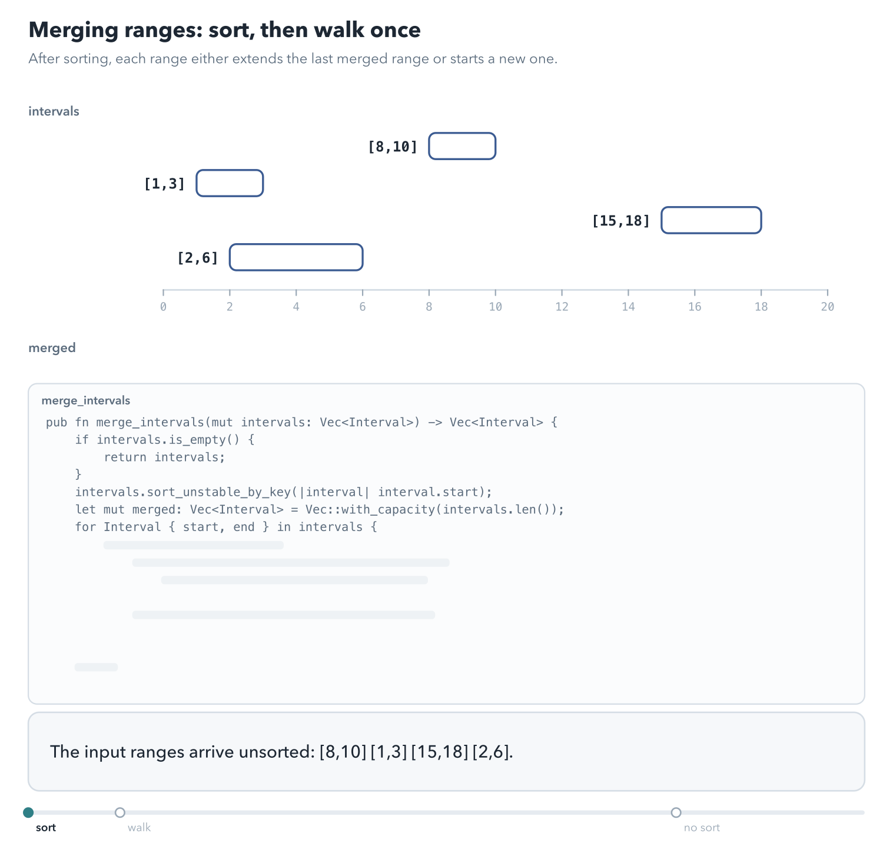</video>
<figcaption><b>Animation 3.5</b> Sorting puts overlapping ranges next to each other, so one walk can merge them. Each step extends the last merged range or starts a new one.</figcaption>
</figure>

The module implements three variations: one using a named `Interval` struct, one using raw tuples, and one operating in place. Listing 3.10 presents the `Interval` struct and the first implementation.

<p class="listing"><b>Listing 3.10</b> Merging ranges held in a struct (lines 6 to 28). <a href="https://github.com/arpanpathak/cracking-the-systems-programming-interview/blob/prep-v2/rust-interview-lab/src/problems/merge_intervals.rs">src/problems/merge_intervals.rs</a></p>

```rust
{{#include ../../rust-interview-lab/src/problems/merge_intervals.rs:6:28}}
```

`sort_unstable_by_key(|interval| interval.start)` orders intervals by start coordinate; unstable sorting may reorder elements with identical start keys, which is inconsequential here and avoids auxiliary allocation.

The loop header `for Interval { start, end } in intervals` destructures each struct directly. Calling `merged.last_mut()` yields a mutable reference to the active tail interval (or `None` on the first element). When the guard `if start <= previous.end` holds, `previous.end = previous.end.max(end)` extends the tail interval in place while preserving containment when a shorter interval lies entirely inside the previous one. Otherwise, the fallback arm appends a new interval.

Listing 3.11 implements the same algorithm over `(i32, i32)` tuples, replacing named fields with positional `.0` and `.1` accessors.

<p class="listing"><b>Listing 3.11</b> The same merge over tuples (lines 30 to 48).</p>

```rust
{{#include ../../rust-interview-lab/src/problems/merge_intervals.rs:30:48}}
```

While behaviorally identical, the named struct in Listing 3.10 improves readability by making `previous.end` self-documenting rather than requiring callers to remember field positions.

Listing 3.12 eliminates the output vector entirely by compacting merged intervals into the prefix of the input vector.

<p class="listing"><b>Listing 3.12</b> Merging in place (lines 50 to 72).</p>

```rust
{{#include ../../rust-interview-lab/src/problems/merge_intervals.rs:50:72}}
```

The write cursor `last` tracks the index of the latest merged interval. Each subsequent interval either extends `intervals[last]` or advances `last` by one and copies into the new slot. Calling `intervals.truncate(last + 1)` discards the uncompacted tail, achieving O(1) auxiliary space beyond sorting.

Matching on `(intervals[last], intervals[i])` copies both `Copy` structs out of the vector before mutating `intervals[last]`, avoiding simultaneous overlapping borrows of the vector.

<p class="listing"><b>Listing 3.13</b> The tests (lines 74 to 106).</p>

```rust
{{#include ../../rust-interview-lab/src/problems/merge_intervals.rs:74:106}}
```

The test suite constructs `Interval` values from tuple arrays via `.map(|(start, end)| Interval { start, end })`, verifying overlapping ranges, empty inputs, disjoint ranges, and unsorted inputs for the in-place variant. Because the overlap predicate uses `<=`, adjacent intervals that share an endpoint (such as `[1,3]` and `[3,5]`) merge into a single range.

## 3.10 Halving the search: binary search

In a sorted array, locating a target does not require a linear scan. Comparing the target against the midpoint eliminates half of the remaining range on every step: values smaller than the midpoint can lie only in the left half, and larger values only in the right half. Figure 3.9 locates `23` among eight elements in three comparisons.

<figure>
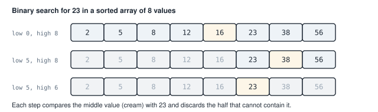
<figcaption><b>Figure 3.9</b> Binary search. Each step halves the range, so a million elements need about 20 steps.</figcaption>
</figure>

<figure class="anim">
<video class="motion" src="figures/ch03-binary-search.mp4" autoplay loop muted playsinline preload="metadata" aria-label="The array 2 5 8 12 16 23 38 56. The live range low..high is marked under it. mid is 4, holding 16, so low moves to 5. mid is 6, holding 38, so high moves to 6. mid is 5, holding 23, the target. A second search, for 20, ends when low equals high and the range is empty." data-chapters="[[0.0, &quot;find 23&quot;], [36.12, &quot;find 20&quot;]]">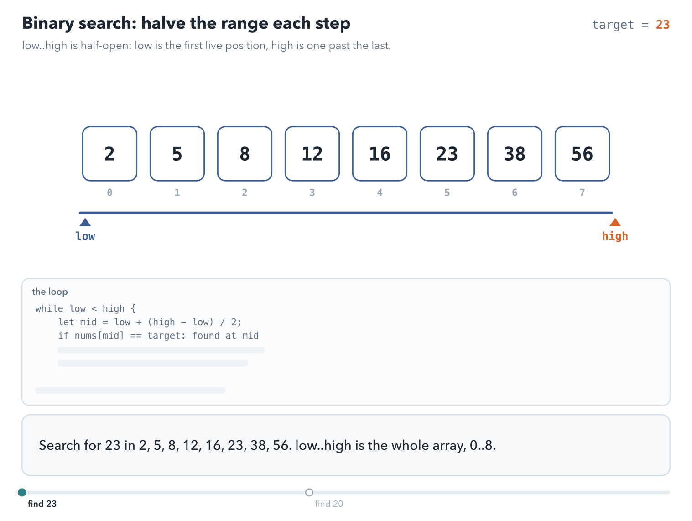</video>
<figcaption><b>Animation 3.6</b> Each comparison halves the live range <code>low..high</code>. Eight elements take three comparisons. The search for 20 ends with an empty range.</figcaption>
</figure>

The implementation below represents the active candidate set as a **half-open range** `low..high`, where `low` is inclusive and `high` is exclusive; the search space is empty precisely when `low == high`.

### 3.10.1 Searching a rotated array

A harder variant searches a sorted array that has been **rotated** by moving a prefix to the back, such as `[4, 5, 6, 7, 0, 1, 2]`, while maintaining O(log n) complexity.

The algorithm relies on a structural invariant: splitting a rotated sorted array at any midpoint `mid` guarantees that at least one of the two halves remains strictly sorted. Comparing endpoint values identifies which half is sorted:

- If the left half is sorted and `target` falls within `[nums[low], nums[mid])`, narrow the search to the left half.
- If the right half is sorted and `target` falls within `(nums[mid], nums[high - 1]]`, narrow the search to the right half.
- Otherwise, discard the sorted half and search the opposite half.

<figure>
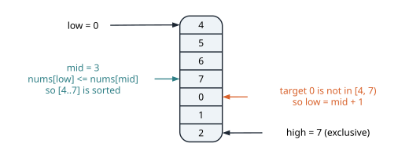
<figcaption><b>Figure 3.10</b> The first step of searching for 0. The left half 4 to 7 is sorted and cannot contain 0, so the search continues on the right.</figcaption>
</figure>

<figure class="anim">
<video class="motion" src="figures/ch03-rotated-search.mp4" autoplay loop muted playsinline preload="metadata" aria-label="The array 4, 5, 6, 7, 0, 1, 2. For target 0: mid is 7, the left half 4 to 7 is sorted and cannot hold 0, so low moves past mid. mid is 1, the left half 0 to 1 is sorted and holds 0, so high moves to mid. mid lands on 0. A second search, for 3, ends with an empty range and None." data-chapters="[[0.0, &quot;find 0&quot;], [41.04, &quot;find 3&quot;]]">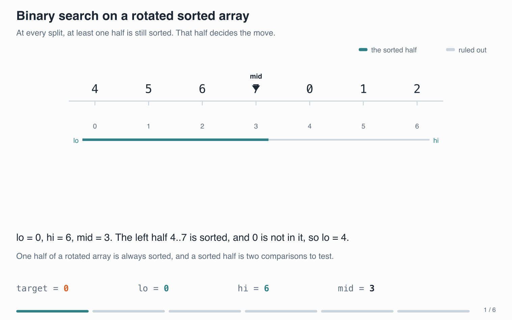</video>
<figcaption><b>Animation 3.7</b> At each step one half around <code>mid</code> is sorted. The search keeps that half only if the target lies inside its end values.</figcaption>
</figure>

<p class="listing"><b>Listing 3.14</b> Search in a rotated sorted array. <a href="https://github.com/arpanpathak/cracking-the-systems-programming-interview/blob/prep-v2/rust-interview-lab/src/problems/binary_search.rs">src/problems/binary_search.rs</a></p>

```rust
{{#include ../../rust-interview-lab/src/problems/binary_search.rs}}
```

Computing `mid = low + (high - low) / 2` avoids integer overflow when `low + high` would exceed `usize::MAX`.

The condition `nums[low] <= nums[mid]` confirms that the left half is monotonically ordered, in which case `nums[low] <= target && target < nums[mid]` determines whether the target lies inside it. For the right half, the upper bound uses `nums[high - 1]` because `high` is exclusive.

## 3.11 Rotating a square grid in place

**The problem.** Rotate an `n × n` matrix 90 degrees clockwise in place, using O(1) extra memory.

**The strategy.** Decompose the rotation into two in-place passes (Figure 3.11): first **transpose** the matrix across its main diagonal by swapping `(i, j)` with `(j, i)`, then reverse every row.

<figure>
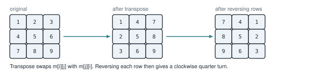
<figcaption><b>Figure 3.11</b> Transpose, then reverse each row. The result is the grid turned a quarter turn clockwise.</figcaption>
</figure>

<figure class="anim">
<video class="motion" src="figures/ch03-rotate-grid.mp4" autoplay loop muted playsinline preload="metadata" aria-label="A 3 by 3 grid of 1 to 9. Three swaps across the diagonal transpose it: 2 with 4, 3 with 7, 6 with 8. Then each row is reversed, giving 7 4 1, 8 5 2, 9 6 3. A last part starts j at 0 instead: 2 and 4 swap, then swap back, and the transpose does nothing." data-chapters="[[0.0, &quot;transpose&quot;], [22.86, &quot;reverse rows&quot;], [39.3, &quot;j from 0&quot;]]">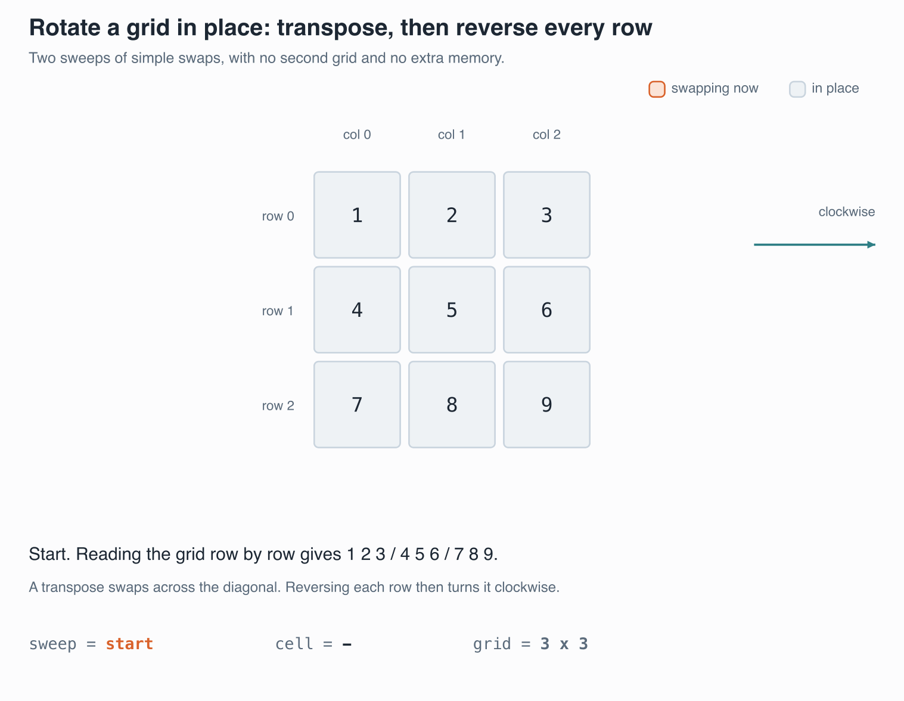</video>
<figcaption><b>Animation 3.8</b> The transpose swaps each pair above the diagonal once, then <code>row.reverse()</code> reverses each row. Starting <code>j</code> at 0 would swap every pair twice.</figcaption>
</figure>

<p class="listing"><b>Listing 3.15</b> The complete program. <a href="https://github.com/arpanpathak/cracking-the-systems-programming-interview/blob/prep-v2/rust-interview-lab/src/bin/rotate_matrix.rs">src/bin/rotate_matrix.rs</a></p>

```rust
{{#include ../../rust-interview-lab/src/bin/rotate_matrix.rs}}
```

Because `rotate` modifies cell values without inserting or removing rows, it accepts `&mut [Vec<i32>]` (a mutable slice of rows). In the transpose pass, starting the inner loop at `j = i + 1` visits only the upper triangle so each off-diagonal pair is swapped once; iterating from `0` would swap every pair twice and restore the original grid.

The exchange uses an explicit temporary variable `tmp` rather than `std::mem::swap(&mut m[i][j], &mut m[j][i])`. Because `m[i]` and `m[j]` are indexed through the same outer slice `m`, the borrow checker cannot prove statically that `i != j` and therefore rejects two simultaneous mutable borrows of `m`.

In the second pass, `for row in m.iter_mut()` yields a mutable reference to each row, which `row.reverse()` reverses in place.

```text
$ cargo run --bin rotate_matrix
[7, 4, 1]
[8, 5, 2]
[9, 6, 3]
```

## 3.12 Finding text inside text with KMP

**The problem.** Locate the first byte index where a pattern string (the **needle**) occurs inside a target string (the **haystack**).

**The baseline approach.** Trying every starting offset in the haystack and comparing the needle character by character restarts from scratch on every mismatch. For a haystack of length `n` and needle of length `m`, worst-case complexity is O(n × m).

**The linear-time approach.** When a mismatch occurs after several matching characters, those matched characters are already known to equal a prefix of the needle. If a proper suffix of the matched portion also equals a prefix of the needle, matching can resume from that prefix length without backtracking in the haystack. The Knuth-Morris-Pratt (KMP) algorithm exploits this structure to achieve O(n + m) worst-case time.

Figure 3.12 illustrates a KMP fallback jump.

<figure>
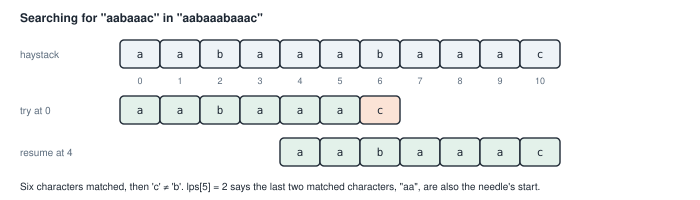
<figcaption><b>Figure 3.12</b> After six matching characters and a mismatch, the last two matched characters, <code>"aa"</code>, are also the start of the needle. The search continues with them already matched, and finds the needle at position 4.</figcaption>
</figure>

<figure class="anim">
<video class="motion" src="figures/ch03-kmp-search.mp4" autoplay loop muted playsinline preload="metadata" aria-label="The haystack aabaaabaaac above the needle aabaaac, with the lps table below. right walks the haystack and left counts matched needle characters. Six characters match, then a mismatch at haystack index 6. left falls back to lps[5] = 2 while right stays at 6, and the needle shifts so its first two characters stay matched. The needle then matches fully at position 4. Last, on a haystack that does not contain the needle, right reaches the end and the search returns -1." data-chapters="[[0.0, &quot;match&quot;], [36.7, &quot;fall back&quot;], [84.92, &quot;absent&quot;]]">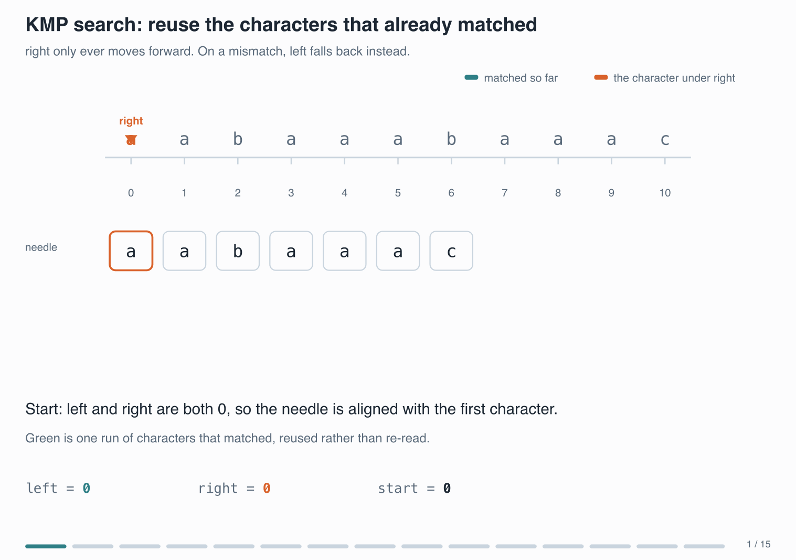</video>
<figcaption><b>Animation 3.9</b> On a mismatch, <code>left</code> falls back to <code>lps[left - 1]</code> and <code>right</code> stays where it is. The haystack is read once, from left to right.</figcaption>
</figure>

To compute fallback offsets in O(1), KMP preprocesses the needle into a failure table `lps` (longest proper prefix that is also a suffix). For each prefix `needle[0..=i]`, `lps[i]` records the length of its longest proper prefix (excluding the entire substring) that matches its suffix. For `"aabaaac"`:

| index | 0 | 1 | 2 | 3 | 4 | 5 | 6 |
|---|---|---|---|---|---|---|---|
| needle | a | a | b | a | a | a | c |
| lps | 0 | 1 | 0 | 1 | 2 | 2 | 0 |

For example, `lps[4] = 2` because `"aabaa"` both starts and ends with `"aa"`.

<figure class="anim">
<video class="motion" src="figures/ch03-kmp-lps.mp4" autoplay loop muted playsinline preload="metadata" aria-label="The needle aabaaac with the lps row below it, filled one entry at a time. right compares needle[right] with needle[left]. A match writes lps[right] = left + 1. A mismatch with left above 0 moves left back to lps[left - 1]; a mismatch at left 0 leaves the entry at 0. The table ends as 0 1 0 1 2 2 0. Last, with left reset to 0 on a mismatch instead of lps[left - 1], lps[5] comes out 1 instead of 2." data-chapters="[[95.88, &quot;reset to 0&quot;]]">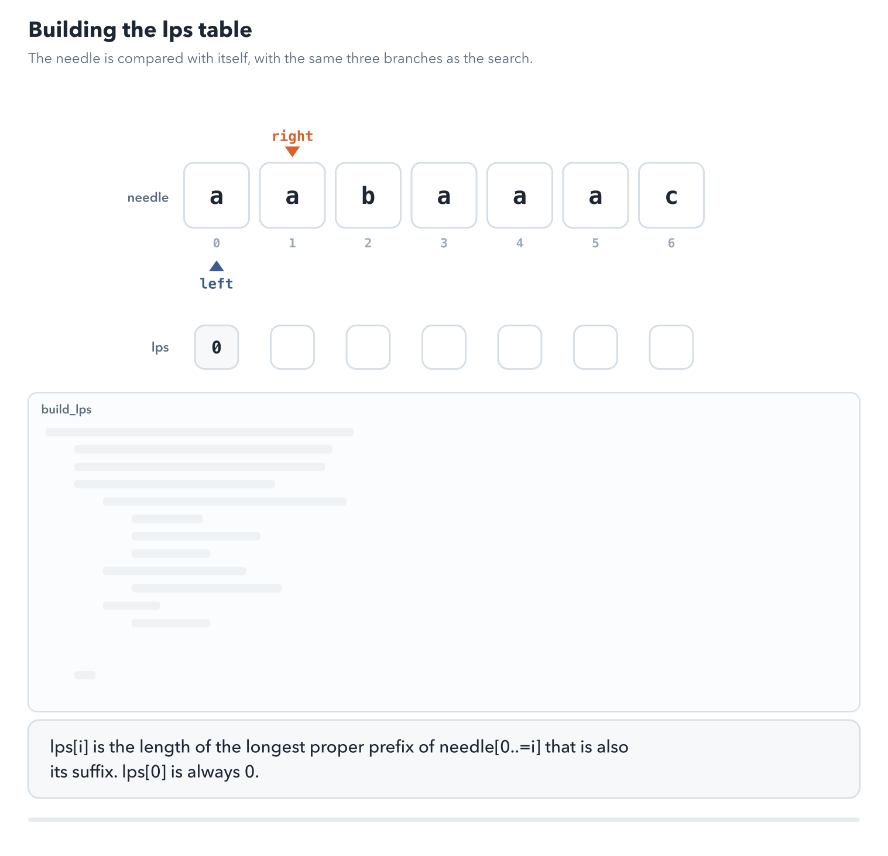</video>
<figcaption><b>Animation 3.10</b> <code>build_lps</code> compares the needle with itself, using the same three branches as the search. The table ends as <code>0 1 0 1 2 2 0</code>.</figcaption>
</figure>


<p class="listing"><b>Listing 3.16</b> The search and the table (lines 1 to 58). <a href="https://github.com/arpanpathak/cracking-the-systems-programming-interview/blob/prep-v2/rust-interview-lab/src/bin/kmp_pattern_matching.rs">src/bin/kmp_pattern_matching.rs</a></p>

```rust
{{#include ../../rust-interview-lab/src/bin/kmp_pattern_matching.rs:1:58}}
    // ...
}
```

`str_str` operates directly on byte slices from `as_bytes()` for O(1) indexing. Here `left` tracks the number of matched needle bytes and `right` scans the haystack. Each iteration executes one of three branches:

1. Matching bytes: advance both `left` and `right`.
2. Mismatch with `left > 0`: fall back to `left = lps[left - 1]` without moving `right`.
3. Mismatch with `left == 0`: advance `right`.

Once `left` reaches `needle.len()`, the match begins at `right - left`.

`build_lps` runs the identical three-branch state machine of the needle against itself. Because `right` advances monotonically and total fallbacks cannot exceed total increments of `left`, preprocessing and searching together run in O(n + m) time.

<p class="listing"><b>Listing 3.17</b> The complete program. <a href="https://github.com/arpanpathak/cracking-the-systems-programming-interview/blob/prep-v2/rust-interview-lab/src/bin/kmp_pattern_matching.rs">src/bin/kmp_pattern_matching.rs</a></p>

```rust
{{#include ../../rust-interview-lab/src/bin/kmp_pattern_matching.rs}}
```

```text
$ cargo run --bin kmp_pattern_matching
str_str("sadbutsad", "sad") = 0

str_str("leetcode", "leeto") = -1

str_str("aabaaabaaac", "aabaaac") = 4

str_str("hello", "") = 0
```

The `-1` sentinel follows the classic interview specification; idiomatic Rust APIs return `Option<usize>` instead. For production string searching, `str::find` in the standard library also runs in linear time (using the Two-Way algorithm).

### 3.12.1 KMP written with `match`

Listing 3.18 implements the same KMP algorithm in a shorter form. Each branch of the search becomes one arm of a `match`, and the function returns `Option<usize>` instead of the `-1` sentinel of `str_str`. The variable `i` is the position in the haystack, and `j` is the number of needle bytes matched so far.

**Building the table.** `build_lps` fills the same `lps` table as before. `j` walks the needle from index 1, and `len` is the length of the prefix that currently matches the end of `needle[0..j]`. The `match` looks at two values, whether `needle[j]` equals `needle[len]`, and whether `len` is 0:

1. `(true, _)`: the matched prefix grows by one byte. `len` increases, `lps[j]` records it, and `j` moves on.
2. `(false, 0)`: no prefix matches, so `lps[j]` is 0, and `j` moves on.
3. `(false, _)`: the current prefix cannot be extended, so `len` falls back to `lps[len - 1]`, the next shorter prefix that also matches. `j` stays, and the comparison is repeated.

For `"aabaaac"`, the table comes out as `0 1 0 1 2 2 0`, the same values as in the table above. At `j = 5`, for example, `len` is 2, and `needle[5]` (`a`) does not equal `needle[2]` (`b`). The third arm sets `len` to `lps[1]`, which is 1. Then `needle[5]` equals `needle[1]`, and the first arm sets `lps[5]` to 2.

**Searching.** `kmp_search` first returns `Some(0)` for an empty needle, because the empty string occurs at the start of every haystack. The loop then matches on three values: whether `haystack[i]` equals `needle[j]`, whether `j` is the needle's last index, and `j` itself. The four arms are:

1. `(true, true, _)`: the needle's last byte matches at `i`. The match began `j` bytes earlier, so the function returns `Some(i - j)`.
2. `(true, false, _)`: the bytes match, but the needle is not finished, so both `i` and `j` advance.
3. `(false, _, 0)`: the bytes differ at the needle's first byte. There is no shorter prefix to fall back to, so only `i` advances.
4. `(false, _, _)`: the bytes differ after `j` matched bytes. `j` falls back to `lps[j - 1]`, and `i` stays, so the same haystack byte is compared again.

The first arm checks for the needle's last byte before advancing. As a result, `j` never reaches `needle.len()`, and `needle[j]` is always a valid index.

The trace below searches for `"aabaaac"` in `"aabaaabaaac"`, the example of Figure 3.12.

| `i` | `j` | `haystack[i]` | `needle[j]` | Arm | Effect |
|---|---|---|---|---|---|
| 0 to 5 | 0 to 5 | `a a b a a a` | `a a b a a a` | 2 | six bytes match, `i` and `j` advance together |
| 6 | 6 | `b` | `c` | 4 | `j` falls back to `lps[5]` = 2 |
| 6 to 9 | 2 to 5 | `b a a a` | `b a a a` | 2 | four bytes match |
| 10 | 6 | `c` | `c` | 1 | returns `Some(10 - 6)` = `Some(4)` |

At `i = 6`, the search keeps the two bytes `"aa"` that it has already matched, as Figure 3.12 shows. It never moves `i` backward.

<p class="listing"><b>Listing 3.18</b> KMP with each branch as one arm of a <code>match</code>. <a href="https://github.com/arpanpathak/cracking-the-systems-programming-interview/blob/prep-v2/rust-interview-lab/src/bin/kmp_search.rs">src/bin/kmp_search.rs</a></p>

```rust
{{#include ../../rust-interview-lab/src/bin/kmp_search.rs}}
```

```text
$ cargo run --bin kmp_search
Some(4)
```

Both versions run in O(n + m) time and use O(m) extra space for the table. Here, `n` is the haystack length and `m` is the needle length.

## 3.13 The complete files

Listing 3.19 reproduces `merge_intervals.rs` in full, combining the excerpts from Section 3.9.

<p class="listing"><b>Listing 3.19</b> Merging overlapping intervals, with its tests. <a href="https://github.com/arpanpathak/cracking-the-systems-programming-interview/blob/prep-v2/rust-interview-lab/src/problems/merge_intervals.rs">src/problems/merge_intervals.rs</a></p>

```rust
{{#include ../../rust-interview-lab/src/problems/merge_intervals.rs}}
```

<div class="summary" markdown="1">

## Summary

- Big-O notation characterizes asymptotic time and auxiliary space growth by retaining only the dominant term and omitting constant factors.
- A `Vec<T>` stores elements contiguously in a heap-allocated buffer, providing O(1) random-access indexing and amortized O(1) `push` via geometric capacity growth.
- A `String` enforces a UTF-8 encoding invariant over a `Vec<u8>`; `len()` reports byte length, whereas `chars()` decodes Unicode scalar values sequentially.
- A `HashMap<K, V>` maps keys to buckets with a randomly seeded hasher to resist collision attacks, delivering O(1) expected `get` and `insert`.
- Indexing visited elements in a `HashMap` reduces complement queries in Two Sum from O(n<sup>2</sup>) to O(n) expected time.
- A `HashSet` finds the first repeating character in one pass. The first non-repeating character needs a count of every character, then a second pass.
- Using a `Vec` as a LIFO stack solves nested delimiter validation and O(1) minimum-element queries (`MinStack`).
- Converging two-pointer traversals reverse ASCII buffers in place in O(1) auxiliary space and solve Three Sum in O(n<sup>2</sup>) time after sorting.
- Sliding windows paired with a last-seen index map compute the longest substring without repeated characters in O(n) time.
- A monotonic deque of indexes gives the sliding window maximum, the largest value in every window of width `k`, in O(n) time.
- Sorting intervals by start coordinate permits a single O(n) pass to merge overlapping ranges, either into an output vector or in place.
- Binary search halves the candidate range per step in O(log n) time and extends to rotated sorted arrays by identifying which half preserves monotonic order.
- Knuth-Morris-Pratt (KMP) preprocesses a pattern's prefix-suffix table (`lps`) to locate substrings in O(n + m) worst-case time without backtracking in the haystack.

</div>

## Exercises

1. Update `two_sum` to perform complement arithmetic in `i64` so extreme values cannot overflow, and add a unit test exercising `i32::MIN`.
2. Modify `is_valid` to reject non-bracket characters explicitly, and add a unit test for `"a"`.
3. Guard `reverse_str` against empty strings, then implement a safe variant that reverses Unicode scalar values for arbitrary UTF-8 strings including `"café"`.
4. Implement standard binary search over a sorted slice returning `Option<usize>`, testing slices of length 0, 1, and 2.
5. Modify the matrix rotation to rotate 90 degrees counterclockwise using a transpose and one reversal pass.
