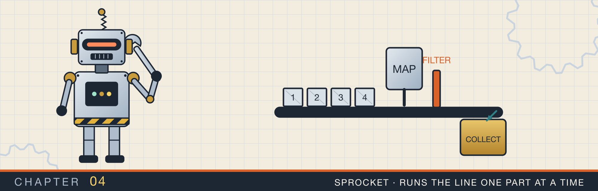
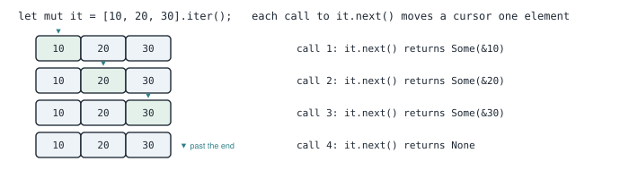
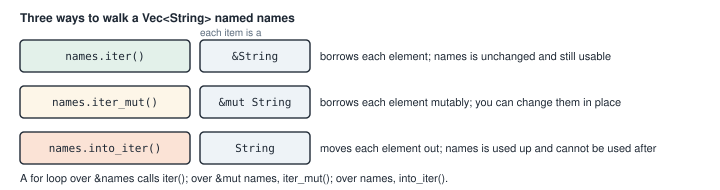
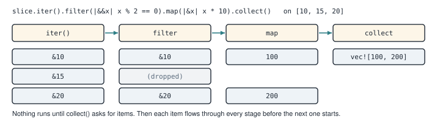
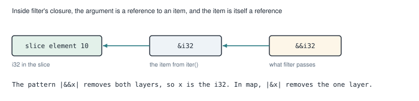
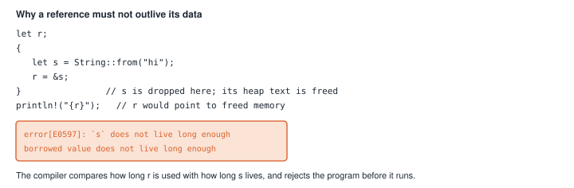
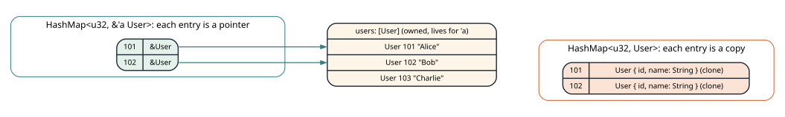
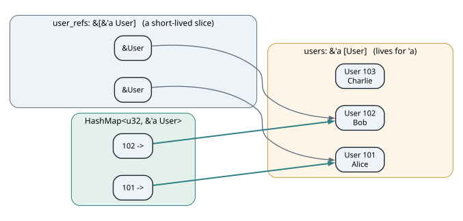

# Iterators and references

<div class="covers" markdown="1">

This chapter covers

- The `Iterator` trait and how `for` loops desugar to `next` calls
- The three collection traversal modes: shared reference, mutable reference, and by value
- Chaining lazy adapters (`filter`, `map`) and driving execution with consumers (`collect`)
- Why `filter` closures receive `&&T`, and how pattern destructuring (`|&&x|`) strips reference layers
- Lifetimes: what they represent, why the compiler requires them across function boundaries, and how to read `'a`
- Indexing a slice with a `HashMap` of borrowed references without cloning elements

</div>

The listings in Chapter 3 used iterators and references throughout (`nums.iter().enumerate()`, `s.chars()`, `seen.get(&key)`). Because every subsequent chapter depends on these abstractions, we now examine their mechanics in full detail.

The chapter is structured in two parts. The first half covers iterators: how the `Iterator` trait operates, how `for` loops drive it, and how lazy adapters compose without intermediate allocations. The second half covers references and lifetimes. A **lifetime** is the static region of a program during which a reference is guaranteed to point to valid, initialized data. We examine why Rust enforces lifetimes across function signatures and how to interpret explicit `'a` annotations.

Both halves converge in a complete program that indexes a slice of `User` structs by ID using a `HashMap` of borrowed references, avoiding any struct cloning.

## 4.1 What an iterator is

An **iterator** is a stateful value implementing the `Iterator` trait, which requires a single method, `next`. Each call to `next` yields `Some(item)` while elements remain and `None` once the sequence is exhausted.

Conceptually, a slice iterator behaves like a cursor positioned just before the first element. Each `next` call advances the cursor and yields a reference to the element it crosses (Figure 4.1).

<figure>

<figcaption><b>Figure 4.1</b> An iterator over <code>[10, 20, 30]</code>. Each call to <code>next</code> returns one item. After the last item, it returns <code>None</code>.</figcaption>
</figure>

Application code rarely calls `next` manually because Rust's `for` loop desugars directly to it. The loop:

```rust
for x in [10, 20, 30].iter() {
    println!("{x}");
}
```

is equivalent to:

```rust
let mut it = [10, 20, 30].iter();
while let Some(x) = it.next() {
    println!("{x}");
}
```

The `while let Some(x) = it.next()` loop continues pulling items until `next` returns `None`. The argument parser in Section 2.8 used this explicit form so the loop body could call `next` a second time to consume flag values.

## 4.2 Three ways to walk a collection

A collection such as `Vec<String>` owns its elements. Iterating over it requires choosing how each element is accessed: by shared reference, by mutable reference, or by owned value. Each mode corresponds to a distinct method (Figure 4.2).

<figure>

<figcaption><b>Figure 4.2</b> The three iteration methods and the item type each one yields.</figcaption>
</figure>

- `iter()` yields `&T` (shared references), leaving the collection intact and usable afterward.
- `iter_mut()` yields `&mut T`, permitting in-place mutation of each element.
- `into_iter()` yields `T` by value, moving ownership out of the collection so the collection cannot be accessed afterward.

In a `for` loop, the expression following `in` selects the mode automatically: `for x in &names` calls `names.iter()`, `for x in &mut names` calls `names.iter_mut()`, and `for x in names` calls `names.into_iter()`, consuming `names`.

<div class="callout tip" markdown="1">

**TIP:** When an iterator item's exact reference depth is unclear, inserting a deliberate type mismatch such as `let () = x;` inside the loop forces the compiler to print the inferred type of `x` in its diagnostic.

</div>

## 4.3 Chaining iterators

An **iterator adapter** wraps one iterator to produce another. `filter` retains only items for which a predicate closure returns `true`, while `map` transforms each item through a closure. By contrast, `collect` is a **consumer**: it drives the pipeline to completion and materializes the output into a target collection such as a `Vec` or `HashMap`.

Figure 4.3 traces three values flowing through a `filter` and `map` pipeline.

<figure>

<figcaption><b>Figure 4.3</b> Items flow through the chain one at a time. The odd number 15 stops at <code>filter</code>.</figcaption>
</figure>

Rust iterator adapters are **lazy**. Evaluating `iter().filter(...).map(...)` constructs a nested state machine describing the pipeline without touching a single element. Execution begins only when a consumer such as `collect` or a `for` loop pulls items via `next`. Each element then traverses all stages sequentially before the next element is fetched, eliminating intermediate heap allocations.

Animation 4.1 traces `functional_numbers_drill` (Listing 4.1) on `[10, 15, 20, 25, 30]`, showing demand propagating backward from `collect` and elements flowing forward one at a time.

<figure class="anim">
<video class="motion" src="figures/ch04-lazy-chain.mp4" autoplay loop muted playsinline preload="metadata" aria-label="Four stages in a row, iter, filter, map, and collect, above the input 10, 15, 20, 25, 30. collect sends next() back through map and filter to iter. The item &10 comes forward, passes filter, becomes 100 in map, and collect stores it. Then &15 comes forward and filter drops it, because it is odd, and asks for the next item at once. 20 and 30 pass, and the result is 100, 200, 300, built in one pass. In a last run collect is removed: no next() is ever called, filter and map never run, and the compiler warns that the Map is unused." data-chapters="[[0.0, &quot;pull&quot;], [12.46, &quot;one at a time&quot;], [32.64, &quot;no collect&quot;]]"></video>
<figcaption><b>Animation 4.1</b> <code>collect</code> pulls items through the chain one at a time. Without a consumer, no item is ever asked for, and the chain does nothing.</figcaption>
</figure>

<div class="callout warning" markdown="1">

**WARNING:** Because adapters are lazy, an iterator chain without a terminating consumer (`collect`, `for`, `count`, or `for_each`) performs no work at runtime. The compiler flags such dead pipelines with an `unused_must_use` warning (`unused Map that must be used`).

</div>

## 4.4 References to references

Inspecting the exact item types in Figure 4.3 clarifies a common point of confusion. Calling `slice.iter()` produces items of type `&i32`. Because `filter` must inspect each item without consuming it (so surviving items can be yielded downstream), `filter` passes a shared reference to the item (`&Self::Item`) into its predicate closure. Combining both layers gives the closure `&&i32`, a reference to a reference to an `i32` (Figure 4.4).

<figure>

<figcaption><b>Figure 4.4</b> The two layers of reference inside <code>filter</code>'s closure.</figcaption>
</figure>

Closure parameters accept irrefutable patterns identical to `let` bindings, where `&x` strips one layer of reference:

- `.filter(|&&x| x % 2 == 0)` strips both reference layers, binding `x` directly as `i32`.
- `.map(|&x| x * 10)` strips the single reference layer yielded by `iter()`, because `map` passes `Self::Item` by value rather than by reference.

Pattern dereferencing works for `i32` because `i32` implements `Copy`, so binding `x` copies the integer out of the reference. Non-`Copy` types such as `String` cannot be moved out of a shared reference; attempting `|&s|` fails to compile, and the closure must bind `|s|` as a reference instead.

## 4.5 The same work in two styles

Listing 4.1 defines a small `User` struct alongside two slice transformations written in functional and imperative styles.

<p class="listing"><b>Listing 4.1</b> The <code>User</code> type and two ways to transform a slice (lines 1 to 23). <a href="https://github.com/arpanpathak/cracking-the-systems-programming-interview/blob/prep-v2/rust-interview-lab/src/bin/lifetime_reference_drill.rs">src/bin/lifetime_reference_drill.rs</a></p>

```rust
{{#include ../../rust-interview-lab/src/bin/lifetime_reference_drill.rs:1:23}}
```

`functional_numbers_drill` implements the pipeline from Figure 4.3. Type inference determines that `collect()` should construct a `Vec<i32>` from the function's return signature; when inference is ambiguous, callers specify the target type explicitly via turbofish syntax (`collect::<Vec<i32>>()`).

`imperative_numbers_map` uses a `for` loop to populate a `HashMap` mapping each input number to `num * 100`. The pattern `for &num in slice` copies the `i32` out of each yielded `&i32`.

Neither style carries an inherent runtime penalty; under optimization, LLVM compiles both forms to comparable machine code. Iterator pipelines express linear data transformations cleanly, whereas explicit loops suit bodies with multiple side effects or complex early-exit control flow.

Having covered iterator pipelines, we next examine the lifetime rules that keep the references they produce valid.

## 4.6 Lifetimes

Every reference borrows data owned elsewhere. If the owner is dropped while a reference remains live, that reference becomes a dangling pointer referencing freed memory, leading to undefined behavior or crashes in unmanaged languages. Figure 4.5 illustrates the minimal case.

<figure>

<figcaption><b>Figure 4.5</b> A reference that would outlive its data. The compiler rejects this program.</figcaption>
</figure>

To prevent dangling references at compile time, the borrow checker tracks the lexical and control-flow span over which each reference is used and verifies that it never extends past the point where its referent is dropped. That valid span is the reference's lifetime.

Within a single function body, the compiler infers all lifetimes automatically. Across function boundaries, however, the compiler checks each function strictly against its signature. Consider a function that takes and returns a string slice:

```rust
fn first_word(s: &str) -> &str { ... }
```

Callers must know how long the returned `&str` remains valid. Because only one input reference exists, the compiler applies its **lifetime elision rules** and infers that the output lifetime matches `s`.

When multiple input references exist, elision cannot determine which input the output borrows from, so the signature must declare explicit lifetime parameters. A lifetime parameter begins with an apostrophe (conventionally `'a`), is declared in angle brackets after the function name, and attaches to the related references:

```rust
fn longest<'a>(x: &'a str, y: &'a str) -> &'a str { ... }
```

This signature states a contract: for some lifetime `'a`, both inputs remain valid for at least `'a`, and the returned reference is valid for `'a`. At every call site, the compiler verifies that the returned reference is never used after either input's backing data is dropped.

Lifetime annotations never alter runtime behavior or extend how long values live; they document borrowing relationships so the compiler can verify memory safety statically.

## 4.7 A map that points into a slice

These lifetime mechanics directly enable zero-copy indexing. To index a slice of `User` structs by ID, one option is cloning each `User` into a `HashMap<u32, User>`. A cheaper alternative stores only borrowed pointers in a `HashMap<u32, &User>`, leaving the original structs untouched (Figure 4.6).

<figure>

<figcaption><b>Figure 4.6</b> A map of copies duplicates every user and its name. A map of references stores one pointer per entry, and depends on the original array staying alive.</figcaption>
</figure>

Avoiding copies introduces a lifetime dependency: the original slice must remain alive and immutable for as long as the map is used. Listing 4.2 encodes this contract in the function signature.

<p class="listing"><b>Listing 4.2</b> A map whose values point into the slice (lines 27 to 33).</p>

```rust
{{#include ../../rust-interview-lab/src/bin/lifetime_reference_drill.rs:27:33}}
```

Applying the contract from Section 4.6, `slice` is valid for `'a`, and every `&'a User` stored in the returned `HashMap` shares that lifetime `'a`. Consequently, attempting to drop `users` while still reading from the map triggers the same compile-time error shown in Figure 4.5.

Inside the body, `for user in slice` yields `&'a User` references directly, inserting pointers into the map with zero `User` clones.

## 4.8 Two lifetimes in one type

Listing 4.3 generalizes the input from a slice of structs to a slice of struct references (`&[&'a User]`).

<p class="listing"><b>Listing 4.3</b> A map built from a slice of references (lines 35 to 41).</p>

```rust
{{#include ../../rust-interview-lab/src/bin/lifetime_reference_drill.rs:35:41}}
```

The parameter type `&[&'a User]` contains two distinct lifetimes:

- The outer `&` borrows the temporary slice of pointers itself; its lifetime is elided because the return type does not depend on it.
- The inner `&'a User` carries the lifetime `'a` of the underlying `User` structs.

Because the returned `HashMap<u32, &'a User>` references only `'a`, the map depends exclusively on the `User` values and not on the intermediate pointer slice. The pointer slice can be dropped immediately after the call returns while the map remains valid (Figure 4.7).

<figure>

<figcaption><b>Figure 4.7</b> The map copies the pointers out of the short-lived slice. It points at the users directly, so only the users must stay alive.</figcaption>
</figure>

The loop pattern `for &user in slice` copies each `&'a User` pointer out of the slice. Shared references implement `Copy` and occupy a single machine word, making this copy a register-width move.

## 4.9 The complete program

<p class="listing"><b>Listing 4.4</b> The complete program. <a href="https://github.com/arpanpathak/cracking-the-systems-programming-interview/blob/prep-v2/rust-interview-lab/src/bin/lifetime_reference_drill.rs">src/bin/lifetime_reference_drill.rs</a></p>

```rust
{{#include ../../rust-interview-lab/src/bin/lifetime_reference_drill.rs}}
```

At the start of `main`, an additional iterator chain demonstrates an alternative way to handle `&&i32` in `filter`: binding `|x|` and writing `*x % 2` explicitly dereferences one layer while `%` auto-dereferences the second. Chaining `.copied()` converts each `&i32` to `i32` before `collect` builds the `Vec<i32>`.

Two declarations in `main` rely on an important compiler rule:

```rust
let users: &[User] = &[ User { ... }, User { ... }, User { ... } ];
```

Here `&[ ... ]` takes a reference to an unnamed array literal. Normally, an unnamed **temporary** value is dropped at the end of its statement, which would leave `users` dangling. When a reference to a temporary is bound directly in a `let` statement, however, Rust applies **temporary lifetime extension**, extending the backing array's lifetime to the end of the enclosing block so `users` and `user_refs` remain valid throughout `main`.

Executing the binary produces:

```text
$ cargo run --bin lifetime_reference_drill
Filtered : [2, 4, 6]
--- Ultra-Lean Inline Slice Drill ---

1. Functional Numbers (Even * 10): [100, 200, 300]
2. Imperative Numbers Map: {20: 2000, 10: 1000, 25: 2500, 15: 1500, 30: 3000}

3. Zero-Allocation Struct Map (From &[User]):
   Key ID: 101 -> Value Name: Alice
   Key ID: 102 -> Value Name: Bob
   Key ID: 103 -> Value Name: Charlie

4. Zero-Allocation Ref Slice Map (From &[&User]):
   Key ID: 102 -> Value Name: Bob
   Key ID: 101 -> Value Name: Alice

--- Drill Completed Successfully! ---
```

Repeated runs print the map entries in different orders because `HashMap` uses a randomly seeded hasher (Section 3.4). When deterministic ordering is required, use `BTreeMap` to maintain keys in sorted order or sort the keys explicitly prior to output.

<div class="summary" markdown="1">

## Summary

- An iterator yields elements through `next`, returning `Some(item)` until exhausted and `None` thereafter; `for` loops desugar to `next` calls.
- `iter()` yields `&T`, `iter_mut()` yields `&mut T`, and `into_iter()` yields `T` while consuming the collection.
- Adapters (`filter`, `map`) are lazy; no work executes until a consumer (`collect`, `for`) pulls elements one by one through the pipeline.
- Because `filter` borrows each yielded item, chaining `iter().filter(...)` passes `&&T` to the predicate; patterns such as `|&&x|` destructure references for `Copy` types.
- A lifetime defines the static region in which a reference remains valid; the borrow checker rejects any reference used after its referent is dropped.
- Explicit lifetime parameters such as `'a` link input and output reference lifetimes in function signatures without altering runtime storage durations.
- Indexing slices with `HashMap<u32, &'a User>` avoids cloning elements while statically guaranteeing that the map never outlives the underlying data.

</div>

Chapter 5 extends these iterators and collections to binary heaps and priority-ordered algorithms, including top-k frequency selection and streaming median computation.

## Exercises

1. Rewrite `imperative_numbers_map` as a single iterator chain terminating in `collect::<HashMap<_, _>>()`.
2. Implement `fn longest<'a>(x: &'a str, y: &'a str) -> &'a str`, then write a `main` function that intentionally violates its lifetime contract and inspect the resulting compiler diagnostic.
3. Change `struct_slice_to_map` to return a `BTreeMap` and verify that output order becomes deterministic across runs.
4. Write a function taking `&mut [User]` that uses `iter_mut()` to append `" (admin)"` to every user's name.
