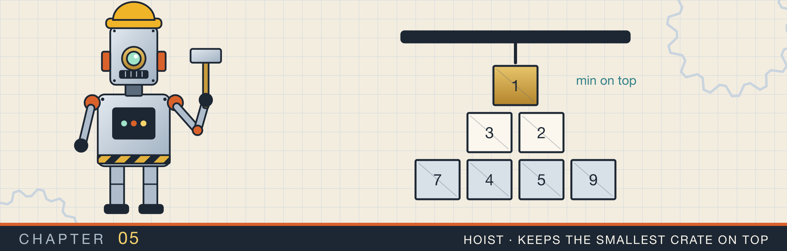
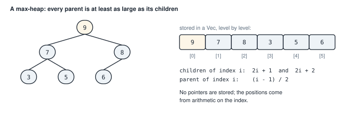
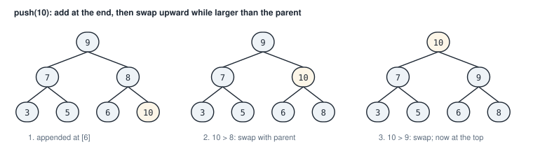
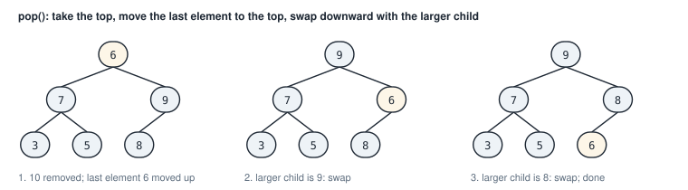
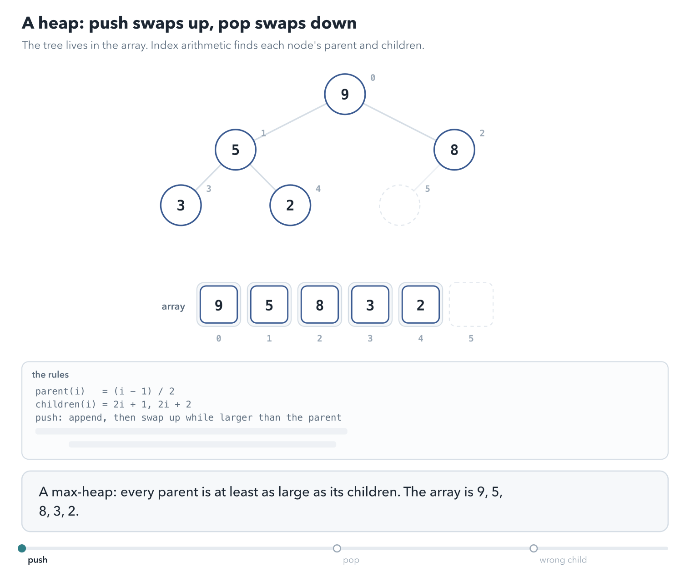
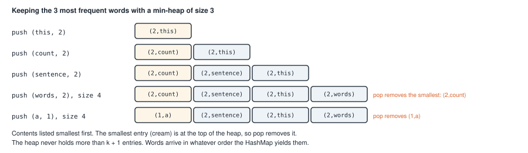
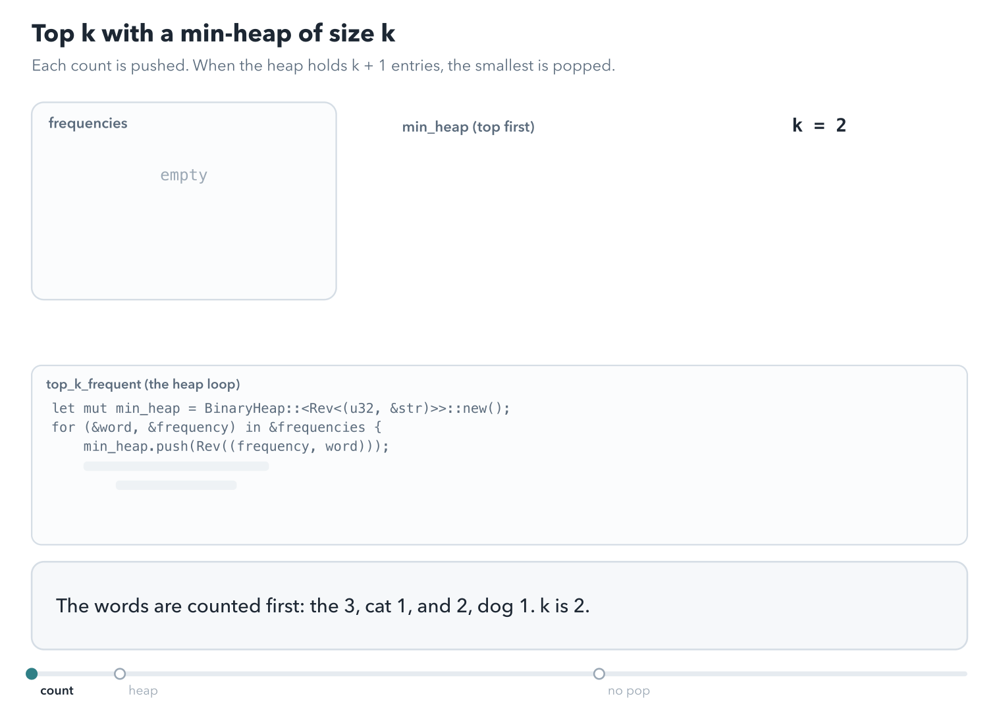
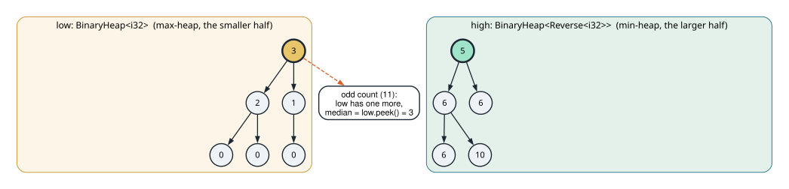

# Heaps

<div class="covers" markdown="1">

This chapter covers

- Binary heap structure and how a complete tree maps onto a contiguous `Vec`
- How `push` and `pop` restore the heap invariant in O(log n) steps
- Rust's `BinaryHeap`, and converting it into a min-heap using `Reverse`
- Lexicographical tuple ordering and prioritizing heap entries by `(count, value)`
- Finding the `k` most frequent items using both an unbounded max-heap and a `k`-bounded min-heap
- Computing a running median over a data stream using two balanced heaps

</div>

Priority-driven workloads require continuous access to the extreme element of a dynamic multiset without paying the O(n) maintenance cost of keeping the entire collection sorted. A **binary heap** resolves this tradeoff by enforcing a partial ordering invariant over a complete binary tree packed contiguously in a vector, supporting O(1) extremum inspection and O(log n) insertions and deletions.

This priority-queue abstraction underpins top-*k* frequency selection, priority scheduling, and streaming order-statistic maintenance. The sections below formalize the implicit array representation, sift-up and sift-down invariant restoration, and Rust's `BinaryHeap` API before developing three complete applications: unbounded top-*k* selection, *k*-bounded top-*k* word ranking, and dual-heap streaming median maintenance.

Four formal definitions establish the terminology:

- A **binary tree** is a hierarchical structure in which every node has at most two children (left and right); the unique node without a parent is the **root**.
- A **max-heap** is a complete binary tree satisfying the max-heap invariant: every parent key is greater than or equal to the keys of both children, placing the global maximum at the root.
- A **min-heap** inverts this ordering invariant so every parent key is less than or equal to its children's keys, placing the global minimum at the root.
- The **median** of a finite multiset of real numbers is its middle element in sorted order when cardinality is odd, or the arithmetic mean of the two middle elements when cardinality is even.

## 5.1 A tree stored in a vector

Although conceptually a tree, a binary heap stores no child or parent pointers. Because a heap is always a complete binary tree (every level filled except possibly the last, which fills from left to right), its nodes pack densely into a `Vec` in level order: the root at index 0, its two children at indexes 1 and 2, their children at indexes 3 through 6, and so on. Figure 5.1 depicts a six-element max-heap alongside its backing vector.

<figure>

<figcaption><b>Figure 5.1</b> A max-heap and its vector. The children of the node at index i are at 2i + 1 and 2i + 2.</figcaption>
</figure>

Dense level-order packing replaces pointer chasing with index arithmetic. For any node at index `i`, its left child lies at `2i + 1`, its right child at `2i + 2`, and its parent at `(i - 1) / 2` (using integer division). In Figure 5.1, node `7` at index 1 has children at indexes 3 and 4, holding `3` and `5`.

The heap invariant constrains only parent-child relationships; sibling and cousin ordering is unconstrained (for example, `7` sits to the left of `8` in Figure 5.1). Maintaining this partial order is far cheaper than keeping the entire array sorted.

A complete binary tree of `n` nodes has height `floor(log₂ n)`, so a heap of one million items is roughly 20 levels deep.

## 5.2 Adding and removing

### 5.2.1 Push

Inserting a new element appends it to the end of the vector, occupying the next free leaf slot on the bottom level. If the new value exceeds its parent, violating the max-heap invariant, it swaps upward with its parent repeatedly (sift-up) until either its parent is larger or it reaches the root. Figure 5.2 traces pushing `10`.

<figure>

<figcaption><b>Figure 5.2</b> Pushing 10. It moves up one level per swap until the rule holds again.</figcaption>
</figure>

Because each swap ascends one level in a tree of height O(log n), `push` completes in O(log n) worst-case time.

### 5.2.2 Pop

Removing the maximum element extracts the root at index 0. To preserve tree completeness, the final element of the vector moves into index 0 and the vector length shrinks by one. That displaced element typically violates the heap invariant, so it swaps downward with its larger child repeatedly (sift-down) until both children are smaller or it becomes a leaf. Figure 5.3 traces popping `10`.

<figure>

<figcaption><b>Figure 5.3</b> Popping the largest item. The item moved to the top sinks one level per swap.</figcaption>
</figure>

Swapping with the larger child is mandatory because the promoted child becomes the new parent of its sibling and must therefore be at least as large as that sibling. Like `push`, `pop` traverses at most the height of the tree in O(log n) time.

Inspecting the maximum element without removal (`peek`) reads index 0 directly in O(1) time.

<figure class="anim">
<video class="motion" src="figures/ch05-heap-sift.mp4" autoplay loop muted playsinline preload="metadata" aria-label="A max-heap 9, 5, 8, 3, 2 drawn as a tree above its array. push(10) appends 10 at index 5; it swaps with its parent 8 at index 2, then with 9 at the root. pop() takes 10 from the root, moves the last value 8 into the root, and 8 swaps with its larger child 9. A last part swaps 8 with the smaller child 5 instead, and 5 ends up as the parent of 9." data-chapters="[[0.0, &quot;push&quot;], [34.32, &quot;pop&quot;], [55.74, &quot;wrong child&quot;]]"></video>
<figcaption><b>Animation 5.1</b> A push appends and swaps up; a pop moves the last value to the root and swaps it down with the larger child. Each value moves in the tree and in the array at the same time. The last part swaps with the smaller child and breaks the heap rule.</figcaption>
</figure>


## 5.3 Heaps in Rust

Rust's standard library provides `std::collections::BinaryHeap<T>`, implemented as a max-heap over a `Vec<T>`. Its core API maps directly to the operations above:

| Method | What it does | Cost |
|---|---|---|
| `push(x)` | adds `x` | O(log n) |
| `pop()` | removes and returns the largest item, as an `Option` | O(log n) |
| `peek()` | returns a reference to the largest item, as an `Option` | O(1) |
| `len()` | the number of items | O(1) |
| `into_sorted_vec()` | consumes the heap and returns its items in ascending order | O(n log n) |

`BinaryHeap<T>` orders elements via the `Ord` trait, which is implemented by integer types, `String`, and tuples of `Ord` elements.

### 5.3.1 How tuples compare

Rust compares tuples lexicographically from left to right: the first elements determine the ordering, and subsequent elements act as tie-breakers only when earlier elements are equal. Thus `(3, 1) > (2, 9)` because `3 > 2`, while `(3, 1) < (3, 2)` because `1 < 2`.

Placing the priority key first in a tuple lets a `BinaryHeap` order arbitrary payloads without defining a custom wrapper type: a heap of `(count, value)` pairs prioritizes by `count` and breaks ties by `value`.

### 5.3.2 A min-heap with `Reverse`

Rather than offering a separate min-heap type, the standard library provides the zero-cost wrapper `std::cmp::Reverse<T>`, whose `Ord` implementation inverts `T`'s ordering (`Reverse(3) > Reverse(5)` because `3 < 5`). Consequently, `BinaryHeap<Reverse<i32>>` behaves as a min-heap keeping the smallest value at the root.

Callers wrap values on insertion (`heap.push(Reverse(x))`) and destructure the wrapper on extraction (`if let Some(Reverse(x)) = heap.pop()`).

With the implicit array layout and `BinaryHeap` interface established, the following three sections apply heaps to frequency ranking and streaming order statistics.

## 5.4 The k most frequent numbers

**The problem.** Given a slice of integers and a count `k`, return the `k` most frequently occurring numbers. For `[1, 1, 1, 2, 2, 3]` and `k = 2`, the result is `1` and `2`.

**The strategy.** Tally frequencies in a `HashMap`, build a max-heap of `(count, number)` pairs, and pop `k` elements.

<p class="listing"><b>Listing 5.1</b> Top k with a full heap. <a href="https://github.com/arpanpathak/cracking-the-systems-programming-interview/blob/prep-v2/rust-interview-lab/src/problems/top_k_frequent.rs">src/problems/top_k_frequent.rs</a></p>

```rust
{{#include ../../rust-interview-lab/src/problems/top_k_frequent.rs}}
```

The implementation proceeds in three stages:

1. `*counts.entry(num).or_insert(0) += 1;` increments the count for `num`. `entry(num)` locates the bucket, `or_insert(0)` initializes absent keys to `0` and returns `&mut usize`, and `*... += 1` increments the counter in place.
2. `counts.into_iter().map(|(num, count)| (count, num)).collect()` swaps each pair so the frequency leads, then constructs the `BinaryHeap` directly via `collect` (using linear-time Floyd heapification).
3. The `while` loop extracts up to `k` elements, terminating early if `pop()` yields `None` when fewer than `k` distinct values exist (covered by the second unit test).

For `n` input elements and `u` distinct values, counting takes O(n) time, heap construction takes O(u) time, and `k` pops take O(k log u) time.

In the first unit test, sorting the returned vector before comparison avoids brittleness: elements with tied frequencies can appear in different orders depending on the randomized `HashMap` seed.

## 5.5 The k most frequent words, with a heap of size k

Inserting every distinct element into the heap wastes memory when `u` is large and `k` is small (for example, finding the top 3 words across millions of distinct tokens). Bounding the heap to at most `k + 1` entries reduces both memory and comparison work.

**The strategy.** Maintain a min-heap of `(count, word)` pairs. After pushing each entry, if the heap length exceeds `k`, pop the root. Because a min-heap places the smallest entry at the root, every eviction discards the least frequent candidate seen so far, guaranteeing that the `k` highest-frequency words remain (Figure 5.4).

<figure>

<figcaption><b>Figure 5.4</b> A min-heap bounded to k = 3 entries. Each time a fourth entry arrives, the smallest is removed.</figcaption>
</figure>

The program tokenizes input text into normalized words, counts occurrences, and filters them through the bounded min-heap.

<figure class="anim">
<video class="motion" src="figures/ch05-top-k.mp4" autoplay loop muted playsinline preload="metadata" aria-label="Word counts the 3, cat 1, and 2, dog 1, and a min-heap with k = 2. Each count is pushed. When the heap holds three entries, pop removes the top, the smallest count. The heap ends with (2, and) and (3, the). Last, without the pop, the heap keeps all four words, and taking two from its top gives cat and dog, the least frequent." data-chapters="[[0.0, &quot;count&quot;], [8.16, &quot;heap&quot;], [52.48, &quot;no pop&quot;]]"></video>
<figcaption><b>Animation 5.2</b> The bounded heap from listing 5.2 with k = 2. The top of the heap is the least frequent word kept, and it is popped whenever the heap holds k + 1 entries.</figcaption>
</figure>


<p class="listing"><b>Listing 5.2</b> The function (lines 1 to 41). <a href="https://github.com/arpanpathak/cracking-the-systems-programming-interview/blob/prep-v2/rust-interview-lab/src/bin/top_k_frequent_words.rs">src/bin/top_k_frequent_words.rs</a></p>

```rust
{{#include ../../rust-interview-lab/src/bin/top_k_frequent_words.rs:1:41}}
```

Four design choices keep the implementation concise and allocation-lean:

- **Tokenization:** The iterator chain splits on whitespace, strips leading and trailing non-alphanumeric characters via `trim_matches` (turning `"sentence."` into `"sentence"`), filters out empty remnants left by standalone punctuation, and lowercases each token by passing `str::to_lowercase` directly to `map`.
- **Zero-copy counting:** The frequency map has type `HashMap<&str, u32>`, borrowing slices from `words` rather than cloning strings for every token occurrence. `or_default()` inserts `0` for absent keys.
- **Bounded min-heap:** Aliasing `std::cmp::Reverse as Rev` keeps the type concise. Pushing `Rev((frequency, word))` places the lowest-frequency pair at the root; whenever `heap.len() > k`, a single `pop()` evicts it.
- **Ordered output:** `into_sorted_vec()` drains the heap in ascending order of `Rev`, which corresponds to descending order of frequency. The final `map` unwraps each `Rev` and allocates an owned `String` for only the surviving `k` words, since the local `words` vector is dropped upon return.

Bounding the heap size to `k + 1` caps each heap operation at O(log k), reducing heap work from O(u log u) to O(u log k) and heap memory from O(u) to O(k).

### 5.5.1 The complete program

<p class="listing"><b>Listing 5.3</b> The complete program, with its tests. <a href="https://github.com/arpanpathak/cracking-the-systems-programming-interview/blob/prep-v2/rust-interview-lab/src/bin/top_k_frequent_words.rs">src/bin/top_k_frequent_words.rs</a></p>

```rust
{{#include ../../rust-interview-lab/src/bin/top_k_frequent_words.rs}}
```

In `main`, the sample text uses a **raw string literal** (`r"..."`), which disables backslash escaping and spans multiple lines. The unit tests exercise standard ranking, case folding and punctuation stripping, `k` exceeding the vocabulary size, and empty input.

```text
$ cargo run --bin top_k_frequent_words
Top 3 frequency [(word, frequency)] :
 [
    (
        "words",
        2,
    ),
    (
        "this",
        2,
    ),
    (
        "sentence",
        2,
    ),
]
```

Four words appear twice in the sample input (`"this"`, `"sentence"`, `"count"`, and `"words"`), and `"count"` is evicted. When frequencies tie, lexicographical tuple comparison falls back to the word string; the min-heap therefore evicts the alphabetically smallest word, retaining the alphabetically latest words among ties.

<div class="callout tip" markdown="1">

**TIP:** To retain the alphabetically earliest words on frequency ties, push `Rev((frequency, Reverse(word)))`. The inner `Reverse` inverts string ordering alone, causing the alphabetically latest word to sit at the min-heap root and be evicted first.

</div>

## 5.6 The median of a stream

**The problem.** Integers arrive incrementally in a stream. After each arrival, report the median of all values received so far.

**The baseline approach.** Maintaining a sorted `Vec` allows O(1) median reads, but inserting each new element into its sorted position shifts up to `n` elements, costing O(n) per arrival.

**The two-heap approach.** Partition the seen values across two complementary heaps (Figure 5.5):

- `low`: a max-heap storing the smaller half of the values, exposing the largest element of the lower half at its root.
- `high`: a min-heap storing the larger half of the values, exposing the smallest element of the upper half at its root.

Two invariants hold after every insertion: every element in `low` is less than or equal to every element in `high`, and `low.len()` is either equal to `high.len()` or `high.len() + 1`. Under these invariants, the median is always available in O(1) at the roots: the root of `low` when the total count is odd, or the mean of both roots when the count is even.

<figure>

<figcaption><b>Figure 5.5</b> The two heaps after all eleven sample values. <code>low</code> has six values and <code>high</code> five, so the median is 3, the top of <code>low</code>.</figcaption>
</figure>

### 5.6.1 Adding a number

<p class="listing"><b>Listing 5.4</b> The structure and <code>add_num</code> (lines 1 to 27). <a href="https://github.com/arpanpathak/cracking-the-systems-programming-interview/blob/prep-v2/rust-interview-lab/src/bin/median_finder.rs">src/bin/median_finder.rs</a></p>

```rust
{{#include ../../rust-interview-lab/src/bin/median_finder.rs:1:7}}

impl MedianFinder {
{{#include ../../rust-interview-lab/src/bin/median_finder.rs:10:26}}
    // ...
}
```

`add_num` preserves both invariants in three unconditional or size-checked heap moves without explicit value comparisons:

1. Push the incoming value into `low`.
2. Pop the maximum element from `low` and push it into `high`, restoring the ordering invariant so every element in `high` is at least as large as every element remaining in `low`.
3. If `high.len() > low.len()`, pop the minimum element from `high` and push it back into `low`, restoring the size balance invariant.

Tracing the first three arrivals (`6`, `10`, and `2`):

| Add | After step 1 (`low`) | After step 2 (`low` / `high`) | After step 3 (`low` / `high`) | Median |
|---|---|---|---|---|
| 6 | {6} | {} / {6} | {6} / {} | 6 |
| 10 | {6, 10} | {6} / {10} | {6} / {10} | (6 + 10) / 2 = 8 |
| 2 | {2, 6} | {2} / {6, 10} | {2, 6} / {10} | 6 |

Because each step performs a constant number of heap pushes and pops, `add_num` runs in O(log n) time.

### 5.6.2 Reading the median

<p class="listing"><b>Listing 5.5</b> <code>find_median</code> (lines 28 to 37).</p>

```rust
impl MedianFinder {
    // ...
{{#include ../../rust-interview-lab/src/bin/median_finder.rs:28:37}}
}
```

`*self.low.peek()?` inspects the root of `low`. The `?` operator works on `Option` identically to `Result`: if no values have been inserted yet, `peek()` yields `None` and `find_median` returns `None` immediately. The return type is `Option<f64>` because the mean of two integers can be fractional.

In the even-count branch, `let Reverse(min_high) = *self.high.peek()?;` unwraps the `Reverse` wrapper directly in the `let` pattern.

### 5.6.3 The complete program

<p class="listing"><b>Listing 5.6</b> The complete program, with its tests. <a href="https://github.com/arpanpathak/cracking-the-systems-programming-interview/blob/prep-v2/rust-interview-lab/src/bin/median_finder.rs">src/bin/median_finder.rs</a></p>

```rust
{{#include ../../rust-interview-lab/src/bin/median_finder.rs}}
```

`main` feeds eleven sample integers into `MedianFinder` and prints the running median after each step:

```text
$ cargo run --bin median_finder
after  6: median 6
after 10: median 8
after  2: median 6
after  6: median 6
after  5: median 6
after  0: median 5.5
after  6: median 6
after  3: median 5.5
after  1: median 5
after  0: median 4
after  0: median 3
```

The test `the_stream_matches_a_sort_on_every_step` validates the two-heap implementation against a simple reference routine: after each insertion, it sorts a copy of all values seen so far, computes the median via `median_of_sorted`, and asserts equality with `find_median()`. Verifying an optimized algorithm against a slower, obviously correct reference implementation is known as **oracle testing**, and reliably catches subtle invariant bugs missed by small hand-crafted examples.

The final test verifies the size-balance invariant directly, asserting that the two heap lengths differ by at most 1 after every insertion.

<div class="summary" markdown="1">

## Summary

- A binary heap embeds a complete binary tree level by level in a contiguous `Vec`, locating the children of index `i` at `2i + 1` and `2i + 2` and its parent at `(i - 1) / 2`.
- In a max-heap, every parent key dominates its children, exposing the global maximum at index `0` for O(1) `peek`.
- `push` appends to the tail and restores the invariant via sift-up; `pop` promotes the tail element to index `0` and restores the invariant via sift-down through the larger child. Both operations run in O(log n) worst-case time.
- Rust's `BinaryHeap<T>` implements a max-heap; wrapping elements in the zero-cost `std::cmp::Reverse<T>` adapter yields a min-heap.
- Lexicographical tuple ordering enables `(count, value)` priority keys without custom comparator structs.
- Bounding a min-heap to k + 1 entries during top-*k* selection reduces heap space from O(u) to O(k) and heap work from O(u log u) to O(u log k).
- Partitioning a stream across a lower max-heap (`low`) and an upper min-heap (`high`) maintains the running median in O(log n) time per insertion and O(1) time per query.

</div>

## Exercises

1. Implement a standalone max-heap over `Vec<i32>` supporting `push`, `pop`, and `peek` using the index formulas from Section 5.1, and oracle-test it against `BinaryHeap` on random sequences.
2. Modify `top_k_frequent_words` to retain alphabetically earliest words on frequency ties using the nested `Reverse` pattern from Section 5.5, and add a unit test confirming the tie-breaking order.
3. Add a `len(&self) -> usize` method to `MedianFinder` returning the total number of elements inserted.
4. Extend `MedianFinder` to support a sliding window of the most recent 100 values by implementing lazy deletion (recording expired values in a hash map and discarding them when they surface at either heap root).
