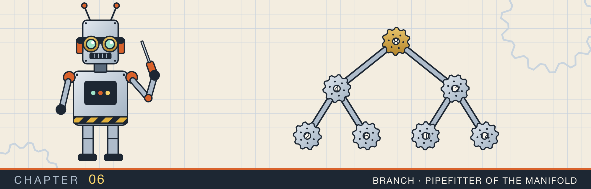
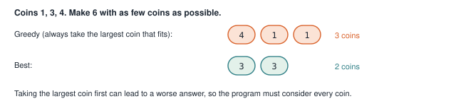
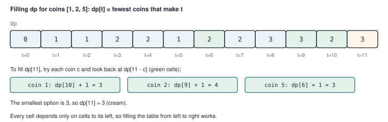
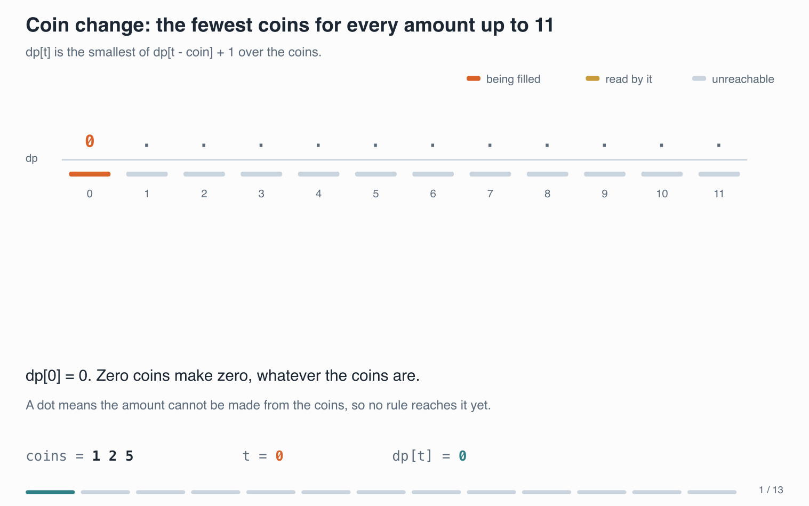
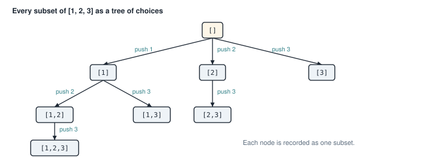
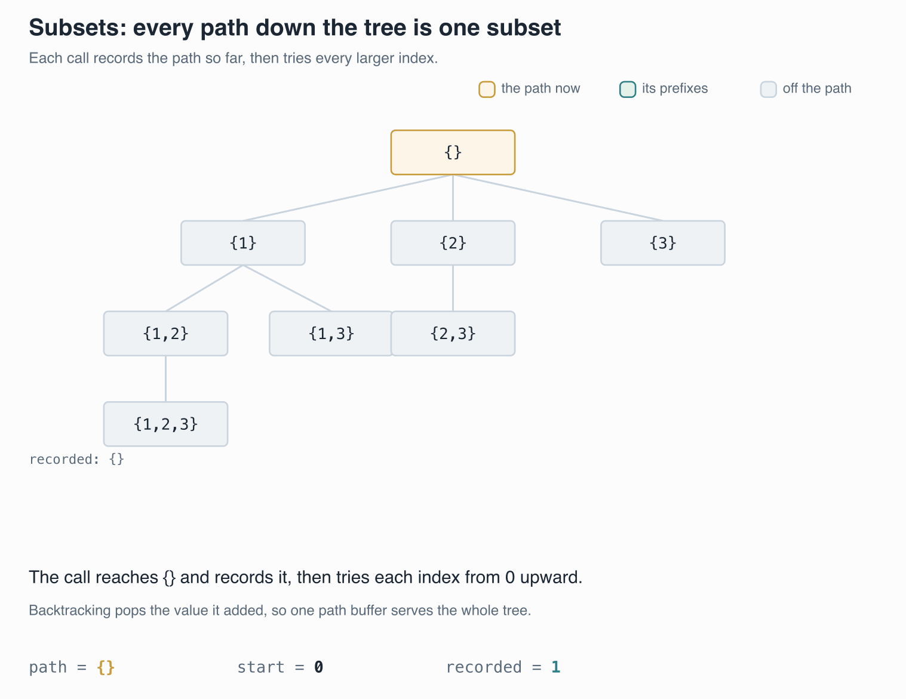
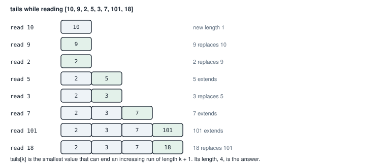
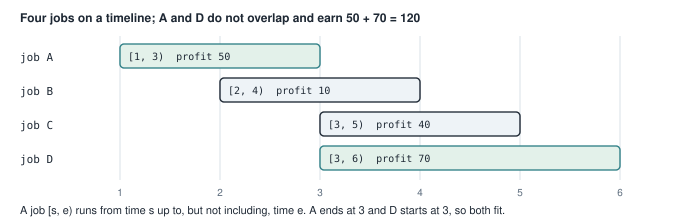

# Recursion and dynamic programming

<div class="covers" markdown="1">

This chapter covers

- Recognizing a problem that can be built from answers to smaller versions of itself
- Filling a table of answers from the smallest case upward
- Listing every subset of a set by exploring a tree of choices
- The longest increasing run hidden inside a list, in O(n log n)
- Choosing jobs that do not overlap, to earn the most

</div>

In Chapter 1, we computed Fibonacci numbers in three ways: a direct recursive implementation that repeated overlapping work, a memoized version that cached each result in a table, and an iterative loop that retained only the preceding states still required. That small example captures the core principle of this chapter.

**Dynamic programming** solves an optimization or counting problem by evaluating smaller subproblems first, storing their results, and combining those results into the final solution. The technique applies when two structural properties hold:

1. **Optimal substructure:** The solution for a larger input can be constructed from the solutions for smaller inputs.
2. **Overlapping subproblems:** The same smaller inputs recur repeatedly, so storing their results eliminates redundant computation.

Four problems below develop these ideas in sequence. The first, making change with coins, presents dynamic programming in its canonical form. The second, enumerating subsets, uses recursion without memoization because every distinct combination must be emitted. The final two combine dynamic programming with the sorting and binary search techniques introduced in Chapter 3.

For each dynamic programming problem, we begin by stating in a single sentence what one table entry represents. That definition is the **subproblem**; once it is stated precisely, both the recurrence relation and the implementation follow directly from it.

## 6.1 Making change with the fewest coins

**The problem.** Given a set of coin denominations with an unlimited supply of each, determine the minimum number of coins that sum to a target amount. With denominations 1, 2, and 5, the amount 11 requires three coins (`5 + 5 + 1`). Some target amounts have no valid representation; with only a coin of value 2, the amount 3 is impossible.

### 6.1.1 Why the obvious approach fails

A natural initial strategy selects the largest denomination that fits at each step. This **greedy** approach succeeds for denominations 1, 2, and 5, but it fails for arbitrary coin sets (Figure 6.1).

<figure>

<figcaption><b>Figure 6.1</b> Greedy picks 4 first and needs three coins. The best answer uses two.</figcaption>
</figure>

Consequently, the algorithm must evaluate every denomination at each step. Exhaustively enumerating every combination takes exponential time, whereas dynamic programming reduces the work to polynomial time.

### 6.1.2 The subproblem

Begin by defining the meaning of a single table entry:

> `dp[t]` is the minimum number of coins that sum to exactly `t`.

Consider the final coin placed in an optimal solution for `t`. If that coin has value `c`, the preceding coins must sum to `t - c`, and the fewest coins required for that remainder is `dp[t - c]`. Choosing coin `c` last therefore costs `dp[t - c] + 1` coins. Because the optimal final coin is unknown in advance, the recurrence evaluates every valid denomination and retains the minimum:

> `dp[t]` = the minimum of `dp[t - c] + 1` over every coin `c` such that `c <= t`.

The base case is `dp[0] = 0`, since zero coins sum to zero.

Filling the table by hand for the denominations in Figure 6.1 (1, 3, and 4) up to amount 6 demonstrates how each row evaluates every fitting coin and retains the smallest count:

| `t` | coins that fit | options from each coin | `dp[t]` |
|---|---|---|---|
| 1 | 1 | `dp[0] + 1` = 1 | 1 |
| 2 | 1 | `dp[1] + 1` = 2 | 2 |
| 3 | 1, 3 | `dp[2] + 1` = 3, `dp[0] + 1` = 1 | 1 |
| 4 | 1, 3, 4 | `dp[3] + 1` = 2, `dp[1] + 1` = 2, `dp[0] + 1` = 1 | 1 |
| 5 | 1, 3, 4 | `dp[4] + 1` = 2, `dp[2] + 1` = 3, `dp[1] + 1` = 2 | 2 |
| 6 | 1, 3, 4 | `dp[5] + 1` = 3, `dp[3] + 1` = 2, `dp[2] + 1` = 3 | 2 |

The entry `dp[6]` evaluates to 2 (from `3 + 3`). The greedy strategy required three coins for the same amount because it committed to 4 and never reconsidered earlier choices. Because the table records the optimal count for every smaller amount, each new entry reduces to a fixed number of lookups plus one.

Both structural properties are required for this recurrence to hold. Subproblems must **overlap** so that caching results avoids repeated work: both `dp[6]` and `dp[5]` read `dp[1]`, and larger tables revisit each entry many times. Optimal substructure must also hold so that the best solution for `t` is composed from best solutions for smaller remainders `t - c`. If a better way to form `t - c` existed, `dp[t - c]` would hold that smaller count. When either property fails, the table produces an incorrect result.

Because `dp[t]` depends exclusively on entries for smaller amounts, the table can be populated from left to right. Figure 6.2 illustrates the completed table for denominations 1, 2, and 5, along with the dependencies used to compute `dp[11]`.

<figure>

<figcaption><b>Figure 6.2</b> The filled table. For <code>dp[11]</code>, the three coins lead back to <code>dp[10]</code>, <code>dp[9]</code>, and <code>dp[6]</code>.</figcaption>
</figure>

<figure class="anim">
<video class="motion" src="figures/ch06-coin-change.mp4" autoplay loop muted playsinline preload="metadata" aria-label="The table dp[0] to dp[11] for coins 1, 2, and 5, filled left to right. For each amount t, arcs connect the entries dp[t - coin] it reads to dp[t]. The first amounts are shown one coin at a time; dp[11] ends as 3. A last part shows greedy on coins 1, 3, 4 for amount 6 taking 4 + 1 + 1, three coins, where the table finds two." data-chapters="[[0.0, &quot;dp[1..2]&quot;], [30.12, &quot;dp[3..10]&quot;], [66.12, &quot;dp[11]&quot;], [89.76, &quot;greedy&quot;]]"></video>
<figcaption><b>Animation 6.1</b> Each entry reads only entries to its left, so one pass fills the table. The arcs show which entries <code>dp[t]</code> reads. The last part shows greedy choosing three coins where two are enough.</figcaption>
</figure>

### 6.1.3 The code

<p class="listing"><b>Listing 6.1</b> Coin change (lines 6 to 29). <a href="https://github.com/arpanpathak/cracking-the-systems-programming-interview/blob/prep-v2/rust-interview-lab/src/problems/dp.rs">src/problems/dp.rs</a></p>

```rust
{{#include ../../rust-interview-lab/src/problems/dp.rs:6:29}}
```

Comparing the implementation against the recurrence clarifies each step:

- Negative amounts are rejected up front, ensuring that the cast `amount as usize` is always well defined.
- `vec![usize::MAX; amount + 1]` allocates one entry per amount from `0` through `amount`, using `usize::MAX` as a sentinel meaning "currently unreachable".
- `dp[0] = 0` establishes the base case.
- The outer loop advances from `1` through `amount`, while the inner loop evaluates every coin denomination.
- The `continue` guard skips any coin larger than `total` as well as any remainder `total - coin` that remains unreachable. That second check also prevents `usize::MAX + 1`, which would overflow.
- `dp[total].min(dp[total - coin] + 1)` updates the entry with the smaller of the current best count and the new candidate.

<div class="callout warning" markdown="1">

**WARNING** The second condition in that `continue` statement is required for correctness rather than performance. Removing it breaks the function: when `dp[total - coin]` holds the sentinel, evaluating `dp[total - coin] + 1` adds one to the maximum `usize`. In a debug build, the program panics with `"attempt to add with overflow"`. In a release build, the addition wraps around to `0`, and the final `match` interprets `0` as a valid count of zero coins, causing the table to report artificially small counts. Checking for the sentinel before adding is mandatory whenever `usize::MAX` represents an unreachable state.

</div>

At the end of the function, a `match` converts the final table entry into the return value. Matching `usize::MAX` produces `None`, while any other value yields `Some(count)`. Returning `Option<i32>` ensures that callers cannot confuse an impossible amount with a valid coin count.

Because the table contains `amount + 1` entries and each entry inspects every denomination, the algorithm runs in O(amount × coins) time and uses O(amount) memory.

<p class="listing"><b>Listing 6.2</b> The complete file. <a href="https://github.com/arpanpathak/cracking-the-systems-programming-interview/blob/prep-v2/rust-interview-lab/src/problems/dp.rs">src/problems/dp.rs</a></p>

```rust
{{#include ../../rust-interview-lab/src/problems/dp.rs}}
```

Running `cargo test --lib coin_change` executes the test suite, which verifies the example from Section 6.1, an unreachable amount, and the base case of `0`.

## 6.2 Listing every subset

Not every recursive problem requires a memoization table. When a problem demands every valid solution rather than a single optimum, recursion explores the entire decision space and there are no overlapping subproblems to cache.

**The problem.** Enumerate every subset of a set of distinct integers. A **subset** is any selection of elements, including the empty selection and the full set. The input `[1, 2, 3]` has eight subsets: `[]`, `[1]`, `[2]`, `[3]`, `[1, 2]`, `[1, 3]`, `[2, 3]`, and `[1, 2, 3]`.

**The idea.** Construct subsets one element at a time, starting from the empty subset. From any partial subset, append one additional element whose index is strictly greater than the indices of all elements already chosen. Enforcing this index order prevents duplicate permutations such as `[2, 1]` from appearing alongside `[1, 2]`. Figure 6.3 depicts these decisions as a tree in which every node corresponds to a distinct subset.

<figure>

<figcaption><b>Figure 6.3</b> The tree of choices for <code>[1, 2, 3]</code>. Each edge adds an element that comes after the last one chosen.</figcaption>
</figure>

To enumerate every node, the algorithm traverses the tree depth first, descending along one branch as far as possible before exploring its siblings. Descending pushes an element onto the active selection, and ascending pops it back off. This systematic search pattern is called **backtracking**.

<figure class="anim">
<video class="motion" src="figures/ch06-subsets.mp4" autoplay loop muted playsinline preload="metadata" aria-label="The tree of choices for 1, 2, 3, with the current path highlighted. The recursion records a subset at each node, pushes the next element on the way down, and pops it on the way back. The result list grows to [], [1], [1, 2], [1, 2, 3], [1, 3], [2], [2, 3], [3]. A last part shows the copy [2, 1] that a loop starting at 0 would record." data-chapters="[[0.0, &quot;walk&quot;], [67.44, &quot;loop from 0&quot;]]"></video>
<figcaption><b>Animation 6.2</b> The recursion records each subset when it reaches its node, in depth-first order. Starting each loop at <code>start</code> keeps <code>[2, 1]</code> out of the result.</figcaption>
</figure>


<p class="listing"><b>Listing 6.3</b> Subsets by backtracking. <a href="https://github.com/arpanpathak/cracking-the-systems-programming-interview/blob/prep-v2/rust-interview-lab/src/problems/backtracking.rs">src/problems/backtracking.rs</a></p>

```rust
{{#include ../../rust-interview-lab/src/problems/backtracking.rs}}
```

The helper `backtrack` is nested inside `subsets`, following the same pattern as `go` in Chapter 1. It accepts four parameters:

- `nums`: an immutable borrow of the input slice.
- `start`: the first index eligible for selection at this level.
- `path`: a single mutable vector holding the subset currently under construction, passed as `&mut`.
- `result`: the mutable output vector accumulating completed subsets, also passed as `&mut`.

Upon entry, `backtrack` appends `path.clone()` to `result`, recording the subset represented by the current tree node. For each index from `start` onward, it pushes the element, recurses to explore the subtree below, and pops the element upon return. After the pop, `path` is restored to its exact prior state, ready for the next sibling branch.

Tracing the opening calls of `subsets(vec![1, 2, 3])` illustrates this push-and-pop discipline:

| Call | `path` on entry | Records | Then pushes |
|---|---|---|---|
| `backtrack(start 0)` | `[]` | `[]` | 1 |
| `backtrack(start 1)` | `[1]` | `[1]` | 2 |
| `backtrack(start 2)` | `[1, 2]` | `[1, 2]` | 3 |
| `backtrack(start 3)` | `[1, 2, 3]` | `[1, 2, 3]` | nothing: the loop is empty |
| back in `start 2` | `[1, 2]` after pop | | no more positions |
| back in `start 1` | `[1]` after pop | | 3 |

Calling `Vec::with_capacity(1 << nums.len())` preallocates the exact output capacity. Shifting `1` left by `n` bits computes 2ⁿ, which is the exact number of subsets of an `n`-element set.

The total work is O(n · 2ⁿ): there are 2ⁿ subsets, and cloning each copies up to `n` elements. Because the output itself has size O(n · 2ⁿ), this bound is asymptotically optimal.

## 6.3 The longest increasing run inside a list

**The problem.** Given a sequence of integers, select elements in their original relative order such that each selected element is strictly greater than the previous one. The goal is to find the maximum length of such an **increasing subsequence**. In `[10, 9, 2, 5, 3, 7, 101, 18]`, the elements `2, 3, 7, 18` form an increasing subsequence of length 4.

Unlike the contiguous substrings examined in Chapter 3, a subsequence may omit intervening elements.

**The direct dynamic program.** Define `dp[i]` as the length of the longest increasing subsequence ending at index `i`. For each `i`, inspecting every earlier index `j` with `nums[j] < nums[i]` and taking the maximum `dp[j] + 1` yields an O(n²) algorithm, because each position scans all preceding positions.

**A faster formulation.** Maintain a separate ordered structure called `tails`, whose entries satisfy the following invariant:

> The `k`-th smallest entry in `tails` is the smallest possible ending value of an increasing subsequence of length `k`.

Minimizing the ending value is advantageous because a smaller tail leaves more room for subsequent elements to extend the subsequence. As each input element arrives, two cases apply:

- If the element exceeds every existing entry, it extends the longest subsequence discovered so far and is inserted into `tails`.
- Otherwise, the smallest entry greater than or equal to the element is replaced by the new element, recording a smaller tail for a subsequence of that length.

When the scan completes, the cardinality of `tails` equals the length of the longest increasing subsequence. Figure 6.4 traces the evolution of `tails` on the sample input.

<figure>

<figcaption><b>Figure 6.4</b> <code>tails</code> after each number. The green cell is the one that changed.</figcaption>
</figure>

In the final row of Figure 6.4, `tails` holds `2, 3, 7, 18`, which happens to be a valid increasing subsequence for this input. That coincidence does not hold in general: `tails` can combine elements from distinct subsequences, so only its length is guaranteed to match the answer.

Because the entries of `tails` remain strictly sorted, locating the smallest entry at least as large as a given element can be performed logarithmically in an ordered collection. The implementation below stores `tails` in a `BTreeSet`.

<p class="listing"><b>Listing 6.4</b> The complete program. <a href="https://github.com/arpanpathak/cracking-the-systems-programming-interview/blob/prep-v2/rust-interview-lab/src/bin/longest_increasing_subsequence.rs">src/bin/longest_increasing_subsequence.rs</a></p>

```rust
{{#include ../../rust-interview-lab/src/bin/longest_increasing_subsequence.rs}}
```

The call `tails.range(num..)` yields an iterator over all entries greater than or equal to `num` in ascending order, and `.next()` retrieves the smallest such entry. If one exists, the function removes it before inserting `num`, effectively replacing the old tail with the smaller value.

Including `num` in the lower-bounded range `num..` also handles duplicate inputs correctly. For `[7, 7, 7, 7]`, each subsequent `7` locates the existing `7`, removes it, and inserts `7` again, leaving the length at 1 as required for a strictly increasing subsequence.

Because `range`, `remove`, and `insert` each run in O(log n) time on a `BTreeSet`, the complete algorithm runs in O(n log n) time.

```text
$ cargo run --bin longest_increasing_subsequence
4
4
1
1
5
0
```

The six output lines match the expected values documented in `main`.

## 6.4 Choosing jobs that do not overlap

**The problem.** A single machine executes one job at a time. Each job specifies a start time, an end time, and a profit. The objective is to select a set of non-overlapping jobs that maximizes total profit. Figure 6.5 illustrates four sample jobs.

<figure>

<figcaption><b>Figure 6.5</b> The sample jobs. A and D fit together and earn 120, the best possible.</figcaption>
</figure>

A job interval `[s, e)` runs from time `s` up to, but excluding, time `e`. Consequently, a job ending at time `3` and a job starting at time `3` do not overlap.

### 6.4.1 Building the subproblem

Sorting the jobs by end time ensures that any job eligible to precede job `i` in a valid schedule finishes earlier and therefore appears earlier in the sorted slice. The subproblem is defined as follows:

> `dp[i]` is the maximum profit achievable using only the first `i` jobs in the sorted list.

For job `i`, two mutually exclusive choices exist:

- **Skip the job:** The maximum profit remains `dp[i]`, the best total achievable without job `i`.
- **Schedule the job:** Only jobs finishing at or before job `i`'s start time may precede it. Because the slice is sorted by end time, those compatible jobs form a prefix of length `prev`, yielding a total profit of `dp[prev] + job.profit`.

Thus `dp[i + 1]` is the maximum of those two values, and the final table entry gives the optimal profit.

Finding `prev` is a binary search over the sorted prefix, analogous to the binary search in Chapter 3. The Rust standard library provides this operation directly via `slice::partition_point`, which accepts a predicate that is `true` for a prefix and `false` thereafter and returns the length of that prefix.

### 6.4.2 The code

Each job is represented as a compact `Copy` struct storing its start time, end time, and profit.

```rust
{{#include ../../rust-interview-lab/src/bin/job_scheduling_with_profit_and_deadline.rs:1:6}}
```

<p class="listing"><b>Listing 6.5</b> The complete program. <a href="https://github.com/arpanpathak/cracking-the-systems-programming-interview/blob/prep-v2/rust-interview-lab/src/bin/job_scheduling_with_profit_and_deadline.rs">src/bin/job_scheduling_with_profit_and_deadline.rs</a></p>

```rust
{{#include ../../rust-interview-lab/src/bin/job_scheduling_with_profit_and_deadline.rs}}
```

The comments inside `max_profit` mirror the derivation in Section 6.4.1. Calling `jobs[..i].partition_point(|j| j.end <= job.start)` counts how many of the first `i` jobs finish by `job.start`; sorting by end time guarantees the monotonic prefix property that `partition_point` requires. Tracing the algorithm on the sorted jobs A, B, C, and D produces the following table:

| i | job | prev | skip: `dp[i]` | take: `dp[prev]` + profit | `dp[i + 1]` |
|---|---|---|---|---|---|
| 0 | A [1, 3) 50 | 0 | 0 | 0 + 50 = 50 | 50 |
| 1 | B [2, 4) 10 | 0 | 50 | 0 + 10 = 10 | 50 |
| 2 | C [3, 5) 40 | 1 | 50 | 50 + 40 = 90 | 90 |
| 3 | D [3, 6) 70 | 1 | 90 | 50 + 70 = 120 | **120** |

For jobs C and D, `prev` equals `1`, because only job A finishes by time `3`. Sorting requires O(n log n) time, and each of the `n` jobs performs one O(log n) binary search, yielding an overall runtime of O(n log n).

```text
$ cargo run --bin job_scheduling_with_profit_and_deadline
120
```

## 6.5 Jobs that also need memory and cores

**The problem.** Consider a cluster containing several GPUs, each with a fixed memory capacity and core count. Every job specifies both a memory requirement and a core requirement and can execute only on a GPU that satisfies both constraints. As in Section 6.4, each GPU executes one job at a time.

The program below addresses a narrower question: which single GPU yields the highest-profit schedule? The capacity left unused by this single-GPU restriction is analyzed in Section 6.5.4.

The sample cluster comprises two GPUs and the four jobs from Section 6.4, augmented with memory and core requirements:

| job | time | memory | cores | profit |
|---|---|---|---|---|
| A | [1, 3) | 12 GB | 20 | 50 |
| B | [2, 4) | 8 GB | 10 | 10 |
| C | [3, 5) | 40 GB | 60 | 40 |
| D | [3, 6) | 60 GB | 90 | 70 |

GPU 0 provides 80 GB of memory and 108 cores, accommodating all four jobs. GPU 1 provides 16 GB and 40 cores, accommodating only jobs A and B.

### 6.5.1 The fit test, and the same table

The resource constraint introduces a single boolean predicate: a job fits on a GPU if and only if the GPU has at least the required memory and at least the required cores.

The remainder of the algorithm reuses the table structure from Section 6.4. After sorting the jobs by end time and precomputing each job's compatible prefix `prev`, the loop populates `dp` with the maximum of skipping the job or scheduling it after `dp[prev]`. A job that fails the fit test is skipped unconditionally, copying the preceding entry `dp[i]` into `dp[i + 1]`.

### 6.5.2 The code

Each `Job` stores its resource requirements alongside its time interval and profit, and each `Gpu` stores its capacities together with a `fits` predicate.

```rust
{{#include ../../rust-interview-lab/src/bin/gpu_job_schedule.rs:7:27}}
```

<p class="listing"><b>Listing 6.6</b> The complete program. <a href="https://github.com/arpanpathak/cracking-the-systems-programming-interview/blob/prep-v2/rust-interview-lab/src/bin/gpu_job_schedule.rs">src/bin/gpu_job_schedule.rs</a></p>

```rust
{{#include ../../rust-interview-lab/src/bin/gpu_job_schedule.rs}}
```

The function `max_profit` precomputes `prev` once and reuses a single `dp` buffer across all GPUs. The closure `pick_jobs_dp` populates the table for one GPU and returns its final entry; `gpus.iter().map(pick_jobs_dp)` evaluates every GPU, and `.max()` selects the highest total.

Reusing `dp` across iterations is sound because each step writes `dp[i + 1]` using only `dp[i]` and `dp[prev[i]]`. Since both indices are at most `i`, every read accesses a value already computed in the current pass, while `dp[0]` remains `0`.

Animation 6.3 begins with the jobs unsorted, reorders them by end time, and displays the recurrence arithmetic for each job beside the table.

<figure class="anim">
<video class="motion" src="figures/ch06-gpu-jobs.mp4" autoplay loop muted playsinline preload="metadata" aria-label="Four jobs, numbered 0 to 3, start out of order and lift into order of end time, above a row of five dp cells. Two cards show gpu 0 with 80 GB and 108 cores, and gpu 1 with 16 GB and 40 cores. A callout beside the table names the job being scanned and shows its arithmetic: skip is dp[i], take is dp[prev] plus the job's profit, and the result is the larger of the two. Arrows lead from the two source cells into dp[i+1]. On gpu 1 the fit test blocks C and D, and the callout marks the take as no fit. Striking the fit test lets gpu 1 take them and read 120, a schedule it cannot run. The last part shares the jobs out, A and D on gpu 0 for 120 and B on gpu 1 for 10, for 130." data-chapters="[[0.0, &quot;the jobs&quot;], [8.7, &quot;sort&quot;], [16.02, &quot;prev&quot;], [46.44, &quot;gpu 0&quot;], [74.24, &quot;gpu 1&quot;], [106.0, &quot;the fit test&quot;], [118.3, &quot;share&quot;]]"></video>
<figcaption><b>Animation 6.3</b> The jobs start out of order and are sorted by end time. Every job shows its index, its resources, and its profit. The callout reads <code>skip = dp[i]</code> against <code>take = dp[prev] + profit</code> and writes <code>max</code> of the two into <code>dp[i+1]</code>. The fit test decides which jobs a GPU may take; the last part shares the jobs out for 130.</figcaption>
</figure>

### 6.5.3 Two tables

Because GPU 0 satisfies the resource requirements of every job, its table matches Section 6.4:

| i | job | fits | prev | skip `dp[i]` | take `dp[prev]` + profit | `dp[i+1]` |
|---|---|---|---|---|---|---|
| 0 | A | yes | 0 | 0 | 0 + 50 = 50 | 50 |
| 1 | B | yes | 0 | 50 | 0 + 10 = 10 | 50 |
| 2 | C | yes | 1 | 50 | 50 + 40 = 90 | 90 |
| 3 | D | yes | 1 | 90 | 50 + 70 = 120 | **120** |

GPU 1 fails the fit test for jobs C and D, so both are skipped and the optimal profit remains 50:

| i | job | fits | prev | skip `dp[i]` | take | `dp[i+1]` |
|---|---|---|---|---|---|---|
| 0 | A | yes | 0 | 0 | 0 + 50 = 50 | 50 |
| 1 | B | yes | 0 | 50 | 0 + 10 = 10 | 50 |
| 2 | C | no | 1 | 50 | no fit | 50 |
| 3 | D | no | 1 | 50 | no fit | **50** |

The answer is `max(120, 50) = 120`.

```text
$ cargo run --bin gpu_job_schedule
120
```

Sorting and computing compatible prefixes via binary search take O(n log n) time. Evaluating each GPU then fills its table in O(n) time, and reusing a single `dp` buffer keeps auxiliary memory at O(n).

### 6.5.4 What one GPU at a time costs

Selecting the maximum across GPUs returns a schedule for only one device, leaving the remaining GPUs idle even when they have available capacity.

The per-GPU optima cannot be summed directly because the schedules overlap in job assignments. The optimal schedule for GPU 1 runs job A alone for a profit of 50, but job A is already included in GPU 0's schedule of 120; summing the two totals would double-count job A.

Partitioning the jobs across devices achieves a higher total: assigning A and D to GPU 0 and B to GPU 1 avoids all time conflicts and yields a combined profit of `120 + 10 = 130`.

Finding an optimal multi-device assignment is a fundamentally harder combinatorial problem because the scheduler must decide which GPU runs each job. Independent per-GPU tables cannot capture cross-device contention. As job and GPU counts scale, the search space grows rapidly, so production cluster schedulers rely on heuristics, bin-packing approximations, or integer linear programming.

<div class="summary" markdown="1">

## Summary

- Dynamic programming answers smaller versions of a problem first, saves the answers, and combines them.
- Start by writing, in one sentence, what one table entry means. The recurrence and the code follow from it.
- Coin change fills `dp[t]` from `dp[t - c] + 1` for each coin, left to right, in O(amount × coins).
- Greedy choices can fail. Coins 1, 3, and 4 make 6 greedily with three coins, but two suffice.
- Backtracking explores a tree of choices with one shared `path`, pushing before each recursive call and
  popping after it. Listing all subsets is O(n · 2ⁿ), the size of the output.
- The longest increasing subsequence keeps the smallest possible ending for each length, in a sorted set,
  for O(n log n).
- Weighted job scheduling sorts by end time, uses `partition_point` to find compatible jobs, and fills a
  table of best profits.
- A memory and a core need cost one boolean in that loop. A job that does not fit is skipped, and one `dp`
  vector serves every GPU.
- The best single GPU is not the same as the best use of all the GPUs. On the sample data, sharing the jobs
  out earns 130 where one GPU earns 120.

</div>

Chapter 7 opens Part 3 on data modeling, where structs, enums, and custom error types enforce invariants so that only valid values can be constructed.

## Exercises

1. Change `coin_change` to also return the coins it used. Store the last coin chosen for each amount, then
   follow those choices back from `amount`.
2. Write the O(n²) version of the longest increasing subsequence described in section 6.3, and check that it
   agrees with `lis_len` on random lists.
3. Generate all subsets without recursion. Count a number `mask` from 0 to 2ⁿ − 1, and include element i
   when bit i of `mask` is set.
4. Extend `max_profit` to return which jobs it chose, not only the total.
5. Change `max_profit` so the jobs may be split across the GPUs. Work out the best total for the two GPUs
   and four jobs in section 6.5 by hand. Then explain why one table per GPU cannot find it.
