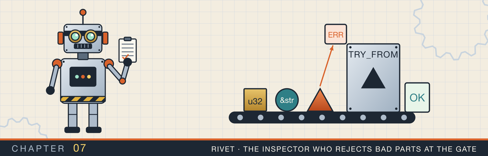
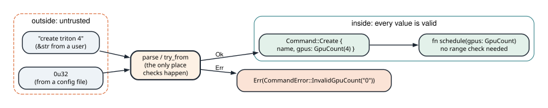
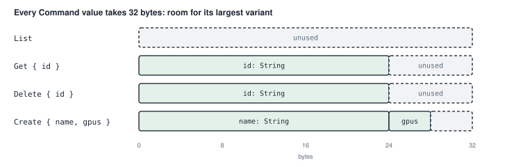
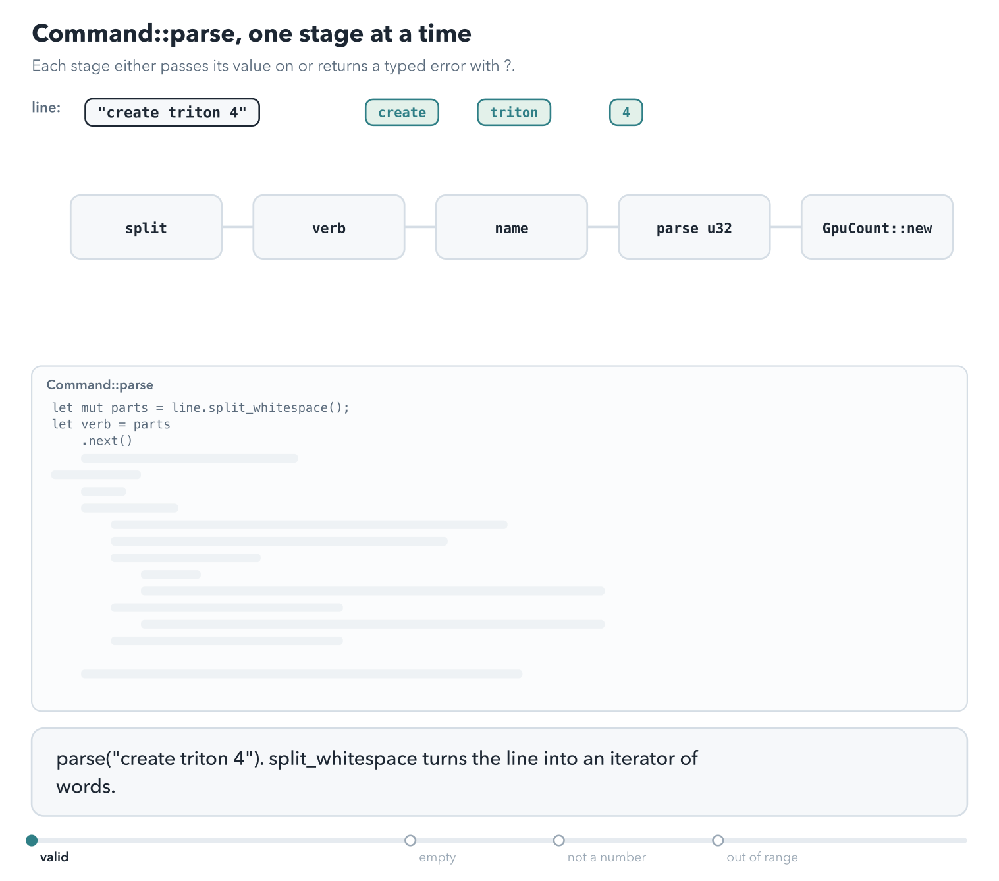
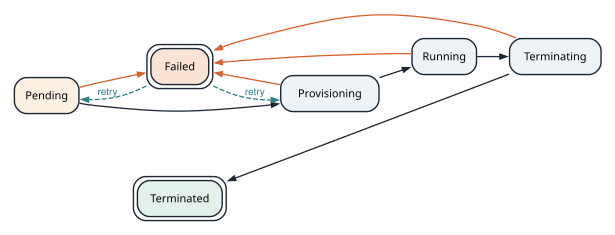

# Types that refuse bad input

<div class="covers" markdown="1">

This chapter covers

- Traits: what they are, how to implement one, and what `#[derive]` generates automatically
- A newtype: a struct around one number that can only hold valid values
- Error types that say what went wrong, with `Display` and `std::error::Error`
- Converting between types with `From` and `TryFrom`
- Enums whose variants carry data, used for commands, for states, and for errors
- A parser that turns a line of text into a typed command

</div>

Robust systems enforce domain invariants at compile time through algebraic data types rather than scattering defensive runtime checks across business logic. By restricting construction to validated boundaries, custom structs and enums make invalid program states unrepresentable.

The implementations below model a command-line control plane that manages compute jobs, termed **workloads**, on a remote cluster. Each workload requests between 1 and 64 GPUs and transitions through discrete lifecycle states such as `Pending`, `Running`, and `Terminated`. Users issue text commands such as `create triton 4`, requesting a workload named `triton` with 4 GPUs.

Input validation illustrates the core architectural invariant. A GPU count arrives as untrusted text, and inputs such as `0`, `99`, or `many` must be rejected before reaching scheduling logic. Revalidating raw integers in every downstream function is brittle because a single omitted guard permits corrupt state to propagate. Validating once at the ingress boundary and encapsulating the result in a private-field newtype guarantees that every downstream function receiving that type observes a valid count by construction.

The implementation progresses through seven stages:

1. Section 7.1 formalizes traits and automatic derivation.
2. Section 7.2 defines the validated `GpuCount` newtype.
3. Section 7.3 defines a structured error type for rejected counts.
4. Section 7.4 implements standard `From` and `TryFrom` conversions.
5. Section 7.5 models CLI commands as a tagged union enum with a text parser.
6. Section 7.6 encodes workload lifecycle states and transition rules as a finite state machine.
7. Section 7.7 models structured remote API errors with retry classification.

## 7.1 Traits

A **trait** defines a set of methods that a type guarantees to provide. The standard library supplies many traits; for example, `Display` defines a single method, `fmt`, that formats a value as human-readable text. Any type implementing `Display` can be formatted with `println!("{}", x)`.

A trait is implemented for a type via an `impl` block naming both the trait and the type:

```rust
impl fmt::Display for GpuCountError {
    fn fmt(&self, formatter: &mut fmt::Formatter<'_>) -> fmt::Result {
        write!(formatter, "...")
    }
}
```

For common traits with mechanical implementations, the compiler can generate the code automatically. Placing `#[derive(Debug, Clone, PartialEq)]` above a struct generates `Debug` (formatting with `{:?}`), `Clone` (duplicating with `.clone()`), and `PartialEq` (comparing with `==`), operating field by field.

Table 7.1 summarizes the traits used in this chapter.

| Trait | What it gives you | How you get it |
|---|---|---|
| `Debug` | printing with `{:?}`, for programmers | `#[derive(Debug)]` |
| `Display` | printing with `{}`, for users | write `impl Display` yourself |
| `Clone`, `Copy` | `.clone()`, and for `Copy`, copying by assignment | derive |
| `PartialEq`, `Eq` | `==` and `!=` | derive |
| `PartialOrd`, `Ord` | `<`, `>`, and sorting | derive |
| `Hash` | use as a `HashMap` key | derive |
| `std::error::Error` | use as an error with `?` and `Box<dyn Error>` | write an empty `impl` once `Debug` and `Display` exist |
| `From`, `TryFrom` | conversions between types | write `impl` yourself |

## 7.2 A GPU count that is always valid

A **newtype** is a single-field struct that wraps a primitive value in a distinct type. Here, a `GpuCount` wraps a `u32`.

The enforcement mechanism is field privacy. Struct fields in Rust are private by default, so code outside the defining module cannot read or modify the inner field directly, nor can it construct `GpuCount(0)`. Callers can obtain a `GpuCount` exclusively through the module's public constructors. Because those constructors validate the range, every `GpuCount` instance in the program is guaranteed valid, as illustrated in Figure 7.1.

<figure>

<figcaption><b>Figure 7.1</b> Checks happen once, at the gate. Inside, the types guarantee the values are valid.</figcaption>
</figure>

The module opens with a documentation comment summarizing its design principles:

<p class="listing"><b>Listing 7.1</b> The module comment (lines 1 to 12). <a href="https://github.com/arpanpathak/cracking-the-systems-programming-interview/blob/prep-v2/rust-interview-lab/src/problems/adt_idioms.rs">src/problems/adt_idioms.rs</a></p>

```rust
{{#include ../../rust-interview-lab/src/problems/adt_idioms.rs:1:12}}
```

Listing 7.2 defines the `GpuCount` type:

<p class="listing"><b>Listing 7.2</b> <code>GpuCount</code> (lines 14 to 36).</p>

```rust
{{#include ../../rust-interview-lab/src/problems/adt_idioms.rs:14:36}}
```

- `pub struct GpuCount(u32);` is a **tuple struct**, a struct whose fields are addressed by position rather than name. The type itself is public, while its inner field remains private.
- `pub const MIN: u32 = 1;` and `MAX` are **associated constants** belonging to the type, referenced as `GpuCount::MIN` externally or `Self::MIN` inside the `impl` block.
- `new` acts as the validation gate. The inclusive range `(Self::MIN..=Self::MAX)` covers `1` through `64`, and `.contains(&value)` tests membership. Valid values yield `Ok(Self(value))`, whereas out-of-range values yield `Err(GpuCountError(value))`, carrying the rejected input (defined in Section 7.3).
- `get` extracts the inner `u32`. Taking `self` by value is inexpensive because `GpuCount` derives `Copy`.

The `#[derive(...)]` attribute equips `GpuCount` with the same standard capabilities as the underlying `u32`, allowing it to be formatted, copied, compared, ordered, and used as a hash map key.

## 7.3 An error that says what went wrong

When `new` rejects an out-of-range value, it returns a `GpuCountError` (Listing 7.3).

<p class="listing"><b>Listing 7.3</b> The error type (lines 38 to 54).</p>

```rust
{{#include ../../rust-interview-lab/src/problems/adt_idioms.rs:38:54}}
```

`GpuCountError(pub u32)` preserves the rejected value in a public field so callers can inspect the exact invalid input.

The `Display` implementation formats a human-readable diagnostic message. Like `format!`, the `write!` macro formats arguments directly into the provided formatter, producing output such as `gpu count 0 is outside 1..=64`.

The `impl std::error::Error for GpuCountError {}` block has an empty body because every method on `Error` provides a default implementation, requiring only that the type implement `Debug` and `Display`. Implementing `std::error::Error` integrates `GpuCountError` with generic error-handling interfaces such as `Box<dyn std::error::Error>`, used in Section 7.5.

## 7.4 Converting with `From` and `TryFrom`

The standard library provides two traits for explicit type conversions:

- `From<A> for B` models infallible conversions. Implementing it provides both `B::from(a)` and the reciprocal `a.into()` wherever a `B` is expected.
- `TryFrom<A> for B` models fallible conversions, returning a `Result`. Implementing it provides both `B::try_from(a)` and `a.try_into()`.

<p class="listing"><b>Listing 7.4</b> The two conversions (lines 56 to 68).</p>

```rust
{{#include ../../rust-interview-lab/src/problems/adt_idioms.rs:56:68}}
```

Converting from `u32` to `GpuCount` can fail and therefore implements `TryFrom`. Its body delegates to `new` so the validation logic remains in one place, and `type Error = GpuCountError;` declares the associated error type.

Converting from `GpuCount` back to `u32` is infallible and implements `From`, returning the inner field `count.0`.

<div class="callout tip" markdown="1">

**TIP:** Rust also provides the `as` cast operator (such as `x as u32`), which never reports failure: casting `300` to `u8` with `as` wraps to `44` without warning. Prefer `From` for infallible conversions and `TryFrom` for fallible ones, reserving `as` for cases where intentional truncation or bit-level conversion is desired.

</div>

## 7.5 Commands: an enum that carries data

### 7.5.1 Why an enum

The CLI supports four commands: `list` takes no arguments, `get` and `delete` each take an identifier, and `create` takes a name and a GPU count. A struct-based design might collect all optional fields into a single type:

```rust
struct Command {
    verb: String,
    id: Option<String>,        // only for get and delete
    name: Option<String>,      // only for create
    gpus: Option<u32>,         // only for create
}
```

That struct permits invalid combinations, such as a `get` command without an identifier or a `list` command carrying a GPU count, forcing every downstream consumer to revalidate which fields apply to the verb. An enum whose variants carry variant-specific payloads eliminates those invalid states at compile time:

<p class="listing"><b>Listing 7.5</b> The command enum (lines 70 to 77).</p>

```rust
{{#include ../../rust-interview-lab/src/problems/adt_idioms.rs:70:77}}
```

A `Create` variant is guaranteed to contain both a `name` and a validated `GpuCount`, because the compiler forbids constructing it otherwise, whereas `List` carries no fields. In memory, every `Command` value occupies the size of its largest variant, as illustrated in Figure 7.2.

<figure>

<figcaption><b>Figure 7.2</b> A <code>Command</code> is 32 bytes. Rust also records which variant a value is. Here it stores that in bit patterns the <code>String</code> never uses, so no extra byte is needed.</figcaption>
</figure>

### 7.5.2 The parser's errors and helper

Before examining the parser itself, consider its error representation and helper function. Assigning each failure mode a distinct error variant allows callers to determine the exact cause of a malformed line.

<p class="listing"><b>Listing 7.6</b> <code>CommandError</code> and <code>argument</code> (lines 119 to 148).</p>

```rust
{{#include ../../rust-interview-lab/src/problems/adt_idioms.rs:119:148}}
```

`CommandError` enumerates every parsing failure mode, and its `Display` implementation formats a message for each variant. Because errors are typed variants rather than opaque strings, callers can `match` on them directly, such as displaying usage help on `MissingArgument` or printing the valid range on `InvalidGpuCount`. With a plain `String` error, callers would have to parse the error text to distinguish failure cases.

The helper `argument` extracts the next whitespace-delimited token from the iterator or fails with the missing parameter's name. Its first parameter, `&mut impl Iterator<Item = &'a str>`, mutably borrows the caller's iterator so each call consumes one token. The explicit lifetime `'a` binds the returned `&str` to the input line, deferring heap allocation until `parse` invokes `to_string()`.

### 7.5.3 Parsing a line of text

Parsing translates a single line of text into either a validated `Command` or an error describing the syntax or domain violation.

<p class="listing"><b>Listing 7.7</b> <code>Command::parse</code> and <code>verb</code> (lines 79 to 117).</p>

```rust
{{#include ../../rust-interview-lab/src/problems/adt_idioms.rs:79:117}}
```

The `parse` method returns `Result<Self, CommandError>`, producing either a validated command or the specific reason the line failed. Tracing `Command::parse("create triton 4")` step by step yields:

| Step | Code | Result |
|---|---|---|
| 1 | `line.split_whitespace()` | an iterator over `"create"`, `"triton"`, `"4"` |
| 2 | `parts.next().ok_or(CommandError::Empty)?` | `verb` is `"create"` |
| 3 | `match verb` | runs the `"create"` arm |
| 4 | `argument(&mut parts, "name")?` | `"triton"`, turned into a `String` |
| 5 | `argument(&mut parts, "gpu count")?` | `raw` is `"4"` |
| 6 | `raw.parse()` | the number 4 |
| 7 | `GpuCount::new(value)` | `GpuCount(4)` |
| 8 | `Ok(Self::Create { name, gpus })` | the finished command |

Malformed inputs fail at the exact stage where validation breaks down. An empty line fails at step 2 because no initial token exists; `ok_or` converts `None` into `Err(CommandError::Empty)`, and `?` returns it immediately. The input `create triton many` fails at step 6 because `"many"` cannot be parsed as an integer, whereas `create triton 0` passes integer parsing at step 6 and is rejected at step 7 by `GpuCount::new`.

Animation 7.1 traces both the valid command and the three malformed inputs through these stages.

<figure class="anim">
<video class="motion" src="figures/ch07-parse-trace.mp4" autoplay loop muted playsinline preload="metadata" aria-label="Five stages in a row: split, verb, name, parse u32, and GpuCount::new. The line create triton 4 is split into three words; the verb is create, the name triton, the count parses as 4, and GpuCount::new accepts it, so parse returns Ok of a Create command. An empty line fails at the verb with Err of Empty. create triton many fails at parse u32 with InvalidGpuCount of many. create triton 0 parses as 0 and fails at GpuCount::new, because 0 is outside 1 to 64, with InvalidGpuCount of 0." data-chapters="[[0.0, &quot;valid&quot;], [21.42, &quot;empty&quot;], [29.82, &quot;not a number&quot;], [38.82, &quot;out of range&quot;]]"></video>
<figcaption><b>Animation 7.1</b> Each <code>?</code> either passes a value to the next stage or returns a typed error. A count of 0 gets past parsing and stops at the type's gate.</figcaption>
</figure>

Although steps 6 and 7 fail for different underlying reasons, both map to the same domain error. Calling `.map_err(|_| CommandError::InvalidGpuCount(raw.to_string()))` converts either failure into `InvalidGpuCount`, preserving the original token so the diagnostic message echoes the user's input.

The `verb` method performs the inverse mapping from a command variant to its static verb name. Patterns such as `Self::Get { .. }` match a variant while ignoring its payload fields.

### 7.5.4 Adding up without an index

The module includes one additional utility function:

<p class="listing"><b>Listing 7.8</b> <code>summarize</code> (lines 150 to 157).</p>

```rust
{{#include ../../rust-interview-lab/src/problems/adt_idioms.rs:150:157}}
```

The `fold` combinator traverses the slice in a single pass while threading an accumulator `(count, sum)` initialized to `(0, 0)`. Widening each `i32` via `i64::from(*value)` uses an infallible `From` conversion, guaranteeing no loss of precision.

### 7.5.5 The complete file

<p class="listing"><b>Listing 7.9</b> The complete file, with its tests. <a href="https://github.com/arpanpathak/cracking-the-systems-programming-interview/blob/prep-v2/rust-interview-lab/src/problems/adt_idioms.rs">src/problems/adt_idioms.rs</a></p>

```rust
{{#include ../../rust-interview-lab/src/problems/adt_idioms.rs}}
```

The unit tests serve as an executable specification of the module. `parses_each_command_variant` verifies one valid input per variant, `rejects_bad_input_with_typed_errors` asserts exact error equality with `assert_eq!` (enabled by deriving `PartialEq` on `CommandError`), and `newtype_rejects_out_of_range_values` checks both boundary values (`1` and `64`) along with the adjacent out-of-range values.

Because Cargo executes unit tests concurrently, their reporting order may vary across runs:

```text
$ cargo test --lib adt_idioms
running 5 tests
test problems::adt_idioms::tests::newtype_rejects_out_of_range_values ... ok
test problems::adt_idioms::tests::summarize_reports_count_and_sum ... ok
test problems::adt_idioms::tests::rejects_bad_input_with_typed_errors ... ok
test problems::adt_idioms::tests::parses_each_command_variant ... ok
test problems::adt_idioms::tests::errors_render_a_reason ... ok

test result: ok. 5 passed; 0 failed
```

Whereas `Command` models user requests, the next section applies enums to entities whose state evolves over time.

## 7.6 The states of a workload

A workload is accepted (`Pending`), receives compute resources (`Provisioning`), executes (`Running`), shuts down (`Terminating`), and completes (`Terminated`). Any active state may transition to `Failed`, and a failed workload may be retried. Modeling a finite set of states together with the permitted transitions between them defines a **state machine** (Figure 7.3).

<figure>

<figcaption><b>Figure 7.3</b> The workload's states. Double borders mark states where the workload holds no machines. Dashed arrows are retries.</figcaption>
</figure>

<p class="listing"><b>Listing 7.10</b> The states (lines 1 to 18). <a href="https://github.com/arpanpathak/cracking-the-systems-programming-interview/blob/prep-v2/rust-interview-lab/src/problems/state_machine.rs">src/problems/state_machine.rs</a></p>

```rust
{{#include ../../rust-interview-lab/src/problems/state_machine.rs:1:18}}
```

Each state is a unit variant carrying no payload. Rust represents this enum in a single byte and derives `Copy`, allowing states to be passed by value.

<p class="listing"><b>Listing 7.11</b> The allowed moves (lines 20 to 56).</p>

```rust
{{#include ../../rust-interview-lab/src/problems/state_machine.rs:20:56}}
```

`can_transition_to` validates a single transition from `self` to `next` by matching on the tuple `(self, next)`, where each arm corresponds to edges in Figure 7.3. Joining patterns with `|` forms an **or-pattern**: the first arm enumerates all forward and failure transitions, the second enumerates retries, and the catch-all arm `_` rejects every other pair.

That final catch-all establishes a deny-by-default policy. If a new state is added later, all transitions into or out of it are rejected until explicitly permitted, which is the safest default for a state machine.

`is_terminal` delegates to the `matches!` macro, returning `true` when the value matches the given pattern. `Failed` is classified as terminal despite permitting retries because it holds no active compute resources. Finally, `summary` returns a fixed description with type `&'static str`, indicating a string literal embedded in the binary that remains valid for the entire program lifetime.

## 7.7 Errors from a server

The same module models structured errors returned by a remote server, where each failure category carries distinct metadata.

<p class="listing"><b>Listing 7.12</b> <code>ApiError</code> and its methods (lines 58 to 91).</p>

```rust
{{#include ../../rust-interview-lab/src/problems/state_machine.rs:58:91}}
```

A rate-limit error specifies the required backoff duration, a not-found error identifies the missing resource, and a server error carries both an HTTP status code and a diagnostic message.

The `is_retryable` method answers a standard client decision: whether retrying the request can succeed. Rate limits expire and HTTP `5xx` server errors are often transient, making both retryable, whereas a missing resource remains absent. A single pattern expresses this policy:

```rust
Self::RateLimited { .. } | Self::Server { status: 500..=599, .. }
```

Inside the struct pattern, `status: 500..=599` matches any HTTP 5xx status code while `..` ignores the remaining fields. A client retry policy can query this predicate directly to separate transient failures from permanent errors.

The `user_message` method formats each variant into a human-readable string, converting `retry_after` to milliseconds via `retry_after.as_millis()`.

<p class="listing"><b>Listing 7.13</b> A small parser (lines 93 to 101).</p>

```rust
{{#include ../../rust-interview-lab/src/problems/state_machine.rs:93:101}}
```

The `parse_gpu_count` helper provides a compact variant of the validation gate from Section 7.2. It trims surrounding whitespace, handles empty strings explicitly, and maps the standard library's integer parse error into `ApiError::InvalidRequest`. Formatting with `{raw:?}` quotes the input so empty or whitespace-padded strings remain visible in the diagnostic message.

<p class="listing"><b>Listing 7.14</b> The complete file, with its tests. <a href="https://github.com/arpanpathak/cracking-the-systems-programming-interview/blob/prep-v2/rust-interview-lab/src/problems/state_machine.rs">src/problems/state_machine.rs</a></p>

```rust
{{#include ../../rust-interview-lab/src/problems/state_machine.rs}}
```

The unit tests verify an allowed transition, two disallowed transitions, the retry classification across three error variants, and the input parser.

<div class="summary" markdown="1">

## Summary

- A trait specifies an interface contract implemented either manually via `impl Trait for Type` or automatically via `#[derive]`.
- A newtype encapsulating a private field behind a validating constructor enforces domain invariants at the ingress boundary, eliminating redundant downstream checks.
- Custom error types implementing `Display` and `std::error::Error` carry structured diagnostic context and integrate directly with the `?` operator.
- `From` encodes infallible value conversions, whereas `TryFrom` encodes fallible conversions returning `Result`.
- Tagged union enums whose variants carry variant-specific payloads eliminate invalid field combinations inherent in structs of `Option` fields, occupying the size of their largest variant plus any required discriminant.
- Boundary parsers transform untrusted text into typed domain values, using `map_err` to translate low-level parse failures into structured domain errors.
- Exhaustive pattern matching over `(current, next)` state pairs defines a deny-by-default finite state machine in which a catch-all `_` arm rejects every unlisted transition.
- Structured error enums carry failure-specific metadata and expose domain predicates such as `is_retryable`.

</div>

## Exercises

1. Write a `Port` newtype for network ports that rejects 0, with a `TryFrom<u16>` implementation and its own
   error type.
2. Implement the `FromStr` trait for `Command`, so that `"list".parse::<Command>()` works. Its method can
   call `Command::parse`.
3. Add a `Suspended` state to `WorkloadState` that can be entered from `Running` and left back to `Running`,
   and add tests for both moves.
4. Give `ApiError` a `Display` implementation that uses `user_message`, then implement `std::error::Error`
   for it.
