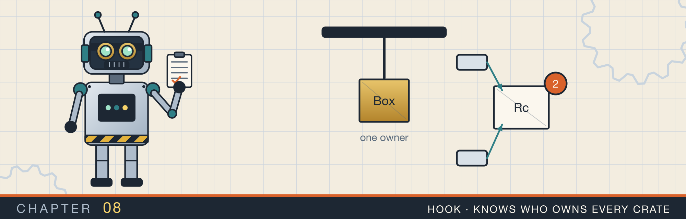
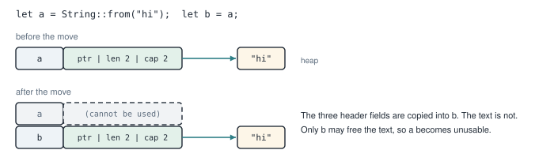
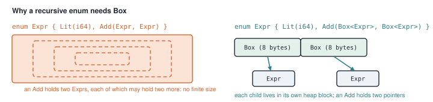
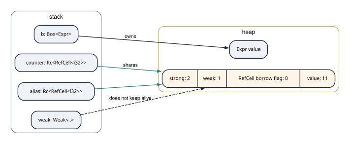
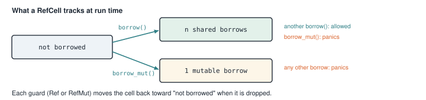
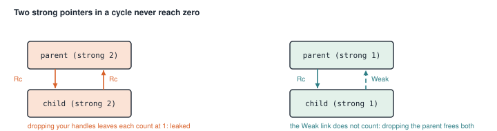
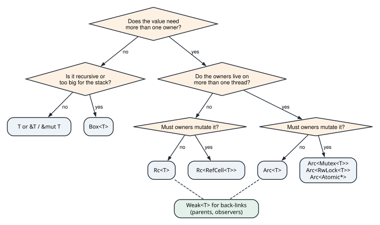

# Ownership and the pointer types

<div class="covers" markdown="1">

This chapter covers

- Ownership and moves, drawn in memory
- `Box`: putting a value on the heap, and why recursive types need it
- `Rc`: one value with several owners, counted
- `RefCell`: changing a value that has several owners, checked while the program runs
- `Weak`: a pointer that does not keep its value alive, and the leak it prevents
- `Arc` and `Mutex`: sharing and changing a value across threads
- `Cow`: borrowing when possible and copying only when needed

</div>

Rust's default affine ownership discipline assigns every value a single static owner and enforces aliasing XOR mutability at compile time. Although single ownership suffices for tree-structured, non-cyclic values, recursive data types, shared graph nodes, parent back-links, and cross-thread mutable state require explicit indirection, reference counting, or dynamic synchronization.

The Rust standard library models these ownership and mutability disciplines through **smart pointer types**. Each smart pointer encapsulates a heap address or interior-mutability guard while preserving memory safety through compile-time trait bounds or runtime checks. The sections below formalize the memory layout, invariants, and tradeoffs of `Box`, `Rc`, `RefCell`, `Weak`, `Arc`, `Mutex`, and `Cow`, beginning with a concise review of baseline move and borrow semantics.

## 8.1 Ownership and moves

Every value in Rust has a single **owner**, the variable or container responsible for it. When the owner leaves scope, the value is dropped and its memory is reclaimed.

Assigning a non-`Copy` value to another variable **moves** it: ownership transfers to the new binding, and the previous binding becomes unusable (Figure 8.1).

<figure>

<figcaption><b>Figure 8.1</b> Moving a <code>String</code>. The small header is copied; the heap text is not. Only one variable may free the text, so the old one becomes unusable.</figcaption>
</figure>

A move copies only the stack-resident header (pointer, length, and capacity), leaving the heap allocation untouched. If both `a` and `b` remained valid, both would attempt to free the same heap buffer on drop; invalidating `a` prevents that double free at compile time.

Instead of transferring ownership, code can **borrow** a value through a reference. A shared reference (`&T`) grants read-only access, whereas a mutable reference (`&mut T`) grants exclusive read-write access. The borrow checker enforces two invariants: at any point, a value may have either any number of shared references or a single mutable reference, never both; and no reference may outlive the value it borrows.

These static rules govern most programs. The pointer types below address cases that require heap indirection, shared ownership, or dynamic borrow checking.

Listing 8.1 presents the module header and summary table for these types.

<p class="listing"><b>Listing 8.1</b> The module comment and imports (lines 1 to 27). <a href="https://github.com/arpanpathak/cracking-the-systems-programming-interview/blob/prep-v2/rust-interview-lab/src/problems/smart_pointers.rs">src/problems/smart_pointers.rs</a></p>

```rust
{{#include ../../rust-interview-lab/src/problems/smart_pointers.rs:1:27}}
```

There is no need to memorize the table up front; each subsequent section covers one row in detail.

## 8.2 `Box`: one owner, on the heap

A `Box<T>` allocates a value of type `T` on the heap and retains sole ownership of it. On a 64-bit architecture, the `Box` itself is an 8-byte pointer. When the `Box` leaves scope, it drops the pointee and frees the heap allocation, behaving like an owned value stored indirectly.

The primary use case for `Box` is defining recursive types. Consider an arithmetic expression that is either a numeric literal or the sum of two subexpressions. Without indirection, such a type would have infinite size (Figure 8.2).

<figure>

<figcaption><b>Figure 8.2</b> Left: an <code>Add</code> that contains two <code>Expr</code> values directly would need infinite space. Right: with <code>Box</code>, an <code>Add</code> holds two pointers.</figcaption>
</figure>

To compute a type's memory layout, the compiler requires a finite, statically known size. An `Add(Expr, Expr)` variant embeds two `Expr` values directly, each of which could itself be another `Add`, causing the size calculation to diverge. Because `Box<Expr>` always occupies 8 bytes regardless of what it points to, `Add(Box<Expr>, Box<Expr>)` has a fixed size.

<p class="listing"><b>Listing 8.2</b> An expression tree (lines 29 to 43).</p>

```rust
{{#include ../../rust-interview-lab/src/problems/smart_pointers.rs:29:43}}
```

The `eval` function computes the numeric value of an expression: literals return their stored integer, and sums recursively evaluate both operands and add the results. Passing `left` (of type `&Box<Expr>`) where `&Expr` is expected succeeds through **deref coercion**, an automatic conversion that follows the `Box` pointer to its target.

Constructing `1 + 2` uses `Expr::Add(Box::new(Expr::Lit(1)), Box::new(Expr::Lit(2)))`, where `Box::new` allocates heap storage and moves each operand into it.

## 8.3 `Rc`: several owners, counted

Some structures inherently require multiple owners with no single owner responsible for deallocation, such as a graph node with multiple incoming edges. For single-threaded shared ownership, Rust provides `Rc<T>` (**reference counted**).

Calling `Rc::new(value)` allocates the value on the heap alongside a count of active handles. Calling `Rc::clone(&rc)` does not duplicate the underlying data; it increments the strong count and returns a new handle to the same allocation. Dropping a handle decrements the count, and when the count reaches zero, the value is dropped and freed (Figure 8.3).

<figure>

<figcaption><b>Figure 8.3</b> Two <code>Rc</code> handles share one heap block. The block holds a strong count (the number of <code>Rc</code> handles), a weak count (section 8.5), and the value.</figcaption>
</figure>

Because multiple owners share the allocation, `Rc` exposes only shared references (`&T`). Issuing a `&mut T` through one handle would violate Rust's aliasing invariant. Mutating shared data therefore requires interior mutability, covered in the next section.

<div class="callout note" markdown="1">

**NOTE:** `Rc` updates its reference count with non-atomic arithmetic. Concurrent updates from multiple threads would cause a data race, so the compiler forbids sending an `Rc` across thread boundaries. Section 8.6 covers `Arc`, the thread-safe counterpart.

</div>

## 8.4 `RefCell`: changing a shared value, checked at run time

A `RefCell<T>` enables mutation through a shared reference by enforcing Rust's borrowing rules at run time rather than compile time (Figure 8.4).

<figure>

<figcaption><b>Figure 8.4</b> The borrow states of a <code>RefCell</code>. Breaking the rules is not a compile error; it panics when it happens.</figcaption>
</figure>

- `cell.borrow()` returns a `Ref<T>` guard behaving like `&T`; multiple shared guards may coexist.
- `cell.borrow_mut()` returns a `RefMut<T>` guard behaving like `&mut T`; it panics if any other borrow is active.
- Dropping a guard releases its borrow.

Combining `Rc` and `RefCell` as `Rc<RefCell<T>>` provides multiple owners with runtime-checked mutable access to the same value.

<p class="listing"><b>Listing 8.3</b> Two handles to one counter (lines 45 to 55).</p>

```rust
{{#include ../../rust-interview-lab/src/problems/smart_pointers.rs:45:55}}
```

Tracing the five statements of Listing 8.3 clarifies how reference counting and dynamic borrow guards interact:

1. `Rc::new(RefCell::new(0))` allocates a heap control block initialized to `0` with a strong count of `1`.
2. `Rc::clone(&counter)` creates a second handle `alias` to the same allocation, incrementing the strong count to `2` without duplicating the underlying integer.
3. `*alias.borrow_mut() += 1;` acquires a temporary `RefMut` guard through `alias`, increments the value to `1`, and drops the guard at the semicolon, immediately releasing the exclusive borrow.
4. `*counter.borrow_mut() += 10;` acquires and releases a second exclusive guard through `counter`, advancing the value to `11`.
5. `*counter.borrow()` acquires a shared `Ref` guard and reads `11`.

Animation 8.1 illustrates these operations alongside the strong count and `RefCell` borrow state stored in the heap allocation.

<figure class="anim">
<video class="motion" src="figures/ch08-rc-refcell.mp4" autoplay loop muted playsinline preload="metadata" aria-label="Two stack variables, counter and alias, point at one heap block showing a strong count, a RefCell flag, and a value. Rc::new creates the block with count 1 and value 0; Rc::clone adds alias and the count becomes 2. borrow_mut through alias sets the flag to mutably borrowed, the value becomes 1, and the flag clears when the guard is dropped. The same through counter makes the value 11, and borrow reads it with a shared borrow. Dropping alias and counter brings the count to 0, and the block is freed. In a last run a guard g is kept alive, and a second borrow_mut panics with already borrowed." data-chapters="[[0.0, &quot;two handles&quot;], [7.98, &quot;borrow&quot;], [26.34, &quot;drop&quot;], [36.3, &quot;two guards&quot;]]"></video>
<figcaption><b>Animation 8.1</b> Two handles, one value. Each guard ends its borrow when it is dropped; a guard kept alive makes the next <code>borrow_mut</code> panic at run time.</figcaption>
</figure>

Because each `borrow_mut` guard is dropped at the end of its statement, no borrows overlap and no panic occurs. Retaining the first guard in a local binding while invoking `borrow_mut` a second time triggers a runtime panic.

## 8.5 `Weak`: a pointer that does not own

Reference counting has a structural limitation: if two allocations hold `Rc` handles to each other, neither strong count can reach zero even after all external handles are dropped. This **reference cycle** leaks memory (Figure 8.5, left).

<figure>

<figcaption><b>Figure 8.5</b> Left: a cycle of strong pointers is never freed. Right: making the back-link <code>Weak</code> breaks the cycle.</figcaption>
</figure>

Breaking a cycle requires a non-owning pointer. Calling `Rc::downgrade` produces a `Weak<T>` handle that increments the weak count rather than the strong count and does not prevent deallocation. Accessing the target requires calling `upgrade()`, which returns `Some(Rc<T>)` if the allocation is still alive and `None` if it has been dropped.

In hierarchical structures, parents typically own children via `Rc` while children hold non-owning `Weak` back-links to their parents.

<p class="listing"><b>Listing 8.4</b> A tree node with a weak parent pointer (lines 57 to 87).</p>

```rust
{{#include ../../rust-interview-lab/src/problems/smart_pointers.rs:57:87}}
```

- `parent: RefCell<Weak<TreeNode>>` encapsulates the non-owning back-link inside a `RefCell` so parent attachment can be updated after node construction.
- `root` constructs a node with `Weak::new()`, a null weak reference whose `upgrade` always yields `None`.
- `child_of` binds the child's parent field to `Rc::downgrade(parent)`, incrementing only the parent's weak count.
- `parent_value` borrows the `RefCell`, attempts `upgrade()`, and projects the parent's integer payload via `Option::map` if the parent allocation remains alive.

The test `weak_parent_link_does_not_keep_the_parent_alive` in Listing 8.7 verifies this behavior. Animation 8.2 traces that test and contrasts it with the leak caused by bidirectional `Rc` links.

<figure class="anim">
<video class="motion" src="figures/ch08-weak-parent.mp4" autoplay loop muted playsinline preload="metadata" aria-label="Stack variables root and child point at two heap nodes, each showing strong and weak counts. child_of gives the child a dashed Weak link to root, which raises root's weak count to 1 and leaves its strong count at 1. parent_value upgrades the link and returns Some(1). drop(root) brings root's strong count to 0, the node is freed, and parent_value returns None. In a second run both links are Rc: dropping both variables leaves each node with a strong count of 1, held by the other, and the pair is leaked." data-chapters="[[0.0, &quot;weak link&quot;], [16.86, &quot;drop root&quot;], [26.1, &quot;Rc both ways&quot;]]"></video>
<figcaption><b>Animation 8.2</b> A <code>Weak</code> parent link lets the parent be freed. With <code>Rc</code> in both directions, each node keeps the other alive forever.</figcaption>
</figure>

Once `root` is dropped, its strong count reaches zero and the node is deallocated, causing subsequent `parent_value()` calls on `child` to return `None`.

## 8.6 `Arc` and `Mutex`: sharing across threads

`Arc<T>` is the thread-safe counterpart to `Rc<T>`, maintaining its reference count through hardware **atomic** instructions. An atomic read-modify-write executes indivisibly across processor cores, preventing data races on the reference count and allowing `Arc` handles to cross thread boundaries safely.

`Mutex<T>` is the thread-safe counterpart to `RefCell<T>`. Calling `lock()` acquires mutual exclusion and returns a `MutexGuard`; if another thread already holds the lock, the calling thread blocks until the guard is dropped rather than panicking.

<p class="listing"><b>Listing 8.5</b> Several threads adding to one total (lines 89 to 110).</p>

```rust
{{#include ../../rust-interview-lab/src/problems/smart_pointers.rs:89:110}}
```

The concurrent accumulation in Listing 8.5 proceeds in five steps:

1. `Arc::new(Mutex::new(0usize))` allocates a mutex-protected counter with an atomic strong count of `1`.
2. For each worker, `Arc::clone(&total)` increments the atomic reference count, and `thread::spawn(move || ...)` transfers ownership of that cloned handle into the spawned thread's closure.
3. Each worker acquires the lock, increments the protected counter, and drops the `MutexGuard` on every iteration for `per_thread` cycles.
4. `handle.join()` synchronizes with each worker thread's termination before proceeding.
5. The final lock acquisition reads the aggregated total once all workers have exited.

If a thread panics while holding a `MutexGuard`, the protected state may violate its invariants; subsequent `lock()` calls return an `Err` indicating mutex **poisoning**. Calling `.expect("mutex poisoned")` propagates that failure by panicking.

Acquiring a mutex on every individual increment serializes all worker threads on a single cache line, degrading throughput under contention. Accumulating into a thread-local counter and locking once per thread eliminates that contention bottleneck.

## 8.7 `Cow`: borrowing when possible

The enum `Cow<'a, str>` (short for *clone on write*) holds either a borrowed `&'a str` or an owned `String`. It is suited to functions that usually return their input unmodified and allocate only when a transformation is required.

<p class="listing"><b>Listing 8.6</b> Uppercase only when needed (lines 112 to 126).</p>

```rust
{{#include ../../rust-interview-lab/src/problems/smart_pointers.rs:112:126}}
```

In Listing 8.6, `normalize` scans the input bytes for any ASCII lowercase letter. When no conversion is needed, it returns `Cow::Borrowed(input)` without allocating. Only when modification is required does it allocate an uppercase `String` and return `Cow::Owned`. Callers can dereference either variant transparently as a `&str`.

## 8.8 The complete file

<p class="listing"><b>Listing 8.7</b> The complete file, with its tests. <a href="https://github.com/arpanpathak/cracking-the-systems-programming-interview/blob/prep-v2/rust-interview-lab/src/problems/smart_pointers.rs">src/problems/smart_pointers.rs</a></p>

```rust
{{#include ../../rust-interview-lab/src/problems/smart_pointers.rs}}
```

The unit tests verify one core property per pointer type. Notably, `cow_borrows_and_owns_as_needed` uses `matches!` to verify the returned enum variant rather than comparing text alone, proving that the unchanged path performs no heap allocation. Run the suite with `cargo test --lib smart_pointers`.

Figure 8.6 distills the chapter into a three-question decision tree for selecting the appropriate pointer type.

<figure>

<figcaption><b>Figure 8.6</b> Choosing a pointer type: owners first, then threads, then whether the owners change the value.</figcaption>
</figure>

<div class="summary" markdown="1">

## Summary

- Rust's affine ownership model assigns every value a single static owner: assignment transfers ownership by copying only the stack header, whereas borrowing grants temporary shared or exclusive access without moving ownership.
- `Box<T>` provides single-owner heap indirection with a fixed pointer size, enabling recursive algebraic types to have statically known layouts.
- `Rc<T>` enables single-threaded shared ownership via non-atomic reference counting; `Rc::clone` increments the strong count without duplicating the pointee.
- `RefCell<T>` provides single-threaded interior mutability by enforcing aliasing XOR mutability at runtime, panicking on overlapping conflicting borrows.
- Bidirectional `Rc` cycles prevent strong counts from reaching zero and leak memory; `Weak<T>` provides a non-owning reference that breaks cycles and upgrades to `Option<Rc<T>>`.
- `Arc<T>` uses atomic reference counting for cross-thread shared ownership, and `Mutex<T>` enforces mutual exclusion by blocking contending threads until the active `MutexGuard` is dropped.
- `Cow<'a, T>` defers heap allocation by returning borrowed data unchanged and cloning into an owned buffer only when mutation is required.

</div>

## Exercises

1. Build the expression `(1 + 2) + 3` with `Expr` and check that `eval` returns 6.
2. In `shared_counter_with_rc_refcell`, keep the first `borrow_mut` guard in a variable and call
   `borrow_mut` again. Run it and read the panic message.
3. Build a parent with two children that point back with `Weak`. Print `Rc::strong_count` and `Rc::weak_count`
   for the parent before and after creating the children.
4. Change `total_with_arc_mutex` so each thread counts in a local variable and adds its total to the mutex
   once. Compare the running time for 8 threads and one million increments each.
