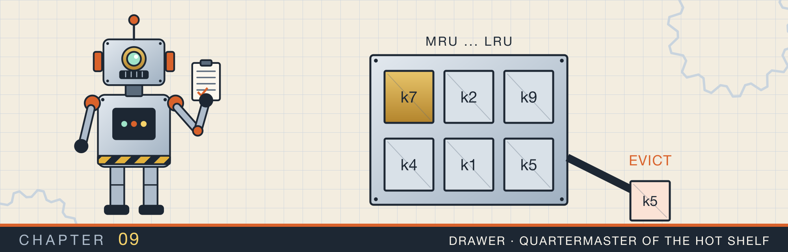
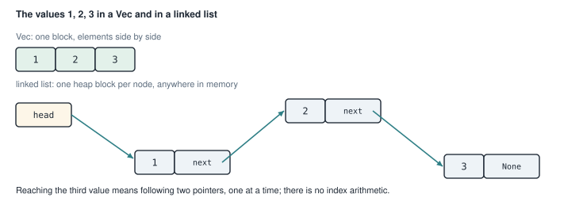
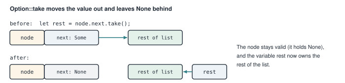
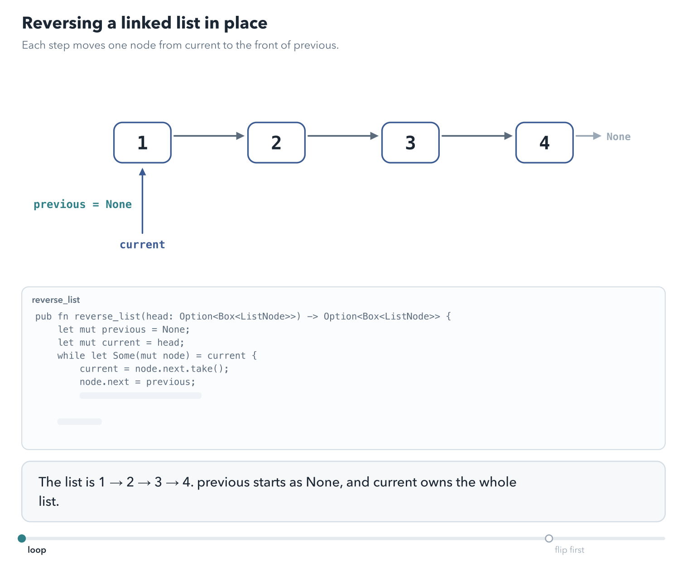
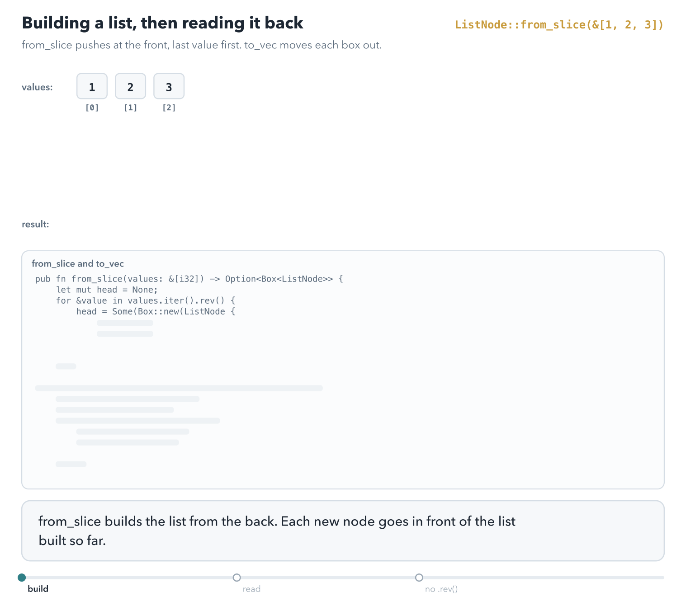
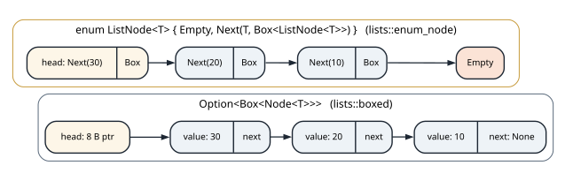
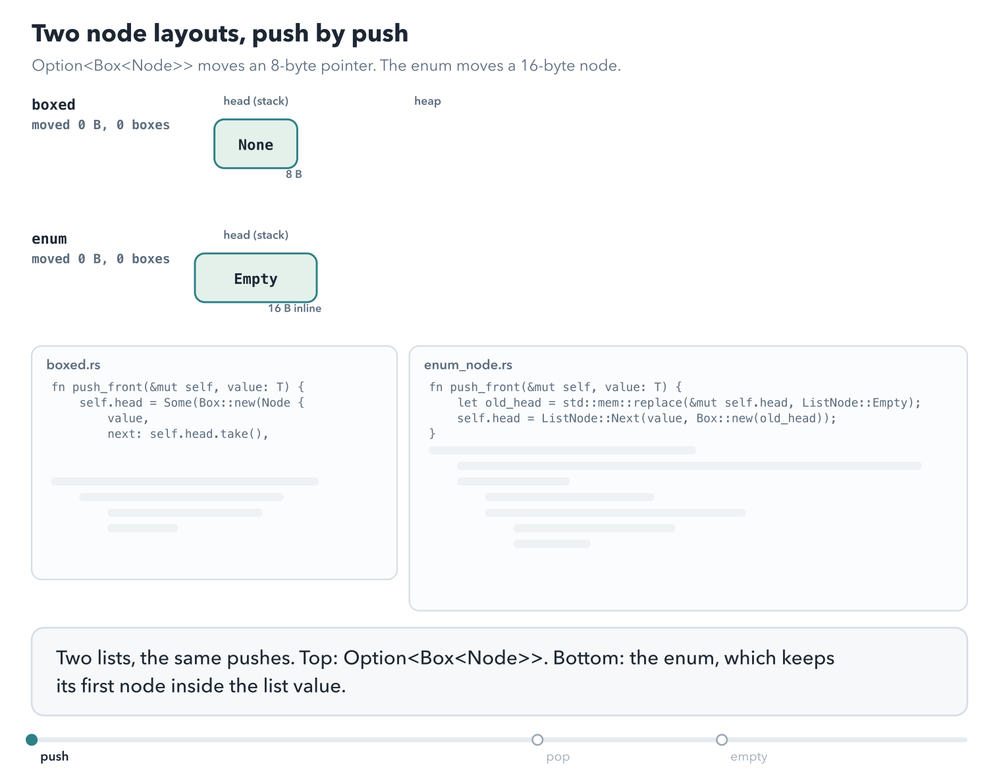
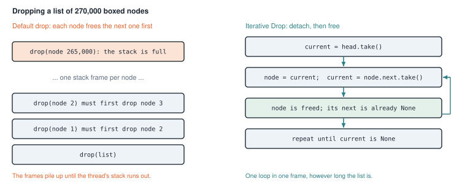
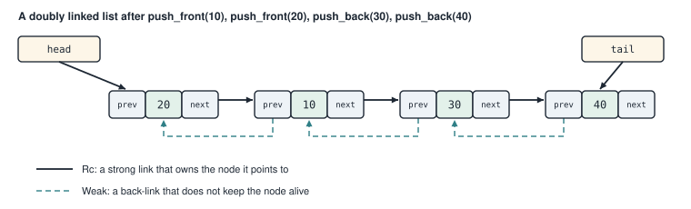
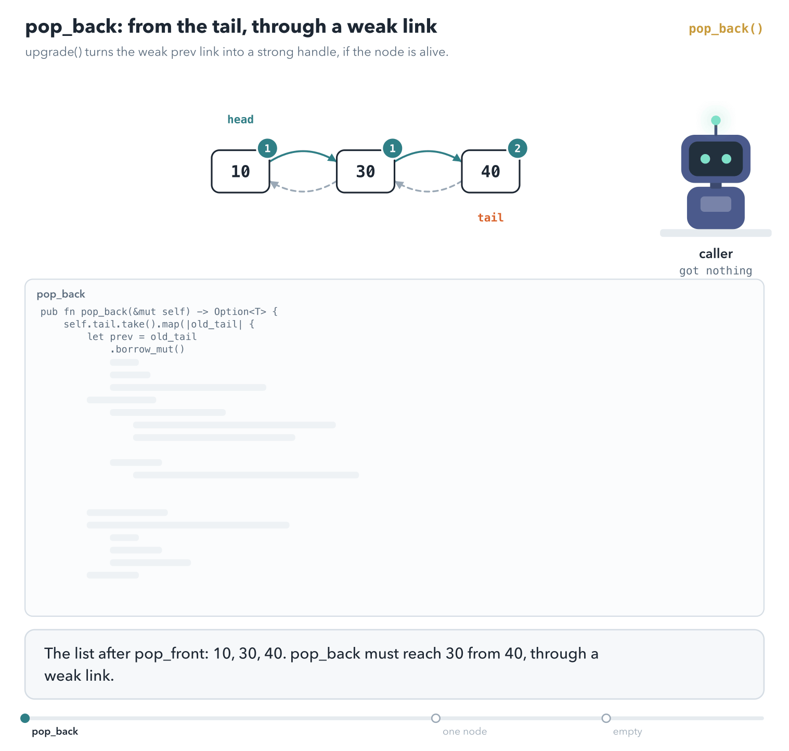

# Linked lists

<div class="covers" markdown="1">

This chapter covers

- What a linked list is, and how it differs from a `Vec` in memory
- Moving ownership of nodes with `Option::take` and `std::mem::replace`
- Reversing a list in place
- Four ways to write a list node, measured against each other
- Why dropping a long list can crash the program, and how to prevent it
- A doubly linked list built from `Rc`, `RefCell`, and `Weak`

</div>

Building on the smart pointer types from Chapter 8, this chapter implements the classic linked data structure: the linked list. Linked lists provide a direct test of Rust's ownership model because every structural operation transfers node ownership from one link to another under compiler verification.

The implementations progress in complexity: first a singly linked list with in-place reversal and cursor-based removal, then four node representations compared under a shared benchmark. That benchmark exposes a list length at which default deallocation overflows the call stack. After diagnosing and fixing recursive drops, the chapter concludes with a doubly linked list built from `Rc`, `RefCell`, and `Weak`.

## 9.1 What a linked list is

A **linked list** stores a sequence of values in separate nodes. Each **node** holds one value and a pointer
to the next node. The list itself holds a pointer to the first node, called the **head**. The last node's
pointer is empty, which marks the end.

Figure 9.1 compares a linked list with a `Vec` holding the same three values.

<figure>

<figcaption><b>Figure 9.1</b> A <code>Vec</code> stores its values next to each other. A linked list stores each value in its own heap block and connects the blocks with pointers.</figcaption>
</figure>

The two structures are good at different things:

| Operation | `Vec` | Singly linked list |
|---|---|---|
| Read the value at position i | O(1): compute the address | O(i): follow i pointers |
| Add or remove at the front | O(n): shift every element | O(1): change the head pointer |
| Add at the end | amortized O(1) | O(n), unless the list keeps a tail pointer |
| Memory per value | the value | the value, a pointer, and a heap block's overhead |

Conceptually, a linked list resembles a chain of pointers where each node reveals only the location of its successor: reaching the fifth node requires traversing the first four, whereas inserting a new head updates a single pointer without moving existing nodes. By contrast, a `Vec` stores elements contiguously like a numbered row of slots: indexing position 5 is a single address calculation, whereas inserting at the front shifts every existing element.

In practice, `Vec` outperforms linked lists for most workloads because contiguous memory exploits hardware spatial locality (measured in Chapter 15). Nevertheless, the ownership-transfer techniques developed here apply directly to the trees and graphs in Chapters 11 and 12.

In Rust, each node owns its successor through a `Box`, and `None` terminates the chain, giving the `next` field the type `Option<Box<Node>>`.

## 9.2 Moving nodes: `take` and `replace`

Every list manipulation transfers a node from one owner to another. Rust's memory safety rules prohibit moving a value directly out of a borrowed location, because doing so would leave the location uninitialized for its owner.

Two standard library operations resolve this by atomically substituting a valid replacement as the old value is extracted:

- `option.take()` moves the value out of an `Option` and leaves `None` in its place.
- `std::mem::replace(&mut place, new_value)` moves the old value out and writes `new_value` into its place.

Figure 9.2 illustrates `take` operating on a node's `next` field.

<figure>

<figcaption><b>Figure 9.2</b> <code>node.next.take()</code> moves the rest of the list out of the node into a variable, and leaves <code>None</code> behind.</figcaption>
</figure>

These two operations appear throughout the listings in this chapter.

## 9.3 Reversing a list

**The problem.** Given a singly linked list `1 → 2 → 3 → 4`, reverse it in place to `4 → 3 → 2 → 1` by rewiring pointers without copying node values.

**The idea.** Traverse the list from front to back using two bindings: `previous` holds the already-reversed prefix, and `current` holds the remaining unvisited suffix. Each iteration detaches the head of `current`, points its `next` link at `previous`, and advances `previous` to that node (Figure 9.3).

<figure>

<figcaption><b>Figure 9.3</b> Halfway through. <code>previous</code> owns the reversed part (2 → 1), and <code>current</code> owns the rest (3 → 4).</figcaption>
</figure>

<figure class="anim">
<video class="motion" src="figures/ch04-reverse.mp4" autoplay loop muted playsinline preload="metadata" aria-label="The list 1, 2, 3, 4 as four boxes with arrows between them, and the variables previous and current pointing at nodes. For each node, take moves the rest of the list into current, the node's link is turned back toward previous, and previous moves to the node. The list ends as 4, 3, 2, 1. A last part turns the link before taking the rest, and nodes 2, 3, and 4 are dropped." data-chapters="[[0.0, &quot;loop&quot;], [81.12, &quot;flip first&quot;]]"></video>
<figcaption><b>Animation 9.1</b> <code>reverse_list</code> one node at a time: take the rest, point the node back, move <code>previous</code> forward. No node is copied. The last part flips the link before taking the rest, and the rest of the list is dropped.</figcaption>
</figure>

Listing 9.1 defines the node struct along with two conversion helpers for constructing and inspecting lists.

<p class="listing"><b>Listing 9.1</b> The node and two helpers (lines 1 to 33). <a href="https://github.com/arpanpathak/cracking-the-systems-programming-interview/blob/prep-v2/rust-interview-lab/src/problems/linked_list.rs">src/problems/linked_list.rs</a></p>

```rust
{{#include ../../rust-interview-lab/src/problems/linked_list.rs:1:33}}
```

The `from_slice` helper iterates over the input slice in reverse, prepending each element to the front of the list so `values[0]` ends up at the head without maintaining a tail pointer. Conversely, `to_vec` consumes the list by value: each iteration of `while let Some(node) = current` moves one `Box` out of `current` and transfers `node.next` back to `current` before the node is freed.

Animation 9.2 traces `from_slice` and `to_vec` on `[1, 2, 3]` and illustrates how omitting `.rev()` inverts the resulting order.

<figure class="anim">
<video class="motion" src="figures/ch09-list-build.mp4" autoplay loop muted playsinline preload="metadata" aria-label="A slice holding 1, 2, 3. from_slice walks it from the back: node 3 drops into place pointing at None and becomes head, then 2 in front of it, then 1. to_vec moves each box out of current in turn, pushes its value into the result, and frees it, until current is None. Without .rev(), the pushes of 1, 2, 3 build the list 3, 2, 1, and the result reads 3, 2, 1." data-chapters="[[0.0, &quot;build&quot;], [21.01, &quot;read&quot;], [38.83, &quot;no .rev()&quot;]]"></video>
<figcaption><b>Animation 9.2</b> Building from the back puts <code>values[0]</code> first. Without <code>.rev()</code>, pushing at the front reverses the order.</figcaption>
</figure>

Listing 9.2 implements the in-place reversal.

<p class="listing"><b>Listing 9.2</b> Reversing the list (lines 35 to 46).</p>

```rust
{{#include ../../rust-interview-lab/src/problems/linked_list.rs:35:46}}
```

Each pass through the loop does three moves:

1. `current = node.next.take();` takes the rest of the list out of the node, as in figure 9.2.
2. `node.next = previous;` points the node at the reversed part.
3. `previous = Some(node);` makes the node the front of the reversed part.

Trace it on 1 → 2 → 3:

| After pass | `previous` | `current` |
|---|---|---|
| start | None | 1 → 2 → 3 |
| 1 | 1 | 2 → 3 |
| 2 | 2 → 1 | 3 |
| 3 | 3 → 2 → 1 | None |

At no point do two bindings own the same node, which satisfies the borrow checker. The traversal visits each node once in O(n) time and O(1) auxiliary space.

The complete module appears in Listing 9.20 at the end of the chapter, with unit tests covering a four-element list, an empty list, and a single-element list.

## 9.4 Removing nodes with a cursor

**The problem.** Remove every node whose value equals `target` in a single pass, including matches at the head or consecutive matches.

**The idea.** Unlinking a node requires mutating the link that owns it, which is either `head` or the preceding node's `next` field. Rather than tracking a node directly, the loop maintains a mutable reference to the owning link itself: a `&mut Option<Box<ListNode>>` called a **cursor**.

The cursor acts as a pointer to a single link in the chain. When the link points to a matching node, the link is redirected past that node and the cursor remains in place to inspect the newly promoted successor. When the node does not match, the cursor advances to that node's `next` link.

<p class="listing"><b>Listing 9.3</b> Removing every match (lines 48 to 71). <a href="https://github.com/arpanpathak/cracking-the-systems-programming-interview/blob/prep-v2/rust-interview-lab/src/problems/linked_list.rs">src/problems/linked_list.rs</a></p>

```rust
{{#include ../../rust-interview-lab/src/problems/linked_list.rs:48:71}}
```

The loop proceeds in four steps:

1. `let mut cursor = &mut head;` anchors the cursor on the `head` link. Treating `head` identically to any `next` field eliminates special-case code for removing the first node.
2. `cursor.as_mut()` mutably borrows the node referenced by the current link.
3. On a match, `node.next.take()` detaches the remainder of the list and `*cursor = next` rebinds the link to it, dropping the unlinked node immediately.
4. Otherwise, `cursor = &mut cursor...next` advances the cursor to the current node's `next` link.

Keeping the cursor stationary after a removal ensures that consecutive matches are never skipped, because the link now points to an uninspected node. Tracing `2 → 1 → 2 → 2 → 3` with `target = 2` yields:

| Step | The cursor holds | The node there | Action |
|---|---|---|---|
| 1 | `head` | 2 | match: `head` now points at 1 |
| 2 | `head` | 1 | keep: the cursor moves to 1's `next` |
| 3 | 1's `next` | 2 | match: 1's `next` now points at the second 2 |
| 4 | 1's `next` | 2 | match: 1's `next` now points at 3 |
| 5 | 1's `next` | 3 | keep: the cursor moves to 3's `next` |
| 6 | 3's `next` | None | the loop ends: 1 → 3 |

Each node is inspected once in O(n) time and O(1) auxiliary space. Animation 9.3 traces this example alongside three edge cases: an absent target, a list where every node matches, and the bug introduced by advancing the cursor unconditionally after a removal.

<figure class="anim">
<video class="motion" src="figures/ch09-list-remove.mp4" autoplay loop muted playsinline preload="metadata" aria-label="A head box and the list 2, 1, 2, 2, 3, with the cursor drawn as a highlighted link. The head link points at a 2: it matches, the 2 falls away, and the head link swings to 1. The cursor moves to 1's next link, which points at a 2; it is removed, and the link swings to the second 2, which is removed too, and the link reaches 3. The result is 1, 3. With target 2 on 1, 3, nothing changes. With 7, 7, 7, the cursor never leaves head and head ends as None. Last, a version that moves the cursor after every node skips the second 2 and returns 1, 2, 3." data-chapters="[[0.0, &quot;remove 2&quot;], [39.37, &quot;absent&quot;], [50.03, &quot;all match&quot;], [58.69, &quot;advance always&quot;]]"></video>
<figcaption><b>Animation 9.3</b> The cursor stays on a link after removing what it pointed at. A version that always moves on skips the node that slid into place.</figcaption>
</figure>

The tests check the cases that break removal code. They remove a match at the head and matches in a row. They
also try a target that is absent, a list where every node matches, and an empty list.

## 9.5 A list written as an enum

The first list separated the node type from the `Option` that marks the end. Another way puts both into one
enum: a list is either empty, or a node holding a value and the rest of the list.

<p class="listing"><b>Listing 9.4</b> The list type (lines 1 to 13). <a href="https://github.com/arpanpathak/cracking-the-systems-programming-interview/blob/prep-v2/rust-interview-lab/src/bin/singly_linked_list.rs">src/bin/singly_linked_list.rs</a></p>

```rust
{{#include ../../rust-interview-lab/src/bin/singly_linked_list.rs:1:13}}
```

`List<T>` is **generic**. The `T` is a placeholder for the type of the values, so the same code works for
a list of numbers or of strings. `type Link<T> = Box<List<T>>;` gives the boxed rest of the list a short name.

<p class="listing"><b>Listing 9.5</b> Creating, checking, and measuring (lines 16 to 29).</p>

```rust
impl<T> List<T> {
{{#include ../../rust-interview-lab/src/bin/singly_linked_list.rs:16:29}}
    // ...
}
```

The `len` method counts nodes recursively, returning `0` for `Empty` and adding `1` to the length of the tail for `Node`. Because each recursive call waits on the next, an `n`-node list consumes `n` stack frames, a limitation examined in Section 9.7.

<p class="listing"><b>Listing 9.6</b> Adding and removing at the front (lines 31 to 49).</p>

```rust
impl<T> List<T> {
    // ...
{{#include ../../rust-interview-lab/src/bin/singly_linked_list.rs:31:49}}
}
```

Both `push_front` and `pop_front` take `&mut self` to mutate the list in place, relying on `std::mem::replace` from Section 9.2. Moving the existing list directly out of `*self` would leave `*self` temporarily uninitialized; `replace(self, List::Empty)` atomically installs a temporary `Empty` variant while returning ownership of the previous list.

In `push_front`, the old list is wrapped inside a new `Node` and written back into `*self`. In `pop_front`, matching on the old list returns `None` for `Empty` (leaving `*self` empty) or unboxes the tail with `*self = *next` for `Node` before returning the front value.

Animation 9.4 traces both operations and contrasts them with the direct move that the compiler rejects.

<figure class="anim">
<video class="motion" src="figures/ch09-list-replace.mp4" autoplay loop muted playsinline preload="metadata" aria-label="A robot owns the list through &amp;mut self, and a caller robot waits on the right. push_front(1): replace moves the list, Empty, down into the local old and leaves a teal Empty in *self; the new node 1 takes the place and links to old. Pushes of 2 and 3 do the same. pop_front swaps Empty in, moves the list down, sends the front value to the caller, frees the empty box, and moves the rest back into *self. Last, let old = *self leaves a red question mark in *self, and the compiler rejects it with error E0507." data-chapters="[[0.0, &quot;push&quot;], [29.98, &quot;pop&quot;], [49.06, &quot;move out&quot;]]"></video>
<figcaption><b>Animation 9.4</b> <code>replace</code> puts <code>Empty</code> in the place as it takes the list out, so the borrowed place is never empty. A plain move out of <code>*self</code> would leave a hole, and the compiler rejects it.</figcaption>
</figure>


The complete program is listing 9.21 at the end of the chapter. Its `main` pushes three values and pops them back in reverse order, the last one pushed coming out first. A list
that adds and removes at the same end behaves as a stack, like the `Vec` in chapter 3.

```text
$ cargo run --bin singly_linked_list
ok
```

## 9.6 Four node layouts, measured

Section 9.3 wrote a node as a struct with an `Option<Box<Node>>`, and section 9.5 wrote the list as an enum.
Which is faster? To answer, the benchmark in this section puts four versions of the same list behind one **trait**. Then
one piece of code can measure them all.

### 9.6.1 One trait for four lists

The four list types are measured by one benchmark, so they share a trait with the operations the benchmark calls.

<p class="listing"><b>Listing 9.7</b> The trait every list implements. <a href="https://github.com/arpanpathak/cracking-the-systems-programming-interview/blob/prep-v2/rust-interview-lab/benchmarking_examples/lists/mod.rs">benchmarking_examples/lists/mod.rs</a></p>

```rust
{{#include ../../rust-interview-lab/benchmarking_examples/lists/mod.rs}}
```

The trait lists the operations: `new`, `push_front`, `pop_front`, `is_empty`, and `variant`, which returns a
name for printing. `SinglyList<T>: Sized` limits the trait to types whose size is known at compile time. The benchmark uses
the trait only through generic functions, so the limit costs nothing. The four `pub mod` lines declare the four versions, each in its own
file.

The first two versions are the struct form and the enum form:

<p class="listing"><b>Listing 9.8</b> <code>Option&lt;Box&lt;Node&lt;T&gt;&gt;&gt;</code>: the types, <code>push_front</code>, and <code>pop_front</code> (lines 9 to 38). <a href="https://github.com/arpanpathak/cracking-the-systems-programming-interview/blob/prep-v2/rust-interview-lab/benchmarking_examples/lists/boxed.rs">benchmarking_examples/lists/boxed.rs</a></p>

```rust
{{#include ../../rust-interview-lab/benchmarking_examples/lists/boxed.rs:9:38}}
    // ...
}
```

<p class="listing"><b>Listing 9.9</b> <code>enum ListNode&lt;T&gt;</code>: the types, <code>push_front</code>, and <code>pop_front</code> (lines 9 to 44). <a href="https://github.com/arpanpathak/cracking-the-systems-programming-interview/blob/prep-v2/rust-interview-lab/benchmarking_examples/lists/enum_node.rs">benchmarking_examples/lists/enum_node.rs</a></p>

```rust
{{#include ../../rust-interview-lab/benchmarking_examples/lists/enum_node.rs:9:44}}
    // ...
}
```

Each file also has `is_empty` and `variant`, which are one line each. The two files implement the trait with `impl<T> SinglyList<T> for LinkedList<T>`. Each uses the tool from
section 9.2 that fits its type: `take()` on the `Option` in the struct version, and `mem::replace` on the enum.

### 9.6.2 What each node costs in memory

Figure 9.4 draws both lists after pushing 10, 20, and 30.

<figure>

<figcaption><b>Figure 9.4</b> The two layouts after three pushes. The struct list's head is one pointer. The enum list keeps its first node inside the list value itself and ends with a heap-allocated <code>Empty</code>.</figcaption>
</figure>

On a 64-bit machine, with `u64` values, each node is 16 bytes in both versions: 8 for the value and 8 for the
pointer. `Option<Box<Node>>` is only 8 bytes, because a `Box` is never null, so Rust uses the null address to
mean `None`. The enum gets the same treatment, using a null `Box` to mean `Empty`.

The versions still differ in two ways. The enum list keeps its first node, 16 bytes, inside the list value. So every push moves those 16 bytes
into a new box, where the struct version moves one 8-byte pointer. And the enum
chain ends with a boxed `Empty`. Both lists make one allocation per push, but one of the enum's boxes holds no
value.

Animation 9.5 pushes 10, 20, and 30 onto both lists, pops one value, and then pops from two empty lists.

<figure class="anim">
<video class="motion" src="figures/ch09-list-layouts.mp4" autoplay loop muted playsinline preload="metadata" aria-label="Two lanes. The boxed list keeps an 8-byte pointer on the stack and three boxes on the heap; each push moves an 8-byte pointer into the new node. The enum list keeps Next(30) inline on the stack and three boxes on the heap, the last holding Empty; each push moves 16 bytes into a new box. After three pushes the boxed list has moved 24 bytes and the enum 48. pop_front on each frees one box; the enum moves the next node's 16 bytes back inline. Popped until empty, one more pop_front returns None on both." data-chapters="[[0.0, &quot;push&quot;], [33.26, &quot;pop&quot;], [45.38, &quot;empty&quot;]]"></video>
<figcaption><b>Animation 9.5</b> Both layouts make one box per push. The boxed list moves 8 bytes each time, the enum moves 16, and its last box holds <code>Empty</code>.</figcaption>
</figure>

Two small demo programs, `list_box.rs` and `list_enum.rs`, push and pop on each version. They import the
lists from the crate's library with `use systems_lab::lists::...`, so every program shares one compiled copy of
the list code. Both are listed at the end of the chapter.

## 9.7 When dropping a list crashes

Consider the following snippet using the struct-based list:

```rust
let mut list = boxed::LinkedList::new();
for value in 0..270_000u64 {
    list.push_front(value);
}
// list goes out of scope here and is dropped
```

Construction succeeds, but execution terminates at the closing brace when `list` is dropped:

```text
thread 'main' has overflowed its stack
fatal runtime error: stack overflow, aborting
```

None of the list's methods are recursive; the recursion resides in the compiler-generated drop glue. Dropping the list drops `head`, which drops the first `Box<Node>`, which recursively drops its `next` field, nesting one call frame per node (Figure 9.5, left).

<figure>

<figcaption><b>Figure 9.5</b> The default drop nests one call per node. A hand-written <code>Drop</code> detaches each node's successor first, so freeing one node never frees another.</figcaption>
</figure>

Animation 9.6 compares the default recursive drop against an iterative implementation, illustrating the stack depth for each.

<figure class="anim">
<video class="motion" src="figures/ch09-list-drop.mp4" autoplay loop muted playsinline preload="metadata" aria-label="A list of nodes 1 to 5 and 269,995 more, a main-thread robot, and a stack of frames with a gauge of 8 MiB. The default drop pushes drop(list), then drop(node 1), drop(node 2), and so on, one frame per node, without freeing anything; the counter runs to 262,144 frames, the gauge fills, and the stack overflows. Then a hand-written Drop: current takes the chain, each pass moves one node out, takes its next, and frees it, with a third frame that returns at once. The freed counter runs to 270,000 with the stack at two or three frames." data-chapters="[[0.0, &quot;default drop&quot;], [40.08, &quot;loop drop&quot;]]"></video>
<figcaption><b>Animation 9.6</b> The default drop keeps every node's frame on the stack until the last node is reached. The <code>Drop</code> loop frees one node per pass, so the stack stays flat.</figcaption>
</figure>

On most systems, the main thread receives an 8 MiB stack. Because the overflow occurs between 260,000 and 270,000 nodes, each nested drop frame consumes roughly 32 bytes. Threads spawned via `std::thread::spawn` default to a 2 MiB stack and therefore overflow at roughly one quarter of that length.

Eliminating this recursion requires a custom iterative **`Drop`** implementation. Rust invokes `Drop::drop` automatically before dropping a value's fields.

<p class="listing"><b>Listing 9.10</b> The struct version's <code>Drop</code> (lines 46 to 55). <a href="https://github.com/arpanpathak/cracking-the-systems-programming-interview/blob/prep-v2/rust-interview-lab/benchmarking_examples/lists/boxed_drop.rs">benchmarking_examples/lists/boxed_drop.rs</a></p>

```rust
{{#include ../../rust-interview-lab/benchmarking_examples/lists/boxed_drop.rs:46:55}}
```

The file `boxed_drop.rs` repeats the types and operations of listing 9.8. Only this `Drop` implementation is new. Its loop reads:

1. `let mut current = self.head.take();` takes the whole chain out of the list.
2. `while let Some(mut node) = current` moves the first box out of `current`.
3. `current = node.next.take();` moves the rest of the chain out of that node.
4. At the end of the loop body, `node` goes out of scope and is freed. Its `next` is already `None`, so freeing
   it frees nothing else.

The loop runs in one stack frame, whatever the length of the list.

<p class="listing"><b>Listing 9.11</b> The enum version's <code>Drop</code> (lines 52 to 62). <a href="https://github.com/arpanpathak/cracking-the-systems-programming-interview/blob/prep-v2/rust-interview-lab/benchmarking_examples/lists/enum_drop.rs">benchmarking_examples/lists/enum_drop.rs</a></p>

```rust
{{#include ../../rust-interview-lab/benchmarking_examples/lists/enum_drop.rs:52:62}}
```

The enum version does the same with `mem::replace` and a `while let ListNode::Next(_, next) = current` loop.
`current = *next;` moves the rest of the chain out of the box. Assigning to `current` drops its old value, a
`Next` whose box has already been emptied, so again nothing nests.

A third demo builds a list of five million nodes and drops it:

<p class="listing"><b>Listing 9.12</b> Five million nodes, dropped with a loop. <a href="https://github.com/arpanpathak/cracking-the-systems-programming-interview/blob/prep-v2/rust-interview-lab/benchmarking_examples/list_drop.rs">benchmarking_examples/list_drop.rs</a></p>

```rust
{{#include ../../rust-interview-lab/benchmarking_examples/list_drop.rs}}
```

## 9.8 The benchmark

The benchmark program measures all four versions with one generic function. The full program also measures
the caches of chapter 13, and is listed there. This is the part that measures the lists.

<p class="listing"><b>Listing 9.13</b> The list benchmark (lines 160 to 236). <a href="https://github.com/arpanpathak/cracking-the-systems-programming-interview/blob/prep-v2/rust-interview-lab/benchmarking_examples/benchmark.rs">benchmarking_examples/benchmark.rs</a></p>

```rust
{{#include ../../rust-interview-lab/benchmarking_examples/benchmark.rs:12:20}}

{{#include ../../rust-interview-lab/benchmarking_examples/benchmark.rs:160:236}}
```

The full benchmark harness, including the cache benchmarks from Chapter 13, is presented in Listing 13.16.

`run_list::<L: SinglyList<u64>>` is **generic** over the list type `L`. The compiler generates a separate copy of the function for each list type. So each list is measured with
its own code.

The function follows three rules that apply to any small benchmark:

1. **Warm up first.** The first time a program allocates a lot of memory, the operating system has to supply
   fresh pages, which is slow. A warm-up pass pays that cost before timing starts.
2. **Run several times and keep the fastest.** Other programs can slow a run down but never speed it
   up. So the fastest run is the closest to the true cost.
3. **Check the result before trusting the time.** Every run pops all the values and checks their order. A
   broken list cannot report a fast time.

`std::hint::black_box(expected)` tells the compiler to treat the value as used, so it cannot delete the loop
that computed it.

These results come from a release build on an 8-core aarch64 development board:

| list | how it drops | 260,000 nodes | 270,000 nodes |
|---|---|---|---|
| `box` | recursively | completed | crashed |
| `enum` | recursively | completed | crashed |
| `box+drop` | with a loop | completed | completed |
| `enum+drop` | with a loop | completed | completed |

```text
  variant        elements          push          drop
  ----------------------------------------------------
  box             200,000        2.40ms        3.23ms
  enum            200,000        3.42ms        3.20ms
  box+drop        200,000        2.32ms        2.91ms
  enum+drop       200,000        3.62ms        2.52ms

  box+drop      5,000,000       58.11ms       72.32ms
  enum+drop     5,000,000       90.98ms       67.51ms
```

Read the table this way:

- A push costs about 12 nanoseconds for the struct node and about 17 for the enum node. Section 9.6.2 gave
  two differences that could explain the gap. The benchmark does not measure them separately.
- `box` and `box+drop` share the same push code, and their push times agree, 2.40 against 2.32 ms. That
  agreement is a sign the measurement is stable.
- The loop drop is not much faster than the recursive one. Its purpose is to remove the size limit, not to
  save time.

The stack overflow and iterative fix can be reproduced with the following commands:

```bash
cargo run --release --bin benchmark list box 260000   # completes
cargo run --release --bin benchmark list box 270000   # crashes
cargo run --release --bin list_drop                   # five million nodes, no crash
```

## 9.9 A doubly linked list

In a **doubly linked list**, each node stores pointers to both its successor and its predecessor, enabling O(1) insertion and removal at either end as well as bidirectional traversal.

In Rust, this layout introduces shared ownership: every interior node is referenced both by the preceding node's `next` link and by the following node's `prev` link, which single-owner `Box` pointers cannot represent.

Applying the pointer types from Chapter 8 resolves this: nodes are wrapped in `Rc<RefCell<Node>>` for shared interior mutability, forward `next` links use strong `Rc` handles to establish ownership from head to tail, and backward `prev` links use `Weak` handles to prevent reference cycles (Figure 9.6).

<figure>

<figcaption><b>Figure 9.6</b> Strong links run forward and weak links run backward. If the back-links were strong, every pair of neighbors would form a cycle and no node would ever be freed.</figcaption>
</figure>

### 9.9.1 The types

A node of the doubly linked list has a value and two links. The link forward owns the next node; the link back is weak, so the two directions do not keep each other alive.

<p class="listing"><b>Listing 9.14</b> Type names, the node, and the list (lines 1 to 25). <a href="https://github.com/arpanpathak/cracking-the-systems-programming-interview/blob/prep-v2/rust-interview-lab/src/bin/ll.rs">src/bin/ll.rs</a></p>

```rust
{{#include ../../rust-interview-lab/src/bin/ll.rs:1:25}}
```

The full type of a link is `Option<Rc<RefCell<Node<T>>>>`. It appears in almost every function, so the file
names it once, `OptNodeRef<T>`, with a `type` alias. The list keeps a `head`, a `tail`, and its length.

### 9.9.2 Adding at either end

A new node at the front must point forward to the old head, and the old head must point back to it. The back of the list works the same way, mirrored.

<p class="listing"><b>Listing 9.15</b> <code>new</code>, <code>len</code>, and <code>push_front</code> (lines 28 to 69).</p>

```rust
impl<T> LinkedList<T> {
{{#include ../../rust-interview-lab/src/bin/ll.rs:28:69}}
    // ...
}
```

`push_front` creates the new node, then looks at the old head with `self.head.take()`:

- If there was an old head, its `prev` becomes a weak link to the new node, made with `Rc::downgrade`.
  The new node's `next` becomes the old head.
- If there was no old head, the list was empty, so the new node is also the tail. `new_node.clone()` makes a
  second strong handle for `tail`.

Finally the new node becomes the head, and the length grows by one. `borrow_mut()` is the `RefCell` method
from section 8.4. Each call is released at the end of its statement, so no two borrows of the same node
overlap.

<p class="listing"><b>Listing 9.16</b> <code>push_back</code> (lines 71 to 93).</p>

```rust
impl<T> LinkedList<T> {
    // ...
{{#include ../../rust-interview-lab/src/bin/ll.rs:71:93}}
    // ...
}
```

`push_back` mirrors it at the other end. The new node's `prev` is set as it is created:
`self.tail.as_ref().map(Rc::downgrade)`. `as_ref()` turns `Option<Rc<...>>` into `Option<&Rc<...>>`, so the
tail is looked at without being moved. `map(Rc::downgrade)` turns that reference into a weak link.

### 9.9.3 Removing from either end

Removing the front node means unlinking it from its neighbor and moving its value out to the caller.

<p class="listing"><b>Listing 9.17</b> <code>pop_front</code> (lines 95 to 125).</p>

```rust
impl<T> LinkedList<T> {
    // ...
{{#include ../../rust-interview-lab/src/bin/ll.rs:95:125}}
    // ...
}
```

`pop_front` must return the value by ownership, not a reference. To move the value out, the node itself must
be moved out of its `Rc`, and `Rc::try_unwrap` does that. It succeeds only if the handle is the last strong
one. So the method first removes every other strong link to the node:

1. `self.head.take()` removes the list's link to it.
2. The next node's `prev` is set to `None`. That link was weak, so it did not count anyway.
3. If there was no next node, the list is now empty, so `self.tail` is cleared, removing the tail's link.

Now `Rc::try_unwrap(old_head)` succeeds, and `.into_inner()` moves the `Node` out of its `RefCell`.

The call is written `.ok().unwrap()` rather than `.unwrap()`. `Result::unwrap` needs to print the error if it
fails, which requires the error type to implement `Debug`. Here the error type is the `Rc` itself, and `Node`
does not implement `Debug`, so `.unwrap()` would not compile. `.ok()` turns the `Result` into an `Option`,
whose `unwrap` needs no `Debug`.

Animation 9.7 builds the list of figure 9.6 and pops its front. The badge on each node is its strong count.
The last part makes `prev` strong, to show the leak that `Weak` prevents.

<figure class="anim">
<video class="motion" src="figures/ch09-list-doubly.mp4" autoplay loop muted playsinline preload="metadata" aria-label="Nodes with a strong-count badge each, strong next arrows above and dashed weak prev arrows below. push_front(10) gives 10 a count of 2, from head and tail. push_front(20) adds a weak prev from 10 to 20 and a strong next from 20 to 10; push_back(30) and push_back(40) mirror it. Every node has count 1 except the tail at 2. pop_front moves head into old_head, takes 20's next, clears 10's prev, sets head to 10, and try_unwrap succeeds at count 1, sending 20 to a caller robot. Last, with strong prev links, every count is 2; dropping head and tail leaves counts of 1 and 2, no node is freed, and all four leak." data-chapters="[[0.0, &quot;push&quot;], [33.84, &quot;pop_front&quot;], [59.22, &quot;strong prev&quot;]]"></video>
<figcaption><b>Animation 9.7</b> Each node has one strong owner on its left, so popping the front leaves its count at 1 and <code>try_unwrap</code> succeeds. With strong back-links, neighbours keep each other alive and the list leaks.</figcaption>
</figure>

<p class="listing"><b>Listing 9.18</b> <code>pop_back</code> (lines 127 to 157).</p>

```rust
impl<T> LinkedList<T> {
    // ...
{{#include ../../rust-interview-lab/src/bin/ll.rs:127:157}}
    // ...
}
```

`pop_back` mirrors `pop_front`. It follows the weak `prev` link with `upgrade()`, which returns `None` if the
previous node is gone, then clears that node's `next`.

Animation 9.8 runs `pop_back` on 10, 30, 40. Then it pops down to one node, and pops once more from the
empty list.

<figure class="anim">
<video class="motion" src="figures/ch09-list-pop-back.mp4" autoplay loop muted playsinline preload="metadata" aria-label="The list 10, 30, 40 with strong-count badges. tail.take moves the tail handle into old_tail, so 40 keeps a count of 2. prev.take and upgrade turn 40's weak link into a strong handle to 30, whose count rises to 2. 30's next is cleared, tail moves to 30, and try_unwrap succeeds on 40, which goes to the caller robot. With one node left, upgrade finds no prev, so head is cleared too. On the empty list, pop_back returns None." data-chapters="[[0.0, &quot;pop_back&quot;], [29.22, &quot;one node&quot;], [41.34, &quot;empty&quot;]]"></video>
<figcaption><b>Animation 9.8</b> <code>upgrade()</code> turns the weak back-link into a strong handle for as long as <code>pop_back</code> needs it. A one-node list clears <code>head</code> as well, and an empty list returns <code>None</code>.</figcaption>
</figure>

### 9.9.4 Looking without removing

Looking at the front value must not move it out of the list. The caller gets a borrow of the value instead.

<p class="listing"><b>Listing 9.19</b> <code>peek_front</code> and <code>peek_back</code> (lines 159 to 180).</p>

```rust
impl<T> LinkedList<T> {
    // ...
{{#include ../../rust-interview-lab/src/bin/ll.rs:159:180}}
}
```

`peek_front` returns `Option<Ref<'_, T>>`, not `Option<&T>`. The value is inside a `RefCell`, and a reference
to it is only safe while the cell's borrow is active. A `Ref` is the guard that keeps the borrow active, as
section 8.4 showed. `Ref::map` narrows a guard for the whole node into a guard for its `data` field. The
caller reads the value with `*`, as `main` does.


### 9.9.5 Running it

The complete program, with its tests, is listing 9.28 at the end of the chapter. Running it:

```text
$ cargo run --bin ll
Length: 4
Front: 20
Back: 40
Pop front: Some(20)
Pop back:  Some(40)
Popped: 10
Popped: 30
Empty? true
```

The test `alternating_push_pop_keeps_invariants` pushes 100 values at each end, then pops from both ends and
checks every value. The comment block at the end of the file lists each standard-library method the file
uses, with a one-line description.

This list costs more than the singly linked list: each node requires a separate heap allocation, two reference counts, and a runtime borrow flag, and every access incurs a dynamic borrow check. It also retains the recursive drop from Section 9.7, because dropping the head drops the next `Rc`, which drops the next node. In Chapter 13, an LRU cache avoids both costs by storing nodes contiguously in a `Vec` and linking them by index.

## 9.10 The complete files

The complete source files follow in the order introduced above.

<p class="listing"><b>Listing 9.20</b> The node, the helpers, <code>reverse_list</code>, and <code>remove_all</code>, with tests. <a href="https://github.com/arpanpathak/cracking-the-systems-programming-interview/blob/prep-v2/rust-interview-lab/src/problems/linked_list.rs">src/problems/linked_list.rs</a></p>

```rust
{{#include ../../rust-interview-lab/src/problems/linked_list.rs}}
```

<p class="listing"><b>Listing 9.21</b> The enum list and its <code>main</code>. <a href="https://github.com/arpanpathak/cracking-the-systems-programming-interview/blob/prep-v2/rust-interview-lab/src/bin/singly_linked_list.rs">src/bin/singly_linked_list.rs</a></p>

```rust
{{#include ../../rust-interview-lab/src/bin/singly_linked_list.rs}}
```

<p class="listing"><b>Listing 9.22</b> The <code>Option&lt;Box&lt;Node&gt;&gt;</code> list. <a href="https://github.com/arpanpathak/cracking-the-systems-programming-interview/blob/prep-v2/rust-interview-lab/benchmarking_examples/lists/boxed.rs">benchmarking_examples/lists/boxed.rs</a></p>

```rust
{{#include ../../rust-interview-lab/benchmarking_examples/lists/boxed.rs}}
```

<p class="listing"><b>Listing 9.23</b> The enum list behind the trait. <a href="https://github.com/arpanpathak/cracking-the-systems-programming-interview/blob/prep-v2/rust-interview-lab/benchmarking_examples/lists/enum_node.rs">benchmarking_examples/lists/enum_node.rs</a></p>

```rust
{{#include ../../rust-interview-lab/benchmarking_examples/lists/enum_node.rs}}
```

<p class="listing"><b>Listing 9.24</b> The demo of the boxed list. <a href="https://github.com/arpanpathak/cracking-the-systems-programming-interview/blob/prep-v2/rust-interview-lab/benchmarking_examples/list_box.rs">benchmarking_examples/list_box.rs</a></p>

```rust
{{#include ../../rust-interview-lab/benchmarking_examples/list_box.rs}}
```

<p class="listing"><b>Listing 9.25</b> The demo of the enum list. <a href="https://github.com/arpanpathak/cracking-the-systems-programming-interview/blob/prep-v2/rust-interview-lab/benchmarking_examples/list_enum.rs">benchmarking_examples/list_enum.rs</a></p>

```rust
{{#include ../../rust-interview-lab/benchmarking_examples/list_enum.rs}}
```

<p class="listing"><b>Listing 9.26</b> The boxed list with its own <code>Drop</code>. <a href="https://github.com/arpanpathak/cracking-the-systems-programming-interview/blob/prep-v2/rust-interview-lab/benchmarking_examples/lists/boxed_drop.rs">benchmarking_examples/lists/boxed_drop.rs</a></p>

```rust
{{#include ../../rust-interview-lab/benchmarking_examples/lists/boxed_drop.rs}}
```

<p class="listing"><b>Listing 9.27</b> The enum list with its own <code>Drop</code>. <a href="https://github.com/arpanpathak/cracking-the-systems-programming-interview/blob/prep-v2/rust-interview-lab/benchmarking_examples/lists/enum_drop.rs">benchmarking_examples/lists/enum_drop.rs</a></p>

```rust
{{#include ../../rust-interview-lab/benchmarking_examples/lists/enum_drop.rs}}
```

<p class="listing"><b>Listing 9.28</b> The doubly linked list, with its tests. <a href="https://github.com/arpanpathak/cracking-the-systems-programming-interview/blob/prep-v2/rust-interview-lab/src/bin/ll.rs">src/bin/ll.rs</a></p>

```rust
{{#include ../../rust-interview-lab/src/bin/ll.rs}}
```

<div class="summary" markdown="1">

## Summary

- A linked list stores each value in its own node and links the nodes with pointers. It adds and removes at
  the front in O(1), but reaching position i takes O(i).
- `Option::take` and `std::mem::replace` move a value out of a place and leave a valid value behind. List
  code uses them to move nodes between owners.
- Reversing a list moves three owners per node: take the rest, point the node back, make it the new front.
- Removal walks a cursor, a `&mut` borrow of one link. A match is unlinked by moving its `next` into that link,
  and the cursor stays put.
- A list can be a struct with `Option<Box<Node>>` or an enum. Both nodes are 16 bytes for `u64` values.
- The compiler-generated drop of a `Box` list recurses once per node and overflows the stack for long lists.
  A hand-written `Drop` loop removes the limit.
- A benchmark should warm up, keep the fastest of several runs, and check its results.
- A doubly linked list needs `Rc<RefCell<Node>>` with strong forward links and `Weak` back-links.

</div>

In Chapter 10, the singly linked list from Section 9.3 serves as the foundation for merging multiple sorted lists into one using several algorithmic strategies.

## Exercises

1. Write `len` for the enum list of section 9.5 with a loop instead of recursion.
2. Implement `Iterator` for the struct list of section 9.3, with an `iter()` method that yields `&i32`.
3. Implement `Drop` for the doubly linked list, and test it with one million nodes.
4. Build a doubly linked list whose nodes live in a `Vec`, with `Option<usize>` indexes as links. Compare its
   push and pop times with the `Rc` version.
