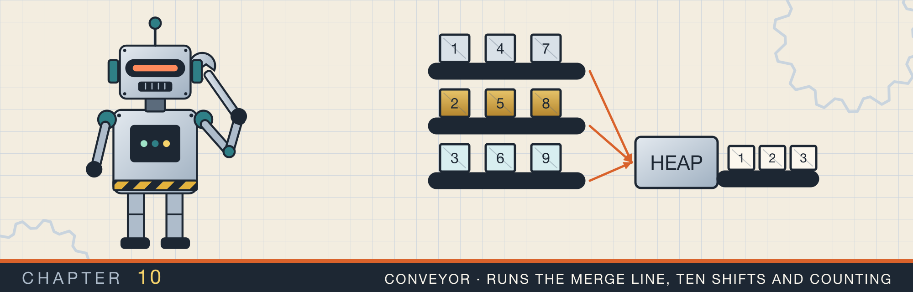
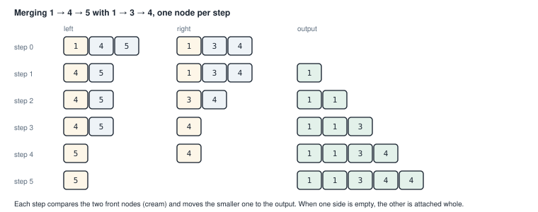
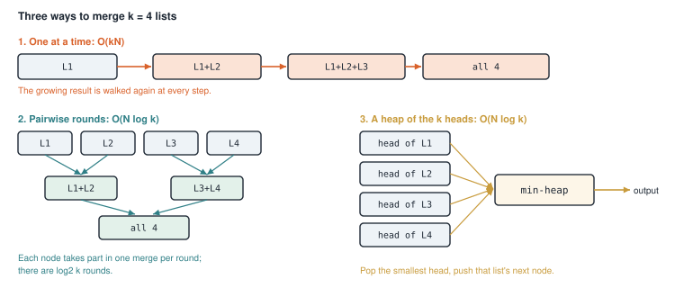
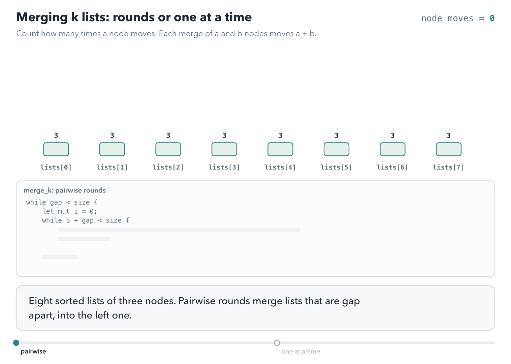
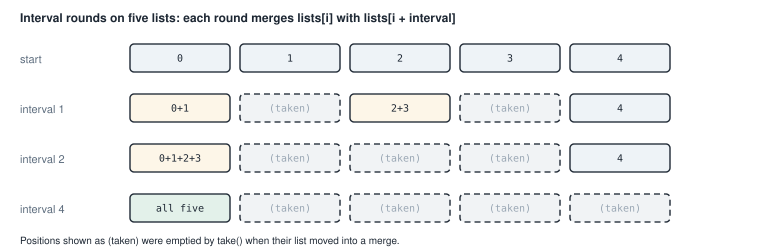
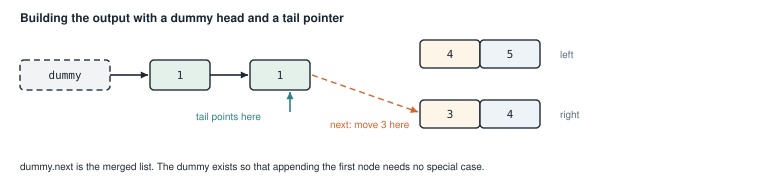
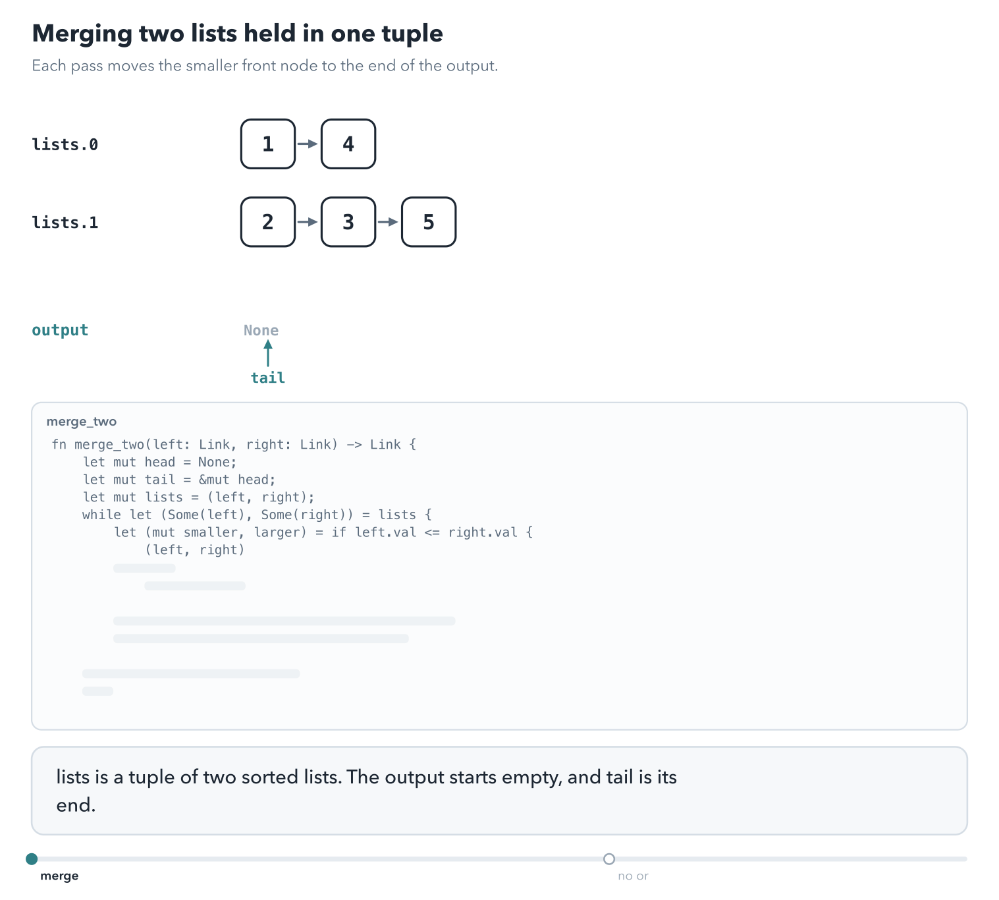

# Merging k sorted lists

<div class="covers" markdown="1">

This chapter covers

- Merging two sorted linked lists by moving nodes, not copying values
- Three strategies for merging many lists, and why two of them are much faster than the third
- A merge that swaps two lists by value, so that only one mutable reference remains
- Borrowing two elements of one `Vec` at the same time with `split_at_mut`
- A heap of list heads, and a recursion on halves

</div>

Merging *k* sorted singly linked lists containing *N* total nodes into a single ordered sequence is a core primitive in external merge sort, log-structured merge-tree (LSM) compaction, and distributed query execution. Merging two sorted lists requires a single linear scan, whereas scaling to *k* lists exposes a sharp algorithmic trade-off: folding the lists sequentially forces early nodes to be revisited up to *k* times (*O*(*kN*) work), while balanced divide-and-conquer reduction and binary min-heap selection both achieve the optimal *O*(*N* log *k*) bound under different auxiliary-memory, call-stack, and cache-locality profiles.

Implementing these strategies in Rust also stresses ownership and borrowing directly: rather than cloning node payloads, each variant transfers ownership of `Box<Node>` handles in place, using disjoint slice borrows (`split_at_mut`) for divide-and-conquer reduction and an *O*(*k*) `BinaryHeap` of active list heads for heap-guided selection. Appendix C preserves an expanded reference study covering eleven variants.

## 10.1 Merging two sorted lists

Every pairwise strategy in this chapter relies on merging two sorted lists: compare their front nodes, move the smaller node to the tail of the output list, repeat until one list is exhausted, and attach the remaining list intact (Figure 10.1).

<figure>

<figcaption><b>Figure 10.1</b> Merging two sorted lists. Each step moves one node, so merging lists of lengths a and b takes a + b steps.</figcaption>
</figure>

With linked lists, moving a node to the output does not copy its payload; it detaches the node from the front of its source list and links it to the tail of the output list.

## 10.2 Three strategies for k lists

Three primary strategies extend two-list merging to `k` lists, as illustrated in Figure 10.2.

<figure>

<figcaption><b>Figure 10.2</b> The first strategy walks its growing result again and again. The other two touch each node only about log₂ k times.</figcaption>
</figure>

**Sequential accumulation.** Merge list 2 into list 1, then list 3 into the accumulated result, and so on. Because
each merge traverses the entire accumulated prefix, elements from the earliest lists are visited up to *k* − 1
times, yielding O(*kN*) total work.

**Pairwise tournament rounds.** Merge lists in disjoint pairs across successive rounds. Each round halves the
number of active lists (*k*/2, *k*/4, ..., 1), and every node participates in exactly one merge per round. Across
⌈log₂ *k*⌉ rounds, total work is O(*N* log *k*).

**Min-heap of list heads.** Insert the head of each non-empty list into a min-priority queue of size at most *k*.
Repeatedly extract the minimum head, append it to the output tail, and push its successor from the same source
list. Because each of the *N* nodes undergoes one push and one pop at O(log *k*) cost, total time is O(*N* log *k*).

Animation 10.1 compares total node moves across eight lists of three nodes each, contrasting pairwise rounds against sequential merging.

<figure class="anim">
<video class="motion" src="figures/ch10-merge-gap.mp4" autoplay loop muted playsinline preload="metadata" aria-label="Eight bars, lists[0] to lists[7], each of three nodes, and a counter of node moves. Pairwise: with gap 1, four merges of 3 and 3 take 24 moves; with gap 2, two merges of 6 and 6 take 24 more; with gap 4, one merge of 12 and 12 takes 24, and lists[0] holds all 24 nodes after 72 moves. Then one at a time: each list is merged into the growing lists[0], and the moves add up 6, 9, 12, up to 24, for 105 in total." data-chapters="[[0.0, &quot;pairwise&quot;], [25.02, &quot;one at a time&quot;]]"></video>
<figcaption><b>Animation 10.1</b> Pairwise rounds move each node once per round, log₂ 8 = 3 rounds: 72 moves. One at a time walks the growing result again and again: 105 moves for the same 24 nodes.</figcaption>
</figure>

For 100 lists of 10,000 nodes each (`N = 1,000,000`), sequential merging performs roughly 100 million node visits, whereas an O(N log k) strategy performs roughly 7 million.

The pairwise strategy admits a compact in-place formulation that stores the lists in a `Vec` and merges positions separated by a doubling **interval** (Figure 10.3), named `gap` in Section 10.3.

<figure>

<figcaption><b>Figure 10.3</b> Interval rounds on five lists. The interval doubles each round, and the result collects in <code>lists[0]</code>.</figcaption>
</figure>

In each round, slot `i` absorbs slot `i + interval` as `i` advances by `2 * interval` (0, 2 × interval,
4 × interval, ...). Any unpaired trailing list (such as index 4 here) remains untouched until `interval` grows
large enough to pair it with index 0.

## 10.3 Merging with the lists swapped by value

The merge constructs its output behind a stack-allocated sentinel node (the **dummy head**), eliminating special
casing for the first output element. A mutable cursor `tail` tracks the last appended node at all times
(Figure 10.4).

<figure>

<figcaption><b>Figure 10.4</b> The dummy node gives the output a fixed starting point. <code>tail</code> always points at the last node, where the next one is attached.</figcaption>
</figure>

The function `merge_two` takes both lists by value. Whenever the right list has the smaller front node, the two bindings are swapped so `left` always holds the next node to detach. Maintaining `tail` as the sole mutable reference simplifies borrow tracking and keeps the loop concise.

<p class="listing"><b>Listing 10.1</b> The node type and <code>merge_two</code> (lines 4 to 27). <a href="https://github.com/arpanpathak/cracking-the-systems-programming-interview/blob/prep-v2/rust-interview-lab/src/bin/merge_k_sorted_lists_owned.rs">src/bin/merge_k_sorted_lists_owned.rs</a></p>

```rust
{{#include ../../rust-interview-lab/src/bin/merge_k_sorted_lists_owned.rs:4:27}}
```

The loop condition `while let (Some(l), Some(r)) = (&left, &right)` executes while both lists remain non-empty,
borrowing `&left` and `&right` immutably solely to compare the two front keys.

Whenever the right head is strictly smaller, `(left, right) = (right, left)` exchanges the two `Option` bindings
by value without touching heap nodes or introducing extra references. After this normalization step, `left`
invariantly holds the minimum head.

Calling `left.unwrap()` moves the `Box<ListNode>` out of `left` (infallible because the `while let` guard
established `Some`). `node.next.take()` detaches the tail and restores it to `left`, isolating the front node.

Calling `tail.next.insert(node)` links the detached node onto the output tail and returns a `&mut Box<ListNode>`
reference to it, advancing `tail` in a single expression.

Once either input is exhausted, `left.or(right)` selects the remaining non-empty suffix and attaches it directly
to `tail.next` in O(1) time.

Animation 10.2 traces `merge_two` line by line alongside ownership and borrow state, concluding with a
borrow-checker error when `l` is read after the tuple swap.


<figure class="anim">
<video class="motion" src="figures/ch10-merge-trace.mp4" autoplay loop muted playsinline preload="metadata" aria-label="Rows for left, right, node, and the output, which starts at a dummy node; a table of the variables left, right, l, r, node, dummy, and tail with what each owns or borrows; and the code of merge_two with the running line highlighted. Each pass shows while let binding l and r as shared borrows of the two front nodes, the comparison where those borrows end, the swap when the right front is smaller, left.unwrap moving the whole list into node so that left is moved out, node.next.take returning the rest to left, and insert moving the node to the end of the output while tail moves on. After four passes, left.or(right) attaches 5 and dummy.next returns 1, 2, 3, 4, 5. Last, a loop that reads l after the swap fails with error E0506, cannot assign to left because it is borrowed, and E0505, cannot move out of left because it is borrowed." data-chapters="[[0.0, &quot;set up&quot;], [17.59, &quot;pass 1&quot;], [57.67, &quot;pass 2&quot;], [100.87, &quot;pass 3&quot;], [133.99, &quot;pass 4&quot;], [175.03, &quot;the end&quot;], [204.55, &quot;l after the swap&quot;]]"></video>
<figcaption><b>Animation 10.2</b> <code>merge_two</code> line by line. <code>l</code> and <code>r</code> borrow the front nodes until the comparison. <code>unwrap</code> moves the list into <code>node</code>, and <code>take</code> returns the rest to <code>left</code>. <code>tail</code> is the only mutable reference. Reading <code>l</code> after the swap does not compile.</figcaption>
</figure>

Trace the merge of 1 → 4 with 2 → 3 → 5:

| Pass | `left` | `right` | Swap? | Node moved | Output after `dummy` |
|---|---|---|---|---|---|
| 1 | 1 → 4 | 2 → 3 → 5 | no | 1 | 1 |
| 2 | 4 | 2 → 3 → 5 | yes: 2 < 4 | 2 | 1 → 2 |
| 3 | 3 → 5 | 4 | no | 3 | 1 → 2 → 3 |
| 4 | 5 | 4 | yes: 4 < 5 | 4 | 1 → 2 → 3 → 4 |
| 5 | None | 5 | the loop ends; `or` attaches 5 | | 1 → 2 → 3 → 4 → 5 |

Each iteration moves exactly one node, so merging *n* nodes executes in O(*n*) time and O(1) auxiliary space,
requiring only the single stack-allocated sentinel node.

<p class="listing"><b>Listing 10.2</b> <code>merge_k</code> (lines 29 to 47).</p>

```rust
{{#include ../../rust-interview-lab/src/bin/merge_k_sorted_lists_owned.rs:29:47}}
```

`merge_k` implements the doubling-interval schedule of Figure 10.3: the outer loop doubles `gap` each round, while
the inner loop advances `i` by `gap * 2` and merges `lists[i]` with `lists[i + gap]`. Calling `lists[i].take()`
extracts each owned list and leaves `None` in its slot so `merge_two` receives two owned heads.

Animation 10.3 traces this merge and demonstrates the node drop caused by omitting `left.or(right)` after the loop.

<figure class="anim">
<video class="motion" src="figures/ch10-merge-owned.mp4" autoplay loop muted playsinline preload="metadata" aria-label="Rows for left and right, and an output row that starts at a dummy node, with a tail marker at its end. Each pass compares the two front nodes; when right's front is smaller, the two rows trade places. Then the front node of left moves to the end of the output, and the rest of its list stays in left. After pass 4, left is empty and the loop ends; left.or(right) attaches the remaining 5, and the output reads 1, 2, 3, 4, 5. Last, with that line struck out, the output stops at 4 and node 5 is dropped." data-chapters="[[0.0, &quot;merge&quot;], [30.16, &quot;no or&quot;]]"></video>
<figcaption><b>Animation 10.3</b> When the right front is smaller, the two lists swap, so <code>left</code> always holds the next node. When one list runs out, <code>or</code> attaches the other. Without that line, the nodes left in <code>right</code> are dropped.</figcaption>
</figure>

```text
$ cargo run --bin merge_k_sorted_lists_owned
[0, 1, 2, 3, 4, 5, 6, 7, 8, 9]
[1, 1, 1, 3, 5]
[]
```

The complete program is listing 10.5 at the end of the chapter.

## 10.4 Borrowing two elements of one `Vec`

`merge_k` moves both lists out of the vector before the call. A merge that takes two `&mut` lists instead cannot be
called on two slots of the same vector:

```rust
merge_two(&mut lists[i], &mut lists[i + gap]) // does not compile
```

Both `&mut` expressions borrow the entire `Vec`, violating Rust's aliasing rule that prohibits simultaneous mutable
borrows of the same container; the borrow checker does not perform index-disjointness analysis on slice indexing.

Calling `lists.split_at_mut(i + gap)` partitions the vector at index `i + gap` into two statically disjoint
mutable slices, returning `(&mut [..], &mut [..])`. Listing C.1 in Appendix C employs this pattern:

```rust
{{#include ../../rust-interview-lab/src/bin/merge_k_sorted_lists_divide.rs:26:27}}
```

Because `left[i]` and `right[0]` belong to disjoint slices, the borrow checker permits both mutable references
simultaneously. Section 10.6 applies `split_at_mut` recursively to bisect a slice of lists.

## 10.5 A heap of list heads

The min-heap strategy of Figure 10.2 stores `(front_value, list_index)` pairs wrapped in `Reverse` inside a
`BinaryHeap`. Indexing lists by `usize` rather than placing `Box<ListNode>` directly in the heap leaves nodes
anchored in `lists` and eliminates the need to implement `Ord` on `ListNode`.

<p class="listing"><b>Listing 10.3</b> <code>merge_k_lists</code> (lines 10 to 33). <a href="https://github.com/arpanpathak/cracking-the-systems-programming-interview/blob/prep-v2/rust-interview-lab/src/bin/merge_k_sorted_lists_heap.rs">src/bin/merge_k_sorted_lists_heap.rs</a></p>

```rust
{{#include ../../rust-interview-lab/src/bin/merge_k_sorted_lists_heap.rs:10:33}}
```

Each iteration performs four steps:

1. Pop the minimum `Reverse((val, i))` pair, identifying the source list `i`.
2. Detach the front node from `lists[i]` and write its successor back into `lists[i]`.
3. If `lists[i]` remains non-empty, push its new front value paired with `i` onto the heap.
4. Append the detached node to the output tail via `tail.next.insert(node)`.

Because Rust compares tuples lexicographically, equal front values break ties deterministically in favor of the
lower-indexed list, making the merge stable across input order.

Because the heap holds at most one element per source stream (*k* entries total), this design generalizes directly
to external k-way merge over disk-backed sorted runs where only the current record of each file resides in RAM.

```text
$ cargo run --bin merge_k_sorted_lists_heap
1 1 2 3 4 4 5 6
```

The complete program is listing 10.6 at the end of the chapter.

## 10.6 Recursion on halves

This version merges from the top down. It splits the lists into two halves, merges each half recursively, and
merges the two results. Its node holds an `i32` named `val`, and `List` is the alias for a whole list:

```rust
{{#include ../../rust-interview-lab/src/bin/merge_k_sorted_lists_halves.rs:3:9}}
```

<p class="listing"><b>Listing 10.4</b> The merge and the recursion on a slice (lines 11 to 34). <a href="https://github.com/arpanpathak/cracking-the-systems-programming-interview/blob/prep-v2/rust-interview-lab/src/bin/merge_k_sorted_lists_halves.rs">src/bin/merge_k_sorted_lists_halves.rs</a></p>

```rust
{{#include ../../rust-interview-lab/src/bin/merge_k_sorted_lists_halves.rs:11:34}}
```

The base arm `(None, rest) | (rest, None) => rest` returns the remaining list intact when either input is empty.
In the recursive arm, `mem::swap` normalizes `left` to hold the smaller head, retains that node at the front, and
recursively assigns `left.next` to the merge of the tail of `left` with `right`. Ownership transfers across
existing `Box` allocations with zero heap allocation.

`merge_k_slice` operates over a mutable slice `&mut [List]`, bisecting it in O(1) space via `split_at_mut` without
allocating intermediate vectors.

Because `merge` recurses once per output node, the final merge reaches a call-stack depth of O(*N*) frames,
overflowing an 8 MiB main-thread stack at approximately 260,000 to 270,000 nodes. Production workloads with
unbounded *N* therefore require the iterative merge of Section 10.3.

```text
$ cargo run --bin merge_k_sorted_lists_halves
Input lists:
[1 -> 4 -> 5]
[1 -> 3 -> 4]
[2 -> 6]

Merged list:
[1 -> 1 -> 2 -> 3 -> 4 -> 4 -> 5 -> 6]
```

The complete program is listing 10.7 at the end of the chapter.

## 10.7 The three programs side by side

In the table, N is the total number of nodes and k the number of lists. The extra memory column counts memory
beyond the input `Vec` and the nodes. The stack column is the deepest the call stack goes, in frames.

| Program | Strategy | Time | Extra memory | Stack | Allocations | How a merge moves nodes |
|---|---|---|---|---|---|---|
| `merge_k_sorted_lists_owned` | gap rounds | O(N log k) | O(1) | O(1) | one dummy node per merge | lists swapped by value, so `tail` is the only `&mut` |
| `merge_k_sorted_lists_heap` | heap of heads | O(N log k) | O(k) | O(1) | one dummy node | list numbers in the heap, `Option::insert` |
| `merge_k_sorted_lists_halves` | recursive halves | O(N log k) | O(1) | O(N) | none | `split_at_mut`, recursive merge |

- **Time.** Each node moves about log₂ k times: O(N log k). The "one at a time" strategy of figure 10.2 would be
  O(kN).
- **Extra memory.** The heap holds one entry per list: O(k). The other two programs reuse the input `Vec`.
- **Stack.** The recursive merge makes one call per node of its output, so its stack reaches O(N) frames. The loop
  and the heap use a fixed number of frames.
- **Allocations.** The gap rounds allocate one dummy node per merge, k - 1 in total. The recursive merge allocates
  nothing.

## 10.8 The complete files

<p class="listing"><b>Listing 10.5</b> Gap rounds with the lists swapped by value. <a href="https://github.com/arpanpathak/cracking-the-systems-programming-interview/blob/prep-v2/rust-interview-lab/src/bin/merge_k_sorted_lists_owned.rs">src/bin/merge_k_sorted_lists_owned.rs</a></p>

```rust
{{#include ../../rust-interview-lab/src/bin/merge_k_sorted_lists_owned.rs}}
```

<p class="listing"><b>Listing 10.6</b> A heap of list heads. <a href="https://github.com/arpanpathak/cracking-the-systems-programming-interview/blob/prep-v2/rust-interview-lab/src/bin/merge_k_sorted_lists_heap.rs">src/bin/merge_k_sorted_lists_heap.rs</a></p>

```rust
{{#include ../../rust-interview-lab/src/bin/merge_k_sorted_lists_heap.rs}}
```

<p class="listing"><b>Listing 10.7</b> Recursion on halves. <a href="https://github.com/arpanpathak/cracking-the-systems-programming-interview/blob/prep-v2/rust-interview-lab/src/bin/merge_k_sorted_lists_halves.rs">src/bin/merge_k_sorted_lists_halves.rs</a></p>

```rust
{{#include ../../rust-interview-lab/src/bin/merge_k_sorted_lists_halves.rs}}
```

<div class="summary" markdown="1">

## Summary

- Merging two sorted linked lists transfers the smaller head to the output tail in O(*a* + *b*) time and O(1)
  auxiliary space.
- Sequential accumulation costs O(*kN*), whereas both pairwise tournament rounds and a min-heap of list heads
  achieve O(*N* log *k*).
- Swapping owned `Option<Box<ListNode>>` bindings by value normalizes the minimum head into `left`, leaving
  `tail` as the sole mutable borrow.
- `Option::insert` links a node onto `tail.next` and returns a mutable reference to the inserted node in a single
  operation.
- `slice::split_at_mut` partitions a `Vec` into statically disjoint mutable slices, enabling simultaneous mutable
  borrows of distinct elements.
- A min-heap of `(value, list_index)` pairs requires O(*k*) auxiliary space and generalizes directly to external
  streaming merges from disk.
- Recursive two-way merging requires zero heap allocations but consumes O(*N*) call-stack frames, risking stack
  overflow on large inputs.

</div>

## Exercises

1. Write the "one at a time" merge and time it against listing 10.5 on 200 lists of 5,000 nodes each.
2. Make `merge_two` from listing 10.1 generic over any `T: Ord`.
3. Write a k-way merge of sorted text files with the heap strategy, keeping only one line per file in memory.
4. Rewrite `merge` from listing 10.4 as a loop with the swap of listing 10.1. Test it on two lists of a million
   nodes each.
