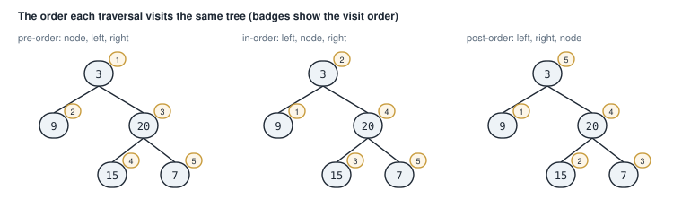
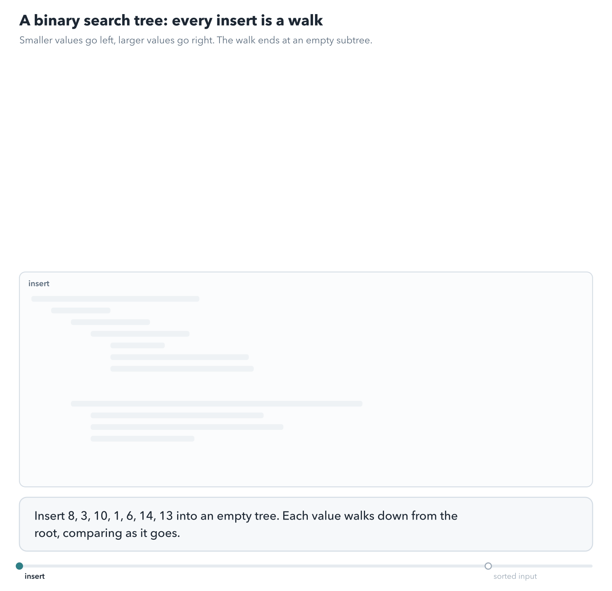
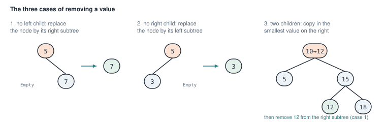
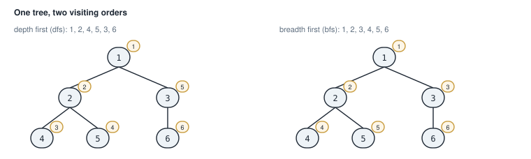
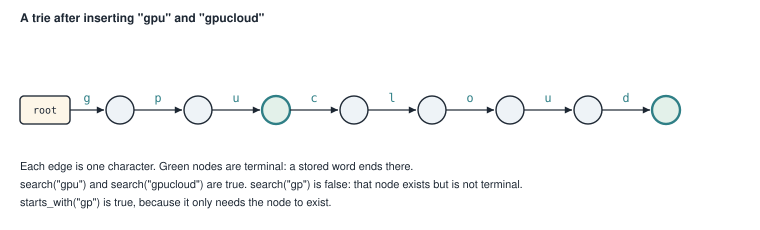
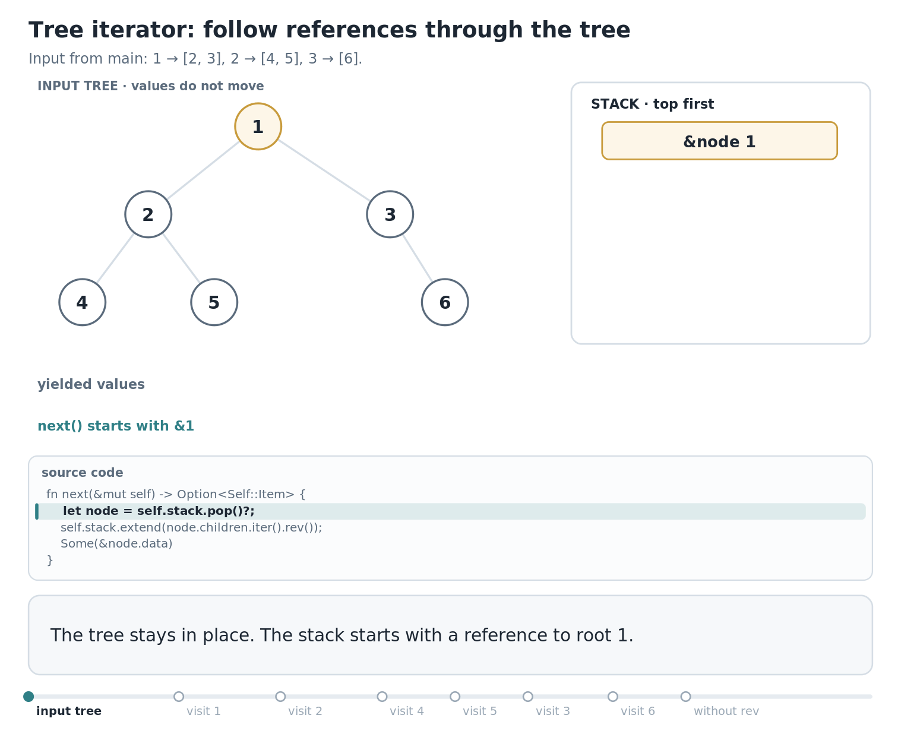
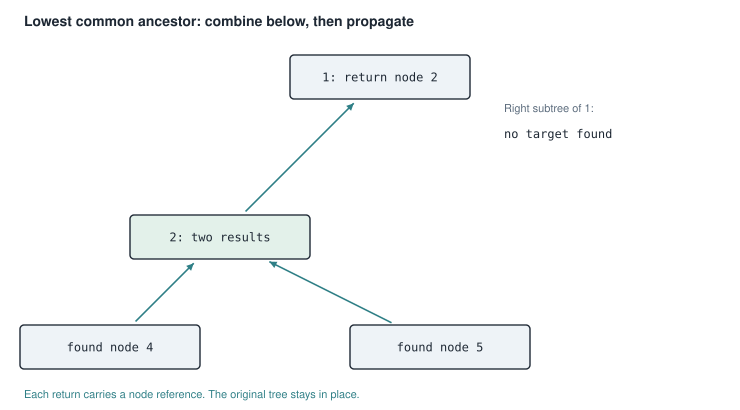
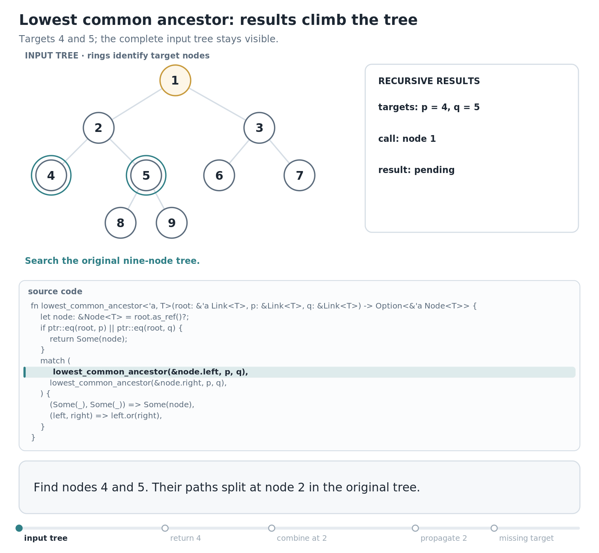

# Trees and tries

<div class="covers" markdown="1">

This chapter covers

- The vocabulary of trees: root, leaf, child, subtree, depth
- A binary tree as an enum, and the three depth-first visiting orders
- Binary search trees: insert, search, remove, and range queries, written two ways
- Trees with any number of children: depth-first and breadth-first visits, and grouping by level
- Saving a tree to a file and loading it back
- A trie, a tree for finding words by their first letters

- Borrowing tree values through an iterator
- Finding a lowest common ancestor by propagating child results

</div>

A **tree** is a connected, acyclic hierarchical data structure composed of nodes organized under a strict
single-parent relation. Whereas a linear sequence restricts each element to at most one successor, a tree permits
each node to own an arbitrary or bounded collection of descendant nodes, termed its **children**. This topology
models hierarchical domains directly, including filesystem directory hierarchies, abstract syntax trees (ASTs),
and ordered search structures.

Because every non-root node has a unique parent and no directed cycles exist, a tree exhibits strict single
ownership. In Rust, each parent node can own its children directly through `Box` or `Vec` without requiring
reference counting (`Rc`) or runtime interior mutability (`RefCell`). The primary implementation challenges
instead concern mutating recursive enum variants in place under the borrow checker and selecting between
call-stack recursion and explicit heap-allocated traversal frontiers.

This chapter formalizes core tree terminology and develops four foundational structures: recursive binary trees,
binary search trees (BSTs), general *k*-ary trees with level-order and serialized representations, and prefix
tries.

## 11.1 Tree vocabulary

The structural components of a tree are labeled in Figure 11.1.

<figure>

<figcaption><b>Figure 11.1</b> The small tree used by this chapter's tests, with its parts labeled.</figcaption>
</figure>

- The **root** is the unique node with no parent; trees are conventionally drawn with the root at the top.
- A **leaf** is a node with no children.
- The **subtree** rooted at a node consists of that node and all of its descendants. Because every subtree is
  itself a tree, tree algorithms naturally admit recursive definitions.
- The **depth** of a tree is the number of levels along the longest path from the root down to a leaf.

A **binary tree** restricts each node to at most two children, designated the left child and the right child.

## 11.2 A binary tree as an enum

A binary tree is defined inductively as either empty or a node holding a value together with two smaller binary
trees. This definition translates directly into a Rust enum:

<p class="listing"><b>Listing 11.1</b> The tree type (lines 1 to 16). <a href="https://github.com/arpanpathak/cracking-the-systems-programming-interview/blob/prep-v2/rust-interview-lab/src/problems/binary_tree.rs">src/problems/binary_tree.rs</a></p>

```rust
{{#include ../../rust-interview-lab/src/problems/binary_tree.rs:1:16}}
```

Each child pointer must be wrapped in `Box<Tree>` to introduce heap indirection. Embedding `Tree` values inline
within `Tree::Node` produces a recursive type of unbounded static size, which the compiler rejects because stack
frame allocation requires a known, finite `Sized` layout. Boxing each child reduces the inline representation of
a node to a fixed-size discriminant, its scalar payload, and two machine-word pointers.

### 11.2.1 Depth and inversion

<p class="listing"><b>Listing 11.2</b> Depth and inversion (lines 19 to 35).</p>

```rust
impl Tree {
{{#include ../../rust-interview-lab/src/problems/binary_tree.rs:19:35}}
    // ...
}
```

Each method dispatches on the two variants of `Tree`. The `Empty` arm serves as the **base case**, returning
an answer directly without further recursion, while the `Node` arm recurses on both subtrees and combines their
results.

The `max_depth` method mirrors the recursive definition directly: an empty tree has depth 0, and a non-empty
node has depth 1 plus the greater depth of its two subtrees. In Figure 11.1, the leaves have depth 1, node 20
has depth 2, and the root has depth 3.

The `invert` method transforms the tree into its mirror image by recursively inverting both subtrees and then
exchanging them with `std::mem::swap(left, right)`. Because the `match` pattern binds `left` and `right` as
mutable references to the `Box` handles, the swap exchanges two pointers in place without moving node payloads.

### 11.2.2 The three depth-first orders

Visiting every node of a tree exactly once is called a **traversal**. Descending along one branch as far as
possible before backtracking is a **depth-first** traversal. The three standard depth-first orders differ only
in when a node is visited relative to its children (Figure 11.2).

<figure>

<figcaption><b>Figure 11.2</b> The badges show the order in which each traversal visits the nodes.</figcaption>
</figure>

- **Pre-order** visits the node first, then its left subtree, then its right subtree.
- **In-order** visits the left subtree, then the node, then the right subtree.
- **Post-order** visits both subtrees, then the node.

<p class="listing"><b>Listing 11.3</b> The public traversal methods (lines 37 to 53).</p>

```rust
impl Tree {
    // ...
{{#include ../../rust-interview-lab/src/problems/binary_tree.rs:37:53}}
    // ...
}
```

Each public method allocates a single `Vec`, passes a mutable reference to a private recursive helper, and
returns the populated vector. Accumulating into one buffer avoids allocating intermediate vectors at every node.

<p class="listing"><b>Listing 11.4</b> The recursive helpers (lines 55 to 86).</p>

```rust
impl Tree {
    // ...
{{#include ../../rust-interview-lab/src/problems/binary_tree.rs:55:86}}
}
```

The three helpers are structurally identical, differing only in where `out.push(*value)` appears relative to
the two recursive calls. Dereferencing `*value` copies the `i32` payload out of the shared reference.

<p class="listing"><b>Listing 11.5</b> The complete file, with its tests. <a href="https://github.com/arpanpathak/cracking-the-systems-programming-interview/blob/prep-v2/rust-interview-lab/src/problems/binary_tree.rs">src/problems/binary_tree.rs</a></p>

```rust
{{#include ../../rust-interview-lab/src/problems/binary_tree.rs}}
```

The test module defines two concise constructors, `leaf` and `node`, so test trees can be assembled in a single
readable expression. The `sample()` helper constructs the tree in Figure 11.1, and the traversal test verifies
all three visitation orders illustrated in Figure 11.2.

## 11.3 Binary search trees

A **binary search tree** (BST) is a binary tree that enforces a strict ordering invariant: for every node, all
values in its left subtree are smaller than the node's value, and all values in its right subtree are larger.

This invariant accelerates lookup. Comparing the target against the current node determines which subtree can
contain it: smaller targets lie exclusively in the left subtree, and larger targets lie exclusively in the
right. Each comparison eliminates an entire subtree from consideration (Figure 11.3).

<figure>

<figcaption><b>Figure 11.3</b> Searching for 7 visits one node per level. In a balanced tree of n values, that is about log₂ n comparisons.</figcaption>
</figure>

Two implementations of the same BST interface follow. Both share identical insertion and lookup logic, differing
in how they handle node deletion and range-query allocation. The first implementation is examined in full; the
second isolates the structural and allocation trade-offs.

<figure class="anim">
<video class="motion" src="figures/ch11-bst.mp4" autoplay loop muted playsinline preload="metadata" aria-label="The values 8, 3, 10, 1, 6, 14, 13 are inserted one at a time. Each value starts at the root and moves left or right at every comparison until it reaches an empty subtree. Then contains(&6) follows 8, 3, 6. A last part inserts 1, 2, 3, 4, 5 in sorted order, and the tree becomes a chain." data-chapters="[[0.0, &quot;insert&quot;], [94.1, &quot;sorted input&quot;]]"></video>
<figcaption><b>Animation 11.1</b> Each insert is a walk from the root that ends at an empty subtree, and a search is the same walk. Sorted input produces a chain, so the shape depends on the insert order.</figcaption>
</figure>


### 11.3.1 The type, insertion, and search

<p class="listing"><b>Listing 11.6</b> The type (lines 1 to 14). <a href="https://github.com/arpanpathak/cracking-the-systems-programming-interview/blob/prep-v2/rust-interview-lab/src/bin/bst_clean.rs">src/bin/bst_clean.rs</a></p>

```rust
{{#include ../../rust-interview-lab/src/bin/bst_clean.rs:1:14}}
```

`BST<T>` is generic over its element type, and its methods require `T: Ord` so that values admit a total
ordering. Annotating `Empty` with `#[default]` designates the empty tree as the default value, which the
removal logic relies on.

<p class="listing"><b>Listing 11.7</b> Creating, inserting, and searching (lines 17 to 47).</p>

```rust
impl<T: Ord> BST<T> {
{{#include ../../rust-interview-lab/src/bin/bst_clean.rs:17:47}}
    // ...
}
```

`insert` takes `&mut self` to mutate the tree in place, descending recursively until it reaches an `Empty`
slot and replacing it with a new leaf via `*self = Self::Node { ... }`. At each internal node, `val.cmp(value)`
returns `Ordering::Less`, `Greater`, or `Equal`. Duplicate values are ignored, so the tree maintains set
semantics. The `contains` method follows the identical search path without modifying the tree.

### 11.3.2 Removal

Removing a value is the most intricate BST operation because the ordering invariant must be preserved across
three structural cases (Figure 11.4).

<figure>

<figcaption><b>Figure 11.4</b> The three removal cases. In case 3, removing 10 copies 12 into the root, then removes 12 from the right subtree.</figcaption>
</figure>

1. **No left child.** Promote the right subtree into the removed node's position.
2. **No right child.** Promote the left subtree into the removed node's position.
3. **Two children.** Retain the structural node and overwrite its payload with its **in-order successor**, defined
   as the minimum element in its right subtree. Because this successor exceeds every key in the left subtree and
   is strictly less than all remaining keys in the right subtree, the BST ordering invariant is preserved. The
   successor node is then deleted from the right subtree; having no left child by definition, its removal reduces
   immediately to Case 1.

<p class="listing"><b>Listing 11.8</b> Removal (lines 49 to 90).</p>

```rust
impl<T: Ord> BST<T> {
    // ...
{{#include ../../rust-interview-lab/src/bin/bst_clean.rs:49:90}}
    // ...
}
```

The first two cases replace `*self` with one of its own children. Because `right` is a mutable reference
borrowing `*self`, moving a subtree out through `right` and assigning it directly to `*self` in one step is
rejected by the borrow checker. Calling `std::mem::take(right)` resolves this conflict by moving the subtree
out and leaving `BST::Empty` (the `Default` value) in its place. The assignment `*self = *std::mem::take(right)`
then unboxes the moved subtree and installs it at `*self`.

The implementation also handles a leaf (a node with no children) in its own arm, although case 1 already covers
it.

For case 3, `remove_min` extracts and returns the smallest value in the right subtree. It descends left until
the match guard `Self::Node { left, .. } if left.is_empty()` identifies the leftmost node. Taking that node out
with `std::mem::take(self)` allows installing its right subtree in its place and returning its value. The
`if let ... else { unreachable!() }` branch satisfies the compiler, which cannot statically prove that the value
taken inside a `Node` arm is itself a `Node`; `unreachable!()` panics if that invariant were ever violated.

`remove` returns `true` when the target value was found and removed, and `false` otherwise, allowing callers to
distinguish deletion from a missing key.

### 11.3.3 Range queries

A **range query** returns every value within a closed interval `[low, high]` in sorted order, pruning subtrees
that cannot contain matching elements.

<p class="listing"><b>Listing 11.9</b> Range queries (lines 92 to 114).</p>

```rust
impl<T: Ord> BST<T> {
    // ...
{{#include ../../rust-interview-lab/src/bin/bst_clean.rs:92:114}}
    // ...
}
```

`range_helper` appends matching element references into an accumulator `acc`, exploiting the BST ordering
invariant to prune unreachable subtrees across three mutually exclusive branches:

- When the node's key is strictly less than `low`, every key in its left subtree is also below `low`; traversal
  prunes the left subtree and descends exclusively into the right subtree.
- When the node's key exceeds `high`, every key in its right subtree also exceeds `high`; traversal prunes the
  right subtree and descends exclusively into the left subtree.
- When the key falls within `[low, high]`, the helper visits the left subtree, records the current key, and visits
  the right subtree. Performing this visit in-order guarantees monotonically ascending output without a post-pass
  sort.

The method signature declares an explicit lifetime parameter: `fn range_helper<'a>(&'a self, ..., acc: &mut Vec<&'a T>)`.
Every reference pushed into `acc` borrows from the underlying tree storage and must therefore share the borrow
lifetime `'a` of `&'a self`. Under Rust's default lifetime elision rules, omitting `'a` assigns distinct
anonymous lifetimes to `&self` and the vector's element references, causing the borrow checker to reject the
insertion into `acc`.

<p class="listing"><b>Listing 11.10</b> The complete program. <a href="https://github.com/arpanpathak/cracking-the-systems-programming-interview/blob/prep-v2/rust-interview-lab/src/bin/bst_clean.rs">src/bin/bst_clean.rs</a></p>

```rust
{{#include ../../rust-interview-lab/src/bin/bst_clean.rs}}
```

```text
$ cargo run --bin bst_clean
Contains 7: true
Contains 12: true
Values in [4, 16]: [5, 7, 10, 12, 15]
Remove 5: true
Remove 10: true
Remove 99: false
After removals: Node {
    value: 12,
    left: Node {
        value: 7,
        left: Node {
            value: 3,
            left: Empty,
            right: Empty,
        },
        right: Empty,
    },
    right: Node {
        value: 15,
        left: Empty,
        right: Node {
            value: 18,
            left: Empty,
            right: Empty,
        },
    },
}
```

Tracing the two removals illustrates case 3 in action. Node 5 has children 3 and 7, so it adopts 7 (the minimum
of its right subtree) and removes the original leaf 7. Node 10 likewise adopts 12 from its right subtree,
leaving 12 at the root and 7 in node 5's former position.

### 11.3.4 A second BST, with an iterative minimum

The second implementation adopts alternative strategies for removal and range queries.

<p class="listing"><b>Listing 11.11</b> Removal and <code>pop_min</code> (lines 49 to 84). <a href="https://github.com/arpanpathak/cracking-the-systems-programming-interview/blob/prep-v2/rust-interview-lab/src/bin/bst_easy.rs">src/bin/bst_easy.rs</a></p>

```rust
{{#include ../../rust-interview-lab/src/bin/bst_easy.rs:1:4}}

impl<T: Ord> BST<T> {
    // ...
{{#include ../../rust-interview-lab/src/bin/bst_easy.rs:49:84}}
    // ...
}
```

This `remove` implementation delegates extraction to a helper method `take` (defined at the end of the module) that
substitutes `BST::Empty` via `mem::replace`, eliminating the `Default` trait bound on `BST<T>`. Method resolution
dereferences `Box<BST<T>>` automatically, allowing `right.take()` to extract the owned child subtree directly.

Rather than descending recursively, `pop_min` locates the minimum element iteratively by advancing a mutable
cursor reference `node` down the left spine of the tree:

```rust
let mut node = self;
while node.has_left() {
    if let Self::Node { left, .. } = node {
        node = left;
    }
}
```

Upon loop termination, `node` refers to the leftmost node. Matching on `node.take()` extracts its value and
promotes its right subtree without requiring an `unreachable!()` guard. Because this loop operates in O(1)
auxiliary stack space regardless of tree height, it eliminates stack-overflow risk on degenerate trees. Exposing
`pop_min` as a public method additionally enables the BST to function as a min-ordered priority structure.

<p class="listing"><b>Listing 11.12</b> A range query that returns a new vector (lines 86 to 102).</p>

```rust
impl<T: Ord> BST<T> {
    // ...
{{#include ../../rust-interview-lab/src/bin/bst_easy.rs:86:102}}
    // ...
}
```

This `range` implementation allocates a fresh `Vec` per recursive invocation and merges child results via `extend`.
Although more concise than the accumulator pattern in Listing 11.9, it incurs O(*k*) heap allocations across *k*
visited nodes, whereas passing a shared `&mut Vec` accumulator performs a single amortized allocation.

<p class="listing"><b>Listing 11.13</b> The complete program. <a href="https://github.com/arpanpathak/cracking-the-systems-programming-interview/blob/prep-v2/rust-interview-lab/src/bin/bst_easy.rs">src/bin/bst_easy.rs</a></p>

```rust
{{#include ../../rust-interview-lab/src/bin/bst_easy.rs}}
```

```text
$ cargo run --bin bst_easy
Contains 7: true
Range 4 to 12: [5, 7, 10, 12]
After removing 10: [3, 5, 7, 12, 15]
Pop min: Some(3)
```

<div class="callout warning" markdown="1">

**WARNING:** Neither implementation performs self-balancing. Inserting keys in strictly ascending order (1, 2,
3, and so on) appends each value as the right child of the previous node, degenerating the tree into a linear
chain of depth *n*. Lookups then degrade to O(*n*), and every recursive method consumes O(*n*) stack frames. For
balanced search trees in production code, use the standard library's `BTreeMap`.

</div>

## 11.4 Trees with any number of children

Many hierarchical structures are not binary; a filesystem directory, for example, can hold an arbitrary number
of entries. Modeling a node with a `Vec<TreeNode<T>>` of children accommodates arbitrary branching without
requiring `Box`, because `Vec` already heap-allocates its backing buffer and keeps the node's inline size fixed.

### 11.4.1 Depth first and breadth first

The two fundamental traversal strategies for a multi-way tree are illustrated in Figure 11.5. A **depth-first**
traversal descends completely down one branch before starting the next (as in Section 11.2.2), whereas a
**breadth-first** traversal visits nodes level by level: the root, then all of its children, then all of their
children.

<figure>

<figcaption><b>Figure 11.5</b> Depth first finishes node 2's branch before visiting 3. Breadth first finishes each level before the next.</figcaption>
</figure>

Depth-first traversal maps naturally onto recursion, whereas breadth-first traversal requires a FIFO **queue**.
The root is enqueued first; on each iteration, the front node is dequeued, visited, and its children are
appended to the back. Because children always enter at the back, every node of one level leaves the queue before
any node of the next level is processed.

Each node owns its payload together with a contiguous `Vec<TreeNode<T>>` of child nodes. Because `Vec` stores its
elements in a heap-allocated array, storing children inline within the vector permits unbounded arity while
improving spatial cache locality during sibling iteration:

```rust
{{#include ../../rust-interview-lab/src/bin/test_tree.rs:1:6}}
```

<p class="listing"><b>Listing 11.14</b> The complete program. <a href="https://github.com/arpanpathak/cracking-the-systems-programming-interview/blob/prep-v2/rust-interview-lab/src/bin/test_tree.rs">src/bin/test_tree.rs</a></p>

```rust
{{#include ../../rust-interview-lab/src/bin/test_tree.rs}}
```

`dfs` visits the current node before recursing across its child slice, executing a pre-order traversal.

`bfs` maintains an explicit FIFO frontier in a `VecDeque<&TreeNode<T>>`, initialized with the root via
`VecDeque::from([self])`. Storing borrowed references avoids moving or cloning node payloads; each iteration
dequeues the oldest frontier element with `pop_front` and enqueues its children with `push_back`.

In `main`, the sample hierarchy is constructed as a single nested struct literal whose syntactic indentation
mirrors the tree topology directly.

```text
$ cargo run --bin test_tree
=== DFS ===
1
2
4
5
3
6

=== BFS ===
1
2
3
4
5
6
```

### 11.4.2 Grouping values by level

A standard breadth-first variant partitions node values by depth, returning a nested sequence (`Vec<Vec<&T>>`)
in which index *d* contains all nodes at distance *d* from the root. The module below presents two equivalent
formulations.

<p class="listing"><b>Listing 11.15</b> The type and the first version (lines 1 to 20). <a href="https://github.com/arpanpathak/cracking-the-systems-programming-interview/blob/prep-v2/rust-interview-lab/src/bin/tree_under_pressure.rs">src/bin/tree_under_pressure.rs</a></p>

```rust
{{#include ../../rust-interview-lab/src/bin/tree_under_pressure.rs:1:20}}
```

`level_order` materializes one complete frontier per iteration inside `level: Vec<&TreeNode<T>>`. Each pass
projects the current frontier's payloads into the output vector and constructs the succeeding frontier via
`level.iter().flat_map(|n| &n.children).collect()`, flattening all child slices into a single contiguous buffer.
Iteration terminates when the frontier becomes empty.

<p class="listing"><b>Listing 11.16</b> The second version, with a queue (lines 22 to 40).</p>

```rust
{{#include ../../rust-interview-lab/src/bin/tree_under_pressure.rs:22:40}}
```

`level_order_readable` maintains a single `VecDeque` frontier. The loop invariant relies on snapshotting
`queue.len()` at the start of each outer iteration: at that boundary, the queue contains exclusively the nodes of
the current depth. The inner loop dequeues exactly that count, records each payload, and appends child references
at the back for the subsequent depth.

The statement `let Some(node) = queue.pop_front() else { break };` employs Rust's **let-else** syntax, binding
`node` when the refutable pattern matches and executing the diverging `else` branch otherwise. Calling
`queue.extend(&node.children)` enqueues all child references in a single batch.

<p class="listing"><b>Listing 11.17</b> The complete program. <a href="https://github.com/arpanpathak/cracking-the-systems-programming-interview/blob/prep-v2/rust-interview-lab/src/bin/tree_under_pressure.rs">src/bin/tree_under_pressure.rs</a></p>

```rust
{{#include ../../rust-interview-lab/src/bin/tree_under_pressure.rs}}
```

`main` formats the hierarchy with `{:#?}` and prints the level partitions produced by both implementations,
confirming identical output:

```text
["root"]
["branch_a", "branch_b"]
["leaf_1", "leaf_2", "leaf_3"]
one queue, one level per round:
["root"]
["branch_a", "branch_b"]
["leaf_1", "leaf_2", "leaf_3"]
```

Both functions return `Vec<Vec<&T>>` containing borrowed references into the tree and execute in O(*n*) time
across *n* nodes.

## 11.5 Saving a tree to a file and loading it back

Persisting a tree to storage requires converting its hierarchical structure into a flat sequence of text, a
process called **serialization**, so that the exact topology can be reconstructed later.

A pre-order sequence of values alone cannot uniquely identify a multi-way tree because it omits where each
node's children terminate. Appending each node's child count immediately after its value resolves this
ambiguity (Figure 11.6): a deserializer reads a value and its child count *k*, then recursively reads *k* child
subtrees.

<figure>

<figcaption><b>Figure 11.6</b> Each node is written as its value and its number of children, in pre-order.</figcaption>
</figure>

<p class="listing"><b>Listing 11.18</b> The tree type, and writing the pairs (lines 1 to 47). <a href="https://github.com/arpanpathak/cracking-the-systems-programming-interview/blob/prep-v2/rust-interview-lab/src/bin/tree_serializ_deserialize_into_file.rs">src/bin/tree_serializ_deserialize_into_file.rs</a></p>

```rust
{{#include ../../rust-interview-lab/src/bin/tree_serializ_deserialize_into_file.rs:1:1}}

{{#include ../../rust-interview-lab/src/bin/tree_serializ_deserialize_into_file.rs:3:7}}

impl<T> TreeNode<T> {
    // ...
{{#include ../../rust-interview-lab/src/bin/tree_serializ_deserialize_into_file.rs:30:47}}
    // ...
}
```

`TreeNode<T>` retains the multi-way representation of Section 11.4, pairing a generic payload with a `Vec` of child
nodes.

`serialize` performs an iterative pre-order traversal backed by an explicit heap-allocated stack (`Vec`). Pushing
children in reverse order via `iter().rev()` ensures that the leftmost child resides at the top of the stack and
is popped first, matching recursive pre-order visitation. For each visited node, the encoder emits two string
tokens: the formatted payload and its arity (child count).

Placing the `where T: ToString` bound directly on `serialize` rather than on the enclosing `impl<T>` block keeps
the container type unconstrained while restricting serialization exclusively to string-formattable payloads.

<p class="listing"><b>Listing 11.19</b> Reading the pairs back (lines 49 to 63).</p>

```rust
impl<T> TreeNode<T> {
    // ...
{{#include ../../rust-interview-lab/src/bin/tree_serializ_deserialize_into_file.rs:49:63}}
    // ...
}
```

`deserialize` reconstructs the tree recursively using a shared cursor `pos: &mut usize` into the flat token
slice. Each invocation reads the `(value, child_count)` pair at `*pos`, advances `*pos` by two, and recurses
`child_count` times to rebuild every child subtree in order.

Every fallible step propagates failure through the `?` operator on `Option`: a truncated token stream, an
unparseable value, or a non-numeric child count. Calling `.parse().ok()?` converts the `Result` from `parse`
into an `Option`, causing any malformed input to return `None`.

<p class="listing"><b>Listing 11.20</b> The complete program. <a href="https://github.com/arpanpathak/cracking-the-systems-programming-interview/blob/prep-v2/rust-interview-lab/src/bin/tree_serializ_deserialize_into_file.rs">src/bin/tree_serializ_deserialize_into_file.rs</a></p>

```rust
{{#include ../../rust-interview-lab/src/bin/tree_serializ_deserialize_into_file.rs}}
```

`save` joins the serialized token stream with newline delimiters and writes it to disk; `load` reads the file,
splits it by line, and invokes `deserialize` starting at cursor offset `&mut 0`. The `main` driver performs a
full round trip and prints the reconstructed levels to confirm structural equivalence:

```text
$ cargo run --bin tree_serializ_deserialize_into_file
["root"]
["a", "b"]
["a1", "a2", "b1"]
```

Because newline characters act as record delimiters, payloads containing embedded newlines corrupt the framing.
Handling arbitrary byte sequences requires length-prefixed framing (storing each payload's byte length before its
contents) or a structured binary serialization format such as `serde` with `bincode` or CBOR.

## 11.6 A trie for finding words by prefix

A **trie** (derived from *retrieval*, commonly pronounced "try") is a prefix tree that indexes a set of strings
by factoring out shared leading character sequences. Each directed edge represents a single character transition;
traversing from the root along the characters of a key locates its corresponding node, where a boolean flag
indicates whether a complete stored key terminates at that position (Figure 11.7).

<figure>

<figcaption><b>Figure 11.7</b> A trie holding <code>"gpu"</code> and <code>"gpucloud"</code>. The two words share their first three nodes.</figcaption>
</figure>

A **prefix** is any leading substring of a string; for instance, `"gp"` is a prefix of `"gpu"`. Because every
descendant of a node shares the path leading to that node, a trie answers prefix-membership queries by following
the prefix's character transitions from the root, making it the foundational index for autocompletion, routing
tables, and lexical dictionaries.

<figure class="anim">
<video class="motion" src="figures/ch11-trie.mp4" autoplay loop muted playsinline preload="metadata" aria-label="Inserting cat, car, and dog one character at a time. A node is created only when no child exists for the character, so cat and car share the nodes c and ca. A ring marks each node that ends a word. starts_with(ca) finds the node ca; search(ca) finds it but it ends no word; cab finds no child b." data-chapters="[[0.0, &quot;insert cat&quot;], [15.44, &quot;insert car&quot;], [32.44, &quot;insert dog&quot;], [49.44, &quot;queries&quot;]]"></video>
<figcaption><b>Animation 11.2</b> <code>insert</code> creates a node only when the character has no child yet, so words with a common start share nodes. <code>"ca"</code> is a prefix but not a word, and <code>"cab"</code> stops at a missing child.</figcaption>
</figure>


A trie encapsulates a single root `Node`. Each `Node` stores a transition table mapping characters to owned child
nodes along with a `terminal` marker indicating key termination:

```rust
{{#include ../../rust-interview-lab/src/problems/trie.rs:8:16}}
```

<p class="listing"><b>Listing 11.21</b> The complete file. <a href="https://github.com/arpanpathak/cracking-the-systems-programming-interview/blob/prep-v2/rust-interview-lab/src/problems/trie.rs">src/problems/trie.rs</a></p>

```rust
{{#include ../../rust-interview-lab/src/problems/trie.rs}}
```

Each `Node` stores a `HashMap<char, Node>` for outgoing transitions and a boolean `terminal` flag. Deriving
`Default` on both types allows empty nodes to be instantiated directly via `Node::default()`.

`insert` advances a mutable cursor `node` through the character sequence, creating intermediate nodes on demand:

```rust
node = node.children.entry(ch).or_default();
```

`entry(ch).or_default()` performs a single hash lookup, returning a mutable reference to the existing child or
inserting a default `Node` if none is present. Rebinding `node` descends one level; once all characters are
consumed, setting `node.terminal = true` registers the complete key.

`find_node` executes the corresponding read-only descent: `node.children.get(&ch)?` short-circuits and returns
`None` upon encountering any absent transition. `search` verifies both node existence and termination via
`is_some_and(|n| n.terminal)`, whereas `starts_with` tests only whether the prefix path resolves to a valid node.

Searching for a word of *m* characters requires *m* steps, independent of the total number of stored words.
Storing a `HashMap` per node supports arbitrary Unicode characters at the cost of significant per-node memory
overhead. When the alphabet is restricted to lowercase ASCII letters, a fixed array of 26 child pointers per
node reduces both memory footprint and lookup latency.

## 11.7 Visiting a tree through an iterator

An iterator lets you consume tree values through the adapters from chapter 4. The next program owns
children in a `Vec` and borrows nodes into an explicit stack. Despite its filename, it traverses a
general rooted tree; it does not enforce binary search ordering.

For the supplied tree, preorder visits `1, 2, 4, 5, 3, 6`. After taking 1, push children in reverse
order: 3, then 2. The stack removes 2 first, so traversal follows the original child order.

### 11.7.1 The stack stores work you have postponed

A recursive preorder traversal visits a node, then traverses each child in order. An iterator must
pause after yielding each value. Its stack records where traversal should continue when the caller
asks for another value.

After yielding 1, the pending stack is `[3, 2]`, with its next node at the right end. Pop 2 and push
its children in reverse: the stack becomes `[3, 5, 4]`. Pop 4, then 5, then return to the pending 3.
The stack saves unfinished branches without copying those branches.

Calling `map` does not force traversal of the whole tree immediately. Each request pulls one value
through `next`. The example's `collect` requests all remaining values and allocates a result vector
for the doubled numbers.

<div class="callout tip memory" markdown="1">

**TIP: Borrowed traversal saves node copies, not every allocation**

The iterator stores `&TreeNode<T>` entries, rather than cloned nodes or cloned `T` values. Its stack
is still a `Vec` and can allocate as pending work grows. The output vector created by `collect` is
another allocation, separate from traversal state.

Consume each borrowed value as it arrives when you do not need to retain all results. Collecting is
appropriate when later work needs a stored sequence.

</div>

### 11.7.2 Count pending branches for the actual tree shape

A long chain leaves only one pending node in this iterator. A root with many children places almost
every other node on the stack after its first visit. Both trees can contain the same number of nodes
while requiring very different traversal storage.

| Tree shape | Explicit stack in this iterator | Recursive traversal stack |
|---|---|---|
| Chain of `n` nodes | At most one pending reference | Up to `n` calls |
| Root with `n - 1` leaf children | Up to `n - 1` pending references | Two calls deep |
| Balanced binary tree | O(log n) pending references | O(log n) calls deep |

The table counts traversal state and excludes the tree itself. An explicit stack avoids deep
recursive calls on a chain. It does not guarantee a smaller total memory footprint for every shape.

`TreeIter<'a, T>` holds references valid for `'a`. Its `Item` is `&'a T`, so values remain in the
tree. In `TreeIter<'_, T>`, the compiler infers the lifetime from the borrowed `self`. The returned
iterator cannot outlive that borrow.

```rust
{{#include ../../rust-interview-lab/src/bin/binary_search_tree_iterator.rs:1:19}}
```

<figure class="anim">
<video class="motion" src="figures/ch11-tree-iterator.mp4" poster="figures/ch11-tree-iterator-poster.svg" autoplay loop muted playsinline preload="metadata" aria-label="Children enter the stack in reverse order, so the left child leaves first." data-chapters="[[0.0, &quot;input tree&quot;], [5.94, &quot;visit 1&quot;], [9.96, &quot;visit 2&quot;], [13.98, &quot;visit 4&quot;], [16.86, &quot;visit 5&quot;], [19.74, &quot;visit 3&quot;], [23.1, &quot;visit 6&quot;], [25.98, &quot;without rev&quot;]]"></video>
<figcaption><b>Animation 11.3</b> Children enter the stack in reverse order, so the left child leaves first.</figcaption>
</figure>

`pop()?` ends traversal when the stack is empty. Each node is pushed and popped once. Total
traversal time is O(n), with up to O(n) pending references for a wide tree. Calling `next` can push
many children, so an individual call can take more than constant time. The example doubles each
visited value through `map`.

The [complete tree iterator program](#tree-iterator-complete-program) below includes the example input and `main`.

### 11.7.3 An arena tree with `iter::from_fn`

You can write the same preorder traversal without defining an iterator struct. An **arena** tree stores every
node in a single `Vec` and refers to each child by its index in that vector, so each node holds
`children: Vec<usize>` instead of nested child nodes. In the example below, node `0` is the root with children
`1` and `2`, and preorder traversal visits `Root`, `Left Child`, and `Right Child`.

```rust
{{#include ../../rust-interview-lab/src/bin/arena_tree_iterator.rs:1:29}}
```

`std::iter::from_fn` builds an iterator directly from a closure. Each call to `next` invokes the closure once
and returns its `Option` result (`Some(item)` or `None`) to the caller. The `move` keyword transfers ownership
of `stack` into the closure, encapsulating all traversal state without a dedicated `TreeIter` struct or manual
`impl Iterator` block. Because the closure also captures `&self`, the returned iterator cannot outlive the
borrow of the tree.

The iterator initializes its stack with `self.root.into_iter().collect()`. Because `Option` implements
`IntoIterator` and yields zero or one element, an empty tree starts with an empty stack while a non-empty tree
starts with `[0]`. Since `Option<usize>` is `Copy`, reading `self.root` copies the root index and leaves the
tree untouched.

Although `node.children.iter()` yields `&usize` references while `stack` is a `Vec<usize>`, `stack.extend(...)`
compiles directly because the standard library implements `Extend<&T>` for `Vec<T>` whenever `T: Copy`,
copying each index into the stack. As in section 11.7.1, reversing the slice with `rev()` pushes children from
right to left so that the leftmost child sits at the top of the stack and is popped first.

| Call to `next` | Stack before | Popped | Pushed | Stack after | Yields |
|---|---|---|---|---|---|
| 1 | `[0]` | 0 | 2, 1 | `[2, 1]` | `Root` |
| 2 | `[2, 1]` | 1 | nothing | `[2]` | `Left Child` |
| 3 | `[2]` | 2 | nothing | `[]` | `Right Child` |
| 4 | `[]` | nothing | nothing | `[]` | `None` |

In this representation, the stack stores 8-byte `usize` indices on 64-bit targets instead of borrowed node
references. The arena packs all `Node<T>` structs into a single contiguous allocation, although each node's
`children` vector remains a separate heap allocation. Traversal time stays O(n), and a wide tree can still
hold up to O(n) pending indices on the stack.

The [complete arena tree iterator program](#arena-tree-iterator-complete-program) below includes the example
input and `main`.

## 11.8 Finding the lowest common ancestor

An **ancestor** lies on the path from the root to a node. Here, a node also counts as its own
ancestor. The **lowest common ancestor** is the deepest node shared by two such paths. You can find
it by returning search results from each child.

For leaves 8 and 9, both searches meet at 5. For 4 and 9, the left and right children of 2 each
return one result, so 2 is their ancestor. For 2 and 8, finding 2 ends that branch immediately: 2
already contains the other target below it.

| Child results | Return |
|---|---|
| Neither found a target | `None` |
| One found a target | That result |
| Both found a target | The current node |

### 11.8.1 Let each subtree report what it found

Start at node 2 while looking for 4 and 5. Its left child returns node 4, and its right child
returns node 5. Each target lies in a different child subtree. Any node below 2 belongs to only one
of those subtrees, so none can contain both targets. Return 2.

At node 1, the left child now returns 2 and the right child returns nothing. Propagating 2 preserves
the answer already found below. Returning 1 would move the answer upward and lose the requirement
that the ancestor be lowest.

A matching target also returns immediately. For targets 2 and 8, finding 2 is enough only under the
promise that 8 occurs below it in this tree. That promise explains the missing-target limitation
described below.

<figure>

<figcaption><b>Figure 11.8</b> A subtree returns a node reference. Two child results identify the split; one child result preserves an answer below.</figcaption>
</figure>

<div class="callout note memory" markdown="1">

**NOTE: Return a handle to the answer, rather than rebuilding it**

The address-based versions return a reference into the original tree. They allocate no result node
and clone no payload. Recursive calls still use stack frames, reaching O(h) depth for tree height
`h`.

The value-returning version clones the matched data and may clone it again where two results meet.
For a large owned payload, that cost differs from copying a reference. The result type determines
what storage the caller receives.

</div>

There are three representations. They share this recurrence but differ in what counts as finding a
target.

| Program | Target comparison | Returned result |
|---|---|---|
| `lca` | Structural equality of whole subtrees | Cloned data |
| `lca_generics` | Address of the owning `Link` field | Borrowed node |
| `lca_option_to_reference` | Address of the node | Borrowed node |

The first representation derives `PartialEq`, which compares data and both subtrees recursively. A
separately constructed matching leaf can therefore identify a target. Two equal leaves in different
positions are indistinguishable to this version.

```rust
{{#include ../../rust-interview-lab/src/bin/lca.rs:1:8}}
```

```rust
impl<T: PartialEq + Clone> TreeNode<T> {
{{#include ../../rust-interview-lab/src/bin/lca.rs:11:22}}
}
```

<div class="callout note memory" markdown="1">

**NOTE: Equality and identity answer different questions**

Derived `PartialEq` compares subtree contents. Two distinct leaves containing 4 compare equal.
Address comparison identifies a particular existing link or node, even when another node contains
equal data.

Borrowing a target from the tree makes that identity available without allocating a duplicate search
target. It also explains why the boxed version takes references to actual `Link` fields: its
comparison uses those field addresses.

</div>

The boxed generic version uses `ptr::eq(root, p)` to compare addresses of `Option` fields. Pass
references to actual links inside the tree, such as `&n5.left`. A separate box with equal data does
not identify that link. Its returned reference borrows from `root`; the target parameters do not
supply the returned storage.

```rust
{{#include ../../rust-interview-lab/src/bin/lca_generics.rs:1:10}}
```

```rust
{{#include ../../rust-interview-lab/src/bin/lca_generics.rs:12:28}}
```

The borrowed representation defines `Link` as `Option<&Node>`. These links are `Copy`, so recursion
passes them by value and compares the underlying node addresses. `root?` returns `None` for an
absent child and unwraps a present reference.

```rust
{{#include ../../rust-interview-lab/src/bin/lca_option_to_reference.rs:1:10}}
```

The search returns a matching node or combines the two child results.

```rust
{{#include ../../rust-interview-lab/src/bin/lca_option_to_reference.rs:12:26}}
```

<figure class="anim">
<video class="motion" src="figures/ch11-lca-return.mp4" poster="figures/ch11-lca-return-poster.svg" autoplay loop muted playsinline preload="metadata" aria-label="Child results travel toward the root. The first split identifies the shared ancestor." data-chapters="[[0.0, &quot;input tree&quot;], [11.34, &quot;return 4&quot;], [19.62, &quot;combine at 2&quot;], [30.78, &quot;propagate 2&quot;], [36.9, &quot;missing target&quot;]]"></video>
<figcaption><b>Animation 11.4</b> Child results travel toward the root. The first split identifies the shared ancestor.</figcaption>
</figure>

WARNING: These searches assume both targets are present. With one missing target, the other target
propagates upward and is returned as though it were the ancestor. A caller needing validation must
also track whether both targets were found.

The address-based searches visit at most O(n) nodes and use O(h) recursive stack space for height
`h`. The structural version can do additional recursive comparisons and clones the returned data.

The complete [value](#lca-value-complete-program), [boxed](#lca-boxed-complete-program), and [borrowed](#lca-borrowed-complete-program) programs below include their input trees and `main`.

## 11.9 The complete programs

<a id="tree-iterator-complete-program"></a>

### Tree iterator

<p class="listing"><b>Listing 11.22</b> The complete program: <code>binary_search_tree_iterator.rs</code>.</p>

```rust
{{#include ../../rust-interview-lab/src/bin/binary_search_tree_iterator.rs}}
```

Run from `rust-interview-lab`:

```text
$ cargo run --bin binary_search_tree_iterator
[2, 4, 8, 10, 6, 12]
```

<a id="lca-value-complete-program"></a>

### Lowest common ancestor: values

<p class="listing"><b>Listing 11.23</b> The complete program: <code>lca.rs</code>.</p>

```rust
{{#include ../../rust-interview-lab/src/bin/lca.rs}}
```

Run from `rust-interview-lab`:

```text
$ cargo run --bin lca
LCA is 2
```

<a id="lca-boxed-complete-program"></a>

### Lowest common ancestor: boxed nodes

<p class="listing"><b>Listing 11.24</b> The complete program: <code>lca_generics.rs</code>.</p>

```rust
{{#include ../../rust-interview-lab/src/bin/lca_generics.rs}}
```

Run from `rust-interview-lab`:

```text
$ cargo run --bin lca_generics
LCA(8, 9) = 5
LCA(4, 9) = 2
LCA(8, 7) = 1
LCA(2, 8) = 2
```

<a id="lca-borrowed-complete-program"></a>

### Lowest common ancestor: borrowed nodes

<p class="listing"><b>Listing 11.25</b> The complete program: <code>lca_option_to_reference.rs</code>.</p>

```rust
{{#include ../../rust-interview-lab/src/bin/lca_option_to_reference.rs}}
```

Run from `rust-interview-lab`:

```text
$ cargo run --bin lca_option_to_reference
LCA(8, 9) = 5
LCA(4, 9) = 2
LCA(8, 7) = 1
LCA(2, 8) = 2
```

<a id="arena-tree-iterator-complete-program"></a>

### Arena tree iterator

<p class="listing"><b>Listing 11.26</b> The complete program: <code>arena_tree_iterator.rs</code>.</p>

```rust
{{#include ../../rust-interview-lab/src/bin/arena_tree_iterator.rs}}
```

Run from `rust-interview-lab`:

```text
$ cargo run --bin arena_tree_iterator
["Root", "Left Child", "Right Child"]
```

<div class="summary" markdown="1">

## Summary

- A tree is a connected, acyclic hierarchy of nodes. Because every subtree is itself a tree, tree algorithms
  admit direct inductive and recursive formulations.
- A binary tree maps cleanly onto a Rust enum with `Box`-indirected children. Pre-order, in-order, and post-order
  traversals differ only in when a node is visited relative to its left and right subtrees.
- A binary search tree enforces a total ordering invariant across left and right subtrees, pruning half the
  remaining search space per comparison in balanced topologies.
- BST deletion resolves three structural cases; the two-child case substitutes the in-order successor (minimum of
  the right subtree) and deletes that successor via Case 1.
- `std::mem::take` and `std::mem::replace` enable in-place replacement of `*self` with an owned child subtree
  without violating borrow-checker exclusivity.
- Range queries prune subtrees outside `[low, high]` and traverse qualifying subtrees in-order to yield sorted
  output.
- General *k*-ary trees store children in a contiguous `Vec`. Breadth-first level partitioning tracks depth
  boundaries either by swapping frontier vectors or by snapshotting `queue.len()` at each level.
- Pre-order traversal paired with per-node child counts encodes a multi-way tree unambiguously for lossless
  deserialization.
- A trie factors common prefixes across keys, executing exact lookup and prefix queries in O(*m*) time
  independent of dictionary cardinality.

- A borrowed stack turns preorder traversal into an iterator without cloning node values.
- An arena tree stores nodes contiguously and links children by index; `iter::from_fn` wraps a stack-owning
  closure into a preorder iterator without a custom iterator type.
- Lowest-common-ancestor searches need a stated target identity rule and assume both targets are present.

</div>

## Exercises

1. Write an in-order traversal of the binary tree from listing 11.1 without recursion, using a `Vec` of
   references as a stack.
2. Add a `height` method to one of the BSTs. Insert the numbers 1 to 1,000 in order, then in shuffled order, and
   compare the heights.
3. Serialize a binary tree using a marker such as `#` for each empty child, and write the matching reader.
4. Add `words_with_prefix(&self, prefix: &str) -> Vec<String>` to the trie.
5. Reverse the iterator child insertion order and predict the resulting traversal.
6. Pass one absent target to each ancestor function. Extend the result to record whether both targets were found.
7. Add a `bfs_iter` method to the arena tree in section 11.7.3 using `iter::from_fn` and a `VecDeque<usize>`.
   Print the visit order for a tree of depth 3.
