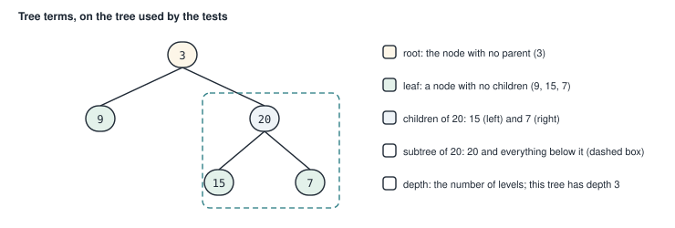
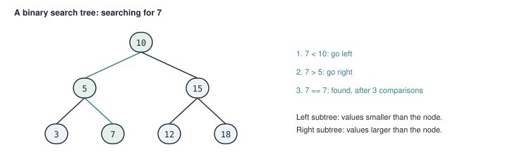
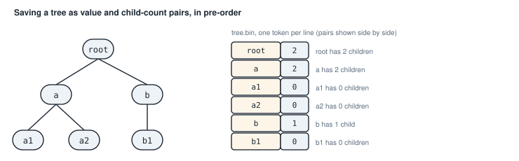
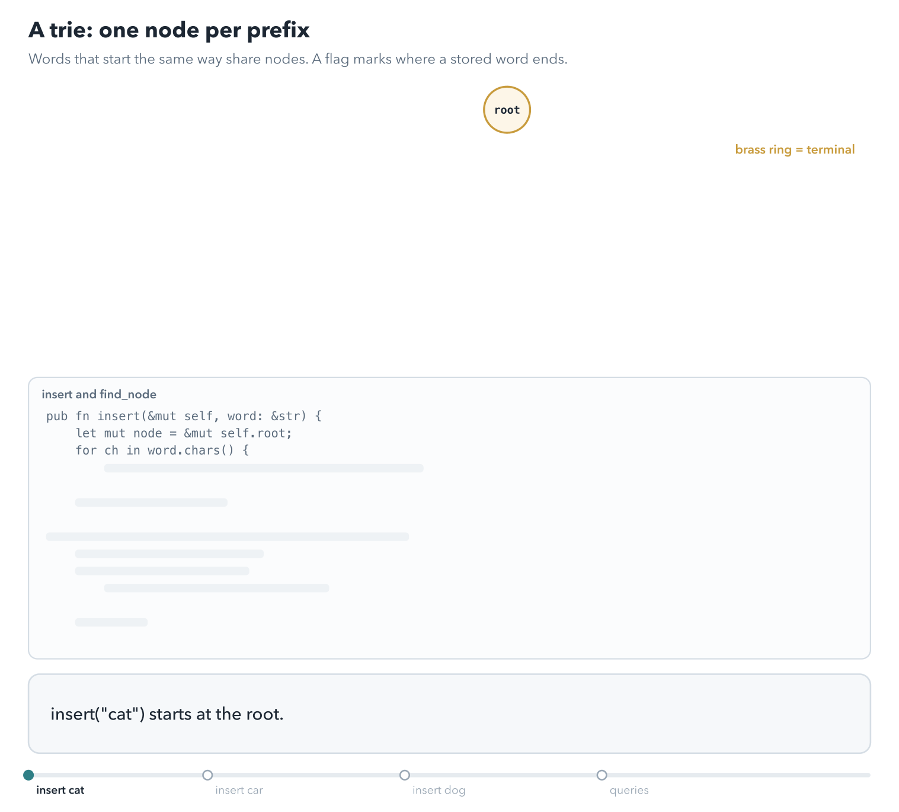

# Trees and tries

<div class="covers" markdown="1">

This chapter covers

- The vocabulary of trees: root, leaf, child, subtree, depth
- A binary tree as an enum, and the three depth-first visiting orders
- Binary search trees: insert, search, remove, and range queries, written two ways
- Trees with any number of children: depth-first and breadth-first visits, and grouping by level
- Saving a tree to a file and loading it back
- A trie, a tree for finding words by their first letters

</div>

In a linked list, each node points to at most one successor. In a **tree**, each node may point to multiple
nodes, called its children, enabling trees to represent hierarchical structures such as filesystem directories,
expression syntax trees, and ordered sets arranged for fast search.

Trees are considerably simpler to implement in Rust than the doubly linked list examined in Chapter 9. Because
each node has at most one parent, a parent can own its children outright through `Box` or `Vec`, without
requiring `Rc` or `RefCell`. The primary implementation challenges lie elsewhere: replacing a node in place
from within a method, and choosing between call-stack recursion and an explicit stack or queue.

We begin with core tree terminology, then implement binary trees, binary search trees, general multi-way trees,
serialization, and finally a prefix trie.

## 11.1 Tree vocabulary

The structural components of a tree are labeled in Figure 11.1.

<figure>

<figcaption><b>Figure 11.1</b> The small tree used by this chapter's tests, with its parts labeled.</figcaption>
</figure>

- The **root** is the unique node with no parent; trees are conventionally drawn with the root at the top.
- A **leaf** is a node with no children.
- The **subtree** rooted at a node consists of that node and all of its descendants. Because every subtree is
  itself a tree, tree algorithms naturally admit recursive definitions.
- The **depth** of a tree is the number of levels along the longest path from the root down to a leaf.

A **binary tree** restricts each node to at most two children, designated the left child and the right child.

## 11.2 A binary tree as an enum

A binary tree is defined inductively as either empty or a node holding a value together with two smaller binary
trees. This definition translates directly into a Rust enum:

<p class="listing"><b>Listing 11.1</b> The tree type (lines 1 to 16). <a href="https://github.com/arpanpathak/cracking-the-systems-programming-interview/blob/prep-v2/rust-interview-lab/src/problems/binary_tree.rs">src/problems/binary_tree.rs</a></p>

```rust
{{#include ../../rust-interview-lab/src/problems/binary_tree.rs:1:16}}
```

As established in Chapter 8, the children must be wrapped in `Box<Tree>`. A `Tree` cannot embed two `Tree`
values directly because the resulting type would have an infinite size; indirection through `Box` stores a
single pointer per child, giving every node a fixed memory layout.

### 11.2.1 Depth and inversion

<p class="listing"><b>Listing 11.2</b> Depth and inversion (lines 19 to 35).</p>

```rust
impl Tree {
{{#include ../../rust-interview-lab/src/problems/binary_tree.rs:19:35}}
    // ...
}
```

Each method dispatches on the two variants of `Tree`. The `Empty` arm serves as the **base case**, returning
an answer directly without further recursion, while the `Node` arm recurses on both subtrees and combines their
results.

The `max_depth` method mirrors the recursive definition directly: an empty tree has depth 0, and a non-empty
node has depth 1 plus the greater depth of its two subtrees. In Figure 11.1, the leaves have depth 1, node 20
has depth 2, and the root has depth 3.

The `invert` method transforms the tree into its mirror image by recursively inverting both subtrees and then
exchanging them with `std::mem::swap(left, right)`. Because the `match` pattern binds `left` and `right` as
mutable references to the `Box` handles, the swap exchanges two pointers in place without moving node payloads.

### 11.2.2 The three depth-first orders

Visiting every node of a tree exactly once is called a **traversal**. Descending along one branch as far as
possible before backtracking is a **depth-first** traversal. The three standard depth-first orders differ only
in when a node is visited relative to its children (Figure 11.2).

<figure>

<figcaption><b>Figure 11.2</b> The badges show the order in which each traversal visits the nodes.</figcaption>
</figure>

- **Pre-order** visits the node first, then its left subtree, then its right subtree.
- **In-order** visits the left subtree, then the node, then the right subtree.
- **Post-order** visits both subtrees, then the node.

<p class="listing"><b>Listing 11.3</b> The public traversal methods (lines 37 to 53).</p>

```rust
impl Tree {
    // ...
{{#include ../../rust-interview-lab/src/problems/binary_tree.rs:37:53}}
    // ...
}
```

Each public method allocates a single `Vec`, passes a mutable reference to a private recursive helper, and
returns the populated vector. Accumulating into one buffer avoids allocating intermediate vectors at every node.

<p class="listing"><b>Listing 11.4</b> The recursive helpers (lines 55 to 86).</p>

```rust
impl Tree {
    // ...
{{#include ../../rust-interview-lab/src/problems/binary_tree.rs:55:86}}
}
```

The three helpers are structurally identical, differing only in where `out.push(*value)` appears relative to
the two recursive calls. Dereferencing `*value` copies the `i32` payload out of the shared reference.

<p class="listing"><b>Listing 11.5</b> The complete file, with its tests. <a href="https://github.com/arpanpathak/cracking-the-systems-programming-interview/blob/prep-v2/rust-interview-lab/src/problems/binary_tree.rs">src/problems/binary_tree.rs</a></p>

```rust
{{#include ../../rust-interview-lab/src/problems/binary_tree.rs}}
```

The test module defines two concise constructors, `leaf` and `node`, so test trees can be assembled in a single
readable expression. The `sample()` helper constructs the tree in Figure 11.1, and the traversal test verifies
all three visitation orders illustrated in Figure 11.2.

## 11.3 Binary search trees

A **binary search tree** (BST) is a binary tree that enforces a strict ordering invariant: for every node, all
values in its left subtree are smaller than the node's value, and all values in its right subtree are larger.

This invariant accelerates lookup. Comparing the target against the current node determines which subtree can
contain it: smaller targets lie exclusively in the left subtree, and larger targets lie exclusively in the
right. Each comparison eliminates an entire subtree from consideration (Figure 11.3).

<figure>

<figcaption><b>Figure 11.3</b> Searching for 7 visits one node per level. In a balanced tree of n values, that is about log₂ n comparisons.</figcaption>
</figure>

Two implementations of the same BST interface accompany this section. Both share identical insertion and lookup
logic, differing in how they perform removal and range queries. We examine the first implementation in full and
then focus on the design differences in the second.

<figure class="anim">
<video class="motion" src="figures/ch11-bst.mp4" autoplay loop muted playsinline preload="metadata" aria-label="The values 8, 3, 10, 1, 6, 14, 13 are inserted one at a time. Each value starts at the root and moves left or right at every comparison until it reaches an empty subtree. Then contains(&6) follows 8, 3, 6. A last part inserts 1, 2, 3, 4, 5 in sorted order, and the tree becomes a chain." data-chapters="[[0.0, &quot;insert&quot;], [94.1, &quot;sorted input&quot;]]"></video>
<figcaption><b>Animation 11.1</b> Each insert is a walk from the root that ends at an empty subtree, and a search is the same walk. Sorted input produces a chain, so the shape depends on the insert order.</figcaption>
</figure>


### 11.3.1 The type, insertion, and search

<p class="listing"><b>Listing 11.6</b> The type (lines 1 to 14). <a href="https://github.com/arpanpathak/cracking-the-systems-programming-interview/blob/prep-v2/rust-interview-lab/src/bin/bst_clean.rs">src/bin/bst_clean.rs</a></p>

```rust
{{#include ../../rust-interview-lab/src/bin/bst_clean.rs:1:14}}
```

`BST<T>` is generic over its element type, and its methods require `T: Ord` so that values admit a total
ordering. Annotating `Empty` with `#[default]` designates the empty tree as the default value, which the
removal logic relies on.

<p class="listing"><b>Listing 11.7</b> Creating, inserting, and searching (lines 17 to 47).</p>

```rust
impl<T: Ord> BST<T> {
{{#include ../../rust-interview-lab/src/bin/bst_clean.rs:17:47}}
    // ...
}
```

`insert` takes `&mut self` to mutate the tree in place, descending recursively until it reaches an `Empty`
slot and replacing it with a new leaf via `*self = Self::Node { ... }`. At each internal node, `val.cmp(value)`
returns `Ordering::Less`, `Greater`, or `Equal`. Duplicate values are ignored, so the tree maintains set
semantics. The `contains` method follows the identical search path without modifying the tree.

### 11.3.2 Removal

Removing a value is the most intricate BST operation because the ordering invariant must be preserved across
three structural cases (Figure 11.4).

<figure>

<figcaption><b>Figure 11.4</b> The three removal cases. In case 3, removing 10 copies 12 into the root, then removes 12 from the right subtree.</figcaption>
</figure>

1. **No left child.** Replace the node with its right subtree.
2. **No right child.** Replace the node with its left subtree.
3. **Two children.** Keep the node, but give it a new value: the smallest value in its right subtree. That value
   is larger than everything on the left and smaller than everything else on the right, so the rule still
   holds. Then remove that smallest value from the right subtree. The smallest value has no left child, so its
   removal is case 1.

<p class="listing"><b>Listing 11.8</b> Removal (lines 49 to 90).</p>

```rust
impl<T: Ord> BST<T> {
    // ...
{{#include ../../rust-interview-lab/src/bin/bst_clean.rs:49:90}}
    // ...
}
```

The first two cases replace `*self` with one of its own children. Because `right` is a mutable reference
borrowing `*self`, moving a subtree out through `right` and assigning it directly to `*self` in one step is
rejected by the borrow checker. Calling `std::mem::take(right)` resolves this conflict by moving the subtree
out and leaving `BST::Empty` (the `Default` value) in its place. The assignment `*self = *std::mem::take(right)`
then unboxes the moved subtree and installs it at `*self`.

The implementation also handles a leaf (a node with no children) in its own arm, although case 1 already covers
it.

For case 3, `remove_min` extracts and returns the smallest value in the right subtree. It descends left until
the match guard `Self::Node { left, .. } if left.is_empty()` identifies the leftmost node. Taking that node out
with `std::mem::take(self)` allows installing its right subtree in its place and returning its value. The
`if let ... else { unreachable!() }` branch satisfies the compiler, which cannot statically prove that the value
taken inside a `Node` arm is itself a `Node`; `unreachable!()` panics if that invariant were ever violated.

`remove` returns `true` when the target value was found and removed, and `false` otherwise, allowing callers to
distinguish deletion from a missing key.

### 11.3.3 Range queries

A **range query** returns every value within a closed interval `[low, high]` in sorted order, pruning subtrees
that cannot contain matching elements.

<p class="listing"><b>Listing 11.9</b> Range queries (lines 92 to 114).</p>

```rust
impl<T: Ord> BST<T> {
    // ...
{{#include ../../rust-interview-lab/src/bin/bst_clean.rs:92:114}}
    // ...
}
```

`range_helper` collects matching values into an accumulator, `acc`. Its three branches skip work:

- If the node's value is below `low`, everything in its left subtree is lower still, so only the right subtree
  is searched.
- If the value is above `high`, only the left subtree is searched.
- Otherwise, the helper searches the left subtree, adds the value, and searches the right subtree. That order
  is in-order traversal, so the results come out sorted.

The signature has an explicit lifetime: `fn range_helper<'a>(&'a self, ..., acc: &mut Vec<&'a T>)`. The
references pushed into `acc` point into the tree, so they must live as long as the tree borrow `&'a self`.
Without the named `'a`, the elision rules from chapter 4 would give `self` and the vector's elements
separate lifetimes. The push would then not compile.

<p class="listing"><b>Listing 11.10</b> The complete program. <a href="https://github.com/arpanpathak/cracking-the-systems-programming-interview/blob/prep-v2/rust-interview-lab/src/bin/bst_clean.rs">src/bin/bst_clean.rs</a></p>

```rust
{{#include ../../rust-interview-lab/src/bin/bst_clean.rs}}
```

```text
$ cargo run --bin bst_clean
Contains 7: true
Contains 12: true
Values in [4, 16]: [5, 7, 10, 12, 15]
Remove 5: true
Remove 10: true
Remove 99: false
After removals: Node {
    value: 12,
    left: Node {
        value: 7,
        left: Node {
            value: 3,
            left: Empty,
            right: Empty,
        },
        right: Empty,
    },
    right: Node {
        value: 15,
        left: Empty,
        right: Node {
            value: 18,
            left: Empty,
            right: Empty,
        },
    },
}
```

Tracing the two removals illustrates case 3 in action. Node 5 has children 3 and 7, so it adopts 7 (the minimum
of its right subtree) and removes the original leaf 7. Node 10 likewise adopts 12 from its right subtree,
leaving 12 at the root and 7 in node 5's former position.

### 11.3.4 A second BST, with an iterative minimum

The second implementation adopts alternative strategies for removal and range queries.

<p class="listing"><b>Listing 11.11</b> Removal and <code>pop_min</code> (lines 49 to 84). <a href="https://github.com/arpanpathak/cracking-the-systems-programming-interview/blob/prep-v2/rust-interview-lab/src/bin/bst_easy.rs">src/bin/bst_easy.rs</a></p>

```rust
{{#include ../../rust-interview-lab/src/bin/bst_easy.rs:1:4}}

impl<T: Ord> BST<T> {
    // ...
{{#include ../../rust-interview-lab/src/bin/bst_easy.rs:49:84}}
    // ...
}
```

This `remove` uses a helper `take`, defined at the end of the file, that swaps in `Empty` with
`mem::replace`. So the type does not need `Default`. `right.take()` reaches through the `Box` automatically
and returns the tree inside.

`pop_min` finds the smallest value with a loop instead of recursion. It moves a mutable reference, `node`, down
the left side of the tree:

```rust
let mut node = self;
while node.has_left() {
    if let Self::Node { left, .. } = node {
        node = left;
    }
}
```

When the loop ends, `node` refers to the leftmost node. `match node.take()` splits it into its value and its
right subtree, with no `unreachable!`. The loop uses one stack frame however deep the tree is. `pop_min` is also public, so the tree can serve as
a queue that always returns the smallest value.

<p class="listing"><b>Listing 11.12</b> A range query that returns a new vector (lines 86 to 102).</p>

```rust
impl<T: Ord> BST<T> {
    // ...
{{#include ../../rust-interview-lab/src/bin/bst_easy.rs:86:102}}
    // ...
}
```

This `range` returns a new `Vec` from each call and joins the children's results with `extend`. It is shorter
than the accumulator version, and it allocates a vector at every node it visits, where the accumulator version
allocates one.

<p class="listing"><b>Listing 11.13</b> The complete program. <a href="https://github.com/arpanpathak/cracking-the-systems-programming-interview/blob/prep-v2/rust-interview-lab/src/bin/bst_easy.rs">src/bin/bst_easy.rs</a></p>

```rust
{{#include ../../rust-interview-lab/src/bin/bst_easy.rs}}
```

```text
$ cargo run --bin bst_easy
Contains 7: true
Range 4 to 12: [5, 7, 10, 12]
After removing 10: [3, 5, 7, 12, 15]
Pop min: Some(3)
```

<div class="callout warning" markdown="1">

**WARNING:** Neither implementation performs self-balancing. Inserting keys in strictly ascending order (1, 2,
3, and so on) appends each value as the right child of the previous node, degenerating the tree into a linear
chain of depth *n*. Lookups then degrade to O(*n*), and every recursive method consumes O(*n*) stack frames. For
balanced search trees in production code, use the standard library's `BTreeMap`.

</div>

## 11.4 Trees with any number of children

Many hierarchical structures are not binary; a filesystem directory, for example, can hold an arbitrary number
of entries. Modeling a node with a `Vec<TreeNode<T>>` of children accommodates arbitrary branching without
requiring `Box`, because `Vec` already heap-allocates its backing buffer and keeps the node's inline size fixed.

### 11.4.1 Depth first and breadth first

The two fundamental traversal strategies for a multi-way tree are illustrated in Figure 11.5. A **depth-first**
traversal descends completely down one branch before starting the next (as in Section 11.2.2), whereas a
**breadth-first** traversal visits nodes level by level: the root, then all of its children, then all of their
children.

<figure>

<figcaption><b>Figure 11.5</b> Depth first finishes node 2's branch before visiting 3. Breadth first finishes each level before the next.</figcaption>
</figure>

Depth-first traversal maps naturally onto recursion, whereas breadth-first traversal requires a FIFO **queue**.
The root is enqueued first; on each iteration, the front node is dequeued, visited, and its children are
appended to the back. Because children always enter at the back, every node of one level leaves the queue before
any node of the next level is processed.

A node owns its value and a `Vec` of child nodes. The children are stored inside the vector itself, not behind pointers, so a node can have any number of them:

```rust
{{#include ../../rust-interview-lab/src/bin/test_tree.rs:1:6}}
```

<p class="listing"><b>Listing 11.14</b> The complete program. <a href="https://github.com/arpanpathak/cracking-the-systems-programming-interview/blob/prep-v2/rust-interview-lab/src/bin/test_tree.rs">src/bin/test_tree.rs</a></p>

```rust
{{#include ../../rust-interview-lab/src/bin/test_tree.rs}}
```

`dfs` prints the node and then calls itself on each child, which is pre-order.

`bfs` uses a `VecDeque` as the queue. `VecDeque::from([self])` starts it with the root. The queue holds
references, `&TreeNode<T>`, so no node is moved or copied. `pop_front` takes from the front, and `push_back`
adds each child at the back.

The tree in `main` is written as one nested value. The shape of the code matches the shape of the tree, which
makes test data easy to check.

```text
$ cargo run --bin test_tree
=== DFS ===
1
2
4
5
3
6

=== BFS ===
1
2
3
4
5
6
```

### 11.4.2 Grouping values by level

A common variation returns the values grouped by level, as a list of lists. The first list holds the
root's value, the second the values of its children, and so on. The file solves it twice.

<p class="listing"><b>Listing 11.15</b> The type and the first version (lines 1 to 20). <a href="https://github.com/arpanpathak/cracking-the-systems-programming-interview/blob/prep-v2/rust-interview-lab/src/bin/tree_under_pressure.rs">src/bin/tree_under_pressure.rs</a></p>

```rust
{{#include ../../rust-interview-lab/src/bin/tree_under_pressure.rs:1:20}}
```

`level_order` keeps one whole level in `level`, a `Vec` of references to nodes. Each pass of the loop does two
things. It adds the values of this level to the result. Then it builds the next level from all the children of
all the nodes in this level: `level.iter().flat_map(|n| &n.children).collect()`. `flat_map` turns each node into
its children and joins all those children into one sequence. The loop ends when a level has no nodes.

<p class="listing"><b>Listing 11.16</b> The second version, with a queue (lines 22 to 40).</p>

```rust
{{#include ../../rust-interview-lab/src/bin/tree_under_pressure.rs:22:40}}
```

`level_order_readable` maintains a single queue, as `bfs` did. The key invariant is reading `queue.len()` at the
start of each round: at that moment, the queue holds the exact set of nodes belonging to the current level. The
inner loop pops that exact count and records their values, while their children accumulate at the back for the
next round.

`let Some(node) = queue.pop_front() else { break };` is a **let-else** statement. It binds `node` if the pattern
matches, and runs the `else` block, which must leave the loop or the function, if it does not.
`queue.extend(&node.children)` adds references to all the children at once.

<p class="listing"><b>Listing 11.17</b> The complete program. <a href="https://github.com/arpanpathak/cracking-the-systems-programming-interview/blob/prep-v2/rust-interview-lab/src/bin/tree_under_pressure.rs">src/bin/tree_under_pressure.rs</a></p>

```rust
{{#include ../../rust-interview-lab/src/bin/tree_under_pressure.rs}}
```

`main` prints the tree with `{:#?}`, then the levels from each version. Both give the same three levels:

```text
["root"]
["branch_a", "branch_b"]
["leaf_1", "leaf_2", "leaf_3"]
one queue, one level per round:
["root"]
["branch_a", "branch_b"]
["leaf_1", "leaf_2", "leaf_3"]
```

Both functions return `Vec<Vec<&T>>`, references into the tree, and both run in O(n).

## 11.5 Saving a tree to a file and loading it back

Persisting a tree to storage requires converting its hierarchical structure into a flat sequence of text, a
process called **serialization**, so that the exact topology can be reconstructed later.

A pre-order sequence of values alone cannot uniquely identify a multi-way tree because it omits where each
node's children terminate. Appending each node's child count immediately after its value resolves this
ambiguity (Figure 11.6): a deserializer reads a value and its child count *k*, then recursively reads *k* child
subtrees.

<figure>

<figcaption><b>Figure 11.6</b> Each node is written as its value and its number of children, in pre-order.</figcaption>
</figure>

<p class="listing"><b>Listing 11.18</b> The tree type, and writing the pairs (lines 1 to 47). <a href="https://github.com/arpanpathak/cracking-the-systems-programming-interview/blob/prep-v2/rust-interview-lab/src/bin/tree_serializ_deserialize_into_file.rs">src/bin/tree_serializ_deserialize_into_file.rs</a></p>

```rust
{{#include ../../rust-interview-lab/src/bin/tree_serializ_deserialize_into_file.rs:1:1}}

{{#include ../../rust-interview-lab/src/bin/tree_serializ_deserialize_into_file.rs:3:7}}

impl<T> TreeNode<T> {
    // ...
{{#include ../../rust-interview-lab/src/bin/tree_serializ_deserialize_into_file.rs:30:47}}
    // ...
}
```

`TreeNode<T>` is the same shape as in section 11.4: a value and a `Vec` of child nodes. A node can have any
number of children.

`serialize` walks the tree in pre-order without recursion, using a `Vec` as a **stack**: the last item pushed
is the first popped. It pushes the children in reverse order, with `iter().rev()`, so that the first child is on
top and is popped first. For each node it writes the value and the child count as strings.

The line `where T: ToString` sits on the method, not on the whole `impl`. So a tree of any type exists, and only
a tree whose values can become strings gets a `serialize` method.

<p class="listing"><b>Listing 11.19</b> Reading the pairs back (lines 49 to 63).</p>

```rust
impl<T> TreeNode<T> {
    // ...
{{#include ../../rust-interview-lab/src/bin/tree_serializ_deserialize_into_file.rs:49:63}}
    // ...
}
```

`deserialize` is recursive. `pos` is a `&mut usize`, a position in the token list shared by all the calls. Each
call reads a value and a count at `pos`, advances `pos` by two, and then calls itself `child_count` times to read
the children.

Every fallible step propagates failure through the `?` operator on `Option`: a truncated token stream, an
unparseable value, or a non-numeric child count. Calling `.parse().ok()?` converts the `Result` from `parse`
into an `Option`, causing any malformed input to return `None`.

<p class="listing"><b>Listing 11.20</b> The complete program. <a href="https://github.com/arpanpathak/cracking-the-systems-programming-interview/blob/prep-v2/rust-interview-lab/src/bin/tree_serializ_deserialize_into_file.rs">src/bin/tree_serializ_deserialize_into_file.rs</a></p>

```rust
{{#include ../../rust-interview-lab/src/bin/tree_serializ_deserialize_into_file.rs}}
```

`save` joins the tokens with newlines and writes the file. `load` reads the file, splits it into lines, and starts
reading at position 0 with `&mut 0`. `main` saves a tree, loads it back, and prints its levels to show the shape
survived:

```text
$ cargo run --bin tree_serializ_deserialize_into_file
["root"]
["a", "b"]
["a1", "a2", "b1"]
```

The format breaks if a value contains a newline, because the reader splits on newlines. For arbitrary text,
write each value's length before it, or use a serialization library such as `serde`.

## 11.6 A trie for finding words by prefix

A **trie** (usually pronounced "try") stores a set of words by sharing their common beginnings. Each edge is one
character. Walking from the root along the characters of a word leads to the node for that word. A flag on the
node marks whether a stored word ends there (figure 11.7).

<figure>

<figcaption><b>Figure 11.7</b> A trie holding <code>"gpu"</code> and <code>"gpucloud"</code>. The two words share their first three nodes.</figcaption>
</figure>

A **prefix** is the beginning of a word: `"gp"` is a prefix of `"gpu"`. A trie answers "is any stored word
starting with this prefix?" by walking the prefix's characters. That makes it the usual structure behind
autocompletion.

<figure class="anim">
<video class="motion" src="figures/ch11-trie.mp4" autoplay loop muted playsinline preload="metadata" aria-label="Inserting cat, car, and dog one character at a time. A node is created only when no child exists for the character, so cat and car share the nodes c and ca. A ring marks each node that ends a word. starts_with(ca) finds the node ca; search(ca) finds it but it ends no word; cab finds no child b." data-chapters="[[0.0, &quot;insert cat&quot;], [15.44, &quot;insert car&quot;], [32.44, &quot;insert dog&quot;], [49.44, &quot;queries&quot;]]"></video>
<figcaption><b>Animation 11.2</b> <code>insert</code> creates a node only when the character has no child yet, so words with a common start share nodes. <code>"ca"</code> is a prefix but not a word, and <code>"cab"</code> stops at a missing child.</figcaption>
</figure>


A trie is one root node. Each node maps a character to the child node for that character, and `terminal` marks a node where a stored word ends:

```rust
{{#include ../../rust-interview-lab/src/problems/trie.rs:8:16}}
```

<p class="listing"><b>Listing 11.21</b> The complete file. <a href="https://github.com/arpanpathak/cracking-the-systems-programming-interview/blob/prep-v2/rust-interview-lab/src/problems/trie.rs">src/problems/trie.rs</a></p>

```rust
{{#include ../../rust-interview-lab/src/problems/trie.rs}}
```

Each `Node` has a `HashMap` from a character to a child node, and a `terminal` flag. Both types derive `Default`,
so an empty node is `Node::default()`.

`insert` walks a mutable cursor, `node`, down the word, one character per line:

```rust
node = node.children.entry(ch).or_default();
```

`entry(ch).or_default()` finds the child for `ch`, creating an empty one if it is missing, and returns a mutable
reference to it. Assigning that to `node` moves the cursor down one level. After the last character, the node is
marked terminal.

`find_node` walks the same way without changing anything. `node.children.get(&ch)?` returns `None` from the
function at the first missing character. `search` then checks that the node exists and is terminal, with
`is_some_and`. `starts_with` only checks that the node exists.

Searching for a word of *m* characters requires *m* steps, independent of the total number of stored words.
Storing a `HashMap` per node supports arbitrary Unicode characters at the cost of significant per-node memory
overhead. When the alphabet is restricted to lowercase ASCII letters, a fixed array of 26 child pointers per
node reduces both memory footprint and lookup latency.

<div class="summary" markdown="1">

## Summary

- A tree is a hierarchy of nodes. Each subtree is itself a tree, so recursion fits tree problems.
- A binary tree fits in an enum with `Box` children. Pre-order, in-order, and post-order differ only in when a
  node is visited relative to its subtrees.
- A binary search tree keeps smaller values on the left and larger on the right, so a search discards a subtree
  at each step.
- Removing from a BST has three cases. The two-children case copies in the smallest value of the right subtree.
- `std::mem::take` and `mem::replace` let a method replace `*self` with one of its own children.
- A range query skips subtrees outside the range and visits the rest in order.
- A node with `Vec` children describes a tree with any number of children. Breadth-first traversal uses a queue,
  and `queue.len()` at the start of a round gives the size of a level.
- Pre-order with child counts saves a tree in a form that can be rebuilt exactly.
- A trie shares prefixes between words, and finds a word in time proportional to its length.

</div>

In Chapter 12, we generalize trees to graphs, allowing arbitrary connections between nodes and cycles.

## Exercises

1. Write an in-order traversal of the binary tree from listing 11.1 without recursion, using a `Vec` of
   references as a stack.
2. Add a `height` method to one of the BSTs. Insert the numbers 1 to 1,000 in order, then in shuffled order, and
   compare the heights.
3. Serialize a binary tree using a marker such as `#` for each empty child, and write the matching reader.
4. Add `words_with_prefix(&self, prefix: &str) -> Vec<String>` to the trie.
