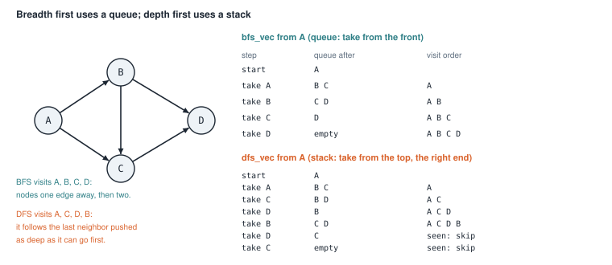
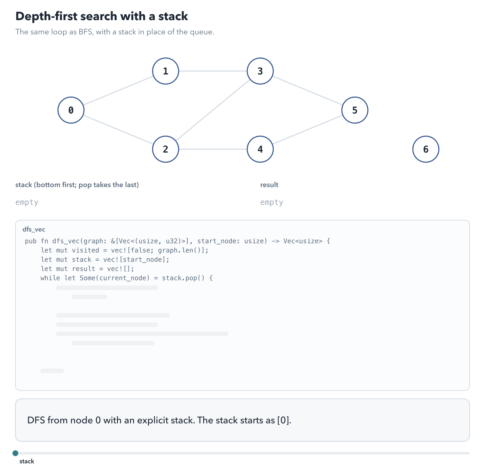
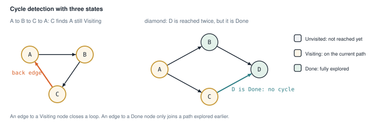
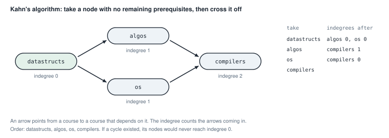
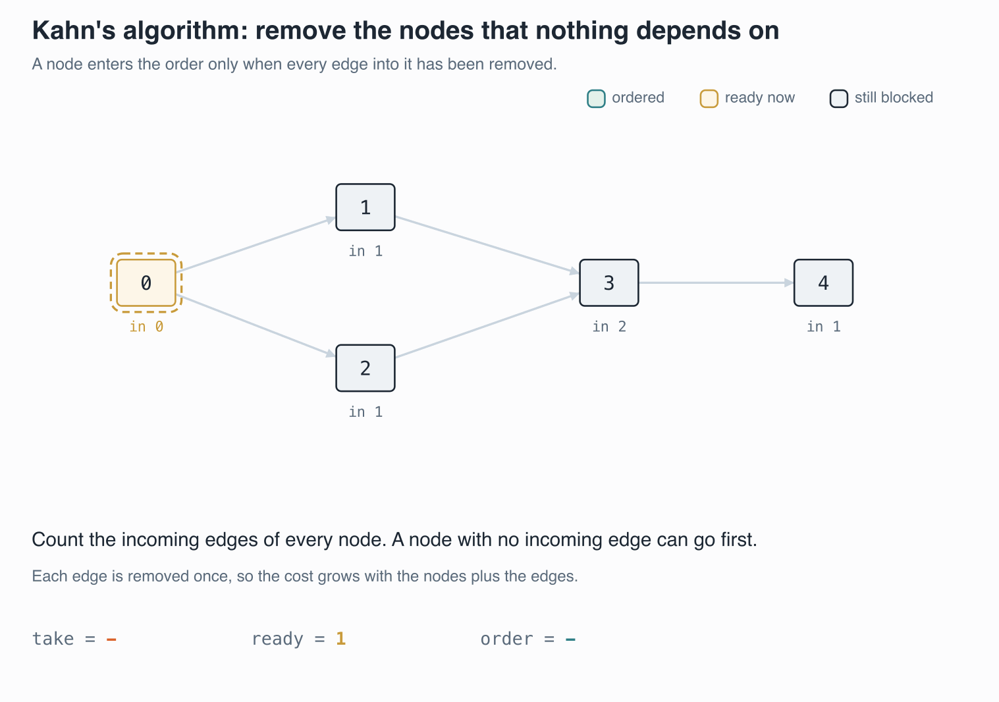
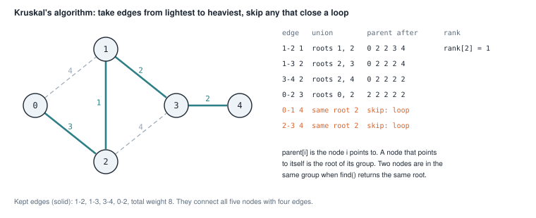

# Graphs

<div class="covers" markdown="1">

This chapter covers

- What a graph is, and two ways to store one in memory
- Breadth-first and depth-first search, and the queue and stack behind them
- Finding cycles with three node states
- Treating a grid of cells as a graph, to count islands
- Ordering tasks so that each comes after its prerequisites
- Shortest paths with Dijkstra's algorithm, written five ways
- Connecting every node at the lowest cost with Kruskal's algorithm and a union-find

</div>

A **graph** *G* = (*V*, *E*) generalizes hierarchical tree topologies by removing both the single-parent restriction
and the acyclicity invariant: any vertex in *V* may connect to any other vertex via an edge in *E*, and directed
or undirected paths may form cycles.

Graphs model arbitrary binary relations across systems engineering, including network routing topologies,
distributed cluster communication links, build dependency pipelines, and scheduling constraints. Because multiple
paths may converge on the same vertex and cycles can cause non-terminating traversals, every graph traversal
algorithm must maintain an explicit visitation state structure, typically a dense `Vec<bool>`, a `HashSet`, or a
state-machine table backed by a `HashMap`.

## 12.1 Graph vocabulary

The fundamental components of a graph are labeled in Figure 12.1.

<figure>

<figcaption><b>Figure 12.1</b> An undirected graph, and the directed, weighted sample graph used in sections 12.2 to 12.4.</figcaption>
</figure>

- A **node** (or vertex) represents an entity in the graph.
- An **edge** connects two nodes. In a **directed** graph, an edge has a single orientation from a source node to
  a target node; in an **undirected** graph, an edge permits traversal in both directions.
- The **neighbors** of a node are the nodes directly reachable via its outgoing edges.
- A **weight** is a numeric cost or distance associated with an edge.
- A **path** is a sequence of consecutive edges connecting a sequence of nodes.
- A **cycle** is a non-empty path that begins and ends at the same node.

A directed graph containing no directed cycles is a **directed acyclic graph** (DAG). A rooted tree corresponds to
the special case of a connected acyclic graph in which every vertex other than the root has indegree 1.

## 12.2 Storing a graph

The standard in-memory representation of a sparse graph is an **adjacency list**, which stores each node's
outgoing edges as a collection of `(neighbor, weight)` pairs. The implementations in this chapter use two
variants of the adjacency list (Figure 12.2).

<figure>

<figcaption><b>Figure 12.2</b> The sample graph in the two adjacency-list forms.</figcaption>
</figure>

In the **index form**, nodes are numbered `0..n` and the graph has type `Vec<Vec<(usize, u32)>>`. Looking up the
outgoing edges of node `i` is a single array index `graph[i]`, and visited tracking uses a compact `Vec<bool>`.

In the **map form**, nodes may be any hashable type such as string names, and the graph is a `HashMap` mapping
each node to its outgoing edges. Edge lookup hashes the node key, and visited tracking uses a `HashSet`.

The index form delivers higher throughput and cache locality, whereas the map form is more convenient when nodes
carry natural identifiers. Several files in this chapter implement both representations side by side for direct
comparison.

The map form in `graph_bfs.rs` has a type alias:

```rust
{{#include ../../rust-interview-lab/src/problems/graph_bfs.rs:10:13}}

{{#include ../../rust-interview-lab/src/problems/graph_bfs.rs:15:16}}
```

`GraphAdjList<'a, Node>` maps each vertex key to a borrowed slice `&'a [(Node, u32)]` of outgoing `(neighbor,
weight)` pairs. Because the map holds non-owning slice references bounded by lifetime `'a`, the backing edge
storage must outlive the map itself; in the test suite, edges are backed by `'static` constant arrays with
program-wide storage duration.

## 12.3 Breadth-first search

**Breadth-first search** (BFS) explores vertices in non-decreasing order of unweighted hop distance from a source
vertex: first the source at distance 0, then all vertices at distance 1, then distance 2, and so on. Like
level-order tree traversal, BFS maintains a FIFO queue representing the active vertex frontier.

Unlike a tree, a general graph may contain multiple distinct paths to the same vertex: in the sample graph, vertex
A reaches C directly via (A, C) and indirectly via (A, B, C). Without deduplication, C would be enqueued multiple
times. BFS enforces the invariant that each vertex is marked visited immediately upon discovery (when first
enqueued), guaranteeing that every reachable vertex enters the frontier at most once.

The upper half of Figure 12.3 traces the frontier queue at each iteration.

<figure>

<figcaption><b>Figure 12.3</b> The queue in BFS and the stack in DFS, starting at A. Both visit every node once, in different orders.</figcaption>
</figure>

<figure class="anim">
<video class="motion" src="figures/ch12-bfs.mp4" autoplay loop muted playsinline preload="metadata" aria-label="A graph of nodes 0 to 6 with a queue and a result list below it. BFS takes 0, then pushes its neighbors 1 and 2, then takes them in order and pushes their unvisited neighbors. The result is 0, 1, 2, 3, 4, 5. Node 6 has no edges to the others and is never reached." data-chapters="[[0.0, &quot;queue&quot;], [51.84, &quot;node 6&quot;]]"></video>
<figcaption><b>Animation 12.1</b> <code>bfs_vec</code> from node 0. The queue hands out the oldest entry first, so nodes are visited in order of distance. Node 6 is not connected and is never reached.</figcaption>
</figure>

### 12.3.1 BFS with numbered nodes

<p class="listing"><b>Listing 12.1</b> BFS over the index form (lines 18 to 36). <a href="https://github.com/arpanpathak/cracking-the-systems-programming-interview/blob/prep-v2/rust-interview-lab/src/problems/graph_bfs.rs">src/problems/graph_bfs.rs</a></p>

```rust
{{#include ../../rust-interview-lab/src/problems/graph_bfs.rs:18:36}}
```

The function initializes three structures: `visited` (one `false` entry per node), `queue` (seeded with the
start node), and `result` (collecting nodes in visitation order).

Each iteration dequeues the front node, appends it to `result`, and inspects its outgoing edges. The pattern
`&(neighbor, _)` destructures each edge pair, copying out the neighbor index while ignoring the weight. Any
unvisited neighbor is marked immediately and enqueued at the back.

Because each node enters the queue at most once and every edge is examined once, BFS runs in O(*V* + *E*) time,
where *V* is the number of nodes and *E* is the number of edges. Nodes unreachable from the start never enter the
queue and are omitted from the result.

### 12.3.2 BFS with any node type

<p class="listing"><b>Listing 12.2</b> BFS over the map form (lines 38 to 59).</p>

```rust
{{#include ../../rust-interview-lab/src/problems/graph_bfs.rs:38:59}}
```

The traversal logic is identical, with three structural differences:

- The function is generic over `Node`. Its `where` clause requires `Copy` so nodes can be copied into the queue
  and result vector, and `Eq + Hash` so nodes can serve as keys in `HashSet`.
- `graph[&current_node]` looks up outgoing edges by key. Because indexing a `HashMap` panics on a missing key,
  every node in the graph must have an entry, even if its edge slice is empty.
- `visited.insert(neighbor)` combines the membership check and insertion in a single call, returning `true` when
  the node was previously unseen.

The unit tests construct the sample topology in both representations and assert identical visitation order:

```text
$ cargo test --lib problems::graph_bfs
running 5 tests
test problems::graph_bfs::tests::vec_variant_skips_unreachable_nodes ... ok
test problems::graph_bfs::tests::vec_variant_visits_level_by_level ... ok
test problems::graph_bfs::tests::vec_variant_handles_cycles ... ok
test problems::graph_bfs::tests::both_variants_agree ... ok
test problems::graph_bfs::tests::map_variant_visits_level_by_level ... ok

test result: ok. 5 passed; 0 failed; 0 ignored; 0 measured; 132 filtered out
```

Because Cargo executes test cases concurrently by default, output line ordering is non-deterministic across runs.

## 12.4 Depth-first search

**Depth-first search** (DFS) explores each branch to its full depth before backtracking to alternative edges.
Although DFS can be expressed recursively, the implementations below maintain an explicit heap-allocated stack
(`Vec`), avoiding thread call-stack overflow on deep or pathological graphs.

<p class="listing"><b>Listing 12.3</b> DFS over the index form (lines 16 to 33). <a href="https://github.com/arpanpathak/cracking-the-systems-programming-interview/blob/prep-v2/rust-interview-lab/src/problems/graph_dfs.rs">src/problems/graph_dfs.rs</a></p>

```rust
{{#include ../../rust-interview-lab/src/problems/graph_dfs.rs:12:14}}

{{#include ../../rust-interview-lab/src/problems/graph_dfs.rs:16:33}}
```

Relative to Listing 12.1, iterative DFS differs in two respects: replacing the FIFO queue with a LIFO stack
(`pop` in place of `pop_front`), and deferring visitation marking until a vertex is popped rather than when it is
pushed.

Deferred marking preserves exact depth-first visitation order at the expense of bounded stack duplication: a
vertex reachable via multiple unexpanded edges may appear on the stack more than once (as C and D do in the lower
half of Figure 12.3). The stack size remains bounded by O(*E*), and duplicate entries are discarded immediately
via `continue` upon removal.

Because adjacency entries are pushed in slice order, LIFO extraction explores the final neighbor first: from A,
pushing B then C causes C to be expanded before B, yielding the traversal order A, C, D, B.

<figure class="anim">
<video class="motion" src="figures/ch12-dfs.mp4" autoplay loop muted playsinline preload="metadata" aria-label="The same graph with a stack and a result list. dfs_vec pops the newest entry, records it if it is unvisited, and pushes all its neighbors. Entries for nodes already visited are popped and skipped. The result is 0, 2, 4, 5, 3, 1. Last, without the visited check, every pop pushes its neighbors again and the stack never empties." data-chapters="[[0.0, &quot;stack&quot;], [98.76, &quot;no visited check&quot;]]"></video>
<figcaption><b>Animation 12.2</b> <code>dfs_vec</code> uses the same loop as BFS with a stack. The newest entry is taken first, so the walk goes deep before it goes wide.</figcaption>
</figure>


<p class="listing"><b>Listing 12.4</b> DFS over the map form (lines 35 to 54).</p>

```rust
{{#include ../../rust-interview-lab/src/problems/graph_dfs.rs:35:54}}
```

Here `if !visited.insert(current_node)` performs atomic membership testing and insertion: a `false` return value
signals that `current_node` was already visited, prompting the loop to skip the stale stack entry.

The module imports `GraphAdjList` from `crate::problems::graph_bfs` so both traversal modules share a single
adjacency-list type definition.

### 12.4.1 A stack of references

When the input topology is a tree, acyclic single-parent connectivity guarantees that no vertex is reachable via
multiple paths, eliminating the need for a visited set. The following program performs iterative DFS over an owned
tree using a stack of shared references.

<p class="listing"><b>Listing 12.5</b> The complete program. <a href="https://github.com/arpanpathak/cracking-the-systems-programming-interview/blob/prep-v2/rust-interview-lab/src/bin/rust_interview_hacks_graph.rs">src/bin/rust_interview_hacks_graph.rs</a></p>

```rust
{{#include ../../rust-interview-lab/src/bin/rust_interview_hacks_graph.rs}}
```

The explicit stack has type `Vec<&Node>`, storing non-owning references into the tree without moving or cloning
any node payloads. Calling `stack.extend(node.children.iter())` pushes references to all children in one pass.
Accessing `tree.value` after the traversal terminates verifies that `tree` retains full ownership throughout.

```text
$ cargo run --bin rust_interview_hacks_graph
Node { value: 1, children: [Node { value: 2, children: [] }, Node { value: 3, children: [Node { value: 4, children: [] }] }] }
Node { value: 3, children: [Node { value: 4, children: [] }] }
Node { value: 4, children: [] }
Node { value: 2, children: [] }
still own it: 1
```

Debug formatting (`{:?}`) prints each node recursively with its descendants, so the first line displays the entire
subtree rooted at 1. Because LIFO extraction pops the last pushed child first, the visitation sequence is 1, 3, 4,
2.

## 12.5 A graph with named nodes

Real-world inputs frequently represent graphs as pairs of string identifiers such as `("A", "B")`. A standard
technique is to assign each distinct name an integer index upon first encounter and then execute graph algorithms
on the compact index representation. Assigning compact numeric identifiers to names in this way is called
**interning**.

The graph maintains two structures: `ids`, which interns each name to a numeric index, and `adj`, the adjacency
list indexed by those integers:

```rust
{{#include ../../rust-interview-lab/src/bin/graph_bfs.rs:1:7}}
```

<p class="listing"><b>Listing 12.6</b> The complete program. <a href="https://github.com/arpanpathak/cracking-the-systems-programming-interview/blob/prep-v2/rust-interview-lab/src/bin/graph_bfs.rs">src/bin/graph_bfs.rs</a></p>

```rust
{{#include ../../rust-interview-lab/src/bin/graph_bfs.rs}}
```

`Graph` pairs two fields: `ids`, mapping each string label to its assigned integer index, and `adj`, an unweighted
index-form adjacency list.

The `id` method performs interning in a single entry lookup. Calling `self.ids.entry(name.to_owned())` queries
the map, and `or_insert_with` invokes its closure exclusively when the label is absent, appending an empty
adjacency vector to `self.adj` and returning its newly assigned index. Dereferencing with `*` copies out the
`usize` identifier.

Although `self.ids` is mutably borrowed by the `Entry` handle while the closure mutates `self.adj`, Rust's
disjoint field borrow analysis permits both borrows simultaneously because they reference distinct struct fields.

This `bfs` implementation marks vertices upon dequeue rather than enqueue, matching the deferred-marking strategy
of Section 12.4: a vertex may enter the queue multiple times, with subsequent copies skipped upon removal.
Calling `queue.extend(self.adj[node].iter())` enqueues all adjacent vertex indices in a single pass.

```text
$ cargo run --bin graph_bfs
[0, 1, 2, 3, 4, 5]
```

The output reports interned integer indices rather than string labels; vertices A through F receive indices 0
through 5 in order of first insertion.

## 12.6 Finding cycles

Many systems must verify that a directed graph is acyclic: a build system cannot compile a target that depends on
itself, and a curriculum planner cannot schedule circular prerequisites.

A single visited flag cannot reliably detect cycles. Consider the diamond on the right of Figure 12.4: DFS
reaches D through B and later encounters D again through C, yet that second visit reflects converging paths
rather than a cycle.

<figure>

<figcaption><b>Figure 12.4</b> An edge to a node on the current path is a cycle. An edge to a finished node is not.</figcaption>
</figure>

Cycle detection in directed graphs requires a three-state visitation state machine per vertex (standard
white-gray-black DFS coloring):

- **Unvisited (white):** DFS has not yet discovered the vertex.
- **Visiting (gray):** The vertex is active on the current DFS recursion stack; its descendants are still being
  explored.
- **Done (black):** All vertices reachable from this vertex have been completely explored and verified acyclic.

An edge targeting a `Visiting` vertex points to an ancestor on the active recursion stack and therefore closes a
directed cycle; such an edge is classified as a **back edge**. An edge targeting a `Done` vertex enters a
previously validated acyclic subgraph (a forward or cross edge) and cannot form a cycle.

### 12.6.1 A graph that owns its node data

<p class="listing"><b>Listing 12.7</b> The graph and its states (lines 1 to 30). <a href="https://github.com/arpanpathak/cracking-the-systems-programming-interview/blob/prep-v2/rust-interview-lab/src/bin/cyclic_graph.rs">src/bin/cyclic_graph.rs</a></p>

```rust
{{#include ../../rust-interview-lab/src/bin/cyclic_graph.rs:1:15}}

impl<T> Graph<T> {
{{#include ../../rust-interview-lab/src/bin/cyclic_graph.rs:18:37}}
    // ...
}
```

This `Graph<T>` stores owned vertex payloads in a contiguous arena `nodes: Vec<T>` and represents edges as integer
indices inside `adj`. Defining `type NodeId = usize` documents index semantics in method signatures; `add_node`
allocates a slot and returns its `NodeId` handle for subsequent edge insertions.

Index-based arena storage is the idiomatic graph representation in Rust. Representing cyclic graphs with direct
pointers or references requires reference counting (`Rc`) and interior mutability (`RefCell`), introducing runtime
borrow checks and reference-cycle memory leaks; integer indices into a `Vec` eliminate ownership aliasing
altogether while improving spatial cache locality.

The `neighbors` method returns `impl Iterator<Item = NodeId> + '_`, an opaque iterator type whose lifetime is tied
to the borrow of `self` so that it cannot outlive the graph. Calling `.copied()` converts yielded `&usize` slice
references into owned `NodeId` values.

<p class="listing"><b>Listing 12.8</b> BFS and DFS (lines 39 to 74).</p>

```rust
impl<T> Graph<T> {
    // ...
{{#include ../../rust-interview-lab/src/bin/cyclic_graph.rs:39:74}}
    // ...
}
```

These methods implement the BFS and DFS traversals of Sections 12.3 and 12.4 over the `neighbors` iterator.
Filtering out already-visited neighbors via `.filter(|&n| !visited[n])` before pushing reduces peak stack depth,
but the post-pop visitation guard remains mandatory: two distinct ancestors may still enqueue the same unvisited
vertex before either stack entry is popped.

<p class="listing"><b>Listing 12.9</b> Cycle detection (lines 76 to 94).</p>

```rust
impl<T> Graph<T> {
    // ...
{{#include ../../rust-interview-lab/src/bin/cyclic_graph.rs:76:94}}
}
```

`visit` executes a recursive DFS that short-circuits and returns `true` upon encountering any back edge,
dispatching on the vertex's current state:

- `Visiting`: the incoming edge is a back edge to an active ancestor, confirming a cycle (`true`).
- `Done`: the subgraph rooted at this vertex has already been proven acyclic (`false`).
- `Unvisited`: the vertex transitions to `Visiting` and recurses over its outgoing neighbors; `.any(...)`
  short-circuits as soon as any branch reports a cycle. Once all descendants return acyclic, the vertex
  transitions to `Done`.

Because a directed graph may contain disconnected components, `has_cycle` initiates `visit` from every vertex in
`0..self.nodes.len()`. All invocations share a single `state` vector, ensuring each vertex and edge is processed
at most once for an overall time complexity of O(*V* + *E*).

<p class="listing"><b>Listing 12.10</b> The complete program. <a href="https://github.com/arpanpathak/cracking-the-systems-programming-interview/blob/prep-v2/rust-interview-lab/src/bin/cyclic_graph.rs">src/bin/cyclic_graph.rs</a></p>

```rust
{{#include ../../rust-interview-lab/src/bin/cyclic_graph.rs}}
```

`main` constructs the directed cycle A -> B -> C -> A, and the `names` closure maps returned `NodeId` indices back
to their stored labels for display.

```text
$ cargo run --bin cyclic_graph
BFS:   ["A", "B", "C"]
DFS:   ["A", "B", "C"]
Cycle: true
```

### 12.6.2 The same graph with a HashMap

The second version stores the graph as a map from a node to its neighbors, with no numbering step.

The cycle check marks each node with a `State`: `Visiting` while its descendants are being explored, and `Done` after. The graph is a map from a node to its neighbors, generic over any `Copy` node type:

```rust
{{#include ../../rust-interview-lab/src/bin/cyclic_graph_map.rs:6:15}}
```

<p class="listing"><b>Listing 12.11</b> The complete program. <a href="https://github.com/arpanpathak/cracking-the-systems-programming-interview/blob/prep-v2/rust-interview-lab/src/bin/cyclic_graph_map.rs">src/bin/cyclic_graph_map.rs</a></p>

```rust
{{#include ../../rust-interview-lab/src/bin/cyclic_graph_map.rs}}
```

Three structural details distinguish this map-backed implementation from Listing 12.10:

- `State` defines only `Visiting` and `Done`; absence from the `state` map implicitly encodes the `Unvisited`
  state.
- `add_edge` inserts the target vertex `v` via `entry(v).or_default()`, guaranteeing that every vertex present in
  the graph owns a map entry so `self.adj[&u]` never panics on sink vertices with outdegree 0.
- The recursive helper is declared as an inner `fn` inside `has_cycle`. Because nested functions do not capture
  enclosing stack variables, the adjacency map and state table are passed explicitly as parameters.

```text
$ cargo run --bin cyclic_graph_map
["A", "B", "C"]
true
```

## 12.7 A grid is a graph

A two-dimensional grid defines an **implicit graph**: each cell `(r, c)` represents a vertex, and its incident
edges to orthogonally adjacent cells (up, down, left, right) are computed dynamically from coordinate offsets
rather than materialized in an adjacency list.

The canonical connected-components problem on an implicit grid counts **islands**, where each island is a maximal
4-connected component of land cells (diagonal adjacency is excluded).

The algorithm scans the grid in row-major order. Whenever the scan encounters an unvisited land cell, it
increments the component counter and executes a BFS **flood fill** from that seed cell to mark the entire
connected component visited (Figure 12.5).

<figure>

<figcaption><b>Figure 12.5</b> The grid from <code>main</code>. Each color is one island, found by one flood fill.</figcaption>
</figure>

<figure class="anim">
<video class="motion" src="figures/ch12-islands.mp4" autoplay loop muted playsinline preload="metadata" aria-label="A 4 by 4 grid of 1s and 0s. The scan reaches land at (0, 0), count becomes 1, and the flood fill colors the three connected land cells. The scan passes cells already filled. At (1, 3) count becomes 2, and the fill colors the second island of three cells. Last, without the visited test in the scan, every land cell starts a new island and count reaches 6." data-chapters="[[2.4, &quot;island 1&quot;], [30.18, &quot;island 2&quot;], [66.0, &quot;no visited check&quot;]]"></video>
<figcaption><b>Animation 12.3</b> The scan starts a new island only at land the fill has not reached. Each fill marks one whole island, so the count is the number of islands.</figcaption>
</figure>

<p class="listing"><b>Listing 12.12</b> Counting islands (lines 27 to 72). <a href="https://github.com/arpanpathak/cracking-the-systems-programming-interview/blob/prep-v2/rust-interview-lab/src/bin/count_islands.rs">src/bin/count_islands.rs</a></p>

```rust
{{#include ../../rust-interview-lab/src/bin/count_islands.rs:21:21}}

{{#include ../../rust-interview-lab/src/bin/count_islands.rs:27:72}}
```

The grid parameter has type `&[&[T]]` (a slice of row slices), parameterized over any `T: PartialEq` so callers
may supply character, boolean, or integer matrices along with the sentinel value `land: T`.

`dirs` enumerates the four orthogonal `(dr, dc)` offsets. Because grid indices have unsigned type `usize`,
subtracting 1 from coordinate 0 would underflow; the implementation widens coordinates to signed `i32`, validates
bounds with `(0..rows as i32).contains(&nr)`, and casts back to `usize` only after bounds verification succeeds.

The flood-fill routine is defined as a local closure `bfs` that borrows `grid`, `dirs`, `rows`, `cols`, and `land`
immutably from its enclosing scope while receiving `visited` explicitly as a mutable parameter. Capturing
`visited` mutably inside the closure would hold an exclusive borrow across the closure's entire lifetime,
preventing the outer scan loop from querying `visited.contains`; passing `&mut visited` per invocation restricts
the mutable borrow to each flood-fill call.

Because each cell is examined a constant number of times, the algorithm runs in O(*R* × *C*) time for an
*R* × *C* grid. Replacing the coordinate `HashSet` with a flat `Vec<bool>` of length *R* × *C* eliminates hashing
overhead and improves spatial cache locality.

<p class="listing"><b>Listing 12.13</b> The complete program, with tests. <a href="https://github.com/arpanpathak/cracking-the-systems-programming-interview/blob/prep-v2/rust-interview-lab/src/bin/count_islands.rs">src/bin/count_islands.rs</a></p>

```rust
{{#include ../../rust-interview-lab/src/bin/count_islands.rs}}
```

```text
$ cargo run --bin count_islands
Islands: 3
Boolean islands: 2

$ cargo test --bin count_islands
running 5 tests
test tests::empty_grid_has_zero_islands ... ok
test tests::all_water_is_zero ... ok
test tests::generic_bool_grid_works ... ok
test tests::single_row_and_column ... ok
test tests::counts_classic_example ... ok

test result: ok. 5 passed; 0 failed; 0 ignored; 0 measured; 0 filtered out
```

## 12.8 Putting tasks in order

When tasks have ordering constraints requiring certain prerequisites to complete before dependent tasks begin, a
**topological order** arranges all tasks so that every dependency precedes its dependents. Build systems, package
managers, and course planners rely on topological sorting.

Each directed edge points from a prerequisite to a task that depends on it. The **indegree** of a node is the
number of incoming edges, representing the count of unresolved prerequisites.

**Kahn's algorithm** constructs a topological order iteratively (Figure 12.6):

1. Enqueue every vertex with indegree 0 (tasks with no unresolved prerequisites).
2. Dequeue a vertex from the frontier and append it to the output topological ordering.
3. For each outgoing edge from that vertex, decrement the target vertex's indegree by 1; whenever a target's
   indegree reaches 0, enqueue it.
4. Repeat until the frontier queue is empty.

<figure>

<figcaption><b>Figure 12.6</b> Kahn's algorithm on four courses.</figcaption>
</figure>

If the graph contains a directed cycle, every vertex participating in or depending on that cycle retains an
indegree of at least 1 and never enters the frontier. Consequently, the resulting sequence contains strictly fewer
than |*V*| vertices, providing a complete O(*V* + *E*) cycle-detection condition.

<figure class="anim">
<video class="motion" src="figures/ch12-topo.mp4" autoplay loop muted playsinline preload="metadata" aria-label="Five nodes with directed edges and each node's indegree below it. Node 0 has indegree 0 and is taken first; removing its edges brings 1 and 2 to 0. Then 1, 2, 3, and 4 follow. A last part adds an edge from 4 back to 1: after 0 and 2, no node reaches indegree 0, and the function returns None." data-chapters="[[0.0, &quot;Kahn&quot;], [61.44, &quot;cycle&quot;]]"></video>
<figcaption><b>Animation 12.4</b> Kahn's algorithm takes a node when nothing points into it, and removing its edges releases the next ones. With a cycle, the order stops short and the function returns <code>None</code>.</figcaption>
</figure>


### 12.8.1 Kahn's algorithm on numbered nodes

The input is a node count and a slice of `(from, to)` edges. The first step builds the adjacency list and
counts each node's indegree at the same time:

```rust
{{#include ../../rust-interview-lab/src/problems/graph_topology.rs:6:15}}
    // ...
}
```

The starting queue comes from one iterator chain:

```rust
pub fn topological_sort(num_nodes: usize, edges: &[(usize, usize)]) -> Option<Vec<usize>> {
    // ...
{{#include ../../rust-interview-lab/src/problems/graph_topology.rs:17:20}}
    // ...
}
```

The iterator pipeline `(0..num_nodes).filter(|&n| indegree[n] == 0).collect()` enumerates all vertex indices,
retains those with zero unresolved prerequisites, and materializes the initial `VecDeque` frontier.

The main loop executes Kahn's reduction:

```rust
pub fn topological_sort(num_nodes: usize, edges: &[(usize, usize)]) -> Option<Vec<usize>> {
    // ...
{{#include ../../rust-interview-lab/src/problems/graph_topology.rs:22:33}}
}
```

Each dequeued vertex is appended to `order`. Logically removing it from the graph decrements the indegree of each
adjacent dependent vertex; any dependent whose indegree reaches 0 has all prerequisites satisfied and enters the
frontier.

The final expression `(order.len() == num_nodes).then_some(order)` yields `Some(order)` when every vertex was
scheduled and `None` when a directed cycle prevented one or more vertices from reaching indegree 0.

<p class="listing"><b>Listing 12.14</b> The complete file. <a href="https://github.com/arpanpathak/cracking-the-systems-programming-interview/blob/prep-v2/rust-interview-lab/src/problems/graph_topology.rs">src/problems/graph_topology.rs</a></p>

```rust
{{#include ../../rust-interview-lab/src/problems/graph_topology.rs}}
```

Because a DAG generally admits multiple valid topological orderings, the unit tests verify the partial-order
invariant directly (asserting that every edge's source precedes its target in the output) rather than comparing
against a single hardcoded permutation.

```text
$ cargo test --lib problems::graph_topology
running 3 tests
test problems::graph_topology::tests::disconnected_nodes_are_included ... ok
test problems::graph_topology::tests::returns_order_for_dag ... ok
test problems::graph_topology::tests::detects_cycle ... ok

test result: ok. 3 passed; 0 failed; 0 ignored; 0 measured; 134 filtered out
```

### 12.8.2 Kahn's algorithm on named courses

The second version takes courses with names and lists of prerequisites, the way the data might arrive from a
file.

A course has a name and a list of prerequisites, the names of the courses that must come before it:

```rust
{{#include ../../rust-interview-lab/src/bin/dependency_resolutiom.rs:1:7}}
```

<p class="listing"><b>Listing 12.15</b> The complete program. <a href="https://github.com/arpanpathak/cracking-the-systems-programming-interview/blob/prep-v2/rust-interview-lab/src/bin/dependency_resolutiom.rs">src/bin/dependency_resolutiom.rs</a></p>

```rust
{{#include ../../rust-interview-lab/src/bin/dependency_resolutiom.rs}}
```

The input encodes dependencies in reverse orientation relative to Kahn's traversal: each `Course` lists the
prerequisites it depends on, whereas Kahn's algorithm traverses forward from each prerequisite to its unlocked
dependents. The setup loop inverts every edge, appending `name` to `adj[dep]` for each prerequisite `dep`.

A course's initial indegree equals the cardinality of its `depends_on` list. Root prerequisites that never appear
as standalone `Course` entries (such as `"datastructs"`) still require an entry in `indegree`; calling
`indegree.entry(dep.clone()).or_insert(0)` initializes absent prerequisites to 0 without overwriting existing
counts.

Destructuring `for Course { name, depends_on } in courses` binds immutable field references directly in the loop
header because `courses` is a shared slice reference.

When a cycle prevents full resolution, this variant returns an empty `Vec`. Returning `Option<Vec<String>>` (as in
Listing 12.14) is preferable in production interfaces because it distinguishes an empty input graph from a cyclic
dependency error.

```text
$ cargo run --bin dependency_resolutiom
["datastructs", "algos", "os", "compilers"]
```

Because the initial frontier is populated by iterating over a `HashMap`, iteration order is randomized per
process. This graph has a unique zero-indegree root, yielding deterministic output; graphs with multiple
concurrent zero-indegree roots may produce different valid topological orderings across executions.

## 12.9 Shortest paths

In a weighted graph, the cost of a path is the sum of its constituent edge weights, and a **shortest path**
between two vertices minimizes that total weight rather than edge cardinality.

Whereas unweighted BFS minimizes hop count, **Dijkstra's algorithm** computes single-source shortest paths from a
start vertex to all reachable vertices in any graph with non-negative edge weights.

### 12.9.1 How Dijkstra's algorithm works

Dijkstra's algorithm maintains two auxiliary structures:

- `dist`, storing the best known upper-bound path cost from the source to each vertex (initialized to 0 for the
  source).
- A min-priority queue of `(cost, vertex)` entries, implemented with `BinaryHeap` and `Reverse`, so that the
  minimum-cost unsettled frontier vertex is always extracted next.

On each iteration, the algorithm extracts the minimum-cost entry `(d, u)` from the heap. For every outgoing edge
`(u, v, w)`, it evaluates the candidate path cost `d + w`; if this candidate strictly improves upon `dist[v]`, the
algorithm updates `dist[v]` and pushes `(d + w, v)` onto the heap. Tightening a vertex's distance upper bound in
this manner is called an **edge relaxation** step.

When a vertex `u` is extracted with its current recorded cost `d == dist[u]`, its shortest-path distance is
permanently settled. Because all remaining heap entries have cost at least `d` and edge weights are non-negative,
no future path can reach `u` with a strictly lower total cost.

Because `std::collections::BinaryHeap` does not support an in-place decrease-key operation, relaxing an edge to a
vertex already in the heap pushes a second, lower-cost entry while leaving the earlier entry intact. When that
superseded entry is eventually popped, its cost exceeds `dist[u]` and the algorithm discards it; such entries are
termed **stale** (lazy deletion).

Figure 12.7 traces the distance table and heap state across a four-vertex weighted graph.

<figure>

<figcaption><b>Figure 12.7</b> Dijkstra's algorithm from A. Two entries become stale when cheaper paths are found.</figcaption>
</figure>

<figure class="anim">
<video class="motion" src="figures/ch12-dijkstra.mp4" autoplay loop muted playsinline preload="metadata" aria-label="A weighted graph A, B, C, D with each node's distance and the heap of entries. A settles at 0 and pushes B at 4 and C at 1. C settles at 1 and lowers B to 3 and D to 6. B settles at 3 and lowers D to 4. The older entry (4, B) is popped later and skipped as stale. D settles at 4. Last, a node E with no edges is never pushed, and its distance stays None." data-chapters="[[0.0, &quot;settle&quot;], [79.32, &quot;unreachable&quot;]]"></video>
<figcaption><b>Animation 12.5</b> <code>dijkstra_vec</code> settles the node with the smallest cost in the heap, then relaxes its edges. An entry whose cost is above the recorded distance is stale and skipped.</figcaption>
</figure>

Tracing the table in Figure 12.7 row by row illustrates how stale entries arise. Settling A records B at cost 4
and C at cost 1. Settling C discovers a cheaper path to B at cost 1 + 2 = 3, which replaces 4 and pushes a new
heap entry while leaving `(4, B)` stale. Settling B at cost 3 then relaxes D from 6 down to 4. When `(4, B)` and
`(6, D)` are eventually popped, each is discarded because its cost exceeds the recorded best distance.

### 12.9.2 Two versions side by side

<p class="listing"><b>Listing 12.16</b> Dijkstra over the index form (lines 23 to 44). <a href="https://github.com/arpanpathak/cracking-the-systems-programming-interview/blob/prep-v2/rust-interview-lab/src/problems/graph_dijkstra.rs">src/problems/graph_dijkstra.rs</a></p>

```rust
{{#include ../../rust-interview-lab/src/problems/graph_dijkstra.rs:15:21}}

{{#include ../../rust-interview-lab/src/problems/graph_dijkstra.rs:23:44}}
```

Distance upper bounds are stored in `Vec<Option<u32>>`, where `None` represents infinity (no path discovered yet).
Two `Option` combinators express the core invariants cleanly:

- `is_some_and(|best| current_cost > best)` identifies stale heap entries whose popped cost exceeds the settled
  or improved distance in `distances`.
- `is_none_or(|best| new_distance < best)` evaluates the relaxation predicate, returning `true` when the neighbor
  is unreached or when the candidate path strictly lowers its recorded distance.

The heap stores `Reverse((cost, node))`. Because `BinaryHeap` is a max-heap by default, wrapping tuples in
`Reverse` inverts the ordering into a min-heap; Rust orders tuples lexicographically, prioritizing `cost` first
and breaking ties deterministically by vertex index.

<p class="listing"><b>Listing 12.17</b> Dijkstra over the map form (lines 46 to 73).</p>

```rust
{{#include ../../rust-interview-lab/src/problems/graph_dijkstra.rs:46:73}}
```

In this map-backed formulation, `distances` is a `HashMap` populated lazily with reached vertices, and `Node`
requires an `Ord` bound to support lexicographic tie-breaking inside the priority queue.

Indexing `distances[&current_node]` is guaranteed not to panic because every vertex is inserted into `distances`
prior to being pushed onto the heap. Calling `distances.get(&neighbor).unwrap_or(&u32::MAX)` treats unreached
vertices as having cost `u32::MAX` (infinity).

Because each edge relaxation pushes at most one entry onto a heap of size O(*E*) and each heap push or pop takes
O(log *E*) time, the total time complexity is O((*V* + *E*) log *E*), which simplifies to O(*E* log *V*) for
connected simple graphs.

```text
$ cargo test --lib problems::graph_dijkstra
running 4 tests
test problems::graph_dijkstra::tests::vec_variant_finds_shorter_multi_hop_paths ... ok
test problems::graph_dijkstra::tests::vec_variant_marks_unreachable_nodes ... ok
test problems::graph_dijkstra::tests::map_variant_omits_unreachable_nodes ... ok
test problems::graph_dijkstra::tests::map_variant_finds_shorter_multi_hop_paths ... ok

test result: ok. 4 passed; 0 failed; 0 ignored; 0 measured; 133 filtered out
```

<div class="callout warning" markdown="1">

**WARNING:** `current_cost + weight` panics on arithmetic overflow in debug builds and wraps around modulo
2^32 in release builds. With `u32` weights, a long path of large weights can overflow; Listing 12.20 prevents
this hazard using `checked_add`.

</div>

### 12.9.3 Edges as a struct

The next three implementations replace raw `(neighbor, weight)` tuples with a named `Edge` struct and widen path
costs to `u64`. Together they form a progressive refinement: first cloning vertex labels, then borrowing vertex
references with explicit lifetimes, and finally guarding against missing adjacency entries and integer overflow.

`Edge<Node>` pairs a target vertex with its `u64` weight, and `AdjMap<Node>` aliases the adjacency map from each
vertex to its outgoing edge vector:

```rust
{{#include ../../rust-interview-lab/src/bin/dijkstra.rs:7:13}}
```

<p class="listing"><b>Listing 12.18</b> The complete program. <a href="https://github.com/arpanpathak/cracking-the-systems-programming-interview/blob/prep-v2/rust-interview-lab/src/bin/dijkstra.rs">src/bin/dijkstra.rs</a></p>

```rust
{{#include ../../rust-interview-lab/src/bin/dijkstra.rs}}
```

Named fields (`edge.to`, `edge.weight`) improve readability over positional tuple indexing (`.0`, `.1`). Relaxing
the bound from `Copy` to `Clone` accommodates heap-allocated vertex identifiers such as `String`, at the cost of
cloning keys on each insertion into `dist` or the priority queue.

Direct indexing `graph[&node]` panics if a vertex lacks an explicit key in the map, so `main` registers sink
vertex `"D"` with an empty edge vector.

```text
$ cargo run --bin dijkstra
{
    "B": [
        Edge {
            to: "D",
            weight: 1,
        },
    ],
    ...
}
{
    "B": 3,
    "C": 1,
    "A": 0,
    "D": 4,
}
```

The first output displays the adjacency map and is truncated here. Because `HashMap` does not maintain a
deterministic iteration order, the printed line order may vary across executions.

<p class="listing"><b>Listing 12.19</b> The graph types, and borrowing nodes instead of cloning them (lines 1 to 47). <a href="https://github.com/arpanpathak/cracking-the-systems-programming-interview/blob/prep-v2/rust-interview-lab/src/bin/dijkstra_with_lifetime.rs">src/bin/dijkstra_with_lifetime.rs</a></p>

```rust
{{#include ../../rust-interview-lab/src/bin/dijkstra_with_lifetime.rs:1:13}}

{{#include ../../rust-interview-lab/src/bin/dijkstra_with_lifetime.rs:15:47}}
```

Both `Edge<Node>` and `AdjMap<Node>` are generic over the vertex identifier type `Node` (such as `&str`, `String`,
or `u32`).

To eliminate key cloning, this implementation stores borrowed references `&'a Node` inside `dist` and the priority
queue, removing the `Clone` trait bound entirely and avoiding heap allocations when vertices are owned `String`
values.

The explicit lifetime parameter `'a` binds the input graph, the start vertex reference, and the keys of the
returned distance map to a common borrow scope. Because every `&edge.to` reference pushed onto the heap borrows
directly from `graph`, the borrow checker enforces statically that `graph` remains immutable and valid for as long
as the returned distance map is accessed.

Two `let ... else` guards harden this implementation against runtime panics:

- `let Some(edges) = graph.get(node) else { continue };` tolerates sink vertices omitted from the adjacency map
  (such as `"D"` in `main`).
- `let Some(new_cost) = cost.checked_add(edge.weight) else { continue };` skips edges whose cumulative path cost
  would overflow `u64::MAX`, preventing both debug panics and release-mode wraparound.

<p class="listing"><b>Listing 12.20</b> The complete program. <a href="https://github.com/arpanpathak/cracking-the-systems-programming-interview/blob/prep-v2/rust-interview-lab/src/bin/dijkstra_with_lifetime.rs">src/bin/dijkstra_with_lifetime.rs</a></p>

```rust
{{#include ../../rust-interview-lab/src/bin/dijkstra_with_lifetime.rs}}
```

In `main`, binding `let start = "A".into();` to a local variable ensures the start key's borrow outlives the
returned distance map.

```text
$ cargo run --bin dijkstra_with_lifetime
Graph => {
    ...
}
Shortest path {
    "A": 0,
    "B": 3,
    "D": 4,
    "C": 1,
}
```

The last version keeps the owned, cloning style of listing 12.18 and adds the two safety checks.

<p class="listing"><b>Listing 12.21</b> The complete program. <a href="https://github.com/arpanpathak/cracking-the-systems-programming-interview/blob/prep-v2/rust-interview-lab/src/bin/dijkstra_bruce_lee.rs">src/bin/dijkstra_bruce_lee.rs</a></p>

```rust
{{#include ../../rust-interview-lab/src/bin/dijkstra_bruce_lee.rs}}
```

```text
$ cargo run --bin dijkstra_bruce_lee
{"B": 3, "C": 1, "D": 4, "A": 0}
```

Table 12.1 compares the five versions.

<p class="listing"><b>Table 12.1</b> The five Dijkstra implementations</p>

| Listing | Nodes | Edges | Missing node entry | Overflow |
|---|---|---|---|---|
| 12.16 `dijkstra_vec` | `usize` indices | `(usize, u32)` | cannot happen | panics in debug |
| 12.17 `dijkstra` | `Copy` values | `(Node, u32)` | panics | panics in debug |
| 12.18 `dijkstra.rs` | cloned | `Edge`, `u64` | panics | panics in debug |
| 12.20 `dijkstra_with_lifetime.rs` | borrowed | `Edge`, `u64` | skipped | skipped |
| 12.21 `dijkstra_bruce_lee.rs` | cloned | `Edge`, `u64` | skipped | skipped |

## 12.10 Connecting every node at the lowest cost

The final graph problem operates on an undirected, weighted graph. Modeling buildings as nodes and cabling costs
as edge weights, the objective is to connect every node directly or indirectly at the minimum total edge weight.

A subset of edges connecting all vertices of an undirected graph without cycles is a **spanning tree**; a spanning
tree of minimum total edge weight is a **minimum spanning tree** (MST). Every spanning tree over |*V*| = *n*
vertices contains exactly *n* − 1 edges: removing any edge disconnects the graph, and adding any edge introduces a
cycle.

**Kruskal's algorithm** constructs an MST greedily by examining edges in non-decreasing order of weight. An edge
is accepted into the spanning forest if and only if its endpoints belong to distinct connected components; any
edge whose endpoints are already connected is discarded because it would close a cycle.

### 12.10.1 Union-find

Kruskal's algorithm requires dynamic connectivity queries and component merges. A **disjoint-set union**
(DSU or **union-find**) data structure maintains a partition of vertices into disjoint sets with near-constant
amortized cost.

Each connected component is represented as an inverted tree encoded in a flat `parent` array, where `parent[i]`
stores the parent index of vertex `i`. A component's canonical representative (its **root**) satisfies
`parent[r] == r`; two vertices belong to the same connected component if and only if they share the same root.

The structure exposes two core operations:

- `find(x)` traverses `parent` pointers from `x` to its component root.
- `union(x, y)` resolves the roots of `x` and `y`; if they differ, it links one root under the other to merge the
  two components.

<p class="listing"><b>Listing 12.22</b> Union-find (lines 10 to 49). <a href="https://github.com/arpanpathak/cracking-the-systems-programming-interview/blob/prep-v2/rust-interview-lab/src/bin/kruskals_algorithm.rs">src/bin/kruskals_algorithm.rs</a></p>

```rust
{{#include ../../rust-interview-lab/src/bin/kruskals_algorithm.rs:1:1}}

{{#include ../../rust-interview-lab/src/bin/kruskals_algorithm.rs:10:49}}
```

`new` initializes *n* singleton components by setting `parent` to `[0, 1, ..., n - 1]` via `(0..n).collect()`.

`find` resolves the root recursively and rewrites `parent[elem]` directly to the root on stack unwind, flattening
the lookup path so subsequent queries resolve in a single hop. This optimization is **path compression**.

`union` returns `false` if both vertices already share a root. Otherwise it merges the two trees via **union by
rank**, attaching the tree of smaller rank beneath the root of higher rank to keep tree height logarithmic; when
both roots share equal rank, one becomes the parent and its rank increments by 1.

Combined, path compression and union by rank achieve an amortized time complexity of O(α(*V*)) per operation,
where α is the inverse Ackermann function (effectively constant for all practical graph sizes).

### 12.10.2 Kruskal's algorithm

<p class="listing"><b>Listing 12.23</b> The edge type and Kruskal's algorithm (lines 3 to 65).</p>

```rust
{{#include ../../rust-interview-lab/src/bin/kruskals_algorithm.rs:3:8}}

{{#include ../../rust-interview-lab/src/bin/kruskals_algorithm.rs:51:65}}
```

An `Edge` connects zero-indexed vertices `u` and `v` with weight `w`; because the graph is undirected, endpoint
order is symmetric.

`edges.sort_by_key(|e| e.w)` orders all edges by non-decreasing weight. Each edge is then tested via
`uf.union(edge.u, edge.v)`: a `true` return value indicates that the endpoints belonged to disjoint components, so
the edge is moved directly into `mst` without copying (`for edge in edges` consumes the vector by value).

Edge sorting dominates the asymptotic complexity, yielding O(*E* log *E*) total time.

Figure 12.8 traces the `parent` array state across every edge of the sample graph.

<figure>

<figcaption><b>Figure 12.8</b> Kruskal's algorithm with union-find. The two weight-4 edges would close loops, so they are skipped.</figcaption>
</figure>

Because `sort_by_key` is a stable sort, equal-weight edges preserve their original input ordering (edge 1-3
precedes 3-4, and 0-1 precedes 2-3).

<figure class="anim">
<video class="motion" src="figures/ch12-kruskal.mp4" autoplay loop muted playsinline preload="metadata" aria-label="Five nodes with weighted edges, colored by the set each node belongs to. The edges are taken cheapest first. An edge joining two sets is kept and the sets merge. The edges 0-1 and 2-3 would close cycles and are skipped. Four edges remain, total weight 8. Last, keeping every edge without the union-find check gives six edges, two cycles, and a total of 16." data-chapters="[[2.4, &quot;union-find&quot;], [50.52, &quot;no check&quot;]]"></video>
<figcaption><b>Animation 12.6</b> Edges arrive cheapest first. <code>union</code> keeps an edge only when its ends are in different sets, so no kept edge closes a cycle.</figcaption>
</figure>


<p class="listing"><b>Listing 12.24</b> The complete program. <a href="https://github.com/arpanpathak/cracking-the-systems-programming-interview/blob/prep-v2/rust-interview-lab/src/bin/kruskals_algorithm.rs">src/bin/kruskals_algorithm.rs</a></p>

```rust
{{#include ../../rust-interview-lab/src/bin/kruskals_algorithm.rs}}
```

```text
$ cargo run --bin kruskals_algorithm
1 - 2 (1)
1 - 3 (2)
3 - 4 (2)
0 - 2 (3)
total: 8
```

The resulting minimum spanning tree contains *n* − 1 = 4 edges across 5 vertices with total weight 8.

## 12.11 The complete files

The preceding sections presented these modules in excerpts; the complete source files follow below.

<p class="listing"><b>Listing 12.25</b> Breadth-first search, with its tests. <a href="https://github.com/arpanpathak/cracking-the-systems-programming-interview/blob/prep-v2/rust-interview-lab/src/problems/graph_bfs.rs">src/problems/graph_bfs.rs</a></p>

```rust
{{#include ../../rust-interview-lab/src/problems/graph_bfs.rs}}
```

<p class="listing"><b>Listing 12.26</b> Depth-first search, with its tests. <a href="https://github.com/arpanpathak/cracking-the-systems-programming-interview/blob/prep-v2/rust-interview-lab/src/problems/graph_dfs.rs">src/problems/graph_dfs.rs</a></p>

```rust
{{#include ../../rust-interview-lab/src/problems/graph_dfs.rs}}
```

<p class="listing"><b>Listing 12.27</b> Dijkstra's algorithm, with its tests. <a href="https://github.com/arpanpathak/cracking-the-systems-programming-interview/blob/prep-v2/rust-interview-lab/src/problems/graph_dijkstra.rs">src/problems/graph_dijkstra.rs</a></p>

```rust
{{#include ../../rust-interview-lab/src/problems/graph_dijkstra.rs}}
```

<div class="summary" markdown="1">

## Summary

- A graph *G* = (*V*, *E*) permits arbitrary vertex connectivity and cycles, requiring every traversal to maintain
  an explicit visitation state structure.
- Adjacency lists represent sparse graphs cleanly: the dense index form (`Vec<Vec<...>>`) maximizes cache locality
  and throughput, whereas the map form (`HashMap`) accommodates arbitrary hashable vertex identifiers.
- BFS uses a FIFO queue to explore vertices in non-decreasing hop distance, whereas DFS uses a LIFO stack to
  explore full branches before backtracking; both run in O(*V* + *E*) time.
- Arena-style integer indexing (`NodeId = usize`) eliminates reference-cycle ownership hazards in Rust graphs.
- Directed cycle detection requires a three-state visitation machine (`Unvisited`, `Visiting`, `Done`); an edge
  targeting a `Visiting` ancestor is a back edge that closes a cycle.
- Two-dimensional grids form implicit graphs whose orthogonal edges are computed from coordinate offsets, enabling
  O(*R* × *C*) flood-fill connected-component counting.
- Kahn's algorithm computes a topological ordering in O(*V* + *E*) time by iteratively removing zero-indegree
  vertices; producing fewer than |*V*| vertices proves the presence of a directed cycle.
- Dijkstra's algorithm computes single-source shortest paths over non-negative edge weights in O(*E* log *V*)
  time using a min-heap with lazy stale-entry deletion, hardened by `checked_add` and `let ... else` guards.
- Kruskal's algorithm constructs a minimum spanning tree in O(*E* log *E*) time by sorting edges and querying
  disjoint-set union with path compression and union by rank.

</div>

## Exercises

1. Change `bfs_vec` in listing 12.1 to also return, for each node, the number of edges on the shortest path from
   the start.
2. Extend `dijkstra_vec` to record each node's predecessor on its shortest path. Then write a function that
rebuilds the path from the start to a given node.
3. Rewrite `count_islands` with a `Vec<bool>` for `visited`, and with a DFS stack instead of a BFS queue. Check
   that the tests still pass.
4. Change `topo_sort` in listing 12.15 to return `Option<Vec<String>>`, and add a test with a cycle.
5. Rewrite `find` in listing 12.22 with a loop instead of recursion, keeping path compression.
