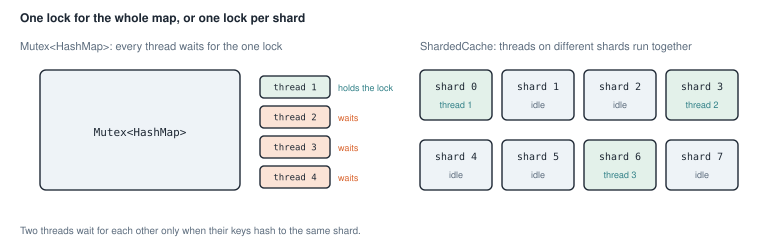
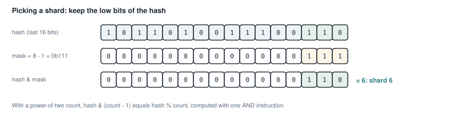
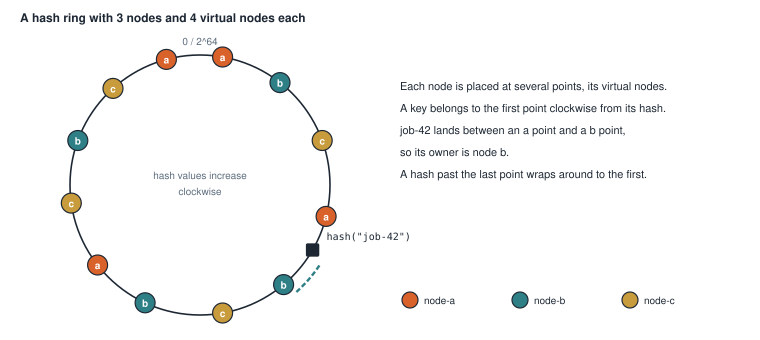
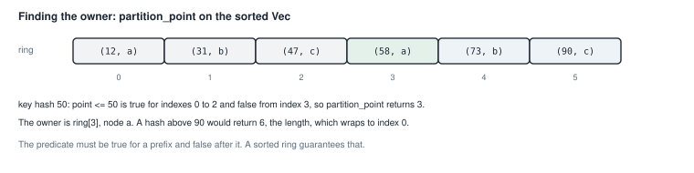

# Shards and consistent hashing

<div class="covers" markdown="1">

This chapter covers

- Why one lock around a whole map makes threads wait, and splitting the map into shards
- Choosing a shard from a hash with a bit mask
- Reading a value under a lock without cloning it, by passing a closure
- Why `hash % N` moves almost every key when N changes
- Consistent hashing: a ring of virtual nodes, searched with `partition_point`

</div>

**Partitioning** (or **sharding**) divides a key space across independent buckets or nodes via a deterministic hash
function so that concurrent operations scale without global serialization. Whether coordinating threads within a
single multi-core process or distributing state across servers in a cluster, partitioning bounds contention,
isolates failures, and keeps key relocation minimal when cluster membership changes.

## 14.1 A map split into shards

Sharing mutable state across threads in Rust commonly combines `Arc` (atomic reference counting) with `Mutex`
(mutual exclusion). While one thread holds the `MutexGuard`, every other thread invoking `lock()` blocks until
the guard is dropped.

A single `Mutex<HashMap<K, V>>` is memory-safe, yet it serializes concurrent access: if four threads query the
map simultaneously, three must wait even when each targets a distinct key. Blocking on a lock held by another
thread is called **lock contention**.

Partitioning the map across multiple independent locks reduces contention. Splitting the key space into eight
smaller maps, each guarded by its own `Mutex` (Figure 14.1), ensures that two threads contend only when their
keys hash to the same shard.

<figure>

<figcaption><b>Figure 14.1</b> One lock for everything, against one lock per shard.</figcaption>
</figure>

Animation 14.1 sends one key and value from each thread into the map. Under the single lock the pairs go in one
at a time and stay. Under eight shards they go in together, each into the shard that owns its key.

<figure class="anim">
<video class="motion" src="figures/ch14-shard-lock.mp4" autoplay loop muted playsinline preload="metadata" aria-label="Four threads, A to D, each holding a key and value pair. Under one Mutex the pairs k1 to 11, k2 to 12, k3 to 13, and k4 to 14 enter the map one at a time and stay there, over four time units. Under eight shards the same four pairs enter shards 1, 3, 6, and 4 at the same time, in one time unit. In the last part every key hashes to shard 0, so all four pairs queue into that one shard." data-chapters="[[0.0, &quot;one lock&quot;], [22.77, &quot;eight shards&quot;], [41.25, &quot;skew&quot;]]"></video>
<figcaption><b>Animation 14.1</b> One lock serializes the four inserts; eight shards take them at once. A hash that sends every key to shard 0 brings the queue back.</figcaption>
</figure>

### 14.1.1 The type

The cache holds a list of shards, each a `HashMap` behind its own `Mutex`. It also holds the hasher that decides which shard a key belongs to.

<p class="listing"><b>Listing 14.1</b> The type and the constructor (lines 16 to 42). <a href="https://github.com/arpanpathak/cracking-the-systems-programming-interview/blob/prep-v2/rust-interview-lab/src/problems/sharded_cache.rs">src/problems/sharded_cache.rs</a></p>

```rust
{{#include ../../rust-interview-lab/src/problems/sharded_cache.rs:11:15}}

{{#include ../../rust-interview-lab/src/problems/sharded_cache.rs:17:25}}

impl<K, V> ShardedCache<K, V>
where
    K: Hash + Eq,
{
{{#include ../../rust-interview-lab/src/problems/sharded_cache.rs:31:43}}
    // ...
}
```

`ShardedCache` comprises three fields:

- `shards`: a `Vec<Mutex<HashMap<K, V>>>` partitioning the key space across independent lock domains.
- `hasher`: a `RandomState` instance supplying deterministic per-cache hashing.
- `mask`: a bitmask (`shard_count - 1`) mapping 64-bit hash digests to shard indices.

`new` constructs the shard vector via `(0..shard_count).map(|_| Mutex::new(HashMap::new())).collect()`, clamping
`shard_count` to at least 1 with `.max(1)` and rounding up to a power of two via `.next_power_of_two()` (so a
request for 6 shards allocates 8).

### 14.1.2 Picking a shard with a mask

Power-of-two shard counts reduce shard indexing from integer division to a single bitwise AND. For 8 shards, the
mask is 8 − 1 = 7 (`0b111` in binary), so `hash & mask` extracts the low three bits in `[0, 7]` (Figure 14.2).

<figure>

<figcaption><b>Figure 14.2</b> <code>hash &amp; mask</code> keeps the low bits. For a power-of-two count, it gives the same result as <code>hash % count</code>.</figcaption>
</figure>

Although `hash % 8` produces the same mathematical residue, bitwise AND executes in a single clock cycle, whereas
integer division requires higher latency and executes on the hot path of every cache operation.

<p class="listing"><b>Listing 14.2</b> Picking a shard (lines 45 to 48).</p>

```rust
impl<K, V> ShardedCache<K, V>
where
    K: Hash + Eq,
{
    // ...
{{#include ../../rust-interview-lab/src/problems/sharded_cache.rs:45:48}}
    // ...
}
```

`hash_one` hashes the key using the cache's `RandomState` to produce a `u64` digest, applies `mask` to compute the
shard index, and returns a shared reference to the selected `Mutex`.

Retaining a single `RandomState` for the lifetime of the cache guarantees consistent shard routing within that
instance while randomizing the SipHash seed at construction time to defend against algorithmic hash-flooding
denial-of-service attacks.

<div class="callout warning" markdown="1">

**WARNING:** the mask reads the low three bits of the hash and nothing else. A hash whose low bits repeat sends
every key to one shard. That shard then carries the traffic of the whole map, its lock serializes every call, and
the seven other shards sit idle. The work looks sharded and behaves like the single map of section 14.1.

Three short hashes show how this happens. Each one takes the low three bits at the end, the mask for eight shards.

```rust
// 1. The bytes added up. Every order of the same bytes gives one number.
fn hash_sum(bytes: &[u8]) -> u64 {
    bytes.iter().map(|b| u64::from(*b)).sum()
}

// 2. The first byte only. Every key with the same first letter collides.
fn hash_first(bytes: &[u8]) -> u64 {
    u64::from(bytes.first().copied().unwrap_or(0))
}

// 3. The key itself, for a numeric key. The low bits repeat every eight.
fn hash_identity(key: u64) -> u64 {
    key
}
```

The keys `"ab"` and `"ba"` hold the same two bytes, so `hash_sum` returns 195 for both. The mask computes
195 & 7 = 3, so both keys land in shard 3. The keys `"abc"` and `"cab"` both return 294, so both land in shard 6.
Under `hash_first`, the keys `"user-1"`, `"user-2"`, and `"user-3"` all begin with `u`, which is 117, so all
three land in shard 5. Under `hash_identity`, the keys 1000, 1008, 1016, and 1024 are all multiples of 8. Their
low three bits are 0, so all four land in shard 0.

The repair is a hash that mixes the whole key, not a piece of it. SipHash, which `RandomState` uses, flips about
half of the output bits when one input bit changes. Keys that arrive from outside, such as user names or header
values, are chosen by whoever sends them. A weak hash lets that caller fill one shard on purpose, and one busy
shard can take the whole service down. Use a reviewed hash, and keep the hash seed secret where the input is
untrusted. Animation 14.1 ends on this case: every key gives index 0, and the four pairs queue on one shard.

</div>

### 14.1.3 Each method locks one shard

A single-key operation touches one shard only. It hashes the key, locks that shard, and leaves every other shard free for other threads.

<p class="listing"><b>Listing 14.3</b> <code>insert</code>, <code>get</code>, and <code>with</code> (lines 50 to 80).</p>

```rust
impl<K, V> ShardedCache<K, V>
where
    K: Hash + Eq,
{
    // ...
{{#include ../../rust-interview-lab/src/problems/sharded_cache.rs:50:80}}
    // ...
}
```

Each single-key method follows the same protocol: compute the shard index, acquire its `Mutex`, and delegate to
the underlying `HashMap`. Because `Mutex` provides interior mutability, every method accepts `&self` rather than
`&mut self`, permitting concurrent access across threads through `Arc<ShardedCache<K, V>>`.

`lock()` returns `LockResult<MutexGuard<'_, _>>`, returning `Err` only if a thread panicked while holding that
shard's lock (a **poisoned** lock); `.expect(...)` propagates poisoning as an explicit panic. The lock remains
held until the `MutexGuard` drops at the end of the enclosing statement.

`get` requires `V: Clone` because returning a borrowed `&V` would allow a reference to outlive the `MutexGuard`
and race with concurrent mutations on other threads; the borrow checker statically forbids references tied to the
guard from escaping the method scope.

### 14.1.4 Reading under the lock with a closure

Cloning a large value solely to inspect one field wastes allocations and memory bandwidth. The `with` method
avoids cloning by accepting a closure and executing it while holding the shard lock:

```rust
pub fn with<R>(&self, key: &K, inspect: impl FnOnce(Option<&V>) -> R) -> R
```

- `inspect: impl FnOnce(Option<&V>) -> R` accepts any closure that takes an `Option<&V>` and returns some type
  `R`. `FnOnce` means `with` calls it at most once.
- The closure receives a reference into the map, valid while the lock is held.
- Only the closure's result, of type `R`, leaves the function. `R` cannot borrow from the map.

The test `with_exposes_the_value_without_cloning` uses it to read the length of a `String`:

```rust
let observed = cache.with(&"node", |value| value.map(|v| v.len()));
```

The doc comment on `with` enforces two concurrency invariants: keep the callback brief because competing threads
targeting the same shard block until it returns, and never invoke methods on the same `ShardedCache` from inside
the closure. Re-acquiring a non-reentrant `std::sync::Mutex` already held by the current thread causes a
self-**deadlock**.

### 14.1.5 Operations on every shard

Some operations need every shard: the total size, and clearing the cache. They visit the shards one at a time.

<p class="listing"><b>Listing 14.4</b> <code>len</code> and <code>clear</code> (lines 96 to 119).</p>

```rust
impl<K, V> ShardedCache<K, V>
where
    K: Hash + Eq,
{
    // ...
{{#include ../../rust-interview-lab/src/problems/sharded_cache.rs:96:119}}
    // ...
}
```

`len` and `clear` acquire and release each shard lock sequentially rather than taking a global lock across all
shards simultaneously. This reflects the fundamental consistency trade-off of lock sharding: no single instant
exists at which all shards are frozen together, so `len` is exact under quiescence and weakly consistent
(approximate) under concurrent writes.

### 14.1.6 The complete file

<p class="listing"><b>Listing 14.5</b> The complete file, with tests. <a href="https://github.com/arpanpathak/cracking-the-systems-programming-interview/blob/prep-v2/rust-interview-lab/src/problems/sharded_cache.rs">src/problems/sharded_cache.rs</a></p>

```rust
{{#include ../../rust-interview-lab/src/problems/sharded_cache.rs}}
```

The test `concurrent_writers_all_land` is the one that uses threads. It wraps the cache in an `Arc`, and starts
eight threads with `thread::spawn`. Each thread gets its own clone of the `Arc` and inserts 500 keys. `join()`
waits for each thread to finish. The final `len` must be 8 × 500 = 4,000, which shows that no insert was lost.

The test `keys_spread_across_shards` inserts 4,096 keys into 8 shards and checks that no shard is empty. It
reaches the private `shards` field directly. A test module inside the file can see private items of its parent
module.

```text
$ cargo test --lib problems::sharded_cache
running 4 tests
test problems::sharded_cache::tests::with_exposes_the_value_without_cloning ... ok
test problems::sharded_cache::tests::insert_get_remove ... ok
test problems::sharded_cache::tests::concurrent_writers_all_land ... ok
test problems::sharded_cache::tests::keys_spread_across_shards ... ok

test result: ok. 4 passed; 0 failed; 0 ignored; 0 measured; 133 filtered out
```

## 14.2 Spreading keys across machines

The same partitioning problem extends from threads within one process to servers across a cluster. When a cache
is distributed across multiple machines, every client must independently map any given key to the same server
without consulting a central directory.

### 14.2.1 The problem with `hash % N`

The simplest mapping rule is `hash(key) % N`, where *N* is the number of servers. Although it distributes keys
evenly with zero metadata overhead, it breaks down whenever *N* changes.

The remapping of hashes 0 through 11 when a fourth server joins three existing servers is illustrated in
Figure 14.3; a key remains on its server only when `hash % 3` equals `hash % 4`.

<figure>

<figcaption><b>Figure 14.3</b> From 3 servers to 4 with <code>hash % N</code>. Three keys in twelve stay, and the rest move.</figcaption>
</figure>

The pattern repeats every 12 hashes, so 75% of all keys change servers. For a cache, a moved key is a miss: the
new server does not have it. Adding one server would empty most of the cache at once.

### 14.2.2 The ring

**Consistent hashing** maps both servers and keys onto a cyclic 64-bit hash space (`0..=u64::MAX`, wrapping around
modulo 2⁶⁴), termed the **ring**. Each server is hashed to a position on the ring, and each key is assigned to the
first server encountered clockwise (the smallest ring position strictly greater than the key's hash, wrapping to
index 0).

When a server joins, it assumes ownership solely of the hash arc between its position and its counterclockwise
predecessor; all other key assignments remain invariant. When a server departs, only its owned arc transfers to
its clockwise successor.

Assigning a single ring point per physical server produces high variance in arc lengths and uneven load
distribution. Replicating each physical server across many distinct ring positions, called **virtual nodes**,
reduces variance and balances key distribution across the cluster (Figure 14.4).

<figure>

<figcaption><b>Figure 14.4</b> Three nodes with four virtual nodes each. The key belongs to the next point clockwise, which belongs to node b.</figcaption>
</figure>

Unrolling the ring into a linear axis clarifies how adding a third node reassigns key ranges (Figure 14.5).

<figure>

<figcaption><b>Figure 14.5</b> Adding node c. The keys that move all move to c. None moves between a and b.</figcaption>
</figure>

Animation 14.2 follows the join through the whole system. It shows the ring, the keys each node holds, the key
that moves, and the clients that learn about it.

<figure class="anim">
<video class="motion" src="figures/ch14-ring.mp4" autoplay loop muted playsinline preload="metadata" aria-label="A ring of 100 points with node a at 20 and node b at 70, and the keys k10, k30, k50, k85, and k95 drawn inside it. Node a holds k10, k85, and k95, and node b holds k30 and k50. Node c joins at point 45 and takes over the arc from 20 to 45, so k30 moves from node b to node c. An event carries the new ring to both clients, which add c to their copy. In the last part client 2 keeps the old copy, sends k30 to node b, and misses." data-chapters="[[0.0, &quot;the ring&quot;], [16.5, &quot;c joins&quot;], [24.26, &quot;keys move&quot;], [41.06, &quot;clients update&quot;], [52.82, &quot;stale ring&quot;]]"></video>
<figcaption><b>Animation 14.2</b> Each node holds the keys it owns, and each client holds a copy of the ring. Adding <code>c</code> moves one key from <code>b</code> to <code>c</code>. An event carries the new ring to every client; a client that misses it asks the wrong node.</figcaption>
</figure>

Each node keeps the keys it owns. A join moves the keys in the new arc from the old owner to the new one.
Every client also keeps a `ConsistentHash` of its own and computes the owner locally, so no lookup needs a central
directory. When a node joins or leaves, each client has to learn the new ring. Until it does, it sends keys to the
old owner. A client that still points `k30` at node b asks a node that has given that key up.

With n servers, a new server takes over about 1/(n + 1) of the keys. Going from 3 servers to 4 moves about 25% of
the keys, where `hash % N` moved 75%.

### 14.2.3 The ring as a sorted `Vec`

The ring of figure 14.4 can be stored as a vector of points, kept sorted by hash. Each point records its position on the ring and the server it belongs to.

<p class="listing"><b>Listing 14.6</b> The type and <code>add_node</code> (lines 17 to 55). <a href="https://github.com/arpanpathak/cracking-the-systems-programming-interview/blob/prep-v2/rust-interview-lab/src/problems/consistent_hash.rs">src/problems/consistent_hash.rs</a></p>

```rust
{{#include ../../rust-interview-lab/src/problems/consistent_hash.rs:12:16}}

{{#include ../../rust-interview-lab/src/problems/consistent_hash.rs:18:24}}

impl ConsistentHash {
{{#include ../../rust-interview-lab/src/problems/consistent_hash.rs:27:62}}
    // ...
}
```

The ring is stored as a sorted `Vec<(u64, Arc<str>)>` pairing each virtual node's 64-bit hash coordinate with an
immutable reference-counted server identifier. With 128 virtual nodes per server, storing `Arc<str>` instead of
`String` allocates each server's name once on the heap via `Arc::from(node)` and shares it across all 128 entries
via cheap atomic reference-count increments (`Arc::clone`).

`add_node` checks for membership idempotently, appends one `(hash, Arc<str>)` entry per virtual node, and re-sorts
the ring by hash coordinate. `remove_node` filters entries in place via `Vec::retain`, preserving the sorted
invariant without re-sorting.

<p class="listing"><b>Listing 14.7</b> The hash functions (lines 94 to 109).</p>

```rust
{{#include ../../rust-interview-lab/src/problems/consistent_hash.rs:94:109}}
```

`virtual_node_hash` feeds both the server name and the replica number into one hasher. Each replica number gives a
different point for the same server. Feeding the two values separately avoids building a string such as
`"node-a#17"` for every virtual node.

<div class="callout warning" markdown="1">

**WARNING:** `DefaultHasher::new()` gives the same result every time within one program, which the ring needs.
The standard library does not promise that it stays the same across Rust versions. Servers and clients built with
different compilers could then disagree about who owns a key. A real deployment should use a hash function with a
fixed, documented algorithm.

</div>

### 14.2.4 Finding a key's server

To find a key's server, hash the key and find the first point on the ring after that hash. If there is none, wrap around to the first point.

<p class="listing"><b>Listing 14.8</b> <code>get</code> (lines 64 to 77).</p>

```rust
impl ConsistentHash {
    // ...
{{#include ../../rust-interview-lab/src/problems/consistent_hash.rs:64:77}}
    // ...
}
```

`get` locates the first ring entry whose hash strictly exceeds the key's hash using O(log *n*) binary search via
`slice::partition_point` (Figure 14.6). Given the monotonic predicate `point <= hash`, `partition_point` returns the
first index where the predicate evaluates to `false`.

<figure>

<figcaption><b>Figure 14.6</b> <code>partition_point</code> returns the first index where the condition is false.</figcaption>
</figure>

When the key's hash exceeds every ring point, `partition_point` returns `ring.len()`, which wraps around to index
0. An empty ring returns `None`; otherwise `.as_ref()` borrows `&str` from the `Arc<str>` entry.

### 14.2.5 The complete file

<p class="listing"><b>Listing 14.9</b> The complete file, with tests. <a href="https://github.com/arpanpathak/cracking-the-systems-programming-interview/blob/prep-v2/rust-interview-lab/src/problems/consistent_hash.rs">src/problems/consistent_hash.rs</a></p>

```rust
{{#include ../../rust-interview-lab/src/problems/consistent_hash.rs}}
```

`node_count` counts distinct servers by collecting the names into a `HashSet`, which keeps one copy of each.

The tests check the properties this section described:

- `keys_spread_across_nodes` places 3,000 keys on three servers with 128 virtual nodes each. Each server must own
  more than 300 keys. An even split would give each one 1,000.
- `adding_a_node_only_moves_keys_to_the_new_node` records the owner of 2,000 keys, adds a third server, and looks
  again. Every key must either keep its owner or move to the new server.
- `removing_a_node_drops_it_from_the_ring` checks that 2 servers with 32 virtual nodes give 64 ring entries, and
  that removing one leaves every key with the other.

```text
$ cargo test --lib problems::consistent_hash
running 5 tests
test problems::consistent_hash::tests::empty_ring_has_no_owner ... ok
test problems::consistent_hash::tests::lookup_is_stable_for_a_fixed_ring ... ok
test problems::consistent_hash::tests::removing_a_node_drops_it_from_the_ring ... ok
test problems::consistent_hash::tests::adding_a_node_only_moves_keys_to_the_new_node ... ok
test problems::consistent_hash::tests::keys_spread_across_nodes ... ok

test result: ok. 5 passed; 0 failed; 0 ignored; 0 measured; 132 filtered out
```

<div class="summary" markdown="1">

## Summary

- Wrapping an entire `HashMap` in a single `Mutex` serializes concurrent operations; sharding partitions the key
  space across independent lock domains so threads contend only on hash-bucket collisions.
- Enforcing a power-of-two shard count reduces shard selection to a single-cycle bitwise mask (`hash & (count - 1)`).
- Because a borrowed `&V` cannot outlive a `MutexGuard`, `get` clones values whereas `with` executes a bounded
  closure under the shard lock for zero-copy inspection.
- Multi-shard operations (`len`, `clear`) lock shards sequentially and therefore yield approximate snapshots under
  concurrent mutation.
- Modulo routing (`hash % N`) relocates most keys upon membership changes; consistent hashing bounds relocation
  to approximately 1/(*n* + 1) of keys when adding a server to an *n*-node cluster.
- Virtual nodes reduce hash-arc variance across servers, and `Arc<str>` deduplicates server identifiers across
  replicas.
- Storing the consistent-hash ring in a sorted `Vec` enables O(log *n*) clockwise lookup via `partition_point`.

</div>

## Exercises

1. Add `update(&self, key: &K, change: impl FnOnce(&mut V))` to `ShardedCache`, which changes a value in place
   under the lock.
2. Write a test that counts how many keys change owner when a fourth server joins a ring of three. Compare the
   result with 25%.
3. Measure how even the ring is. For 10, 50, and 200 virtual nodes per server, place 100,000 keys and report
the largest and smallest share.
4. `add_node` sorts the whole ring after every call. Rewrite it to insert each new entry at its sorted position
   with `partition_point` and `Vec::insert`, and compare the two for 100 servers.
