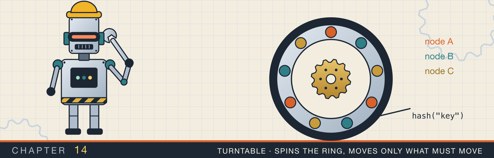
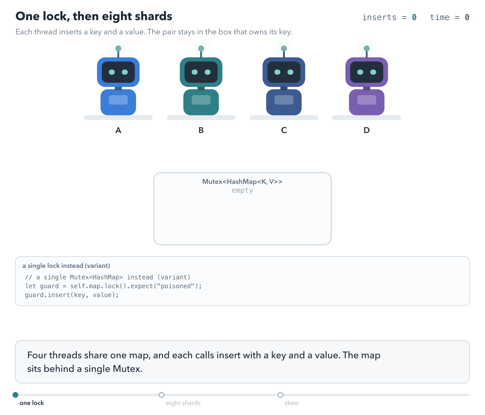
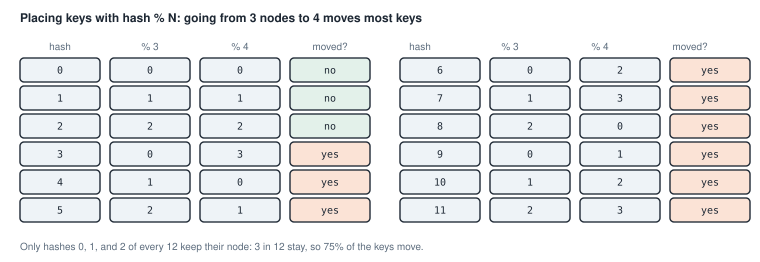
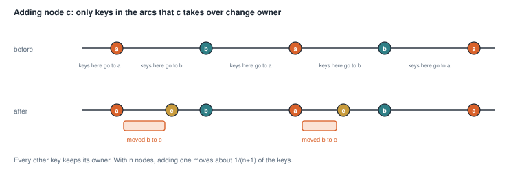
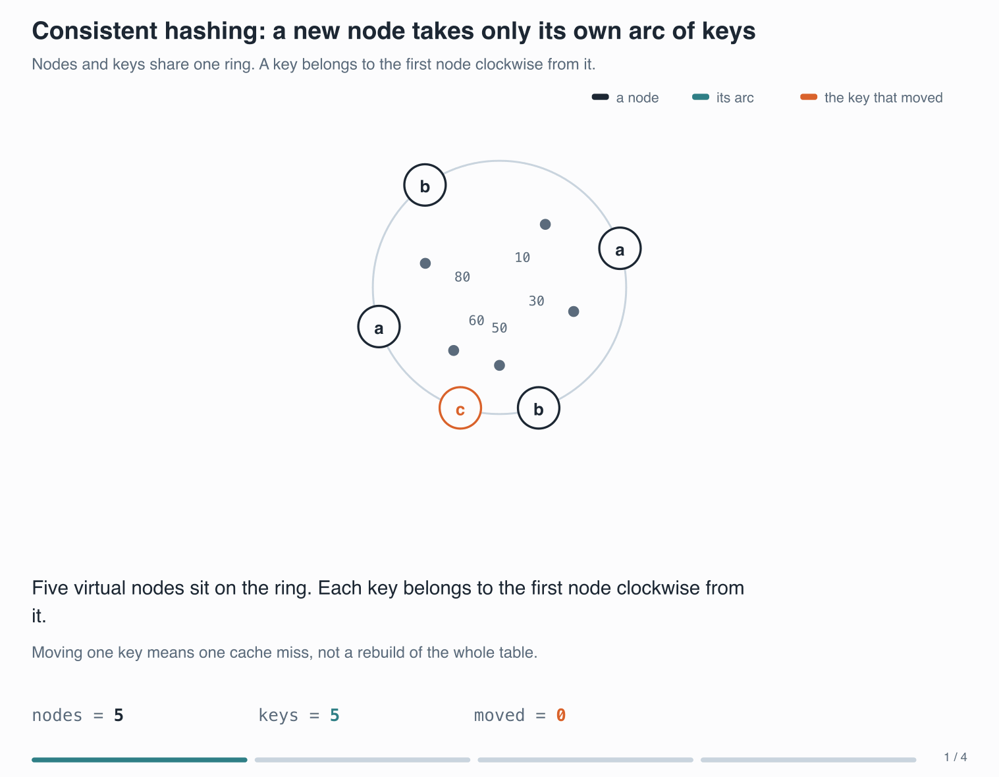

# Shards and consistent hashing

<div class="covers" markdown="1">

This chapter covers

- Why one lock around a whole map makes threads wait, and splitting the map into shards
- Choosing a shard from a hash with a bit mask
- Reading a value under a lock without cloning it, by passing a closure
- Why `hash % N` moves almost every key when N changes
- Consistent hashing: a ring of virtual nodes, searched with `partition_point`

</div>

The LRU caches developed in Chapter 13 serve a single thread at a time. When multiple threads within one process
or multiple servers across a cluster share a key space, coordination becomes the primary bottleneck.

Both halves of this chapter apply the same partitioning principle: keys are divided by hash into independent
groups, each called a **shard**. Section 14.1 partitions an in-process map so threads accessing distinct keys do
not block one another; Section 14.2 partitions keys across servers so that adding or removing a node relocates
as few keys as possible.

## 14.1 A map split into shards

As established in Section 8.6, sharing mutable state across threads uses a `Mutex` wrapped in an `Arc`. While
one thread holds the lock, every other thread calling `lock()` blocks until the guard is released.

A single `Mutex<HashMap<K, V>>` is memory-safe, yet it serializes concurrent access: if four threads query the
map simultaneously, three must wait even when each targets a distinct key. Blocking on a lock held by another
thread is called **lock contention**.

Partitioning the map across multiple independent locks reduces contention. Splitting the key space into eight
smaller maps, each guarded by its own `Mutex` (Figure 14.1), ensures that two threads contend only when their
keys hash to the same shard.

<figure>

<figcaption><b>Figure 14.1</b> One lock for everything, against one lock per shard.</figcaption>
</figure>

Animation 14.1 sends one key and value from each thread into the map. Under the single lock the pairs go in one
at a time and stay. Under eight shards they go in together, each into the shard that owns its key.

<figure class="anim">
<video class="motion" src="figures/ch14-shard-lock.mp4" autoplay loop muted playsinline preload="metadata" aria-label="Four threads, A to D, each holding a key and value pair. Under one Mutex the pairs k1 to 11, k2 to 12, k3 to 13, and k4 to 14 enter the map one at a time and stay there, over four time units. Under eight shards the same four pairs enter shards 1, 3, 6, and 4 at the same time, in one time unit. In the last part every key hashes to shard 0, so all four pairs queue into that one shard." data-chapters="[[0.0, &quot;one lock&quot;], [22.77, &quot;eight shards&quot;], [41.25, &quot;skew&quot;]]"></video>
<figcaption><b>Animation 14.1</b> One lock serializes the four inserts; eight shards take them at once. A hash that sends every key to shard 0 brings the queue back.</figcaption>
</figure>

### 14.1.1 The type

The cache holds a list of shards, each a `HashMap` behind its own `Mutex`. It also holds the hasher that decides which shard a key belongs to.

<p class="listing"><b>Listing 14.1</b> The type and the constructor (lines 16 to 42). <a href="https://github.com/arpanpathak/cracking-the-systems-programming-interview/blob/prep-v2/rust-interview-lab/src/problems/sharded_cache.rs">src/problems/sharded_cache.rs</a></p>

```rust
{{#include ../../rust-interview-lab/src/problems/sharded_cache.rs:11:15}}

{{#include ../../rust-interview-lab/src/problems/sharded_cache.rs:17:25}}

impl<K, V> ShardedCache<K, V>
where
    K: Hash + Eq,
{
{{#include ../../rust-interview-lab/src/problems/sharded_cache.rs:31:43}}
    // ...
}
```

`ShardedCache` has three fields:

- `shards` is a `Vec` of maps, each inside its own `Mutex`.
- `hasher` produces the hash that picks a shard for a key.
- `mask` turns a hash into a shard number, as the next section explains.

`new` builds the `Vec` with an iterator. `(0..shard_count).map(|_| Mutex::new(HashMap::new()))` makes one empty,
locked map per shard, and `collect()` gathers them. The `_` in the closure ignores the shard number, which is
not needed.

The first line of `new` adjusts the requested count. `shard_count.max(1)` turns a request for 0 shards into 1.
`.next_power_of_two()` rounds up to the next power of two, so a request for 6 shards gives 8.

### 14.1.2 Picking a shard with a mask

A shard count that is a power of two lets the code pick a shard cheaply. For 8 shards, the mask is 8 − 1 = 7,
which is `0b111` in binary. The operation `hash & mask` keeps the lowest three bits of the hash and clears the
rest. The result is a number from 0 to 7 (figure 14.2).

<figure>

<figcaption><b>Figure 14.2</b> <code>hash &amp; mask</code> keeps the low bits. For a power-of-two count, it gives the same result as <code>hash % count</code>.</figcaption>
</figure>

`hash % 8` would give the same answer. The `&` is one simple CPU instruction, while `%` is a division, which
takes more time. The difference is small, but this code runs on every call.

<p class="listing"><b>Listing 14.2</b> Picking a shard (lines 45 to 48).</p>

```rust
impl<K, V> ShardedCache<K, V>
where
    K: Hash + Eq,
{
    // ...
{{#include ../../rust-interview-lab/src/problems/sharded_cache.rs:45:48}}
    // ...
}
```

`hash_one` hashes the key with the cache's `RandomState` and returns a `u64`. The mask keeps its low bits as the shard index. It returns a reference to the chosen shard's `Mutex`.

The cache keeps one `RandomState` for its whole life. `RandomState::new()` picks random secret keys for the hash
function when the cache is created. Every lookup in the same cache uses the same keys, so a key always maps to the
same shard. A different cache, or the same program run again, would place the keys differently.

`HashMap` uses `RandomState` for the same reason. Random keys stop an attacker from choosing inputs that all hash
to the same place and slow the map down.

<div class="callout warning" markdown="1">

**WARNING:** the mask reads the low three bits of the hash and nothing else. A hash whose low bits repeat sends
every key to one shard. That shard then carries the traffic of the whole map, its lock serializes every call, and
the seven other shards sit idle. The work looks sharded and behaves like the single map of section 14.1.

Three short hashes show how this happens. Each one takes the low three bits at the end, the mask for eight shards.

```rust
// 1. The bytes added up. Every order of the same bytes gives one number.
fn hash_sum(bytes: &[u8]) -> u64 {
    bytes.iter().map(|b| u64::from(*b)).sum()
}

// 2. The first byte only. Every key with the same first letter collides.
fn hash_first(bytes: &[u8]) -> u64 {
    u64::from(bytes.first().copied().unwrap_or(0))
}

// 3. The key itself, for a numeric key. The low bits repeat every eight.
fn hash_identity(key: u64) -> u64 {
    key
}
```

The keys `"ab"` and `"ba"` hold the same two bytes, so `hash_sum` returns 195 for both. The mask computes
195 & 7 = 3, so both keys land in shard 3. The keys `"abc"` and `"cab"` both return 294, so both land in shard 6.
Under `hash_first`, the keys `"user-1"`, `"user-2"`, and `"user-3"` all begin with `u`, which is 117, so all
three land in shard 5. Under `hash_identity`, the keys 1000, 1008, 1016, and 1024 are all multiples of 8. Their
low three bits are 0, so all four land in shard 0.

The repair is a hash that mixes the whole key, not a piece of it. SipHash, which `RandomState` uses, flips about
half of the output bits when one input bit changes. Keys that arrive from outside, such as user names or header
values, are chosen by whoever sends them. A weak hash lets that caller fill one shard on purpose, and one busy
shard can take the whole service down. Use a reviewed hash, and keep the hash seed secret where the input is
untrusted. Animation 14.1 ends on this case: every key gives index 0, and the four pairs queue on one shard.

</div>

### 14.1.3 Each method locks one shard

A single-key operation touches one shard only. It hashes the key, locks that shard, and leaves every other shard free for other threads.

<p class="listing"><b>Listing 14.3</b> <code>insert</code>, <code>get</code>, and <code>with</code> (lines 50 to 80).</p>

```rust
impl<K, V> ShardedCache<K, V>
where
    K: Hash + Eq,
{
    // ...
{{#include ../../rust-interview-lab/src/problems/sharded_cache.rs:50:80}}
    // ...
}
```

Each method follows the same three steps: pick the shard, lock it, and call the matching `HashMap` method. The
methods take `&self`, not `&mut self`. The `Mutex` provides the permission to change the map, so a shared
reference to the cache is enough. Several threads can then share one cache through an `Arc`.

`lock()` returns a `Result`. It is an error only if another thread panicked while it held the same lock. Such a
lock is called **poisoned**, and chapter 16 covers it. Here `.expect(...)` turns that error into a panic with a
clear message.

The lock stays held until the guard returned by `lock()` is dropped. In `insert`, the guard is a temporary value
in one expression, so it is dropped at the end of the statement.

`get` must return a clone of the value, which is why it asks for `V: Clone`. A reference to the value would point
into the map, and the map is only reachable through the guard. When `get` returns, the guard is dropped and the
lock released. A reference could then be read while another thread changes the map, so the compiler does not
allow it to escape.

### 14.1.4 Reading under the lock with a closure

Cloning a large value solely to inspect one field wastes allocations and memory bandwidth. The `with` method
avoids cloning by accepting a closure and executing it while holding the shard lock:

```rust
pub fn with<R>(&self, key: &K, inspect: impl FnOnce(Option<&V>) -> R) -> R
```

- `inspect: impl FnOnce(Option<&V>) -> R` accepts any closure that takes an `Option<&V>` and returns some type
  `R`. `FnOnce` means `with` calls it at most once.
- The closure receives a reference into the map, valid while the lock is held.
- Only the closure's result, of type `R`, leaves the function. `R` cannot borrow from the map.

The test `with_exposes_the_value_without_cloning` uses it to read the length of a `String`:

```rust
let observed = cache.with(&"node", |value| value.map(|v| v.len()));
```

The doc comment of `with` gives two rules. Keep the closure short, because every other thread that needs the same
shard waits while it runs. And do not call the cache from inside the closure. A call that lands on the same shard
would try to lock a `Mutex` that this thread already holds. The standard `Mutex` does not allow that: the thread
blocks forever or panics. A thread waiting forever for a lock is called a **deadlock**.

### 14.1.5 Operations on every shard

Some operations need every shard: the total size, and clearing the cache. They visit the shards one at a time.

<p class="listing"><b>Listing 14.4</b> <code>len</code> and <code>clear</code> (lines 96 to 119).</p>

```rust
impl<K, V> ShardedCache<K, V>
where
    K: Hash + Eq,
{
    // ...
{{#include ../../rust-interview-lab/src/problems/sharded_cache.rs:96:119}}
    // ...
}
```

`len` locks each shard in turn, reads its size, releases the lock, and adds up the sizes. `clear` also visits the
shards one at a time.

This is the price of sharding, and the comment at the top of the file states it. No moment exists when all
shards are locked together. While `len` runs, other threads can insert into shards it has already counted. The
total is correct if no other thread is writing, and approximate if one is.

### 14.1.6 The complete file

<p class="listing"><b>Listing 14.5</b> The complete file, with tests. <a href="https://github.com/arpanpathak/cracking-the-systems-programming-interview/blob/prep-v2/rust-interview-lab/src/problems/sharded_cache.rs">src/problems/sharded_cache.rs</a></p>

```rust
{{#include ../../rust-interview-lab/src/problems/sharded_cache.rs}}
```

The test `concurrent_writers_all_land` is the one that uses threads. It wraps the cache in an `Arc`, and starts
eight threads with `thread::spawn`. Each thread gets its own clone of the `Arc` and inserts 500 keys. `join()`
waits for each thread to finish. The final `len` must be 8 × 500 = 4,000, which shows that no insert was lost.

The test `keys_spread_across_shards` inserts 4,096 keys into 8 shards and checks that no shard is empty. It
reaches the private `shards` field directly. A test module inside the file can see private items of its parent
module.

```text
$ cargo test --lib problems::sharded_cache
running 4 tests
test problems::sharded_cache::tests::with_exposes_the_value_without_cloning ... ok
test problems::sharded_cache::tests::insert_get_remove ... ok
test problems::sharded_cache::tests::concurrent_writers_all_land ... ok
test problems::sharded_cache::tests::keys_spread_across_shards ... ok

test result: ok. 4 passed; 0 failed; 0 ignored; 0 measured; 133 filtered out
```

## 14.2 Spreading keys across machines

The same partitioning problem extends from threads within one process to servers across a cluster. When a cache
is distributed across multiple machines, every client must independently map any given key to the same server
without consulting a central directory.

### 14.2.1 The problem with `hash % N`

The simplest mapping rule is `hash(key) % N`, where *N* is the number of servers. Although it distributes keys
evenly with zero metadata overhead, it breaks down whenever *N* changes.

The remapping of hashes 0 through 11 when a fourth server joins three existing servers is illustrated in
Figure 14.3; a key remains on its server only when `hash % 3` equals `hash % 4`.

<figure>

<figcaption><b>Figure 14.3</b> From 3 servers to 4 with <code>hash % N</code>. Three keys in twelve stay, and the rest move.</figcaption>
</figure>

The pattern repeats every 12 hashes, so 75% of all keys change servers. For a cache, a moved key is a miss: the
new server does not have it. Adding one server would empty most of the cache at once.

### 14.2.2 The ring

**Consistent hashing** places both servers and keys on a circle of hash values, called the **ring**. The ring
covers every `u64` value. After the largest value, it wraps around to 0.

Each server is hashed to a point on the ring. A key is hashed too, and it belongs to the first server point
clockwise from it. In practice, "clockwise" means "the next larger hash".

When a server joins, it takes over only the keys between its point and the point before it. Every other key keeps
its server. When a server leaves, only its own keys move, to the next point clockwise.

With one point per server, the arcs between points are uneven, so some servers get much more of the ring than
others. The fix is to place each server at many points, called **virtual nodes**. With many small arcs per
server, the shares even out (figure 14.4).

<figure>

<figcaption><b>Figure 14.4</b> Three nodes with four virtual nodes each. The key belongs to the next point clockwise, which belongs to node b.</figcaption>
</figure>

Unrolling the ring into a linear axis clarifies how adding a third node reassigns key ranges (Figure 14.5).

<figure>

<figcaption><b>Figure 14.5</b> Adding node c. The keys that move all move to c. None moves between a and b.</figcaption>
</figure>

Animation 14.2 follows the join through the whole system. It shows the ring, the keys each node holds, the key
that moves, and the clients that learn about it.

<figure class="anim">
<video class="motion" src="figures/ch14-ring.mp4" autoplay loop muted playsinline preload="metadata" aria-label="A ring of 100 points with node a at 20 and node b at 70, and the keys k10, k30, k50, k85, and k95 drawn inside it. Node a holds k10, k85, and k95, and node b holds k30 and k50. Node c joins at point 45 and takes over the arc from 20 to 45, so k30 moves from node b to node c. An event carries the new ring to both clients, which add c to their copy. In the last part client 2 keeps the old copy, sends k30 to node b, and misses." data-chapters="[[0.0, &quot;the ring&quot;], [16.5, &quot;c joins&quot;], [24.26, &quot;keys move&quot;], [41.06, &quot;clients update&quot;], [52.82, &quot;stale ring&quot;]]"></video>
<figcaption><b>Animation 14.2</b> Each node holds the keys it owns, and each client holds a copy of the ring. Adding <code>c</code> moves one key from <code>b</code> to <code>c</code>. An event carries the new ring to every client; a client that misses it asks the wrong node.</figcaption>
</figure>

Each node keeps the keys it owns. A join moves the keys in the new arc from the old owner to the new one.
Every client also keeps a `ConsistentHash` of its own and computes the owner locally, so no lookup needs a central
directory. When a node joins or leaves, each client has to learn the new ring. Until it does, it sends keys to the
old owner. A client that still points `k30` at node b asks a node that has given that key up.

With n servers, a new server takes over about 1/(n + 1) of the keys. Going from 3 servers to 4 moves about 25% of
the keys, where `hash % N` moved 75%.

### 14.2.3 The ring as a sorted `Vec`

The ring of figure 14.4 can be stored as a vector of points, kept sorted by hash. Each point records its position on the ring and the server it belongs to.

<p class="listing"><b>Listing 14.6</b> The type and <code>add_node</code> (lines 17 to 55). <a href="https://github.com/arpanpathak/cracking-the-systems-programming-interview/blob/prep-v2/rust-interview-lab/src/problems/consistent_hash.rs">src/problems/consistent_hash.rs</a></p>

```rust
{{#include ../../rust-interview-lab/src/problems/consistent_hash.rs:12:16}}

{{#include ../../rust-interview-lab/src/problems/consistent_hash.rs:18:24}}

impl ConsistentHash {
{{#include ../../rust-interview-lab/src/problems/consistent_hash.rs:27:62}}
    // ...
}
```

The ring is a `Vec<(u64, Arc<str>)>`, kept sorted by hash. Each entry is one virtual node: its position on the
ring, and the name of the server it belongs to.

With 128 virtual nodes per server, each name would be stored 128 times as a `String`. The code stores it as
`Arc<str>` instead. `Arc::from(node)` copies the name into one heap block once. Each `Arc::clone(&name)` then
adds a pointer to that same block and increases its reference count. No text is copied.

`add_node` does three things:

1. It checks whether the server is already on the ring, by scanning the entries. If so, it returns.
2. It pushes one entry per virtual node, with the hash from `virtual_node_hash`.
3. It sorts the ring by hash again.

`remove_node` keeps every entry that belongs to another server, with `retain`. Removing entries does not
change the order of the rest, so the ring stays sorted.

<p class="listing"><b>Listing 14.7</b> The hash functions (lines 94 to 109).</p>

```rust
{{#include ../../rust-interview-lab/src/problems/consistent_hash.rs:94:109}}
```

`virtual_node_hash` feeds both the server name and the replica number into one hasher. Each replica number gives a
different point for the same server. Feeding the two values separately avoids building a string such as
`"node-a#17"` for every virtual node.

<div class="callout warning" markdown="1">

**WARNING:** `DefaultHasher::new()` gives the same result every time within one program, which the ring needs.
The standard library does not promise that it stays the same across Rust versions. Servers and clients built with
different compilers could then disagree about who owns a key. A real deployment should use a hash function with a
fixed, documented algorithm.

</div>

### 14.2.4 Finding a key's server

To find a key's server, hash the key and find the first point on the ring after that hash. If there is none, wrap around to the first point.

<p class="listing"><b>Listing 14.8</b> <code>get</code> (lines 64 to 77).</p>

```rust
impl ConsistentHash {
    // ...
{{#include ../../rust-interview-lab/src/problems/consistent_hash.rs:64:77}}
    // ...
}
```

`get` must find the first ring entry with a hash larger than the key's hash. The ring is sorted, so a binary
search can find it in O(log n) steps, as in section 3.10.

`partition_point` performs that binary search. It takes a condition that is true for a first part of the slice and false for the rest. It returns the
index where the condition turns false (figure 14.6). Here the condition is
`point <= hash`, so the result is the index of the first point larger than the key's hash.

<figure>

<figcaption><b>Figure 14.6</b> <code>partition_point</code> returns the first index where the condition is false.</figcaption>
</figure>

If the key's hash is larger than every point, `partition_point` returns the length of the ring. The ring wraps
around there, so the code uses index 0 instead.

`get` returns `Option<&str>`, a reference into the ring. `.as_ref()` turns the `Arc<str>` into a `&str`. An empty
ring has no servers, so the function returns `None` for it.

### 14.2.5 The complete file

<p class="listing"><b>Listing 14.9</b> The complete file, with tests. <a href="https://github.com/arpanpathak/cracking-the-systems-programming-interview/blob/prep-v2/rust-interview-lab/src/problems/consistent_hash.rs">src/problems/consistent_hash.rs</a></p>

```rust
{{#include ../../rust-interview-lab/src/problems/consistent_hash.rs}}
```

`node_count` counts distinct servers by collecting the names into a `HashSet`, which keeps one copy of each.

The tests check the properties this section described:

- `keys_spread_across_nodes` places 3,000 keys on three servers with 128 virtual nodes each. Each server must own
  more than 300 keys. An even split would give each one 1,000.
- `adding_a_node_only_moves_keys_to_the_new_node` records the owner of 2,000 keys, adds a third server, and looks
  again. Every key must either keep its owner or move to the new server.
- `removing_a_node_drops_it_from_the_ring` checks that 2 servers with 32 virtual nodes give 64 ring entries, and
  that removing one leaves every key with the other.

```text
$ cargo test --lib problems::consistent_hash
running 5 tests
test problems::consistent_hash::tests::empty_ring_has_no_owner ... ok
test problems::consistent_hash::tests::lookup_is_stable_for_a_fixed_ring ... ok
test problems::consistent_hash::tests::removing_a_node_drops_it_from_the_ring ... ok
test problems::consistent_hash::tests::adding_a_node_only_moves_keys_to_the_new_node ... ok
test problems::consistent_hash::tests::keys_spread_across_nodes ... ok

test result: ok. 5 passed; 0 failed; 0 ignored; 0 measured; 132 filtered out
```

<div class="summary" markdown="1">

## Summary

- A single `Mutex` around a map makes every thread wait for every other. Sharding gives each group of keys its
  own lock, so threads wait only when their keys share a shard.
- With a power-of-two shard count, `hash & (count - 1)` picks the shard with one AND instruction.
- A value inside a `Mutex` can leave the lock only as a clone. A closure passed to `with` can read the value in
  place while the lock is held.
- Operations over all shards, such as `len`, lock one shard at a time and therefore do not represent an atomic
  point-in-time snapshot.
- `hash % N` moves most keys when N changes. Consistent hashing moves only the keys the new server takes over,
  about 1/(n + 1) of them.
- Virtual nodes even out each server's share of the ring. `Arc<str>` lets all of a server's entries share one
  copy of its name.
- The ring is a sorted `Vec`, and `partition_point` finds a key's server by binary search.

</div>

In Chapter 15, we move below the data-structure layer to examine CPU caches, memory layout, and operating-system
primitives.

## Exercises

1. Add `update(&self, key: &K, change: impl FnOnce(&mut V))` to `ShardedCache`, which changes a value in place
   under the lock.
2. Write a test that counts how many keys change owner when a fourth server joins a ring of three. Compare the
   result with 25%.
3. Measure how even the ring is. For 10, 50, and 200 virtual nodes per server, place 100,000 keys and report
the largest and smallest share.
4. `add_node` sorts the whole ring after every call. Rewrite it to insert each new entry at its sorted position
   with `partition_point` and `Vec::insert`, and compare the two for 100 servers.
