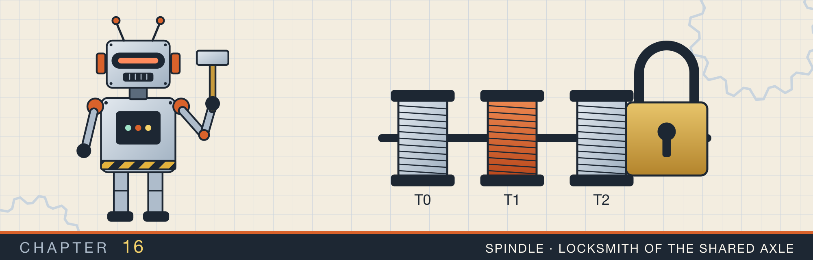

# Threads, atomics, and locks

<div class="covers" markdown="1">

This chapter covers

- Starting threads with `thread::spawn` and `thread::scope`, and collecting their results
- The `Send` and `Sync` traits, which let the compiler reject data races
- Atomic integers, and why `count += 1` from two threads can lose an update
- Splitting a sum across threads, measuring it, and Amdahl's law
- A spin lock built from one atomic flag, with acquire and release ordering
- A counting semaphore built from a `Mutex` and a `Condvar`
- What happens to a `Mutex` when its holder panics, and how to detect a deadlock

</div>

Modern processors integrate multiple physical cores capable of executing independent instruction streams in parallel. A single-threaded process utilizes at most one core at any instant; exploiting the remaining hardware parallelism requires decomposing computation across multiple **threads** scheduled by the operating system onto available cores.

Because threads within a process share a single virtual address space, they can read and mutate the same memory locations directly. Unsynchronized shared-memory access introduces nondeterministic concurrency defects whose manifestation depends on thread interleaving and cache-coherence timing.

Safe Rust enforces a compile-time invariant that rules out **data races**, defined as two or more concurrent accesses to the same memory location where at least one access is a write and no synchronization relation orders them. The type system encodes this invariant through two marker traits, `Send` and `Sync`, which underpin the atomic operations and mutual-exclusion primitives constructed below.

## 16.1 Starting threads

### 16.1.1 What a thread is

A process owns an address space comprising program code, static data, and the heap. A **thread** is an independent path of execution through that address space. Each thread maintains its own call stack, holding local variables and return addresses for active function calls, along with its own architectural register state, including the instruction pointer. All other process memory is shared, allowing every thread to execute the same code and access the same heap allocations (figure 16.1).

<figure>
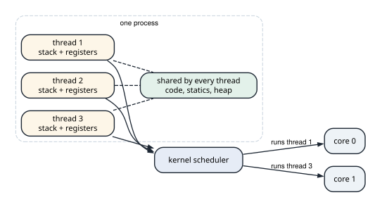
<figcaption><b>Figure 16.1</b> Threads in one process. Stacks and registers are per thread; code, statics, and the heap are shared. The scheduler decides which threads run on the cores.</figcaption>
</figure>

The kernel's **scheduler** multiplexes runnable threads onto physical cores. Each core executes one thread at a time; when runnable threads outnumber cores, the scheduler allocates each thread a bounded time slice, saving the outgoing thread's register state and restoring the incoming thread's registers at each preemption. This transition is a **context switch** and typically incurs several microseconds of overhead.

A thread blocked on I/O or waiting for a lock is marked non-runnable by the kernel. While blocked, it consumes no CPU cycles, occupying only the memory reserved for its stack and kernel metadata.

Because the heap is shared across threads, unsynchronized concurrent access to the same value leads to undefined behavior or corrupted state. The next section covers how concurrent mutations fail, and the subsequent sections construct the synchronization primitives that prevent those failures.

### 16.1.2 `spawn` and `join`

The function `std::thread::spawn` starts a new operating-system thread to execute a closure and returns a `JoinHandle`. Calling `join()` on the handle blocks the caller until the spawned thread terminates and yields the closure's return value:

```rust
let handle = thread::spawn(|| 6 * 7);
assert_eq!(handle.join().expect("worker panicked"), 42);
```

Because a spawned thread can unwind due to a panic, `join` returns a `Result`, carrying the closure's return value in `Ok` and the panic payload in `Err`.

A spawned thread may outlive the stack frame that created it. Consequently, the closure cannot borrow local variables whose storage might be deallocated before the thread reads them. The compiler therefore requires the closure to satisfy the `'static` bound, meaning it must own all captured values or borrow only data that lives for the entire duration of the program. To share ownership across spawned threads, callers move a cloned `Arc` into each closure, following the reference-counting pattern from section 8.6.

### 16.1.3 Scoped threads

When all worker threads are guaranteed to complete before the enclosing function continues, `thread::scope` lifts the `'static` restriction. It accepts a closure that receives a `scope` handle; threads created with `scope.spawn` may borrow local stack data safely because `thread::scope` automatically joins every spawned thread before returning, ensuring all borrowed references remain valid for the lifetime of the workers.

In `threads.rs`, a scoped thread pool sums a slice concurrently across multiple workers (figure 16.2).

<figure>
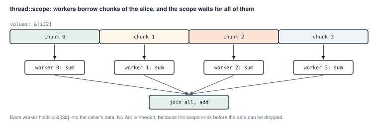
<figcaption><b>Figure 16.2</b> Each worker sums one chunk, borrowing it from the caller's slice.</figcaption>
</figure>

<p class="listing"><b>Listing 16.1</b> <code>available_workers</code> and <code>parallel_sum</code> (lines 31 to 69). <a href="https://github.com/arpanpathak/cracking-the-systems-programming-interview/blob/prep-v2/rust-interview-lab/src/problems/threads.rs">src/problems/threads.rs</a></p>

```rust
{{#include ../../rust-interview-lab/src/problems/threads.rs:23:29}}

{{#include ../../rust-interview-lab/src/problems/threads.rs:31:69}}
```

The call `thread::available_parallelism()` queries the operating system for the number of hardware execution threads available to the process. On a four-core laptop with two hardware threads per core, it returns 8. Because the query can fail in restricted environments, `available_workers` falls back to 1 on error.

To avoid spawning idle threads on short slices, the worker count is capped at the input length. Computing `values.len().div_ceil(workers)` rounds the chunk size upward so that `values.chunks(chunk_size)` covers every element, with the final chunk absorbing any remainder.

Each worker widens every element with `i64::from(*value)` before accumulating, preventing integer overflow when the sum of many `i32` values exceeds the 32-bit signed range.

The order of collection and joining determines whether execution is parallel or sequential. All workers are spawned and their `JoinHandle` values collected into a `Vec` before any handle is joined. Because Rust iterators are lazy, a single chain such as `.map(spawn).map(join)` would spawn one thread, block until it finished, and only then spawn the next, serializing the entire computation. Collecting the handles first forces every thread to start before the caller waits on any result.

The closure passed to `scope.spawn` uses the `move` keyword to transfer the `chunk` slice reference (`&[i32]`) by value into the worker. Moving an immutable reference copies only the pointer and length, leaving the underlying slice data in place.

### 16.1.4 `Send` and `Sync`

The compiler determines which types can safely cross thread boundaries using two marker traits:

- A type `T` is **`Send`** if ownership of a value of type `T` can be transferred safely to another thread.
- A type `T` is **`Sync`** if an immutable reference `&T` can be shared safely across threads; equivalently, `T` is `Sync` if and only if `&T` is `Send`.

Neither trait defines any methods. Both are **auto traits**, meaning the compiler derives them automatically for any composite type whose fields all implement them. Primitive integers (`i32`), heap-allocated collections (`String`, `Vec<i32>`), and synchronized shared pointers (`Arc<Mutex<T>>`) are both `Send` and `Sync`.

By contrast, `Rc<T>` implements neither trait because its reference count is a non-atomic integer; concurrent clones from two threads could lose an update, as demonstrated in section 16.2. `RefCell<T>` is `Send` (assuming `T: Send`) because moving exclusive ownership to another thread is safe, yet it is not `Sync` because its runtime borrow flag cannot be mutated safely from multiple threads. Both `thread::spawn` and `scope.spawn` require their closures to be `Send`, so capturing an `Rc` fails at compile time.

<p class="listing"><b>Listing 16.2</b> A compile-time check (lines 121 to 125).</p>

```rust
{{#include ../../rust-interview-lab/src/problems/threads.rs:121:125}}
```

The helper `assert_send_sync` has an empty body and incurs zero runtime cost. Calling `assert_send_sync::<AtomicCounter>()` compiles only while `AtomicCounter` satisfies `Send + Sync`, turning any future regression (such as introducing an `Rc` field) into an immediate compile error.

## 16.2 Atomic integers

### 16.2.1 The lost update

Although `count += 1` appears as a single statement in source code, the processor executes it as three distinct operations: loading the value from memory, adding one in a register, and storing the result back. When two threads perform this read-modify-write sequence concurrently, their steps can interleave so that both read the same initial value and one increment is overwritten (figure 16.3).

<figure>
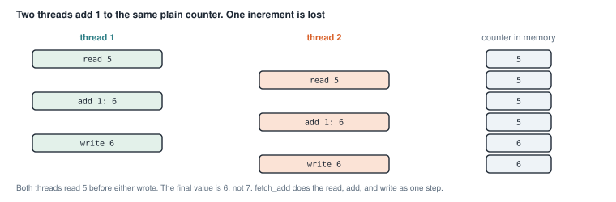
<figcaption><b>Figure 16.3</b> A lost update. Both threads read 5, so one of the two increments disappears.</figcaption>
</figure>

Safe Rust rejects this pattern at compile time because mutating a plain `usize` from two threads simultaneously would require aliasing `&mut` references. In languages without aliasing checks, the code compiles and loses updates without warning under contention.

An **atomic** type executes the read, modification, and write as a single indivisible hardware operation, ensuring no other thread can observe or interleave an intermediate state. Calling `AtomicUsize::fetch_add(1, ordering)` atomically increments the stored integer and returns its previous value.

### 16.2.2 A counter without a lock

<p class="listing"><b>Listing 16.3</b> <code>AtomicCounter</code> and <code>scoped_increment</code> (lines 71 to 110).</p>

```rust
{{#include ../../rust-interview-lab/src/problems/threads.rs:71:110}}
```

The `increment` method accepts `&self` rather than `&mut self`. Like `RefCell`, atomic types provide interior mutability, permitting mutation through a shared reference while hardware atomicity guarantees thread safety. Multiple threads can therefore hold `&AtomicCounter` and invoke `increment` concurrently.

Because `fetch_add` returns the value prior to the addition, `increment` adds 1 to the returned count to report the updated total.

In `scoped_increment`, `threads` scoped workers each increment the shared counter `per_thread` times. Omitting `move` allows the closures to borrow `counter` directly within the scope. The unit test spawns 8 threads performing 500 increments each and verifies that the final count equals exactly 4,000, confirming that no update is lost.

### 16.2.3 Memory ordering

Every atomic operation accepts a `std::sync::atomic::Ordering` parameter. Beyond guaranteeing atomicity of the single variable, the ordering specifies what guarantees other threads can rely on regarding *other* memory writes performed by the same thread.

To maximize throughput, both compilers and out-of-order CPUs reorder memory loads and stores. Within a single thread, these reorderings preserve program semantics, yet another thread observing shared memory may witness writes in an order different from source order. Memory orderings constrain those reorderings around atomic operations:

- `Relaxed` guarantees atomicity of the operation itself without imposing ordering constraints on surrounding memory accesses. This suffices for standalone counters where no other shared data depends on the counter's value.
- `Release` (for stores) and `Acquire` (for loads) form a synchronization pair that establishes a happens-before relationship between threads, as applied to the spin lock in section 16.4.
- `SeqCst` (sequentially consistent) provides the strongest guarantee: all `SeqCst` operations across all threads appear to execute in a single global total order. It is the most straightforward ordering to reason about, though it can carry higher fence overhead on weakly ordered architectures.

### 16.2.4 Initializing a value once

<p class="listing"><b>Listing 16.4</b> <code>OnceLock</code> (lines 112 to 119).</p>

```rust
{{#include ../../rust-interview-lab/src/problems/threads.rs:112:119}}
```

A `static` item defines a single value shared across the entire program. `OnceLock<T>` provides thread-safe, one-time initialization: it begins uninitialized, and the first call to `get_or_init` executes the supplied closure and stores the result. Subsequent calls return a shared reference to the initialized value. If multiple threads invoke `get_or_init` concurrently before initialization completes, one thread executes the closure while the remaining threads block until the value is ready.

<p class="listing"><b>Listing 16.5</b> The complete file, with tests. <a href="https://github.com/arpanpathak/cracking-the-systems-programming-interview/blob/prep-v2/rust-interview-lab/src/problems/threads.rs">src/problems/threads.rs</a></p>

```rust
{{#include ../../rust-interview-lab/src/problems/threads.rs}}
```

```text
$ cargo test --lib problems::threads
running 6 tests
test problems::threads::tests::counter_is_thread_safe_by_construction ... ok
test problems::threads::tests::once_lock_initializes_a_single_value ... ok
test problems::threads::tests::spawn_returns_a_join_handle_that_carries_the_result ... ok
test problems::threads::tests::scoped_threads_share_a_counter_without_arc ... ok
test problems::threads::tests::parallel_sum_handles_small_and_empty_inputs ... ok
test problems::threads::tests::parallel_sum_matches_the_sequential_sum ... ok

test result: ok. 6 passed; 0 failed; 0 ignored; 0 measured; 131 filtered out
```

## 16.3 How much faster do threads make it?

### 16.3.1 A billion elements

The benchmark in `parallel_sum.rs` measures parallel summation at scale by summing one billion elements as `i32`, `i64`, and `i128`, comparing single-threaded execution against multi-threaded execution for each width.

<p class="listing"><b>Listing 16.6</b> The parallel sum for <code>i32</code> (lines 15 to 38). <a href="https://github.com/arpanpathak/cracking-the-systems-programming-interview/blob/prep-v2/rust-interview-lab/src/bin/parallel_sum.rs">src/bin/parallel_sum.rs</a></p>

```rust
{{#include ../../rust-interview-lab/src/bin/parallel_sum.rs:1:5}}

{{#include ../../rust-interview-lab/src/bin/parallel_sum.rs:15:38}}
```

Instead of calling `chunks`, this implementation partitions the slice by index ranges. Worker `i` sums the sub-slice beginning at `i * chunk`, while the final worker extends to the end of the slice so that remainder elements from integer division are included. As in section 16.1.3, all handles are collected into a `Vec` before joining to prevent lazy serialization.

<p class="listing"><b>Listing 16.7</b> The complete program. <a href="https://github.com/arpanpathak/cracking-the-systems-programming-interview/blob/prep-v2/rust-interview-lab/src/bin/parallel_sum.rs">src/bin/parallel_sum.rs</a></p>

```rust
{{#include ../../rust-interview-lab/src/bin/parallel_sum.rs}}
```

The worker count is read from the first command-line argument and defaults to 8. Each inner block allocates its vector, benchmarks both the sequential and parallel sums, and drops the allocation at the closing brace before the next width begins.

<div class="callout warning" markdown="1">

**WARNING:** The three vectors require 4 GB, 8 GB, and 16 GB of memory respectively. On a machine with 16 GB of RAM, the two larger allocations exceed available physical memory alongside the operating system, forcing the kernel to compress memory pages or swap them to disk. Reduce `SIZE` before running this benchmark on machines with limited RAM.

</div>

A representative run on a 16 GB laptop produces the following timings:

```text
$ cargo run --release --bin parallel_sum
i32   seq sum = 1000000000, elapsed = 522.646188ms
i32   par sum = 1000000000, elapsed = 142.427408ms  (n = 8)
i64   seq sum = 1000000000, elapsed = 7.750109265s
i64   par sum = 1000000000, elapsed = 2.591278253s  (n = 8)
i128  seq sum = 1000000000, elapsed = 16.173010504s
i128  par sum = 1000000000, elapsed = 10.198263426s  (n = 8)
```

These figures require careful interpretation. Only the `i32` measurements reflect pure in-memory summation, where eight threads achieved roughly a 3.7x speedup rather than 8x. The `i64` and `i128` timings are dominated by virtual memory pressure: streaming 8 GB from DRAM takes well under a second, so an elapsed time of 7.7 seconds indicates page faults served from compressed memory or swap space.

Single-shot timings also exhibit substantial variance; an earlier run recorded 4.6 seconds for the sequential `i32` sum instead of 0.52 seconds. Repeating the `i32` benchmark over a pre-populated vector yields more stable results: 0.25 to 0.29 seconds sequentially versus 0.08 seconds across eight threads, a speedup of roughly 3.2x.

Two hardware constraints explain why eight threads do not yield an 8x speedup. First, integer addition performs minimal computation per byte loaded, making the loop memory-bandwidth bound rather than compute bound. Multiple cores improve throughput until the memory bus saturates, after which additional threads yield no further gain. Second, the test machine has four physical cores running eight hardware threads (two per core), so pairs of threads share core execution resources.

### 16.3.2 Amdahl's law

Beyond hardware bottlenecks, most workloads include inherently sequential phases such as reading input, spawning threads, and combining partial results. **Amdahl's law** quantifies how that serial fraction bounds maximum achievable speedup.

If a fraction `s` of a program's runtime is strictly serial and the remaining `1 - s` fraction parallelizes ideally across `p` processors, the total execution time becomes `s + (1 - s) / p` of the original runtime. The resulting speedup is the reciprocal:

```text
speedup(s, p) = 1 / (s + (1 - s) / p)
```

For `s = 0.5` and `p = 4`, the reduced runtime is `0.5 + 0.5 / 4 = 0.625` of the baseline, yielding a speedup of `1 / 0.625 = 1.6`.

<p class="listing"><b>Listing 16.8</b> The complete program. <a href="https://github.com/arpanpathak/cracking-the-systems-programming-interview/blob/prep-v2/rust-interview-lab/src/bin/concurrency_amdahl.rs">src/bin/concurrency_amdahl.rs</a></p>

```rust
{{#include ../../rust-interview-lab/src/bin/concurrency_amdahl.rs}}
```

```text
$ cargo run --bin concurrency_amdahl
  serial |      1      2      4      8     16   <- processors
---------+-----------------------------------
    0.00 |   1.00   2.00   4.00   8.00  16.00
    0.05 |   1.00   1.90   3.48   5.93   9.14
    0.10 |   1.00   1.82   3.08   4.71   6.40
    0.25 |   1.00   1.60   2.29   2.91   3.37
    0.50 |   1.00   1.33   1.60   1.78   1.88

limit as processors grow: 1 / serial
  0.00 ->    inf
  0.05 ->   20.0
  0.10 ->   10.0
  0.25 ->    4.0
  0.50 ->    2.0

all checks passed
```

<figure>
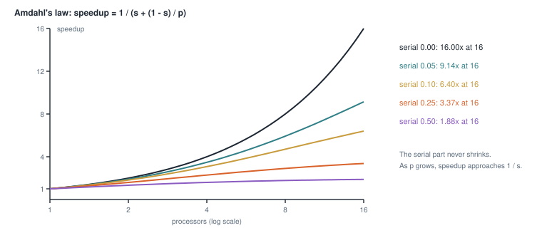
<figcaption><b>Figure 16.4</b> The table as curves. With 5% serial work, 16 processors give a speedup of 9.14.</figcaption>
</figure>

As `p` grows without bound, `(1 - s) / p` approaches zero and the speedup converges to the asymptote `1 / s`. Consequently, a program with 5% serial work can never exceed a 20x speedup regardless of core count.

## 16.4 A spin lock

The standard library's `Mutex` provides mutual exclusion by suspending contending threads in the kernel. To expose the underlying mechanics of mutual exclusion, this section constructs a minimal lock from a single atomic boolean.

A **spin lock** enforces mutual exclusion by busy-waiting: a contending thread polls the lock flag in a tight loop until the flag clears. Busy-waiting avoids kernel context-switch overhead when critical sections last only a few nanoseconds, whereas longer critical sections cause spinning threads to saturate execution cores without advancing application work. For general-purpose synchronization, `std::sync::Mutex` delegates contention handling to the operating system scheduler so blocked threads sleep.

### 16.4.1 The type

<p class="listing"><b>Listing 16.9</b> The lock, the guard, and <code>new</code> (lines 24 to 48). <a href="https://github.com/arpanpathak/cracking-the-systems-programming-interview/blob/prep-v2/rust-interview-lab/src/problems/spin_lock.rs">src/problems/spin_lock.rs</a></p>

```rust
{{#include ../../rust-interview-lab/src/problems/spin_lock.rs:19:24}}

{{#include ../../rust-interview-lab/src/problems/spin_lock.rs:26:41}}

impl<T> SpinLock<T> {
{{#include ../../rust-interview-lab/src/problems/spin_lock.rs:44:50}}
    // ...
}
```

`SpinLock<T>` pairs an atomic boolean (`locked`) with the protected payload wrapped in `UnsafeCell<T>`. `UnsafeCell` is the sole primitive in Rust that permits mutating data behind a shared reference; `RefCell`, `Mutex`, and all atomic types are built atop it. Its `get()` method yields a raw `*mut T` pointer whose dereference requires `unsafe`, transferring responsibility for mutual exclusion from the compiler to the implementation.

Because `UnsafeCell` is not `Sync`, the compiler does not automatically implement `Sync` for `SpinLock<T>`. The explicit `unsafe impl<T: Send> Sync for SpinLock<T> {}` asserts thread safety manually, justified by the `SAFETY` comment: access to the inner `T` is granted exclusively while `locked` is held.

The trait bound is `T: Send` rather than `T: Sync` because only one thread accesses the protected value at any instant, even though ownership of access moves sequentially from one thread to another.

Calling `lock` returns a `SpinGuard`, which borrows the lock, exposes access to the protected value, and automatically clears the lock flag when dropped.

### 16.4.2 Taking and releasing the lock

<p class="listing"><b>Listing 16.10</b> <code>lock</code>, <code>try_lock</code>, and <code>unlock</code> (lines 52 to 87).</p>

```rust
impl<T> SpinLock<T> {
    // ...
{{#include ../../rust-interview-lab/src/problems/spin_lock.rs:52:87}}
}
```

Acquiring the lock requires a single atomic test-and-set transition so that no competing thread can interleave between observing `false` and writing `true`. Calling `compare_exchange(false, true, ...)` atomically transitions `false` to `true` and returns `Ok`, or leaves `true` intact and returns `Err`.

The acquisition loop uses `compare_exchange_weak`, which is permitted to fail spuriously even when the expected value matches. On load-linked/store-conditional architectures such as ARM64, the weak variant compiles to fewer instructions, and inside a retry loop a spurious failure costs only one additional iteration.

When the exchange fails, the contending thread enters an inner polling loop that reads `locked` with a `Relaxed` load. Read-only polling allows the cache line containing `locked` to remain in a shared state across waiting cores, whereas repeating `compare_exchange` would demand exclusive ownership on every iteration and induce repeated cache-line invalidations across the coherence interconnect (as described in section 15.4). Once the load observes `false`, the outer loop retries the exchange. Calling `std::hint::spin_loop()` signals a busy-wait loop to the processor, reducing power consumption and yielding execution pipeline resources to sibling hardware threads.

The non-blocking `try_lock` method attempts a single exchange and returns `None` immediately if the lock is held.

### 16.4.3 Acquire and release

The memory orderings passed to `lock` and `unlock` establish visibility across critical sections (figure 16.5).

<figure>
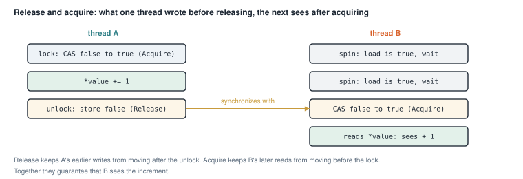
<figcaption><b>Figure 16.5</b> The release store in <code>unlock</code> pairs with the acquire exchange in the next <code>lock</code>.</figcaption>
</figure>

- `unlock` stores `false` with `Release`, guaranteeing that all memory writes performed before the store (including modifications to the protected value) cannot be reordered after it.
- `lock` performs its successful exchange with `Acquire`, guaranteeing that all subsequent memory reads and writes cannot be reordered before it.

When Thread B's `Acquire` exchange reads the `false` written by Thread A's `Release` store, the two operations **synchronize**: every write Thread A performed prior to unlocking becomes visible to Thread B after locking. Using `Relaxed` for both operations would allow Thread B to acquire the lock and still observe stale values in the protected data.

<figure class="anim">
<video class="motion" src="figures/ch16-spin-lock.mp4" autoplay loop muted playsinline preload="metadata" aria-label="Thread A and thread B on either side of the atomic word locked. A's compare_exchange_weak changes false to true and A holds the lock. B's exchange fails, and B spins on a relaxed load. A's unlock stores false with Release; B's next exchange succeeds with Acquire. Last, A leaks its guard with mem::forget, unlock never runs, and B spins forever at 100% CPU." data-chapters="[[0.0, &quot;A locks&quot;], [5.0, &quot;B spins&quot;], [15.68, &quot;handoff&quot;], [29.6, &quot;never released&quot;]]">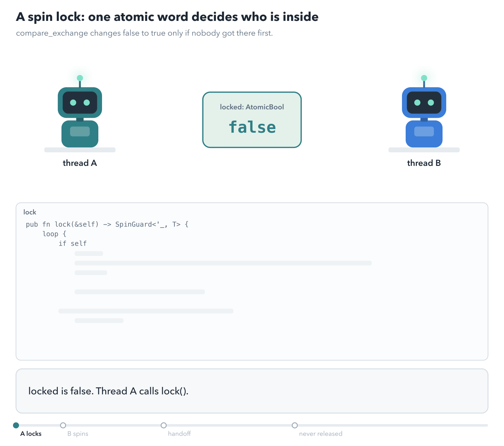</video>
<figcaption><b>Animation 16.1</b> <code>lock</code> from listing 16.10. B stays on the CPU while it spins. The Release store in <code>unlock</code> pairs with B's Acquire exchange.</figcaption>
</figure>


The failure ordering argument to `compare_exchange_weak` is `Relaxed`, because a failed acquisition does not enter the critical section and requires no synchronization with the current lock holder.

### 16.4.4 The guard

<p class="listing"><b>Listing 16.11</b> The guard's traits (lines 96 to 116).</p>

```rust
{{#include ../../rust-interview-lab/src/problems/spin_lock.rs:96:116}}
```

`SpinGuard` implements three standard traits:

- `Drop` invokes `unlock` automatically when the guard leaves scope, including during stack unwinding after a panic. Tying resource release to object lifetime is known as **RAII** (Resource Acquisition Is Initialization).
- `Deref` exposes `&T`, enabling dereferencing (`*guard`) and immutable method calls on the protected value.
- `DerefMut` exposes `&mut T`, enabling direct mutation such as `*lock.lock() += 1`.

Both dereference implementations convert the raw pointer returned by `UnsafeCell::get` into a Rust reference, an invariant that remains sound because holding the guard guarantees exclusive ownership of the lock.

<div class="callout warning" markdown="1">

**WARNING:** `SpinGuard` contains a subtle soundness hole. Because its auto traits are derived solely from its `&SpinLock<T>` field, `SpinGuard<'_, T>` is `Sync` whenever `T: Send`. For a type such as `Cell<u64>` (which is `Send` but not `Sync`), safe code can share `&SpinGuard<Cell<u64>>` across two scoped threads and invoke `Cell::set` concurrently, producing a data race. `std::sync::MutexGuard` closes this hole by implementing `Sync` only when `T: Sync`. Exercise 3 addresses this defect.

</div>

<p class="listing"><b>Listing 16.12</b> The complete file, with tests. <a href="https://github.com/arpanpathak/cracking-the-systems-programming-interview/blob/prep-v2/rust-interview-lab/src/problems/spin_lock.rs">src/problems/spin_lock.rs</a></p>

```rust
{{#include ../../rust-interview-lab/src/problems/spin_lock.rs}}
```

The contention test shares a `SpinLock` across 8 threads via `Arc`, with each thread performing 1,000 increments and verifying an exact total of 8,000.

```text
$ cargo test --lib problems::spin_lock
running 3 tests
test problems::spin_lock::tests::try_lock_reports_contention ... ok
test problems::spin_lock::tests::guard_gives_mutable_access ... ok
test problems::spin_lock::tests::serializes_concurrent_increments ... ok

test result: ok. 3 passed; 0 failed; 0 ignored; 0 measured; 134 filtered out
```

## 16.5 A counting semaphore

Whereas a lock restricts a critical section to a single thread, a **semaphore** admits up to N concurrent threads. It maintains a bounded pool of **permits**: a thread acquires a permit before entering the protected region and returns it upon exit. When the permit count reaches zero, additional threads block until an active holder releases a permit (figure 16.6).

Semaphores bound concurrency around finite resources such as database connections, in-flight network requests, and open file descriptors.

<figure>
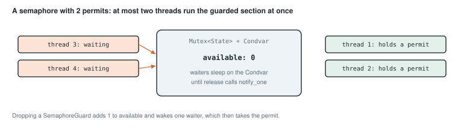
<figcaption><b>Figure 16.6</b> A semaphore with two permits, both taken.</figcaption>
</figure>

### 16.5.1 Waiting without spinning

Because permits may be held for milliseconds or longer, waiting threads should sleep rather than spin. A **condition variable** (`Condvar`) suspends a thread until another thread signals a state change. It always operates in tandem with a `Mutex` protecting the predicate state:

1. The waiting thread locks the mutex and evaluates the predicate.
2. While the predicate is unsatisfied, it calls `condvar.wait(guard)`, which atomically releases the mutex and puts the thread to sleep.
3. Another thread locks the mutex, updates the state, and invokes `notify_one()`.
4. The sleeping thread wakes with the mutex re-acquired and re-evaluates the predicate.

Re-checking the predicate in step 4 is mandatory for two reasons: another thread may have acquired the newly released permit before the woken thread ran, and operating systems may deliver **spurious wakeups** with no corresponding notification. Condition-variable waits must therefore always execute inside a `while` loop rather than an `if` statement.

<p class="listing"><b>Listing 16.13</b> The state, the guard, and <code>acquire_guard</code>. <a href="https://github.com/arpanpathak/cracking-the-systems-programming-interview/blob/prep-v2/rust-interview-lab/src/problems/semaphore.rs">src/problems/semaphore.rs</a></p>

```rust
{{#include ../../rust-interview-lab/src/problems/semaphore.rs:10:13}}

{{#include ../../rust-interview-lab/src/problems/semaphore.rs:15:23}}

{{#include ../../rust-interview-lab/src/problems/semaphore.rs:111:120}}

impl Semaphore {
{{#include ../../rust-interview-lab/src/problems/semaphore.rs:26:53}}
    // ...
}
```

`acquire_guard` returns a `SemaphoreGuard` holding a reference to the semaphore; its `Drop` implementation calls `release`, applying the same RAII pattern from section 16.4 so that permits are returned even on early returns or panics.

Inside `acquire_guard`, `self.released.wait(state)` consumes the mutex guard, suspends the thread, and returns a re-acquired guard upon wakeup. Once the loop terminates, at least one permit is available while the thread holds the mutex, allowing it to decrement the available count safely.

<p class="listing"><b>Listing 16.14</b> The other ways to acquire, and <code>release</code> (lines 47 to 103).</p>

```rust
impl Semaphore {
    // ...
{{#include ../../rust-interview-lab/src/problems/semaphore.rs:55:108}}
}

{{#include ../../rust-interview-lab/src/problems/semaphore.rs:111:120}}
```

The `release` method increments the permit count and wakes one waiting thread via `notify_one`. Keeping `release` private and invoking it solely from `SemaphoreGuard::drop` prevents callers from releasing permits they never acquired.

Two methods in this listing exhibit deliberate limitations:

- `acquire` binds the result of `acquire_guard` to `_guard`, which drops immediately when `acquire` returns. The permit is released before the caller executes any work, making `acquire_guard` the only method that actually holds a permit.
- `try_acquire_timeout` calls `wait_timeout` once without looping. If a spurious wakeup occurs or another thread claims the permit first, it returns `None` prematurely before the full timeout elapses. A complete implementation tracks the deadline and loops over the remaining duration (Exercise 4).

<p class="listing"><b>Listing 16.15</b> The complete file, with tests. <a href="https://github.com/arpanpathak/cracking-the-systems-programming-interview/blob/prep-v2/rust-interview-lab/src/problems/semaphore.rs">src/problems/semaphore.rs</a></p>

```rust
{{#include ../../rust-interview-lab/src/problems/semaphore.rs}}
```

The `never_exceeds_the_permit_count` test spawns 32 threads competing for 4 permits. Each thread increments an `active` counter upon acquiring a permit, records the maximum observed concurrency in `peak` using `fetch_max`, and verifies that `peak` never exceeds 4.

```text
$ cargo test --lib problems::semaphore
running 4 tests
test problems::semaphore::tests::guard_returns_the_permit_on_drop ... ok
test problems::semaphore::tests::try_acquire_reports_contention ... ok
test problems::semaphore::tests::timeout_gives_up_when_no_permit_arrives ... ok
test problems::semaphore::tests::never_exceeds_the_permit_count ... ok

test result: ok. 4 passed; 0 failed; 0 ignored; 0 measured; 133 filtered out
```

## 16.6 When a lock holder panics

A lock protects multi-step invariants that are temporarily broken mid-update. During a bank transfer, for instance, debiting one account and crediting another leaves the combined balance inconsistent between the two writes; the lock hides that intermediate state from other threads.

If a thread panics mid-update, stack unwinding drops the `MutexGuard` and releases the lock while the protected data remains partially mutated. To prevent subsequent threads from unknowingly operating on broken invariants, `std::sync::Mutex` marks itself **poisoned** (figure 16.7), causing every future call to `lock()` to return `Err(PoisonError)` rather than `Ok(guard)`.

<figure>
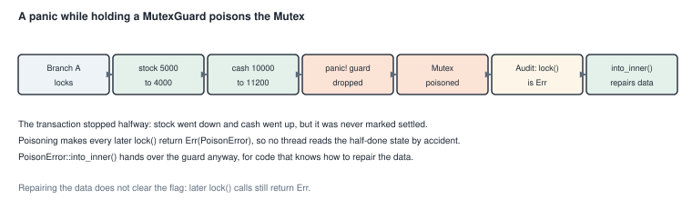
<figcaption><b>Figure 16.7</b> The sequence in <code>mutex_poisoning.rs</code>.</figcaption>
</figure>

Poisoning flags the anomaly without locking out recovery logic: `PoisonError::into_inner()` yields the underlying `MutexGuard` so that audit or repair code can inspect and restore the data.

<p class="listing"><b>Listing 16.16</b> The ledger and the recovery function. <a href="https://github.com/arpanpathak/cracking-the-systems-programming-interview/blob/prep-v2/rust-interview-lab/src/bin/mutex_poisoning.rs">src/bin/mutex_poisoning.rs</a></p>

```rust
{{#include ../../rust-interview-lab/src/bin/mutex_poisoning.rs:27:31}}

{{#include ../../rust-interview-lab/src/bin/mutex_poisoning.rs:33:41}}

{{#include ../../rust-interview-lab/src/bin/mutex_poisoning.rs:54:82}}
```

`Ledger` holds the shared accounting state: cash on hand, stock value, a transaction identifier, and a settlement flag. Panicking between field updates leaves the ledger out of balance.

`recover_ledger` consumes the `PoisonError`, extracts the guard with `into_inner()`, reconciles the fields while holding the lock, and returns a cloned copy of the repaired ledger before the guard drops at function exit.

<p class="listing"><b>Listing 16.17</b> The complete program. <a href="https://github.com/arpanpathak/cracking-the-systems-programming-interview/blob/prep-v2/rust-interview-lab/src/bin/mutex_poisoning.rs">src/bin/mutex_poisoning.rs</a></p>

```rust
{{#include ../../rust-interview-lab/src/bin/mutex_poisoning.rs}}
```

In `main`, Branch A modifies stock and cash and then panics before marking the transaction settled. The panic terminates only Thread A; `handle_a.join()` returns `Err`, which `main` intentionally discards with `let _ =`.

Thread B subsequently attempts to lock the ledger, matching on the `Result` to branch into recovery. Calling `poisoned.get_ref()` inspects the inconsistent state before `recover_ledger` repairs it.

```text
$ cargo run --bin mutex_poisoning
[Branch A] Transaction 1 commenced.
[Branch A] Stock deducted. New value: 4000
[Branch A] Cash updated. New balance: 11200

thread '<unnamed>' (5795284) panicked at src/bin/mutex_poisoning.rs:109:9:
[Branch A] Settlement failure: arithmetic overflow in reconciliation.
note: run with `RUST_BACKTRACE=1` environment variable to display a backtrace

[Audit] Attempting to access the ledger...
[Audit] Mutex is poisoned. Recovered state before correction:
[Audit] Ledger { cash_on_hand: 11200, stock_value: 4000, transaction_id: 0, is_settled: false }
[Reconciliation] Physical audit reveals a cash discrepancy.
[Reconciliation] Digital cash: 11200 | Corrected cash: 11000
[Reconciliation] Ledger corrected. Transaction marked failed and closed.
[Audit] Corrected ledger: Ledger { cash_on_hand: 11000, stock_value: 4000, transaction_id: 1, is_settled: true }
```

Because panic diagnostics are written to standard error, they may interleave with standard output depending on terminal buffering. The parenthesized identifier is the operating system thread ID and varies across runs.

Extracting the guard via `into_inner()` does not reset the poison flag; subsequent `lock()` calls continue returning `Err` unless the caller explicitly clears the flag with `Mutex::clear_poison` (introduced in Rust 1.77) after restoring the invariants.

## 16.7 Deadlock

A **deadlock** occurs when a set of threads waits cyclically for resources held by one another, preventing any thread in the cycle from making progress. In the canonical two-lock scenario, Thread 1 holds lock A while waiting for lock B, and Thread 2 holds lock B while waiting for lock A; neither thread can release its held lock.

Deadlock analysis models resource dependencies as a directed **wait-for graph**, where each node represents a thread and a directed edge `T0 -> T1` denotes that `T0` is blocked waiting on a lock currently held by `T1`. A deadlock exists if and only if the wait-for graph contains a directed cycle (figure 16.8), which can be detected using the three-state depth-first search from section 12.6.

<figure>
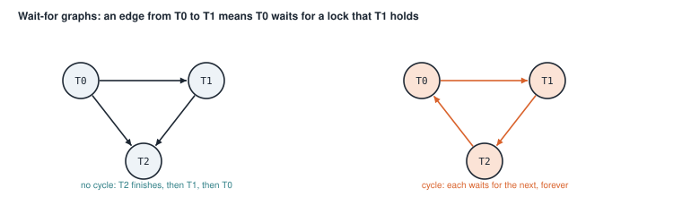
<figcaption><b>Figure 16.8</b> The two graphs from the program. Only the right one is deadlocked.</figcaption>
</figure>

`has_deadlock` accepts dependency edges as `(waiter, holder)` pairs and constructs an adjacency list:

```rust
{{#include ../../rust-interview-lab/src/bin/concurrency_deadlock.rs:7:20}}
    // ...
}
```

A `let ... else` statement extracts the maximum thread identifier, returning `false` immediately when the edge slice is empty. The resulting adjacency list stores, for each thread, the list of holders it waits upon.

The cycle detector applies the three-state DFS from section 12.6, encoding node states as `0` (unvisited), `1` (active on the current recursion stack), and `2` (completely explored):

```rust
fn has_deadlock(waits_for: &[(usize, usize)]) -> bool {
    // ...
{{#include ../../rust-interview-lab/src/bin/concurrency_deadlock.rs:22:39}}
}
```

Reaching any node in state `1` indicates a back-edge closing a cycle, causing `visit` to return `true` immediately. Nodes in state `2` have already been verified cycle-free and are skipped. Iterating with `any` across all nodes ensures disconnected cycles are detected even when no outside thread waits on them.

`main` evaluates three graphs, including the self-loop `(0, 0)`, which models a thread attempting to re-acquire a non-reentrant `Mutex` it already holds.

<p class="listing"><b>Listing 16.18</b> The complete program. <a href="https://github.com/arpanpathak/cracking-the-systems-programming-interview/blob/prep-v2/rust-interview-lab/src/bin/concurrency_deadlock.rs">src/bin/concurrency_deadlock.rs</a></p>

```rust
{{#include ../../rust-interview-lab/src/bin/concurrency_deadlock.rs}}
```

```text
$ cargo run --bin concurrency_deadlock
0->1, 1->2, 0->2     deadlock: false
0->1, 1->2, 2->0     deadlock: true
0->0                 deadlock: true

Coffman conditions:
  - mutual exclusion
  - hold and wait
  - no preemption
  - circular wait

all checks passed
```

Deadlock requires all four **Coffman conditions** to hold simultaneously:

1. **Mutual exclusion**: each lock can be held by at most one thread at a time.
2. **Hold and wait**: a thread retains at least one lock while blocking to acquire another.
3. **No preemption**: a held lock cannot be forcibly reclaimed from its owner.
4. **Circular wait**: a closed chain of threads exists in which each waits for a lock held by the next.

Breaking any single condition eliminates deadlock. In practice, systems prevent deadlock most reliably by breaking circular wait: establishing a strict global lock ordering and requiring every thread to acquire locks in that order. When every thread acquires lock A before lock B, no thread can hold B while requesting A, making cycles impossible.

<figure class="anim">
<video class="motion" src="figures/ch16-deadlock.mp4" autoplay loop muted playsinline preload="metadata" aria-label="Thread A and thread B, and two locks m1 and m2. A takes m1 and B takes m2. A waits for m2 and B waits for m1, which forms the cycle A, m2, B, m1. A second run uses one order for both threads: B waits for m1 while holding nothing, A takes m2 and finishes, then B takes both locks." data-chapters="[[0.0, &quot;opposite order&quot;], [28.64, &quot;fixed order&quot;]]">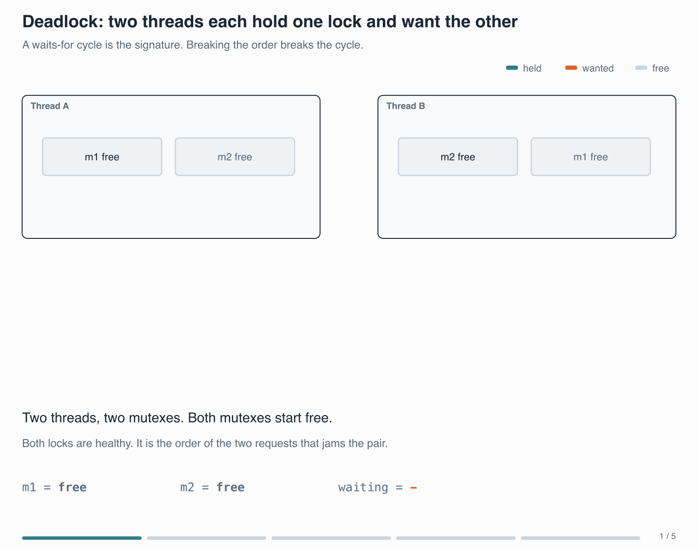</video>
<figcaption><b>Animation 16.2</b> Each lock is taken correctly; the opposite orders form the cycle. When both threads take <code>m1</code> first, the waiting thread holds nothing, and no cycle can form.</figcaption>
</figure>


<div class="summary" markdown="1">

## Summary

- `thread::spawn` requires `'static` closures that own their captured data, whereas `thread::scope` permits borrowing local stack data by joining all spawned threads before returning.
- Collect join handles before calling `join`, because chaining `.map(spawn).map(join)` on a lazy iterator executes threads sequentially.
- `Send` and `Sync` are auto traits that enforce thread safety at compile time; `Rc` and `RefCell` lack the required bounds, preventing unsynchronized sharing across threads.
- Atomic operations perform read-modify-write transitions indivisibly. `Relaxed` suffices for independent counters, whereas `Release` and `Acquire` synchronize surrounding memory writes between threads.
- Parallel summation of a billion `i32` elements scaled by 3 to 4x on eight hardware threads, bounded by memory bandwidth and four physical cores. Amdahl's law caps speedup at `1 / s` for a serial fraction `s`.
- A spin lock combines an atomic flag, a compare-exchange acquisition loop, and an RAII guard that releases on drop; its `unsafe impl Sync` relies on upholding mutual exclusion invariants.
- A counting semaphore built from a `Mutex` and `Condvar` checks its predicate inside a `while` loop to handle contention and spurious wakeups.
- Panicking while holding a `MutexGuard` poisons the mutex; recovery code can inspect and repair the state through `PoisonError::into_inner`.
- Threads deadlock if and only if their wait-for graph contains a cycle; enforcing a global lock acquisition order eliminates circular wait.

</div>

## Exercises

1. Write a version of `parallel_sum` from listing 16.1 as a single lazy chain, `.map(spawn).map(join).sum()`, and
   time both on a large slice. Explain the difference.
2. Make the three pairs of functions in `parallel_sum.rs` one generic function over `T: Sum<T> + Copy + Send + Sync`.
   Which extra bound does `sum::<T>()` over `&T` items need?
3. Close the gap in `SpinGuard`. Add a field `_marker: PhantomData<&'a mut T>`, and explain why this makes the
   guard `Sync` only when `T: Sync`.
4. Rewrite `try_acquire_timeout` to loop until a permit is free or the whole timeout has passed. Use
   `Instant::now()` to compute the time left for each wait.
5. Write a program that deadlocks with two `Mutex` values and two threads. Then fix it by taking the locks in a
   fixed order.
