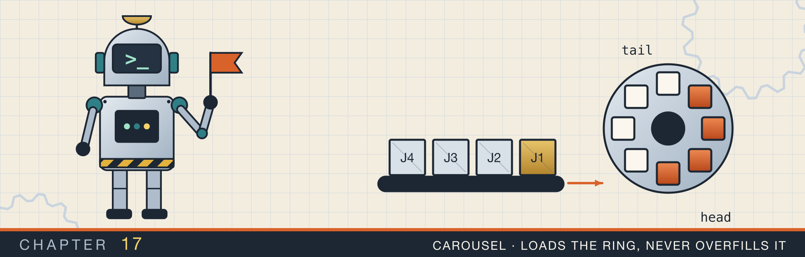

# Queues and bounded buffers

<div class="covers" markdown="1">

This chapter covers

- Passing work between threads through a shared queue
- Putting a waiting thread to sleep with a `Condvar`, and waking it again
- A bounded buffer, where producers wait when the queue is full
- Three ways to handle a poisoned lock inside a queue
- Closing a queue so that every waiting thread wakes up and every loop ends
- A ring buffer for one producer and one consumer, with no lock at all

</div>

Many concurrent systems decouple work generation from work execution across distinct thread roles: producer threads emit tasks (accepting network connections, parsing input streams, or receiving messages), while consumer threads process those tasks asynchronously. Because production and consumption rates fluctuate independently, the two cohorts require a synchronized intermediary to buffer in-flight work.

That intermediary is a **queue**, where producers enqueue elements at the tail and consumers dequeue them from the head. Elements emerge in strict arrival order, a scheduling discipline known as **FIFO** (first in, first out).

The sections below construct six progressive queue designs. Each iteration resolves a concrete synchronization, liveness, or memory-safety limitation of its predecessor, culminating in a lock-free single-producer, single-consumer ring buffer.

## 17.1 Why a queue needs a limit

When producers enqueue items faster than consumers can drain them, an unbounded queue grows continuously until the process exhausts available memory and is terminated by the operating system (figure 17.1).

<figure>
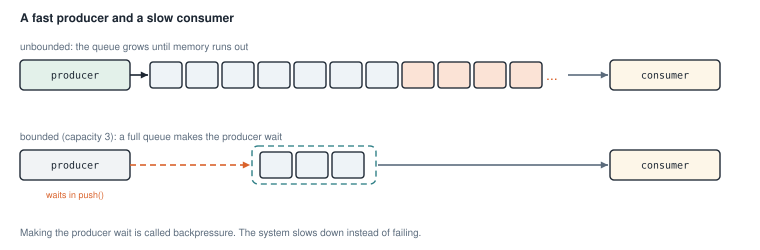
<figcaption><b>Figure 17.1</b> An unbounded queue grows without end. A bounded queue makes the producer wait.</figcaption>
</figure>

A **bounded** queue enforces a fixed capacity. When the queue reaches capacity, `push` blocks until a consumer removes an item, throttling the producer to match the consumer's throughput. Propagating congestion upstream to slow the source of work is known as **backpressure**, trading temporary latency for memory stability.

A bounded queue with blocking `push` and `pop` operations is commonly referred to as a **bounded buffer**.

## 17.2 A shared queue

The initial design is an unbounded queue that establishes the two core primitives used across the mutex-based implementations: a `VecDeque` guarded by a `Mutex` and a `Condvar` for blocking waits.

The standard library's `VecDeque` provides O(1) amortized insertion at the back and removal from the front, while a `Mutex` serializes concurrent access across threads.

When a consumer finds the queue empty, it blocks on the `Condvar`. Following the condition-variable protocol from section 16.5, waiting atomically releases the mutex and suspends the thread; when a producer invokes `notify_one`, one sleeping consumer wakes with the mutex re-acquired.

<p class="listing"><b>Listing 17.1</b> The queue (lines 7 to 29). <a href="https://github.com/arpanpathak/cracking-the-systems-programming-interview/blob/prep-v2/rust-interview-lab/src/bin/thread_safe_queue.rs">src/bin/thread_safe_queue.rs</a></p>

```rust
{{#include ../../rust-interview-lab/src/bin/thread_safe_queue.rs:1:5}}

{{#include ../../rust-interview-lab/src/bin/thread_safe_queue.rs:7:29}}
```

In `push`, the producer locks the mutex, appends the item, and wakes one waiting consumer. Because `if let Ok(mut q)` ignores a poisoned lock, an item passed to a poisoned queue is dropped without notifying the caller; section 17.4 replaces this behavior with explicit error handling.

In `pop`, `wait_while` pairs the mutex guard with a predicate closure and sleeps for as long as the predicate holds:

```rust
let mut q = self.not_empty.wait_while(q, |q| q.is_empty()).ok()?;
```

`wait_while` encapsulates the manual `while` loop from section 16.5, re-evaluating `q.is_empty()` after every wakeup and returning the guard once an item is available. The trailing `.ok()?` maps a poisoned mutex to `None`.

Animation 17.1 traces an item moving from a producer to a consumer blocked in `wait_while`, then demonstrates the hang that occurs when `notify_one` is omitted.

<figure class="anim">
<video class="motion" src="figures/ch17-queue-wait.mp4" autoplay loop muted playsinline preload="metadata" aria-label="A producer robot, a consumer robot, the queue between them, and a badge showing which thread holds the lock. The consumer calls pop on an empty queue, takes the lock, and wait_while puts it to sleep with the lock released. The producer takes the lock, pushes 7, and calls notify_one, which rings the consumer awake. The consumer wakes holding the lock, checks again, and pops 7. Last, with notify_one struck out, the producer pushes 8 and returns, and the consumer sleeps forever beside a full queue." data-chapters="[[0.0, &quot;empty&quot;], [8.7, &quot;push&quot;], [31.62, &quot;no notify&quot;]]">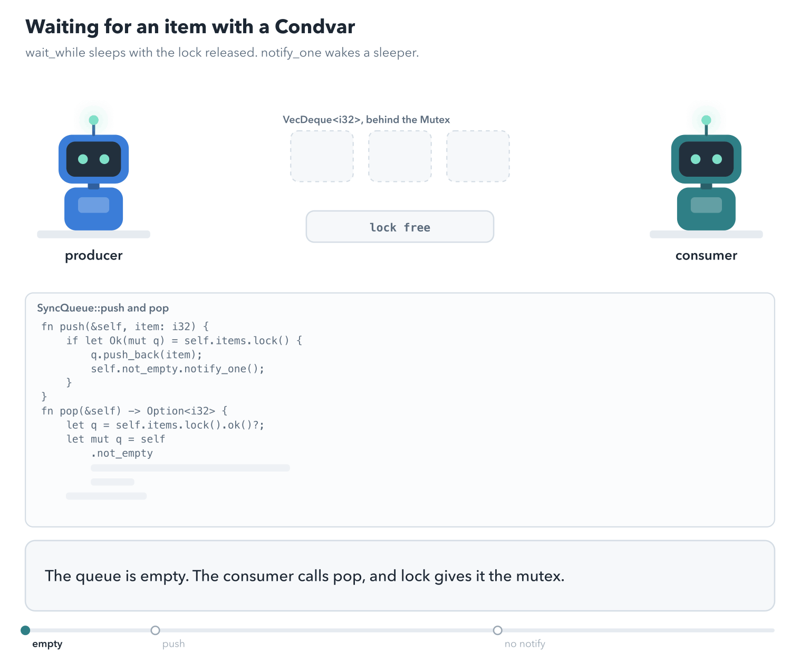</video>
<figcaption><b>Animation 17.1</b> <code>wait_while</code> sleeps with the lock released and checks again when woken. Without <code>notify_one</code>, the item waits in the queue and the consumer never wakes.</figcaption>
</figure>

<p class="listing"><b>Listing 17.2</b> <code>main</code> (lines 31 to 56). <a href="https://github.com/arpanpathak/cracking-the-systems-programming-interview/blob/prep-v2/rust-interview-lab/src/bin/thread_safe_queue.rs">src/bin/thread_safe_queue.rs</a></p>

```rust
{{#include ../../rust-interview-lab/src/bin/thread_safe_queue.rs:31:56}}
```

In `main`, the queue is shared via `Arc`. Each thread is spawned inside a short block that clones the `Arc` under the same local name:

```rust
let producer = {
    let q = Arc::clone(&q);
    thread::spawn(move || { ... })
};
```

Shadowing `q` inside the block keeps the identifier concise while leaving the outer `Arc` intact for subsequent threads.

```text
$ cargo run --bin thread_safe_queue
Producer pushed 0
Producer pushed 1
Producer pushed 2
Producer pushed 3
Producer pushed 4
Cosnumer popped: Some(0)
Cosnumer popped: Some(1)
Cosnumer popped: Some(2)
Cosnumer popped: Some(3)
Cosnumer popped: Some(4)
```

In this execution, the producer completed before the consumer was scheduled; on other runs the output lines interleave. Regardless of scheduling, the consumer always receives values in strict FIFO order from 0 through 4.

## 17.3 A bounded buffer

Introducing a fixed capacity creates a second blocking condition: producers must wait whenever the queue is full. To distinguish the two waiter populations, the bounded buffer maintains two condition variables sharing a single mutex (figure 17.2):

- `not_empty`: waited on by consumers when the queue is empty, and notified by producers after an insertion.
- `not_full`: waited on by producers when the queue is full, and notified by consumers after a removal.

<figure>
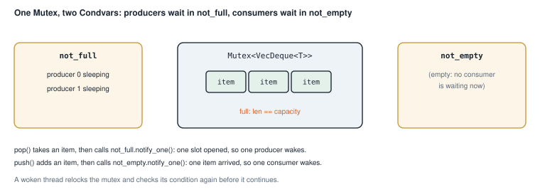
<figcaption><b>Figure 17.2</b> Two condition variables share one mutex. Each wakes only the kind of thread that can make progress.</figcaption>
</figure>

Using a single condition variable with `notify_one` can deadlock the queue: a producer waking another producer instead of a consumer leaves the woken producer blocked on a full buffer while runnable consumers remain asleep. Calling `notify_all` on one condition variable avoids deadlock at the cost of waking every waiting thread on every operation. Separate condition variables route each signal directly to a thread that can make progress.

<p class="listing"><b>Listing 17.3</b> The type and <code>new</code> (lines 19 to 38). <a href="https://github.com/arpanpathak/cracking-the-systems-programming-interview/blob/prep-v2/rust-interview-lab/src/bin/bounded_buffer.rs">src/bin/bounded_buffer.rs</a></p>

```rust
{{#include ../../rust-interview-lab/src/bin/bounded_buffer.rs:1:6}}

{{#include ../../rust-interview-lab/src/bin/bounded_buffer.rs:21:26}}

impl<T> BoundedQueue<T> {
{{#include ../../rust-interview-lab/src/bin/bounded_buffer.rs:29:40}}
    // ...
}
```

Pre-allocating with `VecDeque::with_capacity(capacity)` reserves the full buffer up front so that push operations never trigger heap reallocation. A zero capacity is rejected immediately, as no item could ever be enqueued.

<p class="listing"><b>Listing 17.4</b> <code>push</code> (lines 42 to 76).</p>

```rust
impl<T> BoundedQueue<T> {
    // ...
{{#include ../../rust-interview-lab/src/bin/bounded_buffer.rs:42:76}}
    // ...
}
```

The inline comments in `push` document each invariant, and figure 17.3 traces the exact sequence of lock handoffs when a producer blocks on a full queue.

<figure>
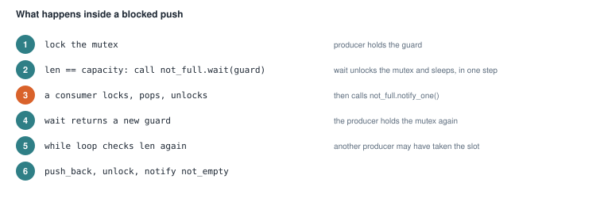
<figcaption><b>Figure 17.3</b> A producer that finds the queue full.</figcaption>
</figure>

<figure class="anim">
<video class="motion" src="figures/ch17-bounded-buffer.mp4" autoplay loop muted playsinline preload="metadata" aria-label="A producer, a consumer, and a buffer with three slots. The producer pushes 1, 2, and 3. push(4) finds the buffer full and waits on not_full. The consumer pops 1 and calls notify_one, the producer wakes, checks again, and pushes 4. The consumer then drains the buffer. Last, a second producer takes the freed slot first; with if in place of while, the woken producer pushes a fourth item into three slots." data-chapters="[[0.0, &quot;fill&quot;], [10.9, &quot;full&quot;], [27.92, &quot;drain&quot;], [38.22, &quot;if, not while&quot;]]">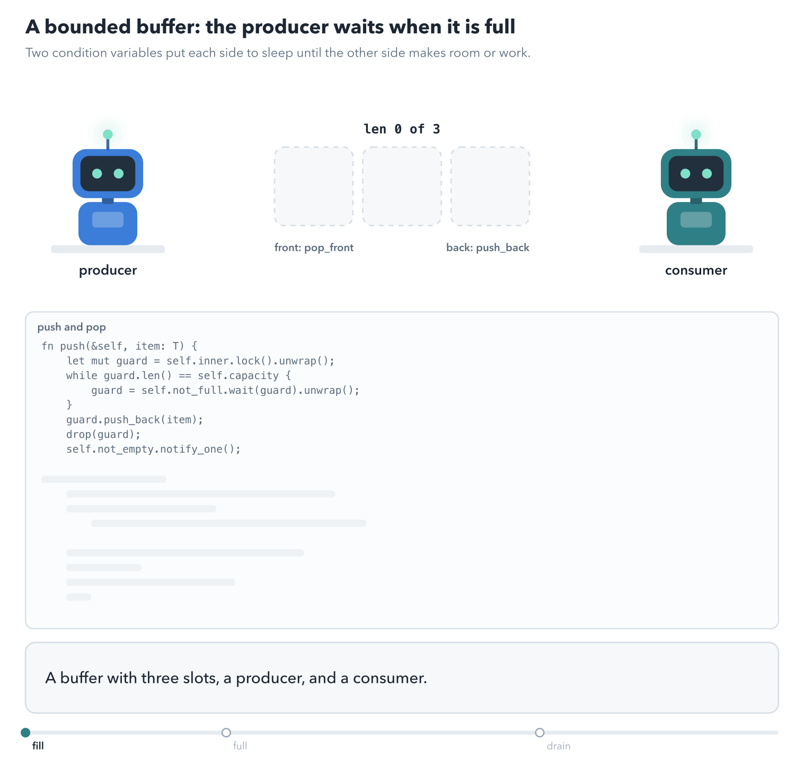</video>
<figcaption><b>Animation 17.2</b> The producer sleeps while the buffer is full and wakes when a pop makes room. A fast producer cannot get more than three items ahead of the consumer.</figcaption>
</figure>

In `guard = self.not_full.wait(guard).unwrap();`, `wait` consumes `guard` by value to release the mutex before sleeping, then re-acquires the mutex on wakeup and returns a fresh guard, which is assigned back to the same binding.

After pushing the item, `drop(guard)` releases the mutex before `notify_one()` is called. Notifying while still holding the lock remains correct, yet it can cause the signaled consumer to resume, immediately contend on the still-held mutex, and re-block. Dropping the guard first avoids that redundant context switch.

<p class="listing"><b>Listing 17.5</b> <code>pop</code> (lines 78 to 102).</p>

```rust
impl<T> BoundedQueue<T> {
    // ...
{{#include ../../rust-interview-lab/src/bin/bounded_buffer.rs:78:102}}
}
```

`pop` mirrors `push`: it waits on `not_empty` while the deque is empty, removes the front element, releases the mutex, and signals `not_full`. The `unwrap()` on `pop_front()` is guaranteed to succeed because the `while` loop exited only after verifying the deque was non-empty while holding the mutex continuously.

<p class="listing"><b>Listing 17.6</b> <code>main</code> (lines 105 to 150). <a href="https://github.com/arpanpathak/cracking-the-systems-programming-interview/blob/prep-v2/rust-interview-lab/src/bin/bounded_buffer.rs">src/bin/bounded_buffer.rs</a></p>

```rust
{{#include ../../rust-interview-lab/src/bin/bounded_buffer.rs:105:150}}
```

In `main`, two producers and two consumers share a buffer of capacity 3. Producers sleep 30 ms between items while consumers sleep 60 ms, ensuring that producers outpace consumers and exercise backpressure.

```text
$ cargo run --bin bounded_buffer
  [producer 0] pushing p0:item0
  [producer 1] pushing p1:item0
[consumer 1] got p0:item0
[consumer 0] got p1:item0
  [producer 0] pushing p0:item1
  [producer 1] pushing p1:item1
  [producer 0] pushing p0:item2
  [producer 1] pushing p1:item2
[consumer 1] got p0:item1
[consumer 0] got p1:item1
  [producer 0] pushing p0:item3
  [producer 1] pushing p1:item3
[consumer 1] got p0:item2
[consumer 0] got p1:item2
  [producer 0] pushing p0:item4
  [producer 1] pushing p1:item4
[consumer 1] got p1:item3
[consumer 0] got p0:item3
[consumer 1] got p0:item4
[consumer 0] got p1:item4
done
```

Interleaving varies across runs, while items from any individual producer preserve their relative order. Because the diagnostic line is printed prior to calling `push`, the log does not display blocking durations directly; Exercise 1 adds wait-time instrumentation.

## 17.4 When the lock is poisoned

Because `bounded_buffer.rs` calls `.unwrap()` on every `lock()` and `wait()`, a panic by any thread holding the mutex poisons the lock (as seen in section 16.6) and cascades panics to every other thread using the queue. The next two implementations propagate poisoning as structured errors instead (figure 17.4).

<figure>
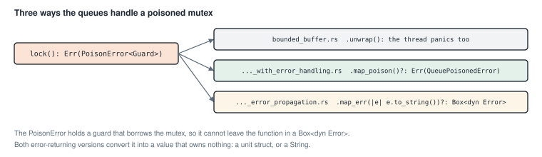
<figcaption><b>Figure 17.4</b> Three responses to a poisoned mutex.</figcaption>
</figure>

### 17.4.1 A custom error type

<p class="listing"><b>Listing 17.7</b> The error and an extension trait (lines 9 to 31). <a href="https://github.com/arpanpathak/cracking-the-systems-programming-interview/blob/prep-v2/rust-interview-lab/src/bin/bounded_buffer_with_error_handling.rs">src/bin/bounded_buffer_with_error_handling.rs</a></p>

```rust
{{#include ../../rust-interview-lab/src/bin/bounded_buffer_with_error_handling.rs:1:7}}

{{#include ../../rust-interview-lab/src/bin/bounded_buffer_with_error_handling.rs:9:31}}
```

`QueuePoisonedError` is a zero-sized unit struct implementing `Display` and `std::error::Error`, enabling composition with `?` and `Box<dyn Error>`.

`PoisonMap` is an **extension trait**: a locally defined trait implemented for a foreign type (here, the standard library's `Result<T, PoisonError<T>>`). Implementing `PoisonMap<T>` attaches a `map_poison` method directly to lock and wait results, converting `PoisonError<T>` into `QueuePoisonedError` without repetitive `map_err` closures.

<p class="listing"><b>Listing 17.8</b> <code>push</code> and <code>pop</code> (lines 51 to 74).</p>

```rust
impl<T> BoundedQueue<T> {
    // ...
{{#include ../../rust-interview-lab/src/bin/bounded_buffer_with_error_handling.rs:51:74}}
}
```

Appending `.map_poison()?` to each `lock()` and `wait()` preserves the exact control flow of listing 17.4 while changing both methods to return `Result`.

The complete source appears in listing 17.22 at the end of the chapter.

In `main`, worker threads log errors with `dbg!` and exit their loops via `break` rather than unwinding.

The second unit test intentionally poisons the queue by spawning a thread that acquires the private `inner` mutex (accessible to tests within the same module) and panics before releasing it. Both `push` and `pop` must subsequently return `Err(QueuePoisonedError)`.

```text
$ cargo test --bin bounded_buffer_with_error_handling
running 2 tests
test tests::test_zero_capacity_panics - should panic ... ok
test tests::test_queue_poisoning_on_thread_panic ... ok

test result: ok. 2 passed; 0 failed; 0 ignored; 0 measured; 0 filtered out
```

### 17.4.2 A boxed error

The third implementation erases the error type behind a trait object:

```rust
{{#include ../../rust-interview-lab/src/bin/bounded_buffer_error_propagation.rs:1:7}}

{{#include ../../rust-interview-lab/src/bin/bounded_buffer_error_propagation.rs:9:9}}
```

`Box<dyn Error + Send + Sync>` accommodates any error implementing `Error`. The `Send + Sync` bounds are required because each worker thread returns its `Result` across a thread boundary to `main` via `join()`.

<p class="listing"><b>Listing 17.9</b> <code>push</code> (lines 29 to 46). <a href="https://github.com/arpanpathak/cracking-the-systems-programming-interview/blob/prep-v2/rust-interview-lab/src/bin/bounded_buffer_error_propagation.rs">src/bin/bounded_buffer_error_propagation.rs</a></p>

```rust
impl<T> BoundedQueue<T> {
    // ...
{{#include ../../rust-interview-lab/src/bin/bounded_buffer_error_propagation.rs:29:46}}
    // ...
}
```

Applying `?` directly to `PoisonError` fails to compile because `PoisonError<MutexGuard<'_, T>>` borrows the mutex, whereas `Box<dyn Error + Send + Sync>` implicitly requires `'static`. Calling `.map_err(|e| e.to_string())?` converts the borrowed error into an owned `String`, which the standard library's `From<String>` implementation then boxes into the trait object.

<p class="listing"><b>Listing 17.10</b> <code>main</code> (lines 72 to 111). <a href="https://github.com/arpanpathak/cracking-the-systems-programming-interview/blob/prep-v2/rust-interview-lab/src/bin/bounded_buffer_error_propagation.rs">src/bin/bounded_buffer_error_propagation.rs</a></p>

```rust
{{#include ../../rust-interview-lab/src/bin/bounded_buffer_error_propagation.rs:72:111}}
```

In `main`, `producers` and `consumers` are lazy iterator adapters; no threads start until `producers.chain(consumers).collect()` materializes all four `JoinHandle`s into a `Vec`, after which the loop joins them.

Annotating each thread closure as `move || -> Result<(), RuntimeError>` supplies the target error type needed by `?` inside the body. Consequently, `handle.join()` yields `Ok(r)` where `r` is itself the thread's `Result`.

```text
$ cargo run --bin bounded_buffer_error_propagation
  [producer 1] pushing p1:item0
  [producer 0] pushing p0:item0
[consumer 1] got p1:item0
[consumer 0] got p0:item0
  [producer 0] pushing p0:item1
  [producer 1] pushing p1:item1
[consumer 1] got p0:item1
[consumer 0] got p1:item1
  [producer 0] pushing p0:item2
  [producer 1] pushing p1:item2
  [producer 0] pushing p0:item3
  [producer 1] pushing p1:item3
[consumer 0] got p1:item2
[consumer 1] got p0:item2
  [producer 0] pushing p0:item4
  [producer 1] pushing p1:item4
Thread joined : Ok(
    (),
)
[consumer 0] got p1:item3
[consumer 1] got p0:item3
Thread joined : Ok(
    (),
)
[consumer 1] got p0:item4
[consumer 0] got p1:item4
Thread joined : Ok(
    (),
)
Thread joined : Ok(
    (),
)
done
```

Join messages interleave with consumer output because `main` joins the producer handles first while the consumers are still draining the remaining items.

## 17.5 Many producers and consumers with `wait_while`

The fourth implementation streamlines the bounded buffer by delegating both condition loops to `wait_while` and replaces `Arc` with scoped threads in `main`.

The struct layout matches section 17.3: a `VecDeque` behind a `Mutex`, a fixed capacity, and two condition variables (`not_empty` and `not_full`):

```rust
{{#include ../../rust-interview-lab/src/bin/mpmc_bounded_buffer.rs:1:24}}
    // ...
}
```

In `push`, `wait_while` accepts the guard and a predicate closure, suspending the thread while the predicate evaluates to `true` and re-checking it after every wakeup. This provides the same protection against spurious wakeups and racing producers as the explicit `while` loop in section 17.3:

```rust
impl<T> BoundedBuffer<T> {
    // ...
{{#include ../../rust-interview-lab/src/bin/mpmc_bounded_buffer.rs:26:40}}
    // ...
}
```

Copying `self.capacity` into a local `cap` before constructing `|q| q.len() >= cap` avoids borrowing `self` inside the closure. Calling `drop(queue)` before `notify_one()` releases the mutex before waking a consumer, avoiding immediate lock contention.

`pop` follows the symmetric sequence: waiting while empty, popping the front element, releasing the lock, and notifying `not_full`:

```rust
impl<T> BoundedBuffer<T> {
    // ...
{{#include ../../rust-interview-lab/src/bin/mpmc_bounded_buffer.rs:42:53}}
}
```

**MPMC** denotes multiple producers and multiple consumers. In `main`, four producers enqueue 10 items each while two consumers dequeue 20 items each:

```rust
{{#include ../../rust-interview-lab/src/bin/mpmc_bounded_buffer.rs:56:83}}
```

Deriving `PER_CONSUMER` from the producer constants guarantees that total items popped equal total items pushed, allowing every thread to terminate cleanly.

The complete program is included in listing 17.24 at the end of the chapter.

Rebinding `let buffer = &buffer;` turns the local variable into a shared reference so that each `move` closure copies only the reference into its scoped thread, while `thread::scope` ensures `buffer` outlives all workers.

```text
$ cargo run --bin mpmc_bounded_buffer
consumer 1: (3, 0)
consumer 1: (2, 0)
consumer 0: (1, 0)
consumer 0: (3, 2)
consumer 0: (3, 3)
...
consumer 0: (3, 8)
consumer 0: (0, 9)
consumer 0: (2, 9)
```

The complete output comprises 40 `(producer, index)` pairs. Items originating from any single producer appear in monotonically increasing index order across the combined stream, while items from different producers interleave according to OS thread scheduling.

## 17.6 Closing a queue

Every implementation thus far lacks a termination protocol. The examples rely on hardcoded item counts, whereas production consumers rarely know the total volume of work in advance; without a shutdown signal, a consumer calling `pop` in a loop blocks indefinitely once all producers exit.

The library implementation in `bounded_queue.rs` resolves this by adding an explicit **close** operation (figure 17.5).

<figure>
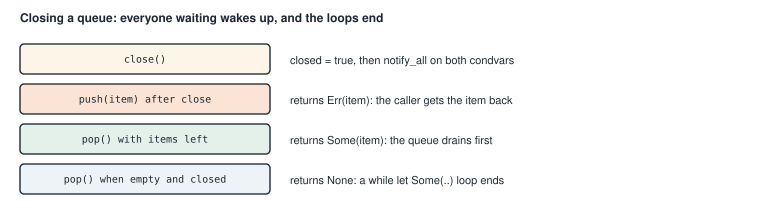
<figcaption><b>Figure 17.5</b> What each operation does after <code>close</code>.</figcaption>
</figure>

<p class="listing"><b>Listing 17.11</b> The state (lines 16 to 27). <a href="https://github.com/arpanpathak/cracking-the-systems-programming-interview/blob/prep-v2/rust-interview-lab/src/problems/bounded_queue.rs">src/problems/bounded_queue.rs</a></p>

```rust
{{#include ../../rust-interview-lab/src/problems/bounded_queue.rs:11:14}}

{{#include ../../rust-interview-lab/src/problems/bounded_queue.rs:16:27}}
```

The mutex now guards a dedicated `State<T>` struct combining the deque, capacity, and `closed` boolean. Keeping `closed` under the same mutex ensures that threads inspect the flag and queue length atomically, preventing lost wakeups during shutdown.

<p class="listing"><b>Listing 17.12</b> <code>push</code> and <code>pop</code> (lines 47 to 94).</p>

```rust
impl<T> BoundedQueue<T> {
    // ...
{{#include ../../rust-interview-lab/src/problems/bounded_queue.rs:47:94}}
    // ...
}
```

Both operations use an explicit `loop` that re-evaluates both the buffer state and the `closed` flag after every wakeup.

`push` returns `Result<(), T>`: if the queue is closed, it returns `Err(item)`, transferring ownership back to the caller rather than discarding the value.

`pop` returns `Option<T>` and checks for queued items before inspecting `closed`. Draining buffered items before signaling closure ensures no already-enqueued work is abandoned; `pop` returns `None` only when the queue is both closed and empty, allowing consumers to terminate cleanly with `while let Some(item) = queue.pop()`.

<p class="listing"><b>Listing 17.13</b> <code>close</code> (lines 109 to 122).</p>

```rust
impl<T> BoundedQueue<T> {
    // ...
{{#include ../../rust-interview-lab/src/problems/bounded_queue.rs:109:122}}
    // ...
}
```

`close` sets `closed = true` under the lock and invokes `notify_all()` on both `not_empty` and `not_full`, waking every blocked producer and consumer so they can observe the new state and return. Repeating `close` leaves the state unchanged, making the operation **idempotent**.

Animation 17.3 illustrates closing a full queue while a producer is blocked in `push`, followed by the hang caused when `close` omits `notify_all`.

<figure class="anim">
<video class="motion" src="figures/ch17-queue-close.mp4" autoplay loop muted playsinline preload="metadata" aria-label="A queue with room for 2 holds 1 and 2, and the producer waits to push 3. main calls close: closed becomes true, and notify_all rings both condition variables. The producer wakes, sees closed, and push returns Err(3), handing the item back. The consumer pops 1 and 2, then pop returns None on the empty closed queue. Last, close without notify_all leaves a consumer asleep on an empty queue forever, and shutdown hangs." data-chapters="[[0.0, &quot;full&quot;], [8.22, &quot;close&quot;], [25.62, &quot;drain&quot;], [36.18, &quot;no notify_all&quot;]]">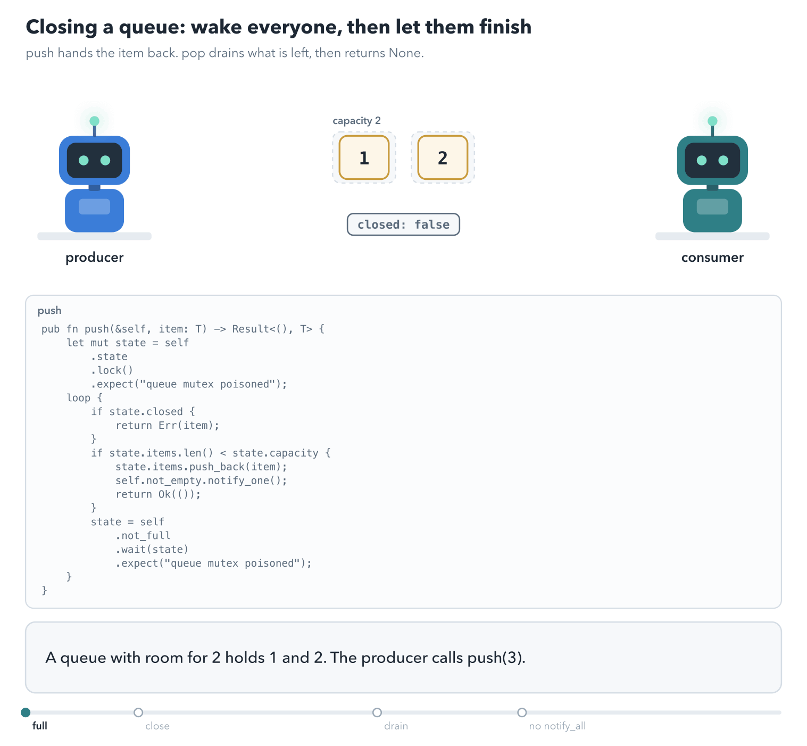</video>
<figcaption><b>Animation 17.3</b> <code>close</code> sets the flag and wakes every waiter. <code>push</code> hands its item back, and <code>pop</code> drains the queue before it returns <code>None</code>. A close that wakes nobody hangs the shutdown.</figcaption>
</figure>

The complete implementation and test suite appear in listing 17.25 at the end of the chapter.

The four unit tests verify the core contract:

- `preserves_order_across_threads` enqueues 0 through 999 on one thread and verifies strict FIFO delivery and clean loop termination on another after `close`.
- `never_exceeds_capacity` tracks the peak observed queue length against a slow consumer and asserts it never exceeds 4.
- `close_wakes_a_blocked_consumer` blocks a consumer on an empty queue for 20 ms, calls `close`, and confirms `pop` returns `None` rather than hanging.
- `push_after_close_returns_the_item` verifies that rejected items are returned intact inside `Err`.

```text
$ cargo test --lib problems::bounded_queue
running 4 tests
test problems::bounded_queue::tests::push_after_close_returns_the_item ... ok
test problems::bounded_queue::tests::preserves_order_across_threads ... ok
test problems::bounded_queue::tests::never_exceeds_capacity ... ok
test problems::bounded_queue::tests::close_wakes_a_blocked_consumer ... ok

test result: ok. 4 passed; 0 failed; 0 ignored; 0 measured; 133 filtered out
```

## 17.7 A ring buffer without a lock

All previous queues acquire a mutex on every operation. When concurrency is restricted to exactly one producer thread and one consumer thread, an **SPSC** (single producer, single consumer) topology, the mutex can be eliminated entirely in favor of atomic indices.

### 17.7.1 The idea

A **ring buffer** maps a fixed-size array of N slots onto a circular index space (figure 17.6), tracked by two monotonically increasing counters:

- `head` counts the total items removed; the consumer reads from slot `head % N`.
- `tail` counts the total items inserted; the producer writes to slot `tail % N`.

The current occupancy is `tail - head`: the ring is empty when `tail == head` and full when `tail - head == N`.

<figure>
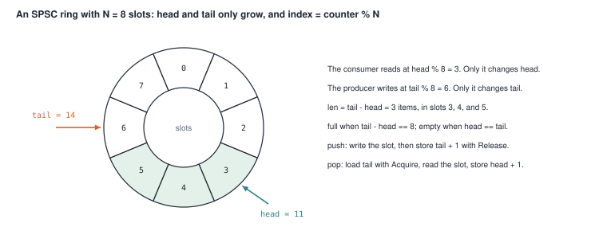
<figcaption><b>Figure 17.6</b> A ring with 8 slots holding 3 items. The counters keep growing, and <code>% 8</code> maps them to slots.</figcaption>
</figure>

Mutual exclusion is unnecessary because each counter has a single writer: only the producer mutates `tail`, and only the consumer mutates `head`, while each side performs read-only loads of the opposing counter.

Memory visibility relies on the `Release`/`Acquire` synchronization pattern from section 16.4. The producer writes the payload into its target slot before publishing the incremented `tail` with `Release`. The consumer loads `tail` with `Acquire` before reading the slot, guaranteeing that observing the updated `tail` makes the slot's payload visible.

### 17.7.2 The type

<p class="listing"><b>Listing 17.14</b> The ring (lines 25 to 38). <a href="https://github.com/arpanpathak/cracking-the-systems-programming-interview/blob/prep-v2/rust-interview-lab/src/problems/ring_buffer.rs">src/problems/ring_buffer.rs</a></p>

```rust
{{#include ../../rust-interview-lab/src/problems/ring_buffer.rs:19:23}}

{{#include ../../rust-interview-lab/src/problems/ring_buffer.rs:25:38}}
```

The definition introduces three low-level Rust features:

- `const N: usize` is a **const generic** parameter specifying the fixed array capacity at compile time, as in `SpscRing<u64, 256>`.
- `MaybeUninit<T>` represents storage that may be uninitialized. Because empty ring slots hold no valid `T` and Rust forbids uninitialized values of type `T`, `MaybeUninit` makes the initialization state explicit; reading the value requires `unsafe` to assert that the slot is populated.
- `UnsafeCell` permits mutating individual slots through `&self`, as in the spin lock of section 16.4.

The constructor initializes the fixed array with `std::array::from_fn`, invoking the closure once per slot index.

### 17.7.3 Push and pop

<p class="listing"><b>Listing 17.15</b> <code>push</code> and <code>pop</code> (lines 71 to 107).</p>

```rust
impl<T, const N: usize> SpscRing<T, N> {
    // ...
{{#include ../../rust-interview-lab/src/problems/ring_buffer.rs:71:107}}
}
```

In `push`, the producer loads its own `tail` with `Relaxed` (since no other thread modifies `tail`) and loads `head` with `Acquire`. That `Acquire` load synchronizes with the consumer's `Release` store of `head`, ensuring the consumer has finished reading a recycled slot before the producer overwrites it.

When the ring is full, `push` returns `Err(value)` to preserve ownership. Otherwise, it writes the element via `MaybeUninit::write` and publishes the slot by storing `tail.wrapping_add(1)` with `Release`.

`pop` performs the symmetric sequence: loading `tail` with `Acquire`, moving the value out via `assume_init_read`, and publishing the freed slot by storing `head.wrapping_add(1)` with `Release`.

Using `wrapping_add` and `wrapping_sub` ensures that `tail.wrapping_sub(head)` remains exact even if the 64-bit counters wrap around zero after 2⁶⁴ operations.

Animation 17.4 traces an 8-slot ring as counters wrap past capacity and fill the buffer, then illustrates the data corruption that occurs when `tail` is published before writing the slot.

<figure class="anim">
<video class="motion" src="figures/ch17-ring-spsc.mp4" autoplay loop muted playsinline preload="metadata" aria-label="A producer robot, a consumer robot, and eight slots between them, with tail and head labels showing each counter and its value % 8. push loads tail and head, checks for room, writes the value into slot tail % 8, and then stores tail + 1 with Release. pop loads tail with Acquire, reads slot head % 8, and stores head + 1. The counters keep growing past 8 and wrap through the slots. When tail - head reaches 8 the ring is full, and push returns Err with the value. Last, a push that stores tail before writing the slot lets the consumer read slot 0 while it is still empty." data-chapters="[[0.0, &quot;push&quot;], [18.98, &quot;pop&quot;], [26.37, &quot;wrap&quot;], [41.68, &quot;full&quot;], [59.71, &quot;publish first&quot;]]"></video>
<figcaption><b>Animation 17.4</b> The producer writes the slot, then publishes <code>tail</code>; the consumer reads <code>tail</code>, then the slot. Publishing first lets the consumer read a slot that was never written.</figcaption>
</figure>

<p class="listing"><b>Listing 17.16</b> <code>Drop</code> (lines 116 to 121).</p>

```rust
{{#include ../../rust-interview-lab/src/problems/ring_buffer.rs:116:121}}
```

Because `MaybeUninit<T>` does not track initialization, it never runs destructors automatically. Implementing `Drop` for `SpscRing` drains all remaining initialized elements via `pop()`, allowing each returned `T` to drop normally. The `dropped_ring_drops_queued_items` test verifies that every queued element's destructor executes.

<div class="callout warning" markdown="1">

**WARNING:** The soundness of `SpscRing` relies on an unchecked caller invariant: at most one thread may invoke `push`, and at most one thread may invoke `pop`. Because both methods accept `&self` and `SpscRing` implements `Sync`, safe code can share one instance across two producers and race on the same slot, causing undefined behavior. A sound public API splits the ring into non-clonable `Producer` and `Consumer` handles taking `&mut self`, enforcing the SPSC contract at compile time (Exercise 5).

</div>

The complete implementation and tests appear in listing 17.26 at the end of the chapter.

The concurrency test transfers 50,000 sequential integers across a 256-slot ring, calling `thread::yield_now()` whenever the producer encounters a full ring or the consumer encounters an empty ring. A sentinel value (`u64::MAX`) signals completion, and the consumer verifies that every integer arrives in exact order.

```text
$ cargo test --lib problems::ring_buffer
running 4 tests
test problems::ring_buffer::tests::is_fifo_within_capacity ... ok
test problems::ring_buffer::tests::full_ring_returns_the_value ... ok
test problems::ring_buffer::tests::dropped_ring_drops_queued_items ... ok
test problems::ring_buffer::tests::producer_and_consumer_run_concurrently_in_order ... ok

test result: ok. 4 passed; 0 failed; 0 ignored; 0 measured; 133 filtered out
```

## 17.8 A lock-free queue for many producers and consumers

The SPSC ring of Section 17.7 owes its simplicity to one structural guarantee, namely that each of its counters has exactly one writer. The producer alone advances `tail` and the consumer alone advances `head`. Neither thread ever has to arbitrate with a peer of its own kind. Admitting a second producer removes that guarantee. Both producers may then read the same value of `tail`, write their items into the same slot, and publish the same incremented counter. One item silently replaces the other, as the left half of Figure 17.7 shows.

We now develop a bounded queue that tolerates any number of producers and consumers, while still avoiding a mutex. This configuration is conventionally abbreviated **MPMC**. The design is due to Dmitry Vyukov, who described it on his site 1024cores.net. It also underlies the `ArrayQueue` type of the crossbeam library. Its correctness rests on two ideas, which the following subsections introduce in turn. Positions are reserved with an atomic compare-and-swap, and every slot carries a sequence number that records whose turn it is.

### 17.8.1 Reserving a position with compare-and-swap

A **compare-and-swap** (CAS) is a single atomic instruction that replaces a value in memory only if that value still equals an expected one. Rust exposes it as `compare_exchange(expected, new)`. The call returns `Ok(expected)` when the replacement took place, and `Err(actual)` when another thread had already changed the location. Because the comparison and the replacement form one indivisible step, no other thread can act between them.

Applied to the queue, a CAS turns the advance of `tail` into an act of ownership. A producer that has read `tail = 2` attempts `compare_exchange(2, 3)`, and a successful attempt makes position 2 its own and no one else's. A competing producer that also read 2 finds its own attempt rejected. The value returned in the error tells it that `tail` is now 3, so it repeats the attempt for position 3.

<figure>
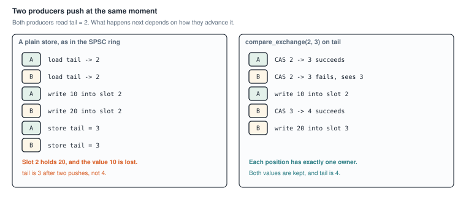
<figcaption><b>Figure 17.7</b> Two producers that both read <code>tail = 2</code>. With a plain store, the second write replaces the first value. With compare-and-swap, the producer that loses the race moves on to position 3.</figcaption>
</figure>

The right half of Figure 17.7 traces this outcome, in which both items survive in separate slots and `tail` ends at 4. A failed CAS never leaves the losing thread waiting for the winner. It always means that another thread has advanced the counter, and the loser retries at once with the newer value.

### 17.8.2 A sequence number in every slot

Reserving a position is necessary, but it is not sufficient. In the SPSC ring, a consumer could infer from `tail` that a slot was full. Its producer published `tail` only after writing that slot. In the MPMC queue, by contrast, `tail` advances at the moment of reservation, before any value has been written. A consumer that trusted `tail` could therefore read a slot whose producer is still in the middle of its write. The counter records which positions have been claimed, but not which of them have been completed.

Vyukov's design attaches the missing information to the slot itself. Each slot holds a **sequence number**, `seq`, which names the operation that the slot is waiting for. For the slot that serves position `p`, three values are meaningful.

| `seq` | State of the slot |
|---|---|
| `p` | Empty, waiting for the producer of position `p` |
| `p + 1` | Full, waiting for the consumer of position `p` |
| `p + capacity` | Empty again, waiting for the producer of the same slot one lap later |

Figure 17.8 follows slot 0 of a queue with capacity 4 through two laps. Its sequence number starts at 0, becomes 1 once the first value has been written, and becomes 4 once that value has been consumed. The producer of position 4 then raises it to 5. Because `seq` only ever increases, a thread cannot mistake a state left over from an earlier lap for the current one.

<figure>
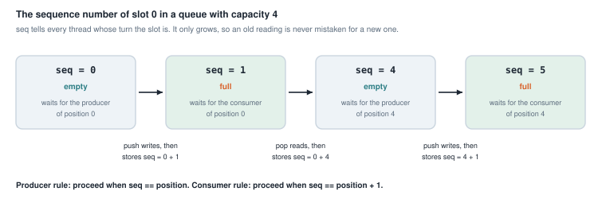
<figcaption><b>Figure 17.8</b> The life of slot 0. Every push and every pop moves the sequence number forward, and the number always names the one thread that may use the slot next.</figcaption>
</figure>

What a thread may do depends on how the slot's `seq` compares with the thread's own position. A producer at position `tail` distinguishes three cases:

- **`seq == tail`.** The slot is empty and waiting for precisely this position, so the producer may attempt its CAS.
- **`seq < tail`.** The slot still holds an item from the previous lap that no consumer has removed yet, so the queue is full.
- **`seq > tail`.** Another producer has already filled this position. The producer's view of `tail` is out of date and must be reloaded.

A consumer applies the same reasoning with an offset of one, since a full slot for position `head` carries `seq = head + 1`. A smaller value indicates that the producer of this position has not finished, which the consumer reports as an empty queue. A larger value indicates that another consumer has already taken the position.

<div class="callout note" markdown="1">

**An analogy: lockers at a parcel depot.** Consider a depot with four lockers, a ticket dispenser for couriers, and another for customers. A courier who draws ticket 6 delivers to locker 6 % 4 = 2. A customer who draws pickup ticket 6 collects from that same locker. Above each locker, a small display states the next ticket that the locker will serve. Locker 2 first shows "deliver 6", and only the courier holding ticket 6 may open it. After the delivery, that courier changes the display to "collect 6". Next, the customer with pickup ticket 6 removes that parcel and sets the display to "deliver 10", for a courier one lap later.

The dispensers correspond to the CAS operations on `tail` and `head`. A ticket is a position, and a display is a slot's `seq`. The analogy breaks down at one point. A courier who finds an older ticket on the display does not wait at the locker, but reports the depot as full and leaves.

</div>

### 17.8.3 Tracing four operations

Figure 17.9 traces a queue with capacity 4 through two pushes and one pop. Initially, slot `k` holds `seq = k`, so every slot is waiting for its producer in the first lap. The push of A reserves position 0 and leaves slot 0 with `seq = 1`, the full state for that position. The push of B does the same for position 1 in slot 1.

<figure>
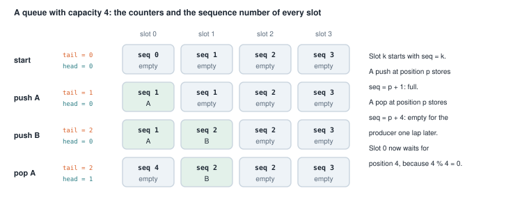
<figcaption><b>Figure 17.9</b> Two pushes and a pop. A push at position <code>p</code> leaves <code>seq = p + 1</code>, and a pop at position <code>p</code> leaves <code>seq = p + 4</code>.</figcaption>
</figure>

The pop of A then reserves position 0 on the consumer side, removes the value, and writes `seq = 0 + 4`. Slot 0 thereby becomes available to position 4, the first position of the second lap. Position 4 maps back to slot 0, because 4 % 4 = 0. Slot 2, meanwhile, still holds `seq = 2`, so the next push, at position 2, will find it empty.

### 17.8.4 Constraints on the capacity

The capacity must be at least 2. With a single slot, the full state of position 0 and the empty state of position 1 coincide. After the push at position 0, the slot holds `seq = 1`, meaning that it is full and waiting for the consumer of position 0. Position 1, however, maps to the same slot. Its producer observes `seq == 1 == tail`, concludes that the slot is empty, and overwrites a value that no consumer has read. For any capacity of two or more, the full value `p + 1` differs from the next empty value `p + capacity`, and the ambiguity disappears.

The capacity must also be a power of two, although this requirement concerns efficiency rather than correctness. For a power-of-two capacity, `p % capacity` equals `p & (capacity - 1)`. Every operation can then locate its slot with a single AND instruction instead of an integer division. The constructor `new` enforces both requirements with one `assert!`.

### 17.8.5 The type

Listing 17.17 declares the slot, the queue, and its constructor.

<p class="listing"><b>Listing 17.17</b> The slot, the queue, and <code>new</code> (lines 11 to 51). <a href="https://github.com/arpanpathak/cracking-the-systems-programming-interview/blob/prep-v2/rust-interview-lab/src/bin/lock_free_queue.rs">src/bin/lock_free_queue.rs</a></p>

```rust
{{#include ../../rust-interview-lab/src/bin/lock_free_queue.rs:11:51}}

    // ...
}
```

A `Slot<T>` pairs the sequence number with storage for one value, and that storage has the same type as in the SPSC ring, `UnsafeCell<MaybeUninit<T>>`. `MaybeUninit` is required because an empty slot contains no valid `T`, and Rust does not allow a value of type `T` to exist uninitialized. `UnsafeCell` is required because threads write into slots through the shared reference `&self`. `UnsafeCell` is the only construct through which Rust permits mutation behind a shared reference.

The queue itself keeps its slots in a `Box<[Slot<T>]>`, a heap-allocated array whose length is fixed when the queue is created. The field `mask` stores `capacity - 1`, which converts a position into a slot index through `position & mask`. The fields `head` and `tail` are the two counters, and like those of the SPSC ring, they grow without bound.

The two `unsafe impl` declarations assert that the queue may be shared between threads and moved between them. The compiler cannot reach this conclusion unaided. The standard library marks `UnsafeCell` as not `Sync`. A cell that permits mutation through `&self` could otherwise receive writes from two threads at once. The queue prevents that situation by its protocol, since the CAS gives every position to a single thread. The protocol lies outside the type system, however, so the code must state it as an explicit promise.

Each `// SAFETY:` comment records the argument behind its promise, so that a reviewer can check the argument against the code. The bound `T: Send` appears on both declarations, because a value pushed on one thread is popped on another.

The constructor checks the capacity and builds the slot array with `map` and `collect`. Slot `i` begins with `seq = i`, and both counters begin at 0.

### 17.8.6 Push

Listing 17.18 shows `push`, which proceeds in two phases.

<p class="listing"><b>Listing 17.18</b> <code>push</code> (lines 53 to 83).</p>

```rust
impl<T> LockFreeQueue<T> {
    // ...
{{#include ../../rust-interview-lab/src/bin/lock_free_queue.rs:53:83}}
}
```

The first phase, the `loop`, reserves a position. It begins from the current value of `tail` and reads the sequence number of the corresponding slot. The two guard clauses then dispose of the cases in which the producer cannot proceed:

- When `seq < tail`, the queue is full. `push` returns `Err(value)`, which hands the value back to the caller, so that it is neither lost nor dropped.
- When `seq > tail`, another producer has already taken this position. `push` reloads `tail` and repeats the loop with the fresh value.

Only when neither guard applies is the slot known to be empty, and `push` attempts to advance `tail` by one. A successful CAS ends the loop with the position reserved. A failed CAS returns the value that the competing producer installed, and the loop resumes from that position.

The CAS used here is `compare_exchange_weak`, a variant that may fail even when the counter holds the expected value. Some processors, among them older ARM cores, implement a CAS as a pair of instructions that can fail for reasons unrelated to the data. The strong variant hides such failures by retrying internally, whereas the weak variant reports them. Inside a loop that retries anyway, the weak variant saves that inner loop.

The second phase writes the value into the reserved slot and then stores `seq = tail + 1`. That store marks the slot full for this position's consumer. Between the successful CAS and that store, the slot belongs to this producer alone. The `// SAFETY:` comment above the write states why. The CAS excluded every other producer, and the equality `seq == tail` showed that no consumer was still reading the slot.

### 17.8.7 Pop

Listing 17.19 shows `pop`, which mirrors `push` with the roles of the counters exchanged.

<p class="listing"><b>Listing 17.19</b> <code>pop</code> (lines 85 to 115).</p>

```rust
impl<T> LockFreeQueue<T> {
    // ...
{{#include ../../rust-interview-lab/src/bin/lock_free_queue.rs:85:115}}
}
```

The reservation loop operates on `head` and expects `seq == head + 1`, the full state of the position. A smaller sequence number means that the producer of this position has not finished, and `pop` returns `None`. A larger one means that another consumer has already taken the position, and `pop` reloads `head`.

Once its CAS succeeds, `pop` moves the value out of the slot with `assume_init_read`. That call is sound only if the slot really holds an initialized value. The `// SAFETY:` comment justifies that condition from the observed sequence number. The final store sets `seq = head + capacity`, written as `head + self.mask + 1`, and so hands the empty slot to the producer of the next lap.

### 17.8.8 Memory ordering

The two kinds of atomic operation in the queue serve different purposes, and their orderings differ accordingly. A CAS on `head` or `tail` decides only which thread owns a position. It publishes no data, so `Relaxed` ordering suffices. The value itself is published through the slot's sequence number, using the Release and Acquire pairing introduced in Section 16.4.

<figure>
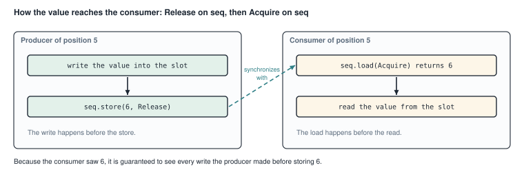
<figcaption><b>Figure 17.10</b> The handoff of one value. Because the consumer's Acquire load observes the producer's Release store, the consumer also observes the value written before that store.</figcaption>
</figure>

Figure 17.10 depicts the handoff for position 5. The producer writes the value and then stores `seq = 6` with `Release`. The consumer loads `seq` with `Acquire`, and observing 6 guarantees that every write the producer made before its store is visible as well. The value therefore cannot be read before it has been written.

The same pairing protects the slot in the opposite direction. The consumer's final store of `seq` uses `Release`, and the producer of the next lap loads `seq` with `Acquire`. The consumer's read of the old value is thereby complete before the producer overwrites the slot.

### 17.8.9 Dropping the queue

Because `MaybeUninit<T>` never runs a destructor, values still in the queue would leak when the queue itself is dropped. The `Drop` implementation prevents the leak with a single statement, `while self.pop().is_some() {}`, which removes every remaining value and lets each one drop normally. Since `drop` receives `&mut self`, no other thread can be using the queue at that moment.

### 17.8.10 The progress guarantee

Although the queue contains no lock, it does not satisfy the formal definition of a lock-free data structure. That definition requires the system as a whole to make progress even when any one thread is suspended indefinitely. Suppose, then, that the operating system suspends a producer after its successful CAS but before its store of `seq`.

The slot of that position remains in the empty state. Consumers that reach it report an empty queue, even when later slots are full. No other thread can complete the suspended producer's write on its behalf. Consumers therefore make no progress past that slot until the producer is scheduled again. Vyukov points out this property in his description of the design. In practice, the delay lasts no longer than one scheduling interval of the suspended thread.

### 17.8.11 Testing with four threads

The `main` function exercises the queue with two producers and two consumers inside a `thread::scope`. Each producer pushes the values 1 to 1000, calling `thread::yield_now` whenever the queue is full. Each consumer pops 1000 values, yields whenever the queue is empty, and adds every value to a shared `AtomicU64`.

The sum of 1 to 1000 is 1000 × 1001 / 2 = 500,500. Together, the two producers therefore push values that add up to 1,001,000. A value lost to a race, or popped twice, would change this total.

```text
$ cargo run --release --bin lock_free_queue
sum = 1001000
```

The complete program appears in listing 17.27 at the end of the chapter.

## 17.9 The complete files

Each complete source file appears below in the order introduced in this chapter.

<p class="listing"><b>Listing 17.20</b> The shared queue and its <code>main</code>. <a href="https://github.com/arpanpathak/cracking-the-systems-programming-interview/blob/prep-v2/rust-interview-lab/src/bin/thread_safe_queue.rs">src/bin/thread_safe_queue.rs</a></p>

```rust
{{#include ../../rust-interview-lab/src/bin/thread_safe_queue.rs}}
```

<p class="listing"><b>Listing 17.21</b> The bounded buffer and its <code>main</code>. <a href="https://github.com/arpanpathak/cracking-the-systems-programming-interview/blob/prep-v2/rust-interview-lab/src/bin/bounded_buffer.rs">src/bin/bounded_buffer.rs</a></p>

```rust
{{#include ../../rust-interview-lab/src/bin/bounded_buffer.rs}}
```

<p class="listing"><b>Listing 17.22</b> The bounded buffer with a custom error type, with tests. <a href="https://github.com/arpanpathak/cracking-the-systems-programming-interview/blob/prep-v2/rust-interview-lab/src/bin/bounded_buffer_with_error_handling.rs">src/bin/bounded_buffer_with_error_handling.rs</a></p>

```rust
{{#include ../../rust-interview-lab/src/bin/bounded_buffer_with_error_handling.rs}}
```

<p class="listing"><b>Listing 17.23</b> The bounded buffer with a boxed error. <a href="https://github.com/arpanpathak/cracking-the-systems-programming-interview/blob/prep-v2/rust-interview-lab/src/bin/bounded_buffer_error_propagation.rs">src/bin/bounded_buffer_error_propagation.rs</a></p>

```rust
{{#include ../../rust-interview-lab/src/bin/bounded_buffer_error_propagation.rs}}
```

<p class="listing"><b>Listing 17.24</b> Many producers and consumers with <code>wait_while</code>. <a href="https://github.com/arpanpathak/cracking-the-systems-programming-interview/blob/prep-v2/rust-interview-lab/src/bin/mpmc_bounded_buffer.rs">src/bin/mpmc_bounded_buffer.rs</a></p>

```rust
{{#include ../../rust-interview-lab/src/bin/mpmc_bounded_buffer.rs}}
```

<p class="listing"><b>Listing 17.25</b> The closable bounded queue, with tests. <a href="https://github.com/arpanpathak/cracking-the-systems-programming-interview/blob/prep-v2/rust-interview-lab/src/problems/bounded_queue.rs">src/problems/bounded_queue.rs</a></p>

```rust
{{#include ../../rust-interview-lab/src/problems/bounded_queue.rs}}
```

<p class="listing"><b>Listing 17.26</b> The SPSC ring buffer, with tests. <a href="https://github.com/arpanpathak/cracking-the-systems-programming-interview/blob/prep-v2/rust-interview-lab/src/problems/ring_buffer.rs">src/problems/ring_buffer.rs</a></p>

```rust
{{#include ../../rust-interview-lab/src/problems/ring_buffer.rs}}
```

<p class="listing"><b>Listing 17.27</b> The lock-free queue for many producers and consumers. <a href="https://github.com/arpanpathak/cracking-the-systems-programming-interview/blob/prep-v2/rust-interview-lab/src/bin/lock_free_queue.rs">src/bin/lock_free_queue.rs</a></p>

```rust
{{#include ../../rust-interview-lab/src/bin/lock_free_queue.rs}}
```

<div class="summary" markdown="1">

## Summary

- A queue decouples producer threads from consumer threads; bounding its capacity applies backpressure by blocking producers when the buffer is full.
- A `Condvar` suspends a thread until signaled, atomically releasing its associated mutex while sleeping and re-acquiring it on wakeup.
- Condition-variable predicates must always be re-evaluated in a `while` loop or `wait_while` to guard against spurious wakeups and competing threads.
- Separating `not_empty` and `not_full` condition variables ensures each notification wakes a thread that can make progress.
- A poisoned mutex can be handled by panicking via `unwrap()`, mapping to a dedicated error type through an extension trait, or converting to an owned `String` inside a boxed error.
- Adding a mutex-protected `closed` flag, waking all waiters with `notify_all`, and returning `None` from `pop` once drained enables clean consumer shutdown.
- An SPSC ring buffer eliminates locks by giving each counter a single writer and synchronizing slot handoffs with `Release` and `Acquire` orderings, provided the public API enforces the single-producer and single-consumer invariants.
- A sequence number in every slot lets many producers and consumers share a bounded ring without a mutex. A compare-and-swap claims a position, and a `Release` store of `seq` hands the slot to the other side.

</div>

## Exercises

1. In `bounded_buffer.rs`, measure how long each `push` waits and print it. Change the sleep times until the
   producers visibly block.
2. Add `try_push(&self, item: T) -> Result<(), T>` to the library `BoundedQueue`. It should return at once when
   the queue is full.
3. Add `pop_timeout(&self, timeout: Duration) -> Option<T>` using `Condvar::wait_timeout_while`.
4. Replace the two condition variables in `bounded_buffer.rs` with one, using `notify_all`. Check that it still
   works, and count the wakeups with an atomic counter.
5. Split `SpscRing` into `Producer<T, N>` and `Consumer<T, N>` handles that share the ring through an `Arc`. Give
   `push` and `pop` a `&mut self` receiver, so that each handle can be used by only one thread at a time.
