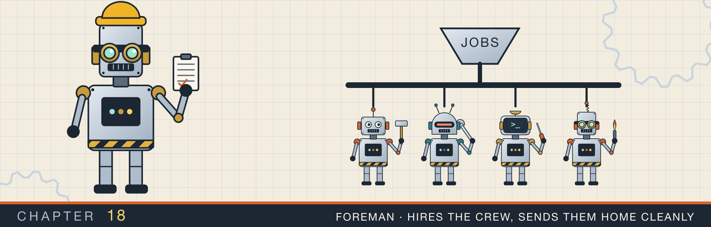
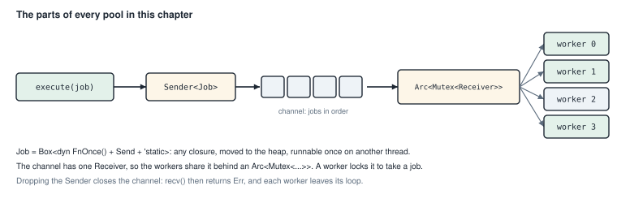
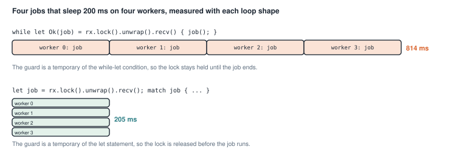
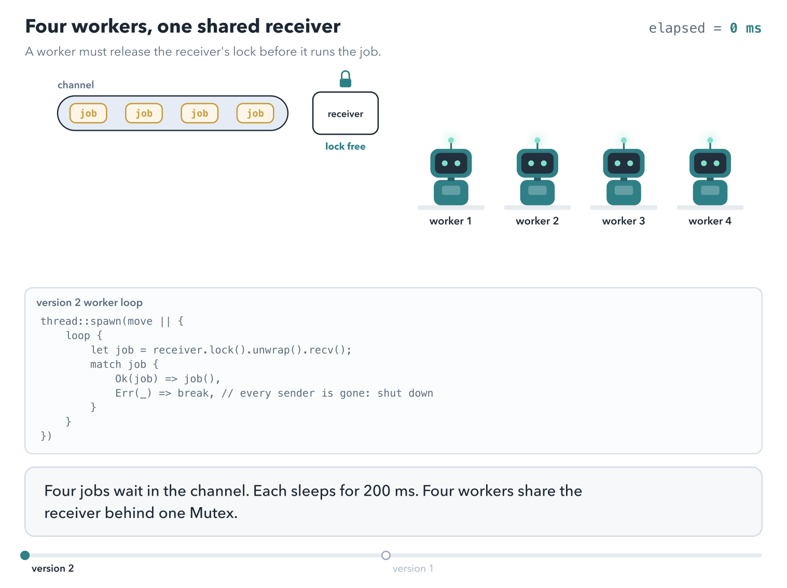
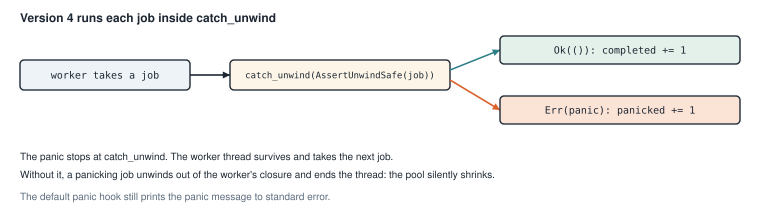
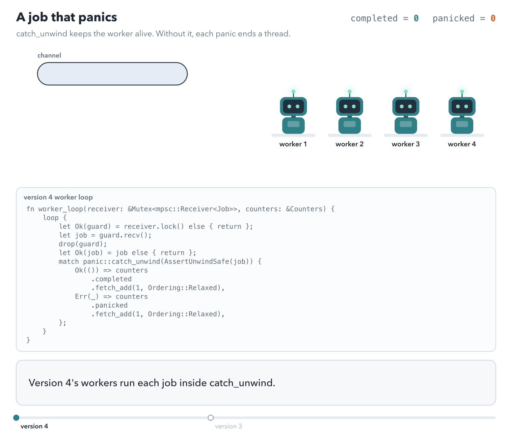
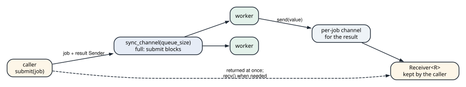
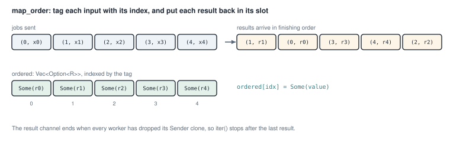

# Thread pools

<div class="covers" markdown="1">

This chapter covers

- A pool of worker threads that take jobs from a shared channel
- A measured bug: a lock held for too long turned four parallel jobs into a sequence
- Returning errors instead of panicking, and shutting down in `Drop`
- Keeping workers alive when a job panics, with `catch_unwind`
- A bounded job queue, results sent back through a channel, and many producers
- A parallel map that returns results in input order

</div>

Spawning an operating-system thread incurs measurable latency and memory overhead: the kernel must allocate a thread control block, map a call stack, and insert the thread into its scheduler queues. For workloads consisting of thousands of short-lived tasks, creating a dedicated thread per task spends more time in thread lifecycle management than in actual computation.

A **thread pool** amortizes that cost by spawning a fixed cohort of **worker** threads at startup and reusing them across tasks. Each worker dequeues a job from a shared work queue, executes it to completion, and blocks until the next job arrives. Structurally, a thread pool composes a concurrent work queue with a managed set of consumer threads.

The sections below evolve a thread pool through successive iterations, each addressing a concrete concurrency, lifecycle, or fault-isolation defect exposed by the previous design.

## 18.1 The parts of a pool

Every pool implementation in this chapter shares four structural components (figure 18.1).

<figure>

<figcaption><b>Figure 18.1</b> A job travels from <code>execute</code>, through a channel, to whichever worker takes it first.</figcaption>
</figure>

**The job type.** A job is any closure that the pool can invoke once on a worker thread:

```rust
type Job = Box<dyn FnOnce() + Send + 'static>;
```

Because each closure in Rust has a distinct, anonymous type, a homogeneous queue cannot store closures directly. Wrapping them in `Box<dyn FnOnce()>` erases the concrete type behind a heap-allocated trait object callable once with no arguments. The `Send` bound permits moving the closure across thread boundaries, and `'static` guarantees the closure borrows no short-lived stack data that could be invalidated before execution.

**The channel.** Calling `std::sync::mpsc::channel()` constructs a FIFO channel split into a `Sender` and a `Receiver`. The acronym `mpsc` denotes multiple producer, single consumer: the `Sender` can be cloned across submitting threads, whereas only a single `Receiver` exists.

**The shared receiver.** Because multiple workers must dequeue from the single `Receiver`, the pool wraps it in `Arc<Mutex<Receiver<Job>>>`. Each worker locks the mutex, calls `recv()` to claim the next job, and then executes that job.

**Shutdown.** Dropping every `Sender` closes the channel. After all buffered jobs have been drained, subsequent `recv()` calls return `Err`, signaling each worker to break out of its loop and terminate cleanly.

## 18.2 Version 1, and a measurable bug

The first implementation translates figure 18.1 directly into code: `new` spawns the workers, `execute` enqueues a job, and `join` closes the channel and joins every thread. Each worker locks the shared receiver to obtain work, and the exact lifetime of that lock guard determines whether jobs execute concurrently or serially.

The pool holds the channel's sending half alongside the worker `JoinHandle`s:

```rust
{{#include ../../rust-interview-lab/src/bin/thread_pool.rs:1:11}}
```

`new` creates the channel, wraps the receiver in `Arc<Mutex<_>>`, and spawns the workers:

```rust
{{#include ../../rust-interview-lab/src/bin/thread_pool.rs:13:30}}
    // ...
}
```

For each worker, `Arc::clone(&receiver)` produces a shared handle to the protected receiver, which `thread::spawn(move || ...)` moves into the worker thread. Each worker loops until `recv()` returns `Err`, and `collect()` gathers the resulting `JoinHandle`s into the `workers` vector.

Job submission and shutdown are implemented in two compact methods:

```rust
impl ThreadPool {
    // ...
{{#include ../../rust-interview-lab/src/bin/thread_pool.rs:32:41}}
}
```

`execute` enqueues a boxed job asynchronously without waiting for a worker to dequeue it. `join` consumes `self` by value, preventing further submissions after shutdown begins. Dropping `self.sender` closes the channel so that workers drain any remaining jobs, observe `Err` from `recv()`, and exit before `w.join()` reaps each thread.

In `main`, 10,000 printing jobs are submitted and joined:

```rust
{{#include ../../rust-interview-lab/src/bin/thread_pool.rs:44:51}}
```

<p class="listing"><b>Listing 18.1</b> The complete program. <a href="https://github.com/arpanpathak/cracking-the-systems-programming-interview/blob/prep-v2/rust-interview-lab/src/bin/thread_pool.rs">src/bin/thread_pool.rs</a></p>

```rust
{{#include ../../rust-interview-lab/src/bin/thread_pool.rs}}
```

Although this program prints all 10,000 lines, its worker loop harbors a severe concurrency defect:

```rust
while let Ok(job) = rx.lock().unwrap().recv() {
    job();
}
```

The expression `rx.lock().unwrap()` produces a temporary `MutexGuard`. Under Rust's temporary lifetime rules, temporaries created inside a `while let` scrutinee remain alive until the end of the entire loop body. Consequently, the worker retains the receiver mutex for the full duration of `job()`, blocking every other worker from calling `recv()`.

Running four 200 ms sleep jobs on a four-worker pool exposes the serialization immediately (figure 18.2).

<figure>

<figcaption><b>Figure 18.2</b> The same four jobs with each loop shape, release build.</figcaption>
</figure>

With the `while let` loop, the four jobs executed sequentially in 814 ms; releasing the lock before invoking `job()` allowed all four to overlap and finish in 205 ms. Despite allocating four worker threads, version 1 utilized only one thread at a time.

Animation 18.1 contrasts both executions, highlighting the mutex ownership across workers.

<figure class="anim">
<video class="motion" src="figures/ch18-pool-lock.mp4" autoplay loop muted playsinline preload="metadata" aria-label="A channel holding four jobs, a receiver with a padlock, and four worker robots. In version 2, worker 1 locks the receiver, takes job 1, and the lock is free again at once; workers 2, 3, and 4 do the same, and all four jobs run together, finishing at 205 ms. In version 1, worker 1 takes job 1 and keeps the lock while it runs; workers 2, 3, and 4 sleep waiting for the lock, and the jobs run one after another, finishing at 814 ms." data-chapters="[[0.0, &quot;version 2&quot;], [27.48, &quot;version 1&quot;]]"></video>
<figcaption><b>Animation 18.1</b> The same four 200 ms jobs. Released before the job, the lock lets all four run at once. Held through the job, it makes the workers take turns.</figcaption>
</figure>

Holding the guard across `job()` introduces a second failure mode: if a job panics, unwinding occurs while the mutex is locked, poisoning the receiver mutex. Piping version 1's output into `head` (which closes the pipe after five lines) causes `println!` to panic inside a job; that panic poisons the lock, causing the remaining three workers to panic on `.unwrap()` and `main` to panic when `send()` finds no surviving receivers.

## 18.3 Version 2: release the lock before the job

<p class="listing"><b>Listing 18.2</b> The pool type, the worker loop, and <code>execute</code> (lines 10 to 64). <a href="https://github.com/arpanpathak/cracking-the-systems-programming-interview/blob/prep-v2/rust-interview-lab/src/problems/thread_pool_v2.rs">src/problems/thread_pool_v2.rs</a></p>

```rust
{{#include ../../rust-interview-lab/src/problems/thread_pool_v2.rs:10:20}}

impl ThreadPool {
{{#include ../../rust-interview-lab/src/problems/thread_pool_v2.rs:23:64}}
}
```

As in version 1, `Job` aliases `Box<dyn FnOnce() + Send + 'static>`, and `ThreadPool` owns the job sender and worker handles.

Moving reception into its own statement, `let job = receiver.lock().unwrap().recv();`, resolves the lock-lifetime bug. Because temporary values in a `let` statement drop at the semicolon, the `MutexGuard` is released before the subsequent `match` invokes `job()`.

Version 2 also improves ergonomics by making `execute` generic over `F: FnOnce() + Send + 'static` and performing the heap allocation internally, allowing callers to write `pool.execute(|| ...)` instead of boxing closures manually.

<p class="listing"><b>Listing 18.3</b> The complete file, with tests. <a href="https://github.com/arpanpathak/cracking-the-systems-programming-interview/blob/prep-v2/rust-interview-lab/src/problems/thread_pool_v2.rs">src/problems/thread_pool_v2.rs</a></p>

```rust
{{#include ../../rust-interview-lab/src/problems/thread_pool_v2.rs}}
```

The `jobs_run_at_the_same_time` test verifies true parallelism deterministically without relying on wall-clock timings. It coordinates four jobs with a `std::sync::Barrier` of size four: each job blocks at `barrier.wait()` until all four arrive simultaneously. Under version 1's serialized loop, the first job would hold the lock while waiting on the barrier forever.

Wrapping result collection in `recv_timeout(Duration::from_secs(5))` ensures a regression fails cleanly after five seconds rather than deadlocking the test runner.

## 18.4 Version 3: errors, and shutdown on drop

Version 2 still panics in three cases: zero worker counts, failed channel sends, and poisoned locks. Furthermore, omitting an explicit `join()` call drops the pool without waiting for queued jobs to finish. Version 3 replaces panics with typed errors and guarantees graceful teardown in `Drop`.

<p class="listing"><b>Listing 18.4</b> The job type and the error type (lines 8 to 32). <a href="https://github.com/arpanpathak/cracking-the-systems-programming-interview/blob/prep-v2/rust-interview-lab/src/problems/thread_pool_v3.rs">src/problems/thread_pool_v3.rs</a></p>

```rust
{{#include ../../rust-interview-lab/src/problems/thread_pool_v3.rs:8:14}}

{{#include ../../rust-interview-lab/src/problems/thread_pool_v3.rs:16:32}}
```

`PoolError` enumerates the pool's failure modes and implements both `Display` and `std::error::Error` for compatibility with `?` and `Box<dyn Error>`.

<p class="listing"><b>Listing 18.5</b> The pool, <code>execute</code>, <code>shutdown</code>, and <code>Drop</code>.</p>

```rust
{{#include ../../rust-interview-lab/src/problems/thread_pool_v3.rs:34:38}}

impl ThreadPool {
    // ...
{{#include ../../rust-interview-lab/src/problems/thread_pool_v3.rs:63:82}}
}

{{#include ../../rust-interview-lab/src/problems/thread_pool_v3.rs:85:89}}
```

Wrapping the sender in `Option<Sender<Job>>` enables explicit closure: `shutdown` extracts and drops the sender via `self.sender.take()`, leaving `None` in its place. Subsequent calls to `execute` observe `None` and return `Err(PoolError::ShutDown)`.

Taking `&mut self` in `shutdown` rather than `self` permits `Drop::drop` to invoke it directly. `self.workers.drain(..)` removes and joins each handle once; calling `shutdown` a second time finds an empty vector and `None` sender, making teardown idempotent.

Because `Drop` delegates to `shutdown`, any `ThreadPool` leaving scope automatically closes its channel and waits for all queued jobs to complete.

<p class="listing"><b>Listing 18.6</b> The worker loop (lines 91 to 104).</p>

```rust
{{#include ../../rust-interview-lab/src/problems/thread_pool_v3.rs:91:104}}
```

Extracting the worker loop into a standalone function improves clarity. A `let ... else` guard exits cleanly if the mutex is poisoned, and an explicit `drop(guard)` releases the lock prior to executing the job.

<p class="listing"><b>Listing 18.7</b> The complete file, with tests. <a href="https://github.com/arpanpathak/cracking-the-systems-programming-interview/blob/prep-v2/rust-interview-lab/src/problems/thread_pool_v3.rs">src/problems/thread_pool_v3.rs</a></p>

```rust
{{#include ../../rust-interview-lab/src/problems/thread_pool_v3.rs}}
```

The `dropping_the_pool_finishes_queued_jobs` test constructs a pool inside an inner scope, enqueues 50 jobs, and asserts after the closing brace that all 50 jobs ran to completion.

## 18.5 Version 4: surviving a panicking job

Version 3 leaves one fault-isolation gap: an unhandled panic inside a job unwinds out of `worker_loop` and terminates that worker thread. Each panicking job permanently reduces the pool's capacity without notifying the caller; once every worker thread has terminated, queued jobs accumulate indefinitely.

Version 4 isolates job panics inside each worker (figure 18.3).

<figure>

<figcaption><b>Figure 18.3</b> A job's panic stops at <code>catch_unwind</code>, and the worker lives on.</figcaption>
</figure>

Animation 18.2 contrasts versions 3 and 4 under repeated job panics: version 4 records each failure while preserving the full worker cohort, whereas version 3 loses one thread per panic until no workers remain.

<figure class="anim">
<video class="motion" src="figures/ch18-pool-panic.mp4" autoplay loop muted playsinline preload="metadata" aria-label="Four worker robots, a channel, and counters for completed and panicked jobs. In version 4, each worker runs jobs inside catch_unwind; when worker 2's job panics, the panic is caught and counted, and all four workers keep taking jobs. In version 3, each panic ends its worker's thread, and the robot greys out; after four panics no worker is left, and jobs pile up in the channel while a clock runs." data-chapters="[[0.0, &quot;version 4&quot;], [14.04, &quot;version 3&quot;]]"></video>
<figcaption><b>Animation 18.2</b> With <code>catch_unwind</code>, a panic costs one job. Without it, each panic costs a worker, and the pool stalls once all are gone.</figcaption>
</figure>

<p class="listing"><b>Listing 18.8</b> The types and the worker loop. <a href="https://github.com/arpanpathak/cracking-the-systems-programming-interview/blob/prep-v2/rust-interview-lab/src/problems/thread_pool_v4.rs">src/problems/thread_pool_v4.rs</a></p>

```rust
{{#include ../../rust-interview-lab/src/problems/thread_pool_v4.rs:11:22}}

{{#include ../../rust-interview-lab/src/problems/thread_pool_v4.rs:24:70}}

{{#include ../../rust-interview-lab/src/problems/thread_pool_v4.rs:150:169}}
```

Version 4 extends version 3 with three additions:

- `PoolError::Spawn(io::Error)` captures operating-system thread creation failures and exposes the underlying `io::Error` through `Error::source`.
- `Counters` stores two atomic tallies (`completed` and `panicked`) shared between the pool and all workers via `Arc`.
- `Report` provides an immutable snapshot of those tallies returned by `shutdown`.

Calling `panic::catch_unwind(f)` executes `f` and intercepts unwinding panics, returning `Err` on panic and `Ok` on normal completion.

Because `catch_unwind` requires its argument to implement `UnwindSafe` (a marker trait indicating that observing captured state after a panic cannot violate invariants), a type-erased `Box<dyn FnOnce()>` does not qualify automatically. Wrapping the job in `AssertUnwindSafe(job)` asserts that the invariant holds because each job owns its captured environment and the worker loop never inspects partial state after a panic.

Depending on the `catch_unwind` result, the worker increments either `completed` or `panicked`.

<p class="listing"><b>Listing 18.9</b> Named workers (lines 73 to 105).</p>

```rust
impl ThreadPool {
{{#include ../../rust-interview-lab/src/problems/thread_pool_v4.rs:73:105}}
    // ...
}
```

Using `thread::Builder` assigns each worker a descriptive OS thread name (`pool-worker-0`, `pool-worker-1`, and so on) that surfaces in panic messages and debuggers. Unlike `thread::spawn`, which panics on OS resource exhaustion, `Builder::spawn` returns an `io::Result`.

Constructing `pool` before spawning workers ensures exception safety during initialization: if spawning the third worker fails, returning `Err(...)` drops the partially initialized `pool`, whose `Drop` implementation closes the channel and joins the two already-running threads so none leak.

<p class="listing"><b>Listing 18.10</b> <code>shutdown</code> and the report (lines 113 to 136).</p>

```rust
impl ThreadPool {
    // ...
{{#include ../../rust-interview-lab/src/problems/thread_pool_v4.rs:119:141}}
}

{{#include ../../rust-interview-lab/src/problems/thread_pool_v4.rs:144:148}}
```

`shutdown` consumes `self` by value, delegates teardown to `close_and_join`, and returns a `Report` summarizing completed and panicked jobs. When `shutdown` returns, `Drop` runs `close_and_join` a second time as a harmless no-op.

<p class="listing"><b>Listing 18.11</b> The complete file, with tests. <a href="https://github.com/arpanpathak/cracking-the-systems-programming-interview/blob/prep-v2/rust-interview-lab/src/problems/thread_pool_v4.rs">src/problems/thread_pool_v4.rs</a></p>

```rust
{{#include ../../rust-interview-lab/src/problems/thread_pool_v4.rs}}
```

The `a_panicking_job_does_not_kill_its_worker` test uses a single-worker pool where the first job panics and the second sends a confirmation value; if the panic killed the sole worker, `recv_timeout` would expire after five seconds.

The `spawn_errors_expose_their_source` test verifies that `Error::source` surfaces the underlying `io::Error` for structured error chains.

```text
$ cargo test --lib problems::thread_pool
running 12 tests
test problems::thread_pool_v3::tests::zero_workers_is_an_error ... ok
test problems::thread_pool_v3::tests::errors_render_a_message ... ok
test problems::thread_pool_v2::tests::zero_workers_is_rejected - should panic ... ok
test problems::thread_pool_v3::tests::execute_after_shutdown_is_an_error ... ok
test problems::thread_pool_v3::tests::dropping_the_pool_finishes_queued_jobs ... ok
test problems::thread_pool_v2::tests::runs_every_job ... ok
test problems::thread_pool_v4::tests::spawn_errors_expose_their_source ... ok
test problems::thread_pool_v2::tests::jobs_run_at_the_same_time ... ok
test problems::thread_pool_v4::tests::zero_workers_is_an_error ... ok
test problems::thread_pool_v4::tests::reports_completed_jobs ... ok
test problems::thread_pool_v4::tests::a_panicking_job_does_not_kill_its_worker ... ok
test problems::thread_pool_v4::tests::workers_are_named ... ok

test result: ok. 12 passed; 0 failed; 0 ignored; 0 measured; 125 filtered out
```

The filter `problems::thread_pool` runs the suites for versions 2, 3, and 4 together. By default, `cargo test` captures stdout and stderr for passing tests; passing `-- --nocapture` reveals the intentional panic message tagged with the worker name `pool-worker-0`.

## 18.6 Shorter pools

The next three standalone programs distill versions 2 and 3 into compact forms, each introducing one additional capability.

### 18.6.1 Shutdown in `Drop`, compactly

This minimal pool relies solely on `Drop` for lifecycle management, closing the channel and joining all workers automatically when the pool leaves scope.

As in version 3, wrapping the sender in `Option` allows `Drop` to close the channel by assigning `None`:

```rust
{{#include ../../rust-interview-lab/src/bin/thread_pool_bruce_lee.rs:6:11}}
```

<p class="listing"><b>Listing 18.12</b> The complete program. <a href="https://github.com/arpanpathak/cracking-the-systems-programming-interview/blob/prep-v2/rust-interview-lab/src/bin/thread_pool_bruce_lee.rs">src/bin/thread_pool_bruce_lee.rs</a></p>

```rust
{{#include ../../rust-interview-lab/src/bin/thread_pool_bruce_lee.rs}}
```

Overwriting `self.job_sender = None` drops the `Sender` in place, and each worker thread runs an inline `move || loop { ... }` closure. `main` submits eight jobs and exits; `Drop` blocks until all eight complete.

```text
$ cargo run --bin thread_pool_bruce_lee
task 0 on ThreadId(4)
task 4 on ThreadId(4)
task 5 on ThreadId(4)
task 6 on ThreadId(4)
task 7 on ThreadId(4)
task 1 on ThreadId(3)
task 2 on ThreadId(2)
task 3 on ThreadId(5)
```

In this run, one worker executed five of the eight tasks because printing a single line finishes quickly enough for an active thread to reclaim the mutex before sleeping threads are scheduled. Thread pools do not guarantee uniform task distribution across workers.

Because `Drop` invokes `worker.join().unwrap()`, a panicked worker would trigger a secondary panic during unwinding (potentially aborting the process). Later variants discard the join status with `let _ = worker.join();`.

### 18.6.2 A bounded queue and results

This variant introduces two capabilities: a bounded job queue that applies backpressure when workers fall behind, and a return channel delivering each job's output to the submitter.

Replacing `Sender` with `SyncSender` switches the pool to a fixed-capacity channel:

```rust
{{#include ../../rust-interview-lab/src/bin/thread_pool_with_back_pressure.rs:6:11}}
```

<p class="listing"><b>Listing 18.13</b> The complete program. <a href="https://github.com/arpanpathak/cracking-the-systems-programming-interview/blob/prep-v2/rust-interview-lab/src/bin/thread_pool_with_back_pressure.rs">src/bin/thread_pool_with_back_pressure.rs</a></p>

```rust
{{#include ../../rust-interview-lab/src/bin/thread_pool_with_back_pressure.rs}}
```

Comments tagged `changed` and `new` highlight the two extensions.

Calling `mpsc::sync_channel(queue_size)` bounds the channel to at most `queue_size` pending jobs. When the channel is full, `SyncSender::send` blocks the submitting thread, providing the backpressure mechanism of section 17.1 directly through the standard library.

The combined architecture, pairing a bounded submission queue with per-job result channels, is illustrated in figure 18.4.

<figure>

<figcaption><b>Figure 18.4</b> A bounded queue slows the caller down when the workers fall behind. Each job carries its own channel back to the caller.</figcaption>
</figure>

The `submit` method allocates a dedicated one-shot channel for each task, moves the result `Sender` into the worker closure, and returns the `Receiver` immediately so the caller can invoke `recv()` when the result is required. A handle representing a value that will resolve asynchronously is known as a **future**, the foundational abstraction underlying asynchronous runtimes.

```text
$ cargo run --bin thread_pool_with_back_pressure
0
1
4
9
16
25
36
49
```

Although tasks may complete in arbitrary order across workers, the output appears in ascending order because `main` calls `recv()` on the returned receivers sequentially.

### 18.6.3 Many producers

This variant allows multiple producer threads to submit jobs concurrently while distinguishing mutex poisoning from channel closure inside the worker loop.

`SharedLockedChannel` aliases `Arc<Mutex<Receiver<Job>>>`, while the pool stores an optional bounded `SyncSender` and the worker handles:

```rust
{{#include ../../rust-interview-lab/src/bin/mpmc_thread_pool_engine.rs:10:16}}
```

<p class="listing"><b>Listing 18.14</b> The complete program. <a href="https://github.com/arpanpathak/cracking-the-systems-programming-interview/blob/prep-v2/rust-interview-lab/src/bin/mpmc_thread_pool_engine.rs">src/bin/mpmc_thread_pool_engine.rs</a></p>

```rust
{{#include ../../rust-interview-lab/src/bin/mpmc_thread_pool_engine.rs}}
```

Its worker loop makes both exit conditions and lock release explicit:

```rust
let Ok(receiver) = rx.lock() else { break }; // mutex poisoned
let Ok(job) = receiver.recv() else { break }; // channel closed
drop(receiver); // release lock before running the job
job();
```

Each `let ... else` branch documents its specific termination condition, and `drop(receiver)` guarantees the mutex is released before `job()` executes.

`execute` returns `Result<(), SendError<Job>>`; if the pool has shut down, the error returns ownership of the rejected `Job` to the caller.

In `main`, three producer threads share the pool through an `Arc`, each submitting five jobs. When the final `Arc` reference drops at the end of `main`, `Drop` closes the channel and waits for all 15 jobs to finish.

```text
$ cargo run --bin mpmc_thread_pool_engine
producer 0, job 0
producer 0, job 3
producer 0, job 4
producer 1, job 1
producer 1, job 2
producer 0, job 1
producer 1, job 4
producer 2, job 0
producer 2, job 1
producer 2, job 2
producer 0, job 2
producer 2, job 4
producer 2, job 3
producer 1, job 3
producer 1, job 0
```

All 15 jobs complete with interleaved ordering, even within a single producer, because four workers execute tasks concurrently.

## 18.7 A parallel map that keeps order

The final design encapsulates a scoped pool inside a single function: `map_order` applies a transformation function across an input vector in parallel while returning outputs in exact input order.

Because concurrent workers complete tasks in nondeterministic order, `map_order` pairs each input with its original index and uses that index to place each result into its target slot (figure 18.5).

<figure>

<figcaption><b>Figure 18.5</b> The index travels with the job, and puts the result back in its slot.</figcaption>
</figure>

The function signature and channel setup establish the type bounds:

```rust
{{#include ../../rust-interview-lab/src/problems/worker_pool.rs:8:26}}
    // ...
}
```

Both the input type `T` and output type `R` cross thread boundaries and therefore require `Send + 'static`. Because `mapper` is shared across all workers via `Arc`, it requires `Fn(T) -> R + Send + Sync + 'static`; it uses `Fn` rather than `FnOnce` because each worker invokes it repeatedly.

Tasks travel through the job channel as `(usize, T)` pairs and return through the result channel as `(usize, R)` pairs, carrying the original sequence index.

Each worker clones handles to the mapper, the shared job receiver, and the result sender:

```rust
pub fn map_order<T, R, F>(worker_count: usize, inputs: Vec<T>, mapper: F) -> Vec<R>
where
    T: Send + 'static,
    R: Send + 'static,
    F: Fn(T) -> R + Send + Sync + 'static,
{
    // ...
{{#include ../../rust-interview-lab/src/problems/worker_pool.rs:28:50}}
    // ...
}
```

Receiving inside a dedicated block (`let job = { let guard = ...; guard.recv() };`) drops `guard` at the closing brace before invoking `mapper`, providing a third syntactic form of the lock-release fix from section 18.3. If sending the result fails because the caller dropped `result_rx`, the worker breaks out of its loop.

The caller dispatches all indexed inputs and drops its local senders:

```rust
pub fn map_order<T, R, F>(worker_count: usize, inputs: Vec<T>, mapper: F) -> Vec<R>
where
    T: Send + 'static,
    R: Send + 'static,
    F: Fn(T) -> R + Send + Sync + 'static,
{
    // ...
{{#include ../../rust-interview-lab/src/problems/worker_pool.rs:52:62}}
    // ...
}
```

`enumerate()` attaches each element's position. Dropping `job_tx` closes the job channel so workers exit once the queue drains, and dropping the caller's `result_tx` ensures that `result_rx.iter()` terminates as soon as the final worker exits and drops its clone.

Finally, results are reassembled in input order:

```rust
pub fn map_order<T, R, F>(worker_count: usize, inputs: Vec<T>, mapper: F) -> Vec<R>
where
    T: Send + 'static,
    R: Send + 'static,
    F: Fn(T) -> R + Send + Sync + 'static,
{
    // ...
{{#include ../../rust-interview-lab/src/problems/worker_pool.rs:64:85}}
}
```

Each returned `(index, value)` is placed into `ordered: Vec<Option<R>>`, grown dynamically via `resize_with` as needed. Once all workers finish, every slot contains `Some(value)` and is unwrapped into the final `Vec<R>`.

<p class="listing"><b>Listing 18.15</b> The complete file, with tests. <a href="https://github.com/arpanpathak/cracking-the-systems-programming-interview/blob/prep-v2/rust-interview-lab/src/problems/worker_pool.rs">src/problems/worker_pool.rs</a></p>

```rust
{{#include ../../rust-interview-lab/src/problems/worker_pool.rs}}
```

```text
$ cargo test --lib problems::worker_pool
running 2 tests
test problems::worker_pool::tests::one_worker_works ... ok
test problems::worker_pool::tests::maps_all_inputs_and_preserves_order ... ok

test result: ok. 2 passed; 0 failed; 0 ignored; 0 measured; 135 filtered out
```

## 18.8 The versions compared

<p class="listing"><b>Table 18.1</b> What each pool handles</p>

| Pool | Jobs run in parallel | Shutdown | Poisoned lock | Panicking job | Queue |
|---|---|---|---|---|---|
| v1 `thread_pool.rs` | no: lock held during job | `join(self)` | panics | poisons the lock | unbounded |
| v2 `thread_pool_v2.rs` | yes | `join(self)` | panics | kills the worker | unbounded |
| v3 `thread_pool_v3.rs` | yes | `Drop` | worker exits | kills the worker | unbounded |
| v4 `thread_pool_v4.rs` | yes | `Drop`, `Report` | worker exits | caught and counted | unbounded |
| `thread_pool_bruce_lee.rs` | yes | `Drop` | panics | kills the worker | unbounded |
| `thread_pool_with_back_pressure.rs` | yes | `Drop` | panics | kills the worker | bounded |
| `mpmc_thread_pool_engine.rs` | yes | `Drop` | worker exits | kills the worker | bounded |

<div class="summary" markdown="1">

## Summary

- A thread pool amortizes thread-creation overhead by reusing a fixed set of workers that pull `Box<dyn FnOnce() + Send + 'static>` jobs from an `Arc<Mutex<Receiver<Job>>>`.
- Placing `rx.lock().unwrap().recv()` directly in a `while let` condition extends the `MutexGuard` lifetime across the entire loop body, serializing four 200 ms jobs into 814 ms instead of 205 ms.
- Releasing the lock before executing the job (via a separate `let` statement, an inner block, or an explicit `drop(guard)`) restores full concurrency.
- Dropping the channel `Sender` signals workers to drain remaining tasks and exit; performing teardown inside `Drop` guarantees queued work completes when the pool leaves scope.
- Wrapping job execution in `panic::catch_unwind` with `AssertUnwindSafe` prevents a panicking task from terminating its worker thread.
- `mpsc::sync_channel` introduces bounded-queue backpressure, while per-job return channels deliver results back to callers.
- Tagging inputs with sequence indices allows a parallel map to reassemble out-of-order worker results in exact input order.

</div>

## Exercises

1. Add a test to `thread_pool_v2.rs` that measures four jobs sleeping 200 ms each, and asserts that they finish in
   under 400 ms.
2. Add `submit` from listing 18.13 to version 4, returning the job's result through a channel.
3. Make version 4's queue bounded with `sync_channel`, and add a `try_execute` method that returns the job instead
   of blocking when the queue is full.
4. Write `map_order` so that it returns `Result<Vec<R>, E>` for a mapper of type `Fn(T) -> Result<R, E>`, and stops
   sending jobs after the first error.
