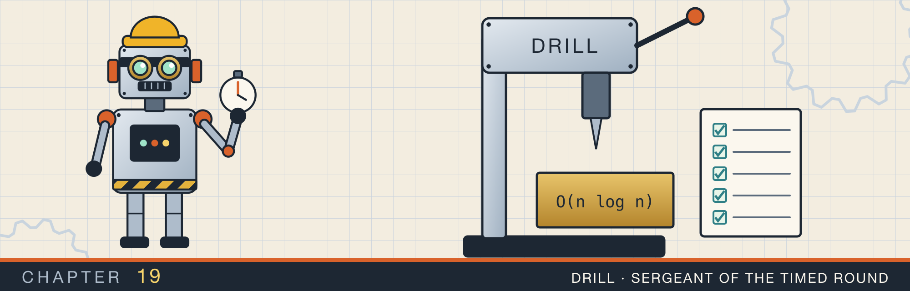
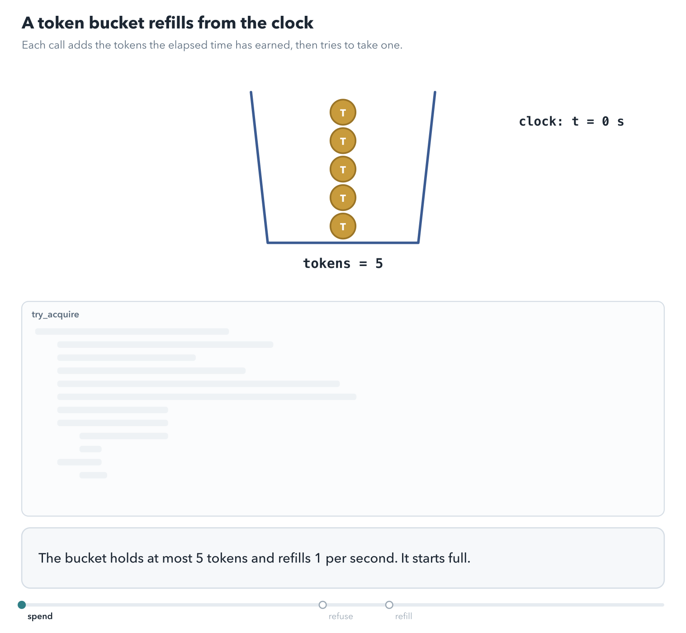
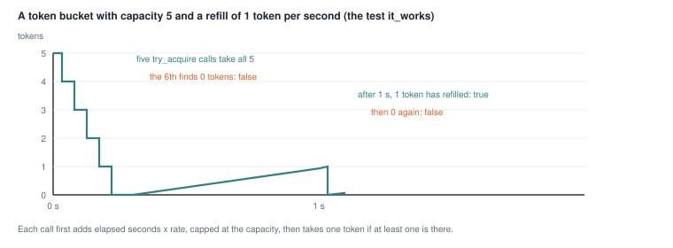
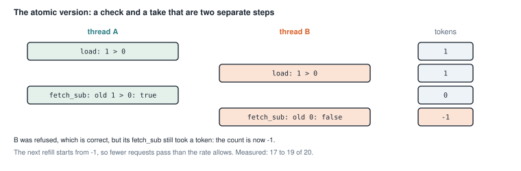
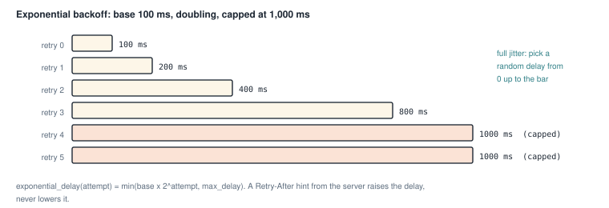
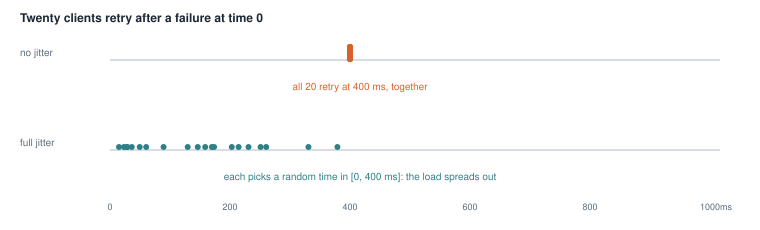
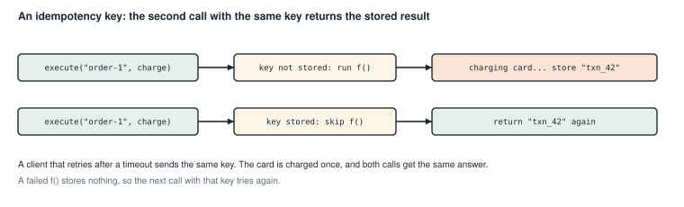
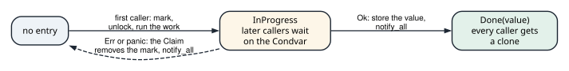
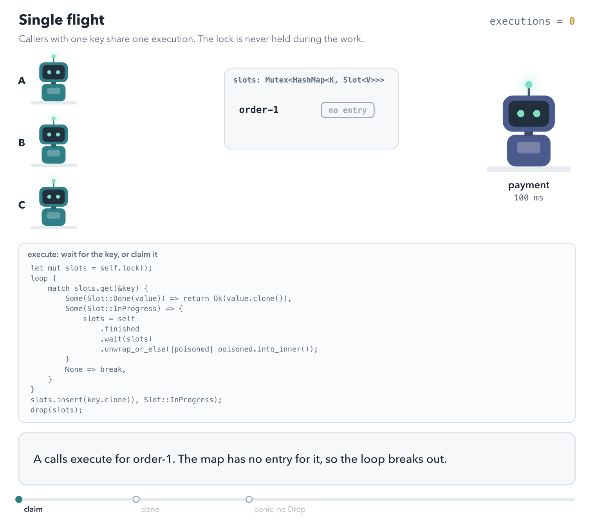

# Rate limits, retries, and idempotency

<div class="covers" markdown="1">

This chapter covers

- A token bucket that limits how often something may happen, with a lock and with atomics
- A measured flaw in the atomic version, and where it comes from
- Retrying failed calls with exponential backoff, jitter, and the server's `Retry-After`
- Deciding which errors to retry, with a trait
- Making a repeated request safe with an idempotency key
- Single flight: concurrent calls with one key share one execution, and other keys run in parallel

</div>

Processes communicating over a network encounter failure modes absent from local function calls: an overloaded server rejects incoming requests, a TCP connection drops mid-transfer, or a response times out without revealing whether the server committed the requested work.

Three complementary mechanisms address these failure modes:

- A **rate limiter** protects a service from overload by rejecting requests that exceed a configured budget.
- A **retry** policy re-attempts transient failures while increasing the delay after each failed attempt.
- An **idempotency key** ensures that delivering the same logical request multiple times produces the same effect as delivering it once.

These three primitives reinforce one another: retrying clients must back off to avoid overwhelming a recovering server, and the server must deduplicate retries so side effects such as billing charges are never applied twice.

## 19.1 A token bucket

Consider a service enforcing a limit of 5 requests per second per client. A fixed-window counter that resets at every whole-second boundary permits a client to issue 5 requests at 0.99 s and 5 more at 1.01 s, producing a burst of 10 requests within 20 ms. A **token bucket** smooths out these boundary spikes.

In a token bucket, a virtual container holds up to a fixed maximum of tokens (for example, 5). Each admitted request removes one token; if the bucket is empty, the request is rejected. Tokens replenish at a steady rate, such as 1 token per second, capped at the bucket's capacity (figure 19.1).

<figure class="anim">
<video class="motion" src="figures/ch19-token-bucket.mp4" autoplay loop muted playsinline preload="metadata" aria-label="A bucket that holds 5 tokens and refills 1 per second. Five calls at time 0 take the five tokens. The sixth call returns false. One second passes with nothing running; the next call adds the token that second earned and takes it. Last, without the cap on the refill, an hour idle adds 3,600 tokens and lets 3,600 calls through at once." data-chapters="[[0.0, &quot;spend&quot;], [28.5, &quot;refuse&quot;], [34.8, &quot;refill&quot;], [56.28, &quot;no cap&quot;]]"></video>
<figcaption><b>Animation 19.1</b> <code>try_acquire</code> adds the tokens earned since the last call, then takes one if it can. Nothing runs between calls.</figcaption>
</figure>


<figure>

<figcaption><b>Figure 19.1</b> The bucket in the test <code>it_works</code>: capacity 5, refill 1 token per second.</figcaption>
</figure>

Two parameters characterize the limiter: **capacity** defines the maximum burst size permitted instantaneously, and **rate** defines the sustained long-run request rate per second.

No background timer thread is needed to replenish tokens. Instead, each incoming call computes the elapsed time since the previous call, credits the accrued tokens lazily, and then checks whether at least one token is available.

### 19.1.1 The bucket behind a lock

<p class="listing"><b>Listing 19.1</b> The bucket (lines 6 to 31). <a href="https://github.com/arpanpathak/cracking-the-systems-programming-interview/blob/prep-v2/rust-interview-lab/src/problems/rate_limiter.rs">src/problems/rate_limiter.rs</a></p>

```rust
{{#include ../../rust-interview-lab/src/problems/rate_limiter.rs:3:3}}

{{#include ../../rust-interview-lab/src/problems/rate_limiter.rs:5:16}}

impl TokenBucket {
{{#include ../../rust-interview-lab/src/problems/rate_limiter.rs:19:30}}
    // ...
}
```

Because `capacity` and `rate` are immutable after construction, they sit outside the lock. The mutable token balance and last-refill timestamp reside in `BucketState` behind a `Mutex`. Storing tokens as `f64` preserves fractional accruals between closely spaced requests, and the bucket initializes full.

Using `std::time::Instant` rather than `SystemTime` guarantees a monotonic clock immune to wall-clock adjustments such as NTP corrections.

<p class="listing"><b>Listing 19.2</b> <code>try_acquire</code> (lines 32 to 49).</p>

```rust
impl TokenBucket {
    // ...
{{#include ../../rust-interview-lab/src/problems/rate_limiter.rs:32:49}}
}
```

`try_acquire` executes the refill and consumption atomically under the mutex:

1. Compute the elapsed `Duration` since `s.last_refill`.
2. Convert that duration to fractional seconds and multiply by `self.refill_rate` to obtain accrued tokens.
3. Add the accrued tokens to the balance, clamping at `self.capacity` via `.min(self.capacity)`.
4. Advance `s.last_refill` to `now`.
5. If `s.tokens >= 1.0`, subtract one token and return `true`; otherwise return `false`.

Tracing the unit test confirms this behavior: the bucket initializes with 5 tokens, five rapid calls consume all five within microseconds (accruing negligible fractional tokens), and the sixth call observes roughly 0.00001 tokens and returns `false`. After sleeping one second, the balance rises to approximately 1.00001 tokens, admitting one additional call before rejecting the next.

<p class="listing"><b>Listing 19.3</b> The complete file, with its test. <a href="https://github.com/arpanpathak/cracking-the-systems-programming-interview/blob/prep-v2/rust-interview-lab/src/problems/rate_limiter.rs">src/problems/rate_limiter.rs</a></p>

```rust
{{#include ../../rust-interview-lab/src/problems/rate_limiter.rs}}
```

```text
$ cargo test --lib problems::rate_limiter
running 1 test
test problems::rate_limiter::tests::it_works ... ok

test result: ok. 1 passed; 0 failed; 0 ignored; 0 measured; 136 filtered out; finished in 1.00s
```

Because the test invokes `thread::sleep`, it takes one full second to run and remains vulnerable to scheduling jitter on heavily loaded machines. Exercise 1 eliminates this clock dependency by injecting `Instant` as an explicit parameter.

### 19.1.2 The bucket with atomics

Acquiring a single mutex on every request can become a contention bottleneck under high concurrency, mirroring the single-lock map contention examined in section 14.1. The second implementation attempts to replace the mutex with atomic integers.

<p class="listing"><b>Listing 19.4</b> The limiter (lines 5 to 37). <a href="https://github.com/arpanpathak/cracking-the-systems-programming-interview/blob/prep-v2/rust-interview-lab/src/bin/rate_limiter_atomic_token_bucket.rs">src/bin/rate_limiter_atomic_token_bucket.rs</a></p>

```rust
{{#include ../../rust-interview-lab/src/bin/rate_limiter_atomic_token_bucket.rs:1:5}}

{{#include ../../rust-interview-lab/src/bin/rate_limiter_atomic_token_bucket.rs:7:14}}

impl RateLimiter {
{{#include ../../rust-interview-lab/src/bin/rate_limiter_atomic_token_bucket.rs:17:43}}
}
```

This implementation differs from the locked design in three respects:

- Tokens are stored as whole integers in an `AtomicI64`, and elapsed time is tracked in whole seconds since construction, causing tokens to replenish in discrete one-second steps rather than continuously.
- `last_refilled_at.fetch_max(now, Relaxed)` atomically updates the timestamp and returns the previous value. When multiple threads enter a new second simultaneously, only the first thread observes an earlier second and performs the refill.
- `#[repr(align(64))]` aligns the struct to a 64-byte cache line boundary to prevent false sharing with adjacent data (section 15.4).

After refilling, `try_acquire` loads the token count, returns `false` if it is non-positive, and otherwise decrements with `fetch_sub(1)`, returning `true` when the prior count was positive.

<p class="listing"><b>Listing 19.5</b> The complete program. <a href="https://github.com/arpanpathak/cracking-the-systems-programming-interview/blob/prep-v2/rust-interview-lab/src/bin/rate_limiter_atomic_token_bucket.rs">src/bin/rate_limiter_atomic_token_bucket.rs</a></p>

```rust
{{#include ../../rust-interview-lab/src/bin/rate_limiter_atomic_token_bucket.rs}}
```

```text
$ cargo run --bin rate_limiter_atomic_token_bucket
request 1: true
request 2: true
request 3: true
request 4: true
request 5: true
request 6: false
request 1: true
request 2: true
request 3: true
request 4: true
request 5: true
request 6: false
```

Under single-threaded execution, the behavior matches specification: five requests succeed, the sixth is rejected, and five more succeed after one second.

### 19.1.3 What happens with many threads

Although each individual atomic instruction is race-free, `try_acquire` composes multiple separate atomic operations without a combined transaction, allowing concurrent threads to interleave between them (figure 19.2).

<figure>

<figcaption><b>Figure 19.2</b> Both threads pass the check before either takes the token.</figcaption>
</figure>

In this interleaving, Thread B is properly rejected, yet its `fetch_sub(1)` still decrements the counter to `-1`. When the next refill adds tokens to that negative balance, the limiter admits fewer requests than its configured rate. Running 8 threads in a tight `try_acquire` loop for 3.5 seconds against a limiter of capacity 5 and rate 5 (which should admit exactly 20 requests: 5 initially plus 5 per elapsed second) admitted only 18, 19, and 17 requests across three trials, terminating with token balances of 0, −1, and −1.

A second race window operates in the opposite direction: because refilling executes `fetch_add` followed by a separate `fetch_min`, a competing thread arriving between the two instructions can consume tokens above `capacity` before the cap takes effect, permitting bursts larger than the configured limit.

Both races vanish when refill, availability check, and decrement are fused into a single atomic compare-and-swap transition using a `compare_exchange` loop that reads the current state, computes the capped next state locally, and commits only if no other thread modified the word in the interim (Exercise 2).

## 19.2 Retrying failed calls

Many distributed failures are transient: a backend restarts, a switch drops a packet, or a downstream dependency experiences a brief traffic spike. Re-issuing the request after a short pause frequently succeeds.

An effective retry mechanism must answer three questions:

1. **Which errors are retryable.** Client errors such as "not found" will fail deterministically on repeat attempts, whereas "server busy" errors may clear.
2. **How long to wait between attempts.** Increasing the delay after consecutive failures gives an overloaded service room to recover.
3. **When to stop.** Bounding the total number of attempts prevents indefinite blocking and surfaces persistent outages to the caller.

### 19.2.1 Which errors to retry

The retry engine operates against `ApiError` (introduced in section 7.7), where each variant encodes a distinct failure mode and its associated metadata:

```rust
{{#include ../../rust-interview-lab/src/problems/state_machine.rs:58:78}}
    // ...
}
```

- `InvalidRequest` and `NotFound` indicate defective or missing targets; retrying yields the same failure.
- `Unauthorized` requires refreshed credentials rather than a repeat attempt.
- `RateLimited` indicates server-side throttling and carries the server's requested wait duration.
- `Server` represents a server-side failure carrying an HTTP status code.

The inherent `is_retryable` method uses `matches!` to classify `RateLimited` and 5xx `Server` status codes (500 through 599) as retryable.

To decouple the retry engine from `ApiError`, the classification contract is abstracted into a trait:

<p class="listing"><b>Listing 19.6</b> The <code>Retryable</code> trait (lines 22 to 44). <a href="https://github.com/arpanpathak/cracking-the-systems-programming-interview/blob/prep-v2/rust-interview-lab/src/problems/retry.rs">src/problems/retry.rs</a></p>

```rust
{{#include ../../rust-interview-lab/src/problems/retry.rs:18:20}}

{{#include ../../rust-interview-lab/src/problems/retry.rs:22:44}}
```

Every implementing error type must define `is_retryable`, whereas `retry_after` supplies a default implementation returning `None` for error types that carry no server-supplied wait hint.

For `ApiError`, `Retryable::is_retryable` delegates to the inherent method via the fully qualified path `ApiError::is_retryable(self)` (avoiding infinite recursion on the identically named trait method), while `retry_after` extracts the duration carried by `RateLimited`, typically parsed from an HTTP `Retry-After` response header.

### 19.2.2 How long to wait

Using a constant retry interval creates a synchronization hazard: if a server outage causes hundreds of clients to fail simultaneously, a fixed delay causes all of them to retry in lockstep, striking the recovering service with a synchronized spike known as a **thundering herd**.

Two techniques break that synchronization:

- **Exponential backoff** doubles the delay after each consecutive failure (100 ms, 200 ms, 400 ms, and so forth) up to an upper bound (figure 19.3), reducing load rapidly during prolonged outages.
- **Jitter** introduces randomness into the wait interval so clients that failed simultaneously scatter their retries over time (figure 19.4). **Full jitter** selects a uniform random delay between `0` and the computed exponential backoff.

<figure>

<figcaption><b>Figure 19.3</b> The delays from the test <code>exponential_backoff_doubles_until_capped</code>.</figcaption>
</figure>

<figure>

<figcaption><b>Figure 19.4</b> The same twenty retries, without and with full jitter.</figcaption>
</figure>

<p class="listing"><b>Listing 19.7</b> The policy (lines 46 to 102).</p>

```rust
{{#include ../../rust-interview-lab/src/problems/retry.rs:46:102}}
```

`RetryPolicy` bundles the four configuration parameters; `max_attempts` includes the initial call, so a value of 3 permits one initial call and two retries.

`exponential_delay` computes `base * 2^attempt` while guarding against arithmetic overflow in three steps:

- `attempt.min(31)` constrains the left-shift `1u32 << shift` to valid 32-bit shift widths.
- `Duration::saturating_mul` clamps overflow to `Duration::MAX` rather than panicking.
- `.min(self.max_delay)` enforces the configured ceiling.

`delay_for` applies full jitter by scaling the exponential delay with a caller-provided floating-point sample in `[0.0, 1.0)`, clamped with `.clamp(0.0, 1.0)` against out-of-range inputs.

### 19.2.3 The retry loop

<p class="listing"><b>Listing 19.8</b> <code>retry</code> (lines 104 to 137).</p>

```rust
{{#include ../../rust-interview-lab/src/problems/retry.rs:104:137}}
```

The generic `retry` function parameterizes over four types: result `T`, error `E: Retryable`, operation closure `F: FnMut(u32) -> Result<T, E>`, and random source `R: FnMut() -> f64`. Requiring `FnMut` rather than `FnOnce` allows repeated invocation and mutable captured state, such as attempt counters in tests.

When an attempt returns `Err`, the loop immediately returns the error if attempts are exhausted or `!error.is_retryable()`. Otherwise, it computes its jittered backoff and merges any server-supplied hint:

```rust
let delay = error.retry_after().map_or(backoff, |hint| hint.max(backoff));
```

`Option::map_or` yields `backoff` when no hint is present and `hint.max(backoff)` when one is, treating the server's `Retry-After` as a lower bound so the client respects both server guidance and its own backoff curve.

Calling `std::thread::sleep(delay)` blocks the OS thread for the wait interval; in asynchronous runtimes (Chapter 22), this becomes a non-blocking timer await so the executor can poll other tasks.

**Injecting randomness.** Accepting `unit_random` as a closure parameter is an instance of **dependency injection**: production callers supply a real PRNG, whereas unit tests supply deterministic stubs such as `|| 0.0`, keeping tests fast and reproducible without global mutable state.

<p class="listing"><b>Listing 19.9</b> The complete file, with tests. <a href="https://github.com/arpanpathak/cracking-the-systems-programming-interview/blob/prep-v2/rust-interview-lab/src/problems/retry.rs">src/problems/retry.rs</a></p>

```rust
{{#include ../../rust-interview-lab/src/problems/retry.rs}}
```

The unit tests configure zero-duration delays so the entire suite executes instantaneously, verifying retry convergence on transient 503 responses (`retries_then_succeeds`) and immediate termination on non-retryable `NotFound` errors (`non_retryable_errors_return_immediately`).

```text
$ cargo test --lib problems::retry
running 6 tests
test problems::retry::tests::full_jitter_scales_the_delay ... ok
test problems::retry::tests::exponential_backoff_doubles_until_capped ... ok
test problems::retry::tests::retry_after_is_honored_as_a_floor ... ok
test problems::retry::tests::non_retryable_errors_return_immediately ... ok
test problems::retry::tests::exhausted_policy_returns_the_last_error ... ok
test problems::retry::tests::retries_then_succeeds ... ok

test result: ok. 6 passed; 0 failed; 0 ignored; 0 measured; 131 filtered out
```

## 19.3 Idempotency keys

Retries introduce a classic ambiguity: if a client submits a payment charge and the response is lost in transit, the client cannot determine whether the charge succeeded. Blindly retrying risks charging the customer twice.

An operation is **idempotent** when executing it multiple times leaves the system in the same state as executing it once. Read queries are naturally idempotent; mutating side effects such as billing charges require explicit server-side protection.

The standard mechanism is an **idempotency key**: the client attaches a unique identifier (such as an order ID) to every attempt of a logical request. The server caches the outcome under that key and returns the recorded result on duplicate arrivals without re-executing the side effect (figure 19.5).

<figure>

<figcaption><b>Figure 19.5</b> Two calls with one key. The work runs once.</figcaption>
</figure>

The in-memory store guards a `HashMap` of completed results behind a `Mutex` for concurrent access:

```rust
{{#include ../../rust-interview-lab/src/bin/idempotent_operation.rs:1:5}}
```

<p class="listing"><b>Listing 19.10</b> The complete program. <a href="https://github.com/arpanpathak/cracking-the-systems-programming-interview/blob/prep-v2/rust-interview-lab/src/bin/idempotent_operation.rs">src/bin/idempotent_operation.rs</a></p>

```rust
{{#include ../../rust-interview-lab/src/bin/idempotent_operation.rs}}
```

`Idempotent<K, V>::execute` coordinates lookup and execution in four steps:

1. Acquire the mutex, converting a `PoisonError` via `map_err(|_| "lock poisoned")?` into a boxed `dyn Error`.
2. If `key` already exists in the map, return a clone of the cached value.
3. Otherwise invoke `f()`; if `f` returns an error, `?` propagates it without inserting into the map so subsequent retries can re-attempt the work.
4. Insert a clone of the successful result into the map and return it.

In `main`, `charge` is passed twice under the same key. Because the closure captures no variables, it implements `Copy` and executes only once:

```text
$ cargo run --bin idempotent_operation
charging card...
```

A second variant introduces the type alias `type RuntimeError = Box<dyn std::error::Error>;` to simplify method signatures:

<p class="listing"><b>Listing 19.11</b> The complete program. <a href="https://github.com/arpanpathak/cracking-the-systems-programming-interview/blob/prep-v2/rust-interview-lab/src/bin/idempotent_operation_with_error_progagation.rs">src/bin/idempotent_operation_with_error_progagation.rs</a></p>

```rust
{{#include ../../rust-interview-lab/src/bin/idempotent_operation_with_error_progagation.rs}}
```

```text
$ cargo run --bin idempotent_operation_with_error_progagation
charging card...
```

Retaining the mutex across `f()` prevents two concurrent calls with the same key from both missing the cache and executing twice, yet it severely restricts scalability: every key contends on the same lock, so one slow payment stalls unrelated orders. Section 19.4 removes this bottleneck, while production services additionally persist idempotency records in durable storage so they survive process restarts.

## 19.4 One execution per key: single flight

Under concurrent load, the single-lock idempotency store exhibits two opposing constraints:

- **Global serialization.** Holding one mutex across `f()` blocks unrelated keys (`order-2`) behind slow operations (`order-1`).
- **Duplicate execution on lock release.** Releasing the mutex before invoking `f()` without coordination allows two simultaneous callers for the same key to both observe a cache miss and charge the card twice.

Caching layers encounter the identical failure mode when a hot entry expires and hundreds of concurrent misses flood the backing database simultaneously, a phenomenon known as a **cache stampede** (a per-key thundering herd).

The **single flight** pattern resolves both constraints by tracking **in-progress** keys explicitly. The first caller for a key inserts an `InProgress` sentinel under the lock, releases the lock, and performs the work. Concurrent callers arriving for the same key observe `InProgress` and wait on a condition variable for the outcome, while callers targeting distinct keys proceed concurrently without waiting.

Each key transitions through three states (figure 19.6): completion publishes `Done(value)` for all waiters and future callers, whereas an error or panic removes the sentinel so a subsequent caller can retry.

<figure>

<figcaption><b>Figure 19.6</b> The states of one key. Only the first caller runs the work. A failure returns the key to no entry, so a retry runs it again.</figcaption>
</figure>

### 19.4.1 The state

A single mutex guards the `HashMap<K, Slot<V>>`, paired with a `Condvar` that wakes waiting threads upon state transitions:

```rust
{{#include ../../rust-interview-lab/src/bin/single_flight.rs:11:38}}
```

Because the mutex is held strictly for brief map lookups and updates, never during I/O or computation, one lock scales across distinct keys. Calling `notify_all()` wakes all waiting callers regardless of key; each re-checks its own key and resumes sleeping if unchanged, trading minor spurious wakeups for a compact single-`Condvar` design.

### 19.4.2 The claim

The caller executing the work holds an RAII **claim** on its key. If the work returns an error or unwinds from a panic, the `InProgress` sentinel must be removed so waiting callers do not block indefinitely; implementing `Drop` on the claim handles both exit paths uniformly:

```rust
{{#include ../../rust-interview-lab/src/bin/single_flight.rs:40:65}}
```

Storing `key` inside an `Option` allows the success path to disarm the guard via `take()` before dropping it. On an error or panic, `key` remains `Some`, causing `Drop` to remove the `InProgress` entry and call `notify_all()`.

The helper `lock` recovers poisoned mutexes via `PoisonError::into_inner` (section 16.6); because every map mutation is a single `insert` or `remove`, the map itself remains structurally consistent after a panic.

### 19.4.3 `execute`

`execute` loops while the key is in progress, claims ownership when absent, runs `work()` outside the lock, and publishes the result:

```rust
{{#include ../../rust-interview-lab/src/bin/single_flight.rs:67:116}}
```

The lookup loop handles all three slot states:

- `Some(Slot::Done(value))`: return a clone immediately (matching section 19.3).
- `Some(Slot::InProgress)`: block on `Condvar::wait`, releasing the lock while sleeping and re-checking the slot upon wakeup in case the notification targeted a different key or was spurious.
- `None`: exit the loop and insert `Slot::InProgress`.

After claiming the key, `drop(slots)` releases the mutex prior to running `work()`. If `work()` returns `Err`, `?` returns early and `Claim::drop` clears the sentinel. If `work()` returns `Ok`, the caller disarms the claim, stores `Slot::Done(value)`, and wakes all waiters.

### 19.4.4 Measured

In `main`, a `Barrier` synchronizes concurrent callers so they contend simultaneously, measuring execution counts and wall-clock latency:

```rust
{{#include ../../rust-interview-lab/src/bin/single_flight.rs:118:139}}
```

Each simulated charge sleeps 100 ms and increments an execution counter. The second scenario compares single flight against a single-lock store holding its mutex across the work.

```text
1. Eight concurrent calls with one key
  executions 1, all got txn-order-1: true, 103 ms

2. Four concurrent calls with four keys
  single flight:                 executions 4, 103 ms
  one lock held during the work: executions 4, 417 ms

3. A failure is not stored
  first: Err("card declined"), retry: Ok("txn-order-5"), executions 1
```

Eight concurrent callers for one key triggered a single execution and all received `txn-order-1` in 103 ms. Four distinct keys executed in parallel under single flight in 103 ms, compared with 417 ms when serialized behind one lock. A declined charge was left uncached, allowing the subsequent retry to execute and succeed.

The fourth scenario induces a panic inside the active worker while a second caller waits on the same key:

```text
4. The work panics while another caller waits

thread '<unnamed>' panicked at src/bin/single_flight.rs:209:21:
payment provider crashed
  caller 0: Err("panicked")
  caller 1: Ok(Ok("txn-order-6"))
```

When caller 0 panics, stack unwinding runs `Claim::drop`, removing the `InProgress` sentinel and waking caller 1, which then claims the key and completes the charge. Without `Claim::drop`, the sentinel would remain stuck in `InProgress` and caller 1 would block forever (Animation 19.2).

<figure class="anim">
<video class="motion" src="figures/ch19-single-flight.mp4" autoplay loop muted playsinline preload="metadata" aria-label="Three caller robots, A, B, and C, a slot map with an entry for order-1, and a payment service. A finds no entry, marks order-1 InProgress, releases the lock, and calls the service. B and C find InProgress and sleep on the Condvar. The charge returns txn-order-1; A stores Done and calls notify_all; B and C wake and each take a clone, with one execution counted. In a second run without the claim's Drop, A's work panics, the mark stays InProgress, and B and C sleep while a clock runs." data-chapters="[[0.0, &quot;claim&quot;], [13.67, &quot;done&quot;], [26.82, &quot;panic, no Drop&quot;]]"></video>
<figcaption><b>Animation 19.2</b> One key, three callers, one execution. When the claim's <code>Drop</code> is missing, a panic leaves the mark in place and the waiters sleep forever.</figcaption>
</figure>

Production single-flight stores add two safeguards: waiter deadlines via `Condvar::wait_timeout` so a stalled upstream call cannot block waiters indefinitely, and TTL-based cache eviction so the map does not grow without bound.

<p class="listing"><b>Listing 19.12</b> Single flight: one execution per key in flight. <a href="https://github.com/arpanpathak/cracking-the-systems-programming-interview/blob/prep-v2/rust-interview-lab/src/bin/single_flight.rs">src/bin/single_flight.rs</a></p>

```rust
{{#include ../../rust-interview-lab/src/bin/single_flight.rs}}
```

<div class="summary" markdown="1">

## Summary

- A token bucket caps burst size at its capacity and sustained throughput at its refill rate, computing accrued tokens lazily from elapsed monotonic time on each call.
- A mutex-guarded token bucket is straightforward and race-free; splitting refill, check, and decrement across separate atomic operations allows the balance to go negative under contention, admitting 17 to 19 requests across 8 threads where 20 were due.
- Only transient failures should be retried; a `Retryable` trait lets each error type classify retryability and expose server `Retry-After` hints.
- Exponential backoff with full jitter spreads client retries across time to prevent thundering herds, treating `Retry-After` as a lower bound on delay.
- Injecting the random source as a closure keeps retry logic deterministic and testable.
- Idempotency keys prevent duplicate side effects by caching results per logical request key and returning cached outcomes on repeat delivery.
- Single flight deduplicates concurrent work per key while allowing distinct keys to run in parallel (103 ms versus 417 ms behind a single lock), using an RAII claim guard to clear `InProgress` state on error or panic.

</div>

In Chapter 20, the stack descends to the network layer itself, examining IPv4 addressing, TCP flow windows, and blocking versus event-driven echo servers.

## Exercises

1. Change `TokenBucket::try_acquire` to take the current time as an argument, `try_acquire_at(&self, now: Instant)`.
   Rewrite the test without `thread::sleep`.
2. Rewrite the atomic limiter's `try_acquire` with a `compare_exchange` loop that refills, checks, and takes a
   token in one atomic step. Run the 8-thread test from section 19.1.3 on it.
3. Add a `max_elapsed: Duration` to `RetryPolicy`, and make `retry` stop when the total time spent would pass it.
4. Add a deadline to `SingleFlight::execute`: a caller that waits longer than a given `Duration` for a key
   in progress returns an error. Use `Condvar::wait_timeout`, and keep the remaining time across spurious wakeups.
