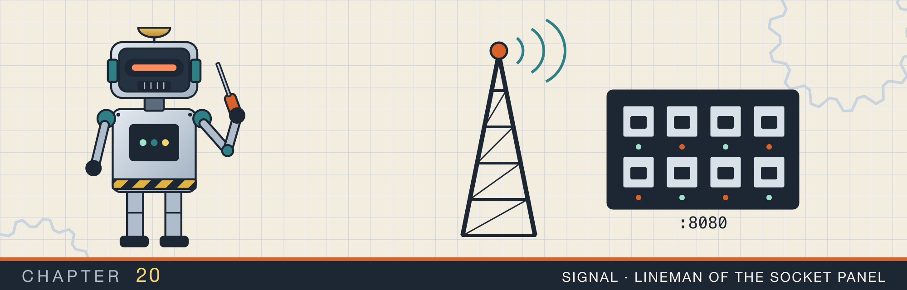
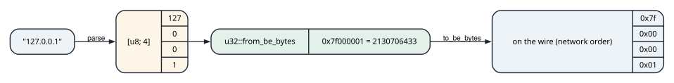
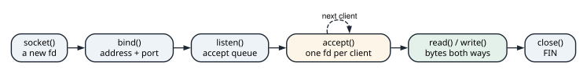
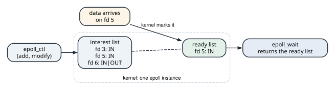
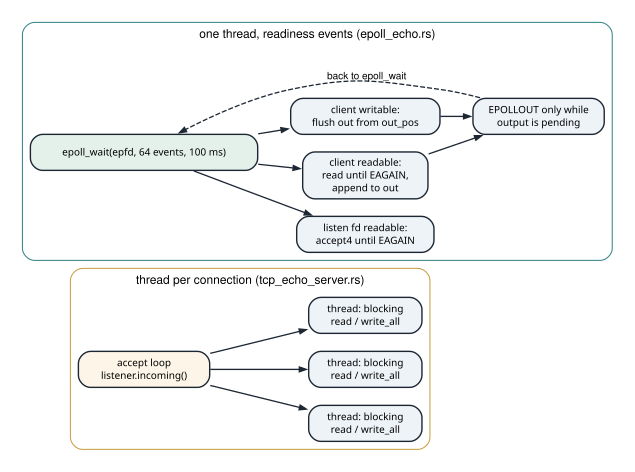

# Addresses, windows, and echo servers

<div class="covers" markdown="1">

This chapter covers

- Parsing IPv4 addresses with `??`, matching private ranges with slice patterns, and byte order
- The effective TCP window and the bandwidth-delay product
- A thread-per-connection echo server and the TCP lifecycle it walks through
- An epoll echo server over raw `libc` calls: non-blocking sockets, `EAGAIN`, and write buffers
- Where each model breaks, and what a production server adds

</div>

The sections below work upward through the network stack from addressing to server concurrency models. Section 20.1 covers IPv4 addresses, private subnets, and wire byte order. Section 20.2 analyzes TCP's in-flight window and how the bandwidth-delay product constrains throughput over high-latency links. Sections 20.3 and 20.4 construct two TCP echo servers: a thread-per-connection server built on `std::net` and a single-threaded non-blocking `epoll` server built directly over `libc` so every kernel system call remains explicit.

## 20.1 IPv4 addresses

An **IPv4 address** identifies a network interface on a host using a 32-bit unsigned integer. Human-readable dotted-decimal notation writes those four bytes individually, such as `10.0.0.1`, where each 8-bit component is an **octet** ranging from 0 to 255.

Because multiple processes share a single host, a transport connection pairs the IP address with a 16-bit **port** number to identify the target application. Together, an IP address and port (such as `127.0.0.1:8080`) form a **socket address**.

Three address blocks are reserved for private networks (offices, homes, and internal data-center fabrics) and are not routed across the public internet:

| Range | Written as | First octets |
|---|---|---|
| 10.0.0.0 to 10.255.255.255 | `10.0.0.0/8` | 10 |
| 172.16.0.0 to 172.31.255.255 | `172.16.0.0/12` | 172, then 16 to 31 |
| 192.168.0.0 to 192.168.255.255 | `192.168.0.0/16` | 192, 168 |

In CIDR notation, the prefix length (such as `/8`) specifies how many leading bits are fixed for the network prefix while the remaining bits identify hosts within that subnet.

On the wire, multi-byte network fields are transmitted in **network byte order**, which is big-endian (most significant byte first). Because most modern processors (x86-64 and ARM64 in standard configurations) store integers in little-endian order, networking code must convert explicitly between host and network byte order (figure 20.1).

<figure>

<figcaption><b>Figure 20.1</b> An address as text, as octets, as a <code>u32</code>, and on the wire.</figcaption>
</figure>

The program `net_ipv4.rs` implements dotted-decimal parsing, private-range classification, and byte-order conversion.

`parse` splits the input string on `.` and parses each component as a `u8`:

```rust
{{#include ../../rust-interview-lab/src/bin/net_ipv4.rs:6:21}}
```

Each octet is extracted via `parts.next()??`, followed by a trailing-element check. Because the mapped iterator yields `Option<u8>`, `next()` returns `Option<Option<u8>>`: the first `?` returns `None` if fewer than four segments exist, and the second `?` returns `None` if a segment fails `u8` parsing (rejecting `"256.1.1.1"`). Finally, `parts.next().is_none().then_some(address)` rejects inputs with a fifth segment.

`is_private` encodes the private-range table directly as a slice pattern:

```rust
{{#include ../../rust-interview-lab/src/bin/net_ipv4.rs:23:27}}
```

The pattern `[10, ..]` matches the entire `10.0.0.0/8` block, and `[172, 16..=31, ..]` matches the `/12` range from `172.16` through `172.31` without manual bit masking.

Conversion to and from big-endian integers uses single standard-library calls:

```rust
{{#include ../../rust-interview-lab/src/bin/net_ipv4.rs:29:36}}
```

`u32::from_be_bytes` interprets the four octets in big-endian order independently of host endianness, and `to_be_bytes` reverses the operation:

```text
input            parsed              private       as u32
10.0.0.1         [10, 0, 0, 1]          true    167772161
172.16.5.4       [172, 16, 5, 4]        true   2886731012
192.168.1.10     [192, 168, 1, 10]      true   3232235786
8.8.8.8          [8, 8, 8, 8]          false    134744072
256.1.1.1        invalid
1.2.3            invalid

all checks passed
```

Note that `str::parse::<u8>` permits leading `+` signs and leading zeros (accepting `"+1.02.3.4"`). Production code should use `std::net::Ipv4Addr` (which rejects both forms and provides `Ipv4Addr::is_private`).

## 20.2 How much data can be in flight

TCP constructs a reliable, ordered byte stream over an unreliable packet network. The sender assigns a sequence number to every transmitted byte, and the receiver replies with an **acknowledgment** (ACK) indicating how many contiguous bytes have arrived. Bytes transmitted but not yet acknowledged are **in flight**; if an ACK fails to arrive before a timeout or loss signal, the sender retransmits the unacknowledged bytes.

The elapsed interval between transmitting a byte and receiving its ACK is the **round-trip time** (RTT), typically sub-millisecond within a data center and tens of milliseconds across continents.

A TCP sender cannot transmit unbounded data; it caps unacknowledged bytes in flight to an **effective window**, determined by the minimum of two independent limits:

- The **receive window** (`rwnd`), advertised in every ACK by the peer, reflects available space in the receiver's socket buffer. Limiting transmission to `rwnd` enforces **flow control**, preventing a fast sender from overwhelming a slow reader.
- The **congestion window** (`cwnd`), maintained locally by the sender, estimates network path capacity by expanding as ACKs arrive and shrinking upon packet loss. Limiting transmission to `cwnd` enforces **congestion control**.

Once `min(rwnd, cwnd)` bytes are in flight, the sender stalls until incoming ACKs advance the window.

This window directly bounds single-connection throughput. The total volume of data a link can hold in transit simultaneously is its bandwidth multiplied by its RTT, called the **bandwidth-delay product** (BDP). Whenever the effective window is smaller than the BDP, the sender exhausts its window before the first ACK returns, leaving the link idle for the remainder of every round trip. On a 1 GB/s link with a 100 ms RTT, the BDP is 100,000,000 bytes; a 64,000-byte window utilizes only 0.064% of the pipe, capping throughput at 64,000 bytes per 100 ms, or 640 KB/s (figure 20.2).

<figure>

<figcaption><b>Figure 20.2</b> A 64,000-byte window on a link whose bandwidth-delay product is 100,000,000 bytes.</figcaption>
</figure>

<figure class="anim">
<video class="motion" src="figures/ch20-bdp.mp4" autoplay loop muted playsinline preload="metadata" aria-label="A sender and a receiver joined by a link with a data lane and an ACK lane. A gauge above shows 16 slots, the packets the link holds in one round trip. With a window of 4, the sender sends 4 packets, stops with the label window full, and waits a round trip for ACKs while most of the link is empty; the link is busy 25 percent of the time. With a window of 16, packets leave continuously, the first ACK returns as the 16th packet leaves, and the link is busy 100 percent of the time. Last, a window of 1 against the real numbers: 1 GB/s times 100 ms is 100,000,000 bytes in flight, and a 64,000-byte window gives 640 KB/s." data-chapters="[[0.0, &quot;window 4&quot;], [25.74, &quot;window 16&quot;], [44.88, &quot;real numbers&quot;]]"></video>
<figcaption><b>Animation 20.1</b> The window caps how many packets are unacknowledged. When it is smaller than the bandwidth-delay product, the sender stops for part of every round trip. The link is idle for that part.</figcaption>
</figure>

The program `net_window.rs` computes both quantities. The effective window takes the minimum of the two limits:

```rust
{{#include ../../rust-interview-lab/src/bin/net_window.rs:7:10}}
```

The bandwidth-delay product preserves integer precision by multiplying before dividing:

```rust
{{#include ../../rust-interview-lab/src/bin/net_window.rs:12:15}}
```

Evaluating `bytes_per_second * rtt_millis / 1_000` avoids truncating sub-second RTTs to zero; the intermediate `u64` product overflows only beyond roughly 1.8 × 10¹⁹ byte-milliseconds per second, well above physical link speeds:

```text
effective window = min(receiver window, congestion window)
  receiver   64000 B, congestion   16000 B ->   16000 B
  receiver   16000 B, congestion   64000 B ->   16000 B
  receiver   32000 B, congestion   32000 B ->   32000 B

bandwidth-delay product (bytes needed in flight)
       1000000 B/s x   1 ms ->         1000 B
      10000000 B/s x  50 ms ->       500000 B
    1000000000 B/s x 100 ms ->    100000000 B

window 64000 B vs product 100000000 B: link is starved, the window too small

all checks passed
```

Because TCP's original 16-bit header window field caps at 65,535 bytes, modern stacks negotiate the TCP window-scaling option during the handshake to multiply the advertised window up to the BDP of high-speed, long-distance links. On Linux, the sysctl parameters `net.ipv4.tcp_rmem` and `net.ipv4.tcp_wmem` bound kernel auto-tuning of these buffer sizes.

## 20.3 A thread-per-connection echo server

An **echo server** transmits back every byte it receives from each client. Despite its minimal protocol, it exercises the complete TCP server lifecycle: accepting connections, reading and writing byte streams, and detecting peer closure.

Applications access the kernel's network stack through a **socket**, a file descriptor bound to a transport endpoint. A listening TCP server executes six canonical system calls in sequence (figure 20.3):

1. `socket` allocates a kernel socket object and returns its file descriptor.
2. `bind` assigns a local socket address (IP and port) to the descriptor.
3. `listen` transitions the socket into passive listening mode; the kernel now completes incoming three-way handshakes and places established connections into an **accept queue**.
4. `accept` dequeues one established connection and returns a new dedicated file descriptor for that client while leaving the listening socket open.
5. `read` and `write` transfer bytes over the client descriptor.
6. `close` tears down the connection, instructing the kernel to transmit a TCP `FIN` segment signaling end-of-stream.

<figure>

<figcaption><b>Figure 20.3</b> The system calls of a listening server. <code>accept</code> runs once per client, and each client gets its own file descriptor.</figcaption>
</figure>

Rust's `std::net` wraps this lifecycle directly: `TcpListener::bind` invokes `socket`, `bind`, and `listen`, while iterating over `incoming()` invokes `accept`. In the thread-per-connection architecture, each accepted `TcpStream` is moved into a dedicated worker thread:

```rust
{{#include ../../rust-interview-lab/src/bin/tcp_echo_server.rs:22:36}}
```

Binding to port `0` instructs the kernel to assign an unused ephemeral port, queried afterward via `local_addr()` so tests and parallel instances never collide. `listener.incoming()` yields accepted client streams indefinitely, spawning one thread per connection.

Each worker thread drives the full echo loop for its assigned client:

```rust
{{#include ../../rust-interview-lab/src/bin/tcp_echo_server.rs:38:54}}
```

Four protocol details govern this loop:

- `set_nodelay(true)` disables Nagle's algorithm, which otherwise buffers small writes to coalesce packets and introduces artificial latency for request-response servers whose replies are not immediately followed by additional data.
- `read` returns any count from `1` up to `buf.len()` depending on packet arrival; because TCP is an unframed byte stream, read boundaries need not match client write boundaries.
- A `read` return value of `0` signals an orderly EOF (the peer transmitted `FIN`). The handler returns `Ok(())`, and dropping `stream` closes the socket.
- `write_all` loops across partial kernel writes until the entire slice has been accepted into the send buffer.

<figure class="anim">
<video class="motion" src="figures/ch20-tcp-handshake.mp4" autoplay loop muted playsinline preload="metadata" aria-label="The echo server's test as two robots, a client and a server, joined by a wire, each with its TCP state above it and a kernel receive buffer below it. The server thread sleeps in accept. The client's connect sends SYN seq 1000; the server's kernel, not the server thread, answers SYN+ACK seq 5000 ack 1001; the client sends ACK 5001, and both sides are ESTABLISHED. The connection waits in the accept queue until accept takes it. write_all sends hello echo as one 10-byte segment into the server's receive buffer, read returns 10, and write_all sends it back. shutdown sends FIN; the server's read returns 0, the handler returns, and the server sends its own FIN; read_to_end returns the echo, and the client's last ACK closes the server side. A second run deletes the shutdown line: both sides block in read forever." data-chapters="[[0.0, &quot;listen&quot;], [5.22, &quot;handshake&quot;], [34.26, &quot;echo&quot;], [57.72, &quot;close&quot;], [88.68, &quot;no FIN&quot;]]"></video>
<figcaption><b>Animation 20.2</b> The test from listing 20.3, one segment at a time. The kernel completes the handshake before <code>accept</code> returns, and each direction closes with its own FIN. Without <code>shutdown</code>, no FIN is sent, and both reads wait forever.</figcaption>
</figure>

The unit test demonstrates clean network testing: it binds an ephemeral port, handles a single connection in a background thread, writes `"hello echo"`, and half-closes the transmit direction with `shutdown(Shutdown::Write)`. Sending `FIN` causes the server's `read` to return `0` and exit, while leaving the client's read half open so `read_to_end` collects the echoed bytes.

Thread-per-connection servers remain a strong default for modest concurrency or handlers that perform blocking I/O. However, each thread consumes a call stack and kernel scheduling overhead; at thousands of mostly idle connections, memory and context-switching costs dominate. Serving large connection counts efficiently requires an event-driven architecture.

## 20.4 An epoll echo server

A thread blocked in `read` can monitor only a single socket. To multiplex thousands of sockets onto one thread, no I/O call may block on an individual connection. Two Linux kernel mechanisms make this possible.

First, a **non-blocking** socket returns immediately when an operation cannot complete: `read` fails with `EAGAIN` when the receive buffer is empty, and `write` fails with `EAGAIN` when the kernel send buffer is full.

Second, **epoll** provides O(1) readiness notification across many file descriptors. A process creates an epoll instance and registers sockets into its kernel **interest list**, specifying readiness flags such as `EPOLLIN` (readable) and `EPOLLOUT` (writable). Whenever a registered socket becomes ready, the kernel appends it to the instance's **ready list**, and `epoll_wait` sleeps until at least one event is ready before returning the batch to user space (figure 20.4).

<figure>

<figcaption><b>Figure 20.4</b> One epoll instance. <code>epoll_ctl</code> edits the interest list; the kernel fills the ready list; <code>epoll_wait</code> hands it to the program.</figcaption>
</figure>

The server architecture reduces to a single event loop: wait in `epoll_wait`, perform non-blocking work on each ready descriptor, and return to `epoll_wait` (figure 20.5).

<figure>

<figcaption><b>Figure 20.5</b> Readiness events against threads. The epoll server's only blocking call is <code>epoll_wait</code>.</figcaption>
</figure>

Because `epoll` is Linux-specific, `epoll_echo.rs` gates the implementation inside `mod linux` with `#[cfg(target_os = "linux")]` and provides a fallback `main` on other platforms so the crate builds everywhere while executing natively on Linux.

### 20.4.1 Setting up the listener by hand

`bind_listener` performs the exact steps hidden inside `TcpListener::bind`, invoking POSIX C functions through `libc` (`c_int` maps to C's `int`, and `socklen_t` holds socket address lengths):

```rust
unsafe extern "C" {
    fn socket(domain: c_int, ty: c_int, protocol: c_int) -> c_int; // AF_INET, SOCK_STREAM | SOCK_NONBLOCK, 0
    fn setsockopt(
        fd: c_int,
        level: c_int,          // SOL_SOCKET
        name: c_int,           // SO_REUSEADDR
        value: *const c_void,  // points at the option's value
        len: socklen_t,        // the value's size in bytes
    ) -> c_int;
    fn bind(fd: c_int, addr: *const sockaddr, len: socklen_t) -> c_int; // give the socket an address
    fn listen(fd: c_int, backlog: c_int) -> c_int; // backlog: how many connections may wait for accept
    fn getsockname(fd: c_int, addr: *mut sockaddr, len: *mut socklen_t) -> c_int; // read back the address
}
```

Each call returns `0` (or a non-negative file descriptor for `socket`) on success, and `-1` on failure with the error code stored in `errno`. `sockaddr` serves as a generic C address header; an IPv4 `sockaddr_in` is cast to `*const sockaddr` alongside its byte length. The three epoll system calls follow the same convention:

```rust
unsafe extern "C" {
    fn epoll_create1(flags: c_int) -> c_int; // a new epoll instance's fd
    fn epoll_ctl(epfd: c_int, op: c_int, fd: c_int, event: *mut epoll_event) -> c_int; // add, modify, remove
    fn epoll_wait(epfd: c_int, events: *mut epoll_event, maxevents: c_int, timeout: c_int) -> c_int;
}
```

Each `epoll_event` pairs an `events` bitmask (such as `EPOLLIN`) with an opaque `u64` user-data field; storing the socket's file descriptor in `u64` identifies which socket triggered each event when `epoll_wait` populates the output array.

The listener setup applies these calls in sequence:

```rust
mod linux {
    // ...
{{#include ../../rust-interview-lab/src/bin/epoll_echo.rs:32:88}}
    // ...
}
```

Passing `SOCK_STREAM | SOCK_NONBLOCK` creates a non-blocking listening socket atomically in a single call. Enabling `SO_REUSEADDR` permits immediate rebinding after a restart even while prior sockets linger in `TIME_WAIT`. The `sockaddr_in` struct is zero-initialized via `std::mem::zeroed()` with port and loopback address converted via `to_be()` into network byte order (section 20.1). Every error path closes the allocated descriptor before returning, preventing fd leaks, and each `unsafe` block documents its pointer-validity invariants in a `SAFETY` comment.

### 20.4.2 The loop

Because non-blocking writes can return `EAGAIN` partway through a reply, each connection maintains a user-space output buffer:

```rust
mod linux {
    // ...
{{#include ../../rust-interview-lab/src/bin/epoll_echo.rs:18:29}}
    // ...
}
```

`Connection` tracks buffered bytes in `out` and the current write cursor in `out_pos`, with `has_pending_output` comparing the two. Buffering unsent bytes isolates slow peers so the event loop can continue servicing other sockets instead of blocking in `write`.

`event_loop` drives readiness dispatch:

```rust
mod linux {
    // ...
{{#include ../../rust-interview-lab/src/bin/epoll_echo.rs:90:139}}
    // ...
}
```

After registering the listening socket for `EPOLLIN`, the loop waits for up to 64 events per call with a 100 ms timeout so it periodically polls the `shutdown` atomic flag. Signal interruptions (`EINTR`) are benign and resume the loop; each returned event identifies its target socket through its `u64` field.

When the listener reports readable, `accept_ready` drains all pending connections from the accept queue:

```rust
mod linux {
    // ...
{{#include ../../rust-interview-lab/src/bin/epoll_echo.rs:141:169}}
    // ...
}
```

Calling `accept4` with `SOCK_NONBLOCK` in a loop until `EAGAIN` drains an entire burst of incoming connections in one wakeup and registers each accepted client for `EPOLLIN`.

When a client socket becomes readable, `read_into` drains available bytes into `out` and attempts an immediate flush:

```rust
mod linux {
    // ...
{{#include ../../rust-interview-lab/src/bin/epoll_echo.rs:171:202}}
    // ...
}
```

Reading until `EAGAIN` accumulates all arrived bytes before calling `flush`; observing a 0-byte read signals peer EOF and triggers connection cleanup.

`flush` writes from `out_pos` onward until either the buffer empties or the kernel send buffer fills:

```rust
mod linux {
    // ...
{{#include ../../rust-interview-lab/src/bin/epoll_echo.rs:204:234}}
    // ...
}
```

When `write` returns `EAGAIN`, the unwritten suffix remains in `out` to be resumed once the socket becomes writable again.

After any read or flush, `update_interest` adjusts the socket's epoll mask:

```rust
mod linux {
    // ...
{{#include ../../rust-interview-lab/src/bin/epoll_echo.rs:236:251}}
    // ...
}
```

`EPOLLOUT` is requested strictly while `has_pending_output()` is true. Because a socket with free send-buffer space is almost always writable, leaving `EPOLLOUT` enabled permanently would cause `epoll_wait` to spin continuously at 100% CPU.

<figure class="anim">
<video class="motion" src="figures/ch20-epoll.mp4" autoplay loop muted playsinline preload="metadata" aria-label="One robot, the event loop thread, beside a panel of registered sockets. Each row shows an fd, its interest set, a readiness light, and for clients an out buffer. The thread sleeps in epoll_wait. Two clients connect, the listener fd 3 lights up, and accept4 turns them into fd 5 and fd 6 until it returns EAGAIN. fd 5 sends 1 KB and fd 6 sends 12 KB; one epoll_wait returns both. fd 5's reply is written in full. fd 6's write stops at EAGAIN with 4 KB left, so the 4 KB stays in out and fd 6's interest becomes IN and OUT while the thread moves on. Later fd 6 turns writable, flush sends the rest, and the interest returns to IN. In a last run fd 6 is blocking: the thread is stuck in write, while fd 5 and a new connection sit ready and ignored." data-chapters="[[0.0, &quot;wait&quot;], [5.22, &quot;accept&quot;], [21.42, &quot;read&quot;], [56.46, &quot;writable&quot;], [69.18, &quot;blocking fd&quot;]]"></video>
<figcaption><b>Animation 20.3</b> The loop from listing 20.4 serving three sockets on one thread. A slow client leaves bytes in its <code>out</code> buffer, not a blocked thread. One blocking socket would stop every other socket.</figcaption>
</figure>

In `main`, the server explicitly ignores `SIGPIPE`. On Unix, writing to a socket whose peer has closed raises `SIGPIPE`, terminating the process by default; ignoring the signal causes `write` to return `EPIPE` as an ordinary error instead. Although Rust's runtime ignores `SIGPIPE` at startup on Unix, raw `libc` programs should set this disposition explicitly.

### 20.4.3 What a production server would change

Although `epoll_echo.rs` is a complete, tested event loop, four refinements are required for production hardening:

- **Per-connection error isolation.** Currently, any non-`EAGAIN` error from `read_into` or `flush` propagates via `?` and terminates `event_loop`. A single peer resetting its connection (`ECONNRESET`) should close only that connection while keeping the server running.
- **Bounded output buffers.** A client that transmits continuously without reading causes `out` to grow without limit. Enforcing backpressure requires removing `EPOLLIN` for that socket whenever `out.len()` exceeds a high-water mark, and re-enabling it once `flush` drains below a low-water mark.
- **Avoiding redundant `epoll_ctl` calls.** `update_interest` issues an `EPOLL_CTL_MOD` system call on every event even when the interest mask has not changed. Caching the currently registered mask per connection eliminates unnecessary kernel transitions.
- **Level-triggered versus edge-triggered readiness.** Omitting `EPOLLET` selects level-triggered mode, where epoll continues reporting a socket for as long as it remains ready. Draining until `EAGAIN` is mandatory under edge-triggered mode (`EPOLLET`) and remains safe under level-triggered mode.

Portable I/O crates such as `mio` (underlying Tokio) abstract this exact readiness loop across Linux `epoll`, BSD/macOS `kqueue`, and Windows `IOCP`. In Chapter 22, we build the complementary half of an async runtime: polling futures when readiness events wake them.

## 20.5 The complete programs

<p class="listing"><b>Listing 20.1</b> Parse, classify, and convert IPv4 addresses. <a href="https://github.com/arpanpathak/cracking-the-systems-programming-interview/blob/prep-v2/rust-interview-lab/src/bin/net_ipv4.rs">src/bin/net_ipv4.rs</a></p>

```rust
{{#include ../../rust-interview-lab/src/bin/net_ipv4.rs}}
```

<p class="listing"><b>Listing 20.2</b> The effective window and the bandwidth-delay product. <a href="https://github.com/arpanpathak/cracking-the-systems-programming-interview/blob/prep-v2/rust-interview-lab/src/bin/net_window.rs">src/bin/net_window.rs</a></p>

```rust
{{#include ../../rust-interview-lab/src/bin/net_window.rs}}
```

<p class="listing"><b>Listing 20.3</b> A thread-per-connection echo server, with its test. <a href="https://github.com/arpanpathak/cracking-the-systems-programming-interview/blob/prep-v2/rust-interview-lab/src/bin/tcp_echo_server.rs">src/bin/tcp_echo_server.rs</a></p>

```rust
{{#include ../../rust-interview-lab/src/bin/tcp_echo_server.rs}}
```

<p class="listing"><b>Listing 20.4</b> One thread, many non-blocking sockets, over <code>libc</code>. <a href="https://github.com/arpanpathak/cracking-the-systems-programming-interview/blob/prep-v2/rust-interview-lab/src/bin/epoll_echo.rs">src/bin/epoll_echo.rs</a></p>

```rust
{{#include ../../rust-interview-lab/src/bin/epoll_echo.rs}}
```

## 20.6 Questions that come up

**"What does a `read` of 0 bytes mean on a TCP socket?"**
The peer closed its sending half by transmitting a `FIN` segment. No further bytes will arrive on the connection; returning `0` signals an orderly end-of-stream rather than an I/O error.

**"Why set `TCP_NODELAY`?"**
Disabling Nagle's algorithm prevents the kernel from buffering small writes while waiting for prior acknowledgments. Request-response protocols that transmit a small reply and wait for the next request enable `TCP_NODELAY` to avoid artificial latency spikes.

**"Thread per connection or an event loop?"**
Thread-per-connection suits modest connection counts and straightforward blocking handlers. An event loop (or an async runtime built over one) suits thousands of mostly idle connections, where per-thread stack memory and scheduler context switches would otherwise dominate.

**"Level-triggered or edge-triggered epoll?"**
Level-triggered epoll reports a descriptor as long as it remains readable or writable. Edge-triggered epoll (`EPOLLET`) fires only on state transitions, requiring handlers to drain each descriptor until `EAGAIN` so unread data is not stranded without another notification.

**"A 10 Gb/s link between regions delivers 50 MB/s. Why?"**
Compare the bandwidth-delay product against the effective TCP window: at an 80 ms RTT, saturating a 10 Gb/s link requires roughly 100 MB in flight. A small socket buffer, or disabled TCP window scaling along the path, caps throughput at `window / RTT`.
