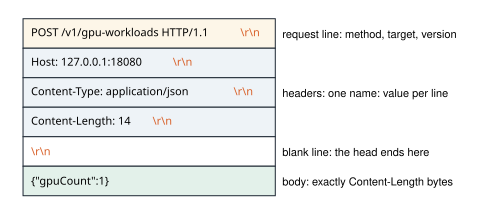
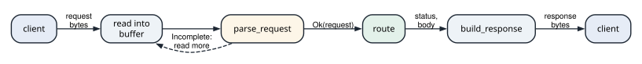
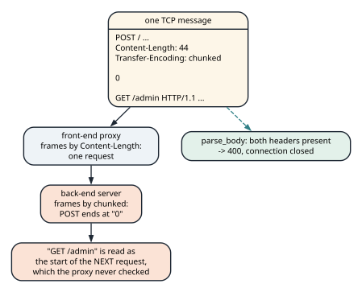
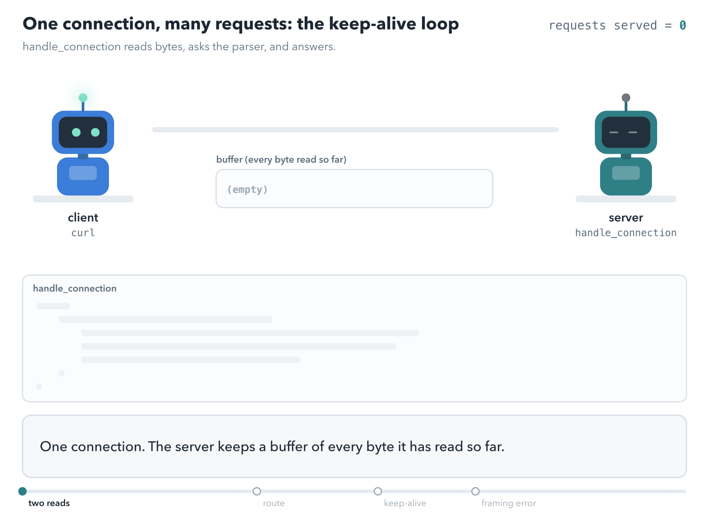

# Parsing and serving HTTP/1.1

<div class="covers" markdown="1">

This chapter covers

- What a request and a response look like on the wire, and how a server finds where a request ends
- Parsing an HTTP/1.1 request from bytes: request line, headers, and body framing
- Why `Content-Length` plus `Transfer-Encoding` must be rejected, and what request smuggling is
- Decoding chunked bodies, enforcing size limits, and reporting "incomplete" as a normal result
- A small REST server: a pure routing function, keep-alive, and status codes
- Reading the server against the RFC, and the three things it gets wrong

</div>

Although HTTP/1.1 resembles line-oriented text, it traverses TCP as an unstructured byte stream whose message boundaries are governed entirely by header-driven framing rules. When a proxy and an origin server disagree on where one message terminates and the next begins, the resulting desynchronization enables request smuggling and bypasses access controls. The sections below construct a strict HTTP/1.1 request parser enforcing unambiguous framing and layer a REST server above it that isolates protocol mechanics from pure application routing.

## 21.1 Requests and responses on the wire

HTTP/1.1 operates over a persistent TCP connection, which provides a reliable, unframed byte stream. A client writes a serialized request into the stream; the server reads the incoming bytes, computes a result, and transmits a response over the same connection.

Each request consists of a sequence of text lines followed by an optional body. Every line terminates with a two-byte carriage return and line feed sequence, written `\r\n` in Rust string literals and known as CRLF. As illustrated in Figure 21.1, a request that creates a GPU workload follows this exact byte layout.

<figure>

<figcaption><b>Figure 21.1</b> One request. The head is text lines ending in CRLF, and an empty line separates it from the body.</figcaption>
</figure>

The first line is the **request line**, composed of three space-separated tokens:

- The **method** specifies the requested operation: `GET` retrieves a resource, `POST` creates one, and `DELETE` removes one.
- The **target** identifies the resource to act upon, in this case the path `/v1/gpu-workloads`.
- The **version** specifies the protocol version, here `HTTP/1.1`.

Each subsequent line is a **header** consisting of a name, a colon, and a value. `Host` identifies the target authority, `Content-Type` declares the media type of the payload, and `Content-Length` specifies the exact byte length of the body (here, 14).

An empty line terminates the **head**, and the **body** follows immediately for exactly `Content-Length` bytes (`{"gpuCount":1}` occupies 14 bytes).

A response uses the same framing structure. Its opening line is a **status line** containing the protocol version, a three-digit status code, and a brief reason phrase. Status codes in the 200 to 299 range indicate success, 400 to 499 indicate a client error, and 500 to 599 indicate a server failure.

```text
HTTP/1.1 201 Created
Content-Length: 49
Content-Type: application/json
Connection: keep-alive

{"id":"wl-a100-2","gpuCount":1,"state":"Pending"}
```

### 21.1.1 Where one request ends

Because TCP delivers an unstructured byte stream rather than discrete datagrams, a single `read` call may yield a request fragment, one complete request, or one request concatenated with the prefix of the next. Lacking an explicit start-of-message delimiter on the wire, the server must derive message boundaries directly from the stream:

1. The head terminates at the first empty line, represented by the four-byte sequence `\r\n\r\n`.
2. The headers within the head then specify the body length, either directly through `Content-Length` or as a sequence of sized chunks (covered in Section 21.2.4).

Correct framing is also essential for connection reuse. HTTP/1.1 keeps a TCP connection open after sending a response so that the client can issue subsequent requests without paying for another TCP handshake, a mechanism called **keep-alive**. The server can locate the start of the second request only if it determines the exact end of the first.

### 21.1.2 The parts of the server

The server architecture is structured as a pipeline of four stages, illustrated in Figure 21.2.

<figure>

<figcaption><b>Figure 21.2</b> One request through the server. The parser sends the server back to read more until a whole request has arrived.</figcaption>
</figure>

- The server reads bytes from the socket and appends them to a per-connection buffer.
- `parse_request` inspects the accumulated buffer. If a full message has not yet arrived, it returns `Incomplete` so the read loop fetches additional bytes; otherwise it produces a `Request` value.
- `route` maps the `Request` to a status code and response payload without interacting with raw bytes or sockets.
- `build_response` serializes that result into wire-format response bytes for transmission back to the client.

The parser, read loop, and response serializer implement the HTTP protocol, whereas `route` implements application behavior. Separating these concerns enables independent testing: the parser can be exercised directly on byte slices, and `route` can be verified on constructed `Request` values.

## 21.2 The parser

The parser resides in `src/problems/http_request.rs` (shown in full as Listing 21.1 in Section 21.4).

### 21.2.1 Types first

The module begins by defining its domain types. `Method` is an enum providing a `parse` constructor that returns `None` for unrecognized tokens, along with two semantic predicates defined in RFC 9110:

```rust
{{#include ../../rust-interview-lab/src/problems/http_request.rs:10:45}}
```

`is_safe` holds for `GET`, `HEAD`, and `OPTIONS`, which do not modify server state, while `is_idempotent` additionally includes `PUT` and `DELETE`. The retry loop from Chapter 19 relies on `is_idempotent` to determine whether a failed request can be reissued safely.

`Version` defines the two protocol versions accepted by the parser, and `Limits` enforces upper bounds on header and body sizes, defaulting to 16 KiB and 8 MiB respectively:

```rust
{{#include ../../rust-interview-lab/src/problems/http_request.rs:47:66}}
```

`Request` encapsulates the parsed request line, normalized headers, and decoded payload:

```rust
{{#include ../../rust-interview-lab/src/problems/http_request.rs:68:100}}
```

Because HTTP header field names are case-insensitive under RFC 9110, `Request::header` performs ASCII case-insensitive matching. The `should_keep_alive` method encodes the version-dependent connection persistence rule: HTTP/1.1 defaults to persistent connections unless the client includes `Connection: close`, whereas HTTP/1.0 closes the connection unless the client explicitly supplies `Connection: keep-alive`. Because the `Connection` header accepts a comma-delimited token list, the inner `has` closure splits the field value on commas before matching.

`ParseError` partitions failure modes according to the protocol action required from the server:

```rust
{{#include ../../rust-interview-lab/src/problems/http_request.rs:102:112}}
```

`Incomplete` signals that the server should read additional bytes and retry parsing, a condition that the connection loop in Section 21.3 handles as normal control flow. `PayloadTooLarge` maps to status 413, while `MissingHost` and `Malformed` map to 400.

### 21.2.2 The head of the request

`parse_request` accepts `&[u8]` rather than `&str` because an HTTP body may contain arbitrary binary data, whereas only the head is constrained to text. It begins by searching for the terminating blank line (`\r\n\r\n`) using `windows(4).position(...)`:

```rust
{{#include ../../rust-interview-lab/src/problems/http_request.rs:134:151}}
    // ...
}
```

When the blank line has not yet arrived, the parser returns `Incomplete`, unless the accumulated buffer already exceeds `max_header_bytes`, in which case it returns `PayloadTooLarge`. Enforcing this limit before finding the delimiter prevents a slow client from exhausting server memory with an unbounded header. The validation sequence across `parse_request` and `parse_body` is outlined in Figure 21.3.

<figure>

<figcaption><b>Figure 21.3</b> The order of checks in <code>parse_request</code> and <code>parse_body</code>.</figcaption>
</figure>

The request line must contain exactly three space-separated tokens: a recognized method, a non-empty request target, and either `HTTP/1.1` or `HTTP/1.0`. Any trailing fourth token is rejected as malformed.

```rust
pub fn parse_request(input: &[u8], limits: Limits) -> Result<Request, ParseError> {
    // ...
{{#include ../../rust-interview-lab/src/problems/http_request.rs:153:180}}
    // ...
}
```

Each header line is split at the first colon. Header names containing whitespace are rejected because RFC 9112 prohibits whitespace between a field name and its terminating colon. Lines beginning with a space or horizontal tab represent *obsolete line folding* (`obs-fold`), a deprecated continuation syntax whose inconsistent interpretation across proxies creates smuggling vectors; the parser rejects it outright.

```rust
pub fn parse_request(input: &[u8], limits: Limits) -> Result<Request, ParseError> {
    // ...
{{#include ../../rust-interview-lab/src/problems/http_request.rs:182:206}}
    // ...
}
```

RFC 9112 mandates that every HTTP/1.1 request contain exactly one `Host` header field. Evaluating `filter(...).count() != 1` rejects both missing and duplicate `Host` headers.

```rust
pub fn parse_request(input: &[u8], limits: Limits) -> Result<Request, ParseError> {
    // ...
{{#include ../../rust-interview-lab/src/problems/http_request.rs:208:216}}
    // ...
}
```

### 21.2.3 Body framing and request smuggling

`parse_body` resolves message framing from the parsed headers. A request carrying both `Content-Length` and `Transfer-Encoding` is rejected immediately with `AmbiguousBodyLength`:

```rust
{{#include ../../rust-interview-lab/src/problems/http_request.rs:229:248}}
    // ...
}
```

This restriction prevents request smuggling (Figure 21.4). When a front-end proxy frames a message using `Content-Length` while a back-end server frames the same byte stream using `Transfer-Encoding: chunked`, the two components disagree on where the first request ends. An attacker can embed a second request in the trailing bytes that the back-end interprets as the start of a new message, bypassing security controls enforced by the proxy. Rejecting ambiguous framing outright and closing the connection eliminates this desynchronization.

<figure>

<figcaption><b>Figure 21.4</b> A CL.TE desynchronization. The parser answers such a request with 400 and closes the connection.</figcaption>
</figure>

<figure class="anim">
<video class="motion" src="figures/ch21-http-framing.mp4" autoplay loop muted playsinline preload="metadata" aria-label="A request's bytes stream into a buffer. The parser slides a window until it finds the blank line that ends the head, then splits the request line and headers into fields. With Content-Length: 5, a ruler counts five body bytes. With Transfer-Encoding: chunked, the parser reads a size line, takes that many bytes, and stops at the zero-size chunk. Last, one message carries both headers: a proxy frames it by Content-Length and sees one request, a back-end frames it by chunks and finds a hidden GET /admin after the body. The parser refuses the message with 400 and closes the connection." data-chapters="[[0.0, &quot;the head&quot;], [14.1, &quot;Content-Length&quot;], [23.7, &quot;chunked&quot;], [40.08, &quot;both&quot;]]"></video>
<figcaption><b>Animation 21.1</b> The head ends at the first blank line. <code>Content-Length</code> or chunked encoding then sets where the body ends. A message with both is refused with 400.</figcaption>
</figure>

Values from all `Transfer-Encoding` headers are concatenated and split into transfer codings. Because a request body whose final transfer coding is not `chunked` has no self-delimiting boundary, the parser accepts only `chunked` as the sole coding and rejects all other configurations with `UnsupportedTransferEncoding`.

```rust
fn parse_body(
    input: &[u8],
    body_start: usize,
    headers: &[(String, String)],
    limits: Limits,
) -> Result<Vec<u8>, ParseError> {
    // ...
{{#include ../../rust-interview-lab/src/problems/http_request.rs:250:268}}
    // ...
}
```

Multiple `Content-Length` headers are permitted only when every declared value parses identically; `lengths.any(|length| length != Ok(first))` compares the `Result` values directly to reject both malformed integers and conflicting lengths. Validating the declared length against `max_body_bytes` *before* awaiting the payload prevents a client from forcing unbounded memory allocation through an inflated header. If fewer than the declared bytes have arrived, the parser returns `Incomplete`.

```rust
fn parse_body(
    input: &[u8],
    body_start: usize,
    headers: &[(String, String)],
    limits: Limits,
) -> Result<Vec<u8>, ParseError> {
    // ...
{{#include ../../rust-interview-lab/src/problems/http_request.rs:270:291}}
}
```

### 21.2.4 Chunked bodies

`decode_chunked` advances a cursor across `size-in-hex CRLF data CRLF` frames until it encounters a zero-length terminating chunk, discarding optional chunk extensions following `;` as permitted by RFC 9112.

```rust
{{#include ../../rust-interview-lab/src/problems/http_request.rs:294:311}}
        // ...
    }
}
```

A zero-length chunk terminates the payload after consuming any optional trailer fields up to the final empty line:

```rust
fn decode_chunked(data: &[u8], max_body: usize) -> Result<Vec<u8>, ParseError> {
    // ...
    loop {
        // ...
{{#include ../../rust-interview-lab/src/problems/http_request.rs:313:323}}
        // ...
    }
}
```

For each non-zero chunk, the decoder verifies the cumulative payload size against `max_body`, computes the chunk end offset using `checked_add`, returns `Incomplete` if the buffer does not yet contain the full frame, and validates the trailing CRLF delimiter:

```rust
fn decode_chunked(data: &[u8], max_body: usize) -> Result<Vec<u8>, ParseError> {
    // ...
    loop {
        // ...
{{#include ../../rust-interview-lab/src/problems/http_request.rs:325:338}}
    }
}
```

`find_crlf` indexes via `data.get(from..)?` so an out-of-bounds cursor yields `None` rather than panicking:

```rust
{{#include ../../rust-interview-lab/src/problems/http_request.rs:342:347}}
```

One arithmetic edge case warrants hardening: `body.len() + size > max_body` executes prior to `checked_add`, so a hex chunk length near `usize::MAX` (sixteen `f` digits on 64-bit targets) overflows the addition. Rewriting the bound check as `size > max_body - body.len()` eliminates the overflow condition entirely.

Additionally, `parse_request` returns only the parsed `Request` without reporting the number of bytes consumed, which prevents a caller from locating the offset of a subsequent pipelined request within the same buffer. The server in Section 21.3 explicitly documents and accepts this non-pipelined constraint.

## 21.3 A small REST server

The HTTP/1.1 server resides in `src/bin/http_server.rs` (shown in full as Listing 21.2 in Section 21.4).

### 21.3.1 Routing as a pure function

The routing function `route(&Request) -> (u16, &'static str, Vec<u8>)` maps a parsed request to its status code, media type, and serialized response body without performing socket I/O:

```rust
{{#include ../../rust-interview-lab/src/bin/http_server.rs:36:47}}
    // ...
}
```

A recognized path paired with an unsupported method yields 405 Method Not Allowed, whereas an unrecognized path yields 404 Not Found:

```rust
pub fn route(request: &Request) -> (u16, &'static str, Vec<u8>) {
    // ...
{{#include ../../rust-interview-lab/src/bin/http_server.rs:49:63}}
    // ...
}
```

For `/v1/gpu-workloads/{id}`, `strip_prefix` extracts the resource identifier, rejecting empty identifiers or nested path segments containing `/` with 404:

```rust
pub fn route(request: &Request) -> (u16, &'static str, Vec<u8>) {
    // ...
{{#include ../../rust-interview-lab/src/bin/http_server.rs:65:80}}
}
```

Isolating routing as a pure function enables direct unit testing: the test suite at the end of `http_server.rs` exercises every endpoint by passing constructed `Request` values directly without opening sockets.

`build_response` formats the status line, `Content-Length`, an optional `Content-Type`, and the `Connection` header declaring whether the server will maintain or close the TCP stream:

```rust
{{#include ../../rust-interview-lab/src/bin/http_server.rs:100:116}}
```

### 21.3.2 The connection loop

`handle_connection` accumulates incoming socket bytes in `buffer` and invokes `parse_request` after each read to determine whether a complete message is available (Figure 21.5).

<figure>

<figcaption><b>Figure 21.5</b> The keep-alive loop in <code>handle_connection</code>.</figcaption>
</figure>

Upon `Ok(request)`, the loop dispatches to `route`, transmits the serialized response, and either terminates or clears the buffer to await the next keep-alive request:

```rust
{{#include ../../rust-interview-lab/src/bin/http_server.rs:134:152}}
            // ...
        }
    }
}
```

Upon `Err(ParseError::Incomplete)`, the loop reads additional bytes from the socket, exiting cleanly if a 0-byte read indicates peer closure mid-request. All other parse errors produce a 400 response carrying the error's `Display` message, followed by immediate connection teardown because stream synchronization is unrecoverable after a framing error:

```rust
fn handle_connection(mut stream: TcpStream) -> std::io::Result<()> {
    // ...
    loop {
        match parse_request(&buffer, limits) {
            // ...
{{#include ../../rust-interview-lab/src/bin/http_server.rs:153:166}}
        }
    }
}
```

<figure class="anim">
<video class="motion" src="figures/ch21-keep-alive.mp4" autoplay loop muted playsinline preload="metadata" aria-label="A client and the server's connection loop. The first request arrives in two reads: the first read leaves the parser with Incomplete, so the loop reads again, and the second read completes the head. The parser returns Ok, route answers 200, the response goes back with Connection: keep-alive, and the buffer is cleared. A second request on the same connection is routed the same way. Last, a request with both Content-Length and Transfer-Encoding gets 400 and the connection closes." data-chapters="[[0.0, &quot;two reads&quot;], [20.46, &quot;route&quot;], [31.02, &quot;keep-alive&quot;], [39.54, &quot;framing error&quot;]]"></video>
<figcaption><b>Animation 21.2</b> The first request arrives in two reads, so the parser returns <code>Incomplete</code> once. The second reuses the connection. The third has both framing headers, gets 400, and the connection closes.</figcaption>
</figure>

A session with `curl` and `nc` against the server, started with
`cargo run --bin http_server 127.0.0.1:18080`:

```text
$ curl -si http://127.0.0.1:18080/healthz
HTTP/1.1 200 OK
Content-Length: 3
Content-Type: text/plain
Connection: keep-alive

ok
$ curl -si -X POST -d '{"gpuCount":1}' http://127.0.0.1:18080/v1/gpu-workloads
HTTP/1.1 201 Created
Content-Length: 49
Content-Type: application/json
Connection: keep-alive

{"id":"wl-a100-2","gpuCount":1,"state":"Pending"}
$ printf 'POST / HTTP/1.1\r\nHost: x\r\nContent-Length: 5\r\nTransfer-Encoding: chunked\r\n\r\nhello' | nc 127.0.0.1 18080
HTTP/1.1 400 Bad Request
Content-Length: 59
Content-Type: text/plain
Connection: close

Content-Length and Transfer-Encoding are mutually exclusive
```

### 21.3.3 Reading the server against the RFC

Testing the server against `curl` and `nc` exposes three concrete departures from RFC 9110:

```text
$ curl -si -X DELETE http://127.0.0.1:18080/v1/gpu-workloads/wl-7
HTTP/1.1 204 No Content
Content-Length: 0
Connection: keep-alive

$ printf 'HEAD /healthz HTTP/1.1\r\nHost: x\r\nConnection: close\r\n\r\n' | nc 127.0.0.1 18080
HTTP/1.1 200 OK
Content-Length: 3
Content-Type: text/plain
Connection: close

ok
```

- **HEAD responses must omit the message body.** A `HEAD` response returns the exact headers of the corresponding `GET` response, including the `Content-Length` of the omitted payload, without transmitting any body bytes. Because this server transmits `ok`, a compliant client reading a persistent connection interprets those three trailing bytes as the status line of the *next* response. Omitting the body in `handle_connection` when `request.method == Method::Head` resolves the violation.
- **204 responses must omit `Content-Length`.** RFC 9110 prohibits `Content-Length` in 1xx and 204 No Content responses, whereas `build_response` emits the header unconditionally. Suppressing `Content-Length` for 1xx and 204 status codes restores compliance.
- **Parse errors map uniformly to 400.** `PayloadTooLarge` requires status 413 Payload Too Large (already present in `status_reason`), which can be dispatched by matching on `ParseError`. Likewise, RFC 9110 requires a 405 Method Not Allowed response to include an `Allow` header enumerating the supported methods for the target resource.

Two additional implementation trade-offs lie outside RFC 9110 compliance. Interpolating `id` into JSON via `format!` allows unescaped `"` characters to corrupt the JSON output, whereas production services serialize structured payloads with `serde_json`. Furthermore, invoking `buffer.clear()` after each response discards any pipelined request bytes already read from the socket, a limitation documented in the module header.

## 21.4 The complete programs

<p class="listing"><b>Listing 21.1</b> An HTTP/1.1 request parser with framing checks and limits. <a href="https://github.com/arpanpathak/cracking-the-systems-programming-interview/blob/prep-v2/rust-interview-lab/src/problems/http_request.rs">src/problems/http_request.rs</a></p>

```rust
{{#include ../../rust-interview-lab/src/problems/http_request.rs}}
```

<p class="listing"><b>Listing 21.2</b> Routes, responses, and a keep-alive loop over <code>std::net</code>. <a href="https://github.com/arpanpathak/cracking-the-systems-programming-interview/blob/prep-v2/rust-interview-lab/src/bin/http_server.rs">src/bin/http_server.rs</a></p>

```rust
{{#include ../../rust-interview-lab/src/bin/http_server.rs}}
```

## 21.5 Questions that come up

**"How does a server know where an HTTP/1.1 request body ends?"**
If `Transfer-Encoding: chunked` is present, the server reads length-prefixed chunks until it encounters a zero-size terminating chunk. Otherwise, `Content-Length` specifies the exact byte count. When neither header is present, the request carries no body (for responses, closing the connection can also delimit the body).

**"What is request smuggling, and how is it prevented?"**
Request smuggling occurs when two servers along the request path frame the same byte stream differently, causing them to disagree on message boundaries. Prevention requires rejecting requests that carry both `Content-Length` and `Transfer-Encoding`, rejecting conflicting `Content-Length` values, and closing the connection after any framing error.

**"How does a server prevent a client from exhausting its memory?"**
The server enforces upper bounds on header and body sizes, validates any declared `Content-Length` before buffering payload bytes, and closes idle or slow connections after a timeout.

**"Why is routing implemented as a separate pure function?"**
Isolating routing from socket I/O allows every route to be unit-tested directly on `Request` values, while enabling protocol changes (such as framing or keep-alive adjustments) without modifying application logic.

**"What does HTTP/2 change?"**
HTTP/2 replaces text-based delimiters with binary framing and explicit frame lengths, multiplexes concurrent streams over a single TCP connection, and compresses headers. HTTP/1.1 framing ambiguities disappear within HTTP/2 itself, although they can reappear at gateways that downgrade HTTP/2 requests to HTTP/1.1.
