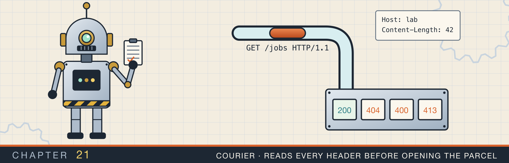
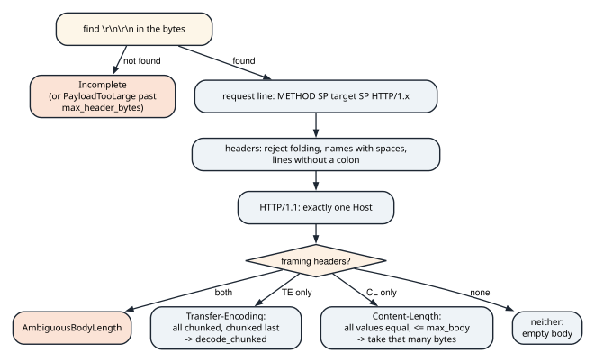
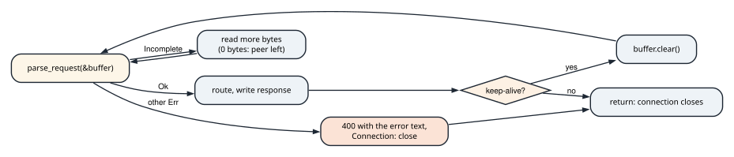

# Parsing and serving HTTP/1.1

<div class="covers" markdown="1">

This chapter covers

- What a request and a response look like on the wire, and how a server finds where a request ends
- Parsing an HTTP/1.1 request from bytes: request line, headers, and body framing
- Why `Content-Length` plus `Transfer-Encoding` must be rejected, and what request smuggling is
- Decoding chunked bodies, enforcing size limits, and reporting "incomplete" as a normal result
- A small REST server: a pure routing function, keep-alive, and status codes
- Reading the server against the RFC, and the three things it gets wrong

</div>

Although HTTP resembles line-oriented text, it is transmitted as an unstructured byte stream whose message boundaries are determined entirely by headers. Many severe vulnerabilities in production servers arise when two components disagree on where one request ends and the next begins. In this chapter, we construct a parser centered on unambiguous framing and layer an HTTP/1.1 server above it that separates protocol handling from application routing so that each layer can be verified independently.

## 21.1 Requests and responses on the wire

HTTP/1.1 operates over a single TCP connection, which provides the byte stream examined in Chapter 20. A client writes a request into the stream; the server reads the bytes, computes a result, and writes a response back over the same connection.

Each request consists of a sequence of text lines followed by an optional body. Every line terminates with a two-byte carriage return and line feed sequence, written `\r\n` in Rust string literals and known as CRLF. As illustrated in Figure 21.1, a request that creates a GPU workload follows this exact byte layout.

<figure>

<figcaption><b>Figure 21.1</b> One request. The head is text lines ending in CRLF, and an empty line separates it from the body.</figcaption>
</figure>

The first line is the **request line**, composed of three space-separated tokens:

- The **method** specifies the requested operation: `GET` retrieves a resource, `POST` creates one, and `DELETE` removes one.
- The **target** identifies the resource to act upon, in this case the path `/v1/gpu-workloads`.
- The **version** specifies the protocol version, here `HTTP/1.1`.

Each subsequent line is a **header** consisting of a name, a colon, and a value. `Host` identifies the target authority, `Content-Type` declares the media type of the payload, and `Content-Length` specifies the exact byte length of the body (here, 14).

An empty line terminates the **head**, and the **body** follows immediately for exactly `Content-Length` bytes (`{"gpuCount":1}` occupies 14 bytes).

A response uses the same framing structure. Its opening line is a **status line** containing the protocol version, a three-digit status code, and a brief reason phrase. Status codes in the 200 to 299 range indicate success, 400 to 499 indicate a client error, and 500 to 599 indicate a server failure.

```text
HTTP/1.1 201 Created
Content-Length: 49
Content-Type: application/json
Connection: keep-alive

{"id":"wl-a100-2","gpuCount":1,"state":"Pending"}
```

### 21.1.1 Where one request ends

TCP delivers an unstructured stream of bytes rather than discrete messages. As established in Chapter 20, a single `read` call may return a fragment of a request, one complete request, or one request followed by the beginning of the next. Because the wire format includes no explicit start-of-message delimiter, the server must derive message boundaries from the bytes themselves:

1. The head terminates at the first empty line, represented by the four-byte sequence `\r\n\r\n`.
2. The headers within the head then specify the body length, either directly through `Content-Length` or as a sequence of sized chunks (covered in Section 21.2.4).

Correct framing is also essential for connection reuse. HTTP/1.1 keeps a TCP connection open after sending a response so that the client can issue subsequent requests without paying for another TCP handshake, a mechanism called **keep-alive**. The server can locate the start of the second request only if it determines the exact end of the first.

### 21.1.2 The parts of the server

The server architecture is structured as a pipeline of four stages, illustrated in Figure 21.2.

<figure>

<figcaption><b>Figure 21.2</b> One request through the server. The parser sends the server back to read more until a whole request has arrived.</figcaption>
</figure>

- The server reads bytes from the socket and appends them to a per-connection buffer.
- `parse_request` inspects the accumulated buffer. If a full message has not yet arrived, it returns `Incomplete` so the read loop fetches additional bytes; otherwise it produces a `Request` value.
- `route` maps the `Request` to a status code and response payload without interacting with raw bytes or sockets.
- `build_response` serializes that result into wire-format response bytes for transmission back to the client.

The parser, read loop, and response serializer implement the HTTP protocol, whereas `route` implements application behavior. Separating these concerns enables independent testing: the parser can be exercised directly on byte slices, and `route` can be verified on constructed `Request` values.

## 21.2 The parser

The parser resides in `src/problems/http_request.rs` (shown in full as Listing 21.1 in Section 21.4).

### 21.2.1 Types first

The module begins by defining its domain types. `Method` is an enum providing a `parse` constructor that returns `None` for unrecognized tokens, along with two semantic predicates defined in RFC 9110:

```rust
{{#include ../../rust-interview-lab/src/problems/http_request.rs:10:45}}
```

`is_safe` holds for `GET`, `HEAD`, and `OPTIONS`, which do not modify server state, while `is_idempotent` additionally includes `PUT` and `DELETE`. The retry loop from Chapter 19 relies on `is_idempotent` to determine whether a failed request can be reissued safely.

`Version` defines the two protocol versions accepted by the parser, and `Limits` enforces upper bounds on header and body sizes, defaulting to 16 KiB and 8 MiB respectively:

```rust
{{#include ../../rust-interview-lab/src/problems/http_request.rs:47:66}}
```

`Request` holds what the parser found:

```rust
{{#include ../../rust-interview-lab/src/problems/http_request.rs:68:100}}
```

`Request::header` finds a header case-insensitively, because header names are case-insensitive. Then
`should_keep_alive` encodes the one rule that differs by version. HTTP/1.1 keeps the connection open
unless the client sends `Connection: close`. HTTP/1.0 closes it unless the client sends `Connection:
keep-alive`. The `has` closure splits the header on commas because `Connection` carries a list.

`ParseError` distinguishes the cases a server must treat differently:

```rust
{{#include ../../rust-interview-lab/src/problems/http_request.rs:102:112}}
```

`Incomplete` signals that the server should read additional bytes and retry parsing, a condition that the connection loop in Section 21.3 handles as normal control flow. `PayloadTooLarge` maps to status 413, while `MissingHost` and `Malformed` map to 400.

### 21.2.2 The head of the request

`parse_request` accepts `&[u8]` rather than `&str` because an HTTP body may contain arbitrary binary data, whereas only the head is constrained to text. It begins by searching for the terminating blank line (`\r\n\r\n`) using `windows(4).position(...)`:

```rust
{{#include ../../rust-interview-lab/src/problems/http_request.rs:134:151}}
    // ...
}
```

When the blank line has not yet arrived, the parser returns `Incomplete`, unless the accumulated buffer already exceeds `max_header_bytes`, in which case it returns `PayloadTooLarge`. Enforcing this limit before finding the delimiter prevents a slow client from exhausting server memory with an unbounded header. The validation sequence across `parse_request` and `parse_body` is outlined in Figure 21.3.

<figure>

<figcaption><b>Figure 21.3</b> The order of checks in <code>parse_request</code> and <code>parse_body</code>.</figcaption>
</figure>

The request line must be exactly three space-separated parts: a known method, a non-empty target, and
`HTTP/1.1` or `HTTP/1.0`. A fourth part is an error.

```rust
pub fn parse_request(input: &[u8], limits: Limits) -> Result<Request, ParseError> {
    // ...
{{#include ../../rust-interview-lab/src/problems/http_request.rs:153:180}}
    // ...
}
```

Header lines are split at the first colon. A name with whitespace is rejected, because RFC 9112 forbids
whitespace between the name and the colon. A line that starts with a space or tab is *obsolete line
folding*, a continuation syntax the RFC deprecates. Since different servers interpret it differently, the
parser rejects it.

```rust
pub fn parse_request(input: &[u8], limits: Limits) -> Result<Request, ParseError> {
    // ...
{{#include ../../rust-interview-lab/src/problems/http_request.rs:182:206}}
    // ...
}
```

HTTP/1.1 requires exactly one `Host` header. The count uses `filter(...).count() != 1`, which rejects both
zero and two.

```rust
pub fn parse_request(input: &[u8], limits: Limits) -> Result<Request, ParseError> {
    // ...
{{#include ../../rust-interview-lab/src/problems/http_request.rs:208:216}}
    // ...
}
```

### 21.2.3 Body framing and request smuggling

`parse_body` decides how long the body is. A request with both `Content-Length` and `Transfer-Encoding` is
rejected as `AmbiguousBodyLength`:

```rust
{{#include ../../rust-interview-lab/src/problems/http_request.rs:229:248}}
    // ...
}
```

This restriction prevents request smuggling (Figure 21.4). When a front-end proxy frames a message using `Content-Length` while a back-end server frames the same byte stream using `Transfer-Encoding: chunked`, the two components disagree on where the first request ends. An attacker can embed a second request in the trailing bytes that the back-end interprets as the start of a new message, bypassing security controls enforced by the proxy. Rejecting ambiguous framing outright and closing the connection eliminates this desynchronization.

<figure>

<figcaption><b>Figure 21.4</b> A CL.TE desynchronization. The parser answers such a request with 400 and closes the connection.</figcaption>
</figure>

<figure class="anim">
<video class="motion" src="figures/ch21-http-framing.mp4" autoplay loop muted playsinline preload="metadata" aria-label="A request's bytes stream into a buffer. The parser slides a window until it finds the blank line that ends the head, then splits the request line and headers into fields. With Content-Length: 5, a ruler counts five body bytes. With Transfer-Encoding: chunked, the parser reads a size line, takes that many bytes, and stops at the zero-size chunk. Last, one message carries both headers: a proxy frames it by Content-Length and sees one request, a back-end frames it by chunks and finds a hidden GET /admin after the body. The parser refuses the message with 400 and closes the connection." data-chapters="[[0.0, &quot;the head&quot;], [14.1, &quot;Content-Length&quot;], [23.7, &quot;chunked&quot;], [40.08, &quot;both&quot;]]"></video>
<figcaption><b>Animation 21.1</b> The head ends at the first blank line. <code>Content-Length</code> or chunked encoding then sets where the body ends. A message with both is refused with 400.</figcaption>
</figure>

`Transfer-Encoding` values from every such header are joined and split into codings. The parser supports
only `chunked`, and requires it to be last, because a body whose final coding is not `chunked` has no
defined end. Anything else is `UnsupportedTransferEncoding`.

```rust
fn parse_body(
    input: &[u8],
    body_start: usize,
    headers: &[(String, String)],
    limits: Limits,
) -> Result<Vec<u8>, ParseError> {
    // ...
{{#include ../../rust-interview-lab/src/problems/http_request.rs:250:268}}
    // ...
}
```

Multiple `Content-Length` headers are allowed only if they all agree. The check parses each value and
compares with `lengths.any(|length| length != Ok(first))`, comparing `Result`s directly. A length above
`max_body_bytes` is rejected *before* the server waits for the bytes. A client cannot claim a huge body and
make the server buffer it. If fewer bytes than the length have arrived, the result is `Incomplete`.

```rust
fn parse_body(
    input: &[u8],
    body_start: usize,
    headers: &[(String, String)],
    limits: Limits,
) -> Result<Vec<u8>, ParseError> {
    // ...
{{#include ../../rust-interview-lab/src/problems/http_request.rs:270:291}}
}
```

### 21.2.4 Chunked bodies

`decode_chunked` walks a cursor through `size-in-hex CRLF data CRLF` records until a size of 0. Chunk
extensions after a `;` are ignored, as the RFC permits.

```rust
{{#include ../../rust-interview-lab/src/problems/http_request.rs:294:311}}
        // ...
    }
}
```

A size of 0 ends the body, after optional trailer lines up to an empty line:

```rust
fn decode_chunked(data: &[u8], max_body: usize) -> Result<Vec<u8>, ParseError> {
    // ...
    loop {
        // ...
{{#include ../../rust-interview-lab/src/problems/http_request.rs:313:323}}
        // ...
    }
}
```

Each other chunk checks the running total against the body limit. It computes the chunk's end with
`checked_add`, returns `Incomplete` if the data has not all arrived, and insists on the CRLF after the
data.

```rust
fn decode_chunked(data: &[u8], max_body: usize) -> Result<Vec<u8>, ParseError> {
    // ...
    loop {
        // ...
{{#include ../../rust-interview-lab/src/problems/http_request.rs:325:338}}
    }
}
```

`find_crlf` uses `data.get(from..)?` so that a cursor past the end is `None` rather than a panic.

```rust
{{#include ../../rust-interview-lab/src/problems/http_request.rs:342:347}}
```

One arithmetic detail needs tightening. `body.len() + size > max_body` runs before the `checked_add`, and
a chunk size near `usize::MAX` overflows that addition. `from_str_radix` parses such a size from sixteen
`f`s. The form `size > max_body - body.len()` cannot overflow.

`parse_request` returns the request but not how many bytes it consumed. A caller therefore cannot find the
start of a second, pipelined request in the same buffer. The server below accepts that limitation, and its
module comment says so.

## 21.3 A small REST server

The server is `src/bin/http_server.rs`. Listing 21.2 in section 21.4 is the whole file.

### 21.3.1 Routing as a pure function

`route(&Request) -> (u16, &'static str, Vec<u8>)` decides the status, content type, and body without
touching a socket:

```rust
{{#include ../../rust-interview-lab/src/bin/http_server.rs:36:47}}
    // ...
}
```

A known path with an unsupported method returns 405, an unknown path 404.

```rust
pub fn route(request: &Request) -> (u16, &'static str, Vec<u8>) {
    // ...
{{#include ../../rust-interview-lab/src/bin/http_server.rs:49:63}}
    // ...
}
```

For `/v1/gpu-workloads/{id}`, `strip_prefix` extracts the id, and an empty id or one containing `/` is a
404.

```rust
pub fn route(request: &Request) -> (u16, &'static str, Vec<u8>) {
    // ...
{{#include ../../rust-interview-lab/src/bin/http_server.rs:65:80}}
}
```

Its doc comment gives the reason it is a separate function: it is unit-testable. The tests at the bottom
of the file exercise every route by building a `Request` value directly.

`build_response` writes the status line, `Content-Length`, an optional `Content-Type`, and a `Connection`
header that tells the client what the server will do:

```rust
{{#include ../../rust-interview-lab/src/bin/http_server.rs:100:116}}
```

### 21.3.2 The connection loop

`handle_connection` accumulates bytes in `buffer` and asks the parser what it has (figure 21.5).

<figure>

<figcaption><b>Figure 21.5</b> The keep-alive loop in <code>handle_connection</code>.</figcaption>
</figure>

On `Ok`, it routes, writes the response, and either closes or clears the buffer for the next request:

```rust
{{#include ../../rust-interview-lab/src/bin/http_server.rs:134:152}}
            // ...
        }
    }
}
```

On `Incomplete`, it reads more; a read of 0 means the client left mid-request. Any other error gets a 400
whose body is the error's `Display` text, and the connection closes. After a framing error the server
cannot know where the next request starts.

```rust
fn handle_connection(mut stream: TcpStream) -> std::io::Result<()> {
    // ...
    loop {
        match parse_request(&buffer, limits) {
            // ...
{{#include ../../rust-interview-lab/src/bin/http_server.rs:153:166}}
        }
    }
}
```

<figure class="anim">
<video class="motion" src="figures/ch21-keep-alive.mp4" autoplay loop muted playsinline preload="metadata" aria-label="A client and the server's connection loop. The first request arrives in two reads: the first read leaves the parser with Incomplete, so the loop reads again, and the second read completes the head. The parser returns Ok, route answers 200, the response goes back with Connection: keep-alive, and the buffer is cleared. A second request on the same connection is routed the same way. Last, a request with both Content-Length and Transfer-Encoding gets 400 and the connection closes." data-chapters="[[0.0, &quot;two reads&quot;], [20.46, &quot;route&quot;], [31.02, &quot;keep-alive&quot;], [39.54, &quot;framing error&quot;]]"></video>
<figcaption><b>Animation 21.2</b> The first request arrives in two reads, so the parser returns <code>Incomplete</code> once. The second reuses the connection. The third has both framing headers, gets 400, and the connection closes.</figcaption>
</figure>

A session with `curl` and `nc` against the server, started with
`cargo run --bin http_server 127.0.0.1:18080`:

```text
$ curl -si http://127.0.0.1:18080/healthz
HTTP/1.1 200 OK
Content-Length: 3
Content-Type: text/plain
Connection: keep-alive

ok
$ curl -si -X POST -d '{"gpuCount":1}' http://127.0.0.1:18080/v1/gpu-workloads
HTTP/1.1 201 Created
Content-Length: 49
Content-Type: application/json
Connection: keep-alive

{"id":"wl-a100-2","gpuCount":1,"state":"Pending"}
$ printf 'POST / HTTP/1.1\r\nHost: x\r\nContent-Length: 5\r\nTransfer-Encoding: chunked\r\n\r\nhello' | nc 127.0.0.1 18080
HTTP/1.1 400 Bad Request
Content-Length: 59
Content-Type: text/plain
Connection: close

Content-Length and Transfer-Encoding are mutually exclusive
```

### 21.3.3 Reading the server against the RFC

The same session shows three places where the server departs from RFC 9110. None of them is hard to fix,
and finding them is good practice.

```text
$ curl -si -X DELETE http://127.0.0.1:18080/v1/gpu-workloads/wl-7
HTTP/1.1 204 No Content
Content-Length: 0
Connection: keep-alive

$ printf 'HEAD /healthz HTTP/1.1\r\nHost: x\r\nConnection: close\r\n\r\n' | nc 127.0.0.1 18080
HTTP/1.1 200 OK
Content-Length: 3
Content-Type: text/plain
Connection: close

ok
```

- **HEAD must not carry a body.** A HEAD response repeats the GET headers, including the
  `Content-Length` of a body it does not send. The server sends `ok`. A client that
  trusts the spec reads those three bytes as the start of the *next* response. The fix is one line in
  `handle_connection`: skip `body` when `request.method == Method::Head`.
- **204 must not carry `Content-Length`.** `build_response` always writes it. Skipping it for 204 (and
  1xx) fixes that.
- **Errors all become 400.** `PayloadTooLarge` deserves 413, and `status_reason` already has its text.
  Mapping `ParseError` to a status in one `match` fixes it. A 405 should also carry an `Allow` header
  listing the methods that path supports.

Two more points concern safety rather than the RFC. The id is interpolated into JSON with `format!`, so an
id containing `"` produces invalid JSON; a real server serializes with `serde_json`. And `buffer.clear()`
after each request discards any pipelined bytes that arrived with it, which the module comment
acknowledges.

## 21.4 The complete programs

<p class="listing"><b>Listing 21.1</b> An HTTP/1.1 request parser with framing checks and limits. <a href="https://github.com/arpanpathak/cracking-the-systems-programming-interview/blob/prep-v2/rust-interview-lab/src/problems/http_request.rs">src/problems/http_request.rs</a></p>

```rust
{{#include ../../rust-interview-lab/src/problems/http_request.rs}}
```

<p class="listing"><b>Listing 21.2</b> Routes, responses, and a keep-alive loop over <code>std::net</code>. <a href="https://github.com/arpanpathak/cracking-the-systems-programming-interview/blob/prep-v2/rust-interview-lab/src/bin/http_server.rs">src/bin/http_server.rs</a></p>

```rust
{{#include ../../rust-interview-lab/src/bin/http_server.rs}}
```

## 21.5 Questions that come up

**"How does a server know where an HTTP/1.1 request body ends?"**
If `Transfer-Encoding: chunked` is present, the server reads length-prefixed chunks until it encounters a zero-size terminating chunk. Otherwise, `Content-Length` specifies the exact byte count. When neither header is present, the request carries no body (for responses, closing the connection can also delimit the body).

**"What is request smuggling, and how is it prevented?"**
Request smuggling occurs when two servers along the request path frame the same byte stream differently, causing them to disagree on message boundaries. Prevention requires rejecting requests that carry both `Content-Length` and `Transfer-Encoding`, rejecting conflicting `Content-Length` values, and closing the connection after any framing error.

**"How does a server prevent a client from exhausting its memory?"**
The server enforces upper bounds on header and body sizes, validates any declared `Content-Length` before buffering payload bytes, and closes idle or slow connections after a timeout.

**"Why is routing implemented as a separate pure function?"**
Isolating routing from socket I/O allows every route to be unit-tested directly on `Request` values, while enabling protocol changes (such as framing or keep-alive adjustments) without modifying application logic.

**"What does HTTP/2 change?"**
HTTP/2 replaces text-based delimiters with binary framing and explicit frame lengths, multiplexes concurrent streams over a single TCP connection, and compresses headers. HTTP/1.1 framing ambiguities disappear within HTTP/2 itself, although they can reappear at gateways that downgrade HTTP/2 requests to HTTP/1.1.
