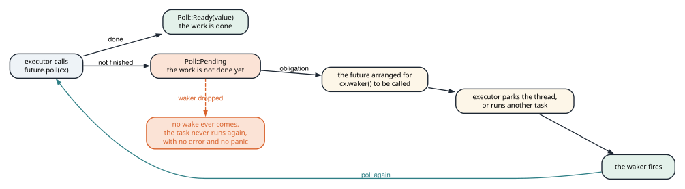
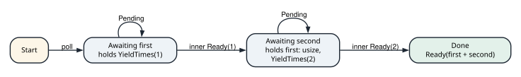
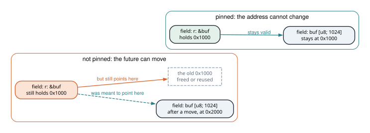

# Async Rust from the executor up

<div class="covers" markdown="1">

This chapter covers

- What `Future::poll`, `Poll::Pending`, and a `Waker` promise each other
- Why one thread can hold thousands of waiting connections
- `block_on`: an executor in a dozen lines that parks the thread between polls
- Two futures written by hand: one that yields, and one that waits on a timer
- A task queue where waking a task is the same as scheduling it
- What an `async` block compiles to, and why `poll` takes `Pin<&mut Self>`
- Two HTTP clients with caching and retries, one blocking and one on Tokio

</div>

Assigning a dedicated operating-system thread to every network connection scales cleanly to tens or hundreds of concurrent clients, yet exhausts virtual memory and scheduler capacity when a service must hold thousands of predominantly idle connections. Cooperative asynchronous runtimes eliminate that per-connection stack overhead by multiplexing many suspended state machines onto a small pool of worker threads.

The sections below construct an asynchronous runtime from first principles: starting from the cooperative polling contract of the `Future` trait, building a single-future `block_on` executor and a multi-task run queue, analyzing `Pin` and self-referential compiler-generated state machines, and culminating in a comparative implementation of blocking and Tokio-based HTTP clients.

## 22.1 Why a thread per connection does not scale

A spawned OS thread in Rust reserves a 2 MiB stack by default, and that reservation persists for the thread's entire lifetime, including time spent blocked in `read`. Holding ten thousand idle connections as separate threads reserves roughly 20 GB of virtual address space before any application work occurs.

An alternative model keeps a single OS thread and represents each connection as a **future**: a state object representing an in-progress computation. While awaiting I/O, a suspended future does not occupy a thread stack; it stores only the local state needed to resume from its suspension point.

A **task** is a future managed by a runtime, which schedules and polls the future whenever progress becomes possible.

Because a suspended future retains only values live across its suspension points, an idle connection typically occupies a few hundred bytes rather than two megabytes. Ten thousand idle connections therefore fit in a few megabytes instead of tens of gigabytes, as contrasted in Figure 22.1.

<figure>

<figcaption><b>Figure 22.1</b> A parked thread keeps its stack. A parked future keeps only the values it needs to resume.</figcaption>
</figure>

The trade-off for this memory efficiency is that waiting must be expressed as an explicit state machine. Rust's `async` and `.await` syntax generates that state machine automatically while preserving sequential control flow.

## 22.2 The contract

At the foundation of asynchronous Rust lies the single method of the `Future` trait, which answers whether a computation has finished:

```rust
fn poll(self: Pin<&mut Self>, cx: &mut Context<'_>) -> Poll<Self::Output>;
```

`poll` returns `Poll::Ready(value)` once the computation finishes, or `Poll::Pending` when it cannot proceed yet.

Returning `Pending` carries a strict obligation: before returning, the future must arrange for `cx.waker()` to be invoked once progress becomes possible. The waker is a handle supplied by the executor; calling it notifies the executor that the task is ready to be polled again.

The executor upholds the reciprocal obligation by polling the task again after receiving a wake notification, while remaining idle rather than busy-spinning in the interim. Both halves of this contract are illustrated in Figure 22.2.

<figure>

<figcaption><b>Figure 22.2</b> The poll contract. A dropped waker is the one branch with no error and no panic.</figcaption>
</figure>

Two invariants follow directly from this contract. Polling a future that is not yet ready is always safe, because it returns `Pending` again and costs only one redundant poll. Failing to register a wake, however, breaks liveness: the task returns `Pending`, nothing invokes its waker, and the task never runs again.

<div class="callout warning" markdown="1">

**WARNING** A dropped waker produces no panic, no error, and no CPU activity. The affected task stalls indefinitely while the rest of the program continues normally. When an asynchronous program hangs without visible error, inspect first for a waker that was dropped instead of invoked.

</div>

The receiver type `Pin<&mut Self>` (rather than `&mut self`) is examined in Section 22.6; for now, treat it as a guarantee that the future will not relocate in memory between polls.

## 22.3 The smallest executor

Because `.await` does not invoke the operating system directly, a runtime component must call `poll` and act on `Poll::Pending`. That component is an **executor**.

The minimal useful executor drives a single future on the current thread, parking the thread instead of busy-waiting whenever the future returns `Pending`. Listing 22.1 presents the complete implementation.

<p class="listing"><b>Listing 22.1</b> <code>block_on</code> and its waker (lines 36 to 61). <a href="https://github.com/arpanpathak/cracking-the-systems-programming-interview/blob/prep-v2/rust-interview-lab/src/problems/async_mini.rs">src/problems/async_mini.rs</a></p>

```rust
{{#include ../../rust-interview-lab/src/problems/async_mini.rs:17:29}}

{{#include ../../rust-interview-lab/src/problems/async_mini.rs:36:61}}
```

`block_on` executes in three distinct stages:

1. `Box::pin(future)` heap-allocates the future and pins it in place, guaranteeing a stable memory address across every subsequent poll.
2. `Waker::from(Arc::new(ThreadWaker(thread::current())))` constructs a `Waker` backed by the `Wake` trait, avoiding manual raw vtable construction; invoking `wake` unparks the calling executor thread.
3. The poll loop repeatedly invokes `future.as_mut().poll(&mut cx)`, returning immediately on `Poll::Ready(value)` and suspending the thread via `thread::park()` on `Poll::Pending` until an `unpark` notification arrives.

Because `thread::park` may return spuriously without a corresponding `unpark`, the loop unconditionally re-polls the future; an unready future re-registers its waker and returns `Poll::Pending`, making spurious wakeups harmless under the poll contract.

The `park`/`unpark` pair also prevents lost wakeups under concurrent scheduling: if a background thread invokes `unpark` before the executor enters `park`, the runtime records an unpark permit so the subsequent `park` call consumes the permit and returns immediately.

<figure class="anim">
<video class="motion" src="figures/ch22-poll-wake.mp4" autoplay loop muted playsinline preload="metadata" aria-label="A robot labelled executor thread polls a future that waits on a timer, and hands it a waker drawn as a bell. The future's ready flag is false, so it stores the bell in its waker slot and returns Pending. The executor parks, and its CPU gauge falls to zero. A timer thread sleeps for 50 ms, sets ready to true, takes the bell out of the slot, and rings it, which unparks the executor. The second poll returns Ready. The run then repeats with the line that stores the waker deleted: the timer finds the slot empty, and the executor stays parked forever." data-chapters="[[0.0, &quot;cast&quot;], [4.74, &quot;poll&quot;], [27.42, &quot;park&quot;], [33.14, &quot;wake&quot;], [48.86, &quot;ready&quot;], [63.26, &quot;no waker&quot;]]"></video>
<figcaption><b>Animation 22.1</b> <code>block_on</code> driving a future that waits on a timer, the <code>Delay</code> of section 22.4.2, with the line each thread is running. In the second run the waker is never stored, and the executor never wakes.</figcaption>
</figure>

## 22.4 Two futures written by hand

Almost every leaf future follows one of two patterns: either it immediately re-arms itself to yield control, or it waits on an external event and stores the caller's waker until that event completes.

### 22.4.1 A future that yields to itself

`YieldTimes` voluntarily returns `Poll::Pending` a configured number of times before completing. Although no external I/O blocks its progress, yielding relinquishes execution back to the executor so peer tasks can advance in cooperative round-robin order.

<p class="listing"><b>Listing 22.2</b> <code>YieldTimes</code>, a future that re-arms itself (lines 63 to 97). <a href="https://github.com/arpanpathak/cracking-the-systems-programming-interview/blob/prep-v2/rust-interview-lab/src/problems/async_mini.rs">src/problems/async_mini.rs</a></p>

```rust
{{#include ../../rust-interview-lab/src/problems/async_mini.rs:63:97}}
```

Because `YieldTimes` stores only two `usize` counters, it automatically implements `Unpin`, allowing `self.get_mut()` to project `Pin<&mut Self>` into `&mut Self` in safe Rust.

To satisfy the polling contract before returning `Poll::Pending`, `poll` invokes `context.waker().wake_by_ref()`, immediately re-enqueuing the task for a subsequent poll (the exact mechanism used by `tokio::task::yield_now`). Upon exhaustion of its yield budget, `YieldTimes` resolves to its total yield count, allowing tests to verify suspension and resumption behavior deterministically.

### 22.4.2 A future that waits on a timer

`Delay` resolves after an elapsed wall-clock interval, modeling the second leaf-future pattern characteristic of asynchronous I/O and kernel event sources.

Its shared state pairs a `ready` boolean with an optional `Waker`, synchronized between the executor and a background timer thread through `Arc<Mutex<_>>`:

<p class="listing"><b>Listing 22.3</b> <code>Delay</code> state and constructor (lines 99 to 137). <a href="https://github.com/arpanpathak/cracking-the-systems-programming-interview/blob/prep-v2/rust-interview-lab/src/problems/async_mini.rs">src/problems/async_mini.rs</a></p>

```rust
{{#include ../../rust-interview-lab/src/problems/async_mini.rs:99:137}}
```

On each poll, `Delay::poll` inspects `ready`; while the timer has not expired, it stores a clone of the current waker and returns `Poll::Pending`:

<p class="listing"><b>Listing 22.4</b> <code>Delay</code> as a future (lines 139 to 154). <a href="https://github.com/arpanpathak/cracking-the-systems-programming-interview/blob/prep-v2/rust-interview-lab/src/problems/async_mini.rs">src/problems/async_mini.rs</a></p>

```rust
{{#include ../../rust-interview-lab/src/problems/async_mini.rs:139:154}}
```

The background thread sleeps for the requested duration, sets `ready` to `true`, extracts the stored waker, drops the mutex guard, and invokes `wake()`. The full synchronization exchange between the executor and the timer thread is depicted in Figure 22.3.

<figure>

<figcaption><b>Figure 22.3</b> One <code>Delay</code> from start to finish. The executor thread sleeps in <code>park</code>, not in <code>poll</code>.</figcaption>
</figure>

Two synchronization invariants ensure correctness. First, `poll` overwrites the stored waker on *every* `Poll::Pending` return rather than only the first: because a work-stealing runtime may migrate a suspended task to another worker thread between polls, only the most recent waker targets its current owner. Second, the timer thread drops the mutex guard before calling `wake()` so the unparked executor does not immediately contend on a lock still held by the signaling thread.

Production runtimes replace one OS thread per timer with a hierarchical timer wheel and replace blocking socket threads with a readiness reactor such as `epoll` (Section 20.4), indexing registered wakers by file descriptor and waking them when `epoll_wait` reports I/O readiness.

## 22.5 Waking is scheduling

Whereas `block_on` drives a single future to completion, a multi-task executor multiplexes many independent futures on a shared run queue, demonstrating that waking a task and scheduling it are the identical operation.

Each `Task` encapsulates a pinned future, a handle to the executor's run queue, and a `completed` flag, and implements `Wake` by pushing a cloned `Arc<Task>` onto the queue:

<p class="listing"><b>Listing 22.5</b> A task, and the <code>Wake</code> impl that reschedules it (lines 156 to 177). <a href="https://github.com/arpanpathak/cracking-the-systems-programming-interview/blob/prep-v2/rust-interview-lab/src/problems/async_mini.rs">src/problems/async_mini.rs</a></p>

```rust
{{#include ../../rust-interview-lab/src/problems/async_mini.rs:156:177}}
```

`spawn` wraps a future in a heap-allocated `Task` and enqueues it onto the run queue:

<p class="listing"><b>Listing 22.6</b> The executor's queue, and <code>spawn</code> (lines 184 to 208). <a href="https://github.com/arpanpathak/cracking-the-systems-programming-interview/blob/prep-v2/rust-interview-lab/src/problems/async_mini.rs">src/problems/async_mini.rs</a></p>

```rust
{{#include ../../rust-interview-lab/src/problems/async_mini.rs:184:208}}
    // ...
}
```

`run` dequeues tasks sequentially, constructs a `Waker` from the `Arc<Task>` itself, and polls the inner future. Observing `Poll::Ready` sets `completed` so that any stale wake arriving afterward is ignored without re-polling a completed future:

<p class="listing"><b>Listing 22.7</b> <code>MiniExecutor::run</code> (lines 210 to 245). <a href="https://github.com/arpanpathak/cracking-the-systems-programming-interview/blob/prep-v2/rust-interview-lab/src/problems/async_mini.rs">src/problems/async_mini.rs</a></p>

```rust
impl MiniExecutor {
    // ...
{{#include ../../rust-interview-lab/src/problems/async_mini.rs:210:245}}
}
```

<figure class="anim">
<video class="motion" src="figures/ch22-task-queue.mp4" autoplay loop muted playsinline preload="metadata" aria-label="Three task tickets wait on a run queue. Each ticket shows its YieldTimes future, the yields it has left, and a bell for its waker. The executor pops the front ticket and polls it. A yield uses up one dot and rings the ticket's own bell, and the ticket flies to the back of the queue. A ticket with no yields left is stamped Ready and moves to the completed column, in the order 1, 2, 3. In a second run, task 1 returns Pending without ringing its bell. It drops out of the queue and is never polled again, while tasks 2 and 3 finish." data-chapters="[[0.0, &quot;spawn&quot;], [5.46, &quot;round 1&quot;], [38.22, &quot;round 2&quot;], [46.68, &quot;the rest&quot;], [65.87, &quot;no wake&quot;]]"></video>
<figcaption><b>Animation 22.2</b> Three tasks take turns on one thread. Waking a task pushes it onto the back of the queue. A task that returns <code>Pending</code> without waking is never polled again.</figcaption>
</figure>

`MiniExecutor::run` returns once the run queue empties. A task that returned `Poll::Pending` without re-enqueuing itself awaits an external event source; lacking an integrated timer or I/O reactor, this minimal executor exits immediately rather than parking on an event loop.

The `+ Send` bound on spawned futures is dictated by `Waker`: because a waker may be transferred to another thread (as in `Delay`) and invoke `wake`, the `Arc<Task>` it references must satisfy `Send + Sync`, which in turn requires the enclosed future to be `Send`. This is the exact constraint enforced by `tokio::spawn` and explains why holding non-`Send` values such as `std::sync::MutexGuard` or `Rc` across an `.await` point triggers a compile-time error.

Listings 22.8 and 22.9 present the complete standalone runtime module and its driver program, requiring zero external runtime crates.

<p class="listing"><b>Listing 22.8</b> The complete runtime, with tests. <a href="https://github.com/arpanpathak/cracking-the-systems-programming-interview/blob/prep-v2/rust-interview-lab/src/problems/async_mini.rs">src/problems/async_mini.rs</a></p>

```rust
{{#include ../../rust-interview-lab/src/problems/async_mini.rs}}
```

<p class="listing"><b>Listing 22.9</b> The program that drives the runtime. <a href="https://github.com/arpanpathak/cracking-the-systems-programming-interview/blob/prep-v2/rust-interview-lab/src/bin/async_demo.rs">src/bin/async_demo.rs</a></p>

```rust
{{#include ../../rust-interview-lab/src/bin/async_demo.rs}}
```

```text
$ cargo run --bin async_demo
== block_on drives a hand-written future ==
YieldTimes suspended and resumed 3 time(s)

== block_on drives an async block ==
async block finished with 3

== block_on parks the thread until the waker fires ==
Delay completed after 52.083242ms

== MiniExecutor runs independent tasks ==
task 1 completed after 1 yield(s)
task 2 completed after 2 yield(s)
task 3 completed after 3 yield(s)
3 task(s) completed
```

The tasks complete in the order 1, 2, 3 because each yield pushes the active task to the back of the run queue. Each task receives one turn per round, mirroring the round-robin scheduler from Chapter 15 with each yield acting as the end of a time slice.

## 22.6 What `async` compiles to, and why `Pin`

An `async` block or function is syntactic sugar that the compiler lowers into an anonymous type implementing `Future`. That generated type is structured as a state-machine enum with one variant per suspension point, where each variant stores the local variables that remain live across that point.

The block executed by the demo is:

```rust
async {
    let first = YieldTimes::new(1).await;
    let second = YieldTimes::new(2).await;
    first + second
}
```

The compiler synthesizes an enum with four states: `Start`, `Awaiting first`, `Awaiting second`, and `Done`. The resulting state transitions and the values retained in each state are illustrated in Figure 22.4.

<figure>

<figcaption><b>Figure 22.4</b> The state machine behind the async block. The value <code>first</code> survives the second <code>.await</code>, so it is stored in the second state.</figcaption>
</figure>

Each poll advances execution until it reaches an `.await` whose inner future returns `Poll::Pending`, at which point the state machine records its discriminant, stores the inner future alongside all live local variables, and returns `Poll::Pending`. Subsequent polls dispatch directly to the saved variant rather than restarting from the beginning.

<figure class="anim">
<video class="motion" src="figures/ch22-await.mp4" autoplay loop muted playsinline preload="metadata" aria-label="The async block's code, with a bookmark at the await where the next poll resumes, beside the future's memory: a state tag and two slots. Poll 1 runs to the first await, stores YieldTimes(1), and the tag flips to AwaitingFirst. Poll 2 resumes at the bookmark. first = 1 moves into memory, YieldTimes(2) is stored, and the tag flips to AwaitingSecond. Poll 3 returns Pending and stays in the same state. Poll 4 computes first + second = 3, returns Ready(3), and the tag flips to Done. A fifth poll would find Done and panic." data-chapters="[[0.0, &quot;the block&quot;], [5.46, &quot;poll 1&quot;], [20.58, &quot;poll 2&quot;], [43.5, &quot;poll 3&quot;], [53.04, &quot;poll 4&quot;], [69.78, &quot;poll 5?&quot;]]"></video>
<figcaption><b>Animation 22.3</b> The same block, one poll at a time. <code>first</code> lives across the second <code>.await</code>, so the future stores it. <code>second</code> does not, so the future never stores it.</figcaption>
</figure>

Because `first` remains live across the second `.await`, it resides inside the `Awaiting second` variant; the future's total size is statically determined by the largest enum variant plus its discriminant.

The receiver type `Pin<&mut Self>` enforces memory-location stability for self-referential state machines. A suspended variant may hold an internal reference pointing into another field of the same struct, such as a local buffer borrowed across an `.await`. Relocating the state machine in memory after creating that borrow would invalidate the internal pointer, leaving it dangling at the prior address (Figure 22.5).

<figure>

<figcaption><b>Figure 22.5</b> Why a self-referential future must not move. Pinning keeps a borrow of one field valid across a suspension point.</figcaption>
</figure>

`Pin<&mut Self>` encodes the invariant that the pointee will not relocate in memory between its first poll and its `Drop` execution. Both `block_on` (via `Box::pin`) and `MiniExecutor` (via `Pin<Box<...>>`) uphold this guarantee by pinning the future at a fixed heap address for its entire lifetime.

Only self-referential or address-sensitive types require pinning. Any type whose values can relocate safely in memory after being polled implements the auto-trait `Unpin`, for which `Pin` imposes no restriction. `YieldTimes` is `Unpin` because it contains only two integers, allowing its `poll` implementation to call `self.get_mut()` and access `&mut Self` directly.

<figure class="anim">
<video class="motion" src="figures/ch22-pin.mp4" autoplay loop muted playsinline preload="metadata" aria-label="A future holds buf, the bytes p i n g, and r, a reference to buf that holds the address 0x1000. The future moves to 0x2000. Its bytes are copied, but r still holds 0x1000, so its arrow stretches back to the freed place, which now holds garbage. Next, Box::pin puts the future on the heap, marked with a pin. Moving the Pin&lt;Box&lt;_&gt;&gt; handle from one stack slot to another leaves the future where it is, so r stays valid. An attempt to swap the future out is rejected at compile time. Last, a YieldTimes value, which is Unpin, moves freely." data-chapters="[[0.0, &quot;a borrow&quot;], [5.7, &quot;a move&quot;], [25.5, &quot;pinned&quot;], [39.72, &quot;rejected&quot;], [46.38, &quot;Unpin&quot;]]"></video>
<figcaption><b>Animation 22.4</b> A move copies bytes and leaves a reference into the old copy behind. <code>Box::pin</code> keeps the future at one address, so moving the handle the program holds moves only a pointer.</figcaption>
</figure>

## 22.7 Two HTTP clients with caching, retries, and idempotency

The final two implementations integrate reliability primitives with live network I/O. Both clients issue `POST /post` with a JSON payload and the idempotency key `create-demo-001` against `httpbin.org`, composing the same three architectural layers: an idempotency cache, a retry policy, and an HTTP transport (Figure 22.6).

<figure>

<figcaption><b>Figure 22.6</b> The same three layers in both clients: cache, retry, transport.</figcaption>
</figure>

### 22.7.1 A blocking client over `TcpStream`

The synchronous client composes four components: a typed request enum, an idempotency cache, an exponential-backoff retry policy, and an HTTP/1.1 transport over `std::net::TcpStream`. Encoding HTTP methods as enum variants restricts payloads to methods that permit them:

```rust
{{#include ../../rust-interview-lab/src/bin/fun_network_call.rs:1:25}}
```

`RuntimeError` erases heterogeneous error types behind `Box<dyn Error>` so `?` propagates failures uniformly from `main`, while `RequestHeader` aliases a vector of `(name, value)` pairs. Separating `Get` from `Post` makes constructing a `GET` request with a message body unrepresentable at compile time.

The cache memoizes each successful response body keyed by its idempotency key:

```rust
{{#include ../../rust-interview-lab/src/bin/fun_network_call.rs:27:54}}
```

`IdemCache` specializes the mutex-guarded idempotency store from Section 19.3 to `String` keys and values: `get_or_insert` returns any cached response immediately, or executes `f`, inserts the successful outcome, and returns it. Failures are not cached so subsequent invocations may retry, and holding the mutex across `f` serializes concurrent calls for the same key at the cost of blocking unrelated keys.

The retry policy re-attempts failing operations up to `max_attempts` times:

```rust
{{#include ../../rust-interview-lab/src/bin/fun_network_call.rs:56:88}}
```

Following each failure prior to the final attempt, `execute` sleeps for `base × 2^(attempt - 1)` clamped to `max_delay` (100 ms after the first failure, 200 ms after the second). The closure bound requires `FnMut` rather than `FnOnce` to permit repeated invocation across retries.

`HttpClient` composes the server address with both layers, chaining cache lookup and retry dispatch in a single expression:

```rust
{{#include ../../rust-interview-lab/src/bin/fun_network_call.rs:90:111}}
    // ...
}
```

A cache miss delegates to the retry policy, which invokes `send` on each attempt until success or exhaustion.

`send` serializes the HTTP/1.1 request manually and reads the response stream to EOF:

```rust
impl HttpClient {
    // ...
{{#include ../../rust-interview-lab/src/bin/fun_network_call.rs:113:147}}
}
```

The `match` destructures each variant into its method token, target path, headers, and optional payload, then formats the wire message according to Section 21.1: request line, `Host`, `Connection: close`, caller headers, optional `Content-Length`, the terminating blank line, and any body bytes. Specifying `Connection: close` causes the peer to close the socket after transmitting the response, allowing `read_to_string` to terminate cleanly, after which `split_once("\r\n\r\n")` strips the response head and returns the body.

`main` issues a `GET` query followed by a `POST` creation request, each carrying a distinct idempotency key:

```rust
{{#include ../../rust-interview-lab/src/bin/fun_network_call.rs:150:181}}
```

<p class="listing"><b>Listing 22.10</b> Cache, retry, and a hand-written HTTP/1.1 request. <a href="https://github.com/arpanpathak/cracking-the-systems-programming-interview/blob/prep-v2/rust-interview-lab/src/bin/fun_network_call.rs">src/bin/fun_network_call.rs</a></p>

```rust
{{#include ../../rust-interview-lab/src/bin/fun_network_call.rs}}
```

Two architectural omissions separate this implementation from a production HTTP client:

- **Unchecked HTTP status codes.** `send` returns whatever bytes follow the first `\r\n\r\n` delimiter without inspecting the status line. A `500 Internal Server Error` response is treated as a successful result, cached under the idempotency key, and never retried; only transport-layer I/O failures reach the retry loop.
- **Unconditional retries.** Every transport error is retried identically rather than classified through a `Retryable` predicate (Section 19.2.1), causing deterministic failures such as DNS resolution errors for invalid hostnames to waste all retry attempts.

### 22.7.2 An async client with `reqwest`

The asynchronous client preserves the same three-layer architecture over Tokio and `reqwest`, while adding status-code inspection to classify retryable server responses:

```rust
{{#include ../../rust-interview-lab/src/bin/reqwest_and_tokio.rs:1:28}}
```

`RETRY` enumerates transient HTTP status codes: `429 Too Many Requests` and four `5xx` server errors. `Config` groups the base URL, retry parameters, and per-request timeout, while `Api` bundles the `reqwest::Client`, idempotency cache, and configuration. Defining `type Error = Box<dyn std::error::Error + Send + Sync>` permits error values to traverse multi-threaded Tokio worker boundaries safely.

`new` configures the underlying client, accompanied by short-lived cache accessors:

```rust
{{#include ../../rust-interview-lab/src/bin/reqwest_and_tokio.rs:30:54}}
    // ...
}
```

- `Client::builder().timeout(cfg.timeout)` enforces an upper bound on total request latency, preventing indefinite hangs against unresponsive peers that accept TCP connections without replying.
- The cache relies on `std::sync::Mutex`, which remains sound in asynchronous code strictly because its guard is never held across an `.await` point: both `cached` and `store` lock, perform an O(1) map operation, and release the guard before returning. Poisoned locks are recovered via `unwrap_or_else(|e| e.into_inner())` (Section 16.6) because single-entry `HashMap` insertions preserve structural consistency.

`call` consults the cache and executes the asynchronous retry loop on a miss:

```rust
impl Api {
    // ...
{{#include ../../rust-interview-lab/src/bin/reqwest_and_tokio.rs:56:100}}
}
```

Each attempt constructs a request with `self.http.request(method, url)`, attaches `Accept` and `Idempotency-Key` headers, and serializes any JSON payload via `req.json(b)` (which automatically sets `Content-Type: application/json`). Transmitting `Idempotency-Key: create-demo-001` allows a compliant server to deduplicate retried `POST` requests across network failures, complementing the client-side in-process cache.

`req.send().await?` transmits the request and awaits response headers, and `resp.text().await?` streams the response body. Dispatching on the HTTP status code handles three outcomes:

- A `2xx` success is memoized in the cache and returned.
- A status listed in `RETRY` with remaining attempts awaits an exponential backoff interval and retries.
- Any other status (or an exhausted retry budget) returns an error recording the final status code and attempt count.

Calling `tokio::time::sleep(delay).await` suspends only the current task rather than blocking the worker thread: it returns a timer future registered with Tokio's timer wheel (the production counterpart to `Delay` in Section 22.4.2), allowing the executor to poll other ready tasks during the backoff interval.

`main` initializes the client and executes a single `POST` request:

```rust
{{#include ../../rust-interview-lab/src/bin/reqwest_and_tokio.rs:103:119}}
```

The `#[tokio::main]` attribute macro expands to a synchronous entry point that constructs a Tokio runtime and invokes `block_on` on the `async fn main` future, while `serde_json::json!` constructs structured JSON values directly in source syntax.

<p class="listing"><b>Listing 22.11</b> The same layers on Tokio. <a href="https://github.com/arpanpathak/cracking-the-systems-programming-interview/blob/prep-v2/rust-interview-lab/src/bin/reqwest_and_tokio.rs">src/bin/reqwest_and_tokio.rs</a></p>

```rust
{{#include ../../rust-interview-lab/src/bin/reqwest_and_tokio.rs}}
```

### 22.7.3 The two clients side by side

The two implementations exhibit complementary failure-handling gaps: the asynchronous client inspects HTTP status codes yet propagates transport errors from `send().await?` immediately without retrying, whereas the blocking client retries transport errors yet ignores HTTP status codes. A complete client unifies both paths under a `Retryable` classification covering transient transport faults alongside `429` and `5xx` responses.

Neither client applies full jitter or honors server `Retry-After` headers; both mechanisms are already formulated in the retry policy of Section 19.2.

### 22.7.4 Where the merged client belongs

The repository includes an empty `rust-async-http-examples` crate reserved for a unified client library. Extracting the asynchronous client from Section 22.7.2 into `lib.rs` with public retry and cache abstractions enables deterministic integration tests against the local HTTP server from Chapter 21 rather than an external echo service.

## 22.8 Questions that come up

**"What happens when a future returns `Pending`?"**
The future guarantees that it has registered `cx.waker()` to be invoked once forward progress becomes possible. The executor suspends polling that task and schedules other runnable tasks; when the waker fires, the executor re-enqueues and polls the task again.

**"Why does `poll` take `Pin<&mut Self>`?"**
A compiler-generated async state machine can store internal references pointing to its own fields across `.await` points. Pinning guarantees that the future remains at a fixed memory address from its first poll until `Drop`, keeping every self-reference valid.

**"Why must spawned futures be `Send` in Tokio?"**
A multi-threaded work-stealing executor may resume a suspended task on a different worker thread after any `.await` point. Every value held live across a suspension point must therefore implement `Send`.

**"Can blocking code be called inside an async task?"**
Only for negligible durations. A blocking system call stalls the underlying worker thread and starves every other task multiplexed onto that thread. Blocking CPU or I/O work must be offloaded via `tokio::task::spawn_blocking`, while network and timer waits use asynchronous primitives.

**"Is a `std::sync::Mutex` allowed in async code?"**
Yes, provided the `MutexGuard` is dropped before any `.await` point. Holding a synchronous mutex guard across a suspension point can block the executor thread or induce deadlock; locks held across `.await` boundaries require an async-aware lock such as `tokio::sync::Mutex`.

<div class="summary" markdown="1">

## Summary

- The `Future` trait defines a single cooperative polling method, `poll`: `Poll::Ready` completes the task, whereas `Poll::Pending` obligates the future to arrange a `Waker` notification when progress becomes possible.
- An executor re-polls tasks upon wake notifications without busy-spinning. Spurious wakeups are benign, whereas a dropped or uninvoked waker breaks liveness without raising an error.
- `block_on` implements a minimal single-future executor: pin the future, construct a thread-unparking `Waker`, poll in a loop, and call `thread::park()` on `Poll::Pending`.
- Leaf futures either re-arm their own waker immediately (`YieldTimes`, `yield_now`) or register the waker with an external event source (`Delay`, kernel sockets, timer wheels).
- In a multi-task executor, waking a task and scheduling it are the same operation: `Task` implements `Wake` by pushing itself back onto the run queue.
- An `async` block compiles into a state-machine enum with one variant per `.await` suspension point, storing only the local variables live across that point.
- `Future::poll` requires `Pin<&mut Self>` so self-referential state machines cannot relocate in memory after their first poll, preserving internal borrows.
- Spawned futures require `Send` because wakers and work-stealing executors may transfer a task across worker threads between polls.
- Both HTTP clients compose caching, retry, and transport layers; unifying them requires classifying both transport errors and retryable HTTP status codes (`429`, `5xx`), combined with jitter and `Retry-After` handling.

</div>

## Exercises

1. Add a poll counter to `block_on` and print it. Check that the count matches the number of wakes for `Delay`, and that a spurious wake adds one poll without breaking anything.
2. Write a `ReadyNow` future that returns `Ready` on its first poll. Confirm that `MiniExecutor::run` completes it in one poll.
3. Change `MiniExecutor::run` to return the number of tasks it completed. Test it with tasks that yield different numbers of times.
4. Give `Delay` a `Drop` that sets a flag the timer thread checks, so a cancelled delay does not keep a thread asleep.
5. Merge the two HTTP clients. Retry a retryable status and a transport error, add jitter to the delay, and honor `Retry-After` when the server sends it.
6. Move the async client into `rust-async-http-examples` as a library, and test it against chapter 21's local server.
