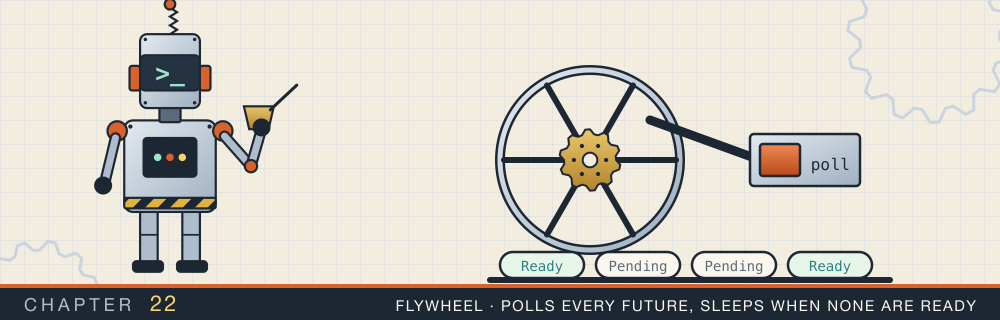
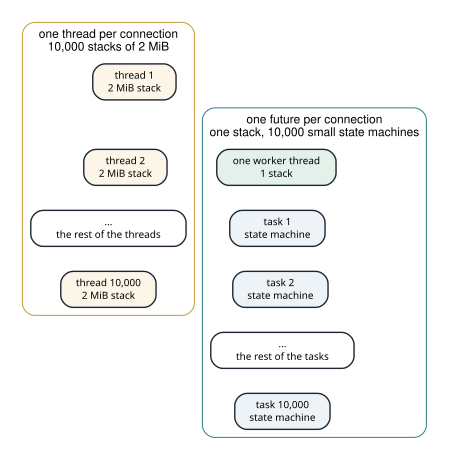
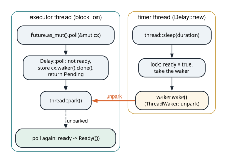
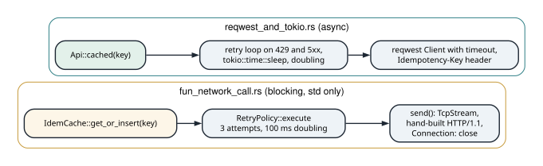

# Async Rust from the executor up

<div class="covers" markdown="1">

This chapter covers

- What `Future::poll`, `Poll::Pending`, and a `Waker` promise each other
- Why one thread can hold thousands of waiting connections
- `block_on`: an executor in a dozen lines that parks the thread between polls
- Two futures written by hand: one that yields, and one that waits on a timer
- A task queue where waking a task is the same as scheduling it
- What an `async` block compiles to, and why `poll` takes `Pin<&mut Self>`
- Two HTTP clients with caching and retries, one blocking and one on Tokio

</div>

The echo server in Chapter 20 assigns a dedicated OS thread to each client, and the HTTP server from Chapter 21 extends that model directly. While a thread-per-connection design handles tens or hundreds of concurrent clients comfortably, it breaks down when a process must maintain thousands of mostly idle connections.

In this chapter, we construct an asynchronous runtime that replaces one thread per connection with a single thread multiplexing many suspended tasks. Starting from the single method defined by the `Future` trait, we build upward to an asynchronous HTTP client running on Tokio.

## 22.1 Why a thread per connection does not scale

A spawned OS thread in Rust reserves a 2 MiB stack by default, and that reservation persists for the thread's entire lifetime, including time spent blocked in `read`. Holding ten thousand idle connections as separate threads reserves roughly 20 GB of virtual address space before any application work occurs.

An alternative model keeps a single OS thread and represents each connection as a **future**: a state object representing an in-progress computation. While awaiting I/O, a suspended future does not occupy a thread stack; it stores only the local state needed to resume from its suspension point.

A **task** is a future managed by a runtime, which schedules and polls the future whenever progress becomes possible.

Because a suspended future retains only values live across its suspension points, an idle connection typically occupies a few hundred bytes rather than two megabytes. Ten thousand idle connections therefore fit in a few megabytes instead of tens of gigabytes, as contrasted in Figure 22.1.

<figure>

<figcaption><b>Figure 22.1</b> A parked thread keeps its stack. A parked future keeps only the values it needs to resume.</figcaption>
</figure>

The trade-off for this memory efficiency is that waiting must be expressed as an explicit state machine. Rust's `async` and `.await` syntax generates that state machine automatically while preserving sequential control flow.

## 22.2 The contract

At the foundation of asynchronous Rust lies the single method of the `Future` trait, which answers whether a computation has finished:

```rust
fn poll(self: Pin<&mut Self>, cx: &mut Context<'_>) -> Poll<Self::Output>;
```

`poll` returns `Poll::Ready(value)` once the computation finishes, or `Poll::Pending` when it cannot proceed yet.

Returning `Pending` carries a strict obligation: before returning, the future must arrange for `cx.waker()` to be invoked once progress becomes possible. The waker is a handle supplied by the executor; calling it notifies the executor that the task is ready to be polled again.

The executor upholds the reciprocal obligation by polling the task again after receiving a wake notification, while remaining idle rather than busy-spinning in the interim. Both halves of this contract are illustrated in Figure 22.2.

<figure>

<figcaption><b>Figure 22.2</b> The poll contract. A dropped waker is the one branch with no error and no panic.</figcaption>
</figure>

Two invariants follow directly from this contract. Polling a future that is not yet ready is always safe, because it returns `Pending` again and costs only one redundant poll. Failing to register a wake, however, breaks liveness: the task returns `Pending`, nothing invokes its waker, and the task never runs again.

<div class="callout warning" markdown="1">

**WARNING** A dropped waker produces no panic, no error, and no CPU activity. The affected task stalls indefinitely while the rest of the program continues normally. When an asynchronous program hangs without visible error, inspect first for a waker that was dropped instead of invoked.

</div>

The receiver type `Pin<&mut Self>` (rather than `&mut self`) is examined in Section 22.6; for now, treat it as a guarantee that the future will not relocate in memory between polls.

## 22.3 The smallest executor

Because `.await` does not invoke the operating system directly, a runtime component must call `poll` and act on `Poll::Pending`. That component is an **executor**.

The minimal useful executor drives a single future on the current thread, parking the thread instead of busy-waiting whenever the future returns `Pending`. Listing 22.1 presents the complete implementation.

<p class="listing"><b>Listing 22.1</b> <code>block_on</code> and its waker (lines 36 to 61). <a href="https://github.com/arpanpathak/cracking-the-systems-programming-interview/blob/prep-v2/rust-interview-lab/src/problems/async_mini.rs">src/problems/async_mini.rs</a></p>

```rust
{{#include ../../rust-interview-lab/src/problems/async_mini.rs:17:29}}

{{#include ../../rust-interview-lab/src/problems/async_mini.rs:36:61}}
```

`block_on` does three things, in order:

1. `Box::pin(future)` moves the future to the heap and pins it there, so its address is the same for every poll.
2. `Waker::from(Arc::new(ThreadWaker(thread::current())))` builds a waker. `ThreadWaker` implements `Wake`, and its `wake` method unparks the thread driving the future. `Waker::from` is the safe way to build a waker without writing a raw vtable.
3. The loop polls. `Ready` returns the value. `Pending` calls `thread::park()`, which sleeps until `unpark` is called on this thread.

`park` can return without anyone calling `unpark`. The loop tolerates that by polling again: a second poll of a future that is not ready returns `Pending` a second time. Spurious wakes are harmless, which is the other half of the contract.

`park` and `unpark` also cover a race the loop depends on. If `unpark` runs before `park`, it leaves a token behind, and the next `park` returns at once.

<figure class="anim">
<video class="motion" src="figures/ch22-poll-wake.mp4" autoplay loop muted playsinline preload="metadata" aria-label="A robot labelled executor thread polls a future that waits on a timer, and hands it a waker drawn as a bell. The future's ready flag is false, so it stores the bell in its waker slot and returns Pending. The executor parks, and its CPU gauge falls to zero. A timer thread sleeps for 50 ms, sets ready to true, takes the bell out of the slot, and rings it, which unparks the executor. The second poll returns Ready. The run then repeats with the line that stores the waker deleted: the timer finds the slot empty, and the executor stays parked forever." data-chapters="[[0.0, &quot;cast&quot;], [4.74, &quot;poll&quot;], [27.42, &quot;park&quot;], [33.14, &quot;wake&quot;], [48.86, &quot;ready&quot;], [63.26, &quot;no waker&quot;]]"></video>
<figcaption><b>Animation 22.1</b> <code>block_on</code> driving a future that waits on a timer, the <code>Delay</code> of section 22.4.2, with the line each thread is running. In the second run the waker is never stored, and the executor never wakes.</figcaption>
</figure>

## 22.4 Two futures written by hand

Almost every leaf future follows one of two patterns: either it immediately re-arms itself to yield control, or it waits on an external event and stores the caller's waker until that event completes.

### 22.4.1 A future that yields to itself

`YieldTimes` returns `Pending` a set number of times before it completes. Nothing is blocking it. It is giving the executor a chance to run other tasks before it finishes its own work.

<p class="listing"><b>Listing 22.2</b> <code>YieldTimes</code>, a future that re-arms itself (lines 63 to 97). <a href="https://github.com/arpanpathak/cracking-the-systems-programming-interview/blob/prep-v2/rust-interview-lab/src/problems/async_mini.rs">src/problems/async_mini.rs</a></p>

```rust
{{#include ../../rust-interview-lab/src/problems/async_mini.rs:63:97}}
```

`YieldTimes` holds two `usize` values, which makes it `Unpin`: safe to move even after a poll. `self.get_mut()` uses that to turn `Pin<&mut Self>` into `&mut Self` without `unsafe`.

One line asks for the next poll: `context.waker().wake_by_ref()`. It runs, then `poll` returns `Pending`. This is what `tokio::task::yield_now` does. `YieldTimes` completes with the number of times it yielded. A test can use that count to check that the executor suspended and resumed it.

### 22.4.2 A future that waits on a timer

`Delay` completes after a wall-clock duration. It is the second shape, and it is the one that looks like real I/O.

Its state is a `ready` flag and an optional stored `Waker`, shared with a background thread through `Arc<Mutex<_>>`.

<p class="listing"><b>Listing 22.3</b> <code>Delay</code> state and constructor (lines 99 to 137). <a href="https://github.com/arpanpathak/cracking-the-systems-programming-interview/blob/prep-v2/rust-interview-lab/src/problems/async_mini.rs">src/problems/async_mini.rs</a></p>

```rust
{{#include ../../rust-interview-lab/src/problems/async_mini.rs:99:137}}
```

`poll` checks `ready`. While it is false, `poll` stores a clone of the current waker and returns `Pending`.

<p class="listing"><b>Listing 22.4</b> <code>Delay</code> as a future (lines 139 to 154). <a href="https://github.com/arpanpathak/cracking-the-systems-programming-interview/blob/prep-v2/rust-interview-lab/src/problems/async_mini.rs">src/problems/async_mini.rs</a></p>

```rust
{{#include ../../rust-interview-lab/src/problems/async_mini.rs:139:154}}
```

The background thread sleeps for the requested duration, sets `ready` to `true`, extracts the stored waker, drops the lock, and invokes `wake()`. The full exchange between the executor and the timer thread is depicted in Figure 22.3.

<figure>

<figcaption><b>Figure 22.3</b> One <code>Delay</code> from start to finish. The executor thread sleeps in <code>park</code>, not in <code>poll</code>.</figcaption>
</figure>

Two details make it correct. `poll` stores the waker on every `Pending`, not only the first. A task can be polled with a different waker each time. A runtime may move the task to another thread, and only the latest waker reaches its current owner. The timer thread wakes after dropping the lock, so the woken executor does not immediately block on a mutex the waker still held.

A production runtime replaces one thread per timer with a single timer wheel, and replaces one thread per socket with the `epoll` reactor from Chapter 20, storing wakers keyed by file descriptor and waking them when `epoll_wait` reports readiness.

## 22.5 Waking is scheduling

`block_on` drives one future. A general executor drives many, and it shows that waking a task and scheduling it are the same operation.

A `Task` holds its future, a handle to the executor's queue, and a `completed` flag. It also implements `Wake`. Waking a task pushes an `Arc` of the task back on the queue.

<p class="listing"><b>Listing 22.5</b> A task, and the <code>Wake</code> impl that reschedules it (lines 156 to 177). <a href="https://github.com/arpanpathak/cracking-the-systems-programming-interview/blob/prep-v2/rust-interview-lab/src/problems/async_mini.rs">src/problems/async_mini.rs</a></p>

```rust
{{#include ../../rust-interview-lab/src/problems/async_mini.rs:156:177}}
```

`spawn` wraps a future in a task and enqueues it.

<p class="listing"><b>Listing 22.6</b> The executor's queue, and <code>spawn</code> (lines 184 to 208). <a href="https://github.com/arpanpathak/cracking-the-systems-programming-interview/blob/prep-v2/rust-interview-lab/src/problems/async_mini.rs">src/problems/async_mini.rs</a></p>

```rust
{{#include ../../rust-interview-lab/src/problems/async_mini.rs:184:208}}
    // ...
}
```

`run` pops tasks one at a time, builds a waker from the task itself, and polls the future. A `Ready` result marks the task completed, so a late wake is skipped by the `completed` check.

<p class="listing"><b>Listing 22.7</b> <code>MiniExecutor::run</code> (lines 210 to 245). <a href="https://github.com/arpanpathak/cracking-the-systems-programming-interview/blob/prep-v2/rust-interview-lab/src/problems/async_mini.rs">src/problems/async_mini.rs</a></p>

```rust
impl MiniExecutor {
    // ...
{{#include ../../rust-interview-lab/src/problems/async_mini.rs:210:245}}
}
```

<figure class="anim">
<video class="motion" src="figures/ch22-task-queue.mp4" autoplay loop muted playsinline preload="metadata" aria-label="Three task tickets wait on a run queue. Each ticket shows its YieldTimes future, the yields it has left, and a bell for its waker. The executor pops the front ticket and polls it. A yield uses up one dot and rings the ticket's own bell, and the ticket flies to the back of the queue. A ticket with no yields left is stamped Ready and moves to the completed column, in the order 1, 2, 3. In a second run, task 1 returns Pending without ringing its bell. It drops out of the queue and is never polled again, while tasks 2 and 3 finish." data-chapters="[[0.0, &quot;spawn&quot;], [5.46, &quot;round 1&quot;], [38.22, &quot;round 2&quot;], [46.68, &quot;the rest&quot;], [65.87, &quot;no wake&quot;]]"></video>
<figcaption><b>Animation 22.2</b> Three tasks take turns on one thread. Waking a task pushes it onto the back of the queue. A task that returns <code>Pending</code> without waking is never polled again.</figcaption>
</figure>

`run` returns when the queue is empty. A task that returned `Pending` without waking is waiting on something outside this executor, and this executor has nothing to park on. A real runtime would park on its timer or its I/O reactor instead of returning.

The `+ Send` bound on spawned futures comes from the waker. A waker may be sent to another thread, as `Delay` does, so the task it can reach must be safe to send too. This is the same bound `tokio::spawn` imposes. It is also why holding a `std::sync::MutexGuard` or an `Rc` across an `.await` in a spawned task is a compile error.

Listings 22.8 and 22.9 are the complete pair: the runtime module, and the program that drives it, with no runtime dependency.

<p class="listing"><b>Listing 22.8</b> The complete runtime, with tests. <a href="https://github.com/arpanpathak/cracking-the-systems-programming-interview/blob/prep-v2/rust-interview-lab/src/problems/async_mini.rs">src/problems/async_mini.rs</a></p>

```rust
{{#include ../../rust-interview-lab/src/problems/async_mini.rs}}
```

<p class="listing"><b>Listing 22.9</b> The program that drives the runtime. <a href="https://github.com/arpanpathak/cracking-the-systems-programming-interview/blob/prep-v2/rust-interview-lab/src/bin/async_demo.rs">src/bin/async_demo.rs</a></p>

```rust
{{#include ../../rust-interview-lab/src/bin/async_demo.rs}}
```

```text
$ cargo run --bin async_demo
== block_on drives a hand-written future ==
YieldTimes suspended and resumed 3 time(s)

== block_on drives an async block ==
async block finished with 3

== block_on parks the thread until the waker fires ==
Delay completed after 52.083242ms

== MiniExecutor runs independent tasks ==
task 1 completed after 1 yield(s)
task 2 completed after 2 yield(s)
task 3 completed after 3 yield(s)
3 task(s) completed
```

The tasks complete in the order 1, 2, 3 because each yield pushes the active task to the back of the run queue. Each task receives one turn per round, mirroring the round-robin scheduler from Chapter 15 with each yield acting as the end of a time slice.

## 22.6 What `async` compiles to, and why `Pin`

An `async` block or function is syntactic sugar that the compiler lowers into an anonymous type implementing `Future`. That generated type is structured as a state-machine enum with one variant per suspension point, where each variant stores the local variables that remain live across that point.

The block executed by the demo is:

```rust
async {
    let first = YieldTimes::new(1).await;
    let second = YieldTimes::new(2).await;
    first + second
}
```

The compiler synthesizes an enum with four states: `Start`, `Awaiting first`, `Awaiting second`, and `Done`. The resulting state transitions and the values retained in each state are illustrated in Figure 22.4.

<figure>

<figcaption><b>Figure 22.4</b> The state machine behind the async block. The value <code>first</code> survives the second <code>.await</code>, so it is stored in the second state.</figcaption>
</figure>

Polling the block runs code until the next `.await` whose inner future returns `Pending`. It saves the state, stores the inner future and the live locals, and returns `Pending` too. A later poll resumes at the saved state rather than starting the block again.

<figure class="anim">
<video class="motion" src="figures/ch22-await.mp4" autoplay loop muted playsinline preload="metadata" aria-label="The async block's code, with a bookmark at the await where the next poll resumes, beside the future's memory: a state tag and two slots. Poll 1 runs to the first await, stores YieldTimes(1), and the tag flips to AwaitingFirst. Poll 2 resumes at the bookmark. first = 1 moves into memory, YieldTimes(2) is stored, and the tag flips to AwaitingSecond. Poll 3 returns Pending and stays in the same state. Poll 4 computes first + second = 3, returns Ready(3), and the tag flips to Done. A fifth poll would find Done and panic." data-chapters="[[0.0, &quot;the block&quot;], [5.46, &quot;poll 1&quot;], [20.58, &quot;poll 2&quot;], [43.5, &quot;poll 3&quot;], [53.04, &quot;poll 4&quot;], [69.78, &quot;poll 5?&quot;]]"></video>
<figcaption><b>Animation 22.3</b> The same block, one poll at a time. <code>first</code> lives across the second <code>.await</code>, so the future stores it. <code>second</code> does not, so the future never stores it.</figcaption>
</figure>

`first` survives the second `.await`, so it is stored in the `Awaiting second` state. The size of a future is fixed once its type is known. The compiler sizes each state to hold the largest set of locals that can live there.

The remaining question is why `poll` requires `Pin<&mut Self>`. A suspended state may hold a reference pointing into another field of the same state machine, such as a local buffer borrowed across an `.await`. If the state machine were moved in memory after creating that borrow, the internal reference would become a dangling pointer to the old address. Both the unpinned failure and the pinned solution are contrasted in Figure 22.5.

<figure>

<figcaption><b>Figure 22.5</b> Why a self-referential future must not move. Pinning keeps a borrow of one field valid across a suspension point.</figcaption>
</figure>

`Pin<&mut Self>` is the promise that the value will not move after the first poll. That is why `block_on` calls `Box::pin` and why `MiniExecutor` stores `Pin<Box<...>>`. Both keep the future at one address for its whole life.

Only self-referential or address-sensitive types require pinning. Any type whose values can relocate safely in memory after being polled implements the auto-trait `Unpin`, for which `Pin` imposes no restriction. `YieldTimes` is `Unpin` because it contains only two integers, allowing its `poll` implementation to call `self.get_mut()` and access `&mut Self` directly.

<figure class="anim">
<video class="motion" src="figures/ch22-pin.mp4" autoplay loop muted playsinline preload="metadata" aria-label="A future holds buf, the bytes p i n g, and r, a reference to buf that holds the address 0x1000. The future moves to 0x2000. Its bytes are copied, but r still holds 0x1000, so its arrow stretches back to the freed place, which now holds garbage. Next, Box::pin puts the future on the heap, marked with a pin. Moving the Pin&lt;Box&lt;_&gt;&gt; handle from one stack slot to another leaves the future where it is, so r stays valid. An attempt to swap the future out is rejected at compile time. Last, a YieldTimes value, which is Unpin, moves freely." data-chapters="[[0.0, &quot;a borrow&quot;], [5.7, &quot;a move&quot;], [25.5, &quot;pinned&quot;], [39.72, &quot;rejected&quot;], [46.38, &quot;Unpin&quot;]]"></video>
<figcaption><b>Animation 22.4</b> A move copies bytes and leaves a reference into the old copy behind. <code>Box::pin</code> keeps the future at one address, so moving the handle the program holds moves only a pointer.</figcaption>
</figure>

## 22.7 Two HTTP clients with caching, retries, and idempotency

The final two programs put a runtime to practical use. Both send `POST /post` with a JSON body and the idempotency key `create-demo-001` to `httpbin.org`, a public echo service, and both compose the same three layers: a cache, a retry policy, and a transport. Both client stacks are compared in Figure 22.6.

<figure>

<figcaption><b>Figure 22.6</b> The same three layers in both clients: cache, retry, transport.</figcaption>
</figure>

In Chapter 19, retries and idempotency keys were developed in isolation; here they are integrated with live network requests.

### 22.7.1 A blocking client over `TcpStream`

The blocking client is built from four parts: a request type, a cache, a retry policy, and the client that joins
them. A request is an enum, and each variant carries exactly the fields its HTTP method needs:

```rust
{{#include ../../rust-interview-lab/src/bin/fun_network_call.rs:1:25}}
```

`RuntimeError` is a boxed error, so `?` can return any error type from `main`. `RequestHeader` is an alias for a
list of (name, value) pairs. A `Get` has no body and a `Post` has one, so a `GET` with a body cannot be built.

The cache keeps each successful response under its idempotency key:

```rust
{{#include ../../rust-interview-lab/src/bin/fun_network_call.rs:27:54}}
```

`IdemCache` is chapter 19's `Idempotent<K, V>` store with `String` keys and values. `get_or_insert` returns the
stored response if there is one. Otherwise it runs `f`, stores the result, and returns it. A failure is not
stored, so a later call tries again. The lock is held while `f` runs, so two calls with one key cannot both send.

The retry policy runs an operation up to `max_attempts` times:

```rust
{{#include ../../rust-interview-lab/src/bin/fun_network_call.rs:56:88}}
```

After each failure except the last, `execute` sleeps for `base × 2^(attempt - 1)`, capped at `max_delay`: 100 ms
after the first failure, 200 ms after the second. `F` is `FnMut`, not `FnOnce`, because the loop calls it more
than once.

The client holds the server's address and one of each layer. `execute` joins the layers in one line:

```rust
{{#include ../../rust-interview-lab/src/bin/fun_network_call.rs:90:111}}
    // ...
}
```

The cache calls the retry policy only on a miss, and the retry policy calls `send` once per attempt.

`send` writes the request by hand and reads the response:

```rust
impl HttpClient {
    // ...
{{#include ../../rust-interview-lab/src/bin/fun_network_call.rs:113:147}}
}
```

The `match` turns either variant into the same four parts: the method name, the path, the headers, and an
optional body. The request text then follows section 21.1. It is the request line, `Host`,
`Connection: close`, and the caller's headers. A body adds `Content-Length`, then the blank line, then the body.
`Connection: close` lets `read_to_string` read the whole response, because the server closes the connection at
the end. `split_once("\r\n\r\n")` drops the status line and the headers, and keeps the body.

`main` reads with a `GET`, then creates an item with a `POST`. Each request has its own idempotency key:

```rust
{{#include ../../rust-interview-lab/src/bin/fun_network_call.rs:150:181}}
```

<p class="listing"><b>Listing 22.10</b> Cache, retry, and a hand-written HTTP/1.1 request. <a href="https://github.com/arpanpathak/cracking-the-systems-programming-interview/blob/prep-v2/rust-interview-lab/src/bin/fun_network_call.rs">src/bin/fun_network_call.rs</a></p>

```rust
{{#include ../../rust-interview-lab/src/bin/fun_network_call.rs}}
```

Two omissions separate this implementation from a production client, and both are visible in the code:

- The status code is never read. `send` returns whatever follows the first blank line. A `500` error page is returned as success, cached under the idempotency key, and never retried. Only transport errors reach the retry loop.
- Everything is retried. A policy should ask the error, as `Retryable` does in chapter 19. Here a DNS failure for a misspelled host is retried three times.

### 22.7.2 An async client with `reqwest`

The async client keeps the same layers, on Tokio and the `reqwest` crate. It also reads the status code, and
decides from it whether to retry. Its settings come first:

```rust
{{#include ../../rust-interview-lab/src/bin/reqwest_and_tokio.rs:1:28}}
```

`RETRY` lists the statuses to retry, where the server may succeed later: 429, Too Many Requests, and four
5xx codes. `Config` holds the base URL, the retry settings, and a timeout. `Api` holds a `reqwest::Client`, the
cache, and the configuration. `type Error = Box<dyn std::error::Error + Send + Sync>` lets errors cross task
boundaries, because a `Send + Sync` error can move between Tokio's worker threads.

`new` builds the HTTP client, and two helpers read and write the cache:

```rust
{{#include ../../rust-interview-lab/src/bin/reqwest_and_tokio.rs:30:54}}
    // ...
}
```

- `Client::builder().timeout(cfg.timeout)` bounds every request. A client without a timeout can wait forever on
  a server that accepted the connection and never answered.
- The cache is a `std::sync::Mutex`. That is allowed in async code because the guard is never held across an
  `.await`: `cached` and `store` lock, act, and return. The lock is taken with
  `unwrap_or_else(|e| e.into_inner())`, chapter 16's ignore-the-poison choice. A `HashMap` insert cannot leave
  the map half-updated, so recovering the guard is safe here.

`call` checks the cache, then sends and retries:

```rust
impl Api {
    // ...
{{#include ../../rust-interview-lab/src/bin/reqwest_and_tokio.rs:56:100}}
}
```

Each attempt builds a request with `self.http.request(method, url)`. It adds two headers, and for a body calls
`req.json(b)`, which serializes the JSON value and sets `Content-Type`. The request carries
`Idempotency-Key: create-demo-001`, so a server that honors the header can deduplicate a retried `POST`. The
client-side cache gives the same guarantee within one process.

`req.send().await?` sends the request and waits for the response headers. `resp.text().await?` waits for the
body. The `match` on the status then has three arms:

- A success is stored in the cache and returned.
- A status in `RETRY`, with attempts left, sleeps and doubles the delay.
- Anything else is returned as an error that names the status and the attempts.

`tokio::time::sleep` does not block the thread. It returns a future that registers with Tokio's timer and
returns `Pending`, which is the `Delay` of section 22.4.2 done properly. Other tasks run on the same thread while
this one waits.

`main` builds the client and makes one call:

```rust
{{#include ../../rust-interview-lab/src/bin/reqwest_and_tokio.rs:103:119}}
```

`#[tokio::main]` starts a Tokio runtime and runs `main` as its first task, so `main` can be `async`.
`serde_json::json!` builds a JSON value from JSON-like syntax.

<p class="listing"><b>Listing 22.11</b> The same layers on Tokio. <a href="https://github.com/arpanpathak/cracking-the-systems-programming-interview/blob/prep-v2/rust-interview-lab/src/bin/reqwest_and_tokio.rs">src/bin/reqwest_and_tokio.rs</a></p>

```rust
{{#include ../../rust-interview-lab/src/bin/reqwest_and_tokio.rs}}
```

### 22.7.3 The two clients side by side

The asynchronous client has the opposite gap from the blocking one. It reads the status code, but a transport error from `send().await?` is not retried at all. The blocking client retries transport errors and never reads the status code. Merging the two means retrying both, with a policy that asks the error which kind it is.

Neither client adds jitter, and neither honors `Retry-After`; both techniques are implemented in the delay policy from Chapter 19.

### 22.7.4 Where the merged client belongs

The repository has an empty crate named `rust-async-http-examples`, created for this. Its first program can be the client from section 22.7.2 moved into `lib.rs`, with the retry and cache layers exposed for testing. Its tests can then run against a local server such as chapter 17's, instead of a public one.

## 22.8 Questions that come up

**"What happens when a future returns `Pending`?"**
It has arranged for its waker to be called when it can make progress. The executor stops polling it and runs other tasks. When the waker fires, the executor polls it again.

**"Why does `poll` take `Pin<&mut Self>`?"**
An async state machine can hold a reference into itself across an `.await`. Pinning guarantees the value will not move after the first poll, so that reference stays valid.

**"Why must spawned futures be `Send` in Tokio?"**
The multi-threaded runtime may resume a task on a different worker thread after any `.await`. Everything the task holds across an `.await` must therefore be safe to move between threads.

**"Can blocking code be called inside an async task?"**
Only briefly. A blocking call holds the worker thread, stalling every other task scheduled on it. Offload blocking work with `tokio::task::spawn_blocking`, and use asynchronous equivalents for I/O and timers.

**"Is a `std::sync::Mutex` allowed in async code?"**
Yes, if the guard is dropped before the next `.await`. Holding it across an `.await` can block the worker or deadlock it. Use `tokio::sync::Mutex` when the lock must be held across an await.

<div class="summary" markdown="1">

## Summary

- A future has one method, `poll`. `Ready` finishes the task. `Pending` is a promise that the waker will be called when progress becomes possible.
- The executor polls again after a wake and does not spin. Spurious wakes are harmless; a missing wake is a task that never runs again, with no error.
- `block_on` is the whole executor for one future: pin, build a waker from the current thread, poll, and park on `Pending`.
- A future either re-arms itself (`YieldTimes`, `yield_now`) or keeps a waker for an event outside the executor (`Delay`, sockets, timers).
- Waking a task and scheduling it are the same operation. `Task` implements `Wake`, and `wake` pushes the task back on the queue.
- An `async` block compiles to an enum with one variant per suspension point. Each variant holds the values alive across that point.
- `poll` takes `Pin<&mut Self>` because a state can borrow from another field of the same future. Pinning keeps the value at one address, so the borrow stays valid.
- A spawned future must be `Send`, because a waker may move it to another worker thread.
- The two HTTP clients share three layers: cache, retry, and transport. The blocking client never reads the status code; the async one never retries a transport error.

</div>

In Chapter 23, we move beneath standard `read` and `write` system calls to map a file directly into virtual memory, observe the page faults that populate it, and transmit a file over a socket without copying its payload through user space.

## Exercises

1. Add a poll counter to `block_on` and print it. Check that the count matches the number of wakes for `Delay`, and that a spurious wake adds one poll without breaking anything.
2. Write a `ReadyNow` future that returns `Ready` on its first poll. Confirm that `MiniExecutor::run` completes it in one poll.
3. Change `MiniExecutor::run` to return the number of tasks it completed. Test it with tasks that yield different numbers of times.
4. Give `Delay` a `Drop` that sets a flag the timer thread checks, so a cancelled delay does not keep a thread asleep.
5. Merge the two HTTP clients. Retry a retryable status and a transport error, add jitter to the delay, and honor `Retry-After` when the server sends it.
6. Move the async client into `rust-async-http-examples` as a library, and test it against chapter 21's local server.
