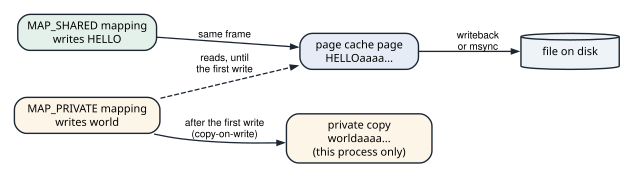

# Mapping files and copying less

<div class="covers" markdown="1">

This chapter covers

- The kernel page cache: how file data resides in physical RAM and why `read` incurs a user-space copy
- Demand-paged virtual memory mappings (`mmap`): page table population via minor and major page faults
- Shared (`MAP_SHARED`) and private (`MAP_PRIVATE`) mappings, explicit writeback via `msync`, and copy-on-write isolation
- Asynchronous error delivery (`SIGBUS`), cross-process aliasing hazards, and selection criteria between `mmap` and `read`
- Kernel-space file-to-socket transfer via `sendfile` and scatter-gather DMA zero-copy transmission
- The architectural boundary where user-space TLS encryption and dynamic compression preclude zero-copy I/O

</div>

Every conventional file transfer across the user-kernel boundary pays a memory bandwidth tax: the kernel copies file bytes from its internal page cache into a caller-allocated buffer, and a subsequent network transmission copies those same bytes back into a kernel socket buffer. Eliminating redundant copies requires either exposing page cache frames directly in a process's virtual address space through demand-paged memory mappings (`mmap`) or delegating file-to-socket movement entirely to the kernel (`sendfile`). Both mechanisms shift the cost profile of I/O from linear byte copying to virtual memory management, page fault handling, and scatter-gather DMA descriptors.

Two reference programs quantify these mechanisms. `mmap_file` maps a 64-page file into virtual memory, records minor page faults across consecutive traversal passes, and contrasts write propagation under shared and private mappings. `zero_copy` transmits a 256 MiB file over a loopback TCP socket, measuring system call volume and wall-clock throughput for a conventional `read`/`write` loop against Linux `sendfile`.

## 23.1 Where a file's bytes live

The operating system maintains recently accessed file blocks in physical memory inside the **kernel page cache**, indexed by file inode and page offset (page 0 spans bytes 0 to 4,095, page 1 spans bytes 4,096 to 8,191, and so forth). All buffered file I/O traverses this cache: reading an uncached page triggers a storage read into a newly allocated page frame, whereas subsequent reads of that page by any process are satisfied directly from RAM.

Because the page cache resides in kernel address space, the `read` system call cannot expose a cached physical frame directly to user space. Instead, the kernel copies the requested byte range from the page cache into a caller-supplied buffer. Upon return from `read(fd, &mut buffer)`, the same data occupies physical memory twice: once in the kernel page cache and once in the process's heap or stack buffer.

A **demand-paged memory mapping** eliminates this duplication. The `mmap` system call reserves a contiguous virtual address range within the process's address space, associates it with a specified byte range of an open file descriptor, and returns the base virtual address. When the process dereferences an address within that range, the hardware memory management unit (MMU) translates the virtual address through the page table directly to the physical frame in the kernel page cache (Figure 23.1), granting direct in-place access without a copy.

<figure>

<figcaption><b>Figure 23.1</b> <code>read</code> copies from the page cache into a user-space buffer. A mapping points at the page cache's frames.</figcaption>
</figure>

As depicted in Figure 23.2, a file mapping constitutes a standard virtual memory area (VMA) within the process's address space alongside the stack, heap, and executable text segments. Its page table entries resolve directly to the physical frames managed by the kernel page cache.

<figure>

<figcaption><b>Figure 23.2</b> A mapping is a region of virtual addresses. Its page table entries point into the page cache.</figcaption>
</figure>

Invoking `mmap` transfers no file data and populates no page table entries; it records only the virtual memory area metadata in the kernel. The initial memory access to each mapped page triggers a hardware page fault (Section 15.5), trapping into the kernel. The page fault handler locates the target page in the page cache (or schedules a block I/O read if the page is absent), installs the corresponding page table entry, and resumes the faulting instruction. A fault satisfied from an already-resident page cache frame is a **minor fault** (costing microseconds), whereas a fault requiring block storage I/O is a **major fault** (dominated by storage latency).

For a 64-page mapping whose backing file is already resident in the page cache, fault accumulation proceeds in three distinct phases:

| Step | What the kernel does | Faults |
|---|---|---|
| `mmap` of 64 pages | reserves 64 pages of addresses, fills no entries | 0 |
| first read of each page | fills that page's entry | one per page |
| second read of each page | nothing: the entries are already filled | 0 |

The remainder of this section encapsulates the mapping lifecycle in an RAII Rust wrapper and verifies this fault profile empirically.

### 23.1.1 A type that owns a mapping

Direct invocation of `mmap` requires FFI bindings through the `libc` crate. A live mapping consists of a base virtual address and a byte length that must be released via `munmap` exactly once. Encapsulating these invariants in an owning struct with a `Drop` implementation ensures deterministic unmapping:

```rust
{{#include ../../rust-interview-lab/src/bin/mmap_file.rs:10:23}}
```

The `NonNull<u8>` pointer encodes the invariant that a constructed `Mapping` always holds a non-null virtual base address. The `libc` crate exposes POSIX C interfaces through `unsafe extern "C"` declarations parameterized by platform ABI types: `c_int` for C `int`, `size_t` for unsigned byte counts, `off_t` for file offsets, and `*mut c_void` for untyped pointers. The contract of `mmap` is specified as follows:

```rust
unsafe extern "C" {
    fn mmap(
        addr: *mut c_void, // where to map; null lets the kernel choose
        len: size_t,       // how many bytes to map
        prot: c_int,       // what is allowed: PROT_READ | PROT_WRITE
        flags: c_int,      // MAP_SHARED or MAP_PRIVATE (section 23.2)
        fd: c_int,         // the open file
        offset: off_t,     // where in the file; a multiple of the page size
    ) -> *mut c_void;      // the mapping's address, or MAP_FAILED
}
```

Invoking an `extern "C"` function requires an `unsafe` block because the Rust compiler cannot verify pointer validity, alignment, or lifetime invariants across the foreign function boundary. `Mapping::new` executes the system call and validates its return value:

```rust
{{#include ../../rust-interview-lab/src/bin/mmap_file.rs:25:56}}
    // ...
}
```

On failure, `mmap` returns the sentinel value `MAP_FAILED` (`(void *)-1`) rather than a null pointer; the constructor therefore compares the result against `MAP_FAILED` before reading `errno` via `io::Error::last_os_error()`.

Safe byte-level access is exposed through shared and mutable slices constructed from the base pointer and length:

```rust
impl Mapping {
    // ...
{{#include ../../rust-interview-lab/src/bin/mmap_file.rs:58:66}}
    // ...
}
```

Because `bytes_mut` requires `&mut self`, the borrow checker enforces exclusive mutable access within the current process, matching the aliasing discipline of `Vec<u8>`. Releasing the virtual address range in `Drop` invokes `munmap` with the original base address and length:

```rust
unsafe extern "C" {
    fn munmap(addr: *mut c_void, len: size_t) -> c_int; // 0, or -1 with errno set
}
```


```rust
{{#include ../../rust-interview-lab/src/bin/mmap_file.rs:80:88}}
```

The lifetime of any slice returned by `bytes` or `bytes_mut` is bound to `&self` or `&mut self`, preventing a slice from outliving the `Mapping` instance. Without this compile-time lifetime tie, dereferencing a slice after `munmap` would access an unmapped virtual address and raise `SIGSEGV`.

### 23.1.2 Counting the faults

The kernel maintains per-process resource accounting counters, including minor and major page fault totals. `getrusage` populates a caller-supplied `rusage` structure with these counters, while `sysconf` queries runtime system parameters such as the hardware page size:

```rust
unsafe extern "C" {
    fn getrusage(
        who: c_int,          // RUSAGE_SELF: this process
        usage: *mut rusage,  // filled in; ru_minflt counts minor faults
    ) -> c_int;              // 0, or -1 with errno set
    fn sysconf(name: c_int) -> c_long; // _SC_PAGESIZE gives the page size
}
```

Sampling `ru_minflt` immediately before and after a traversal pass isolates the exact fault count incurred by that pass:

```rust
{{#include ../../rust-interview-lab/src/bin/mmap_file.rs:97:116}}
```

`touch_every_page` reads one byte per page by advancing an iterator with `step_by(page)`. Accumulating and returning the byte sum introduces a data dependency that prevents dead-code elimination from optimizing away the memory loads.

`main` creates a 64-page file, maps it with `MAP_SHARED`, and executes two consecutive traversal passes:

```rust
fn main() -> io::Result<()> {
    // ...
{{#include ../../rust-interview-lab/src/bin/mmap_file.rs:138:149}}
    // ...
}
```

Animation 23.1 traces both traversal passes, the shared and private write behaviors of Section 23.2, and the truncation fault of Section 23.2.1.

<figure class="anim">
<video class="motion" src="figures/ch23-faults.mp4" autoplay loop muted playsinline preload="metadata" aria-label="The program's thread as a robot, its page table as a grid of 64 empty entries, and the kernel's page cache holding the file's 64 pages beside the file on disk. The first read of page 0 finds the entry empty: a page fault stops the thread. The kernel finds page 0 in the page cache, a minor fault, and fills the entry. Every other page takes the same path, and the first-pass counter reaches 64. The second pass sweeps all 64 entries with no fault. Writing HELLO through the shared mapping changes the page cache's page 0, and msync carries it to the disk. A private mapping starts with no entries filled; writing world to page 0 faults, the kernel copies page 0 into a private frame, and only the copy holds world. In a last run another process truncates the file to one page; the kernel drops pages 1 to 63 and empties their entries, and the next read of page 1 ends in SIGBUS." data-chapters="[[0.0, &quot;mmap&quot;], [10.62, &quot;first pass&quot;], [48.72, &quot;second pass&quot;], [58.98, &quot;HELLO&quot;], [70.8, &quot;world&quot;], [89.28, &quot;truncated&quot;]]"></video>
<figcaption><b>Animation 23.1</b> The first touch of each page faults, and the kernel fills the entry from the page cache. A first write to a private mapping copies the page. A page truncated away leaves nothing to fill the entry with.</figcaption>
</figure>

On macOS, the measured fault counts match the theoretical single-page-per-fault model exactly:

```text
$ cargo run --bin mmap_file
page size 4096 bytes, file 64 pages (262144 bytes)

first pass over the mapping:  64 minor faults
second pass over the mapping: 0 minor faults
```

Every fault is classified as minor because the preceding `fs::write` call already populated the kernel page cache with all 64 pages; no block device reads occur during traversal.

On Linux, the identical binary reports `first pass over the mapping:  5 minor faults`. During a read fault on a file-backed mapping, the Linux virtual memory subsystem performs **fault-around**: it speculatively installs page table entries for neighboring pages that are already resident in the page cache. With the default fault-around window of 64 KiB (16 pages of 4 KiB each), traversing 64 pages requires a minimum of 4 fault-around traps. On both operating systems, the second pass incurs zero faults because all 64 page table entries remain resident.

## 23.2 Shared and private mappings

The `flags` parameter passed to `mmap` determines how store instructions to mapped pages interact with the kernel page cache and backing file (Figure 23.3):

- **`MAP_SHARED`**: page table entries map directly to the shared page cache frames with write permissions enabled. A store modifies the cached page in place, making the update immediately visible to every process mapping or reading the same file. The kernel flushes modified (dirty) pages to storage asynchronously during background **writeback**.
- **`MAP_PRIVATE`**: page table entries initially map to the shared page cache frames, but the kernel marks those entries read-only in hardware. The first store to a page triggers a protection fault; the kernel allocates a fresh anonymous physical frame, copies the original page contents into it, updates the process's page table entry to point to the private frame with write permission, and resumes the store. This **copy-on-write** (CoW) isolation ensures that modifications remain private to the process and never propagate to the backing file.

<figure>

<figcaption><b>Figure 23.3</b> A shared mapping writes into the page cache. A private mapping copies the page on its first write.</figcaption>
</figure>

Background writeback operates on the kernel's dirty-page flushing schedule (commonly bounded near 30 seconds). When durability requires flushing dirty pages at a deterministic boundary, the application invokes `msync`:

```rust
unsafe extern "C" {
    fn msync(
        addr: *mut c_void, // start of the range, as returned by mmap
        len: size_t,       // length of the range
        flags: c_int,      // MS_SYNC: return after the write completes
    ) -> c_int;            // 0, or -1 with errno set
}
```

Passing `MS_SYNC` blocks the calling thread until all dirty pages within the specified virtual range have been written to the underlying storage subsystem:

```rust
impl Mapping {
    // ...
{{#include ../../rust-interview-lab/src/bin/mmap_file.rs:68:77}}
}
```

`main` writes `HELLO` through the shared mapping and synchronizes it to disk, then creates a `MAP_PRIVATE` mapping of the same file and writes `world`:

```rust
fn main() -> io::Result<()> {
    // ...
{{#include ../../rust-interview-lab/src/bin/mmap_file.rs:151:166}}
    // ...
}
```

`file_prefix` inspects the backing file via `fs::read`, querying the kernel page cache directly rather than the private mapping:

```text
after writing HELLO through MAP_SHARED, the file starts with "HELLO"
after writing world through MAP_PRIVATE, the mapping holds "world"
and the file still starts with "HELLO"
```

POSIX `fork` relies on this same copy-on-write primitive at process granularity. The kernel duplicates the parent's page tables for the child and marks all writable anonymous pages read-only in both processes; physical frame duplication is deferred until either process executes a store to a shared page.

### 23.2.1 What a mapping cannot report

A failing `read` system call returns `-1` and sets `errno`, enabling synchronous error handling in user space. A load or store instruction targeting a memory-mapped address has no error return channel; consequently, the kernel must report I/O and bounds failures asynchronously via signals:

- If another process truncates the backing file, physical pages beyond the new file length are invalidated. Dereferencing a virtual address in the truncated region raises `SIGBUS`, which terminates the process unless a signal handler is registered.
- If the storage device returns a media or transport error while servicing a major page fault, the kernel likewise delivers `SIGBUS` to the faulting thread.

Furthermore, Rust's borrow checker enforces aliasing invariants only within a single process. A `&[u8]` slice asserts that its referenced bytes remain immutable for the duration of the borrow, yet an external process can mutate a `MAP_SHARED` backing file concurrently. `Mapping::bytes` is therefore sound only under the external precondition that no concurrent writer modifies the file. For this reason, the ecosystem `memmap2` crate marks `Mmap::map` as an `unsafe fn`, delegating that cross-process aliasing contract to the caller.

### 23.2.2 When to map, and when to read

Eliminating the kernel-to-user copy is not cost-free. A memory mapping incurs page fault trap overhead on first access to each page, consumes virtual address space, and requires a **TLB shootdown** upon `munmap`: the kernel must issue inter-processor interrupts (IPIs) to invalidate stale translation lookaside buffer entries across all CPU cores executing threads of the process.

| Access pattern | Better tool | Reason |
|---|---|---|
| Read a file once, front to back | `read` into a reused buffer | readahead keeps the page cache ahead of the reader, and one buffer is cheap to copy into |
| Random reads over a large file, repeated | `mmap` | each page faults once, then reads cost what memory reads cost |
| Many processes reading the same large file | `mmap` (shared, read-only) | every process uses the page cache's single copy |
| Files that other processes may truncate | `read` | a failed `read` returns an error instead of raising `SIGBUS` |

Embedded storage engines such as LMDB map their B-tree data files to exploit zero-overhead repeated random reads and cross-process page cache sharing, whereas streaming log processors and file-copy utilities favor sequential `read` with a reused buffer to avoid page fault and TLB invalidation costs.

## 23.3 Sending a file to a socket

A static file server transmits file contents from disk to network sockets without inspecting or transforming the payload. A conventional implementation loops over `read` and `write`: `read` copies bytes from the kernel page cache into a user-space buffer, and `write` copies those bytes from the user-space buffer into the kernel's socket send buffer (Figure 23.4). Each chunk requires two system calls, two context-switch boundaries, and two CPU-driven memory copies solely because the POSIX `read`/`write` interface routes data through a user-space buffer.

The `sendfile` system call transfers bytes directly from a file descriptor to a socket descriptor entirely inside the kernel. A single invocation specifies the destination socket, source file, starting offset, and byte count. On network interface cards (NICs) that support scatter-gather DMA (`NETIF_F_SG`), the kernel attaches references to the page cache frames directly to the socket buffer descriptors (`sk_buff`) and instructs the NIC to read payload bytes directly from physical memory via DMA. This **zero-copy** path eliminates both CPU payload copies and reduces system call overhead to a single transition per transfer segment.

<figure>

<figcaption><b>Figure 23.4</b> The two copies of a <code>read</code>/<code>write</code> loop, and the path of <code>sendfile</code>.</figcaption>
</figure>

### 23.3.1 Measuring both

Because Linux `sendfile` accepts a socket as `out_fd` with a distinct signature from BSD and macOS, `zero_copy` isolates its implementation inside a Linux-conditional module. `connected_pair` establishes a loopback TCP connection and spawns a consumer thread that drains the receiving socket to verify complete delivery:

```rust
{{#include ../../rust-interview-lab/src/bin/zero_copy.rs:10:45}}
    // ...
}
```

The `Transfer` struct records elapsed duration and system call count for each benchmark pass. Joining the receiver thread returns the total byte count observed on the peer socket, verifying that no bytes were dropped or truncated.

The baseline `copy_loop` reads up to `buffer_size` bytes per iteration and transmits them via `write_all`, incrementing the system call counter on each operation:

```rust
mod linux {
    // ...
{{#include ../../rust-interview-lab/src/bin/zero_copy.rs:47:71}}
    // ...
}
```

Because `write_all` may issue multiple underlying `write` calls whenever the socket send buffer fills, counting one call per `write_all` yields a conservative lower bound on total system calls.

The `sendfile` implementation allocates no user-space transfer buffer and invokes the kernel transfer interface directly:

```rust
unsafe extern "C" {
    fn sendfile(
        out_fd: c_int,       // where the bytes go: the socket
        in_fd: c_int,        // where they come from: the file
        offset: *mut off_t,  // where to start reading; advanced by the kernel
        count: size_t,       // at most this many bytes
    ) -> ssize_t;            // bytes sent, or -1 with errno set
}
```

The transfer loop invokes `sendfile` repeatedly until `offset` reaches the file length:

```rust
mod linux {
    // ...
{{#include ../../rust-interview-lab/src/bin/zero_copy.rs:73:101}}
    // ...
}
```

On each call, the kernel advances `*offset` by the number of bytes transferred. Linux caps a single `sendfile` call at `0x7ffff000` (2,147,479,552) bytes, and signal delivery can cause a short transfer; looping until completion handles both cases, though a 256 MiB loopback transfer completes in a single call.

`main` creates a 256 MiB file and performs an untimed warm-up transfer so that both timed runs operate against a hot page cache. Executed in release mode inside a Linux container:

```text
$ cargo run --release --bin zero_copy
method                        MiB   syscalls         ms        MiB/s
read/write, 64 KiB            256       8193      316.4          809
sendfile                      256          1      194.3         1318
```

Transferring 256 MiB in 64 KiB chunks requires 4,096 `read` calls, 4,096 `write` calls, and one terminal `read` returning 0 (EOF), totaling 8,193 system calls. `sendfile` completed the identical transfer in 1 system call, reducing elapsed time by approximately 39%. Both runs share the fixed overhead of loopback TCP segmentation and the local receiver thread copying bytes into its own buffer; over a physical NIC to a remote host, eliminating sender-side copies represents a substantially larger fraction of total CPU cost.

### 23.3.2 Where zero-copy stops

`sendfile` requires that bytes leave the kernel unmodified relative to their representation in the page cache. Any payload transformation forces the CPU to read and rewrite every byte:

- **TLS encryption.** User-space TLS implementations such as `rustls` encrypt records inside the application process. Serving a file over HTTPS requires reading plaintext into user space, encrypting it into ciphertext buffers, and writing the ciphertext to the socket. Linux **kernel TLS** (kTLS) restores zero-copy transmission by allowing the user-space library to perform the handshake and then install the symmetric session keys into the kernel socket via `setsockopt(SOL_TLS)`. With kTLS active, `sendfile` transfers page cache frames directly while the kernel (or a kTLS-capable NIC) encrypts records inline.
- **On-the-fly compression.** Dynamic response compression (`gzip`, `brotli`, `zstd`) requires reading every plaintext byte into CPU registers. Pre-compressing static assets on disk restores eligibility for `sendfile` by allowing the kernel to transmit the compressed representation directly.

## 23.4 The complete programs

<p class="listing"><b>Listing 23.1</b> Shared and private mappings, and the faults that load them. <a href="https://github.com/arpanpathak/cracking-the-systems-programming-interview/blob/prep-v2/rust-interview-lab/src/bin/mmap_file.rs">src/bin/mmap_file.rs</a></p>

```rust
{{#include ../../rust-interview-lab/src/bin/mmap_file.rs}}
```

```text
$ cargo run --bin mmap_file
page size 4096 bytes, file 64 pages (262144 bytes)

first pass over the mapping:  64 minor faults
second pass over the mapping: 0 minor faults

after writing HELLO through MAP_SHARED, the file starts with "HELLO"
after writing world through MAP_PRIVATE, the mapping holds "world"
and the file still starts with "HELLO"
```

<p class="listing"><b>Listing 23.2</b> A file sent over a socket with a <code>read</code>/<code>write</code> loop and with <code>sendfile</code>. <a href="https://github.com/arpanpathak/cracking-the-systems-programming-interview/blob/prep-v2/rust-interview-lab/src/bin/zero_copy.rs">src/bin/zero_copy.rs</a></p>

```rust
{{#include ../../rust-interview-lab/src/bin/zero_copy.rs}}
```

## 23.5 Questions that come up

**"Is a mapped file faster than `read`?"**
For repeated random access over a large file, `mmap` is typically faster: each page faults once, and subsequent accesses execute at memory-load speed without system call transitions. For a single sequential scan, `read` into a reused buffer is competitive or faster because kernel readahead keeps the page cache populated without incurring per-page fault traps or TLB shootdowns on teardown.

**"What happens when two processes map the same file with `MAP_SHARED`?"**
Both processes' page tables map to the identical physical frames in the kernel page cache. A store executed by one process is immediately visible to the other through cache coherence, prior to any disk writeback. POSIX shared memory (`shm_open` paired with `mmap`) uses this exact mechanism.

**"Does `msync` make a write durable?"**
`msync` with `MS_SYNC` blocks until the kernel flushes all dirty pages in the range to the storage device. Physical durability beyond power loss still depends on the storage controller's volatile write cache and flush barriers, matching the semantics of `fsync`.

**"Why does a file server stop using `sendfile` when it turns on TLS?"**
User-space TLS libraries must read plaintext into process memory to encrypt each record before writing ciphertext to the socket. Offloading symmetric record encryption to the kernel via kTLS restores `sendfile` compatibility.

**"What does fault-around change?"**
Fault-around reduces the minor page fault count during sequential access to a memory-mapped file by speculatively populating page table entries for neighboring pages already resident in the page cache. It does not alter observable memory semantics and issues no additional block I/O.

<div class="summary" markdown="1">

## Summary

- The kernel page cache stores recently accessed file pages in kernel memory; `read` copies bytes from the page cache into a caller-owned user-space buffer.
- `mmap` reserves a virtual address range backed by a file without preloading data; the first access to each page triggers a hardware page fault that populates its page table entry.
- A minor page fault resolves from an already-resident page cache frame; a major page fault requires a blocking read from storage.
- Stores through `MAP_SHARED` mutate the page cache frame in place and propagate to disk via writeback or `msync(MS_SYNC)`. Stores through `MAP_PRIVATE` trigger copy-on-write isolation into a private anonymous frame.
- I/O errors or external file truncation on a mapped range deliver `SIGBUS` asynchronously rather than returning an error code. Exposing a `MAP_SHARED` region as `&[u8]` is sound only when no external process mutates the file concurrently.
- `sendfile` transfers file data to a socket inside the kernel without user-space copies, reducing a 256 MiB loopback transfer from 8,193 system calls to 1.
- User-space TLS encryption and dynamic compression require CPU access to payload bytes, precluding `sendfile` unless encryption is offloaded to kTLS or assets are pre-compressed.

</div>

## Exercises

1. Change `PAGES` to 4,096 and run `mmap_file` again. Drop the page cache (on Linux as root: `echo 1 > /proc/sys/vm/drop_caches`) between writing the file and mapping it, and record both `ru_majflt` and `ru_minflt`. Which faults become major?
2. Map the file read-only with `PROT_READ` alone, and attempt a write through a raw pointer inside an `unsafe` block. Identify the resulting signal and classify the fault using Section 15.5.
3. In `copy_loop`, benchmark buffer sizes of 4 KiB, 64 KiB, and 1 MiB. Account for the changes in system call count and elapsed wall-clock time.
4. Add a third benchmark method to `zero_copy` that maps the entire file via `mmap` and passes the slice to `write_all`. Compare its system call count and throughput against `copy_loop` and `sendfile`.
5. Write a test that truncates the backing file to one page while a two-page `Mapping` remains live. Verify that page 0 remains readable, explain why dereferencing page 1 is omitted from the test, and state the signal that accessing page 1 would raise.
