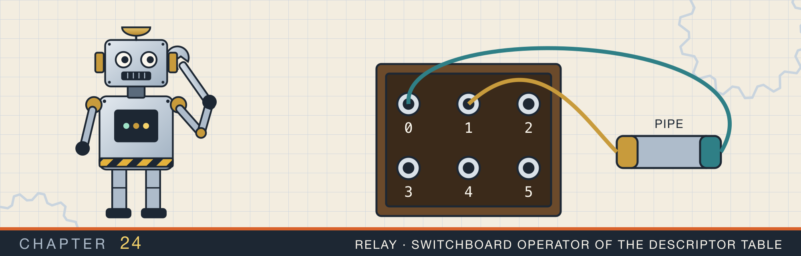
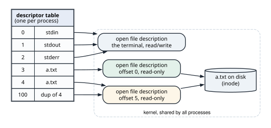
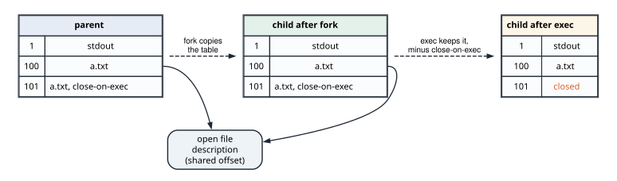
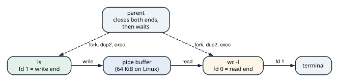

# File descriptors, fork, and pipes

<div class="covers" markdown="1">

This chapter covers

- The three-level kernel descriptor architecture: per-process descriptor tables, open file descriptions, and the lowest-free-descriptor allocation rule
- Descriptor inheritance across `fork` and `exec`, and async-signal-safety constraints in multithreaded processes
- Kernel pipes: ring-buffer semantics, blocking rules, `SIGPIPE`/`EPIPE`, and end-of-file termination conditions
- Constructing a two-stage shell pipeline (`ls | wc -l`) directly via `pipe`, `fork`, `dup2`, and `execvp`
- Descriptor leaks that leave a pipe write end open and induce indefinite reader blocking
- Close-on-exec (`FD_CLOEXEC` / `O_CLOEXEC`) semantics and atomic descriptor creation flags

</div>

Every POSIX process interacts with files, sockets, and pipes through a kernel-managed indirection layer: small non-negative integers called **file descriptors** index a per-process table whose entries reference shared kernel-level open file descriptions. Process creation (`fork`) duplicates that table by reference rather than by value, while program replacement (`exec`) preserves every entry not marked close-on-exec. Unix pipelines exploit the narrow window between `fork` and `exec` to rewire standard input and standard output onto kernel pipe descriptors, making descriptor lifecycle management critical to both process termination and security isolation.

The reference program `fd_table` exercises these kernel invariants directly through `libc` bindings: verifying lowest-free-descriptor allocation, constructing `ls | wc -l` without a shell, reproducing the indefinite hang caused by an unclosed pipe write end, and testing close-on-exec propagation across `execvp`.

## 24.1 The descriptor table

Each process owns a **file descriptor table** managed by the kernel, mapping non-negative integer indices to kernel I/O objects. By convention, process initialization populates the first three slots: `0` for standard input (`stdin`), `1` for standard output (`stdout`), and `2` for standard error (`stderr`).

A descriptor table entry does not reference an inode directly. Instead, it points to an **open file description** (a kernel `struct file` on Linux) allocated by a single `open`, `pipe`, or `socket` system call. The open file description stores per-opening state, including the current byte offset, access mode (`O_RDONLY`, `O_WRONLY`, `O_RDWR`), and file status flags such as `O_APPEND` or `O_NONBLOCK`. That kernel object in turn references the underlying inode or socket endpoint (Figure 24.1).

<figure>

<figcaption><b>Figure 24.1</b> Three levels: descriptor numbers, open file descriptions, and the file. Descriptors 4 and 100 share one offset.</figcaption>
</figure>

Three fundamental POSIX invariants follow directly from this three-level indirection:

- **Independent `open` calls allocate distinct open file descriptions.** Each description maintains an independent file offset; advancing the offset through descriptor 3 has no effect on descriptor 4.
- **Duplicated descriptors alias the same open file description.** `dup`, `dup2`, and `fcntl(..., F_DUPFD, ...)` install a new descriptor table entry referencing an existing open file description. Any `read`, `write`, or `lseek` through either descriptor advances the shared offset.
- **Allocation follows the lowest-free-number invariant.** `open` and `dup` always assign the smallest non-negative integer not currently active in the process's descriptor table. Closing descriptor 3 makes 3 the immediate return value of the next allocation.

An open file description is reference-counted across all descriptor tables in the system. Calling `close` removes a single descriptor table entry and decrements the description's reference count; the kernel deallocates the description (and tears down the underlying pipe endpoint or network socket) only when that reference count reaches zero.

The per-process descriptor table size is bounded by the `RLIMIT_NOFILE` resource limit. A process that leaks descriptors eventually exhausts this table, causing subsequent `open`, `accept`, or `socket` calls to fail with `EMFILE` ("Too many open files"). In Rust, RAII wrappers such as `std::fs::File`, `std::net::TcpStream`, and `std::os::fd::OwnedFd` invoke `close` deterministically inside `Drop`, eliminating most accidental descriptor leaks.

### 24.1.1 Watching the numbers

On Linux and macOS, the pseudo-directory `/dev/fd` enumerates the calling process's currently active descriptor numbers. `open_fds` reads and parses these entries:

```rust
{{#include ../../rust-interview-lab/src/bin/fd_table.rs:7:27}}
```

Each entry name corresponds to an integer descriptor index. The second `filter_map` retains entries that parse as `i32`. Because enumerating `/dev/fd` itself requires opening a directory descriptor, that transient descriptor appears in the returned list.

`main` opens a file twice, closes the lower-numbered descriptor, and opens the file a third time to verify slot reuse:

```rust
fn main() -> io::Result<()> {
    // ...
{{#include ../../rust-interview-lab/src/bin/fd_table.rs:204:218}}
    // ...
}
```

The observed output confirms both allocation invariants:

```text
open at start: [0, 1, 2, 3]
opened two files: fd 3 and fd 4
closed fd 3, opened another: fd 3
```

At startup, descriptors 0, 1, and 2 refer to the standard streams and descriptor 3 is the directory descriptor opened by `fs::read_dir`. Dropping the directory iterator closes descriptor 3, allowing the first `File::open` to acquire 3 and the second to acquire 4. Dropping the first `File` frees slot 3, which the third `File::open` immediately reclaims.

## 24.2 `fork` and `exec`

Unix separates process creation from executable loading into two orthogonal primitives:

1. **`fork`** clones the calling process, producing a child process with a copy-on-write duplicate of the parent's virtual address space (Section 23.2) and a shallow copy of the parent's descriptor table. `fork` returns twice: in the parent it returns the child's process identifier (`pid_t`), and in the child it returns `0`.
2. **`exec`** replaces the calling process's address space with a new executable image while preserving its process identifier and descriptor table. Every descriptor entry whose per-descriptor **close-on-exec** (`FD_CLOEXEC`) flag is clear remains open in the new program; entries with `FD_CLOEXEC` set are closed atomically by the kernel during image replacement.

Because `fork` performs a shallow copy of the descriptor table (Figure 24.2), corresponding entries in parent and child reference the identical open file descriptions and increment their kernel reference counts. Parent and child therefore share file offsets on inherited descriptors. After `exec`, the replacement program inherits standard streams at indices 0, 1, and 2 solely because those entries were positioned there prior to `exec`.

<figure>

<figcaption><b>Figure 24.2</b> <code>fork</code> copies the table, and both copies point at the same descriptions. <code>exec</code> keeps the table and closes the close-on-exec entries.</figcaption>
</figure>

Command shells construct I/O redirections and pipelines in the interval between `fork` and `exec`. Within the child process, the shell binds pipe endpoints or redirected files onto descriptors 0 and 1 via `dup2`, then invokes `exec`. The newly loaded executable reads descriptor 0 and writes descriptor 1 transparently, decoupled from whether those indices reference a terminal, regular file, or kernel pipe.

### 24.2.1 What the child may do before `exec`

In a multithreaded process, `fork` duplicates only the single thread that invoked it. All other threads vanish instantaneously in the child's address space, leaving any mutexes they held (such as the global heap allocator lock) permanently locked with no owning thread to release them. Calling a lock-acquiring library function such as `malloc` inside the child before `exec` can therefore deadlock immediately.

POSIX restricts a multithreaded process's post-`fork`, pre-`exec` child strictly to **async-signal-safe** system calls: primitives that acquire no user-space locks, including `dup2`, `close`, `execvp`, and `_exit`. Because Rust's test harness executes tests concurrently across a thread pool, `fd_table` adheres strictly to this invariant by performing all heap allocations prior to `fork`.

The `Program` helper constructs null-terminated C strings in advance:

```rust
{{#include ../../rust-interview-lab/src/bin/fd_table.rs:72:92}}
```

`execvp` expects a null-terminated array of `*const c_char` pointers. `argv` builds this pointer vector from the owned `CString` buffers; the pointers remain valid for the lifetime of `Program`.

The process-spawning primitive binds three POSIX calls:

```rust
unsafe extern "C" {
    fn fork() -> pid_t;                      // child's id in the parent, 0 in the child, -1 on error
    fn dup2(src: c_int, dst: c_int) -> c_int; // make dst refer to src's open file
    fn execvp(
        file: *const c_char,                  // program name, searched in PATH
        argv: *const *const c_char,           // arguments, ending with a null pointer
    ) -> c_int;                               // returns only on failure
}
```

`spawn` constructs `argv` before calling `fork`, then redirects standard streams and replaces the child image:

```rust
{{#include ../../rust-interview-lab/src/bin/fd_table.rs:94:122}}
```

Because `argv` is allocated before `fork`, the child executes zero heap allocations. Inside the child, `dup2(fd, 1)` atomically closes any existing descriptor at slot 1 and points slot 1 at the open file description of `fd`. `execvp` searches `PATH` and does not return on success. On failure, the child terminates immediately via `_exit(127)` (the conventional shell exit code for "command not found"), bypassing user-space `atexit` handlers and preventing the child from returning into parent control flow.

The parent reaps terminated children with `waitpid`:

```rust
unsafe extern "C" {
    fn waitpid(
        pid: pid_t,          // the child to wait for
        status: *mut c_int,  // filled in; WEXITSTATUS(status) is the exit code
        options: c_int,      // 0 to wait, WNOHANG to return at once
    ) -> pid_t;              // the child's id, 0 if WNOHANG and still running, or -1
}
```


```rust
{{#include ../../rust-interview-lab/src/bin/fd_table.rs:124:138}}
```

An exited child remains in the kernel process table as a **zombie** holding its exit status until its parent reaps it via `waitpid`. Passing `WNOHANG` performs a non-blocking poll, returning `0` if the child is still executing.

## 24.3 Pipes

A **pipe** is a unidirectional, in-kernel FIFO ring buffer exposed through a pair of descriptors: a read end and a write end. Bytes written to the write end are delivered in strict FIFO order from the read end. On Linux, the default pipe buffer capacity is 64 KiB (16 memory pages).

Pipeline flow control and termination are governed by four kernel blocking and error semantics:

- `read` on an empty pipe blocks until at least one byte is written or all write ends close.
- `read` returns `0` (end-of-file) if and only if the pipe buffer is empty **and** the kernel reference count for the write-end open file description has reached zero across all processes.
- `write` to a full pipe blocks until a reader drains sufficient buffer space.
- `write` to a pipe whose read-end reference count is zero fails immediately: the kernel delivers `SIGPIPE` to the writing process, or returns `-1` with `errno == EPIPE` if `SIGPIPE` is ignored or masked.

A shell executes `ls | wc -l` through a five-step descriptor protocol (Figure 24.3):

1. Invoke `pipe` to allocate the read and write descriptors in the parent's descriptor table.
2. Invoke `fork`; in the first child, redirect `stdout` (descriptor 1) to the pipe write end with `dup2` and invoke `execvp("ls", ...)`.
3. Invoke `fork`; in the second child, redirect `stdin` (descriptor 0) to the pipe read end with `dup2` and invoke `execvp("wc", ...)`.
4. Close both the read and write pipe descriptors in the parent process.
5. Reap both child processes with `waitpid`.

<figure>

<figcaption><b>Figure 24.3</b> <code>ls | wc -l</code> after setup. Only <code>ls</code> holds the write end, and only <code>wc</code> holds the read end.</figcaption>
</figure>

Step 4 establishes the termination invariant: once the parent closes its pipe descriptors, `ls`'s descriptor 1 is the sole remaining reference to the pipe's write end. When `ls` exits, the kernel closes its descriptor table, dropping the write-end reference count to zero; `wc -l` then observes `read() == 0`, prints its line count, and exits.

### 24.3.1 Building the pipeline

The low-level pipe and descriptor control interfaces operate on raw integer descriptors:

```rust
unsafe extern "C" {
    fn pipe(fds: *mut c_int) -> c_int;            // fills [read end, write end]; 0 or -1
    fn fcntl(fd: c_int, cmd: c_int, ...) -> c_int; // F_SETFD sets flags; F_DUPFD copies
}
```

`pipe` writes `[read_fd, write_fd]` into a two-element array, while `fcntl` is a variadic system call accepting a command code and optional argument. Wrapping both descriptors in `OwnedFd` ensures deterministic closure on drop, and setting `FD_CLOEXEC` prevents accidental inheritance:

```rust
{{#include ../../rust-interview-lab/src/bin/fd_table.rs:29:56}}
```

`check` converts the POSIX `-1`/`errno` convention into `io::Result`. Marking the original pipe descriptors with `FD_CLOEXEC` eliminates explicit `close` calls in each child prior to `exec`: because `dup2` clears `FD_CLOEXEC` on the target slot, descriptors 0 and 1 survive `execvp` while the original pipe descriptors close automatically upon image replacement.

`ls_wc` implements the five-step pipeline directly:

```rust
{{#include ../../rust-interview-lab/src/bin/fd_table.rs:152:167}}
```

The explicit `drop` calls execute step 4 in the parent before waiting. Against a directory containing three files, the pipeline outputs:

```text
ls fd_table_demo | wc -l
       3
```

On Linux, GNU `wc` formats the count as `3` without leading whitespace.

### 24.3.2 A write end left open

Animation 24.1 contrasts the properly closed pipeline with a defective run that omits step 4.

<figure class="anim">
<video class="motion" src="figures/ch24-pipe.mp4" autoplay loop muted playsinline preload="metadata" aria-label="A parent robot, two child robots named ls and wc, and a pipe between them, with a counter of open write ends. pipe creates fd 3, the read end, and fd 4, the write end, in the parent's table. fork copies the table to the ls child; dup2 points its fd 1 at the write end, and exec closes fds 3 and 4, which are close-on-exec. The same for wc, with fd 0 on the read end. The parent drops both ends; the write-end counter shows 1, held by ls. ls writes three names into the pipe and exits, the counter drops to 0, and wc's read returns 0: end-of-file. wc prints 3. In a second run the parent keeps its write end: ls exits, the counter stays at 1, and wc sleeps in read while a clock runs." data-chapters="[[0.0, &quot;fork ls&quot;], [22.14, &quot;fork wc&quot;], [29.58, &quot;close&quot;], [39.3, &quot;data&quot;], [60.9, &quot;write end kept&quot;]]"></video>
<figcaption><b>Animation 24.1</b> The reader sees end-of-file when the last write end closes. A parent that keeps its copy of the write end keeps the reader waiting.</figcaption>
</figure>

`reader_waits_for_the_write_end` reproduces this liveness failure by spawning `wc -l`, writing two lines to the pipe, and delaying closure of the parent's write descriptor for one second:

```rust
{{#include ../../rust-interview-lab/src/bin/fd_table.rs:169:185}}
```

```text
parent writes two lines to wc -l and holds the write end for 1 s:
       2
wc still running after 1 s: true
```

Although `wc -l` consumed both lines within microseconds, its `read` system call remained blocked for the entire second because the parent's open descriptor held the write-end reference count at 1. `wc -l` emitted `2` and exited only after `drop(writer)` reduced the reference count to zero. In production software, omitting that `drop` causes a silent deadlock consuming zero CPU cycles and producing no error diagnostic.

An analogous failure occurs with TCP sockets: if a server forks a long-lived child process that inherits an accepted client socket without `FD_CLOEXEC`, closing the socket in the parent does not decrement the kernel reference count to zero. Consequently, the kernel does not transmit a TCP `FIN`, leaving the client connection hung indefinitely.

## 24.4 Close-on-exec

Every descriptor lacking the `FD_CLOEXEC` flag survives `exec` into the child process, creating three distinct classes of operational defects:

- **Port retention:** A listening socket inherited by a long-lived child keeps the TCP port bound even after the parent server exits, causing a restarted parent to fail with `EADDRINUSE`.
- **Pipeline stalls:** An inherited pipe write end prevents downstream readers from observing EOF (Section 24.3.2).
- **Privilege leakage:** Sensitive file descriptors (credential stores, database sockets, configuration files) remain accessible to untrusted child executables.

Rust's standard library sets `FD_CLOEXEC` on every file, socket, and pipe descriptor it allocates. Descriptor leaks in Rust binaries therefore originate from raw `libc` calls or linked C libraries. `duplicate` demonstrates both behaviors using `fcntl`:

```rust
{{#include ../../rust-interview-lab/src/bin/fd_table.rs:58:70}}
```

`F_DUPFD` duplicates a descriptor without setting `FD_CLOEXEC`, whereas `F_DUPFD_CLOEXEC` sets the flag atomically during duplication. Requesting the lowest free slot at or above 100 isolates the test descriptors from low-numbered descriptors allocated by the child executable itself.

`child_has` inspects the child's inherited descriptor table by executing `ls /dev/fd` and capturing its standard output through a pipe:

```rust
{{#include ../../rust-interview-lab/src/bin/fd_table.rs:140:150}}
```

`output` drops the parent's `write_end` immediately after `spawn` so that `read_to_string` observes EOF once the child exits.

```rust
{{#include ../../rust-interview-lab/src/bin/fd_table.rs:187:194}}
```

```text
fd 100 without close-on-exec, open in the child: true
fd 101 with close-on-exec,    open in the child: false
```

Setting `FD_CLOEXEC` via a separate `fcntl` call after `pipe` introduces a concurrency window: in a multithreaded process, another thread executing `fork` and `exec` between `pipe` and `fcntl` leaks both pipe ends into its child. Linux eliminates this race with atomic creation flags: `pipe2(fds, O_CLOEXEC)`, `open(..., O_CLOEXEC)`, `socket(..., SOCK_CLOEXEC, ...)`, and `accept4(..., SOCK_CLOEXEC)`. Rust's standard library uses these atomic variants wherever the target kernel provides them.

## 24.5 The complete program

<p class="listing"><b>Listing 24.1</b> The descriptor table, <code>ls | wc -l</code> by hand, and close-on-exec. <a href="https://github.com/arpanpathak/cracking-the-systems-programming-interview/blob/prep-v2/rust-interview-lab/src/bin/fd_table.rs">src/bin/fd_table.rs</a></p>

```rust
{{#include ../../rust-interview-lab/src/bin/fd_table.rs}}
```

```text
$ cargo run --bin fd_table
open at start: [0, 1, 2, 3]
opened two files: fd 3 and fd 4
closed fd 3, opened another: fd 3

ls fd_table_demo | wc -l
       3

parent writes two lines to wc -l and holds the write end for 1 s:
       2
wc still running after 1 s: true

fd 100 without close-on-exec, open in the child: true
fd 101 with close-on-exec,    open in the child: false
```

## 24.6 Questions that come up

**"What does `2>&1` do?"**
In the child process between `fork` and `exec`, the shell executes `dup2(1, 2)`. Descriptor 2 then references the same open file description as descriptor 1, routing standard error to the same destination and shared offset as standard output.

**"Why does `yes | head -1` stop?"**
After reading one line, `head` exits and the kernel closes its descriptor table, dropping the pipe read-end reference count to zero. The next `write` by `yes` triggers `SIGPIPE`, terminating `yes`. Because the Rust runtime ignores `SIGPIPE` by default, a Rust writer instead receives `io::ErrorKind::BrokenPipe` (`EPIPE`).

**"Why is `fork` slow for a large process, and what replaces it?"**
Although `fork` shares physical pages via copy-on-write, it must still duplicate the parent's page table hierarchy. For a process with tens of gigabytes mapped, copying page tables takes milliseconds and temporarily degrades memory throughput via CoW faults. `posix_spawn` and `vfork` launch a child executable without duplicating the parent's page tables; `std::process::Command` selects `posix_spawn` or `vfork` where the platform supports them.

**"A server restarted and failed with `EADDRINUSE`. The old process is gone. What holds the port?"**
A surviving child process may have inherited the listening socket because `FD_CLOEXEC` was omitted; `lsof -i :PORT` or `ss -tulpn` identifies the owning PID. Alternatively, residual connections in `TIME_WAIT` may occupy the port unless the new listener enables `SO_REUSEADDR`.

**"What does `Too many open files` mean?"**
The process has exhausted its `RLIMIT_NOFILE` descriptor table limit (`EMFILE`). Inspecting `/proc/PID/fd` on Linux reveals the leaked descriptor class, typically unclosed network sockets or files opened inside a loop without proper RAII cleanup.

<div class="summary" markdown="1">

## Summary

- A file descriptor indexes a per-process table whose entries reference kernel open file descriptions; each description stores the current file offset and status flags and points to the underlying inode or socket.
- `open` allocates the lowest free descriptor index; `dup2` binds a target index to an existing open file description, sharing its offset.
- `fork` performs a shallow copy of the descriptor table, incrementing reference counts on all shared open file descriptions; `exec` preserves all entries except those marked `FD_CLOEXEC`.
- Between `fork` and `exec`, a child of a multithreaded process may invoke only async-signal-safe system calls to avoid deadlocking on locks held by vanished threads.
- A pipe reader observes EOF only when the buffer is empty and every write-end descriptor across all processes is closed; a leaked write end causes an indefinite read block.
- Rust's standard library sets `FD_CLOEXEC` on all descriptors it creates. Raw `libc` descriptors must set the flag explicitly, preferring atomic creation flags (`O_CLOEXEC`, `SOCK_CLOEXEC`, `pipe2`) to prevent multithreaded inheritance races.

</div>

## Exercises

1. Execute `fd_table` with standard input closed: `cargo run --bin fd_table <&-`. Which descriptor index does the first `File::open` return, and which allocation rule explains the result?
2. Read a prefix of bytes from a file, then invoke `spawn` to run `cat` with that file's descriptor bound to standard input. Does `cat` emit the entire file or only the unread remainder? Justify the behavior using Figure 24.2.
3. Remove `drop(write_end)` from `output` and run the test suite. Identify which test hangs and which system call blocks indefinitely.
4. Generalize `ls_wc` into a pipeline builder accepting an arbitrary slice of commands (such as `ls | sort | wc -l`). For $n$ commands, how many pipes are created and how many pipe descriptors must the parent close?
5. Replace `pipe` plus `fcntl` with `pipe2(..., O_CLOEXEC)` under `#[cfg(target_os = "linux")]`, retaining the two-call implementation for non-Linux targets.
