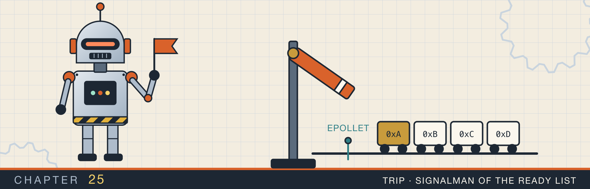
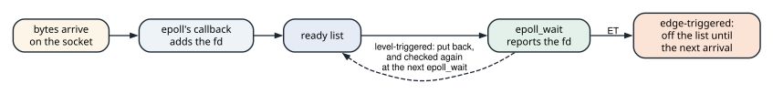
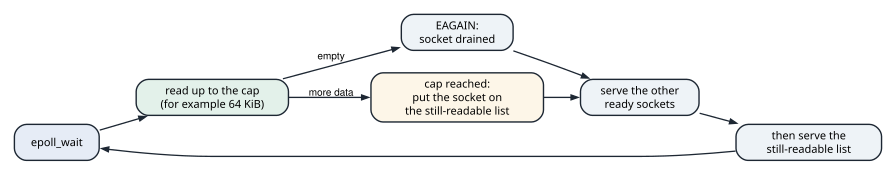
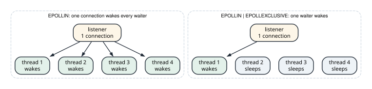

# Edge-triggered epoll

<div class="covers" markdown="1">

This chapter covers

- Readiness semantics as a persistent level versus a state-transition edge, and their implementation on the `epoll` ready list
- Quantitative comparison of three socket handlers: single-read level-triggered, single-read edge-triggered, and drain-to-`EAGAIN` edge-triggered
- The edge-triggered stall condition: unread kernel buffer data with no future readiness notification
- Write-readiness efficiency under `EPOLLET` and bounded drain quotas to prevent single-connection starvation
- Serializing per-socket dispatch across shared-instance worker threads with `EPOLLONESHOT`
- Mitigating the accept thundering herd across per-thread event loops with `EPOLLEXCLUSIVE` and `SO_REUSEPORT`

</div>

An I/O multiplexer reports socket readiness under one of two semantic contracts: **level-triggered** notification, which reports a descriptor on every `epoll_wait` invocation while its readiness predicate remains true, or **edge-triggered** notification (`EPOLLET`), which reports a descriptor once per arrival transition. Edge-triggered mode reduces kernel re-evaluation overhead and permits persistent `EPOLLOUT` registration, but it imposes a strict non-blocking drain invariant: every handler must consume readiness until `EAGAIN`, or residual bytes remain stranded in the kernel receive buffer with no subsequent wakeup.

Because `epoll` is a Linux kernel subsystem, the accompanying `epoll_edge` benchmark runs inside a Linux container. It injects 10,000 bytes into a socket pair to measure exact event and byte counts across three handler designs, then verifies the concurrency guarantees of `EPOLLONESHOT` and `EPOLLEXCLUSIVE`.

## 25.1 Levels and edges

A socket satisfies the **readable** predicate whenever its kernel receive buffer contains at least one unread byte (or an EOF/error condition is pending). This predicate is a persistent state, or **level**: it remains asserted until read calls empty the buffer. The arrival of new bytes from the peer or network stack constitutes a state transition, or **edge**.

Level-triggered `epoll` reports the level: each call to `epoll_wait` returns the descriptor as long as unread bytes remain. Edge-triggered `epoll` reports only the edge: a single notification fires upon arrival, and no further event is delivered until additional bytes arrive.

This divergence arises directly from how the kernel maintains the `epoll` **ready list** introduced in Section 20.4 (Figure 25.1). When data arrives on a monitored socket, a kernel wait-queue callback enqueues the descriptor onto the `epoll` instance's ready list. `epoll_wait` dequeues ready entries and copies them to user space. For a level-triggered entry, the kernel reinserts the descriptor onto the ready list before returning, causing the subsequent `epoll_wait` to re-poll the socket's readiness predicate and report it again if unread bytes remain. For an edge-triggered entry, the kernel does not reinsert the descriptor; only a future arrival callback can enqueue it again.

<figure>

<figcaption><b>Figure 25.1</b> The ready list. A level-triggered entry goes back on the list after each report. An edge-triggered entry waits for the next arrival.</figcaption>
</figure>

The table below traces event delivery when 10,000 bytes arrive in a single burst and a handler reads at most 4,096 bytes per notification:

| Step | Bytes in the buffer | Level-triggered | Edge-triggered |
|---|---|---|---|
| 10,000 bytes arrive | 10,000 | event | event |
| handler reads 4,096 | 5,904 | event: still readable | nothing |
| handler reads 4,096 | 1,808 | event: still readable | n/a |
| handler reads 1,808 | 0 | nothing | n/a |

Under edge-triggered mode, 5,904 bytes remain unread in the receive buffer after the first event, yet the descriptor is absent from the ready list. If the peer is awaiting a protocol response to those 10,000 bytes before transmitting again, both endpoints block indefinitely in a classic liveness stall. Correctness under `EPOLLET` therefore requires a non-blocking socket drained in a loop until `read` returns `EAGAIN`, proving that the receive buffer is empty.

## 25.2 Three handlers, measured

The Linux `epoll` interface comprises three system calls and the `epoll_event` descriptor structure, which carries interest flags into `epoll_ctl` and triggered events out of `epoll_wait`:

```rust
struct epoll_event {
    events: u32, // EPOLLIN, EPOLLOUT, EPOLLET, ... combined with |
    u64: u64,    // data the caller chooses; the program stores the fd
}

unsafe extern "C" {
    fn epoll_create1(flags: c_int) -> c_int; // a new instance's fd; EPOLL_CLOEXEC
    fn epoll_ctl(
        epfd: c_int,                // the instance
        op: c_int,                  // EPOLL_CTL_ADD, EPOLL_CTL_MOD, or EPOLL_CTL_DEL
        fd: c_int,                  // the descriptor to watch
        event: *mut epoll_event,    // its flags
    ) -> c_int;                     // 0, or -1 with errno set
    fn epoll_wait(
        epfd: c_int,
        events: *mut epoll_event,   // an array the kernel fills
        maxevents: c_int,           // its length
        timeout: c_int,             // milliseconds; -1 waits forever
    ) -> c_int;                     // how many entries were filled, or -1
}
```

The `Epoll` wrapper owns the `epoll` file descriptor and closes it deterministically on drop:

```rust
{{#include ../../rust-interview-lab/src/bin/epoll_edge.rs:11:76}}
    // ...
}
```

`epoll_create1(EPOLL_CLOEXEC)` allocates the instance with close-on-exec set atomically (Section 24.4). `control` populates an `epoll_event` with the requested flag bitmask and descriptor identifier before invoking `epoll_ctl`. Because each benchmark monitors a single descriptor, `wait` returns only the event count.

The two read handlers differ solely by the presence of the drain loop:

```rust
mod linux {
    // ...
{{#include ../../rust-interview-lab/src/bin/epoll_edge.rs:78:96}}
    // ...
}
```

`read_once` issues a single 4,096-byte `read`, whereas `read_until_eagain` loops until the non-blocking socket returns `EAGAIN`, surfaced in Rust as `io::ErrorKind::WouldBlock`.

`run` allocates a connected Unix domain socket pair, writes the 10,000-byte payload into one endpoint, and dispatches readiness events on the non-blocking peer until a 100 ms `epoll_wait` timeout expires:

```rust
mod linux {
    // ...
{{#include ../../rust-interview-lab/src/bin/epoll_edge.rs:98:117}}
    // ...
}
```

`UnixStream::pair` isolates kernel socket-buffer semantics from network timing jitter. Setting the reading endpoint to non-blocking mode satisfies the precondition for `read_until_eagain`, and parameterizing `run` by a function pointer allows identical harness execution across all three configurations.

Animation 25.1 visualizes the three runs side by side.

<figure class="anim">
<video class="motion" src="figures/ch25-edge.mp4" autoplay loop muted playsinline preload="metadata" aria-label="A socket's receive buffer as a gauge of bytes, a ready list, and an event loop robot. Level-triggered with one read per event: 10,000 bytes arrive and the socket joins the ready list. epoll_wait returns it, the robot reads 4,096, and the socket goes back on the list because 5,904 bytes remain. Two more events read 4,096 and 1,808, and the buffer is empty. Edge-triggered with reads until EAGAIN: one event, three reads of 4,096, 4,096, and 1,808, then EAGAIN, and the buffer is empty. Edge-triggered with one read per event: one event, one read of 4,096, and the socket is not put back. The robot sleeps in epoll_wait while 5,904 bytes sit in the buffer; the 100 ms timeout passes with no event." data-chapters="[[0.0, &quot;level-triggered&quot;], [32.11, &quot;edge, drained&quot;], [49.21, &quot;edge, read once&quot;]]"></video>
<figcaption><b>Animation 25.1</b> The same 10,000 bytes under three handlers. An edge-triggered socket that is not drained stays off the ready list with data in it.</figcaption>
</figure>

The container execution reproduces the analytical table from Section 25.1 exactly:

```text
10000 bytes written into a socket; one handler call per epoll event

level-triggered, read once  events 3, bytes per event [4096, 4096, 1808], left unread 0
edge-triggered,  read once  events 1, bytes per event [4096], left unread 5904
edge-triggered,  to EAGAIN  events 1, bytes per event [10000], left unread 0
```

Level-triggered single-read delivery required three `epoll_wait` cycles to drain all 10,000 bytes. Edge-triggered single-read delivery stalled with 5,904 bytes stranded in the kernel buffer, whereas draining to `EAGAIN` consumed all 10,000 bytes in a single event notification.

### 25.2.1 Why use edge-triggered mode

Edge-triggered notification eliminates redundant kernel work in two hot paths:

- **Elimination of ready-list re-polling.** Under level-triggered mode, every partially drained descriptor is reinserted onto the ready list and re-polled by the kernel on each `epoll_wait` invocation. Under `EPOLLET`, each arrival transition produces exactly one notification.
- **Persistent `EPOLLOUT` registration.** A TCP socket's send buffer almost always has available capacity, meaning the socket is continuously writable. Under level-triggered mode (Section 20.4), an event loop must dynamically add `EPOLLOUT` via `epoll_ctl` when a write blocks and remove it once flushed, otherwise `epoll_wait` returns immediately on every iteration in a busy spin. Under edge-triggered mode, the loop registers `EPOLLIN | EPOLLOUT | EPOLLET` once at connection setup; a write-readiness edge fires only after a `write` returns `EAGAIN` and the kernel subsequently drains space in the send buffer.

For these reasons, the `mio` I/O abstraction layer underlying the Tokio runtime registers Linux sockets in edge-triggered mode by default.

Unbounded draining to `EAGAIN` introduces a fairness hazard: a high-rate peer transmitting faster than the event loop can consume keeps the handler trapped inside its read loop, starving every other socket on the same thread. Production event loops therefore enforce a per-event byte quota (Figure 25.2). When a handler reaches its quota without observing `EAGAIN`, it yields the socket onto an internal user-space continuation queue, services the remaining ready descriptors from `epoll_wait`, and revisits the continuation queue on the next cycle. Tokio applies this same cooperative budgeting mechanism across asynchronous tasks, forcing a task to yield after consuming its per-poll work budget even when its socket remains readable.

<figure>

<figcaption><b>Figure 25.2</b> A capped drain. A busy socket waits its turn on a list of its own, instead of holding the loop.</figcaption>
</figure>

## 25.3 Several threads on one epoll: `EPOLLONESHOT`

When a pool of worker threads invokes `epoll_wait` concurrently on a single shared `epoll` instance, edge-triggered mode permits a race condition that dispatches the same socket to two threads simultaneously:

1. Data arrives on a socket; Thread A returns from `epoll_wait` with that descriptor and begins reading.
2. While Thread A is still servicing the socket, a second packet arrives, generating a new readiness edge and re-enqueuing the descriptor on the ready list.
3. Thread B returns from `epoll_wait` with the identical descriptor and invokes `read` concurrently. The two threads interleave chunks of the same byte stream, corrupting framing and message ordering.

The **`EPOLLONESHOT`** flag prevents concurrent per-socket dispatch by atomically disabling the descriptor in the `epoll` interest list immediately after delivering a single event. The descriptor remains registered, but the kernel suppresses all subsequent notifications until the owning thread finishes processing and explicitly re-arms it with `epoll_ctl(..., EPOLL_CTL_MOD, ...)`. Exclusivity is thereby guaranteed between event delivery and re-arming.

```rust
mod linux {
    // ...
{{#include ../../rust-interview-lab/src/bin/epoll_edge.rs:119:137}}
    // ...
}
```

```text
EPOLLONESHOT: first write 1 event, second write 0 events, after re-arming 1 event
```

The second write arrived while the descriptor was disarmed, causing `epoll_wait` to time out with zero events. Upon re-arming via `EPOLL_CTL_MOD`, the kernel detected the pending readable data and delivered the event immediately. Disarming a descriptor never discards incoming data; bytes remain buffered in the kernel receive queue until the descriptor is re-armed and drained.

## 25.4 Many waiters on one listener: `EPOLLEXCLUSIVE`

An alternative multithreaded server architecture assigns each worker thread a private `epoll` instance and registers the shared listening socket on every instance. When an incoming TCP connection completes the three-way handshake, the listener's wait-queue callback notifies every registered `epoll` instance, waking all worker threads simultaneously. One thread succeeds in `accept`; the remaining threads receive `EAGAIN` and return to sleep. On a 64-core server, a single incoming connection triggers 64 thread wakeups and 63 wasted `accept` system calls, a contention pathology known as the **thundering herd**.

Introduced in Linux 4.5, **`EPOLLEXCLUSIVE`** (permitted only with `EPOLL_CTL_ADD`) registers an `epoll` instance as an exclusive waiter on the underlying file wait queue. When a connection arrives on the listener, the kernel wakes a single exclusive waiter (or a small bounded subset) rather than broadcasting to every sleeping thread (Figure 25.3).

<figure>

<figcaption><b>Figure 25.3</b> One connection and four waiting threads, with and without <code>EPOLLEXCLUSIVE</code>.</figcaption>
</figure>

`woken_by_one_connection` spawns four worker threads, synchronizes their `epoll_ctl` registrations with a `Barrier`, initiates one client connection, and tallies how many threads return from `epoll_wait`:

```rust
mod linux {
    // ...
{{#include ../../rust-interview-lab/src/bin/epoll_edge.rs:139:176}}
}
```

The `Barrier` guarantees that all workers have registered the listener prior to client connection, and the 50 ms delay allows each worker to block inside `epoll_wait` before the SYN arrives.

```text
4 threads wait on one listener, and one client connects:
  without EPOLLEXCLUSIVE: 4 threads woke
  with EPOLLEXCLUSIVE:    1 thread woke
```

An orthogonal kernel-level solution is **`SO_REUSEPORT`**: each worker thread opens an independent listening socket bound to the identical IP address and port with `SO_REUSEPORT` enabled prior to `bind`. The kernel hashes the incoming packet's four-tuple to route each new connection directly to one listener's accept queue. Because no two threads share a listening descriptor, cross-thread wakeup contention is eliminated entirely.

## 25.5 The complete program

<p class="listing"><b>Listing 25.1</b> Level- and edge-triggered handlers, <code>EPOLLONESHOT</code>, and <code>EPOLLEXCLUSIVE</code>. <a href="https://github.com/arpanpathak/cracking-the-systems-programming-interview/blob/prep-v2/rust-interview-lab/src/bin/epoll_edge.rs">src/bin/epoll_edge.rs</a></p>

```rust
{{#include ../../rust-interview-lab/src/bin/epoll_edge.rs}}
```

```text
$ cargo run --bin epoll_edge
10000 bytes written into a socket; one handler call per epoll event

level-triggered, read once  events 3, bytes per event [4096, 4096, 1808], left unread 0
edge-triggered,  read once  events 1, bytes per event [4096], left unread 5904
edge-triggered,  to EAGAIN  events 1, bytes per event [10000], left unread 0

EPOLLONESHOT: first write 1 event, second write 0 events, after re-arming 1 event

4 threads wait on one listener, and one client connects:
  without EPOLLEXCLUSIVE: 4 threads woke
  with EPOLLEXCLUSIVE:    1 thread woke
```

## 25.6 Questions that come up

**"A server under edge-triggered epoll sometimes stops answering one client, while CPU use is zero. What should be checked first?"**
Audit every `read` and `accept` handler to confirm that it loops until `EAGAIN` (or re-enqueues the descriptor on an application-level continuation list when hitting a drain cap). Terminating a read handler after a fixed buffer fill leaves unread bytes stranded in the kernel receive buffer with no future edge event to trigger dispatch.

**"Does edge-triggered mode apply to `accept`?"**
Yes. If multiple connections arrive simultaneously in the listen backlog, an edge-triggered listener may fire a single `EPOLLIN` notification; the handler must therefore call `accept` in a loop until `EAGAIN`, matching `accept_ready` in Section 20.4.

**"What happens to an edge-triggered socket when the peer closes it?"**
Receiving a TCP `FIN` constitutes a readiness transition. `epoll` delivers `EPOLLIN` (along with `EPOLLRDHUP` if registered), and the subsequent drain loop consumes any remaining buffered bytes before observing `read() == 0`.

**"Is kqueue edge-triggered?"**
BSD and macOS `kqueue` supports both semantics per filter registration: `EV_CLEAR` resets the event state after delivery to provide edge-triggered behavior, and `EV_DISPATCH` disables the event after delivery to provide `EPOLLONESHOT` semantics.

**"Why not have every thread call `accept` on one blocking listener?"**
Modern Linux kernels use exclusive wakeups (`WQ_FLAG_EXCLUSIVE`) for threads blocked directly inside `accept`, waking only one thread per connection. The thundering herd re-emerges when multiple private `epoll` instances register the same listener, because each `epoll` instance attaches a non-exclusive wait-queue callback unless `EPOLLEXCLUSIVE` is specified.

<div class="summary" markdown="1">

## Summary

- Socket readability is a persistent level (non-empty receive buffer); data arrival is a state-transition edge.
- Level-triggered `epoll` reinserts reported descriptors onto the ready list and re-polls them on every `epoll_wait`. Edge-triggered `epoll` (`EPOLLET`) delivers one event per arrival transition and does not re-notify until new bytes arrive.
- Edge-triggered handlers must drain non-blocking sockets until `EAGAIN`. Reading a single 4,096-byte chunk from a 10,000-byte arrival stranded 5,904 bytes unread with no subsequent notification.
- `EPOLLET` eliminates ready-list re-polling and allows persistent `EPOLLOUT` registration, but requires per-event byte quotas and user-space continuation queues to prevent busy sockets from starving peers.
- `EPOLLONESHOT` disarms a descriptor after a single event until re-armed via `EPOLL_CTL_MOD`, enforcing single-thread ownership in shared-`epoll` worker pools.
- `EPOLLEXCLUSIVE` suppresses the accept thundering herd across per-thread `epoll` instances (waking 1 of 4 threads rather than all 4); `SO_REUSEPORT` eliminates shared listeners altogether by hashing connections across per-thread listening sockets.

</div>

## Exercises

1. Modify `run` so that after the edge-triggered single-read stall completes, the writer injects one additional byte, and record the resulting event and byte counts. How many bytes does `read_once` return on the second event, and why?
2. Register `EPOLLOUT | EPOLLET` on a socket in `run` and count events while no writes occur. Fill the send buffer until `write` returns `WouldBlock`, drain bytes from the peer, and verify that a single writable edge fires.
3. Cap `read_until_eagain` at 8,192 bytes per invocation and return a boolean indicating whether the cap was reached prior to `EAGAIN`. Implement a continuation queue in the event loop that services capped descriptors after processing each `epoll_wait` batch.
4. Execute `woken_by_one_connection` with 16 worker threads and 10 sequential connections. Compare total thread wakeups with and without `EPOLLEXCLUSIVE`.
5. Reimplement `woken_by_one_connection` using `SO_REUSEPORT` (via the `socket2` crate before `bind`) and measure how 10 incoming connections distribute across the worker threads.
