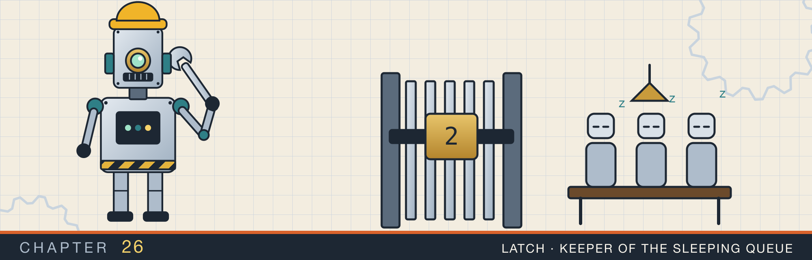
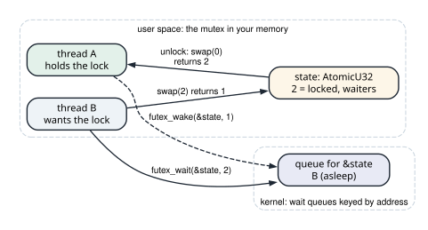
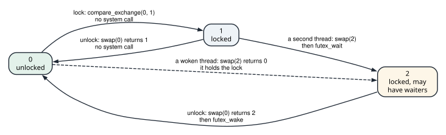
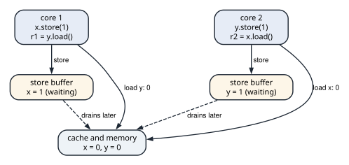

# Futexes and memory ordering

<div class="covers" markdown="1">

This chapter covers

- The futex: a kernel wait queue keyed by the address of a word in user-space memory
- A three-state mutex that enters the kernel only to sleep and to wake waiters
- Why the kernel verifies the word atomically before putting a thread to sleep
- Counting the system calls a mutex issues and comparing it against `std::sync::Mutex`
- Store buffers and the memory reordering they permit even on x86
- Two litmus tests executed a million times each: store buffering and message passing

</div>

In chapter 16, we implemented a spin lock from a single atomic flag. A thread encountering a held lock kept its CPU busy until the lock became free. Spinning is an effective trade-off when a critical section lasts only a few nanoseconds, but it wastes processor cycles when a thread holds the lock across blocking work such as file I/O. For longer critical sections, the lock must put waiting threads to sleep and wake them once the lock is released, an operation that requires kernel intervention.

In this chapter, we build a sleeping mutex on the Linux **futex** system call, following the same three-state design used by `std::sync::Mutex` on Linux. We then examine the hardware behavior beneath the memory orderings introduced in chapter 16 by running two classic litmus tests a million times each and counting how frequently the processor reorders memory operations.

## 26.1 Sleeping on a word

A **futex** (fast user-space mutex) is a wait queue in the kernel keyed by a memory address. The 32-bit word at that address resides in user-space memory, and the kernel never interprets its meaning. A futex provides two primary operations:

- **`futex_wait(addr, expected)`**: if the 32-bit word at `addr` still holds `expected`, place the calling thread to sleep on the wait queue associated with `addr`. If the word holds any other value, return immediately.
- **`futex_wake(addr, n)`**: wake up to `n` threads currently sleeping on the wait queue for `addr`.

The lock state itself lives in an atomic integer in user space (figure 26.1). Acquiring an uncontended lock requires only a single compare-exchange instruction on that word, with no system call. A thread invokes `futex_wait` only when it must block, and `unlock` invokes `futex_wake` only when a sleeping waiter may be present.

<figure>

<figcaption><b>Figure 26.1</b> The lock word lives in the program. The kernel keeps only the queue of threads asleep on its address.</figcaption>
</figure>

### 26.1.1 Why the kernel checks the word

`futex_wait` checks the word and queues the thread as one step, under a kernel lock. Without the check,
this sequence would lose a wake-up:

1. Thread B reads the lock word and sees it held. B decides to sleep.
2. Thread A unlocks and calls `futex_wake`. No thread is on the queue yet, so the wake does nothing.
3. B enters the queue and sleeps. Nobody will wake it.

With the atomic check in place, step 3 observes that the word no longer holds the value thread B read, so `futex_wait` returns immediately and thread B retries the lock. This race is the **lost wake-up** problem, and it is the same reason `Condvar` in chapter 16 requires a mutex argument.

## 26.2 A mutex with three states

The lock word encodes three states (figure 26.2):

- **0**: unlocked.
- **1**: locked, with no waiting threads.
- **2**: locked, with one or more threads potentially asleep in `futex_wait`.

The third state allows `unlock` to determine whether a `futex_wake` call is necessary. Releasing a lock from state 1 costs a single atomic instruction, whereas releasing from state 2 also incurs a system call.

<figure>

<figcaption><b>Figure 26.2</b> The three states. The two transitions between 0 and 1 are the uncontended path, and make no system call.</figcaption>
</figure>

### 26.2.1 The system calls

`libc` has no wrapper for `futex`, so the program calls it through `syscall`, which takes a system call's
number and its arguments:

```rust
unsafe extern "C" {
    fn syscall(number: c_long, ...) -> c_long;
}

// The futex call, as the kernel defines its arguments:
// syscall(SYS_futex, uaddr: *const u32, op: c_int, val: u32, timeout: *const timespec)
//   FUTEX_WAIT: sleep if *uaddr == val, until woken or until the timeout (null: none)
//   FUTEX_WAKE: wake up to val threads sleeping on uaddr; timeout is unused
```

The two wrappers:

```rust
{{#include ../../rust-interview-lab/src/bin/futex_mutex.rs:10:53}}
    // ...
}
```

`FUTEX_PRIVATE_FLAG` informs the kernel that the futex word is private to the current process, allowing the kernel to key the wait queue by virtual address alone. A word shared across processes must be keyed by physical page, which requires an extra lookup. `AtomicU32::as_ptr` yields the address of the underlying word. The return value of `futex_wait` is ignored because the call can return spuriously (for example, when interrupted by a signal), and the caller re-checks the lock word in a loop regardless.

### 26.2.2 `lock` and `unlock`

The mutex struct holds the state word, two atomic counters for the measurements in this chapter, and the protected value:

```rust
mod linux {
    // ...
{{#include ../../rust-interview-lab/src/bin/futex_mutex.rs:55:75}}
        // ...
}
```

As with the spin lock in chapter 16, the `unsafe impl Sync` invariant guarantees that the mutex grants exclusive access to `value` to one thread at a time. Calling `lock` returns a `Guard` (defined below) that provides access to the protected value and releases the lock upon drop. `lock` attempts the uncontended fast path first:

```rust
mod linux {
    // ...
    impl<T> FutexMutex<T> {
        // ...
{{#include ../../rust-interview-lab/src/bin/futex_mutex.rs:77:101}}
        // ...
    }
    // ...
}
```

`compare_exchange(UNLOCKED, LOCKED, Acquire, Relaxed)` acquires an uncontended lock in a single atomic instruction. When that exchange fails, `lock_contended` swaps in state 2 and inspects the previous value. A previous value of 0 indicates that the lock was free and the calling thread now holds it; any other value indicates that another thread holds the lock, so the caller sleeps in `futex_wait` as long as the word remains 2 and then retries.

A thread that acquires the lock via `lock_contended` leaves the state word at 2 even if no other threads are waiting. Because the thread cannot tell whether other waiters remain asleep in the kernel, it preserves state 2 conservatively. The trade-off is an occasional `futex_wake` call that finds an empty wait queue.

`unlock` swaps in 0 with `Release` ordering, publishing all writes performed inside the critical section (as established in section 16.4.3). The previous state determines whether to wake a sleeping thread.

The guard implementation mirrors that of the spin lock:

```rust
mod linux {
    // ...
{{#include ../../rust-interview-lab/src/bin/futex_mutex.rs:113:138}}
}
```

Animation 26.1 follows two threads through the three states, and then shows the lost wake-up.

<figure class="anim">
<video class="motion" src="figures/ch26-futex.mp4" autoplay loop muted playsinline preload="metadata" aria-label="Two thread robots, A and B, beside the lock word, with the kernel's wait queue for the word's address below. A's compare_exchange changes 0 to 1 without entering the kernel. B's compare_exchange fails; B swaps in 2, sees 1, and calls futex_wait(&state, 2). The kernel checks that the word holds 2, and B sleeps on the queue. A unlocks: swap(0) returns 2, so A calls futex_wake and B wakes. B's swap(2) returns 0, so B holds the lock, with the word at 2. B's unlock returns 2 and calls futex_wake, which finds nobody. In a last run the kernel does not check the word: B sees the lock held, A unlocks and wakes an empty queue, then B joins the queue and sleeps forever." data-chapters="[[0.0, &quot;fast path&quot;], [7.14, &quot;B waits&quot;], [26.78, &quot;wake&quot;], [52.06, &quot;no check&quot;]]"></video>
<figcaption><b>Animation 26.1</b> The uncontended path stays in user space. A waiter sleeps in the kernel, and the check of the word inside <code>futex_wait</code> keeps a wake-up from being lost.</figcaption>
</figure>

### 26.2.3 Measured

`main` adds 1 to a counter a million times under each lock: with one thread, then split across two and four
threads. It runs in a Linux container with two CPUs:

```text
$ cargo run --release --bin futex_mutex
threads     total    waits    wakes     futex ms       std ms
      1   1000000        0        0         30.8         25.1
      2   1000000    23712    59752         64.4         56.2
      4   1000000    28006    71826         71.0         56.1
```

With a single thread, one million increments issued zero system calls, averaging roughly 30 ns per lock-unlock pair. With two threads, approximately 2.4% of lock acquisitions slept, and `futex_wake` was called 2.5 times as often as `futex_wait`. Most of those extra wakes originated from threads that acquired the lock through `lock_contended`, left the word in state 2, and subsequently woke an empty queue.

`std::sync::Mutex` uses the same three-state protocol, yet it ran faster under contention. Before entering the kernel to sleep, it spins for up to 100 iterations polling the lock word. Because a lock held for only a few nanoseconds frequently becomes free within that window, the waiter avoids two system calls and a context switch. Wall-clock timings vary by 10% or more across runs in this container (in one of three runs, four threads on `std::sync::Mutex` took 214 ms), so the wait and wake counts provide the more reliable metric.

## 26.3 What the hardware reorders

As established in section 16.2.3, `Relaxed` imposes no ordering constraints on surrounding memory operations, whereas `SeqCst` establishes a single global order observed by all threads. This section demonstrates a reordering performed by real hardware and the ordering constraint that forbids it.

### 26.3.1 Store buffers

Writing directly to memory is slow for a processor core because the target cache line may first need to be fetched from another core. To hide that latency, each core queues outgoing stores in a private **store buffer** and continues executing subsequent instructions while the buffer drains to the cache in the background. A core's own loads consult its store buffer, guaranteeing that a thread always observes its own prior stores, but other cores observe a store only after it drains into the coherent cache hierarchy.

Consequently, a load that follows a store in program order can complete before that store becomes visible to other cores. Figure 26.3 illustrates two cores executing this pattern concurrently: both loads read the initial value 0 from memory while both stores remain pending in their respective store buffers.

<figure>

<figcaption><b>Figure 26.3</b> Both stores wait in store buffers while both loads read memory. Each thread's load completes before its own store is visible.</figcaption>
</figure>

Animation 26.2 runs one round of this, then the same round with `SeqCst`.

<figure class="anim">
<video class="motion" src="figures/ch26-store-buffer.mp4" autoplay loop muted playsinline preload="metadata" aria-label="Two thread robots on cores 1 and 2, each with a store buffer below, and cache and memory between them holding x = 0 and y = 0. With Relaxed, thread 1's store x = 1 goes into its buffer, and thread 2's store y = 1 into its own. Thread 1 loads y from memory and reads 0; thread 2 loads x and reads 0. Only then do the buffers drain, and memory holds x = 1 and y = 1, with r1 = 0 and r2 = 0. With SeqCst, thread 1's store waits for its buffer to drain before the core continues, so x = 1 is in memory before thread 1 loads y and reads 0. Thread 2 stores y the same way and then loads x, which reads 1." data-chapters="[[0.0, &quot;Relaxed&quot;], [32.99, &quot;SeqCst&quot;]]"></video>
<figcaption><b>Animation 26.2</b> With <code>Relaxed</code>, both loads run while both stores are still buffered. A <code>SeqCst</code> store drains the buffer first, so the later load of the other thread sees it.</figcaption>
</figure>

x86 processors keep a strong ordering, called **total store order**. They never reorder two stores, or two
loads, and this store-then-load case is the one reordering they allow. ARM processors, including Apple's
M-series and AWS Graviton, also reorder stores with stores and loads with loads. The compiler may reorder
`Relaxed` operations too, on any processor.

### 26.3.2 The litmus tests

A **litmus test** is two short threads and a question about the results. Each test here runs a million
rounds. Every round uses fresh atomics, so no round needs a reset, and both threads meet before each round
so their operations overlap:

```rust
{{#include ../../rust-interview-lab/src/bin/litmus.rs:9:34}}
```

`meet` is a spin barrier on one counter. Each thread adds 1 and waits until both have arrived for this round.

**Store buffering** is figure 26.3 as code. The question is whether both loads can read 0:

```rust
{{#include ../../rust-interview-lab/src/bin/litmus.rs:36:63}}
```

**Message passing** writes data, then sets a flag. The question is whether the reader can see the flag set
and the data still 0:

```rust
{{#include ../../rust-interview-lab/src/bin/litmus.rs:65:93}}
```

Message passing is the pattern behind every lock and every queue: the flag says the data is ready. Its
`Release` store and `Acquire` load are the pair from section 16.4.3.

The run on an Intel x86 laptop:

```text
$ cargo run --release --bin litmus
store buffering, 1000000 rounds: both loads read 0
  Relaxed               14472
  Release / Acquire     15019
  SeqCst                    0

message passing, 1000000 rounds: flag read as 1, data read as 0
  Relaxed                   0
  Release / Acquire         0
  SeqCst                    0
```

The Linux container on the same machine recorded 6,342 and 5,045 reordered rounds for store buffering, with identical zeros elsewhere. These measurements establish three properties:

- **Store buffering occurs in practice.** Roughly 1.5% of rounds observed both loads reading 0 under `Relaxed`. Pairing `Release` and `Acquire` did not prevent this outcome, because release ordering constrains earlier operations before a store and acquire ordering constrains later operations after a load; neither prevents a store from being bypassed by a subsequent load.
- **`SeqCst` forbids store-load reordering.** On x86, a `SeqCst` store compiles to an `xchg` instruction, which flushes the store buffer before subsequent loads execute. Every `SeqCst` operation then participates in a single total order, ensuring that one store precedes the other and at least one load reads 1.
- **Message passing did not fail on x86, even with `Relaxed`.** Because x86 hardware preserves store-store and load-load order, the hardware never reordered this test. The `Relaxed` version remains incorrect: on ARM processors it fails in practice, and on any architecture the compiler is free to reorder `Relaxed` operations. A test that passes on x86 does not prove that its memory orderings are sound.

## 26.4 The complete programs

<p class="listing"><b>Listing 26.1</b> A mutex on the futex system call. <a href="https://github.com/arpanpathak/cracking-the-systems-programming-interview/blob/prep-v2/rust-interview-lab/src/bin/futex_mutex.rs">src/bin/futex_mutex.rs</a></p>

```rust
{{#include ../../rust-interview-lab/src/bin/futex_mutex.rs}}
```

<p class="listing"><b>Listing 26.2</b> Store buffering and message passing, a million rounds each. <a href="https://github.com/arpanpathak/cracking-the-systems-programming-interview/blob/prep-v2/rust-interview-lab/src/bin/litmus.rs">src/bin/litmus.rs</a></p>

```rust
{{#include ../../rust-interview-lab/src/bin/litmus.rs}}
```

## 26.5 Questions that come up

**"Why not always spin, or always sleep?"**
Spinning wastes a CPU for as long as the wait lasts. Sleeping costs two system calls and a context switch,
a few microseconds. A short spin followed by a sleep handles both short and long holds, which is what
`std::sync::Mutex` does.

**"What is priority inversion, and does a futex help?"**
A low-priority thread holds a lock that a high-priority thread waits for. Meanwhile a medium-priority thread keeps the low one off the CPU. Linux has priority-inheritance futexes, `FUTEX_LOCK_PI`, which raise the
holder's priority while a higher-priority thread waits.

**"Can a futex be shared between processes?"**
Yes. Put the word in memory both processes map, such as a `MAP_SHARED` mapping from section 23.2, and leave
out `FUTEX_PRIVATE_FLAG`. The kernel then keys the queue by the physical page.

**"When is `Relaxed` correct?"**
When no other memory depends on the value: a statistics counter, or a unique id from `fetch_add`. Once a
value says that other data is ready, it needs `Release` and `Acquire`.

**"When is `SeqCst` needed?"**
When correctness depends on a single order of operations on different variables, as in store buffering.
Dekker's mutual-exclusion algorithm is the classic case. Most code built from locks, channels, and
`Release`/`Acquire` pairs does not need it.

<div class="summary" markdown="1">

## Summary

- A futex is a kernel wait queue keyed by the address of a word in user memory. `futex_wait` sleeps only if
  the word still holds the expected value, which prevents a lost wake-up.
- A three-state mutex takes and releases an uncontended lock with one atomic instruction each. It enters the kernel only to sleep or to wake a sleeper.
- One thread made a million increments under the lock with no system calls. Under contention, the conservative
  state 2 made more wakes than waits.
- `std::sync::Mutex` spins briefly before sleeping, which saved system calls in this test.
- A store buffer lets a later load complete before an earlier store is visible. x86 allows this one
  reordering. ARM allows more.
- Store buffering read 0 twice in about 1.5% of a million rounds with `Relaxed` or `Release`/`Acquire`, and
  never with `SeqCst`. Message passing never failed on x86, which does not make `Relaxed` correct there.

</div>

Part 9 turns to production networking, beginning in chapter 27 with the lifecycle of a closing TCP connection, including the post-`FIN` states, the duration of `TIME_WAIT`, and the `CLOSE_WAIT` sockets accumulated by a leaking server.

## Exercises

1. Add a spin to `lock_contended`: up to 100 relaxed loads of the word, stopping early when it reads 0,
   before the first `swap`. Compare the waits, wakes, and times with the table in section 26.2.3.
2. Hold the lock for 50 microseconds inside each increment, with a busy loop, and run four threads. Compare
   the futex mutex with chapter 16's spin lock in total time and in CPU time (`/usr/bin/time -v`).
3. Remove the `expected` check by passing a value the word never holds, such as 7, to `futex_wait`. Explain
   why the program now burns CPU instead of sleeping.
4. Change the message-passing test to `Relaxed` for both and build it for `aarch64` (or run it on an ARM
   machine). Count the failing rounds.
5. Add the "load buffering" test: thread 1 loads x then stores y = 1, and thread 2 loads y then stores
   x = 1. Can both loads read 1? Run it with `Relaxed` on x86 and explain the result.
