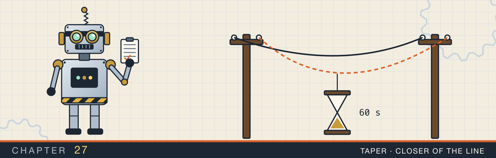
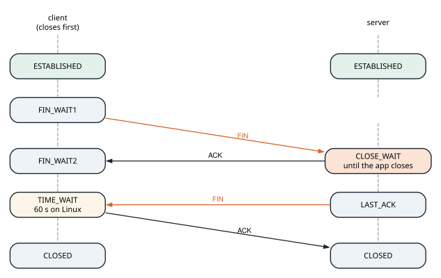
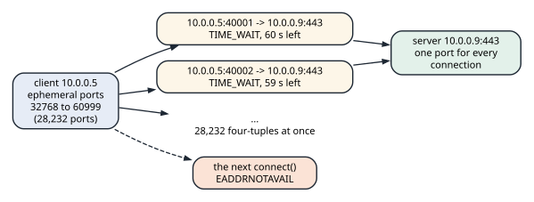

# Closing TCP connections

<div class="covers" markdown="1">

This chapter covers

- How each direction of a TCP connection closes with its own `FIN`
- The states of the side that closes first and of the side that closes second, read from the kernel
- `TIME_WAIT`: what it protects, how long it lasts, and the port limit it puts on busy clients
- `SO_REUSEADDR`, and why a restarted server can bind its port
- `CLOSE_WAIT`: the sockets a server keeps when it never closes, and how to find them
- The reset that replaces `FIN` when a socket closes with unread data

</div>

In chapter 20, TCP connections were opened and closed with `shutdown` and `drop`. From the application's perspective, each close transmits a `FIN` and causes the peer's `read` to return 0. Beneath that interface, however, the kernel tracks each endpoint through a sequence of closing states long after the application has moved on: some states persist for a full minute, and one persists indefinitely if the application fails to close its descriptor.

In this chapter, we trace a TCP connection through its closing transitions as recorded by the kernel. The companion program, `tcp_close`, reads socket states directly from Linux's `/proc/net/tcp` at each step in a Linux container. We also examine two production failures caused by these closing states, along with the conditions under which closing a socket sends a reset rather than a `FIN`.

## 27.1 Two directions, two `FIN`s

A TCP connection is full-duplex, carrying bytes independently in both directions, and each direction closes separately. An endpoint with no further bytes to transmit sends a **`FIN`**, which the peer acknowledges; bytes may continue flowing in the opposite direction until the peer closes its side as well. Complete teardown therefore requires four segments: `FIN`, `ACK`, `FIN`, and `ACK`.

The endpoint that transmits the first `FIN` performs the **active close**, while the peer performs the **passive close**. The two endpoints traverse distinct state sequences (figure 27.1):

| Side | State | Waiting for |
|---|---|---|
| active | `FIN_WAIT1` | the `ACK` of its `FIN` |
| active | `FIN_WAIT2` | the peer's `FIN` |
| active | `TIME_WAIT` | a fixed time, 60 seconds on Linux, before the connection is forgotten |
| passive | `CLOSE_WAIT` | its own program to close the socket |
| passive | `LAST_ACK` | the `ACK` of its `FIN` |

<figure>

<figcaption><b>Figure 27.1</b> The four segments of a close, and the state each side is in between them.</figcaption>
</figure>

Two of these states depend on local events rather than network traffic: `CLOSE_WAIT` persists until the local process closes the socket descriptor, and `TIME_WAIT` persists until a kernel timer expires. Sections 27.2 and 27.3 examine both states in detail.

### 27.1.1 Reading the states

Linux exposes every IPv4 TCP socket in `/proc/net/tcp`, one socket per line. The second and third columns record the local and remote endpoints in hexadecimal form (for example, `0100007F:1F90` for the IP address and port), and the fourth column records the TCP state as a hexadecimal code from `01` (`ESTABLISHED`) through `0B` (`CLOSING`).

The helper functions below parse those lines into port pairs and human-readable state names:

```rust
{{#include ../../rust-interview-lab/src/bin/tcp_close.rs:8:70}}
    // ...
}
```

`entries` skips the header line, splits each line on whitespace, and keeps the three columns it needs. The
`?` operators inside `filter_map` skip any line that does not parse. All connections in this program run
over `127.0.0.1`, so the two ports alone identify a socket.

`state` looks up one socket, and `census` counts the states of every socket on one server port:

```rust
mod linux {
    // ...
{{#include ../../rust-interview-lab/src/bin/tcp_close.rs:72:98}}
    // ...
}
```

A socket the kernel has forgotten has no line in the file, and `state` reports it as `gone`. `connected`
returns both ends of a new connection, so one process can watch both sides.

### 27.1.2 A close, step by step

The first scenario closes a connection in the same sequence used by the echo test in chapter 20. The client half-closes its write direction with `shutdown(Write)`, the server reads until EOF and sends a reply, and both endpoints then drop their sockets. After each step, the program sleeps for 50 ms so loopback segments complete delivery before sampling both states:

```text
1. An orderly close, client first, with a half-close

  step                                   client       server
  connected                              ESTABLISHED  ESTABLISHED
  client shutdown(Write): FIN sent       FIN_WAIT2    CLOSE_WAIT
  server read to end, wrote a reply      FIN_WAIT2    CLOSE_WAIT
  server dropped its socket: FIN sent    TIME_WAIT    gone
  client read the reply, dropped         TIME_WAIT    gone
```

The client never appears in `FIN_WAIT1` because on loopback the `ACK` of its `FIN` arrives within microseconds, advancing the socket to `FIN_WAIT2` before the program polls `/proc/net/tcp`. Over a network link with a 50 ms round-trip time, `FIN_WAIT1` would be visible.

The third row demonstrates a half-closed connection in action: the client's transmit direction is closed while the server's remains open, allowing the server's reply to reach the client cleanly. Once the server drops its socket, the server side transitions through `LAST_ACK` and disappears from the table, while the client side enters `TIME_WAIT` and remains there even after the client drops its descriptor. `TIME_WAIT` is maintained by the kernel rather than by the application process.

Animation 27.1 follows these steps, then shows a server that never closes.

<figure class="anim">
<video class="motion" src="figures/ch27-close.mp4" autoplay loop muted playsinline preload="metadata" aria-label="A client robot and a server robot joined by a wire, each with its TCP state above it. The client's shutdown sends FIN; the server's kernel acknowledges it, and the states become FIN_WAIT2 and CLOSE_WAIT. The server's read returns 0, it writes a reply that crosses to the client, and it drops its socket, which sends FIN. The server goes through LAST_ACK to gone, and the client acknowledges and enters TIME_WAIT, where a 60-second clock runs after the client drops its socket. In a second run the server never drops its sockets: five clients connect and close, each leaves a FIN_WAIT2 on the client side and a CLOSE_WAIT on the server, and the server's count of open descriptors climbs toward its limit." data-chapters="[[0.0, &quot;FIN&quot;], [15.42, &quot;reply&quot;], [23.42, &quot;second FIN&quot;], [42.42, &quot;leak&quot;]]"></video>
<figcaption><b>Animation 27.1</b> Each side's <code>FIN</code> closes one direction. A server that never closes leaves every connection in <code>CLOSE_WAIT</code>, holding a descriptor.</figcaption>
</figure>

## 27.2 `TIME_WAIT`

The endpoint that initiates the active close remains in `TIME_WAIT` before the kernel reclaims the connection state. This waiting period guards against two network hazards:

- **A lost final `ACK`.** If the final `ACK` is dropped in transit, the peer remains in `LAST_ACK` and retransmits its `FIN`. An endpoint still in `TIME_WAIT` recognizes the connection and retransmits the `ACK`. Had it discarded the connection immediately, it would respond with a reset (`RST`), causing the peer to report an error on a connection that closed cleanly.
- **Delayed duplicate segments.** A segment from the closed connection can be delayed in the network and arrive late. If a new connection reusing the same four-tuple (local IP, local port, remote IP, remote port) were already established, that stale segment could corrupt the new byte stream. `TIME_WAIT` keeps the four-tuple reserved until any delayed segments have expired.

The TCP specification defines this duration as twice the maximum segment lifetime (2 MSL); Linux fixes it at 60 seconds.

### 27.2.1 The cost: ports on a busy client

A `TIME_WAIT` socket consumes only a few hundred bytes of kernel memory, which is negligible. The scarce resource is the four-tuple it reserves. For each outgoing connection to a server, the client kernel allocates a local port from the **ephemeral port range** (32768 to 60999 by default on Linux, providing 28,232 ports). When the client closes first, each port remains bound in `TIME_WAIT` for 60 seconds, capping the client at roughly 470 new connections per second to a single destination address and port. Exceeding that rate causes `connect` to fail with `EADDRNOTAVAIL`.

<figure>

<figcaption><b>Figure 27.2</b> Each closed connection holds its four values for 60 seconds. On the client, the free values run out with the ephemeral ports.</figcaption>
</figure>

Three fixes are common:

- **Reuse connections.** An HTTP client that keeps connections alive, or a connection pool, as in chapter
  29, makes few connections and few closes.
- **Let the server close first.** Then `TIME_WAIT` lands on the server. All its connections share its one port, so the entries use up nothing.
- **`net.ipv4.tcp_tw_reuse`.** This Linux setting lets an outgoing connection reuse a port in `TIME_WAIT`
  when TCP timestamps prove its segments are newer.

### 27.2.2 Binding a port with connections in `TIME_WAIT`

A server that closes first collects `TIME_WAIT` entries on its own port. If it restarts within a minute,
its new listening socket asks for a port that those entries still use. By default, `bind` refuses.
**`SO_REUSEADDR`** allows the bind as long as no socket on the port is listening. Rust's `TcpListener::bind`
sets it on Unix, so the program uses raw calls to bind both ways:

```rust
unsafe extern "C" {
    fn socket(domain: c_int, ty: c_int, protocol: c_int) -> c_int; // AF_INET, SOCK_STREAM, 0
    fn setsockopt(
        fd: c_int,
        level: c_int,          // SOL_SOCKET
        name: c_int,           // SO_REUSEADDR
        value: *const c_void,  // points at the option's value, a c_int here
        len: socklen_t,        // its size in bytes
    ) -> c_int;
    fn bind(fd: c_int, addr: *const sockaddr, len: socklen_t) -> c_int;
}
```

`sockaddr` is a generic address type. An IPv4 address is a `sockaddr_in`, passed as a pointer to `sockaddr`
with its own size:

```rust
mod linux {
    // ...
{{#include ../../rust-interview-lab/src/bin/tcp_close.rs:100:141}}
    // ...
}
```

The third scene closes one connection server-first, drops the listener, and binds the port again:

```text
3. TIME_WAIT on the server's port, and binding it again

  server closed first, then the client: {"TIME_WAIT": 1}
  bind port again, SO_REUSEADDR false: Address already in use (os error 98)
  bind port again, SO_REUSEADDR true : bound
```

One socket in `TIME_WAIT` was enough to stop a plain `bind`.

## 27.3 `CLOSE_WAIT`

The side that receives the first `FIN` moves to `CLOSE_WAIT`, and stays there until its own program
closes the socket. The kernel cannot leave `CLOSE_WAIT` on its own. Only the program knows whether it still
wants to send.

A server that never closes a connection after the client has gone leaves it in `CLOSE_WAIT` for as long as
the server runs. Each such connection holds a descriptor. The usual causes are a handler that ignores a `read` of 0, and a connection kept in a map that nothing removes. A reference cycle that keeps a socket's owner alive does the same.

`leaky_server` keeps every accepted socket in a `Vec`, while each client connects and closes at once:

```rust
mod linux {
    // ...
{{#include ../../rust-interview-lab/src/bin/tcp_close.rs:143:157}}
    // ...
}
```

```text
2. A server that never closes what clients closed

  while the server keeps 5 sockets: {"CLOSE_WAIT": 5, "FIN_WAIT2": 5}
  after the server drops them:      {"TIME_WAIT": 5}
```

Five connections waited at the halfway point of figure 27.1. The clients were in `FIN_WAIT2`, waiting for a `FIN`, and the server in `CLOSE_WAIT`, waiting for itself. When the server dropped the `Vec`, it sent five
`FIN`s, and the clients' sides moved to `TIME_WAIT`. The clients had already closed their descriptors.
Linux keeps such an orphaned `FIN_WAIT2` socket for 60 seconds (`tcp_fin_timeout`), then drops it.

In production, `ss -tan state close-wait` lists the `CLOSE_WAIT` sockets of every process. A count that only grows is a leak in the program that owns them. It ends in `EMFILE`, "Too many open files", as in section 24.1.

## 27.4 Reset instead of `FIN`

When a process closes a socket whose receive buffer still contains unread bytes, the kernel sends a **reset** (`RST`) rather than a `FIN`, signaling to the peer that data was discarded. The peer's subsequent `read` fails with `ECONNRESET`, and any unread bytes still buffered on the peer side are discarded as well.

```rust
mod linux {
    // ...
{{#include ../../rust-interview-lab/src/bin/tcp_close.rs:159:169}}
}
```

```text
4. Closing with unread data

  client read failed: Connection reset by peer (os error 104)
```

This behavior creates a subtle failure mode in HTTP servers. If a server transmits an error response and closes the socket before draining the remaining request body, the resulting `RST` can overtake or abort delivery of the response, causing the client to report a connection reset instead of reading the HTTP error. Production servers avoid this with a **lingering close**: after writing the response, the server calls `shutdown(Write)`, drains and discards incoming request bytes for a brief interval, and only then closes the descriptor.

An application can also force an immediate reset intentionally by configuring `SO_LINGER` with a timeout of 0 before closing. Doing so bypasses `TIME_WAIT` and delivers `ECONNRESET` to the peer. While load balancers occasionally use this technique to shed connections rapidly, it also discards unsent data in the send buffer and is unsuitable as a general default.

## 27.5 The complete program

<p class="listing"><b>Listing 27.1</b> The states of a closing connection, read from <code>/proc/net/tcp</code>. <a href="https://github.com/arpanpathak/cracking-the-systems-programming-interview/blob/prep-v2/rust-interview-lab/src/bin/tcp_close.rs">src/bin/tcp_close.rs</a></p>

```rust
{{#include ../../rust-interview-lab/src/bin/tcp_close.rs}}
```

```text
$ cargo run --bin tcp_close
1. An orderly close, client first, with a half-close

  step                                   client       server
  connected                              ESTABLISHED  ESTABLISHED
  client shutdown(Write): FIN sent       FIN_WAIT2    CLOSE_WAIT
  server read to end, wrote a reply      FIN_WAIT2    CLOSE_WAIT
  server dropped its socket: FIN sent    TIME_WAIT    gone
  client read the reply, dropped         TIME_WAIT    gone

2. A server that never closes what clients closed

  while the server keeps 5 sockets: {"CLOSE_WAIT": 5, "FIN_WAIT2": 5}
  after the server drops them:      {"TIME_WAIT": 5}

3. TIME_WAIT on the server's port, and binding it again

  server closed first, then the client: {"TIME_WAIT": 1}
  bind port again, SO_REUSEADDR false: Address already in use (os error 98)
  bind port again, SO_REUSEADDR true : bound

4. Closing with unread data

  client read failed: Connection reset by peer (os error 104)
```

## 27.6 Questions that come up

**"A server has 30,000 sockets in `TIME_WAIT`. Is that a problem?"**
Usually not on the server. They share the server's port and cost little memory. It is a problem on a
client, where each one holds an ephemeral port to the same destination.

**"A server has 3,000 sockets in `CLOSE_WAIT` and the number keeps rising. What happened?"**
The clients closed, and the server never closed its side. Look for a code path that returns without
dropping the connection, or a collection that keeps connections after they end.

**"Why not shorten `TIME_WAIT`?"**
Linux has no setting for it: the 60 seconds is a constant in the kernel. Reusing connections removes the need, and `tcp_tw_reuse` covers the outgoing case safely.

**"What is the difference between `shutdown(Write)` and `close`?"**
`shutdown(Write)` sends `FIN` and keeps the socket open for reading. `close` releases the descriptor. If no
other descriptor refers to the socket, the kernel sends `FIN`, or a reset if unread data remains.

**"Both sides send `FIN` at the same moment. What happens?"**
Both go from `FIN_WAIT1` to `CLOSING`, a state for this simultaneous close, then both to `TIME_WAIT`.

<div class="summary" markdown="1">

## Summary

- Each direction of a connection closes with its own `FIN` and `ACK`, four segments in all.
- The side that closes first passes through `FIN_WAIT1`, `FIN_WAIT2`, and `TIME_WAIT`. The other passes
  through `CLOSE_WAIT` and `LAST_ACK`.
- `TIME_WAIT` lasts 60 seconds on Linux. It answers a retransmitted `FIN` and keeps late segments out of a
  new connection with the same addresses and ports.
- On a client, `TIME_WAIT` holds ephemeral ports: about 470 new connections per second to one server.
  Reusing connections is the fix.
- `SO_REUSEADDR` lets a server bind a port that has connections in `TIME_WAIT`. `TcpListener::bind` sets it.
- `CLOSE_WAIT` lasts until the program closes the socket. A growing count is a leak of descriptors.
- Closing with unread data sends a reset, and the peer's `read` fails with `ECONNRESET`.

</div>

In chapter 28, we add transport encryption to TCP connections using `rustls`, verifying server certificates and extending the handshake to mutual TLS so that the server authenticates clients as well.

## Exercises

1. Add `thread::sleep(Duration::from_secs(61))` at the end of the first scene and print the client's state
   again. What does it show?
2. Change `leaky_server` so the server closes first and the clients never do. Which side holds `FIN_WAIT2`,
   which holds `CLOSE_WAIT`, and which ends up in `TIME_WAIT`?
3. Open 1,000 connections to one listener in a loop, closing each from the client side, and print the
   `census` afterwards. Then make the server close first and compare.
4. In `close_with_unread_data`, read the client's bytes on the server before dropping it. What does the
   client's `read` return now?
5. Set `SO_LINGER` to `{ l_onoff: 1, l_linger: 0 }` on the server's socket with `libc::setsockopt` before
   dropping it in the first scene. Which states disappear, and what does the client's `read` report?
