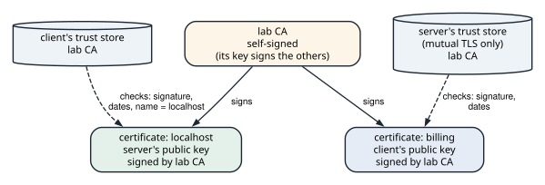
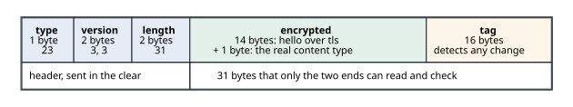

# TLS and mutual TLS

<div class="covers" markdown="1">

This chapter covers

- Transport Layer Security (TLS) guarantees over TCP: confidentiality, authenticated integrity, and cryptographic peer authentication
- X.509 certificates, certificate authorities (CAs), trust stores, and the three mandatory verification checks
- The single-round-trip TLS 1.3 handshake and wire-level record framing inspected byte by byte
- Configuring a `rustls` client and server with ephemeral X.509 certificates generated via `rcgen`
- Handshake failure diagnostics for hostname mismatch and untrusted issuer chains
- Mutual TLS (mTLS) client authentication, `CertificateRequired` alerts, and certificate rotation lifecycles

</div>

Unencrypted TCP transmits payloads in plaintext across every intermediate router and network link, providing neither confidentiality against passive eavesdropping nor integrity against active tampering or endpoint impersonation. **Transport Layer Security (TLS)** inserts a cryptographic record and handshake layer directly above TCP, providing three formal security guarantees: confidentiality via symmetric authenticated encryption (AEAD), integrity via per-record authentication tags that detect modification or truncation, and endpoint authentication via X.509 public-key certificates.

The reference program `tls_mtls` constructs a self-contained public-key infrastructure (PKI) in memory using `rcgen` and executes five TLS 1.3 scenarios over loopback with `rustls`: standard server-authenticated TLS, hostname-mismatch rejection, untrusted-CA rejection, mutual TLS rejection of an unauthenticated client, and mutual TLS with a verified client certificate.

## 28.1 Certificates and trust

TLS establishes cryptographic identity using **asymmetric (public-key) cryptography**. An endpoint generates a key pair comprising a confidential private key and a publicly distributed public key. A **digital signature** computed with the private key can be verified by any party holding the corresponding public key, yet cannot be forged without possessing the private key.

An **X.509 certificate** is a digitally signed assertion binding a subject's identity (such as a DNS name) and validity window (`not_before` to `not_after`) to a public key. The signing entity is a **certificate authority (CA)**, and each verifying party maintains a **trust store** of trusted root CA certificates. Upon receiving a server's certificate chain during a handshake, the client enforces three mandatory verification invariants (Figure 28.1):

1. **Signature chain validation.** Every certificate in the chain carries a valid signature from its issuer, terminating at a root CA present in the client's trust store.
2. **Temporal validity.** The current wall-clock time falls within every certificate's `[not_before, not_after]` interval.
3. **Subject identity match.** At least one Subject Alternative Name (SAN) in the leaf certificate matches the target hostname requested by the client.

Because certificates are transmitted publicly, presenting a valid certificate alone does not prove ownership. During the handshake, the server additionally signs a cryptographic hash of the entire handshake transcript with its private key (`CertificateVerify`), proving live possession of the private key bound to the certificate's public key.

<figure>

<figcaption><b>Figure 28.1</b> One CA signs both certificates. Each side trusts the CA, and so trusts what it signed.</figcaption>
</figure>

On the public internet, operating systems and browsers ship trust stores containing hundreds of commercial root CAs. Within private infrastructure and service meshes, organizations operate internal CAs that issue short-lived certificates exclusively for internal service-to-service traffic, mirroring the structure of `tls_mtls`.

### 28.1.1 Making the certificates

The `rcgen` crate generates asymmetric key pairs and X.509 certificates programmatically. `Pki` synthesizes a self-signed root CA and uses it to sign distinct leaf certificates for the server (`localhost`) and the client (`billing`):

```rust
{{#include ../../rust-interview-lab/src/bin/tls_mtls.rs:11:89}}
```

Setting `IsCa::Ca` authorizes the root certificate to sign subordinate certificates, and `self_signed` signs the root with its own private key; clients trust a root CA strictly by explicit inclusion in their trust store. `CertificateParams::new` populates the SAN entries for each leaf certificate, and `signed_by` certifies the leaf public key using the CA's signing key. `roots` constructs a `RootCertStore` trusting solely this local CA.

## 28.2 The TLS 1.3 handshake

Before transmitting application data, the endpoints execute a **handshake** to negotiate cipher suites, derive shared symmetric keys, and authenticate identities. TLS 1.3 completes this protocol in a single network round trip (1-RTT):

| Step | From | Messages | Encrypted |
|---|---|---|---|
| 1 | client | `ClientHello`: cipher suites, a key share, and the server's name (SNI) | no |
| 2 | server | `ServerHello`: the chosen suite and the server's key share | no |
| 3 | server | `Certificate`, `CertificateVerify` (the signature), `Finished` | yes |
| 4 | client | `Finished` | yes |

Following step 2, both endpoints combine their local ephemeral private value with the peer's public key share via **elliptic-curve Diffie-Hellman (ECDHE)** to derive identical symmetric handshake keys with forward secrecy; a passive observer recording the wire cannot compute these keys. Every handshake message subsequent to `ServerHello` (including the server's certificate) is encrypted under those keys. The client validates the certificate chain, `CertificateVerify` signature, and `Finished` MAC in step 3 before transmitting its own `Finished` message and initial application payload in step 4.

TLS encapsulates all handshake messages, alerts, and application payloads into **records**. Each record begins with an unencrypted 5-byte header: a 1-byte content type (`22` for handshake, `23` for application data), a 2-byte legacy protocol version (`0x0303`), and a 2-byte big-endian payload length.

### 28.2.1 Watching the wire

To inspect wire-level framing without external packet capture, `Tap` wraps the client's `TcpStream` and records a copy of every outbound byte. `records` parses the captured stream header by header:

```rust
{{#include ../../rust-interview-lab/src/bin/tls_mtls.rs:97:140}}
```

The slice pattern `[kind, _, _, high, low, rest @ ..]` matches while at least five header bytes remain, extracting the record type and big-endian length. `rest.get(length..)` advances past the record body and returns `None` if the buffer terminates mid-record.

### 28.2.2 A client and a server

`rustls` decouples cryptographic state machines (`ClientConnection` and `ServerConnection`) from transport I/O. `StreamOwned` composes a TLS state machine with any type implementing `std::io::Read` and `std::io::Write`, driving the handshake automatically on the first I/O call.

Builder methods assemble immutable `ServerConfig` and `ClientConfig` structures, explicitly selecting the `ring` cryptographic provider:

```rust
{{#include ../../rust-interview-lab/src/bin/tls_mtls.rs:228:241}}
    // ...
}
```

`with_safe_default_protocol_versions` enables TLS 1.3 and TLS 1.2 while excluding deprecated protocol versions. `with_no_client_auth` configures unidirectional authentication: the server authenticates to the client, and no client certificate is requested.

The server accepts a single connection, uppercases one message, and performs an authenticated shutdown:

```rust
{{#include ../../rust-interview-lab/src/bin/tls_mtls.rs:142:161}}
```

Invoking `send_close_notify` transmits a cryptographically authenticated `close_notify` alert prior to closing the TCP socket. Without this alert, an active attacker could inject a forged TCP `FIN` to truncate a response prematurely; `rustls` therefore surfaces an unauthenticated EOF as an unexpected end-of-file error.

The client connects through `Tap`, transmits `hello over tls`, and reads the server's reply:

```rust
{{#include ../../rust-interview-lab/src/bin/tls_mtls.rs:163:203}}
```

`ServerName` serves two roles: `rustls` transmits it in the `ClientHello` Server Name Indication (SNI) extension and verifies it against the SANs in the server's certificate.

Animation 28.1 traces this standard TLS 1.3 exchange followed by the mutual TLS scenarios of Section 28.4.

<figure class="anim">
<video class="motion" src="figures/ch28-tls.mp4" autoplay loop muted playsinline preload="metadata" aria-label="A client robot and a server robot joined by a wire. The client sends ClientHello with its key share and the name localhost. The server answers ServerHello with its key share, and both robots get the same key. Locked messages follow from the server: its certificate, signed by the lab CA; CertificateVerify, a signature with its private key; and Finished. The client checks the signature chain to its trust store, the dates, and that the name is localhost, then sends Finished, and its 14-byte message travels as a locked 31-byte record. In mutual TLS the server also sends CertificateRequest. A client with the billing certificate sends Certificate and CertificateVerify, and the server checks them against the lab CA. A client with no certificate sends an empty Certificate, and the server ends the handshake with the alert CertificateRequired." data-chapters="[[0.0, &quot;hello&quot;], [12.36, &quot;keys&quot;], [22.38, &quot;certificate&quot;], [37.86, &quot;data&quot;], [48.06, &quot;mutual&quot;], [67.38, &quot;no certificate&quot;]]"></video>
<figcaption><b>Animation 28.1</b> One round trip sets up the keys, and everything after <code>ServerHello</code> is encrypted. In mutual TLS the server asks for a certificate, and refuses a client without one.</figcaption>
</figure>

Scenario 1 verifies normal TLS 1.3 negotiation and wire-level encryption:

```text
1. The client checks the server's certificate
  client: TLSv1_3 TLS13_AES_256_GCM_SHA384, reply "HELLO OVER TLS"
  client sent records: [("handshake", 231), ("change_cipher_spec", 1), ("application_data", 69), ("application_data", 31)]
  "hello" readable on the wire: false
  server: client presented no certificate
```

The client transmitted four records:

- **`handshake` (231 bytes):** the unencrypted `ClientHello` record containing cipher suites, key share, and SNI.
- **`change_cipher_spec` (1 byte):** a compatibility dummy record retained by RFC 8446 so legacy middleboxes expecting TLS 1.2 state machines do not drop the connection.
- **`application_data` (69 bytes):** the client's encrypted `Finished` message; TLS 1.3 wraps all post-`ServerHello` handshake records in outer type `23` (`application_data`) to obscure record boundaries from passive observers.
- **`application_data` (31 bytes):** the 14-byte plaintext `hello over tls`, plus 1 byte encoding the inner content type and a 16-byte AES-256-GCM authentication tag (Figure 28.2).

<figure>

<figcaption><b>Figure 28.2</b> The client's last record, byte by byte. Only the header can be read on the wire.</figcaption>
</figure>

Scanning the captured byte stream confirms that the plaintext substring `"hello"` never appears on the wire.

## 28.3 When the check fails

Scenarios 2 and 3 violate the hostname-identity check and the trusted-CA chain check, respectively:

```text
2. The client expects a different name
  client: invalid peer certificate: certificate not valid for name "billing.example"; certificate is only valid for DnsName("localhost")
  server: handshake failed: unexpected end of file

3. The client does not trust the CA
  client: invalid peer certificate: UnknownIssuer
  server: handshake failed: unexpected end of file
```

In both cases, the client aborts the handshake at step 3 prior to transmitting any application data and closes the socket, causing the server to observe an unexpected EOF. Although the server's certificate is structurally well-formed in both runs, rejecting a mismatched hostname or an untrusted issuer prevents man-in-the-middle impersonation.

Encrypting a channel to an unauthenticated peer provides confidentiality against passive observers while remaining completely vulnerable to active interception. Accordingly, `rustls` provides no boolean toggle to disable verification; bypassing certificate validation requires implementing a custom `ServerCertVerifier` explicitly gated behind the `danger` API namespace.

## 28.4 Mutual TLS

Standard TLS authenticates only the server at the transport layer; clients remain anonymous until they present application-level credentials (such as bearer tokens or passwords) inside the encrypted channel. In **mutual TLS (mTLS)**, the server transmits a `CertificateRequest` during the handshake, requiring the client to present an X.509 certificate signed by a CA in the server's trust store alongside a `CertificateVerify` signature proving possession of the client's private key.

Internal microservice architectures use mTLS to bind cryptographic caller identities directly to transport connections: once verified, the subject name in the client certificate (`billing`) serves as an unforgeable principal for authorization policies.

Enabling mTLS on the server attaches a `WebPkiClientVerifier` configured with the shared CA trust store:

```rust
fn main() -> Result<(), Error> {
    // ...
{{#include ../../rust-interview-lab/src/bin/tls_mtls.rs:260:277}}
}
```

```text
4. Mutual TLS, client without a certificate
  client: received fatal alert: CertificateRequired
  server: handshake failed: peer sent no certificates

5. Mutual TLS, client with the billing certificate
  client: TLSv1_3 TLS13_AES_256_GCM_SHA384, reply "HELLO OVER TLS"
  client sent records: [("handshake", 231), ("change_cipher_spec", 1), ("application_data", 481), ("application_data", 31)]
  "hello" readable on the wire: false
  server: client presented 1 verified certificate
```

In scenario 4, the client lacking a certificate receives a fatal `CertificateRequired` TLS alert. In scenario 5, presenting the `billing` certificate expands the client's encrypted handshake record from 69 bytes to 481 bytes; the additional 412 bytes encode the client's X.509 certificate and `CertificateVerify` signature.

Because every X.509 certificate carries a finite validity window, production mTLS deployments automate short-lived certificate issuance and rotation (typically hours or days, as in SPIFFE/SPIRE). Short validity periods bound the blast radius of a compromised private key without requiring global revocation checks on every handshake.

### 28.4.1 What TLS costs

- **Handshake latency.** Establishing a fresh TLS 1.3 connection requires one round trip for the TCP three-way handshake plus one round trip for the TLS handshake (2 RTT total) before the first request departs, exceeding 100 ms across continental regions. **Session resumption** (pre-shared key tickets) avoids full certificate verification on repeat connections, and persistent connection pools (Chapter 29) amortize handshake latency across thousands of requests.
- **CPU overhead.** Asymmetric ECDHE key exchange and digital signatures consume tens to hundreds of microseconds per handshake, whereas hardware-accelerated symmetric AEAD encryption (`AES-GCM` via AES-NI or ARMv8 Crypto) sustains multi-gigabyte-per-second throughput per core.
- **User-space copies.** Because `rustls` encrypts records in user space, static file servers cannot invoke `sendfile` directly on a `rustls` stream without copying payload bytes through user space, unless symmetric encryption is offloaded to kernel TLS (Section 23.3.2).

## 28.5 The complete program

<p class="listing"><b>Listing 28.1</b> TLS and mutual TLS with <code>rustls</code>, on certificates made by <code>rcgen</code>. <a href="https://github.com/arpanpathak/cracking-the-systems-programming-interview/blob/prep-v2/rust-interview-lab/src/bin/tls_mtls.rs">src/bin/tls_mtls.rs</a></p>

```rust
{{#include ../../rust-interview-lab/src/bin/tls_mtls.rs}}
```

```text
$ cargo run --bin tls_mtls
1. The client checks the server's certificate
  client: TLSv1_3 TLS13_AES_256_GCM_SHA384, reply "HELLO OVER TLS"
  client sent records: [("handshake", 231), ("change_cipher_spec", 1), ("application_data", 69), ("application_data", 31)]
  "hello" readable on the wire: false
  server: client presented no certificate

2. The client expects a different name
  client: invalid peer certificate: certificate not valid for name "billing.example"; certificate is only valid for DnsName("localhost")
  server: handshake failed: unexpected end of file

3. The client does not trust the CA
  client: invalid peer certificate: UnknownIssuer
  server: handshake failed: unexpected end of file

4. Mutual TLS, client without a certificate
  client: received fatal alert: CertificateRequired
  server: handshake failed: peer sent no certificates

5. Mutual TLS, client with the billing certificate
  client: TLSv1_3 TLS13_AES_256_GCM_SHA384, reply "HELLO OVER TLS"
  client sent records: [("handshake", 231), ("change_cipher_spec", 1), ("application_data", 481), ("application_data", 31)]
  "hello" readable on the wire: false
  server: client presented 1 verified certificate
```

## 28.6 Questions that come up

**"What does SNI do, and is it encrypted?"**
Server Name Indication (SNI) transmits the target hostname inside `ClientHello`, enabling a single IP address to host distinct certificates for multiple virtual domains. Standard SNI travels in plaintext; **Encrypted Client Hello (ECH)** encrypts the inner `ClientHello` (including SNI) when both client and server support it.

**"Where should TLS end in a system?"**
Terminating TLS at an edge load balancer leaves backend traffic in plaintext, which is acceptable only inside a strictly isolated network perimeter. End-to-end mutual TLS between internal services preserves confidentiality and cryptographic service authentication across every network hop.

**"A client fails with `UnknownIssuer` against a server that works in a browser. Why?"**
The server is typically transmitting only its leaf certificate while omitting the intermediate CA certificate required to chain to a trusted root. Web browsers often succeed via cached intermediates or AIA fetching, whereas minimal TLS clients reject incomplete chains. The server must transmit the full leaf-to-intermediate chain.

**"What does 0-RTT mean?"**
TLS 1.3 zero-round-trip resumption allows a client with a cached session ticket to transmit encrypted application data alongside `ClientHello` before the handshake finishes. Because 0-RTT payloads lack single-use replay protection, servers must restrict 0-RTT strictly to idempotent operations (Chapter 19).

**"How does a server revoke a client's certificate before it expires?"**
The server can attach Certificate Revocation Lists (CRLs) to `WebPkiClientVerifier` so revoked serial numbers are rejected during handshake verification. Many internal systems supplement or replace CRLs with short-lived certificates (hours in duration) that expire naturally when renewal is halted.

<div class="summary" markdown="1">

## Summary

- TLS layers confidentiality (AEAD encryption), tamper and truncation detection (authentication tags and `close_notify`), and X.509 certificate authentication over TCP.
- An X.509 certificate binds a public key to a subject identity and validity window, signed by a CA; verifying clients check the signature chain to a trusted root, validity dates, and hostname SAN match.
- `CertificateVerify` proves live possession of the private key corresponding to the presented certificate.
- TLS 1.3 establishes forward-secret keys via ECDHE in one round trip and encrypts all handshake messages after `ServerHello`; a 14-byte payload expands into a 31-byte encrypted record (1-byte inner type plus 16-byte AEAD tag).
- Hostname mismatches and untrusted CAs abort the handshake before any application payload is transmitted.
- Mutual TLS requires the client to present a verified certificate and signature; omitting one terminates the handshake with a fatal `CertificateRequired` alert.
- Per-connection TLS overhead (one extra round trip and asymmetric cryptography) is amortized by session resumption and connection pooling.

</div>

## Exercises

1. Print the DER-encoded byte lengths of the server and client certificates in `tls_mtls`. Compare the client certificate size against the 412-byte increase in the mutual TLS encrypted handshake record and account for the remaining bytes.
2. Issue the server certificate with both `localhost` and `api.internal` in `CertificateParams::new`, and verify successful TLS connections targeting each hostname.
3. Set the server certificate's `not_after` timestamp to yesterday via `rcgen::date_time_ymd` and record the exact verification error returned by `rustls`.
4. Introduce an intermediate CA signed by the root CA and sign the server leaf certificate with that intermediate. Observe the client error when the server sends only its leaf certificate, then verify success when the full chain `[leaf, intermediate]` is sent.
5. Restrict the server to TLS 1.2 via `with_protocol_versions(&[&rustls::version::TLS12])` and compare the client's captured wire records against the TLS 1.3 trace.
