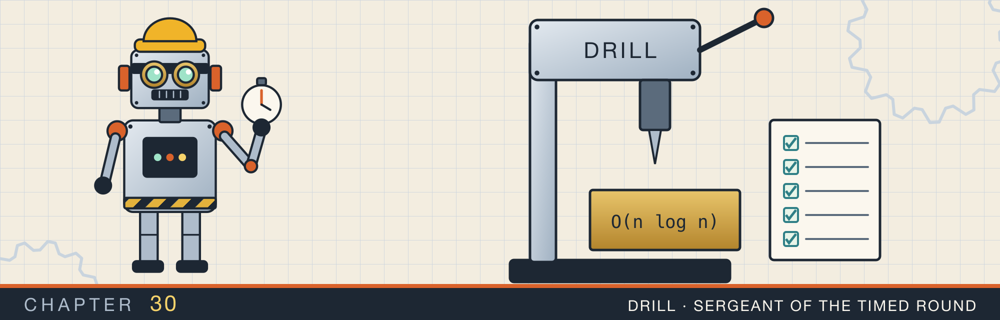
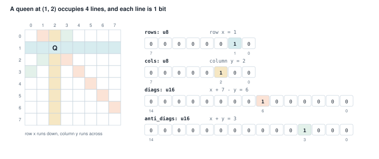
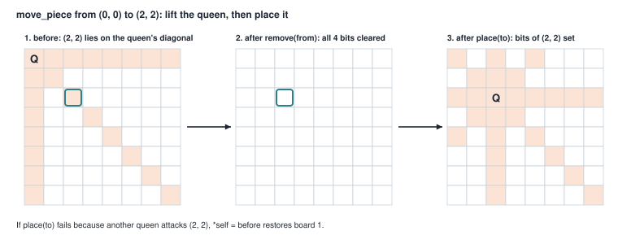

# Drills against the clock

<div class="covers" markdown="1">

This chapter covers

- Ten compact systems implementations sized for a 45-minute technical interview
- Cross-references mapping each compact drill to its full production-grade counterpart
- Deliberate engineering trade-offs omitted from the short forms, including a subtle lazy-iterator serialization defect
- Time-allocation discipline for a 45-minute live coding round and a structured rehearsal protocol

</div>

Production-grade systems primitives prioritize safety invariants, cache-line contention avoidance, and exhaustive failure handling; timed technical interviews impose a distinct constraint set: a blank buffer, a concise specification, and roughly forty minutes to deliver a verified implementation. The module `drills.rs` provides ten self-contained, interview-sized counterparts to the book's core concurrency, networking, and data-structure primitives, each paired with a unit test exercising primary behavior.

This reference guide indexes each drill against its full implementation, audits every deliberate simplification and behavioral divergence, and defines a repeatable rehearsal protocol for timed execution.

## 30.1 The drills

The module `drills.rs` contains 10 self-contained implementations, each short enough to be written within a 45-minute round. Full reference implementations with complete test suites reside in the neighboring modules, as documented in the module header (Listing 30.1). Each drill maps to a reference chapter and listing as follows.

| Drill | Lines | Full version |
|---|---|---|
| `count_parallel`: `Arc<Mutex<usize>>` counter | 20 | chapter 8 (`total_with_arc_mutex`, listing 8.7), chapter 16 |
| `parallel_sum`: scoped threads | 19 | chapter 16, `threads::parallel_sum`, listing 16.5 |
| `SpinLock` and `SpinGuard` | 53 | chapter 16, listing 16.12 |
| `Semaphore` | 44 | chapter 16, listing 16.15 |
| `BlockingQueue` with `close` | 78 | chapter 17, listing 17.25 |
| `ThreadPool` with `Drop` | 54 | chapter 18, listing 18.7 |
| `retry` with backoff | 25 | chapter 19, listing 19.9 |
| `HashRing` | 45 | chapter 14, listing 14.9 |
| `parse_request_head` | 35 | chapter 21, listing 21.1 |
| `Port` newtype and `Route` enum | 33 | chapter 7 (the `GpuCount` newtype, listing 7.2); chapter 21, `route` |

<p class="listing"><b>Listing 30.1</b> The module header and imports (lines 1 to 20). <a href="https://github.com/arpanpathak/cracking-the-systems-programming-interview/blob/prep-v2/rust-interview-lab/src/problems/drills.rs">src/problems/drills.rs</a></p>

```rust
{{#include ../../rust-interview-lab/src/problems/drills.rs:1:20}}
```

### 30.1.1 Thread-safe counter

<p class="listing"><b>Listing 30.2</b> <code>count_parallel</code> (lines 22 to 42).</p>

```rust
{{#include ../../rust-interview-lab/src/problems/drills.rs:22:42}}
```

In `count_parallel`, `threads` worker threads are spawned, and each worker increments a shared counter `per_thread` times. The counter is held in an `Arc<Mutex<usize>>`. `Arc` provides shared ownership across threads, and `Mutex` serializes the increments. Each worker receives its own clone of the `Arc` before its closure is moved into `thread::spawn`.

After every handle is joined, the final value is read under the lock, and `threads × per_thread` is expected. A `JoinHandle` that is never joined would leave a worker running past the read, so the join loop precedes the final lock.

**Usage.** The drill is called from `main` in `src/bin/drills.rs` (Listing 30.3).

<p class="listing"><b>Listing 30.3</b> Usage of <code>count_parallel</code> (lines 24 to 25). <a href="https://github.com/arpanpathak/cracking-the-systems-programming-interview/blob/prep-v2/rust-interview-lab/src/bin/drills.rs">src/bin/drills.rs</a></p>

```rust
fn main() {
    // ...
{{#include ../../rust-interview-lab/src/bin/drills.rs:24:25}}
    // ...
}
```

```text
count_parallel(4, 1000) = 4000
```

With 4 threads and 1000 increments per thread, the counter reaches 4 × 1000 = 4000, so no increment is lost.

### 30.1.2 Scoped threads

<p class="listing"><b>Listing 30.4</b> <code>parallel_sum</code> (lines 44 to 63).</p>

```rust
{{#include ../../rust-interview-lab/src/problems/drills.rs:44:63}}
```

In `parallel_sum`, the slice is divided into at most 4 chunks of `values.len().div_ceil(4)` elements, and each chunk is summed by a separate thread. Because `thread::scope` guarantees that every spawned thread is joined before the scope returns, the threads borrow `values` directly, and no `Arc` is required. The `.max(1)` guard keeps the chunk size nonzero for an empty slice, since `chunks(0)` panics.

The iterator chain is lazy. Each thread is therefore joined before the next thread is spawned, and the chunks are summed sequentially. This defect, and the 1-line repair, are analyzed in section 30.4.

**Usage.** The drill is called from `main` in `src/bin/drills.rs` (Listing 30.5).

<p class="listing"><b>Listing 30.5</b> Usage of <code>parallel_sum</code> (lines 27 to 30). <a href="https://github.com/arpanpathak/cracking-the-systems-programming-interview/blob/prep-v2/rust-interview-lab/src/bin/drills.rs">src/bin/drills.rs</a></p>

```rust
fn main() {
    // ...
{{#include ../../rust-interview-lab/src/bin/drills.rs:27:30}}
    // ...
}
```

```text
parallel_sum(1..=100) = 5050
```

The sum of the integers 1 to 100 is 100 × 101 / 2 = 5050. The result is correct even though the chunks are summed sequentially (section 30.4).

### 30.1.3 Spin lock

<p class="listing"><b>Listing 30.6</b> <code>SpinLock</code> and <code>SpinGuard</code> (lines 65 to 118).</p>

```rust
{{#include ../../rust-interview-lab/src/problems/drills.rs:65:118}}
```

A `SpinLock<T>` consists of an `AtomicBool` flag and the protected value in an `UnsafeCell<T>`. In `lock`, the calling thread executes `swap(true, Acquire)` in a loop until the previous value is `false`, and a `SpinGuard` is then returned. The `Acquire` ordering makes every write performed in the previous critical section visible to the new holder.

Access to the value is provided through the `Deref` and `DerefMut` implementations of `SpinGuard`. In its `Drop` implementation, the lock is released with a `Release` store, so the lock is released on every exit path, including a panic. The `unsafe impl Sync` and the 2 `unsafe` blocks carry no `// SAFETY:` comments; section 30.3 lists this omission together with the cache-line cost of spinning on `swap`.

**Usage.** The drill is called from `main` in `src/bin/drills.rs` (Listing 30.7).

<p class="listing"><b>Listing 30.7</b> Usage of <code>SpinLock</code> (lines 32 to 45). <a href="https://github.com/arpanpathak/cracking-the-systems-programming-interview/blob/prep-v2/rust-interview-lab/src/bin/drills.rs">src/bin/drills.rs</a></p>

```rust
fn main() {
    // ...
{{#include ../../rust-interview-lab/src/bin/drills.rs:32:45}}
    // ...
}
```

```text
spin lock total = 4000
```

4 scoped threads each acquire the lock 1000 times. Because the total equals 4 × 1000 = 4000, no increment was lost, and mutual exclusion holds.

### 30.1.4 Semaphore

<p class="listing"><b>Listing 30.8</b> <code>Semaphore</code> (lines 120 to 164).</p>

```rust
{{#include ../../rust-interview-lab/src/problems/drills.rs:120:164}}
```

A `Semaphore` holds a permit count in a `Mutex<usize>` and a `Condvar` named `released`. In `acquire`, a thread waits on `released` while the count is 0 and then decrements the count. The `while` loop rechecks the count after every wakeup. Spurious wakeups are thereby tolerated, as are permits taken by other threads between the notification and the reacquisition of the lock.

In `try_acquire`, `false` is returned instead of blocking when no permit is available. In `release`, the count is incremented, and 1 waiting thread is woken with `notify_one`. Because `acquire` and `release` are separate calls, a caller that returns early between them leaks a permit (section 30.3).

**Usage.** The drill is called from `main` in `src/bin/drills.rs` (Listing 30.9).

<p class="listing"><b>Listing 30.9</b> Usage of <code>Semaphore</code> (lines 47 to 57). <a href="https://github.com/arpanpathak/cracking-the-systems-programming-interview/blob/prep-v2/rust-interview-lab/src/bin/drills.rs">src/bin/drills.rs</a></p>

```rust
fn main() {
    // ...
{{#include ../../rust-interview-lab/src/bin/drills.rs:47:57}}
    // ...
}
```

```text
3 try_acquire calls with 2 permits = true, true, false
try_acquire after release = true
```

With 2 permits, the third `try_acquire` call fails. After 1 permit is released, the next call succeeds.

### 30.1.5 Bounded blocking queue

<p class="listing"><b>Listing 30.10</b> <code>BlockingQueue</code> (lines 166 to 244).</p>

```rust
{{#include ../../rust-interview-lab/src/problems/drills.rs:166:244}}
```

A `BlockingQueue<T>` keeps a `VecDeque<T>`, a capacity, and a `closed` flag under 1 mutex, with 2 condition variables: `not_empty` for consumers and `not_full` for producers.

In `push`, a producer returns `Err(item)` if the queue is closed. If space is available, the producer appends the item and wakes 1 consumer; otherwise, the producer waits on `not_full` and rechecks both conditions after waking. In `pop`, a consumer takes the front item and wakes 1 producer. If the queue is empty and closed, the consumer returns `None`; otherwise, the consumer waits on `not_empty`.

In `close`, the flag is set and the guard is dropped before every thread waiting on either condition variable is woken. Blocked producers then observe the closed state and return their items, and blocked consumers drain the remaining items before receiving `None`.

**Usage.** The drill is called from `main` in `src/bin/drills.rs` (Listing 30.11).

<p class="listing"><b>Listing 30.11</b> Usage of <code>BlockingQueue</code> (lines 59 to 82). <a href="https://github.com/arpanpathak/cracking-the-systems-programming-interview/blob/prep-v2/rust-interview-lab/src/bin/drills.rs">src/bin/drills.rs</a></p>

```rust
fn main() {
    // ...
{{#include ../../rust-interview-lab/src/bin/drills.rs:59:82}}
    // ...
}
```

```text
blocking queue received [1, 2, 3, 4, 5]
```

With capacity 2, the producer is blocked whenever 2 items are queued. All 5 items are received in FIFO order, and the consumer loop ends when `pop` returns `None` after `close`.

### 30.1.6 Thread pool

<p class="listing"><b>Listing 30.12</b> <code>ThreadPool</code> (lines 246 to 300).</p>

```rust
{{#include ../../rust-interview-lab/src/problems/drills.rs:246:300}}
```

In `ThreadPool::new`, an `mpsc` channel of boxed jobs is created, and the receiver is shared among `size` worker threads through an `Arc<Mutex<Receiver>>`. Each worker locks the receiver, waits for 1 job with `recv`, and executes it. Because the job is bound in a `let ... else` statement, the `MutexGuard` is dropped at the end of that statement, before `job()` runs. Other workers can therefore receive jobs while 1 job executes (section 30.3).

In `execute`, the job is boxed and sent through the channel. In `Drop`, the sender is dropped first. Once the sender is gone, `recv` returns `Err` in every worker, each worker returns from its loop, and each worker thread is joined.

**Usage.** The drill is called from `main` in `src/bin/drills.rs` (Listing 30.13).

<p class="listing"><b>Listing 30.13</b> Usage of <code>ThreadPool</code> (lines 84 to 101). <a href="https://github.com/arpanpathak/cracking-the-systems-programming-interview/blob/prep-v2/rust-interview-lab/src/bin/drills.rs">src/bin/drills.rs</a></p>

```rust
fn main() {
    // ...
{{#include ../../rust-interview-lab/src/bin/drills.rs:84:101}}
    // ...
}
```

```text
thread pool completed 8 jobs
```

Because every worker is joined when the pool is dropped, all 8 jobs have completed before the counter is read.

### 30.1.7 Retry with exponential backoff

<p class="listing"><b>Listing 30.14</b> <code>retry</code> (lines 302 to 327).</p>

```rust
{{#include ../../rust-interview-lab/src/problems/drills.rs:302:327}}
```

In `retry`, the caller-supplied operation is executed up to `max_attempts` times. After each failure, the attempt counter is incremented, and the error is returned at once if the limit is reached or if `retryable` classifies the error as permanent.

Otherwise, the calling thread sleeps for the current delay before the next attempt. The delay starts at 25 ms and is doubled after every failure, up to a ceiling of 1 s, so that a struggling dependency receives progressively fewer requests.

**Usage.** The drill is called from `main` in `src/bin/drills.rs` (Listing 30.15).

<p class="listing"><b>Listing 30.15</b> Usage of <code>retry</code> (lines 103 to 120). <a href="https://github.com/arpanpathak/cracking-the-systems-programming-interview/blob/prep-v2/rust-interview-lab/src/bin/drills.rs">src/bin/drills.rs</a></p>

```rust
fn main() {
    // ...
{{#include ../../rust-interview-lab/src/bin/drills.rs:103:120}}
    // ...
}
```

```text
retry = Ok("connected") after 3 attempts
```

The first 2 attempts fail with `"timeout"`. The third attempt succeeds after delays of 25 ms and 50 ms.

### 30.1.8 Consistent hashing ring

<p class="listing"><b>Listing 30.16</b> <code>HashRing</code> (lines 329 to 374).</p>

```rust
{{#include ../../rust-interview-lab/src/problems/drills.rs:329:374}}
```

In a consistent hashing ring, keys and nodes are hashed onto the same circular space, and each key is assigned to the first node point after its hash. In `add`, `replicas` virtual points are inserted per node, each hashed from the node name and the replica index, and the point list is kept sorted.

In `get`, the first point with a hash greater than the key's hash is located by binary search with `partition_point`. An index past the end wraps to 0 through `% self.points.len()`, which closes the circle. When a node is added, only the keys that fall between the new points and their predecessors are reassigned.

**Usage.** The drill is called from `main` in `src/bin/drills.rs` (Listing 30.17).

<p class="listing"><b>Listing 30.17</b> Usage of <code>HashRing</code> (lines 122 to 142). <a href="https://github.com/arpanpathak/cracking-the-systems-programming-interview/blob/prep-v2/rust-interview-lab/src/bin/drills.rs">src/bin/drills.rs</a></p>

```rust
fn main() {
    // ...
{{#include ../../rust-interview-lab/src/bin/drills.rs:122:142}}
    // ...
}
```

```text
owners with 2 nodes = ["node-b", "node-b", "node-a", "node-a"]
owners with 3 nodes = ["node-b", "node-c", "node-a", "node-a"]
```

When `node-c` is added, only `job-2` is reassigned, to `node-c`. The other 3 keys keep their owners.

### 30.1.9 HTTP request head

<p class="listing"><b>Listing 30.18</b> <code>parse_request_head</code> (lines 376 to 411).</p>

```rust
{{#include ../../rust-interview-lab/src/problems/drills.rs:376:411}}
```

In `parse_request_head`, the input is split on `\r\n`. The request line is split on spaces into the method, the target, and the version, and any version other than `HTTP/1.1` is rejected with `None`.

Header lines are then read until the empty line that terminates the head. Each line is split at its first colon, the name is lowercased, and both the name and the value are trimmed. Every missing component is propagated as `None` through the `?` operator.

**Usage.** The drill is called from `main` in `src/bin/drills.rs` (Listing 30.19).

<p class="listing"><b>Listing 30.19</b> Usage of <code>parse_request_head</code> (lines 144 to 152). <a href="https://github.com/arpanpathak/cracking-the-systems-programming-interview/blob/prep-v2/rust-interview-lab/src/bin/drills.rs">src/bin/drills.rs</a></p>

```rust
fn main() {
    // ...
{{#include ../../rust-interview-lab/src/bin/drills.rs:144:152}}
    // ...
}
```

```text
request = GET /v1/gpu-workloads/wl-7 [("host", "api"), ("accept", "*/*")]
```

The method and the target are extracted from the request line. Header names are lowercased, and header values are trimmed.

### 30.1.10 Newtype and enum

<p class="listing"><b>Listing 30.20</b> <code>Port</code> and <code>Route</code> (lines 413 to 446).</p>

```rust
{{#include ../../rust-interview-lab/src/problems/drills.rs:413:446}}
```

`Port` is a newtype over `u16`. Values are accepted by `Port::new` only in the range 1 to 65535, so every `Port` is nonzero by construction, and no later check is required.

`Route` is an enum of the 3 routes of the service. In `Route::parse`, the static paths are matched directly, and the workload ID of `/v1/gpu-workloads/{id}` is extracted with `strip_prefix`. Unrecognized paths produce `None`.

**Usage.** The drill is called from `main` in `src/bin/drills.rs` (Listing 30.21).

<p class="listing"><b>Listing 30.21</b> Usage of <code>Port</code> and <code>Route</code> (lines 154 to 167). <a href="https://github.com/arpanpathak/cracking-the-systems-programming-interview/blob/prep-v2/rust-interview-lab/src/bin/drills.rs">src/bin/drills.rs</a></p>

```rust
fn main() {
    // ...
{{#include ../../rust-interview-lab/src/bin/drills.rs:154:167}}
    // ...
}
```

```text
Port::new(8080) = Ok(8080), Port::new(0) = Err("port must be non-zero")
Route::parse("/v1/gpu-workloads/wl-7") = by id wl-7
```

Port 0 is rejected at construction. The workload ID `wl-7` is extracted from the path as `Route::ById`.

### 30.1.11 The tests

The 3 tests at the end of `drills.rs` exercise every drill with a value assertion. The thread-pool test, for example, submits 100 jobs that each increment an `AtomicUsize`, drops the pool, and expects the counter to equal 100. Because the pool's `Drop` implementation joins every worker, all 100 jobs complete before the assertion runs.

```text
$ cargo test --lib problems::drills
running 3 tests
test problems::drills::tests::semaphore_queue_and_pool ... ok
test problems::drills::tests::counter_scoped_sum_and_spin_lock ... ok
test problems::drills::tests::retry_ring_http_and_adt ... ok

test result: ok. 3 passed; 0 failed; 0 ignored; 0 measured; 136 filtered out
```

Value assertions verify results, not concurrency; the sequential `parallel_sum` passes its test unchanged (section 30.4).

The complete `main` runs every drill in order and prints 1 or 2 lines per drill.

```text
$ cargo run --bin drills
count_parallel(4, 1000) = 4000
parallel_sum(1..=100) = 5050
spin lock total = 4000
3 try_acquire calls with 2 permits = true, true, false
try_acquire after release = true
blocking queue received [1, 2, 3, 4, 5]
thread pool completed 8 jobs
retry = Ok("connected") after 3 attempts
owners with 2 nodes = ["node-b", "node-b", "node-a", "node-a"]
owners with 3 nodes = ["node-b", "node-c", "node-a", "node-a"]
request = GET /v1/gpu-workloads/wl-7 [("host", "api"), ("accept", "*/*")]
Port::new(8080) = Ok(8080), Port::new(0) = Err("port must be non-zero")
Route::parse("/v1/gpu-workloads/wl-7") = by id wl-7
```

## 30.2 Queens on a bitboard

**The problem.** Queens are placed on an 8 × 8 board under the constraint that no 2 queens share a row, a column, or a diagonal. A placed queen may also be moved along a legal queen trajectory. Placing 8 queens under this constraint is the eight queens puzzle, first published by the chess composer Max Bezzel in 1848.

**The baseline approach.** With an 8 × 8 Boolean array, each safety test requires a scan of the row, the column, and both diagonals of the candidate square. Up to 27 squares are examined per test.

### 30.2.1 One bit per line

A queen at row `x` and column `y` occupies exactly 4 lines: 1 row, 1 column, 1 diagonal, and 1 anti-diagonal. 1 bit is reserved for every line on the board and set when a queen occupies that line. A square is then safe if and only if none of its 4 line bits is set. A board represented by the bits of machine integers is called a **bitboard**.

- Row `x` maps to bit `x` of `rows`, and column `y` maps to bit `y` of `cols`. With 8 rows and 8 columns, each field fits in a `u8`.
- All squares on 1 diagonal share the difference `x - y`, which ranges from -7 to 7. The offset `x + 7 - y` maps this range to bit indices 0 to 14, so `diags` is a `u16`.
- All squares on 1 anti-diagonal share the sum `x + y`, which ranges from 0 to 14, so `anti_diags` is also a `u16`.

For a queen at (1, 2), bit 1 of `rows` and bit 2 of `cols` are set. Bit 6 of `diags` (1 + 7 - 2) and bit 3 of `anti_diags` (1 + 2) are also set (Figure 30.1). A safety test in `place` then requires 4 AND operations regardless of the number of queens, and a queen is removed in `remove` by clearing the same 4 bits with `field &= !mask`.

<figure>

<figcaption><b>Figure 30.1</b> The 4 lines of a queen at (1, 2) and the bit set for each line.</figcaption>
</figure>

### 30.2.2 Moving a queen

A move is accepted by `Queen::can_move` if it follows a row (`dx == 0`), a column (`dy == 0`), or a diagonal (`dx == dy`). Every legal destination therefore lies on 1 of the moving queen's own lines. While the queen stands on its origin square, those lines are marked as occupied, so a direct call to `place(to)` would reject every legal move.

In `move_piece`, a copy of the board is saved with `let before = *self;`, the queen is lifted with `remove(from)`, and the queen is placed with `place(to)`. If another queen attacks the destination, the saved copy is restored (Figure 30.2). Because `Chess` derives `Copy` and occupies 6 bytes, the saved copy costs a 6-byte memory copy.

<figure>

<figcaption><b>Figure 30.2</b> A move from (0, 0) to (2, 2): the queen is lifted, then placed. On failure, board 1 is restored.</figcaption>
</figure>

<p class="listing"><b>Listing 30.22</b> Non-attacking queens on a bitboard. <a href="https://github.com/arpanpathak/cracking-the-systems-programming-interview/blob/prep-v2/rust-interview-lab/src/bin/chess.rs">src/bin/chess.rs</a></p>

```rust
{{#include ../../rust-interview-lab/src/bin/chess.rs}}
```

```text
$ cargo run --bin chess
moved the queen from (0, 0) to (2, 2)
place (5, 5): Err(Occupied)
```

In `main`, a queen is placed at (0, 0) and moved diagonally to (2, 2). The squares (2, 2) and (5, 5) share diagonal 7, since 2 + 7 - 2 = 7 and 5 + 7 - 5 = 7, so the placement at (5, 5) is rejected with `Err(Occupied)`.

## 30.3 What the short forms leave out

Omitting secondary features is acceptable under interview time constraints only when the author can articulate every omitted invariant and its production consequence during follow-up questioning.

**Test-and-set versus test-and-test-and-set in `SpinLock`.** The drill spins via `while self.locked.swap(true, Acquire) { spin_loop() }`, executing an atomic read-modify-write on every iteration. Under multicore contention, every spinning core repeatedly invalidates the lock's cache line across the interconnect (cache-line bouncing). The reference implementation in Chapter 16 uses `compare_exchange_weak` guarded by an inner `Relaxed` load loop, allowing waiting cores to spin on a shared read-only cache line until release. Both preserve mutual exclusion, but only the reference scales under contention. The drill also omits explicit `// SAFETY:` invariant documentation required in production reviews.

**Permit leakage in `Semaphore`.** Exposing bare `acquire` and `release` methods leaks a permit whenever a caller returns early or panics between calls. The reference design in Section 16.5 returns an RAII `SemaphoreGuard` whose `Drop` implementation releases the permit deterministically.

**Temporary drop order in `ThreadPool`.** Writing `let Ok(job) = receiver.lock().expect(..).recv() else { return; };` binds the job in a `let` statement, dropping the temporary `MutexGuard` at the semicolon prior to executing `job()`. Timing confirms true parallelism: four 200 ms tasks across four workers complete in 205 ms. Writing the identical receive inside `while let` would extend the `MutexGuard` lifetime across the loop body and serialize all worker threads (Chapter 18, Figure 18.2).

**Modulo wraparound and allocation in `HashRing`.** The drill maps past-the-end binary-search indices back to slot 0 via `partition_point(..) % self.points.len()` rather than an explicit branch, hashes `(input, replica)` directly without intermediate formatting, and stores an owned `String` per virtual node instead of sharing a single `Arc<str>`.

**Minimal validation in `parse_request_head`.** The drill enforces `HTTP/1.1`, splits headers on the first colon, and normalizes header names to lowercase, omitting header-size bounds, mandatory `Host` verification, and body framing. That scope matches a ten-minute parsing prompt; full HTTP server hardening requires the checks developed in Chapter 21.

**Concise domain validation in `Port` and `Route`.** `Port::new` encodes its range invariant in a single combinator pipeline: `(1..=u16::MAX).contains(&value).then_some(Self(value)).ok_or(..)`. `Route::parse` matches static paths directly and extracts parameterized IDs via `strip_prefix`, rejecting all unrecognized paths with `None`.

## 30.4 The drill that is slower than it looks

Unlike the intentional simplifications above, the drill version of `parallel_sum` alters asymptotic concurrency relative to the Chapter 16 reference:

```rust
// drills.rs
values
    .chunks(chunk_size)
    .map(|chunk| scope.spawn(move || ...))
    .map(|handle| handle.join().expect("worker panicked"))
    .sum()

// threads.rs
let handles: Vec<_> = values.chunks(chunk_size).map(|chunk| scope.spawn(...)).collect();
handles.into_iter().map(|handle| handle.join().expect("worker panicked")).sum()
```

Rust iterators are lazy. In `drills.rs`, `sum` pulls one element completely through both `map` adapters before requesting the next chunk. Consequently, the first worker thread is spawned and immediately *joined* before the second worker thread is even created, executing all four chunks strictly sequentially. The reference implementation forces eager spawning by collecting all `JoinHandle`s into a `Vec` before joining any of them.

Because sequential execution produces the identical arithmetic sum, a value-only unit test passes without flagging the bug. Timing four workers that each sleep for 200 ms exposes the serialization immediately:

```text
lazy spawn/join chain, four 200 ms workers: 809.402756ms (sum 4)
collect first, then join:              203.482125ms (sum 4)
```

Inserting a single `.collect::<Vec<_>>()` between the two `map` stages restores full parallelism. As established in the thread-pool analysis of Chapter 18, verifying concurrency requires either a synchronization barrier (such as `thread_pool_v2`'s `jobs_run_at_the_same_time`) or a wall-clock timing assertion rather than output-value equality alone.

## 30.5 Running a round

A 45-minute technical round follows five predictable phases. Allocating time deliberately protects the final seven minutes, where systems design maturity is evaluated, from last-minute debugging (Figure 30.3).

<figure>

<figcaption><b>Figure 30.3</b> One way to spend a 45-minute round. The proportions matter more than the exact minutes.</figcaption>
</figure>

- **Clarify (0 to 5 min).** Lock down input contracts, invalid-input semantics, and operational bounds (capacity, concurrency, latency). Every constraint translates directly into a type invariant or guard clause.
- **Types first (5 to 10 min).** Specify enums, newtypes, and public function signatures before writing implementation bodies. Selecting `Result<T, ParseError>` early prevents structural rewrites mid-round.
- **Happy path, then edge cases (10 to 30 min).** Compile and pass one end-to-end path first, then layer in boundary checks, concurrency shutdown paths, and error variants.
- **Tests (30 to 38 min).** Write targeted unit tests covering empty inputs, capacity bounds, concurrent contention, and error returns rather than only the prompt's nominal example.
- **Failure modes (38 to 45 min).** Articulate scaling bottlenecks, kernel limits, and production hardening steps, drawing directly from the book's reference implementations.

## 30.6 Practicing with this repository

The repository supports a closed-loop rehearsal workflow for building timed fluency: implement a minimal correct structure within 30 to 45 minutes, then audit its failure modes and tests against the reference solution.

1. Select one drill and review its reference chapter once.
2. Close the chapter and reference source, then implement the primitive from a blank file in a scratch binary under `src/bin/`.
3. Execute `cargo test` on the implementation alongside the corresponding reference suites (`cargo test thread_pool`, `cargo test bounded_queue`, `cargo test --bin http_server`).
4. Diff the implementation against the reference module, cataloging every omission as either an intentional scope reduction or a correctness gap.
5. Verbalize the production failure modes and concurrency proofs aloud as if addressing a design review.

The "Questions that come up" sections at the end of each chapter supply targeted follow-up prompts for step 5. The iterative progressions preserved across the repository (eleven merge variants, nine pools, and six ring buffers) illustrate how minimal prototypes evolve into hardened systems components.

## 30.7 Questions that come up

**"A parallel sum returns the exact expected total. How can parallelism be verified?"**
Inspect thread lifecycle ordering to verify that all worker threads are spawned before any handle is joined; a lazy iterator chaining `spawn` and `join` executes serially. Confirm concurrency empirically with a `Barrier` test or a wall-clock timing assertion.

**"What changes are required to harden this spin lock for production?"**
Guard the atomic exchange with an inner `Relaxed` load spin loop to avoid cache-line bouncing, add backoff or thread yielding under sustained contention, document explicit `// SAFETY:` invariants on `unsafe impl Sync`, and prefer `std::sync::Mutex` unless profiling proves a spin lock is necessary.

**"A caller panics while holding a semaphore permit. What happens to the permit?"**
With bare `acquire`/`release` methods, the permit leaks permanently and reduces effective concurrency. Returning an RAII `SemaphoreGuard` whose `Drop` releases the permit guarantees leak-free cleanup across panics and early returns.

**"What criterion governs what to omit in a timed drill?"**
Match omissions strictly to the interview prompt's stated scope, while explicitly naming every omitted production invariant (such as `// SAFETY:` proofs, RAII guards, cache-line optimization, or bounds enforcement) and noting where an omission alters asymptotic or concurrency behavior.
