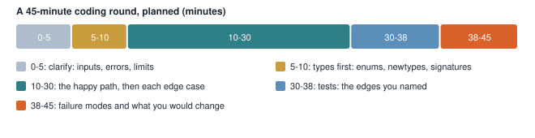

# Drills against the clock

<div class="covers" markdown="1">

This chapter covers

- Ten short implementations, each sized to type in a live round
- Where each drill's full version lives in this book
- Two drills that differ from their reference versions, one of them in a way that changes the answer
- A plan for a 45-minute round, and a way to practice with this repository

</div>

The preceding chapters presented complete reference implementations alongside their design rationale, test suites, and evolution. A timed technical interview offers a different environment: an empty editor, a brief problem statement, and roughly forty minutes. The module `drills.rs` provides compact counterparts, consisting of ten implementations sized to be written from scratch under time pressure, each paired with a unit test that verifies basic behavior.

This chapter serves as a field guide to those drills. We map each implementation back to its reference chapter, examine the deliberate simplifications made in the short forms, and outline a structured method for rehearsing them.

## 30.1 The drills

<p class="listing"><b>Listing 30.1</b> Ten answers sized for a live round. <a href="https://github.com/arpanpathak/cracking-the-systems-programming-interview/blob/prep-v2/rust-interview-lab/src/problems/drills.rs">src/problems/drills.rs</a></p>

```rust
{{#include ../../rust-interview-lab/src/problems/drills.rs}}
```

The module comment states the file's role in one line: the neighboring modules hold the reference implementations, and this file contains the compact forms written under interview conditions. Table 30.1 pairs each drill with the chapter that explains its full version.

| Drill | Lines | Full version |
|---|---|---|
| `count_parallel`: `Arc<Mutex<usize>>` counter | 18 | chapter 8 (`total_with_arc_mutex`, listing 8.7), chapter 16 |
| `parallel_sum`: scoped threads | 12 | chapter 16, `threads::parallel_sum`, listing 16.5 |
| `SpinLock` and `SpinGuard` | 45 | chapter 16, listing 16.12 |
| `Semaphore` | 36 | chapter 16, listing 16.15 |
| `BlockingQueue` with `close` | 62 | chapter 17, listing 17.22 |
| `ThreadPool` with `Drop` | 45 | chapter 18, listing 18.7 |
| `retry` with backoff | 21 | chapter 19, listing 19.9 |
| `HashRing` | 33 | chapter 14, listing 14.9 |
| `parse_request_head` | 29 | chapter 21, listing 21.1 |
| `Port` newtype and `Route` enum | 32 | chapter 7 (the `GpuCount` newtype, listing 7.2); chapter 21, `route` |

## 30.2 What the short forms leave out

A drill is allowed to be simpler than its reference. Knowing *what* it left out is part of the answer,
because the follow-up question is usually aimed at exactly that.

**The spin lock uses `swap`.** `while self.locked.swap(true, Acquire) { spin_loop() }` is a test-and-set lock: every waiting thread writes the lock's cache line on every iteration. The reference version in chapter 16 uses `compare_exchange_weak` and spins on a *load*, allowing waiters to share the cache line read-only until the lock is released. Both are correct, but the reference scales better under contention. The drill also omits the `// SAFETY:` comments, which production code and formal reviews require.

**The semaphore has no guard.** `acquire` and `release` are separate calls, so a caller that panics
between them leaks a permit. The reference in section 16.5 returns a `SemaphoreGuard` whose `Drop` gives the
permit back.

**The thread pool receives in a let-else.** `let Ok(job) = receiver.lock().expect(..).recv() else { return; };`
is a `let` statement, so the `MutexGuard` temporary is dropped at its end, before `job()` runs. The
pool is fully parallel, which a timing confirms: four 200 ms jobs on four workers take 205 ms. The same
receive written as `while let` would serialize the pool (chapter 18, figure 18.2), so this is the form
to memorize.

**The hash ring wraps with `%`.** `partition_point(..) % self.points.len()` maps an index one past the
end back to 0 in one expression. The reference uses an `if` instead. The drill also hashes in a plainer
way: it calls `hasher.write(input.as_bytes())` and `write_usize(replica)` directly. It stores a `String`
per virtual node where the reference shares an `Arc<str>`.

**The request parser checks the version and little else.** `parse_request_head` accepts only
`HTTP/1.1`, splits headers at the first colon, and lowercases the names. It has no size limits, no
`Host` check, and no body framing. That is the right scope for a ten-minute question about a request
head. For a question about serving requests, chapter 21's checks are the answer.

**`Port::new` is a one-expression validator.** `(1..=u16::MAX).contains(&value).then_some(Self(value)).ok_or(..)`
reads left to right as the rule. `Route::parse` matches the two fixed paths and falls back to
`strip_prefix` for the id route, returning `None` for everything else.

## 30.3 The drill that is slower than it looks

`parallel_sum` changed behavior in the short form. Compare it with the reference in chapter 16:

```rust
// drills.rs
values
    .chunks(chunk_size)
    .map(|chunk| scope.spawn(move || ...))
    .map(|handle| handle.join().expect("worker panicked"))
    .sum()

// threads.rs
let handles: Vec<_> = values.chunks(chunk_size).map(|chunk| scope.spawn(...)).collect();
handles.into_iter().map(|handle| handle.join().expect("worker panicked")).sum()
```

Iterators are lazy. In the drill, `sum` pulls one item through both `map`s before it asks for the next.
The first chunk's thread is therefore spawned and then *joined* before the second chunk's thread is
spawned. The four workers run one after another. The reference collects every `JoinHandle` into a `Vec`
first, which spawns all four, and only then joins them.

The result is the same number either way, so the drill's test passes. Timing four workers that each
sleep 200 ms shows the difference:

```text
lazy spawn/join chain, four 200 ms workers: 809.402756ms (sum 4)
collect first, then join:              203.482125ms (sum 4)
```

The fix is a single `collect()` between the two `map` calls. The same concurrency principle appeared in the thread pool analysis of chapter 18: a test that checks only the final numerical result cannot distinguish parallel execution from serial execution. Verifying concurrency requires either a synchronization barrier (as in `thread_pool_v2`'s `jobs_run_at_the_same_time`) or a wall-clock timing assertion.

## 30.4 Running a round

A 45-minute coding round follows a predictable arc. Budgeting time deliberately keeps the final ten minutes, where the strongest engineering signal emerges, free from last-minute debugging (figure 30.1).

<figure>

<figcaption><b>Figure 30.1</b> One way to spend a 45-minute round. The proportions matter more than the exact minutes.</figcaption>
</figure>

- **Clarify.** Establish the input contracts, invalid-input behavior, and operational bounds (size, concurrency, latency). Each constraint translates directly into a type or guard check.
- **Types first.** Define enums, newtypes, and function signatures before writing function bodies. Choosing a `Result<T, ParseError>` return type in minute six avoids a structural rewrite in minute twenty-five.
- **The happy path, then each edge.** Get a single end-to-end case compiling and passing, then layer in the edge cases identified during clarification.
- **Tests.** Exercise the boundary conditions explicitly rather than testing only the prompt's happy-path example.
- **Failure modes.** Articulate what degrades at scale and how the design would evolve in production; the reference implementations throughout this book serve as that checklist.

## 30.5 Practicing with this repository

The repository supports the structured rehearsal loop described in the problem index: write a minimal correct implementation in 30 to 45 minutes, then analyze its failure modes and verification strategy.

1. Select a drill and read its reference chapter once.
2. Close the book and the reference file, then implement the structure from a blank buffer in a scratch binary under `src/bin/`.
3. Run `cargo test` on the implementation, followed by the reference test suites (`cargo test thread_pool`, `cargo test bounded_queue`, `cargo test --bin http_server`).
4. Diff against the reference implementation, noting every omission and whether it was an intentional trade-off.
5. Walk through the failure modes aloud as if presenting to a design reviewer.

The "Questions that come up" sections at the end of each chapter provide the follow-up prompts to rehearse. The progression traced across this book (eleven merge variants, nine pools, and six buffers) illustrates what that iterative refinement loop produces when intermediate drafts are preserved.

## 30.6 Questions that come up

**"Your parallel sum gives the right answer. Is it parallel?"**
Check that all threads are spawned before any is joined. A lazy iterator that spawns and joins in one
chain is serial.

**"What would you add to this spin lock for production?"**
Spin on a relaxed load before retrying the exchange. Back off or yield under contention. Add `SAFETY`
comments, and prefer `std::sync::Mutex` unless measurements say otherwise.

**"Your semaphore's caller panicked. What happened to the permit?"**
It leaked. Return a guard whose `Drop` releases it.

**"How did you decide what to leave out?"**
By the question's scope. Name what a full version adds, and where it would change the answer.
