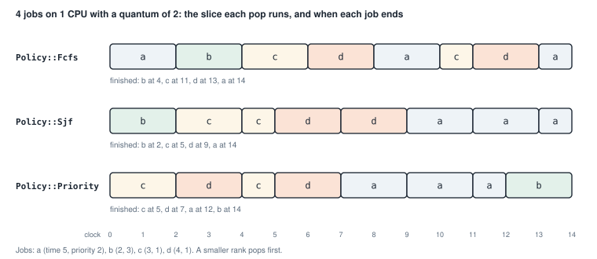

# Scheduling jobs by policy

<div class="covers" markdown="1">

This chapter covers

- Reducing FCFS, shortest job first, and priority scheduling to a single rank in a min-heap
- Preempting a job at the end of a time quantum, and how round-robin and SRTF emerge from the rank
- Computing mean turnaround time under each policy from an execution trace
- Coordinating worker threads in `thread::scope` over a shared `Mutex<BinaryHeap<_>>`
- Evolving the scheduler from `.unwrap()` to value-based error propagation with `?`

</div>

A **scheduler** decides which job runs next whenever runnable work exceeds the available processors. Section 15.6 introduced round-robin scheduling, which grants every runnable task an equal turn on the CPU. Other policies select the next job using a property of the job itself, such as its remaining work or its urgency. This chapter encodes each policy as a single numeric rank and stores ready jobs in the binary min-heap from chapter 5, running them first on one simulated CPU and then across real worker threads.

## 31.1 Scheduling policies on one CPU

**The problem.** A single CPU executes a batch of jobs. Each job carries a name, a running time in clock units, and a priority where smaller numbers denote higher urgency. The CPU runs one job at a time for at most one **quantum**, a fixed slice of clock time. A **scheduling policy** chooses which job receives the next slice. Three classical policies are compared below:

- **First come, first served (FCFS)** assigns the CPU to the job that has waited the longest.
- **Shortest job first (SJF)** assigns the CPU to the job with the least remaining work.
- **Priority scheduling** assigns the CPU to the job with the smallest priority number.

Scheduling the four jobs `a` (time 5, priority 2), `b` (time 2, priority 3), `c` (time 3, priority 1), and `d` (time 4, priority 1) with a quantum of 2 produces completion order `b, c, d, a` under FCFS and SJF, and `c, d, a, b` under priority scheduling.

**The baseline approach.** Storing ready jobs in a `Vec` and scanning the entire vector before every slice takes O(n) time per selection, yielding O(s × n) total time for a schedule of `s` slices.

**The heap approach.** Each policy maps a job to a single integer **rank**, and the scheduler stores ready jobs in a min-heap of `(rank, queued_at, index, time_left)` tuples. The `queued_at` field records the logical clock value at which the job entered the heap. When two jobs share the same rank, lexicographical tuple comparison breaks the tie in favor of the smaller `queued_at` value, so the job that has waited longer runs first. On each step, the scheduler pops the smallest tuple and runs that job for up to one quantum. If work remains, the scheduler pushes the job back with a recomputed rank and the current clock as its new `queued_at` timestamp. Each selection costs O(log n).

### 31.1.1 A single rank for three policies

`Policy::rank` computes a job's rank from its remaining time and priority:

- `Policy::Fcfs` returns `0` for every job. Because all jobs tie on rank, the heap orders them by `queued_at` and then by input index. Reinserting a preempted job with the current clock places it behind every job already waiting, turning FCFS with a time quantum into **round-robin** scheduling (section 15.6).
- `Policy::Sjf` returns the job's remaining time. Because the scheduler recomputes the rank on every reinsertion, a partially executed job competes using its remaining work rather than its initial duration. This preemptive form of SJF is **shortest remaining time first (SRTF)**.
- `Policy::Priority` returns the job's priority. Jobs at the same priority level break ties by `queued_at`, so they alternate in round-robin order. In the example workload, jobs `c` and `d` (both priority 1) share the CPU until both finish.

### 31.1.2 Preemption at the end of a quantum

After popping a tuple, the scheduler compares the remaining time `left` against the quantum in a two-arm `match`:

1. `Ordering::Greater`: the job needs more than one quantum. The scheduler advances the clock by `quantum`, subtracts `quantum` from `left`, and pushes the job back with a fresh rank and the updated clock as `queued_at`.
2. `Ordering::Less | Ordering::Equal`: the job finishes within this slice. The scheduler advances the clock by `left` and invokes the job's `run` closure to collect its result.

Under SJF, the eight pops unfold as follows. Notice how a partially executed job re-enters the heap with a lower rank:

| Pop | Entry popped | Job | Clock after the slice | Entry pushed back |
|---|---|---|---|---|
| 1 | `(2, 0, 1, 2)` | b | 2 | b completes |
| 2 | `(3, 0, 2, 3)` | c | 4 | `(1, 4, 2, 1)` |
| 3 | `(1, 4, 2, 1)` | c | 5 | c completes |
| 4 | `(4, 0, 3, 4)` | d | 7 | `(2, 7, 3, 2)` |
| 5 | `(2, 7, 3, 2)` | d | 9 | d completes |
| 6 | `(5, 0, 0, 5)` | a | 11 | `(3, 11, 0, 3)` |
| 7 | `(3, 11, 0, 3)` | a | 13 | `(1, 13, 0, 1)` |
| 8 | `(1, 13, 0, 1)` | a | 14 | a completes |

At pop 3, `c` precedes `(4, 0, 3, 4)` for `d` because only 1 unit of `c` remains, dropping its rank to 1. Figure 31.1 plots the complete timelines for all three policies.

<figure>

<figcaption><b>Figure 31.1</b> The slices executed under each policy with a quantum of 2. Under <code>Policy::Fcfs</code>, the jobs take turns in round-robin order.</figcaption>
</figure>

Because all four jobs arrive at clock 0, each job's completion time equals its **turnaround time**, the total interval from arrival to completion. The table below compares the mean turnaround times of the three schedules in Figure 31.1:

| Policy | Completion times | Mean turnaround time |
|---|---|---|
| FCFS | b 4, c 11, d 13, a 14 | (4 + 11 + 13 + 14) / 4 = 10.5 |
| SJF | b 2, c 5, d 9, a 14 | (2 + 5 + 9 + 14) / 4 = 7.5 |
| Priority | c 5, d 7, a 12, b 14 | (5 + 7 + 12 + 14) / 4 = 9.5 |

SJF achieves the lowest mean turnaround time, matching the classical result that running the shortest jobs first minimizes mean turnaround time when all jobs arrive together.

### 31.1.3 The program

<p class="listing"><b>Listing 31.1</b> A scheduler with 3 policies and a quantum, on 1 heap. <a href="https://github.com/arpanpathak/cracking-the-systems-programming-interview/blob/prep-v2/rust-interview-lab/src/bin/shortest_job_first_scheduling.rs">src/bin/shortest_job_first_scheduling.rs</a></p>

```rust
{{#include ../../rust-interview-lab/src/bin/shortest_job_first_scheduling.rs}}
```

```text
$ cargo run --bin shortest_job_first_scheduling
fcfs     ["b done", "c done", "d done", "a done"]
sjf      ["b done", "c done", "d done", "a done"]
priority ["c done", "d done", "a done", "b done"]
```

Key implementation details:

- Wrapping each 4-tuple in `Reverse` turns Rust's max-heap (`BinaryHeap`) into a min-heap that pops the smallest tuple first (section 5.3.2).
- Every initial entry starts with `queued_at = 0`, so initial ties break by input index.
- In `while let Some(Reverse((.., index, left))) = heap.pop()`, the `..` rest pattern discards the rank and `queued_at` fields, which are no longer needed after extraction.
- The loop advances a logical clock without sleeping and invokes each job's closure once, during its final slice. Section 31.2 applies these same policies to jobs executing on real threads.
- All jobs in Listing 31.1 arrive at clock 0. Under continuous arrivals of short or high-priority work, a long job under SJF or a low-priority job under priority scheduling can wait indefinitely, a condition called **starvation**.

**Complexity.** A job of length `t` requires `⌈t / q⌉` pops for a quantum `q`. A schedule of `s` slices runs in O(s log n) time, and the heap holds at most `n` entries at once.

## 31.2 Workers that pop from a priority heap

Section 31.1 simulated three scheduling policies on one CPU using a logical clock. This section applies the same `Policy` enum and ranking function to jobs running concurrently on OS threads. Before spawning any workers, the scheduler loads all jobs into a `Mutex<BinaryHeap<JobState>>`. A fixed cohort of worker threads then pops the lowest-ranked job in a loop and executes it. Two implementations follow: the first uses `.unwrap()`, and the second propagates lock errors as `Result` values.

**The problem.** Two worker threads execute the four jobs `a`, `b`, `c`, and `d` from section 31.1. Each job now sleeps for a real wall-clock duration of 50, 20, 30, or 40 ms before returning its name, while retaining its `time` (5, 2, 3, or 4) and `priority` (2, 3, 1, or 1). The scheduler collects job results in completion order.

**The design.** Unlike the thread pools in sections 18.2 through 18.7, which accept tasks dynamically over a channel, this scheduler processes a fixed batch known up front. Filling a `Mutex<BinaryHeap<JobState>>` once lets each worker exit as soon as the heap becomes empty. Each entry has the form `Reverse((rank, elapsed, index))`, where `elapsed` records time since `start` using `Instant`, a monotonic clock that never moves backward. Inserting jobs in index order preserves input order on rank ties. Spawning the workers inside `thread::scope` (section 16.1.3) lets every worker borrow `jobs`, `heap`, and `results` directly from the caller's stack frame without `Arc`, because `thread::scope` joins all spawned threads before returning.

### 31.2.1 Version 1, with `unwrap`

Listing 31.2 shows the complete `.unwrap()` implementation.

<p class="listing"><b>Listing 31.2</b> 2 workers that pop jobs from a priority heap. <a href="https://github.com/arpanpathak/cracking-the-systems-programming-interview/blob/prep-v2/rust-interview-lab/src/bin/multi_thread_job_scheduling.rs">src/bin/multi_thread_job_scheduling.rs</a></p>

```rust
{{#include ../../rust-interview-lab/src/bin/multi_thread_job_scheduling.rs}}
```

```text
$ cargo run --bin multi_thread_job_scheduling
fcfs     ["b", "a", "c", "d"]
sjf      ["b", "c", "d", "a"]
priority ["c", "d", "b", "a"]
```

On each iteration, a worker performs three steps:

1. It locks `heap` and pops the smallest entry in `let next = heap.lock().unwrap().pop();`. Because the temporary `MutexGuard` drops at the semicolon, the worker releases the heap mutex before running the job (section 18.3).
2. If the heap is empty, `let ... else` breaks out of the loop and terminates the worker thread.
3. Otherwise, the worker invokes `(jobs[index].run)()` without holding any lock, then locks `results` briefly to append the output. As a result, `results` reflects actual completion order.

The policy dictates dispatch order, while completion order depends on both job durations and the worker count (Figure 31.2). Under `Policy::Priority`, worker 1 claims `c` and worker 2 claims `d`. At 30 ms, worker 1 finishes `c` and starts `a` (priority 2). At 40 ms, worker 2 finishes `d` and starts `b` (priority 3), which finishes at 60 ms, 20 ms ahead of `a`. A lower-priority job can therefore finish earlier because priority governs only when a job starts.

<figure>

<figcaption><b>Figure 31.2</b> 2 workers and 4 jobs under each policy. The pop order follows the rank; the order of the results follows the completion times.</figcaption>
</figure>

Under `Policy::Fcfs`, jobs `a` and `c` both finish around 50 ms on separate workers, so whichever worker acquires the `results` mutex first appends its output first. Across 30 consecutive runs, the program printed `["b", "a", "c", "d"]` 27 times and `["b", "c", "a", "d"]` 3 times. SJF and priority scheduling produced identical output in all 30 runs because none of their completion times collide within a few milliseconds.

Key implementation details:

- `F: Fn() -> T + Sync` is required because every worker invokes closures through the shared slice `&jobs`; a shared reference `&T` is `Send` only when `T` is `Sync` (section 16.1.4).
- `T: Send` is required because worker threads produce `T` values that the caller consumes after joining.
- After `thread::scope` returns, all workers have terminated, so `results.into_inner()` unwraps the vector directly without acquiring the mutex.
- Each `.unwrap()` panics if its mutex is poisoned, which happens only when a thread panics while holding the guard (section 16.6).

### 31.2.2 Version 2: errors as values

Version 2 replaces every `.unwrap()` with `?`. `schedule` now returns `ScheduledJob<T, String>`, a type alias for `Result<Vec<T>, String>`, and `main` returns `Result<(), String>` so it can propagate failures from each `schedule` call. The domain types, job array, and output remain identical to version 1; only `schedule` changes (Listing 31.3).

<p class="listing"><b>Listing 31.3</b> <code>schedule</code> with errors returned as values (lines 35 to 76). <a href="https://github.com/arpanpathak/cracking-the-systems-programming-interview/blob/prep-v2/rust-interview-lab/src/bin/job_scheduling_worker_with_error_propagation.rs">src/bin/job_scheduling_worker_with_error_propagation.rs</a></p>

```rust
{{#include ../../rust-interview-lab/src/bin/job_scheduling_worker_with_error_propagation.rs:35:76}}
```

```text
$ cargo run --bin job_scheduling_worker_with_error_propagation
fcfs     ["b", "a", "c", "d"]
sjf      ["b", "c", "d", "a"]
priority ["c", "d", "b", "a"]
```

Declaring each worker closure as `|| -> Result<(), String>` enables `?` inside the loop. Two events now terminate a worker:

1. **A poisoned mutex:** `lock()` returns `Err(PoisonError)`. `map_err(|e| e.to_string())` formats the error as a `String`, and `?` returns it from the closure.
2. **An empty heap:** `pop()` returns `None`, `ok_or("worker polled an empty queue")` turns it into an `Err(&str)`, and `?` converts the `&str` into a `String` via `From` before exiting the closure. Because the empty heap exits through `?`, the loop needs no explicit `break`.

Each `s.spawn` call returns a `ScopedJoinHandle`, which this version drops without joining explicitly. Although `thread::scope` still joins every worker before returning, dropping the handles discards each closure's `Result`. Inside the scope, a worker that exits on a poisoned lock looks identical to one that exits on an empty heap. After the scope finishes, `heap.into_inner()` checks whether the heap mutex was poisoned and propagates any `Err` via `?`; `results.into_inner()` performs the same check for the output vector.

Neither version catches panics raised inside a job closure. If a scoped worker panics and the caller does not join its handle manually, `thread::scope` resumes the panic on the calling thread once all workers have exited.

**Complexity.** `collect` builds the heap from `n` jobs in O(n) time, and each of the `n` pops takes O(log n) time under the heap mutex. With `w` workers and jobs of equal duration `d`, the batch finishes in roughly `⌈n / w⌉ × d`.

## 31.3 The complete files

Listing 31.4 presents the complete source of version 2, including the job list in `main`.

<p class="listing"><b>Listing 31.4</b> Version 2, with errors returned as values. <a href="https://github.com/arpanpathak/cracking-the-systems-programming-interview/blob/prep-v2/rust-interview-lab/src/bin/job_scheduling_worker_with_error_propagation.rs">src/bin/job_scheduling_worker_with_error_propagation.rs</a></p>

```rust
{{#include ../../rust-interview-lab/src/bin/job_scheduling_worker_with_error_propagation.rs}}
```

<div class="summary" markdown="1">

## Summary

- A scheduling policy reduces to a single numeric rank in a min-heap of `(rank, queued_at, index, time_left)` tuples. With a time quantum, a constant rank of `0` yields round-robin, remaining time yields shortest remaining time first, and static priority yields priority scheduling.
- Reinserting a preempted job with the current clock as `queued_at` places it behind every waiting job of equal rank.
- When all jobs arrive together, running the shortest jobs first minimizes mean turnaround time: 7.5 for the four jobs in section 31.1, versus 10.5 for round-robin and 9.5 for priority scheduling.
- Workers in `thread::scope` can share a `Mutex<BinaryHeap<_>>` safely when each worker holds the lock only while popping. The policy fixes dispatch order, while job durations and worker count govern completion order.
- Errors returned from a scoped worker closure are discarded unless the caller retains and joins its `ScopedJoinHandle`.

</div>

## Exercises

1. Add arrival times to the jobs in Listing 31.1 so that each job enters the heap only when the clock reaches its arrival time. Print the turnaround time of every job under each policy.
2. Submit a new job of length 1 on every slice and verify that a job of length 8 starves under `Policy::Sjf`. Add **aging** by subtracting each job's wait time from its rank, and verify that the length-8 job finishes.
3. Run Listing 31.2 with 1, 2, and 4 workers and record the completion order under each policy. Explain each result with a timeline like Figure 31.2.
4. Collect the `ScopedJoinHandle` of every worker in Listing 31.3 and join each handle so `schedule` returns the first worker error. Return `Ok(())` when the heap is empty so normal termination no longer surfaces as an error.
