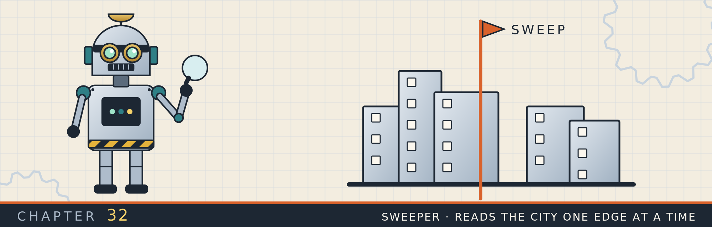

# Sweep-line algorithms

<div class="covers" markdown="1">

This chapter covers

- Reducing a geometric problem to a sequence of events sorted by coordinate
- Keeping the active set in a `BTreeMap` used as an ordered multiset, when a `BinaryHeap` cannot remove an arbitrary element
- Ordering events at the same coordinate so that no false key point is emitted
- The skyline problem, traced event by event, in O(n log n) time

</div>

Many problems about intervals, rectangles and segments ask a question at every point of a line. Examples are which intervals cover a coordinate, which rectangle is tallest there, and which segments cross. A direct answer evaluates the question at every coordinate of interest against every object, at a cost of O(n²) for n objects. A **sweep line** reduces that cost by moving an imaginary vertical line from left to right and stopping only where the answer can change. Each stop is called an **event**, and the objects that the line crosses between 2 events form the **active set**.

Michael Shamos and Dan Hoey applied the technique to the detection of intersecting line segments in 1976, and Jon Bentley and Thomas Ottmann extended it to report every intersection in 1979. It has been a standard method of computational geometry since then. In this chapter, we develop a sweep line for the skyline problem, and we choose the data structure for the active set from the operations that the sweep requires.

## 32.1 The skyline problem

**The problem.** A city is described by rectangular buildings that stand on a common ground line. Each building is given as `[left, right, height]`, with `left < right` and `height > 0`. The **skyline** is the outline that the buildings form when the city is viewed from a distance. It is reported as a list of **key points** `[x, height]`. A key point is emitted at every x-coordinate where the height of the outline changes. For the 5 buildings `[2, 9, 10]`, `[3, 7, 15]`, `[5, 12, 12]`, `[15, 20, 10]` and `[19, 24, 8]`, the skyline consists of 7 key points: `[2, 10]`, `[3, 15]`, `[7, 12]`, `[12, 0]`, `[15, 10]`, `[20, 8]` and `[24, 0]` (figure 32.1).

<figure>

<figcaption><b>Figure 32.1</b> 5 buildings and their skyline. A key point marks every change in the height of the outline.</figcaption>
</figure>

**The baseline approach.** At a coordinate `x`, the outline's height equals the maximum height among all buildings that cover `x`. In a direct method, this maximum is evaluated at each of the 2n building edges by a scan over all n buildings. Each evaluation costs O(n), and the whole computation costs O(n²).

**The sweep-line approach.** The height of the outline can change only at a building edge, so the 2n edges are the events of the sweep. A left edge adds 1 height to the active set, and a right edge removes 1 height. After each edge, the maximum of the active set gives the outline's height to the right of that edge. A key point is emitted only when this maximum differs from its previous value.

## 32.2 An ordered multiset of active heights

The active set requires 3 operations: insertion of a height, removal of 1 specific height, and retrieval of the maximum. `BinaryHeap` from chapter 5 supports insertion and retrieval of the maximum, but it provides no operation that removes an arbitrary element. The active set is therefore stored in a `BTreeMap<i32, i32>` used as a **multiset**, a set in which an element can occur more than once. Each key is a height, and its value counts the active buildings of that height. The counts are required because 2 active buildings can have equal heights. When 1 of these buildings ends, the other must remain in the set.

A `BTreeMap` stores its keys in sorted order in a B-tree. Insertion and removal take O(log n) time, and `keys().next_back()` returns the largest key in O(log n) time. The map is initialized with the entry `(0, 1)`, which represents the ground. This entry is never removed, so the map is never empty, and the outline falls to height 0 when the last building of a group ends.

## 32.3 Events at the same coordinate

Each building contributes 2 events, `(left, Event::Start(Reverse(height)))` and `(right, Event::End(height))`, and the events are sorted as tuples. Events at different coordinates are ordered by `x`. Ties at the same coordinate are decided by the derived `Ord` implementation of `Event`. 3 of its rules prevent key points that do not belong to the skyline:

1. Variants are compared in declaration order, so every `Start` precedes every `End` at the same `x`. When 1 building ends where another of equal height begins, the start is processed first. The maximum never drops, and no key point `[x, 0]` is emitted between the 2 buildings.
2. 2 `Start` events compare their `Reverse(height)` values, so the taller building is processed first. The taller height becomes the maximum at once, the shorter start leaves it unchanged, and 1 key point is emitted where 2 would be emitted otherwise.
3. 2 `End` events compare plain heights, so the shorter building is removed first. The maximum changes only when the taller building is removed, and again 1 key point is emitted.

Rule 1 decides the result for the buildings `[0, 5, 10]` and `[5, 8, 10]`. If the end at `x = 5` were processed first, the maximum would fall to 0 and rise back to 10, and the false key points `[5, 0]` and `[5, 10]` would be emitted between 2 buildings that form 1 flat roof.

## 32.4 A trace

The 10 events of the 5 buildings in figure 32.1 are processed in the order below. After each event, the active heights are listed in sorted order, and a key point is emitted whenever the maximum changes.

| `x` | Event | Active heights | Maximum | Key point |
|---|---|---|---|---|
| 2 | `Start(Reverse(10))` | 0, 10 | 10 | `[2, 10]` |
| 3 | `Start(Reverse(15))` | 0, 10, 15 | 15 | `[3, 15]` |
| 5 | `Start(Reverse(12))` | 0, 10, 12, 15 | 15 | |
| 7 | `End(15)` | 0, 10, 12 | 12 | `[7, 12]` |
| 9 | `End(10)` | 0, 12 | 12 | |
| 12 | `End(12)` | 0 | 0 | `[12, 0]` |
| 15 | `Start(Reverse(10))` | 0, 10 | 10 | `[15, 10]` |
| 19 | `Start(Reverse(8))` | 0, 8, 10 | 10 | |
| 20 | `End(10)` | 0, 8 | 8 | `[20, 8]` |
| 24 | `End(8)` | 0 | 0 | `[24, 0]` |

At `x = 5`, the building of height 12 becomes active, but the building of height 15 still covers that coordinate, so no key point is emitted. The height 12 reaches the outline at `x = 7`, when the building of height 15 ends.

## 32.5 The program

<p class="listing"><b>Listing 32.1</b> The skyline with a sweep line and an ordered multiset. <a href="https://github.com/arpanpathak/cracking-the-systems-programming-interview/blob/prep-v2/rust-interview-lab/src/bin/skyline_problem.rs">src/bin/skyline_problem.rs</a></p>

```rust
{{#include ../../rust-interview-lab/src/bin/skyline_problem.rs}}
```

```text
$ cargo run --bin skyline_problem
[[2, 10], [3, 15], [7, 12], [12, 0], [15, 10], [20, 8], [24, 0]]
```

Key details of the implementation:

- In `flat_map`, each building is expanded into an array of 2 events, so `events` holds exactly 2n entries.
- `sort_unstable` is sufficient, although it may reorder equal elements. 2 events that compare equal have the same coordinate, variant and height, so their relative order cannot change the result.
- In the `End` arm, `entry(h).or_default()` yields a mutable reference to the count of `h`, and the count is decremented. When the count reaches 0, the key is removed, so `next_back` cannot return the height of a building that has ended. The commented block shows an equivalent formulation with `get_mut` and `is_some_and`.
- The condition `if let Some(&curr_max) = active.keys().next_back() && curr_max != prev_max` is a **let chain**, stabilized in Rust 1.88 for the 2024 edition. The comparison is evaluated only when the pattern matches, and it can use the binding `curr_max`.

**Complexity.** The 2n events are sorted in O(n log n) time. Each event then performs 1 update of the B-tree and 1 lookup of the maximum, each in O(log n) time. The total running time is O(n log n), and the events and the map occupy O(n) space.

<div class="summary" markdown="1">

## Summary

- A sweep line moves across the plane and stops only at events, the coordinates where the answer can change. Between 2 events, the active set is constant.
- For the skyline, the events are the 2n building edges. The outline's height after an event is the maximum of the active heights, and a key point is emitted only when that maximum changes.
- The active set needs removal of a specific height, which `BinaryHeap` lacks. A `BTreeMap` that counts heights supports insertion, removal and the maximum in O(log n) time, and the ground entry `(0, 1)` keeps it non-empty.
- The derived `Ord` of `Event` orders ties at 1 coordinate: starts before ends, taller starts first, shorter ends first. Each rule prevents a false key point.
- The whole sweep runs in O(n log n) time and O(n) space.

</div>

## Exercises

1. Replace the `BTreeMap` in `get_skyline` with a `BinaryHeap<i32>` and lazy deletion: record each ended height in a `HashMap<i32, i32>`, and pop the heap while its top is recorded there. Check that the 7 key points of section 32.4 are unchanged.
2. Reverse the declaration order of `Start` and `End` in `Event`, and run the program on the buildings `[0, 5, 10]` and `[5, 8, 10]`. Explain each false key point that appears.
3. Use a sweep line to compute the maximum number of meetings that overlap at any moment, given each meeting as `[start, end)`. Decide whether an end at `x` must be processed before or after a start at the same `x`.
4. Compute the total area covered by the buildings of figure 32.1, counting overlapping parts once, by summing the outline's height times the width between consecutive key points.
