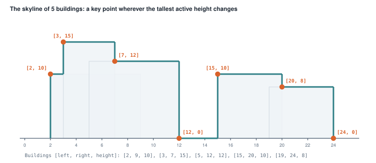

# Sweep-line algorithms

<div class="covers" markdown="1">

This chapter covers

- Reducing a geometric problem to a sorted sequence of coordinate events
- Maintaining an active set in a `BTreeMap` multiset when `BinaryHeap` cannot remove arbitrary elements
- Ordering tied events at the same coordinate to prevent false key points
- Solving the skyline problem in O(n log n) time with an event-by-event trace

</div>

Many geometric problems over intervals, rectangles, and line segments pose a query at every coordinate along an axis: which intervals cover a point, which rectangle stands tallest there, or which segments intersect. Evaluating that query directly at every coordinate against all `n` objects costs O(n²). A **sweep line** lowers that cost by moving an imaginary vertical line from left to right and stopping only at coordinates where the answer can change. Each stop is an **event**, and the objects currently crossing the line form the **active set**.

Michael Shamos and Dan Hoey introduced the sweep-line method for segment-intersection detection in 1976, and Jon Bentley and Thomas Ottmann generalized it in 1979 to report all intersections. It has remained a standard technique in computational geometry ever since. This chapter applies a sweep line to the skyline problem and derives the active-set data structure directly from the operations the sweep demands.

## 32.1 The skyline problem

**The problem.** Rectangular buildings stand along a shared ground line, each given as `[left, right, height]` with `left < right` and `height > 0`. The **skyline** is the outer silhouette formed by the union of those buildings, reported as a sequence of **key points** `[x, height]`. The algorithm emits a key point at every x-coordinate where the silhouette's height changes. For the five buildings `[2, 9, 10]`, `[3, 7, 15]`, `[5, 12, 12]`, `[15, 20, 10]`, and `[19, 24, 8]`, the skyline consists of seven key points: `[2, 10]`, `[3, 15]`, `[7, 12]`, `[12, 0]`, `[15, 10]`, `[20, 8]`, and `[24, 0]` (Figure 32.1).

<figure>

<figcaption><b>Figure 32.1</b> 5 buildings and their skyline. A key point marks every change in the height of the outline.</figcaption>
</figure>

**The baseline approach.** At any coordinate `x`, the skyline height equals the maximum height among all buildings covering `x`. Evaluating that maximum at each of the `2n` building edges by scanning all `n` buildings costs O(n) per edge and O(n²) overall.

**The sweep-line approach.** Because the silhouette height can change only at a building's left or right edge, the `2n` edges serve as the sweep events. A left edge inserts a building's height into the active set, and a right edge removes it. After processing each edge, the maximum of the active set gives the skyline height immediately to the right of that coordinate. Whenever that maximum differs from the previous height, the algorithm emits a key point.

## 32.2 An ordered multiset of active heights

The active set must support three operations: inserting a height, removing a specific height, and querying the maximum. `BinaryHeap` (chapter 5) handles insertion and maximum queries in O(log n) and O(1) time, but it cannot remove an arbitrary element. We therefore store the active set in a `BTreeMap<i32, i32>` acting as a **multiset**, a collection that allows duplicate elements. Each key is a building height, and its value tracks how many active buildings share that height. Reference counts prevent premature deletion when two overlapping buildings have the same height: ending one building decrements the count while keeping the height active for the other.

`BTreeMap` maintains its keys in sorted order inside a B-tree, supporting insertion, removal, and maximum lookup (`keys().next_back()`) in O(log n) time. Initializing the map with `(0, 1)` represents the ground level. Because this sentinel entry is never removed, the map never empties, and the maximum naturally drops to `0` when the last building in a cluster ends.

## 32.3 Events at the same coordinate

Each building generates two events, `(left, Event::Start(Reverse(height)))` and `(right, Event::End(height))`, which the algorithm sorts as tuples. Tuples with distinct coordinates order by `x`. When multiple events share the same `x`, the derived `Ord` implementation on `Event` breaks ties using three rules that suppress spurious key points:

1. **Starts precede ends.** Derived `Ord` compares enum variants in declaration order, placing every `Start` before every `End` at the same `x`. When one building ends where another of equal height begins, processing the start first keeps the maximum unchanged and avoids emitting a false `[x, 0]` dip between them.
2. **Taller starts come first.** Comparing `Start` events by `Reverse(height)` processes the tallest starting building first. Its height becomes the maximum immediately, shorter starts at the same `x` leave that maximum unchanged, and the sweep emits one key point instead of several rising steps.
3. **Shorter ends come first.** Comparing `End` events by plain `height` removes shorter ending buildings first. The maximum changes only when the tallest building leaves, again emitting a single key point.

Consider the adjacent buildings `[0, 5, 10]` and `[5, 8, 10]`, which form one continuous flat roof of height 10. Rule 1 ensures the start at `x = 5` runs before the end. If the end ran first, the active maximum would drop to `0` and immediately climb back to `10`, emitting two false key points: `[5, 0]` and `[5, 10]`.

## 32.4 A trace

The table below traces all 10 events for the five buildings in Figure 32.1. After each event, it lists the active heights in ascending order and records a key point whenever the maximum changes:

| `x` | Event | Active heights | Maximum | Key point |
|---|---|---|---|---|
| 2 | `Start(Reverse(10))` | 0, 10 | 10 | `[2, 10]` |
| 3 | `Start(Reverse(15))` | 0, 10, 15 | 15 | `[3, 15]` |
| 5 | `Start(Reverse(12))` | 0, 10, 12, 15 | 15 | |
| 7 | `End(15)` | 0, 10, 12 | 12 | `[7, 12]` |
| 9 | `End(10)` | 0, 12 | 12 | |
| 12 | `End(12)` | 0 | 0 | `[12, 0]` |
| 15 | `Start(Reverse(10))` | 0, 10 | 10 | `[15, 10]` |
| 19 | `Start(Reverse(8))` | 0, 8, 10 | 10 | |
| 20 | `End(10)` | 0, 8 | 8 | `[20, 8]` |
| 24 | `End(8)` | 0 | 0 | `[24, 0]` |

At `x = 5`, the building of height 12 enters the active set, but the taller building of height 15 still covers that coordinate, so the maximum stays 15 and no key point is emitted. At `x = 7`, removing height 15 exposes height 12 as the new maximum and emits `[7, 12]`.

## 32.5 The program

<p class="listing"><b>Listing 32.1</b> The skyline with a sweep line and an ordered multiset. <a href="https://github.com/arpanpathak/cracking-the-systems-programming-interview/blob/prep-v2/rust-interview-lab/src/bin/skyline_problem.rs">src/bin/skyline_problem.rs</a></p>

```rust
{{#include ../../rust-interview-lab/src/bin/skyline_problem.rs}}
```

```text
$ cargo run --bin skyline_problem
[[2, 10], [3, 15], [7, 12], [12, 0], [15, 10], [20, 8], [24, 0]]
```

Key implementation details:

- `flat_map` expands each building into a two-element array of events, populating `events` with exactly `2n` entries.
- `sort_unstable` suffices even though it may reorder equal elements: two equal events share the same coordinate, variant, and height, so their relative order cannot affect the output.
- In the `End` arm, `active.entry(h).or_default()` returns a mutable reference to the count of `h`, which the code decrements. Once the count reaches `0`, `active.remove(&h)` deletes the key so `next_back()` never observes an expired height. The commented block shows an equivalent version using `get_mut` and `is_some_and`.
- The condition `if let Some(&curr_max) = active.keys().next_back() && curr_max != prev_max` uses a **let chain**, stabilized in Rust 1.88 for the 2024 edition. It evaluates `curr_max != prev_max` only when the pattern matches, keeping `curr_max` in scope for the comparison.

**Complexity.** Sorting the `2n` events takes O(n log n) time. Each event then performs one B-tree update and one maximum lookup, each in O(log n) time. Total runtime is O(n log n), and the event vector and active map consume O(n) space.

<div class="summary" markdown="1">

## Summary

- A sweep line moves across the plane and stops only at events where the answer can change; between consecutive events, the active set stays constant.
- For the skyline problem, the `2n` building edges form the events. After each event, the active set's maximum gives the skyline height, and any change in that maximum produces a key point.
- Removing an arbitrary height rules out a plain `BinaryHeap`. A `BTreeMap` of height counts supports insertion, removal, and maximum queries in O(log n) time, while the ground sentinel `(0, 1)` keeps the map non-empty.
- The derived `Ord` on `Event` resolves ties at the same coordinate: starts before ends, taller starts first, and shorter ends first, preventing false key points in each case.
- The complete sweep runs in O(n log n) time and O(n) space.

</div>

## Exercises

1. Replace the `BTreeMap` in `get_skyline` with a `BinaryHeap<i32>` and lazy deletion: track ended heights in a `HashMap<i32, i32>` and pop stale entries from the heap's top before reading the maximum. Verify that the seven key points in section 32.4 match.
2. Swap the declaration order of `Start` and `End` in `Event` and run the program on `[0, 5, 10]` and `[5, 8, 10]`. Explain each false key point that appears.
3. Use a sweep line to compute the maximum number of overlapping meetings given intervals `[start, end)`. Determine whether an end at `x` should sort before or after a start at the same `x`.
4. Compute the total union area of the buildings in Figure 32.1 by summing each outline height times the width between consecutive key points.
