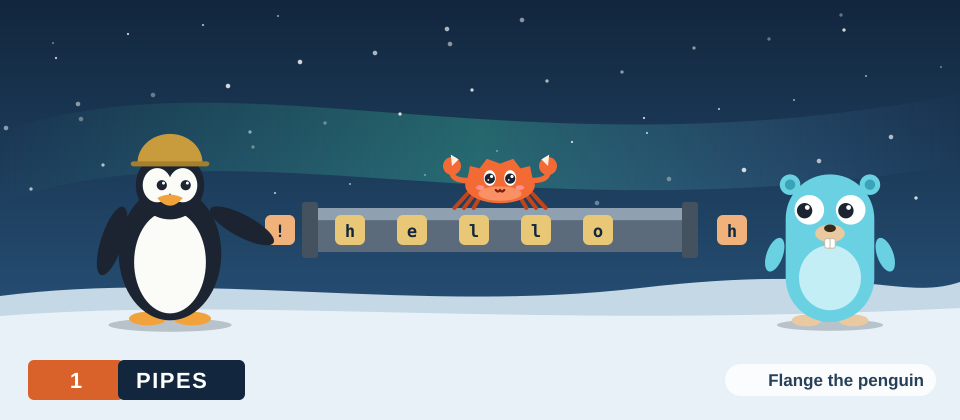

# Pipes

A pipe is a one-way stream of bytes between processes, buffered in a fixed amount of
kernel memory. The shell creates one for each `|` on a command line. In
`seq 1 100000 | grep 7 | wc -l`, the first pipe carries the output of `seq` to the input
of `grep`, and the second carries the output of `grep` to the input of `wc`.

In this chapter, we will specify what a pipe has to do, measure how the Linux pipe
behaves, and then implement the same design ourselves. We will write `pipefacts`, which measures a kernel pipe, `handpipe`, which implements a pipe in user space with the kernel's data structure, and `pipeline`, which connects real commands with kernel pipes the way a shell does. Each program is written in Go and in Rust.

<div class="covers">

This chapter covers

- the requirements of a byte stream between processes, and the mechanism that meets each
- the capacity of a Linux pipe and the unit in which a read frees space
- the pipe buffer: a ring of pages indexed by the counters `head` and `tail`
- blocking: how a full buffer suspends the writer and an empty buffer suspends the reader
- end of stream and `SIGPIPE`: how each side learns that the other has closed
- the descriptor rule a program must follow when it builds a pipeline
- the kernel's `struct pipe_inode_info` and `struct pipe_buffer`
- resizing a pipe, named pipes, and how to inspect pipes on a running system

</div>

## Why a pipe

Consider the job of counting how many of the numbers from 1 to 100000 contain the digit
7. `seq 1 100000` prints the numbers, 588895 bytes of text, and `grep 7 | wc -l` counts
the matching lines. The output of the first program has to reach the second somehow.

The obvious way is a temporary file: run `seq` and store its output, then run `grep` on
the file. This works, and it has 3 costs. The whole output is stored, although each
number is needed only once. The second program cannot start until the first has
finished. And if the output were endless, as it is for a program that follows a log, the
method would not work at all.

A pipe removes all 3. It is a small buffer in memory with a writer on one side and a
reader on the other. The writer adds bytes, the reader removes them, and both programs
run at the same time. The buffer holds 65536 bytes at most, whether 600 kilobytes pass
through it or 600 gigabytes.

<figure>
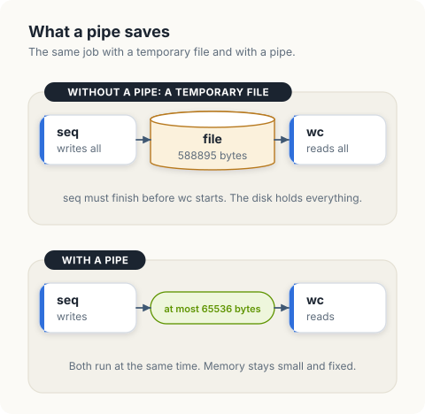
<figcaption><b>Figure 1.1</b> A temporary file stores everything and forces an order. A pipe passes the bytes along while both programs run.</figcaption>
</figure>

A small buffer between 2 running programs raises questions that a file does not. What
happens when the buffer is full? What happens when it is empty? How does the reader
learn that the writer has finished? The answers are the behaviour of a pipe, and the
next section lists them as requirements.

## Requirements

Linux runs each program as a *process*, which has its own memory. A process cannot
read or write the memory of another. The *kernel* is the part of the operating system
that manages memory and devices for all processes, and a process asks it for a service
with a *system call*: a function call that enters the kernel and returns a result.
`read` and `write` are system calls. Each takes a *file descriptor*, a small integer
that names an open file or another source of bytes.

Since processes share no memory, a stream of bytes between them has to pass through the kernel. The table lists what such a stream must provide and the mechanism a pipe uses to provide it.

| Requirement | Mechanism in a pipe |
|---|---|
| Bytes arrive in the order they were sent | a first-in, first-out buffer |
| Memory use is independent of the length of the stream | the buffer has a fixed capacity, 16 pages by default |
| A fast writer cannot overrun a slow reader | a write to a full buffer blocks until a read frees space |
| The reader can detect the end of the stream | a read from an empty buffer returns 0 once every write end is closed |
| The writer can detect that the reader is gone | a write with no read end open raises `SIGPIPE` and fails with `EPIPE` |

A call *blocks* when the kernel suspends the calling thread until the call can proceed.
A suspended thread consumes no processor time.

## The interface

The `pipe2` system call creates a pipe and returns a pair of file descriptors: the *read end*, then the *write end*. Bytes passed to `write` on the write
end are appended to the pipe's buffer, and `read` on the read end removes them from the
front.

<figure>
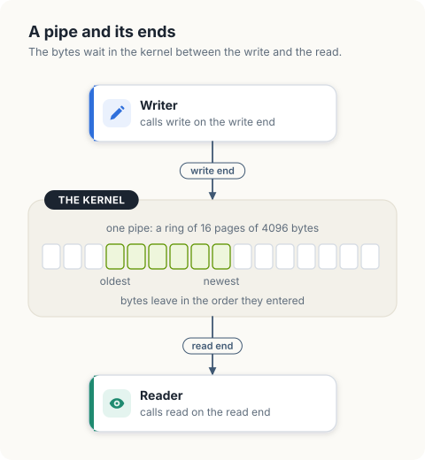
<figcaption><b>Figure 1.2</b> A pipe: a write end, a read end, and a buffer in kernel memory between them.</figcaption>
</figure>

A pipe has no name in the file system and stores nothing on disk. It exists for as long
as some process holds a descriptor for either end. Linux lists the descriptors of a
process under `/proc/<pid>/fd`, where `<pid>` is the process number, so we can observe a
pipe from outside. For `sleep 47 | sleep 48`, with the processes numbered 4121903
and 4121904, descriptor 1 (standard output) of the first and descriptor 0 (standard
input) of the second refer to the same pipe object:

```console
$ ls -l /proc/4121903/fd/1 /proc/4121904/fd/0
/proc/4121903/fd/1 -> pipe:[33835818]
/proc/4121904/fd/0 -> pipe:[33835818]
```

The listing is read as follows.

<figure>
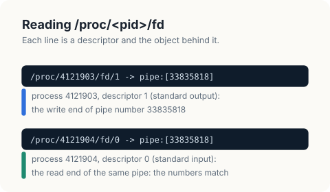
<figcaption><b>Figure 1.3</b> How to read the 2 lines: the number after <code>pipe:</code> identifies the pipe, and equal numbers mean the same pipe.</figcaption>
</figure>

The same can be seen from inside a pipeline. Here `ls` lists its own descriptors while
its output goes to `cat`. The lines for descriptors 1 and 3 are shown: descriptor 1 of
`ls` is a pipe, and descriptor 3 is the directory it is reading.

```console
$ ls -l /proc/self/fd | cat
1 -> pipe:[35453230]
3 -> /proc/559492/fd
```

A pipe carries bytes in 1 direction. A program that needs to send and receive creates 2
pipes, or uses a socket ([chapter 10](10-tcp-sockets.md)). The descriptors, the table
they live in and what a child process inherits are the subject of
[chapter 2](02-file-descriptors.md). For this chapter it is enough that a descriptor is
a number that names 1 end of the pipe.

## One write, step by step

Before looking at the data structures, we follow a single call. A process holds the
write end of a pipe as descriptor 4 and calls `write(4, "hello", 5)`.

1. The kernel takes entry 4 of the process's descriptor table and finds a `struct file`,
   its record of an open file. The record contains a table of functions, `f_op`, and
   for a pipe the write function in that table is `pipe_write`.
2. `pipe_write` locks the pipe. A *mutex* is a lock that 1 thread can hold at a time,
   and a thread that asks for a held mutex sleeps until it is released. All further
   steps happen with the lock held, so a reader running at the same moment sees the pipe
   either before the write or after it.
3. It checks that a read end is open. If none is, it sends the process the signal
   `SIGPIPE` and returns the error `EPIPE`.
4. It looks for room. The bytes can go into the unused end of the page written last, or
   into a new page if a slot of the buffer is free. If there is no room, the process is
   put to sleep until a reader makes some, and the step is repeated.
5. It copies the 5 bytes from the memory of the process into the page.
6. It wakes any reader that is asleep waiting for data, releases the lock, and returns
   5.

<figure>
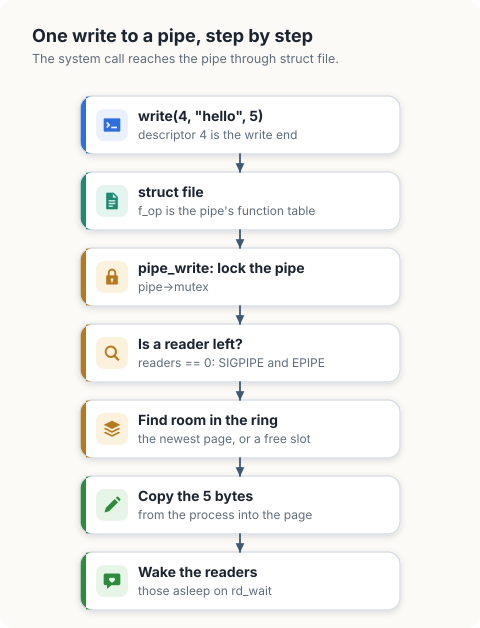
<figcaption><b>Figure 1.4</b> A <code>write</code> to a pipe, from the system call to the wake-up of the reader.</figcaption>
</figure>

Each step corresponds to a field of the structure that represents a pipe in the kernel.

## The kernel's structures

A pipe is a `struct pipe_inode_info`, and each slot of its buffer is a
`struct pipe_buffer`. These are the definitions in `include/linux/pipe_fs_i.h` of the
kernel that runs on our machine, Linux 5.15, with the fields this chapter does not use
left out.

```c
struct pipe_buffer {
        struct page *page;             /* the page that holds the bytes */
        unsigned int offset, len;      /* where the unread bytes start, and how many */
        unsigned int flags;            /* PIPE_BUF_FLAG_CAN_MERGE: may be appended to */
        /* ... */
};

struct pipe_inode_info {
        struct mutex mutex;                    /* the lock of step 2 */
        wait_queue_head_t rd_wait, wr_wait;    /* sleeping readers, sleeping writers */
        unsigned int head;                     /* slots ever filled */
        unsigned int tail;                     /* slots ever emptied */
        unsigned int max_usage;                /* slots that may be in use */
        unsigned int ring_size;                /* slots in bufs, a power of 2 */
        unsigned int readers;                  /* open read ends */
        unsigned int writers;                  /* open write ends */
        struct pipe_buffer *bufs;              /* the array of slots */
        /* ... */
};

#define PIPE_DEF_BUFFERS        16
```

| Field | Meaning |
|---|---|
| `bufs`, `ring_size` | The buffer: an array of `ring_size` slots. A new pipe has `PIPE_DEF_BUFFERS`, 16. |
| `page` | A *page* is the unit in which the kernel allocates memory, 4096 bytes on this machine. Each slot in use refers to 1 page. |
| `offset`, `len` | The unread bytes of a page are `len` bytes starting at `offset`. A read advances `offset` and reduces `len`. |
| `head`, `tail` | Counters that only increase. `head - tail` slots are in use. |
| `mutex` | Held during every read and write. |
| `rd_wait`, `wr_wait` | *Wait queues*: lists of sleeping threads. A reader that finds the pipe empty adds itself to `rd_wait` and sleeps, and a writer wakes the threads on it. `wr_wait` is the same for writers and a full pipe. |
| `readers`, `writers` | How many read ends and write ends are open. Step 3 tests `readers`. |

<figure>
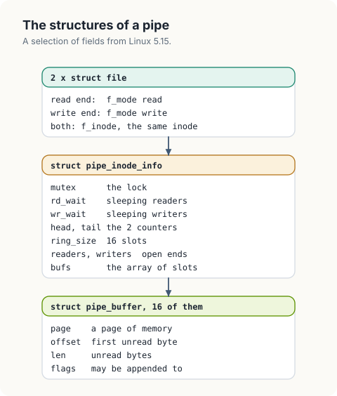
<figcaption><b>Figure 1.5</b> The structures of a pipe and the pointers between them.</figcaption>
</figure>

The capacity follows from these numbers: 16 slots of 4096 bytes are 65536 bytes. The
first measurement below checks it.

## Setting up the project

The Go programs share a module, and the Rust programs share a Cargo workspace. The Rust
crates use the 2024 edition and Rust 1.99, the current stable release. A
`rust-toolchain.toml` file in the `rust` directory selects it.

`pipefacts` calls the kernel through `golang.org/x/sys/unix` in Go and through the
`nix` crate in Rust. `handpipe` uses the `parking_lot` crate in Rust for its lock and
condition variables. `pipeline` needs only the standard library in both languages.

To create the Go module with its dependency, we run:

```console
$ mkdir go && cd go
$ go mod init democratizing-linux
$ go get golang.org/x/sys/unix
```

This produces the following `go.mod`. Each program is a directory with a `main.go`,
such as `pipefacts/main.go`.

```text
{{#include ../code/go/go.mod}}
```

For Rust, we create a directory `rust` with this workspace manifest in `Cargo.toml`:

```toml
[workspace]
members = []
resolver = "3"
```

and this `rust-toolchain.toml` beside it:

```toml
{{#include ../code/rust/rust-toolchain.toml}}
```

Then we create the crates and add their dependencies. `cargo new` adds each crate to
`members`.

```console
$ cargo new pipefacts
$ cargo add -p pipefacts nix --features fs
$ cargo new handpipe
$ cargo add -p handpipe parking_lot
$ cargo new pipeline
```

The manifest of `pipefacts` is now:

```toml
{{#include ../code/rust/pipefacts/Cargo.toml}}
```

and the manifest of `handpipe`:

```toml
{{#include ../code/rust/handpipe/Cargo.toml}}
```

We run a program with `go run ./pipefacts` from the `go` directory and with
`cargo run -p pipefacts` from the `rust` directory.

## Measuring a kernel pipe

`pipefacts` measures the behaviours in the requirements table on a kernel pipe. It creates each
pipe with the `O_NONBLOCK` flag. In this mode, a call that would block returns the error
`EAGAIN` immediately, which lets a thread detect a full or an empty buffer
without being suspended. We will come back to `O_CLOEXEC` when we start other programs.

<p class="listing"><b>Listing 1.1</b> The imports of <code>pipefacts</code>, in Go. <a href="https://github.com/arpanpathak/cracking-the-systems-programming-interview/blob/prep-v2/democratizing-linux/code/go/pipefacts/main.go">code/go/pipefacts/main.go</a></p>

```go
{{#include ../code/go/pipefacts/main.go:imports}}
```

<p class="listing"><b>Listing 1.2</b> The imports of <code>pipefacts</code>, in Rust. <a href="https://github.com/arpanpathak/cracking-the-systems-programming-interview/blob/prep-v2/democratizing-linux/code/rust/pipefacts/src/main.rs">code/rust/pipefacts/src/main.rs</a></p>

```rust
{{#include ../code/rust/pipefacts/src/main.rs:imports}}
```

<p class="listing"><b>Listing 1.3</b> Creating a non-blocking pipe, in Go. <a href="https://github.com/arpanpathak/cracking-the-systems-programming-interview/blob/prep-v2/democratizing-linux/code/go/pipefacts/main.go">code/go/pipefacts/main.go</a></p>

```go
{{#include ../code/go/pipefacts/main.go:pipe}}
```

<p class="listing"><b>Listing 1.4</b> Creating a non-blocking pipe, in Rust. <a href="https://github.com/arpanpathak/cracking-the-systems-programming-interview/blob/prep-v2/democratizing-linux/code/rust/pipefacts/src/main.rs">code/rust/pipefacts/src/main.rs</a></p>

```rust
{{#include ../code/rust/pipefacts/src/main.rs:pipe}}
```


`fill` measures free space. It writes 4096-byte blocks until a write returns `EAGAIN`
and returns the total number of bytes accepted. `drain` removes bytes.

<p class="listing"><b>Listing 1.5</b> Measuring free space by writing until the kernel refuses, in Go. <a href="https://github.com/arpanpathak/cracking-the-systems-programming-interview/blob/prep-v2/democratizing-linux/code/go/pipefacts/main.go">code/go/pipefacts/main.go</a></p>

```go
{{#include ../code/go/pipefacts/main.go:fill}}
```

<p class="listing"><b>Listing 1.6</b> Measuring free space by writing until the kernel refuses, in Rust. <a href="https://github.com/arpanpathak/cracking-the-systems-programming-interview/blob/prep-v2/democratizing-linux/code/rust/pipefacts/src/main.rs">code/rust/pipefacts/src/main.rs</a></p>

```rust
{{#include ../code/rust/pipefacts/src/main.rs:fill}}
```


`capacity` calls `fill` on a new pipe, again after 1 byte has been read from the full pipe, and again after 4096 bytes have been read in total.

<p class="listing"><b>Listing 1.7</b> Capacity, and the space a read frees, in Go. <a href="https://github.com/arpanpathak/cracking-the-systems-programming-interview/blob/prep-v2/democratizing-linux/code/go/pipefacts/main.go">code/go/pipefacts/main.go</a></p>

```go
{{#include ../code/go/pipefacts/main.go:capacity}}
```

<p class="listing"><b>Listing 1.8</b> Capacity, and the space a read frees, in Rust. <a href="https://github.com/arpanpathak/cracking-the-systems-programming-interview/blob/prep-v2/democratizing-linux/code/rust/pipefacts/src/main.rs">code/rust/pipefacts/src/main.rs</a></p>

```rust
{{#include ../code/rust/pipefacts/src/main.rs:capacity}}
```


`resize` changes the number of slots. `fcntl` with the command `F_SETPIPE_SZ` asks for a
capacity in bytes and returns the capacity granted. The program asks for 16384 bytes,
for 5000 bytes, and for 1048576 bytes, and measures the pipe after each request.

<p class="listing"><b>Listing 1.9</b> Changing the capacity of a pipe, in Go. <a href="https://github.com/arpanpathak/cracking-the-systems-programming-interview/blob/prep-v2/democratizing-linux/code/go/pipefacts/main.go">code/go/pipefacts/main.go</a></p>

```go
{{#include ../code/go/pipefacts/main.go:resize}}
```

<p class="listing"><b>Listing 1.10</b> Changing the capacity of a pipe, in Rust. <a href="https://github.com/arpanpathak/cracking-the-systems-programming-interview/blob/prep-v2/democratizing-linux/code/rust/pipefacts/src/main.rs">code/rust/pipefacts/src/main.rs</a></p>

```rust
{{#include ../code/rust/pipefacts/src/main.rs:resize}}
```


`endOfStream` reads an empty pipe with the write end open, and again with it closed.

<p class="listing"><b>Listing 1.11</b> Reading an empty pipe, in Go. <a href="https://github.com/arpanpathak/cracking-the-systems-programming-interview/blob/prep-v2/democratizing-linux/code/go/pipefacts/main.go">code/go/pipefacts/main.go</a></p>

```go
{{#include ../code/go/pipefacts/main.go:eof}}
```

<p class="listing"><b>Listing 1.12</b> Reading an empty pipe, in Rust. <a href="https://github.com/arpanpathak/cracking-the-systems-programming-interview/blob/prep-v2/democratizing-linux/code/rust/pipefacts/src/main.rs">code/rust/pipefacts/src/main.rs</a></p>

```rust
{{#include ../code/rust/pipefacts/src/main.rs:eof}}
```


`brokenPipe` closes the read end and then writes.

<p class="listing"><b>Listing 1.13</b> Writing with no read end open, in Go. <a href="https://github.com/arpanpathak/cracking-the-systems-programming-interview/blob/prep-v2/democratizing-linux/code/go/pipefacts/main.go">code/go/pipefacts/main.go</a></p>

```go
{{#include ../code/go/pipefacts/main.go:broken}}
```

<p class="listing"><b>Listing 1.14</b> Writing with no read end open, in Rust. <a href="https://github.com/arpanpathak/cracking-the-systems-programming-interview/blob/prep-v2/democratizing-linux/code/rust/pipefacts/src/main.rs">code/rust/pipefacts/src/main.rs</a></p>

```rust
{{#include ../code/rust/pipefacts/src/main.rs:broken}}
```


The Go and Rust programs print the following on a Jetson Orin NX running Linux 5.15:

```text
{{#include ../code/output/pipefacts.txt}}
```

| Output | Conclusion |
|---|---|
| a new pipe accepts 65536 bytes | The capacity is 16 pages. A *page* is the unit in which the kernel allocates memory: 4096 bytes on this machine. |
| after 1 byte is read, 0 bytes are accepted | Free space is counted in whole pages. The pipe held 65535 bytes at that point and still refused a write. |
| after 4096 bytes are read, 4096 are accepted | Reading the last byte of a page releases that page. |
| 16384 requested, 16384 granted | The ring was replaced by a ring of 4 slots. |
| 5000 requested, 8192 granted | The kernel rounds the request up to whole pages and to a power of 2 slots, here 2. |
| 1048576 requested and granted | 256 slots. This is the largest size an ordinary user may ask for, set in `/proc/sys/fs/pipe-max-size`. |
| `EAGAIN` with the write end open | The buffer is empty and data may still arrive. A blocking read would be suspended here. |
| 0 with the write end closed | The buffer is empty and no data can arrive. A return value of 0 from `read` is the end of the stream. |
| `EPIPE` with the read end closed | No process can consume the data, so the write is refused. |

In the last case the kernel also sends the writing process `SIGPIPE`. A *signal* is an
asynchronous notification from the kernel to a process, and the default action for
`SIGPIPE` is to terminate the process. The programs continue and print `EPIPE` because
their runtimes change that default: the Go runtime handles `SIGPIPE` for descriptors
other than 1 and 2, and a Rust program starts with `SIGPIPE` ignored. The `pipeline`
program shows the default action.

Rows 2 and 3 confirm that the buffer is made of whole pages and rule out a flat byte array, since a flat array with 1 byte removed would accept 1 byte.

## The buffer: a ring of pages

The kernel allocates physical memory in pages, and the pipe buffer is built from that
unit. A pipe has an array of *slots*, 16 by default, and each slot refers to a page.
Each slot also records which part of its page holds unread data: an `offset` to the
first unread byte and a `length`.

Since the buffer is built from page references, an empty pipe needs no data pages and an idle pipe costs little memory. A page that already contains the data can also be placed in a slot directly: the `splice` system call moves page references between
a file and a pipe and copies no bytes.

The slots are used as a ring, indexed by the counters `head` and `tail`:

- `head` is the number of pages added to the ring since the pipe was created.
- `tail` is the number of pages removed.

`head` and `tail` only increase. The ring maintains these invariants:

1. `head - tail` is the number of pages in use, and it is between 0 and the number of
   slots.
2. Counter value `c` refers to slot `c mod slots`. The oldest page is at `tail` and the
   newest at `head - 1`.
3. New bytes are appended to the newest page if it has unused space after its data.
   The remainder goes into new pages at `head`.
4. Bytes are removed from the oldest page. When its `length` reaches 0, the page is
   released and `tail` advances by 1.

The kernel computes the slot with a mask in place of a division: `head & (ring_size - 1)`.
The 2 are equal when `ring_size` is a power of 2, which is the reason a request for 5000
bytes was rounded up to 2 slots. The counters are unsigned 32-bit numbers and wrap
around to 0 after about 4 billion pages. `head - tail` remains correct across the wrap,
because unsigned subtraction wraps in the same way.

Invariants 3 and 4 explain the measurement. Removing bytes from the oldest page frees
space at the front of that page, and invariant 3 places no new bytes there. The space
becomes usable only when the whole page is released.

The table below traces a ring of 4 slots with 8-byte pages. The last column lists the
`length` of each slot, with a dot for a free slot.

| Call | Result | `head` | `tail` | Slots 0 to 3 | Explanation |
|---|---|---|---|---|---|
| `put` 12 | 12 | 2 | 0 | `[8 4 . .]` | 2 new pages: 8 bytes and 4 bytes. |
| `take` 3 | 3 | 2 | 0 | `[5 4 . .]` | Slot 0 has `offset` 3 and `length` 5. It still holds data, so `tail` is unchanged. |
| `put` 30 | 20 | 4 | 0 | `[5 8 8 8]` | 4 bytes complete slot 1, and slots 2 and 3 take 8 each. All slots are in use. The 3 free bytes in slot 0 are unusable. |
| `take` 5 | 5 | 4 | 1 | `[. 8 8 8]` | Slot 0 is empty and is released. |
| `put` 30 | 8 | 5 | 1 | `[8 8 8 8]` | Counter 4 maps to slot 0. The newest page now precedes the oldest in the array: the ring has wrapped. |

<figure>
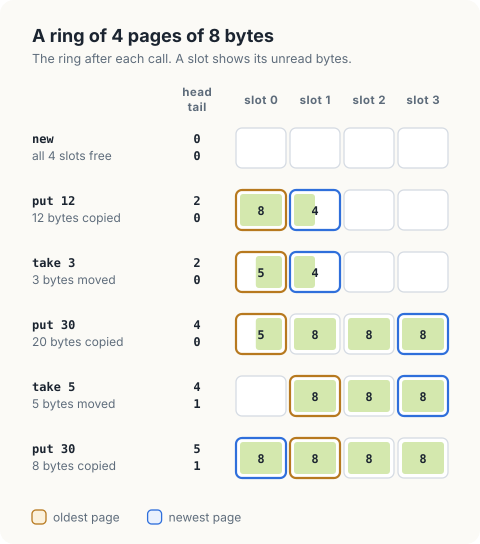
<figcaption><b>Figure 1.6</b> The trace as a picture. The shaded part of a slot is its unread data.</figcaption>
</figure>

<div class="lld">

Low-level design: `handpipe`

| Type | Fields | Invariant |
|---|---|---|
| `page` | `data`, `offset`, `length` | unread bytes are `data[offset .. offset+length]` |
| `ring` | `pages`, `head`, `tail` | `0 <= head - tail <= len(pages)`; counter `c` maps to slot `c mod len(pages)` |
| `pipe` | `ring`, a lock, `readable`, `writable`, `readers`, `writers` | the ring and the counts are accessed only with the lock held |

| Operation | Behaviour | Blocks |
|---|---|---|
| `put(data)` | appends as many bytes as fit; returns the count | no |
| `take(buf)` | removes up to `len(buf)` of the oldest bytes; returns the count | no |
| `write(data)` | appends all of `data`; fails with `EPIPE` when `readers` is 0 | while the ring is full |
| `read(buf)` | removes at least 1 byte; returns 0 when the ring is empty and `writers` is 0 | while the ring is empty and `writers` is above 0 |
| `closeWriter`, `closeReader` | decrements a count and wakes the other side | no |

</div>

### Implementing the ring

`page` and `ring` follow the description directly. `slot` applies invariant 2. Both
versions allocate every page when the ring is created, which keeps the code short; the
kernel allocates a page when a slot first needs one.

<p class="listing"><b>Listing 1.15</b> The imports of <code>handpipe</code>, in Go. <a href="https://github.com/arpanpathak/cracking-the-systems-programming-interview/blob/prep-v2/democratizing-linux/code/go/handpipe/main.go">code/go/handpipe/main.go</a></p>

```go
{{#include ../code/go/handpipe/main.go:imports}}
```

<p class="listing"><b>Listing 1.16</b> The imports of <code>handpipe</code>, in Rust. <a href="https://github.com/arpanpathak/cracking-the-systems-programming-interview/blob/prep-v2/democratizing-linux/code/rust/handpipe/src/main.rs">code/rust/handpipe/src/main.rs</a></p>

```rust
{{#include ../code/rust/handpipe/src/main.rs:imports}}
```

<p class="listing"><b>Listing 1.17</b> The page, the ring, and its counters, in Go. <a href="https://github.com/arpanpathak/cracking-the-systems-programming-interview/blob/prep-v2/democratizing-linux/code/go/handpipe/main.go">code/go/handpipe/main.go</a></p>

```go
{{#include ../code/go/handpipe/main.go:page}}
```

<p class="listing"><b>Listing 1.18</b> The page, the ring, and its counters, in Rust. <a href="https://github.com/arpanpathak/cracking-the-systems-programming-interview/blob/prep-v2/democratizing-linux/code/rust/handpipe/src/main.rs">code/rust/handpipe/src/main.rs</a></p>

```rust
{{#include ../code/rust/handpipe/src/main.rs:page}}
```


`put` implements invariant 3: first the unused space of the newest page, then free slots. It returns the number of bytes copied, which is smaller than the request
when the ring fills.

<p class="listing"><b>Listing 1.19</b> Appending bytes to the ring, in Go. <a href="https://github.com/arpanpathak/cracking-the-systems-programming-interview/blob/prep-v2/democratizing-linux/code/go/handpipe/main.go">code/go/handpipe/main.go</a></p>

```go
{{#include ../code/go/handpipe/main.go:put}}
```

<p class="listing"><b>Listing 1.20</b> Appending bytes to the ring, in Rust. <a href="https://github.com/arpanpathak/cracking-the-systems-programming-interview/blob/prep-v2/democratizing-linux/code/rust/handpipe/src/main.rs">code/rust/handpipe/src/main.rs</a></p>

```rust
{{#include ../code/rust/handpipe/src/main.rs:put}}
```


`take` implements invariant 4. It advances `offset` in the oldest page and increments
`tail` when the page is exhausted.

<p class="listing"><b>Listing 1.21</b> Removing the oldest bytes from the ring, in Go. <a href="https://github.com/arpanpathak/cracking-the-systems-programming-interview/blob/prep-v2/democratizing-linux/code/go/handpipe/main.go">code/go/handpipe/main.go</a></p>

```go
{{#include ../code/go/handpipe/main.go:take}}
```

<p class="listing"><b>Listing 1.22</b> Removing the oldest bytes from the ring, in Rust. <a href="https://github.com/arpanpathak/cracking-the-systems-programming-interview/blob/prep-v2/democratizing-linux/code/rust/handpipe/src/main.rs">code/rust/handpipe/src/main.rs</a></p>

```rust
{{#include ../code/rust/handpipe/src/main.rs:take}}
```


`smallRing` applies the calls of the trace and prints the ring after each.

<p class="listing"><b>Listing 1.23</b> Running the trace, in Go. <a href="https://github.com/arpanpathak/cracking-the-systems-programming-interview/blob/prep-v2/democratizing-linux/code/go/handpipe/main.go">code/go/handpipe/main.go</a></p>

```go
{{#include ../code/go/handpipe/main.go:trace}}
```

<p class="listing"><b>Listing 1.24</b> Running the trace, in Rust. <a href="https://github.com/arpanpathak/cracking-the-systems-programming-interview/blob/prep-v2/democratizing-linux/code/rust/handpipe/src/main.rs">code/rust/handpipe/src/main.rs</a></p>

```rust
{{#include ../code/rust/handpipe/src/main.rs:trace}}
```


```text
{{#include ../code/output/handpipe.txt:1:6}}
```

The output agrees with the table.

### Checking the model against the kernel

`kernelSize` repeats the capacity measurement of `pipefacts` on a ring with the kernel's
dimensions, 16 pages of 4096 bytes.

<p class="listing"><b>Listing 1.25</b> The capacity measurement on a ring of 16 pages, in Go. <a href="https://github.com/arpanpathak/cracking-the-systems-programming-interview/blob/prep-v2/democratizing-linux/code/go/handpipe/main.go">code/go/handpipe/main.go</a></p>

```go
{{#include ../code/go/handpipe/main.go:kernelsize}}
```

<p class="listing"><b>Listing 1.26</b> The capacity measurement on a ring of 16 pages, in Rust. <a href="https://github.com/arpanpathak/cracking-the-systems-programming-interview/blob/prep-v2/democratizing-linux/code/rust/handpipe/src/main.rs">code/rust/handpipe/src/main.rs</a></p>

```rust
{{#include ../code/rust/handpipe/src/main.rs:kernelsize}}
```


```text
{{#include ../code/output/handpipe.txt:8:10}}
```

These lines are identical to lines 1 to 3 of the `pipefacts` output. The ring
of pages reproduces the kernel's capacity and its page-sized release of space.

<div class="callout">

**Where the model simplifies.** `handpipe` uses the kernel's names and its ring. It
differs in 3 details. It allocates every page when the ring is created, where the kernel
allocates a page when a slot first needs one. It appends to the newest page whenever
there is space, where the kernel does so only when the final partial page of a write
fits there completely, which keeps the pages of a large write aligned. And its ring has
a fixed size, where the kernel's can be resized with `F_SETPIPE_SZ`, as `pipefacts`
showed.

</div>

## Blocking

The ring is a single-threaded data structure. A pipe adds safe access from a reader and a writer running concurrently, and a defined behaviour when a call cannot make progress. Figure 1.7 lists the cases of each call.

<figure>
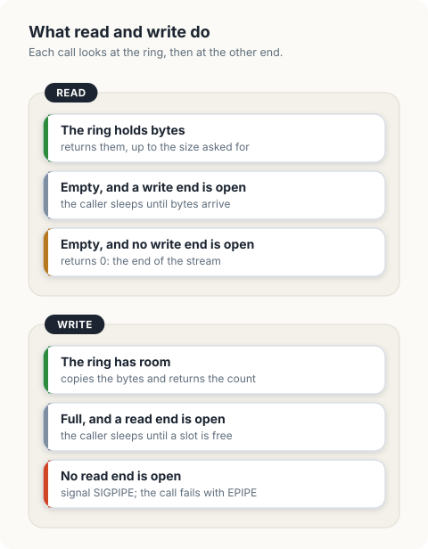
<figcaption><b>Figure 1.7</b> The cases of <code>read</code> and of <code>write</code>.</figcaption>
</figure>

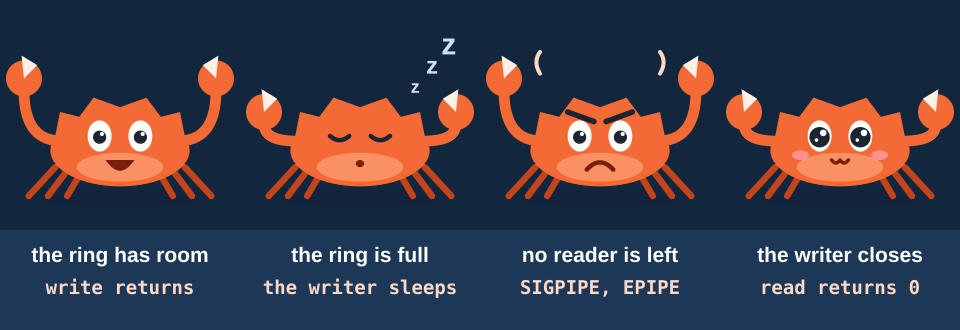

The blocking cases provide flow control. If `seq` produces output faster than `grep`
consumes it, the ring fills and `seq` is suspended inside `write`. When `grep` releases
a page, `seq` resumes. The writer's rate is therefore limited to the reader's rate, and
the memory between them stays at 16 pages for a stream of any length. Neither program
contains code for this; it follows from the semantics of `write`.

In addition to the ring, the implementation needs:

- A *lock*, which gives a thread exclusive access to the ring while it holds the lock.
- The *condition variables* `readable` and `writable`. A condition variable is a queue on which a thread sleeps
  until another thread wakes it. Waiting releases the lock and suspends the thread atomically, and reacquires the lock before returning. Readers wait on `readable`
  and writers on `writable`. The kernel's equivalents are the wait queues `rd_wait` and
  `wr_wait`.
- The counts `readers` and `writers` of the open ends.

<p class="listing"><b>Listing 1.27</b> The pipe: a ring, a lock, wait queues, and the open ends, in Go. <a href="https://github.com/arpanpathak/cracking-the-systems-programming-interview/blob/prep-v2/democratizing-linux/code/go/handpipe/main.go">code/go/handpipe/main.go</a></p>

```go
{{#include ../code/go/handpipe/main.go:pipe}}
```

<p class="listing"><b>Listing 1.28</b> The pipe: a ring, a lock, wait queues, and the open ends, in Rust. <a href="https://github.com/arpanpathak/cracking-the-systems-programming-interview/blob/prep-v2/democratizing-linux/code/rust/handpipe/src/main.rs">code/rust/handpipe/src/main.rs</a></p>

```rust
{{#include ../code/rust/handpipe/src/main.rs:pipe}}
```


`write` loops until all of `data` is in the ring. On each pass it checks for a reader,
appends what fits, and either wakes the readers or waits on `writable`.

A woken thread must test its condition again before proceeding. A wake-up indicates
that the state changed, and the change may be unrelated to the condition the thread waits for: in row 2 of the trace, a `take` of 3 bytes freed no slot. For
this reason the wait is inside the loop, and the writer calls `put` again after every
wake-up.

<p class="listing"><b>Listing 1.29</b> Blocking write, in Go. <a href="https://github.com/arpanpathak/cracking-the-systems-programming-interview/blob/prep-v2/democratizing-linux/code/go/handpipe/main.go">code/go/handpipe/main.go</a></p>

```go
{{#include ../code/go/handpipe/main.go:write}}
```

<p class="listing"><b>Listing 1.30</b> Blocking write, in Rust. <a href="https://github.com/arpanpathak/cracking-the-systems-programming-interview/blob/prep-v2/democratizing-linux/code/rust/handpipe/src/main.rs">code/rust/handpipe/src/main.rs</a></p>

```rust
{{#include ../code/rust/handpipe/src/main.rs:write}}
```


`read` waits while the ring is empty and a writer exists. If it wakes with the ring
still empty, `writers` is 0, `take` returns 0, and so does `read`. A read returns as soon as at least 1 byte is available, so the caller may receive fewer bytes than it
asked for and must be prepared to call `read` again.

<p class="listing"><b>Listing 1.31</b> Blocking read, in Go. <a href="https://github.com/arpanpathak/cracking-the-systems-programming-interview/blob/prep-v2/democratizing-linux/code/go/handpipe/main.go">code/go/handpipe/main.go</a></p>

```go
{{#include ../code/go/handpipe/main.go:read}}
```

<p class="listing"><b>Listing 1.32</b> Blocking read, in Rust. <a href="https://github.com/arpanpathak/cracking-the-systems-programming-interview/blob/prep-v2/democratizing-linux/code/rust/handpipe/src/main.rs">code/rust/handpipe/src/main.rs</a></p>

```rust
{{#include ../code/rust/handpipe/src/main.rs:read}}
```


Closing an end decrements its count and wakes the opposite side. Without the wake-up, a
reader already waiting on an empty ring would remain suspended after `writers` reached
0.

<p class="listing"><b>Listing 1.33</b> Closing an end, in Go. <a href="https://github.com/arpanpathak/cracking-the-systems-programming-interview/blob/prep-v2/democratizing-linux/code/go/handpipe/main.go">code/go/handpipe/main.go</a></p>

```go
{{#include ../code/go/handpipe/main.go:close}}
```

<p class="listing"><b>Listing 1.34</b> Closing an end, in Rust. <a href="https://github.com/arpanpathak/cracking-the-systems-programming-interview/blob/prep-v2/democratizing-linux/code/rust/handpipe/src/main.rs">code/rust/handpipe/src/main.rs</a></p>

```rust
{{#include ../code/rust/handpipe/src/main.rs:close}}
```


Animation 1.1 runs a writer and a reader on the 4-slot ring. The writer's second call
writes 30 bytes. It blocks after 20 bytes and again after 28, and returns when all 30 bytes are in the ring.

<figure class="anim">
<video class="motion" src="figures/ring-sleep.mp4" autoplay loop muted playsinline preload="metadata" aria-label="A writer and a reader share a ring of 4 pages of 8 bytes. The writer puts 12 bytes, and the reader takes 3. The writer starts a write of 30 bytes; 20 fit, every slot is in use, and the writer sleeps. The reader takes 5 more bytes, which frees slot 0; the writer wakes, puts 8 bytes into slot 0, and sleeps again with 2 bytes left. The reader takes 8, the writer puts its last 2 bytes and its write returns 30. The writer closes its end, the reader takes the 26 bytes that remain, and its next read returns 0." data-chapters="[[0.0, &quot;put&quot;], [3.06, &quot;take&quot;], [8.1, &quot;full&quot;], [19.74, &quot;wake&quot;], [37.38, &quot;end&quot;]]"></video>
<figcaption><b>Animation 1.1</b> A write of 30 bytes into a ring that holds 32. The writer blocks while no slot is free.</figcaption>
</figure>

`transfer` tests the complete pipe. A writer thread sends 1048576 bytes in writes of
100000 bytes. Each write is larger than the ring's capacity, so each one blocks several
times. The reader verifies the order of the bytes, then reads again after the write end is closed. The read end is then closed and another write is attempted.

<p class="listing"><b>Listing 1.35</b> One megabyte through a 16-page ring, in Go. <a href="https://github.com/arpanpathak/cracking-the-systems-programming-interview/blob/prep-v2/democratizing-linux/code/go/handpipe/main.go">code/go/handpipe/main.go</a></p>

```go
{{#include ../code/go/handpipe/main.go:transfer}}
```

<p class="listing"><b>Listing 1.36</b> One megabyte through a 16-page ring, in Rust. <a href="https://github.com/arpanpathak/cracking-the-systems-programming-interview/blob/prep-v2/democratizing-linux/code/rust/handpipe/src/main.rs">code/rust/handpipe/src/main.rs</a></p>

```rust
{{#include ../code/rust/handpipe/src/main.rs:transfer}}
```


```text
{{#include ../code/output/handpipe.txt:12:14}}
```

All bytes arrived in order through 65536 bytes of buffer. The read that returns 0 and the write that fails with `EPIPE` match the `pipefacts` output.

<div class="callout">

**Atomic writes.** When several processes write to the same pipe, the kernel guarantees
that a write of at most `PIPE_BUF` bytes (4096 on Linux) is kept contiguous in the
stream. Larger writes can be interleaved with the writes of other processes.
`handpipe` omits this guarantee: its `write` can block after copying part of a small
request.

</div>

## The end of a stream

`readers` and `writers` in `struct pipe_inode_info` count open ends, and both rules for
the end of a stream are tests of these counts.

| Call | Condition | Result |
|---|---|---|
| `read` | the ring is empty and `writers` is 0 | returns 0 |
| `write` | `readers` is 0 | `SIGPIPE`, and the error `EPIPE` |

The counts change when an end is opened or closed, and "closed" has a precise meaning.
An end of a pipe is a `struct file`, and several descriptors can refer to the same
`struct file`: `dup` creates another one, and `fork` gives the child a copy of every
descriptor of the parent. The kernel releases the `struct file`, and lowers `readers` or
`writers`, when the last of those descriptors is closed. A single forgotten descriptor
in any process keeps the end open.

Figure 1.8 follows the counts through the life of the pipeline `a | b`.

<figure>
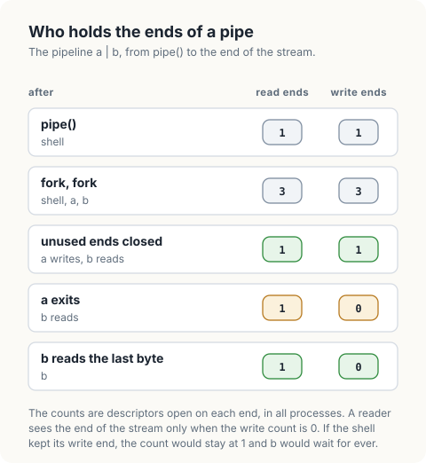
<figcaption><b>Figure 1.8</b> The open ends of a pipe, counted over all processes.</figcaption>
</figure>

The figure counts descriptors, as a programmer has to. Row 3 is the step that programs
get wrong. After the forks, 3 processes hold a descriptor for the write end. The reader
`b` holds one itself, and if it does not close it, `b` waits for the end of a stream
whose last writer is `b`.

## Building a pipeline

`pipeline` runs `seq 1 100000 | grep 7 | wc -l` with kernel pipes. The kernel's rules for descriptors determine how it must manage them.

1. **Descriptors are inherited.** When a process (the *parent*) starts another (the
   *child*), the child receives copies of the parent's descriptors. A copy refers to the
   same pipe end as the original.
2. **An end is closed when its last descriptor is closed.** The kernel counts the
   descriptors that refer to each end. `read` returns 0 only when the count for the
   write end is 0.

Suppose the parent creates a pipe, starts `seq` with the write end and `grep` with the
read end, and keeps its own descriptors open. When `seq` exits, the write end still has an open descriptor, the parent's. `grep` then blocks in `read` indefinitely and the pipeline
does not finish. The rule for the parent follows: after starting a child, close the
parent's copy of every pipe end that was passed to it.

`O_CLOEXEC` enforces the same rule for descriptors that were not passed deliberately.
The kernel closes a descriptor carrying this flag when the process executes a new
program. Go's `os.Pipe` and Rust's `io::pipe` both set it, so each command receives its own ends and no descriptors for the other pipes.

<figure>
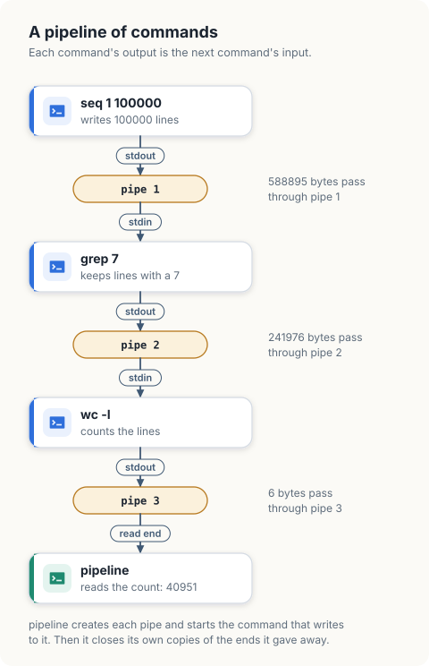
<figcaption><b>Figure 1.9</b> The pipeline that <code>pipeline</code> builds. The parent reads pipe 3 to collect the result.</figcaption>
</figure>

`start` creates a pipe for each command. Each command writes to its own pipe and reads from the previous pipe, and the read end of the newest pipe is carried to the next iteration.
The parent's copies are closed in each iteration: explicitly in Go, and in Rust by
ownership, since the ends are moved into the `Command`, which is dropped at the end of
the statement.

<p class="listing"><b>Listing 1.37</b> The imports of <code>pipeline</code>, in Go. <a href="https://github.com/arpanpathak/cracking-the-systems-programming-interview/blob/prep-v2/democratizing-linux/code/go/pipeline/main.go">code/go/pipeline/main.go</a></p>

```go
{{#include ../code/go/pipeline/main.go:imports}}
```

<p class="listing"><b>Listing 1.38</b> The imports of <code>pipeline</code>, in Rust. <a href="https://github.com/arpanpathak/cracking-the-systems-programming-interview/blob/prep-v2/democratizing-linux/code/rust/pipeline/src/main.rs">code/rust/pipeline/src/main.rs</a></p>

```rust
{{#include ../code/rust/pipeline/src/main.rs:imports}}
```

<p class="listing"><b>Listing 1.39</b> Starting the commands, each with its own pipe, in Go. <a href="https://github.com/arpanpathak/cracking-the-systems-programming-interview/blob/prep-v2/democratizing-linux/code/go/pipeline/main.go">code/go/pipeline/main.go</a></p>

```go
{{#include ../code/go/pipeline/main.go:start}}
```

<p class="listing"><b>Listing 1.40</b> Starting the commands, each with its own pipe, in Rust. <a href="https://github.com/arpanpathak/cracking-the-systems-programming-interview/blob/prep-v2/democratizing-linux/code/rust/pipeline/src/main.rs">code/rust/pipeline/src/main.rs</a></p>

```rust
{{#include ../code/rust/pipeline/src/main.rs:start}}
```


The kernel records how each process terminated: with an exit status chosen by the
process, where 0 means success by convention, or by a signal. The parent retrieves the
record with the `wait` system call.

<p class="listing"><b>Listing 1.41</b> Reporting how a command terminated, in Go. <a href="https://github.com/arpanpathak/cracking-the-systems-programming-interview/blob/prep-v2/democratizing-linux/code/go/pipeline/main.go">code/go/pipeline/main.go</a></p>

```go
{{#include ../code/go/pipeline/main.go:status}}
```

<p class="listing"><b>Listing 1.42</b> Reporting how a command terminated, in Rust. <a href="https://github.com/arpanpathak/cracking-the-systems-programming-interview/blob/prep-v2/democratizing-linux/code/rust/pipeline/src/main.rs">code/rust/pipeline/src/main.rs</a></p>

```rust
{{#include ../code/rust/pipeline/src/main.rs:status}}
```


`run` reads the last pipe until `read` returns 0. That occurs when the last command has
exited and no descriptor for the write end remains, which depends on `start` having
closed the parent's copy.

<p class="listing"><b>Listing 1.43</b> Running a pipeline, in Go. <a href="https://github.com/arpanpathak/cracking-the-systems-programming-interview/blob/prep-v2/democratizing-linux/code/go/pipeline/main.go">code/go/pipeline/main.go</a></p>

```go
{{#include ../code/go/pipeline/main.go:run}}
```

<p class="listing"><b>Listing 1.44</b> Running a pipeline, in Rust. <a href="https://github.com/arpanpathak/cracking-the-systems-programming-interview/blob/prep-v2/democratizing-linux/code/rust/pipeline/src/main.rs">code/rust/pipeline/src/main.rs</a></p>

```rust
{{#include ../code/rust/pipeline/src/main.rs:run}}
```


```text
{{#include ../code/output/pipeline.txt}}
```

In the first pipeline, each command reached the end of its input when the previous
command exited, and all of them exited with status 0. The result can be verified
independently. Of the 100000 5-digit strings from 00000 to 99999, 9<sup>5</sup> =
59049 contain no 7. The range 1 to 100000 replaces 00000 with 100000, and neither
contains a 7, so 100000 - 59049 = 40951 numbers in the range contain a 7.

The second pipeline terminates a writer that has no end of its own. `yes` writes the
line `y` in a loop. `head -n 3` exits after 3 lines, which closes the only read end
of the pipe. The next `write` by `yes` raises `SIGPIPE`, signal 13, and the default
action terminates the process. In a longer pipeline this propagates from right to left:
each command that exits closes a read end, and the command before it is terminated on
its next write.

## Named pipes

The pipes so far have no name, so only processes that inherited the descriptors can use
them. A *named pipe*, or FIFO, is the same kernel object with an entry in the file
system, created by `mkfifo`. Unrelated processes open it by path, one for writing and
one for reading, and the bytes pass through a `struct pipe_inode_info` exactly as
before. Nothing is written to the disk. The `p` at the start of the permissions marks
the type.

```console
$ mkfifo /tmp/x/queue
$ ls -l /tmp/x/queue
prw-rw-r-- /tmp/x/queue
$ echo hello > /tmp/x/queue &
$ cat /tmp/x/queue
hello
```

An `open` of a FIFO for writing blocks until some process opens it for reading, and the
reverse, which is why the `echo` above is started in the background.

## Inspecting pipes on a live system

| Command | Shows |
|---|---|
| `ls -l /proc/<pid>/fd` | which descriptors of a process are pipes, and the number of each pipe; equal numbers are the 2 ends of the same pipe |
| `cat /proc/sys/fs/pipe-max-size` | the largest capacity an ordinary user can set with `F_SETPIPE_SZ`: 1048576 here |
| `cat /proc/sys/fs/pipe-user-pages-soft` | the number of pages all pipes of a user may hold before new pipes are created with a single slot: 16384 here |
| `fcntl(fd, F_GETPIPE_SZ)` | the capacity of a pipe, from inside a program |

A pipeline that appears to hang is usually diagnosed with the first command: find the
process that is blocked, read its descriptors, and look for another process that still
holds the write end of the same pipe number.

## The complete programs

<p class="listing"><b>Listing 1.45</b> The complete <code>pipefacts</code>, in Go. <a href="https://github.com/arpanpathak/cracking-the-systems-programming-interview/blob/prep-v2/democratizing-linux/code/go/pipefacts/main.go">code/go/pipefacts/main.go</a></p>

```go
{{#include ../code/go/pipefacts/main.go}}
```

<p class="listing"><b>Listing 1.46</b> The complete <code>pipefacts</code>, in Rust. <a href="https://github.com/arpanpathak/cracking-the-systems-programming-interview/blob/prep-v2/democratizing-linux/code/rust/pipefacts/src/main.rs">code/rust/pipefacts/src/main.rs</a></p>

```rust
{{#include ../code/rust/pipefacts/src/main.rs}}
```


<p class="listing"><b>Listing 1.47</b> The complete <code>handpipe</code>, in Go. <a href="https://github.com/arpanpathak/cracking-the-systems-programming-interview/blob/prep-v2/democratizing-linux/code/go/handpipe/main.go">code/go/handpipe/main.go</a></p>

```go
{{#include ../code/go/handpipe/main.go}}
```

<p class="listing"><b>Listing 1.48</b> The complete <code>handpipe</code>, in Rust. <a href="https://github.com/arpanpathak/cracking-the-systems-programming-interview/blob/prep-v2/democratizing-linux/code/rust/handpipe/src/main.rs">code/rust/handpipe/src/main.rs</a></p>

```rust
{{#include ../code/rust/handpipe/src/main.rs}}
```


<p class="listing"><b>Listing 1.49</b> The complete <code>pipeline</code>, in Go. <a href="https://github.com/arpanpathak/cracking-the-systems-programming-interview/blob/prep-v2/democratizing-linux/code/go/pipeline/main.go">code/go/pipeline/main.go</a></p>

```go
{{#include ../code/go/pipeline/main.go}}
```

<p class="listing"><b>Listing 1.50</b> The complete <code>pipeline</code>, in Rust. <a href="https://github.com/arpanpathak/cracking-the-systems-programming-interview/blob/prep-v2/democratizing-linux/code/rust/pipeline/src/main.rs">code/rust/pipeline/src/main.rs</a></p>

```rust
{{#include ../code/rust/pipeline/src/main.rs}}
```


<div class="summary">

## Summary

- A pipe is a one-way byte stream between processes, buffered in kernel memory and
  reached through a read end and a write end.
- The buffer is a ring of 16 slots, each referring to one page: 65536 bytes with
  4096-byte pages.
- `head` counts pages added and `tail` counts pages removed. Space is released a whole page at a time, when the last byte of the oldest page has been read.
- A write to a full pipe blocks until a read releases a page. This limits a writer to
  the rate of its reader and bounds the memory between them.
- A thread woken from a wait tests its condition again, because a wake-up reports that
  the state changed and says nothing about which change occurred.
- `read` returns 0 when the pipe is empty and no descriptor for the write end remains.
- `write` raises `SIGPIPE` and fails with `EPIPE` when no descriptor for the read end
  remains.
- A program that builds a pipeline closes its own copy of each pipe end after passing it
  to a child. A copy left open prevents the end of the stream from being reported.

</div>

## References

- `pipe(7)` and `pipe(2)`, Linux manual pages:
  <https://man7.org/linux/man-pages/man7/pipe.7.html>
- `fs/pipe.c` and `include/linux/pipe_fs_i.h`, Linux 5.15:
  <https://elixir.bootlin.com/linux/v5.15/source/fs/pipe.c>
- M. Kerrisk, *The Linux Programming Interface*, No Starch Press, 2010, chapter 44.
- D. M. Ritchie, "The Evolution of the Unix Time-sharing System", AT&T Bell Laboratories
  Technical Journal, 63(8), 1984.
- Go, package `os/signal`, the section on `SIGPIPE`: <https://pkg.go.dev/os/signal>
