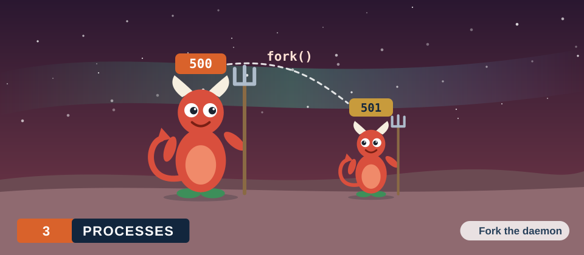
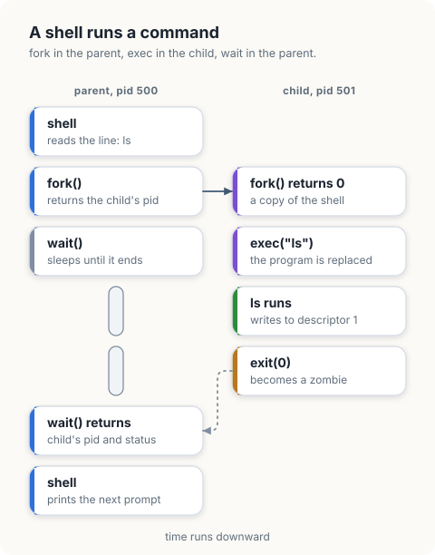
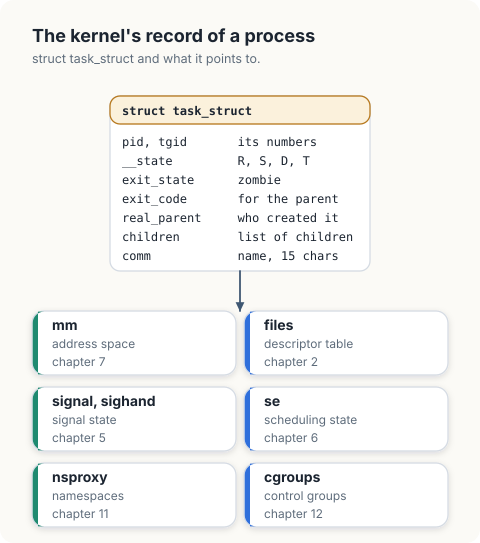
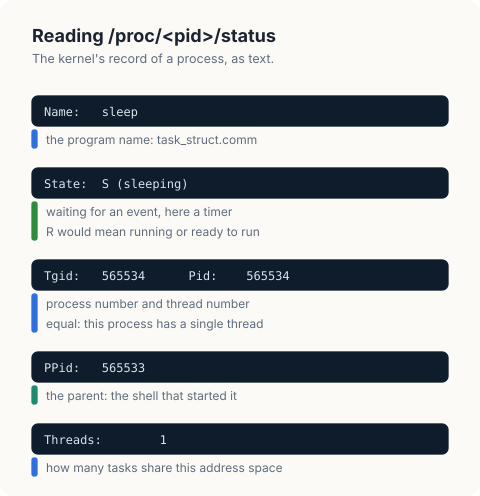
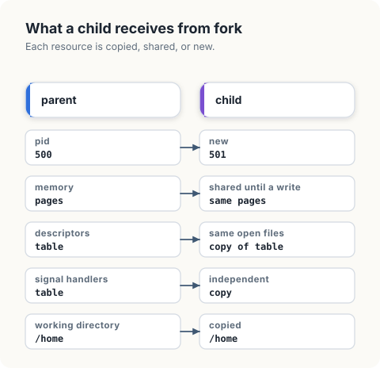
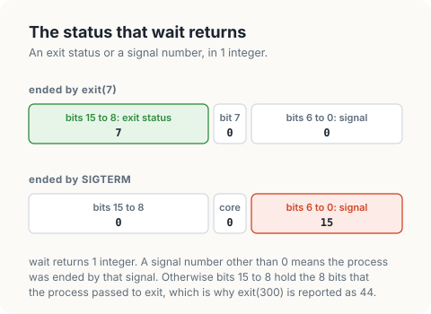
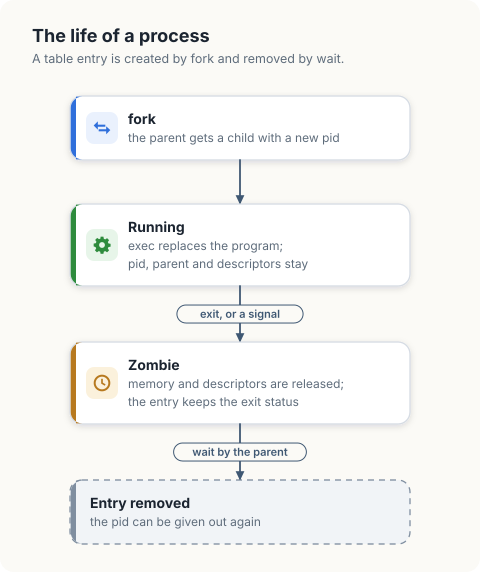
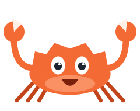
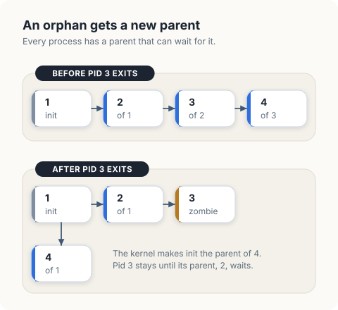

# Processes

A *process* is a program in execution, together with everything the kernel keeps for it:
its memory, its open files, its identity for permission checks, and its place in the
scheduler. The kernel represents each process by a record, `struct task_struct`, and
identifies it by a number, the *process ID* or *pid*.

In this chapter, we will follow a process through its whole life: how it is created,
how it comes to run a different program, how it ends, and how the process that created
it learns the result. We will read the kernel's record of a process field by field and
find the same information under `/proc`. Then we will write `procfacts`, which measures
each step on a running kernel, and `proctable`, a model of the kernel's process table.

<div class="covers">

This chapter covers

- what happens when a shell runs a command, step by step
- `struct task_struct`: the kernel's record of a process
- process states, and how to read them from `/proc`
- `fork`: what the child copies, what it shares, and what is new
- `exec`: what is replaced and what survives
- `exit` and `wait`, and the integer that carries the result
- zombies, orphans, and the process that adopts them
- how the kernel chooses a pid
- threads, and the difference between a process and a task

</div>

## A shell runs a command

When we type `ls` in a shell, 4 system calls do the work, 2 in the shell and 2 in a new
process.

1. The shell calls `fork`. The kernel creates a second process that is a copy of the
   shell: the same program, the same memory contents, the same open files. The new
   process is the *child*, and the shell is its *parent*. `fork` returns in both
   processes. In the parent it returns the pid of the child, and in the child it returns
   0, which is how each of them knows which one it is.
2. The child calls `exec` with the path of the `ls` program. The kernel discards the
   memory of the child, loads `ls` in its place, and starts it. The pid does not change.
   It is the same process running a different program.
3. `ls` does its work and calls `exit` with a status, 0 for success.
4. Meanwhile the parent has called `wait`, which puts it to sleep until a child ends.
   `wait` now returns the pid of the child and its status, and the shell prints the next
   prompt.

<figure>

<figcaption><b>Figure 3.1</b> The 4 calls behind a command: <code>fork</code> and <code>wait</code> in the parent, <code>exec</code> and <code>exit</code> in the child.</figcaption>
</figure>

Creating a process and loading a program are separate calls, and that is deliberate.
Between `fork` and `exec` the child is still running the shell's code, with the shell's
descriptors. The shell uses that interval to prepare the environment of the new program:
it redirects descriptors with `dup2`, changes the working directory, or adjusts signal
handling. Then it calls `exec`. The new program starts in the prepared environment and
contains no code for the preparation. The redirections of
[chapter 2](02-file-descriptors.md) are performed in this interval, and
[chapter 4](04-building-a-shell.md) builds a shell that does it.

## The kernel's record of a process

Every process has a `struct task_struct`. It is one of the largest structures in the
kernel, about 700 lines in `include/linux/sched.h`. These are the fields that this
chapter and the following chapters use, as they appear in Linux 5.15.

```c
struct task_struct {
        unsigned int __state;                  /* running, sleeping, stopped, ... */
        struct sched_entity se;                /* scheduling data, chapter 6 */
        struct mm_struct *mm;                  /* the address space, chapter 7 */
        int exit_state;                        /* EXIT_ZOMBIE after exit */
        int exit_code;                         /* the status for the parent */
        pid_t pid;                             /* the number of this task */
        pid_t tgid;                            /* the number of its process */
        struct task_struct *real_parent;       /* the process that created it */
        struct list_head children;             /* its children */
        struct list_head sibling;              /* its place in the parent's list */
        const struct cred *cred;               /* user and group, capabilities */
        char comm[TASK_COMM_LEN];              /* the name of the program */
        struct files_struct *files;            /* the descriptor table, chapter 2 */
        struct nsproxy *nsproxy;               /* its namespaces, chapter 11 */
        struct signal_struct *signal;          /* signal state, chapter 5 */
        struct sighand_struct *sighand;        /* signal handlers, chapter 5 */
        struct css_set *cgroups;               /* its control groups, chapter 12 */
        /* ... */
};
```

| Field | Meaning |
|---|---|
| `pid` | The number by which system calls and `/proc` name the task. |
| `real_parent` | The process that is told when this one ends and that collects its status. |
| `children`, `sibling` | The children of a process form a linked list. `children` is the head of the list in the parent, and `sibling` links a child into it. |
| `__state` | Whether the task is runnable, sleeping or stopped. |
| `exit_state`, `exit_code` | Set when the task ends, and kept until the parent has read them. |
| `comm` | The name of the program, at most 15 characters. `ps` and `/proc/<pid>/comm` show it. |
| `cred` | The user and group the process runs as. The kernel checks these when the process opens a file or sends a signal. |
| `mm`, `files`, `signal`, `nsproxy`, `cgroups` | Pointers to the other resources of the process. Each is the subject of a later chapter. |

<figure>

<figcaption><b>Figure 3.2</b> A process is a <code>struct task_struct</code> and the structures it points to.</figcaption>
</figure>

The resources are separate structures reached through pointers, and this is what makes
`fork` and threads possible with the same code. A new task can receive a copy of a
resource or a pointer to the same one, resource by resource.

### Reading the record from /proc

The kernel publishes the record of every process as text files in `/proc/<pid>`. This is
a `sleep` started from a shell with pid 565533:

```console
$ ps -o pid,ppid,stat,comm
    PID    PPID STAT COMMAND
 565533  565532 S    sh
 565534  565533 S    sleep
$ grep -E 'Name|State|Tgid|Pid|PPid|Threads' /proc/565534/status
Name:	sleep
State:	S (sleeping)
Tgid:	565534
Pid:	565534
PPid:	565533
Threads:	1
```

<figure>

<figcaption><b>Figure 3.3</b> The status file of the <code>sleep</code> process, line by line.</figcaption>
</figure>

`Name` is `comm`, `Pid` and `Tgid` are `pid` and `tgid`, and `PPid` is the pid of
`real_parent`. `State` is a letter derived from `__state` and `exit_state`.

| Letter | State | Meaning |
|---|---|---|
| `R` | running | The task is on a CPU or waiting in the run queue for one. |
| `S` | sleeping | The task waits for an event, such as input or a timer, and a signal can wake it. |
| `D` | uninterruptible sleep | The task waits for an event, usually disk I/O, and signals are held back until it arrives. |
| `T` | stopped | The task was stopped by a signal such as `SIGSTOP` and continues on `SIGCONT`. |
| `Z` | zombie | The task has ended, and its parent has not yet collected its status. |

Most processes on a system are in state `S` at any moment. A process in state `R` uses
CPU time, and [chapter 6](06-cpu-scheduling.md) describes how the kernel divides the
CPUs among them.

## fork

`fork` creates a new `struct task_struct` and decides, for each resource of the parent,
whether the child gets a copy.

| Resource | In the child |
|---|---|
| pid | new |
| parent | the process that called `fork` |
| memory | a copy, made lazily: the pages are shared until one side writes ([chapter 7](07-virtual-memory.md)) |
| descriptor table | a copy; the entries refer to the same open files ([chapter 2](02-file-descriptors.md)) |
| signal handlers | a copy |
| pending signals | none |
| working directory, user and group | the same |
| namespaces and control group | the same |

<figure>

<figcaption><b>Figure 3.4</b> The parent and the child directly after <code>fork</code>.</figcaption>
</figure>

A way to remember the table: the child starts as a photograph of the parent, taken at
the moment of the call. Everything that is true of the parent at that moment is true of
the child, with 2 differences that let them tell each other apart: the pid, and the
return value of `fork`. From then on they are separate processes, and a change in one is
invisible to the other, except through the open files they still share.

The copy of the memory is what makes `fork` look expensive and why it is cheap in
practice. The kernel copies the page table and leaves the pages themselves shared and
read-only. A page is copied only when one of the processes writes to it. A child that
calls `exec` immediately, the usual case, discards the address space before it has
written to more than a few pages.

On Linux, `fork` is a special case of a more general call, `clone`, which takes a flag
for each resource: with the flag, the child shares the parent's structure, and without
it the child gets a copy. `fork` is `clone` with no sharing flags.

## exec

`exec` keeps the `task_struct` and replaces what the process runs. The kernel reads the
header of the program file, which is in the ELF format on Linux, to learn which parts of
the file to map into memory and at which address execution starts. It builds a new
address space, places the arguments and the environment variables on a new stack, and
sets the processor to the entry point.

| Kept across `exec` | Replaced or reset |
|---|---|
| pid, parent, children | the address space: code, data, heap and stack |
| open descriptors without the close-on-exec flag | descriptors with the flag are closed |
| working directory, user and group | signal handlers return to the default action |
| ignored signals stay ignored | `comm` becomes the name of the new program |
| namespaces and control group | |

The table explains why the preparation between `fork` and `exec` works. Everything the
shell arranges in that interval is in the left column.

## exit and wait

A process ends by calling `exit` with a status, or because a signal ends it. In both
cases the kernel releases its memory and closes its descriptors at once. The
`task_struct` remains, with `exit_state` set to `EXIT_ZOMBIE` and the result in
`exit_code`, because the parent has not yet asked for the result. A process in this
condition is a *zombie*. It uses no memory and no CPU. It occupies a `task_struct` and a
pid.

The parent collects the result with `wait` or `waitpid`, and the kernel then frees the
`task_struct`. This is called *reaping* the child. `wait` delivers both kinds of ending
in a single integer.

<figure>

<figcaption><b>Figure 3.5</b> The layout of the status that <code>wait</code> returns.</figcaption>
</figure>

The exit status has 8 bits. A program that calls `exit(300)` is reported with status
44, the low 8 bits of 300. A shell folds the integer into its own `$?`: the exit status
itself, or `128 + n` for a process ended by signal `n`, so a process ended by `SIGTERM`,
signal 15, appears as 143.

A parent that does not call `wait` leaves a zombie for each child that ends. The zombies
disappear when the parent itself ends, for the reason given next.

<div class="crab crab-shocked">

A zombie cannot be ended with `kill`. It has already ended, and only its parent can remove it, by calling `wait`.

</div>

### Orphans

A zombie can be reaped only by its parent, so every process needs a living parent. When
a process ends before its children, the children are *orphans*, and the kernel gives
them a new parent at once. The new parent is process 1, the first process of the system,
unless a closer ancestor has asked for the role: a process can declare itself a
*subreaper* with `prctl(PR_SET_CHILD_SUBREAPER)`, and it then adopts the orphans among
its descendants. Process 1 and every subreaper call `wait` in a loop for exactly this
purpose.

<figure>

<figcaption><b>Figure 3.6</b> The <code>task_struct</code> of a process, from <code>fork</code> to <code>wait</code>.</figcaption>
</figure>

## Processes and threads

`task_struct` has 2 numbers, `pid` and `tgid`, because the kernel schedules *tasks*, and
a process can consist of several. A *thread* is a task that shares the address space,
the descriptor table and the signal handlers of another task. It is created by `clone`
with the sharing flags set, where `fork` sets none.

All threads of a process have the same `tgid`, the *thread group ID*, and each has its
own `pid`. The number that `getpid` returns, and that we call the pid of a process, is
the `tgid`. The number of each thread is visible under `/proc/<pid>/task`, and the
`Threads` line of `/proc/<pid>/status` counts them. The `sleep` above has 1. A Go
program always has several, because the Go runtime starts threads of its own to run
goroutines.

## Measuring processes

`procfacts` starts child processes with the standard libraries, `os/exec` in Go and
`std::process` in Rust. Both perform the creation of the child and the `exec` in a
single call, since a program with several threads cannot safely run arbitrary code
between `fork` and `exec`. The Rust version uses the `nix` crate with the `signal`
feature to send a signal.

```console
$ cargo new procfacts
$ cargo add -p procfacts nix --features signal
```

`field` reads a field of `/proc/<pid>/stat`, a single line with the same information as
`status` in a fixed order. Field 3 is the state letter and field 4 is the parent's pid.

<p class="listing"><b>Listing 3.1</b> The imports of <code>procfacts</code>, in Go. <a href="https://github.com/arpanpathak/cracking-the-systems-programming-interview/blob/prep-v2/democratizing-linux/code/go/procfacts/main.go">code/go/procfacts/main.go</a></p>

```go
{{#include ../code/go/procfacts/main.go:imports}}
```

<p class="listing"><b>Listing 3.2</b> The imports of <code>procfacts</code>, in Rust. <a href="https://github.com/arpanpathak/cracking-the-systems-programming-interview/blob/prep-v2/democratizing-linux/code/rust/procfacts/src/main.rs">code/rust/procfacts/src/main.rs</a></p>

```rust
{{#include ../code/rust/procfacts/src/main.rs:imports}}
```

<p class="listing"><b>Listing 3.3</b> Reading a field of a process's record, in Go. <a href="https://github.com/arpanpathak/cracking-the-systems-programming-interview/blob/prep-v2/democratizing-linux/code/go/procfacts/main.go">code/go/procfacts/main.go</a></p>

```go
{{#include ../code/go/procfacts/main.go:proc}}
```

<p class="listing"><b>Listing 3.4</b> Reading a field of a process's record, in Rust. <a href="https://github.com/arpanpathak/cracking-the-systems-programming-interview/blob/prep-v2/democratizing-linux/code/rust/procfacts/src/main.rs">code/rust/procfacts/src/main.rs</a></p>

```rust
{{#include ../code/rust/procfacts/src/main.rs:proc}}
```


`parent` runs a shell that prints `$PPID`, the pid of its parent, and compares it with
the pid of the program.

<p class="listing"><b>Listing 3.5</b> The parent of a child, in Go. <a href="https://github.com/arpanpathak/cracking-the-systems-programming-interview/blob/prep-v2/democratizing-linux/code/go/procfacts/main.go">code/go/procfacts/main.go</a></p>

```go
{{#include ../code/go/procfacts/main.go:parent}}
```

<p class="listing"><b>Listing 3.6</b> The parent of a child, in Rust. <a href="https://github.com/arpanpathak/cracking-the-systems-programming-interview/blob/prep-v2/democratizing-linux/code/rust/procfacts/src/main.rs">code/rust/procfacts/src/main.rs</a></p>

```rust
{{#include ../code/rust/procfacts/src/main.rs:parent}}
```


`status` runs a script and reports how it ended. The program calls it with `exit 7`,
with `exit 300`, and with a script that sends itself `SIGTERM`.

<p class="listing"><b>Listing 3.7</b> Exit status and signal, in Go. <a href="https://github.com/arpanpathak/cracking-the-systems-programming-interview/blob/prep-v2/democratizing-linux/code/go/procfacts/main.go">code/go/procfacts/main.go</a></p>

```go
{{#include ../code/go/procfacts/main.go:status}}
```

<p class="listing"><b>Listing 3.8</b> Exit status and signal, in Rust. <a href="https://github.com/arpanpathak/cracking-the-systems-programming-interview/blob/prep-v2/democratizing-linux/code/rust/procfacts/src/main.rs">code/rust/procfacts/src/main.rs</a></p>

```rust
{{#include ../code/rust/procfacts/src/main.rs:status}}
```


`execKeepsPid` runs a shell that prints its pid, replaces itself with another shell by
`exec`, and prints the pid again.

<p class="listing"><b>Listing 3.9</b> The pid before and after exec, in Go. <a href="https://github.com/arpanpathak/cracking-the-systems-programming-interview/blob/prep-v2/democratizing-linux/code/go/procfacts/main.go">code/go/procfacts/main.go</a></p>

```go
{{#include ../code/go/procfacts/main.go:exec}}
```

<p class="listing"><b>Listing 3.10</b> The pid before and after exec, in Rust. <a href="https://github.com/arpanpathak/cracking-the-systems-programming-interview/blob/prep-v2/democratizing-linux/code/rust/procfacts/src/main.rs">code/rust/procfacts/src/main.rs</a></p>

```rust
{{#include ../code/rust/procfacts/src/main.rs:exec}}
```


`zombie` starts `true`, which exits immediately, and polls the state field until the
child has ended. Then it waits for the child and checks whether the `/proc` entry still
exists.

<p class="listing"><b>Listing 3.11</b> A child between exit and wait, in Go. <a href="https://github.com/arpanpathak/cracking-the-systems-programming-interview/blob/prep-v2/democratizing-linux/code/go/procfacts/main.go">code/go/procfacts/main.go</a></p>

```go
{{#include ../code/go/procfacts/main.go:zombie}}
```

<p class="listing"><b>Listing 3.12</b> A child between exit and wait, in Rust. <a href="https://github.com/arpanpathak/cracking-the-systems-programming-interview/blob/prep-v2/democratizing-linux/code/rust/procfacts/src/main.rs">code/rust/procfacts/src/main.rs</a></p>

```rust
{{#include ../code/rust/procfacts/src/main.rs:zombie}}
```


`orphan` runs a shell that starts `sleep 30` in the background, prints the pid of the
sleep, and exits. The sleep is then an orphan. The program reads the pid of its new
parent and the name of that process.

<p class="listing"><b>Listing 3.13</b> The new parent of an orphan, in Go. <a href="https://github.com/arpanpathak/cracking-the-systems-programming-interview/blob/prep-v2/democratizing-linux/code/go/procfacts/main.go">code/go/procfacts/main.go</a></p>

```go
{{#include ../code/go/procfacts/main.go:orphan}}
```

<p class="listing"><b>Listing 3.14</b> The new parent of an orphan, in Rust. <a href="https://github.com/arpanpathak/cracking-the-systems-programming-interview/blob/prep-v2/democratizing-linux/code/rust/procfacts/src/main.rs">code/rust/procfacts/src/main.rs</a></p>

```rust
{{#include ../code/rust/procfacts/src/main.rs:orphan}}
```


```text
{{#include ../code/output/procfacts.txt}}
```

| Output | Conclusion |
|---|---|
| the child's parent is this process | `real_parent` of a child is the process that created it. |
| `exit 7`: status 7 | The status passed to `exit` reaches the parent. |
| `exit 300`: status 44 | Only the low 8 bits are kept: 300 - 256 = 44. |
| `kill -TERM $$`: signal 15 | A process ended by a signal has no exit status. The parent receives the signal number. |
| the pid is equal before and after `exec` | `exec` replaces the program inside the same `task_struct`. |
| state `Z` before `wait`, no entry after | A process that has ended is a zombie until its parent reaps it. |
| the orphan is adopted by `systemd` | The kernel gave the orphan a new parent. |

The process named `systemd` in the last line is the service manager of the user's
session, which has registered as a subreaper. On a system without one, the line would
name process 1.

## Modelling the process table

`proctable` is a model of the part of the kernel that this chapter describes: the table
of processes, the allocation of pids, the zombie state, and the adoption of orphans.

<div class="lld">

Low-level design: `proctable`

| Type | Kernel structure | Fields | Invariant |
|---|---|---|---|
| `process` | `struct task_struct` | `parent`, `state`, `status` | `state` is running or zombie; `status` is meaningful for a zombie |
| `table` | the kernel's table of pids | `procs`, `last`, `pidMax` | every `parent` except that of process 1 is a pid in `procs` |

| Operation | Behaviour | Error |
|---|---|---|
| `allocate()` | returns the first free pid after `last`, wrapping at `pidMax` | `EAGAIN` when every pid is in use |
| `fork(parent)` | adds a running child of `parent` | `ESRCH` when `parent` does not exist |
| `exit(pid, status)` | marks `pid` a zombie, stores `status`, gives its children to process 1 | `ESRCH` |
| `wait(parent)` | removes a zombie child and returns its pid and status | `ECHILD` when `parent` has no children |

</div>

The table maps a pid to an entry. `last` remembers the pid allocated most recently.

<p class="listing"><b>Listing 3.15</b> The imports of <code>proctable</code>, in Go. <a href="https://github.com/arpanpathak/cracking-the-systems-programming-interview/blob/prep-v2/democratizing-linux/code/go/proctable/main.go">code/go/proctable/main.go</a></p>

```go
{{#include ../code/go/proctable/main.go:imports}}
```

<p class="listing"><b>Listing 3.16</b> The imports of <code>proctable</code>, in Rust. <a href="https://github.com/arpanpathak/cracking-the-systems-programming-interview/blob/prep-v2/democratizing-linux/code/rust/proctable/src/main.rs">code/rust/proctable/src/main.rs</a></p>

```rust
{{#include ../code/rust/proctable/src/main.rs:imports}}
```

<p class="listing"><b>Listing 3.17</b> The process table, in Go. <a href="https://github.com/arpanpathak/cracking-the-systems-programming-interview/blob/prep-v2/democratizing-linux/code/go/proctable/main.go">code/go/proctable/main.go</a></p>

```go
{{#include ../code/go/proctable/main.go:table}}
```

<p class="listing"><b>Listing 3.18</b> The process table, in Rust. <a href="https://github.com/arpanpathak/cracking-the-systems-programming-interview/blob/prep-v2/democratizing-linux/code/rust/proctable/src/main.rs">code/rust/proctable/src/main.rs</a></p>

```rust
{{#include ../code/rust/proctable/src/main.rs:table}}
```


`allocate` searches upward from `last` and wraps around at `pidMax`. A pid that has been
freed is therefore reused only after all higher numbers have been tried. The delay
protects programs that hold a pid: a process that stored the pid of another, to send it
a signal later, would otherwise reach an unrelated new process if the number were reused
quickly. `/proc/sys/kernel/pid_max` sets the limit, 4194304 on this machine.

<p class="listing"><b>Listing 3.19</b> Allocating a pid and creating a child, in Go. <a href="https://github.com/arpanpathak/cracking-the-systems-programming-interview/blob/prep-v2/democratizing-linux/code/go/proctable/main.go">code/go/proctable/main.go</a></p>

```go
{{#include ../code/go/proctable/main.go:fork}}
```

<p class="listing"><b>Listing 3.20</b> Allocating a pid and creating a child, in Rust. <a href="https://github.com/arpanpathak/cracking-the-systems-programming-interview/blob/prep-v2/democratizing-linux/code/rust/proctable/src/main.rs">code/rust/proctable/src/main.rs</a></p>

```rust
{{#include ../code/rust/proctable/src/main.rs:fork}}
```


`exit` keeps the entry and changes its state. It then gives every child of the ended
process to process 1.

<p class="listing"><b>Listing 3.21</b> Ending a process, in Go. <a href="https://github.com/arpanpathak/cracking-the-systems-programming-interview/blob/prep-v2/democratizing-linux/code/go/proctable/main.go">code/go/proctable/main.go</a></p>

```go
{{#include ../code/go/proctable/main.go:exit}}
```

<p class="listing"><b>Listing 3.22</b> Ending a process, in Rust. <a href="https://github.com/arpanpathak/cracking-the-systems-programming-interview/blob/prep-v2/democratizing-linux/code/rust/proctable/src/main.rs">code/rust/proctable/src/main.rs</a></p>

```rust
{{#include ../code/rust/proctable/src/main.rs:exit}}
```


`wait` has 3 outcomes. A zombie child exists, and it is removed and returned. Children
exist and none has ended, where the kernel would put the caller to sleep. Or the caller
has no children, which is the error `ECHILD`.

<p class="listing"><b>Listing 3.23</b> Collecting a child, in Go. <a href="https://github.com/arpanpathak/cracking-the-systems-programming-interview/blob/prep-v2/democratizing-linux/code/go/proctable/main.go">code/go/proctable/main.go</a></p>

```go
{{#include ../code/go/proctable/main.go:wait}}
```

<p class="listing"><b>Listing 3.24</b> Collecting a child, in Rust. <a href="https://github.com/arpanpathak/cracking-the-systems-programming-interview/blob/prep-v2/democratizing-linux/code/rust/proctable/src/main.rs">code/rust/proctable/src/main.rs</a></p>

```rust
{{#include ../code/rust/proctable/src/main.rs:wait}}
```


The program applies a sequence of calls to a table with `pidMax` set to 6 and prints the
table after each call. An entry is printed as `pid(parent)state`.

<p class="listing"><b>Listing 3.25</b> The trace, in Go. <a href="https://github.com/arpanpathak/cracking-the-systems-programming-interview/blob/prep-v2/democratizing-linux/code/go/proctable/main.go">code/go/proctable/main.go</a></p>

```go
{{#include ../code/go/proctable/main.go:trace}}
```

<p class="listing"><b>Listing 3.26</b> The trace, in Rust. <a href="https://github.com/arpanpathak/cracking-the-systems-programming-interview/blob/prep-v2/democratizing-linux/code/rust/proctable/src/main.rs">code/rust/proctable/src/main.rs</a></p>

```rust
{{#include ../code/rust/proctable/src/main.rs:trace}}
```


```text
{{#include ../code/output/proctable.txt}}
```

| Line | What it shows |
|---|---|
| `wait by 2: would block` | Process 2 has a child, 3, which is still running. |
| `exit of 3` | Entry 3 becomes `Z` and stays. Its child 4 now has parent 1. |
| `wait by 2: pid 3` | The zombie is removed and its status is returned. |
| `fork by 2: pid 5` | Pid 3 is free, and the search continues upward from `last`, which is 4. |
| `wait by 1: pid 4, status 7` | Process 1 reaps the orphan it adopted. |
| `fork by 2: pid 3` | After pid 6 the search wraps around. Pid 2 is in use, and 3 is the first free number. |

<figure>

<figcaption><b>Figure 3.7</b> The table before and after the line <code>exit of 3</code>.</figcaption>
</figure>

<div class="callout">

**Correspondence with the kernel source.** `kernel/fork.c` contains `copy_process`,
which builds the new `task_struct` and calls a `copy_` function for each resource
(`copy_mm`, `copy_files`, `copy_sighand`, and others), each of which copies or shares
according to the `clone` flags. `alloc_pid` in `kernel/pid.c` allocates numbers with
`idr_alloc_cyclic`, the cyclic search that `allocate` models. `do_exit` in
`kernel/exit.c` sets `EXIT_ZOMBIE` and calls `forget_original_parent`, which chooses the
new parent of each child with `find_new_reaper`. The kernel keeps a list of children in
each task, where `proctable` scans the whole table.

</div>

## Inspecting processes on a live system

| Command | Shows |
|---|---|
| `ps -o pid,ppid,stat,comm` | pid, parent, state and name of the processes of the terminal |
| `ps -ef --forest` or `pstree -p` | every process, drawn as a tree of parents and children |
| `cat /proc/<pid>/status` | the record of a process: state, parent, threads, memory, user |
| `ls /proc/<pid>/task` | the threads of a process |
| `cat /proc/sys/kernel/pid_max` | the largest pid |
| `ps -eo stat,pid,ppid,comm \| grep '^Z'` | the zombies of the system, with the parent that has not reaped them |

A zombie cannot be removed with `kill`, since it has already ended. The last command
gives the pid of the parent, and the remedy is there: the parent has to call `wait`, or
end.

## The complete programs

<p class="listing"><b>Listing 3.27</b> The complete <code>procfacts</code>, in Go. <a href="https://github.com/arpanpathak/cracking-the-systems-programming-interview/blob/prep-v2/democratizing-linux/code/go/procfacts/main.go">code/go/procfacts/main.go</a></p>

```go
{{#include ../code/go/procfacts/main.go}}
```

<p class="listing"><b>Listing 3.28</b> The complete <code>procfacts</code>, in Rust. <a href="https://github.com/arpanpathak/cracking-the-systems-programming-interview/blob/prep-v2/democratizing-linux/code/rust/procfacts/src/main.rs">code/rust/procfacts/src/main.rs</a></p>

```rust
{{#include ../code/rust/procfacts/src/main.rs}}
```


<p class="listing"><b>Listing 3.29</b> The complete <code>proctable</code>, in Go. <a href="https://github.com/arpanpathak/cracking-the-systems-programming-interview/blob/prep-v2/democratizing-linux/code/go/proctable/main.go">code/go/proctable/main.go</a></p>

```go
{{#include ../code/go/proctable/main.go}}
```

<p class="listing"><b>Listing 3.30</b> The complete <code>proctable</code>, in Rust. <a href="https://github.com/arpanpathak/cracking-the-systems-programming-interview/blob/prep-v2/democratizing-linux/code/rust/proctable/src/main.rs">code/rust/proctable/src/main.rs</a></p>

```rust
{{#include ../code/rust/proctable/src/main.rs}}
```


<div class="summary">

## Summary

- A process is a `struct task_struct` and the resources it points to: an address space,
  a descriptor table, signal state, namespaces and control groups.
- `fork` creates a child with a new pid and copies of the parent's resources. Memory is
  copied lazily. `exec` replaces the program and keeps the `task_struct`.
- The code that runs between `fork` and `exec` prepares the environment of the new
  program.
- A process ends with an 8-bit exit status or by a signal, and `wait` reports which in a
  single integer.
- A process that has ended is a zombie until its parent reaps it with `wait`.
- An orphan is adopted by the nearest subreaper among its ancestors, or by process 1.
- Pids are allocated in a cycle, so a freed pid is reused as late as possible.
- A thread is a task that shares the resources of another. The pid of a process is the
  thread group ID of its tasks.

</div>

## References

- `fork(2)`, `clone(2)`, `execve(2)`, `wait(2)`, `prctl(2)` and `proc(5)`, Linux manual
  pages: <https://man7.org/linux/man-pages/man2/fork.2.html>
- M. Kerrisk, *The Linux Programming Interface*, No Starch Press, 2010, chapters 6 and
  24 to 28.
- `include/linux/sched.h`, `kernel/fork.c`, `kernel/exit.c` and `kernel/pid.c`, Linux
  5.15: <https://elixir.bootlin.com/linux/v5.15/source/kernel/fork.c>
