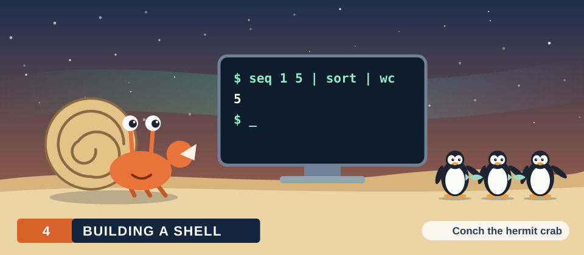
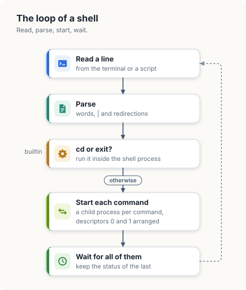
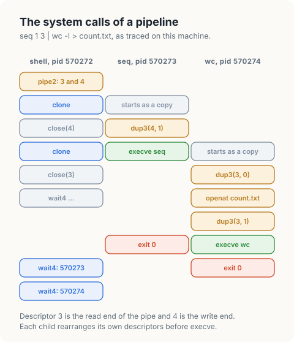
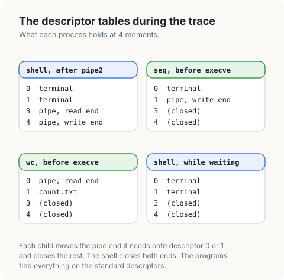
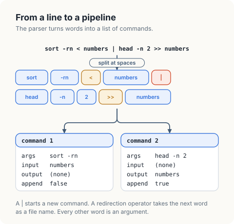
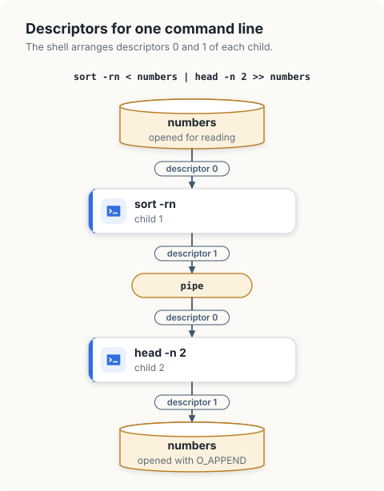

# Building a Shell

A shell is a user program that reads command lines and converts each into the system
calls of the previous chapters: `pipe`, `fork`, `dup2`, `exec` and `wait`. It has no
special privileges and no private interface to the kernel. Everything a shell does, any
program can do.

In this chapter, we will write `msh`, a shell that runs pipelines with input and output
redirection and has the built-in commands `cd` and `exit`. We will first watch a real
shell at work, by tracing the system calls it makes for a single line. Then we will
build `msh` in stages: the parser, the redirections, the launch of a pipeline, the
collection of statuses, and the built-in commands.

<div class="covers">

This chapter covers

- the loop of a shell: read, parse, start, wait
- a system call trace of a shell running a pipeline
- how a shell finds a program: the `PATH` variable
- the environment, and how it reaches a new program
- the system calls behind `|`, `<`, `>` and `>>`
- why the shell closes its own copies of every descriptor it hands to a child
- the status a shell reports for a pipeline, a signal, and a missing command
- why `cd` and `exit` cannot be separate programs
- what a full shell adds: expansion, quoting, and job control

</div>

## The loop of a shell

A shell repeats 4 steps. It reads a line. It parses the line into commands. It starts a
process for each command, with the descriptors of each process arranged as the line
asks. It waits for the processes to end and remembers the status of the last one. A few
commands, the *built-in* commands, are carried out by the shell itself in place of the
third step.

<figure>

<figcaption><b>Figure 4.1</b> The loop of a shell.</figcaption>
</figure>

Each element of a command line corresponds to a small number of system calls.

| Syntax | What the shell does |
|---|---|
| `cmd args` | starts a child process that executes `cmd`, then waits for it |
| `a \| b` | creates a pipe; starts `a` with descriptor 1 on the write end and `b` with descriptor 0 on the read end |
| `cmd < file` | opens `file` for reading and makes it descriptor 0 of the child |
| `cmd > file` | opens `file` with `O_CREAT` and `O_TRUNC` and makes it descriptor 1 of the child |
| `cmd >> file` | the same with `O_APPEND` in place of `O_TRUNC` |
| `cd dir` | calls `chdir` in the shell process |
| `exit n` | ends the shell process with status `n` |

## A real shell, traced

`strace` prints the system calls of a process as it makes them. With `-f` it follows the
children as well. This is the system shell, `sh`, running the line
`seq 1 3 | wc -l > count.txt` on our machine. The first column is the pid of the caller.
The calls that load shared libraries are removed, and calls that were interleaved are
shown in order.

```console
$ strace -f -e trace=pipe2,clone,dup3,execve,wait4,close,openat sh -c 'seq 1 3 | wc -l > count.txt'
570272 pipe2([3, 4], 0)                                  = 0
570272 clone(... flags=...|SIGCHLD ...)                  = 570273
570272 close(4)                                          = 0
570273 close(3)                                          = 0
570273 dup3(4, 1, 0)                                     = 1
570273 close(4)                                          = 0
570273 execve("/usr/bin/seq", ["seq", "1", "3"], ...)    = 0
570272 clone(... flags=...|SIGCHLD ...)                  = 570274
570272 close(3)                                          = 0
570272 wait4(-1, ...
570274 dup3(3, 0, 0)                                     = 0
570274 close(3)                                          = 0
570274 openat(AT_FDCWD, "count.txt", O_WRONLY|O_CREAT|O_TRUNC, 0666) = 3
570274 close(1)                                          = 0
570274 dup3(3, 1, 0)                                     = 1
570274 close(3)                                          = 0
570274 execve("/usr/bin/wc", ["wc", "-l"], ...)          = 0
570273 +++ exited with 0 +++
570272 ... wait4 resumed                                 = 570273
570274 +++ exited with 0 +++
570272 wait4(-1, ...)                                    = 570274
```

Every line of the trace is something we have already met.

| Call | Meaning |
|---|---|
| `pipe2([3, 4], 0)` | The shell creates the pipe. Descriptor 3 is the read end and 4 the write end ([chapter 1](01-pipes.md)). |
| `clone(...)` | The shell creates a child. On Linux, `fork` is implemented by `clone` ([chapter 3](03-processes.md)). The return value is the pid of the child. |
| `570273 dup3(4, 1, 0)` | The first child makes descriptor 1 refer to the write end. `dup3` is `dup2` with a flags argument ([chapter 2](02-file-descriptors.md)). |
| `570273 close(3)`, `close(4)` | The child closes the pipe descriptors it does not need under their old numbers. |
| `570273 execve("/usr/bin/seq", ...)` | The child becomes `seq`. Its descriptor 1 is the pipe, and `seq` does not know it. |
| `570272 close(4)`, `close(3)` | The shell closes its own copies of both ends. |
| `570274 openat("count.txt", O_WRONLY\|O_CREAT\|O_TRUNC, 0666)` | The second child opens the output file. The file is truncated here, before `wc` runs. |
| `570272 wait4(-1, ...)` | The shell waits for any child, 2 times. |

<figure>
 count.txt, in 3 columns. The shell calls pipe2 and gets descriptors 3 and 4, then clone. The first child calls dup3(4, 1) and execve seq, while the shell closes 4 and calls clone again. The second child calls dup3(3, 0), opens count.txt, calls dup3(3, 1) and execve wc, while the shell closes 3 and calls wait4. Both children exit with 0, and wait4 returns their pids.">
<figcaption><b>Figure 4.2</b> The same trace, with a column for each process.</figcaption>
</figure>

A trace is easier to read one process at a time. Follow the lines that begin with
570273 and ignore the rest: it closes 3, makes 4 its descriptor 1, closes 4, and becomes
`seq`. The whole preparation is 3 calls. Figure 4.3 shows the result
as descriptor tables.

<figure>

<figcaption><b>Figure 4.3</b> The descriptor table of each process at 4 moments of the trace.</figcaption>
</figure>

The redirections are carried out in the children, between `clone` and `execve`. The
shell's own descriptors 0, 1 and 2 are untouched, so the next command line starts from
the same state.

## Finding the program, and the environment

The trace shows `execve("/usr/bin/seq", ...)`, although the line said `seq`. `execve`
takes a path, and the shell has to find one. It looks the name up in each directory
listed in the variable `PATH`, in order, and uses the first match. A name that contains
a `/` is used as it is.

```console
$ type seq cd
seq is /usr/bin/seq
cd is a shell builtin
```

`PATH` is an *environment variable*. The *environment* is a list of strings of the form
`NAME=value` that every process has. It is the third argument of `execve`: the trace
shows `/* 92 vars */` where `strace` abbreviated it. A program started without special
arrangement receives a copy of the environment of the process that started it, which is
how settings such as `PATH`, `HOME` and `LANG` reach every program in a session. The
environment lives in the memory of the process, so a change in a child is invisible to
the parent.

`msh` leaves the lookup to the standard library. Go's `exec.Command` and Rust's
`Command::new` search `PATH` when the name has no `/`, and both pass the environment of
`msh` on to the child.

## Setting up

`msh` uses only the standard libraries.

```console
$ cargo new msh
```

<div class="lld">

Low-level design: `msh`

| Type | Fields | Meaning |
|---|---|---|
| `command` | `args`, `input`, `output`, `appendOutput` | a stage of a pipeline and its redirections |
| `shell` | `last`, `exiting` | the status of the previous line; whether `exit` has run |

| Function | Behaviour |
|---|---|
| `parse(line)` | splits a line into commands; fails on an empty command or a missing file name |
| `redirect(command)` | opens the files named by `<`, `>` and `>>` |
| `launch(pipeline)` | starts every command with its descriptors; closes the shell's copies |
| `run(pipeline)` | launches, waits for every child, returns the status of the last |
| `execute(line)` | runs `cd` and `exit` in the shell; passes everything else to `run` |

</div>

## Parsing

A pipeline is a list of commands, and a command is a list of arguments with optional
file names for its input and output. `parse` reads the words of a line from left to
right. A `|` ends the current command, a redirection operator consumes the next word as
a file name, and every other word is an argument.

<figure>
> numbers is split at spaces into 10 words. The words form 2 commands. Command 1 has the arguments sort -rn, the input file numbers, and no output file. Command 2 has the arguments head -n 2, no input file, the output file numbers, and append set.">
<figcaption><b>Figure 4.4</b> A line, its words, and the commands that <code>parse</code> builds.</figcaption>
</figure>

`msh` requires spaces around operators and has no quoting, which keeps the parser to a
single loop.

<p class="listing"><b>Listing 4.1</b> The imports of <code>msh</code>, in Go. <a href="https://github.com/arpanpathak/cracking-the-systems-programming-interview/blob/prep-v2/democratizing-linux/code/go/msh/main.go">code/go/msh/main.go</a></p>

```go
{{#include ../code/go/msh/main.go:imports}}
```

<p class="listing"><b>Listing 4.2</b> The imports of <code>msh</code>, in Rust. <a href="https://github.com/arpanpathak/cracking-the-systems-programming-interview/blob/prep-v2/democratizing-linux/code/rust/msh/src/main.rs">code/rust/msh/src/main.rs</a></p>

```rust
{{#include ../code/rust/msh/src/main.rs:imports}}
```

<p class="listing"><b>Listing 4.3</b> Parsing a line into a pipeline, in Go. <a href="https://github.com/arpanpathak/cracking-the-systems-programming-interview/blob/prep-v2/democratizing-linux/code/go/msh/main.go">code/go/msh/main.go</a></p>

```go
{{#include ../code/go/msh/main.go:parse}}
```

<p class="listing"><b>Listing 4.4</b> Parsing a line into a pipeline, in Rust. <a href="https://github.com/arpanpathak/cracking-the-systems-programming-interview/blob/prep-v2/democratizing-linux/code/rust/msh/src/main.rs">code/rust/msh/src/main.rs</a></p>

```rust
{{#include ../code/rust/msh/src/main.rs:parse}}
```


## Redirections

`redirect` opens the files a command names. `>` truncates the file when it is opened,
which is before the command runs, as the trace showed. For this reason
`sort < numbers > numbers` empties the file before `sort` reads it. `>>` opens with
`O_APPEND` and keeps the contents.

<p class="listing"><b>Listing 4.5</b> Opening the files of a redirection, in Go. <a href="https://github.com/arpanpathak/cracking-the-systems-programming-interview/blob/prep-v2/democratizing-linux/code/go/msh/main.go">code/go/msh/main.go</a></p>

```go
{{#include ../code/go/msh/main.go:files}}
```

<p class="listing"><b>Listing 4.6</b> Opening the files of a redirection, in Rust. <a href="https://github.com/arpanpathak/cracking-the-systems-programming-interview/blob/prep-v2/democratizing-linux/code/rust/msh/src/main.rs">code/rust/msh/src/main.rs</a></p>

```rust
{{#include ../code/rust/msh/src/main.rs:files}}
```


## Launching a pipeline

`launch` walks the pipeline from left to right. For each command except the last it
creates a pipe, gives the write end to this command as descriptor 1, and carries the
read end to the next iteration, where it becomes descriptor 0 of the next command. A
redirection takes precedence over the pipe: when a command names a file for a
descriptor, the file replaces the pipe end on that descriptor.

<figure>
> numbers. Descriptor 0 of sort is the file numbers, opened for reading. Descriptor 1 of sort is the write end of a pipe. Descriptor 0 of head is the read end of that pipe. Descriptor 1 of head is the file numbers, opened with O_APPEND.">
<figcaption><b>Figure 4.5</b> The descriptors of both children for the line of figure 4.4.</figcaption>
</figure>

After a child has started, the shell closes every descriptor it opened for that child,
as `sh` did in the trace. The rule from [chapter 1](01-pipes.md) applies: a write end
that stays open in the shell keeps the write count of the pipe above 0, and the next
command waits for an end of the stream that is not reported.

The standard libraries perform the `clone`, the `dup3` calls and the `execve` in a
single call, `Start` in Go and `spawn` in Rust. We name the files for descriptors 0 and 1
of the child, and the library arranges them in the child.

<p class="listing"><b>Listing 4.7</b> Starting the commands of a pipeline, in Go. <a href="https://github.com/arpanpathak/cracking-the-systems-programming-interview/blob/prep-v2/democratizing-linux/code/go/msh/main.go">code/go/msh/main.go</a></p>

```go
{{#include ../code/go/msh/main.go:launch}}
```

<p class="listing"><b>Listing 4.8</b> Starting the commands of a pipeline, in Rust. <a href="https://github.com/arpanpathak/cracking-the-systems-programming-interview/blob/prep-v2/democratizing-linux/code/rust/msh/src/main.rs">code/rust/msh/src/main.rs</a></p>

```rust
{{#include ../code/rust/msh/src/main.rs:launch}}
```


## Collecting statuses

The shell waits for every child. A child that is not waited for remains a zombie, as
[chapter 3](03-processes.md) showed. The status of a pipeline is the status of its last
command. `status` applies the conventions of a shell.

| Ending of the last command | Status |
|---|---|
| it called `exit(n)` | `n` |
| it was ended by signal `n` | `128 + n` |
| it could not be started | 127 |

By convention 0 means success and any other value means failure, and the commands `if`
and `while` of a full shell test exactly this number.

<p class="listing"><b>Listing 4.9</b> Waiting for the pipeline, in Go. <a href="https://github.com/arpanpathak/cracking-the-systems-programming-interview/blob/prep-v2/democratizing-linux/code/go/msh/main.go">code/go/msh/main.go</a></p>

```go
{{#include ../code/go/msh/main.go:wait}}
```

<p class="listing"><b>Listing 4.10</b> Waiting for the pipeline, in Rust. <a href="https://github.com/arpanpathak/cracking-the-systems-programming-interview/blob/prep-v2/democratizing-linux/code/rust/msh/src/main.rs">code/rust/msh/src/main.rs</a></p>

```rust
{{#include ../code/rust/msh/src/main.rs:wait}}
```


## Built-in commands

The working directory is an attribute of a process, kept by the kernel, and a child
receives a copy of it. If `cd` were a separate program, it would change the directory of
its own process and exit, and the directory of the shell would be unchanged. The same
reasoning applies to `exit`. Both therefore run inside the shell process.

<p class="listing"><b>Listing 4.11</b> Running a line: built-in commands and pipelines, in Go. <a href="https://github.com/arpanpathak/cracking-the-systems-programming-interview/blob/prep-v2/democratizing-linux/code/go/msh/main.go">code/go/msh/main.go</a></p>

```go
{{#include ../code/go/msh/main.go:builtin}}
```

<p class="listing"><b>Listing 4.12</b> Running a line: built-in commands and pipelines, in Rust. <a href="https://github.com/arpanpathak/cracking-the-systems-programming-interview/blob/prep-v2/democratizing-linux/code/rust/msh/src/main.rs">code/rust/msh/src/main.rs</a></p>

```rust
{{#include ../code/rust/msh/src/main.rs:builtin}}
```


<div class="crab crab-happy">

`cd` works because it runs inside the shell. A separate `cd` program would change its own directory and exit.

</div>

## Running a script

Without arguments, `msh` runs a fixed script in a temporary directory and prints the
status after each line. With `-i`, it reads lines from standard input.

<p class="listing"><b>Listing 4.13</b> The script, and the interactive loop, in Go. <a href="https://github.com/arpanpathak/cracking-the-systems-programming-interview/blob/prep-v2/democratizing-linux/code/go/msh/main.go">code/go/msh/main.go</a></p>

```go
{{#include ../code/go/msh/main.go:script}}
```

<p class="listing"><b>Listing 4.14</b> The script, and the interactive loop, in Rust. <a href="https://github.com/arpanpathak/cracking-the-systems-programming-interview/blob/prep-v2/democratizing-linux/code/rust/msh/src/main.rs">code/rust/msh/src/main.rs</a></p>

```rust
{{#include ../code/rust/msh/src/main.rs:script}}
```


```text
{{#include ../code/output/msh.txt}}
```

| Line | What it shows |
|---|---|
| `seq 1 5 > numbers` | Descriptor 1 of `seq` is the file. Nothing is printed. |
| `wc -l < numbers` | Descriptor 0 of `wc` is the file. |
| `sort -rn < numbers \| head -n 2 >> numbers` | `sort` reads its whole input before writing, so the 2 lines that `head` appends are `5` and `4`. |
| `paste -sd, numbers` | The file now has 7 lines. |
| `false` | The status is the exit status of the command, 1. |
| `nosuchcommand` | The command could not be started. The status is 127. |
| `cd /` then `pwd` | The child `pwd` inherits the directory that the built-in `cd` set in the shell. |
| `exit 3` | The shell ends, and the last line of the script is not run. |

## What a full shell adds

`msh` passes each word of a line to the program unchanged. A shell such as `bash` or
`dash` processes the words first, and it is useful to know that these steps happen in
the shell, before any program starts.

| Feature | What the shell does before `exec` |
|---|---|
| variables | replaces `$HOME` with the value of the variable |
| wildcards | replaces `*.txt` with the list of matching file names; the program receives the names and does not see the `*` |
| command substitution | runs the command inside `$(...)` with its output on a pipe, and inserts what it reads |
| quoting | `'...'` and `"..."` keep spaces and operators from being treated as separators |
| `a && b`, `a \|\| b` | runs `b` depending on whether the status of `a` was 0 |
| `cmd &` | starts the command and does not wait for it |

The last row leads to *job control*. A shell places each pipeline in a *process group*,
a set of processes that can be signalled together, and tells the terminal which group is
in the foreground. When we press Ctrl-C, the terminal driver in the kernel sends
`SIGINT` to every process of the foreground group, and the shell itself, which is in a
different group, is unaffected. Signals are the subject of
[chapter 5](05-signals.md).

## Inspecting a shell at work

| Command | Shows |
|---|---|
| `strace -f -e trace=process,pipe2,dup3 sh -c '...'` | the system calls of a shell and its children for a line |
| `type name` | whether a name is a built-in command or a program, and which file |
| `echo $?` | the status of the previous command |
| `set -x` | each command, after expansion, as the shell runs it |
| `echo $PATH` | the directories searched for programs |

## The complete program

<p class="listing"><b>Listing 4.15</b> The complete <code>msh</code>, in Go. <a href="https://github.com/arpanpathak/cracking-the-systems-programming-interview/blob/prep-v2/democratizing-linux/code/go/msh/main.go">code/go/msh/main.go</a></p>

```go
{{#include ../code/go/msh/main.go}}
```

<p class="listing"><b>Listing 4.16</b> The complete <code>msh</code>, in Rust. <a href="https://github.com/arpanpathak/cracking-the-systems-programming-interview/blob/prep-v2/democratizing-linux/code/rust/msh/src/main.rs">code/rust/msh/src/main.rs</a></p>

```rust
{{#include ../code/rust/msh/src/main.rs}}
```


<div class="summary">

## Summary

- A shell is an ordinary program built on `pipe`, `fork`, `dup2`, `exec` and `wait`.
- `|` becomes a pipe between descriptor 1 of one child and descriptor 0 of the next.
  `<`, `>` and `>>` become an `open` whose result replaces descriptor 0 or 1.
- Redirections are performed in the child, between its creation and `exec`. The shell's
  own descriptors do not change.
- `>` truncates its file before the command starts.
- The shell finds a program by searching the directories of `PATH`, and the environment
  is passed to the program by `exec`.
- The shell closes its own copies of pipe ends and redirected files after starting each
  child, and waits for every child.
- The status of a pipeline is the status of its last command; a signal is reported as
  `128 + n`, and a command that cannot be started as 127.
- `cd` and `exit` act on the shell process and are built in for that reason.
- Variables, wildcards and quoting are processed by the shell before a program starts.

</div>

## References

- *The Open Group Base Specifications, Shell Command Language*:
  <https://pubs.opengroup.org/onlinepubs/9699919799/utilities/V3_chap02.html>
- `execve(2)`, `environ(7)`, `chdir(2)` and `strace(1)`, Linux manual pages:
  <https://man7.org/linux/man-pages/man2/execve.2.html>
- M. Kerrisk, *The Linux Programming Interface*, No Starch Press, 2010, chapters 6, 27,
  34 and 44.
