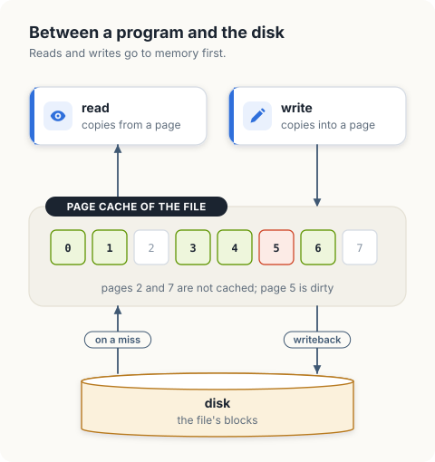
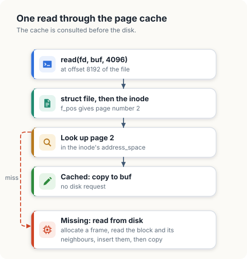
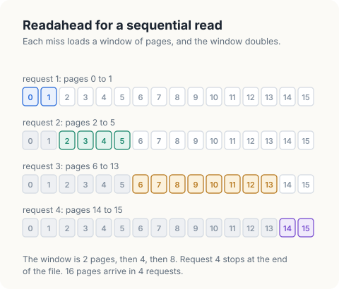
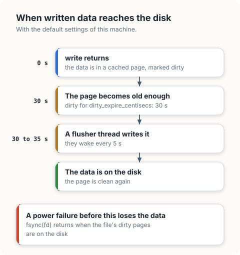
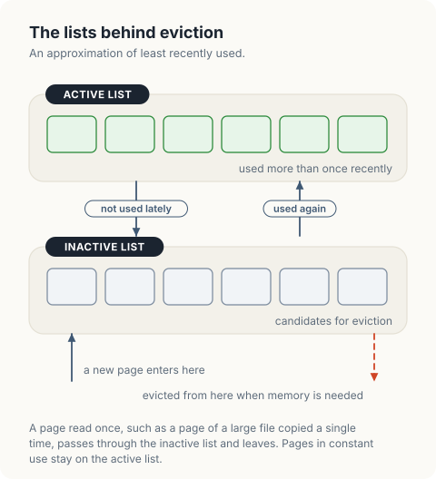

# The Page Cache

The page cache is the kernel's in-memory copy of file contents. It holds frames of file
data, indexed by file and by page number within the file. `read` copies from these
frames and `write` copies into them. The disk is involved only when a page is missing
from the cache, or when a changed page is written back.

In this chapter, we will learn when file data moves between the cache and the disk. We
will first measure with `cachefacts` how many pages of a file are cached after writes
and reads of different kinds. Then we will write `pagecache`, a model with readahead,
dirty pages and eviction, and compare its behaviour with the measurements.

<div class="covers">

This chapter covers

- why reads and writes go through memory
- one `read`, step by step, with the page cached and with it missing
- the kernel structure of the cache: `struct address_space`
- how much of a machine's memory is page cache, and why that memory still counts as available
- readahead: how a read of 1 byte brings several pages into the cache
- dirty pages, writeback and `fsync`
- eviction of the page used least recently
- `posix_fadvise`: telling the kernel how a file will be used
- the settings that control writeback, and how to observe the cache on a running system

</div>

## Why a cache

A disk request takes far longer than a copy in memory: roughly 100 microseconds for a
fast solid-state drive against well under 1 microsecond for a page that is already in
memory. The kernel therefore keeps file pages in frames that no process currently needs
and serves file operations from them.

| Operation | With the page cached | With the page missing |
|---|---|---|
| `read` | copies from the cached page | reads the page from the disk into the cache, then copies |
| `write` | copies into the cached page and marks it *dirty* | creates the page in the cache, copies, and marks it dirty |

A dirty page is newer than the disk. The kernel writes dirty pages to the disk in the
background, a process called *writeback*, typically within 30 seconds. `write` therefore
returns before the data is on the disk, and data written shortly before a power failure
can be lost. A program that needs the data to be durable calls `fsync`, which returns
when the file's dirty pages have reached the disk.

<figure>

<figcaption><b>Figure 8.1</b> File operations use cached pages. The disk is read on a miss and written by writeback.</figcaption>
</figure>

The cache uses memory that is otherwise free, and gives it up when processes need it.
A clean page can be discarded at any time, because the disk has the same contents. A
dirty page has to be written first.

## One read, step by step

A process calls `read(fd, buf, 4096)` on a file whose offset is 8192.

1. The kernel finds the `struct file` for the descriptor and, through it, the inode of
   the file ([chapter 2](02-file-descriptors.md)).
2. It divides the offset by the page size. Offset 8192 is the start of page number 2 of
   the file.
3. It looks page 2 up in the cache of this file. Each inode has its own index of cached
   pages.
4. If the page is there, the kernel copies 4096 bytes from it to `buf`, advances the
   offset, and returns. No request reaches the disk.
5. If the page is missing, the kernel allocates a frame, asks the file system to read
   the block from the disk into it, and inserts the frame in the index. The process
   sleeps until the disk has answered. Then step 4 follows.

<figure>

<figcaption><b>Figure 8.2</b> A <code>read</code> with the page cached, and with the page missing.</figcaption>
</figure>

A read that finds its page is a *cache hit*, and one that has to go to the disk is a
*cache miss*. The page fault of [chapter 7](07-virtual-memory.md) that reads a page of a
mapped file takes the same path from step 3 on, and the frame it maps is the frame in
the cache. `read` and `mmap` therefore see the same copy of a file.

## The kernel's structure

The index of cached pages of a file is a `struct address_space`, embedded in the inode
and reached through `inode->i_mapping`. This is the definition in `include/linux/fs.h`
of Linux 5.15, reduced to the fields we use.

```c
struct address_space {
        struct inode *host;                    /* the file these pages belong to */
        struct xarray i_pages;                 /* page number -> struct page */
        unsigned long nrpages;                 /* number of cached pages */
        pgoff_t writeback_index;               /* where writeback continues */
        const struct address_space_operations *a_ops;  /* read and write a page */
        /* ... */
};
```

| Field | Meaning |
|---|---|
| `i_pages` | An *XArray*: a tree that maps a page number to the `struct page` of the frame that caches it. A lookup for a page that is not cached finds nothing. |
| `nrpages` | How many pages of this file are cached. The `fincore` command used below reports this count, page by page. |
| `a_ops` | Functions supplied by the file system, such as ext4: `readpage` fills a frame from the disk, and `writepages` writes dirty frames back. The cache itself knows nothing about disk formats. |
| `host` | The inode. |

Each cached frame is a `struct page` ([chapter 7](07-virtual-memory.md)) whose `mapping`
field points back to this `address_space` and whose `index` is its page number. Bits in
its `flags` record its state: `PG_uptodate` when its contents are valid, `PG_dirty` when
it has been written and the disk has not, and `PG_writeback` while it is being written
to the disk.

### How much memory is cache

The page cache uses whatever memory nothing else needs. On our machine, with 16 GB of
memory:

```console
$ free -m
               total        used        free      shared  buff/cache   available
Mem:           15655        8881         300         294        6473        6197
$ grep -E 'Cached|Dirty|Writeback:' /proc/meminfo
Cached:          5760296 kB
Dirty:              2488 kB
Writeback:             0 kB
```

<figure>

<figcaption><b>Figure 8.3</b> The memory of the machine, divided as <code>free -m</code> reports it.</figcaption>
</figure>

Only 300 MB is `free`, and that is the normal state of a healthy system. 6473 MB is
`buff/cache`, mostly page cache, and the kernel can take it back at any moment, which is
why the `available` column, 6197 MB, is the number that says how much memory a new
program could get. `Dirty` is the part of the cache that has not been written to disk
yet, 2.5 MB at that moment.

## Measuring the cache

`cachefacts` counts the cached pages of a file with the `fincore` utility from
util-linux. It uses `golang.org/x/sys/unix` in Go and the `nix` crate with the `fs`
feature in Rust, for `posix_fadvise`.

```console
$ cargo new cachefacts
$ cargo add -p cachefacts nix --features fs
```

The file must be on a disk-backed file system for the measurement to mean anything. On
this machine `/tmp` is on ext4. `drop` makes the file's pages clean with `fsync` and then
asks the kernel to discard them with the advice `POSIX_FADV_DONTNEED`.

<p class="listing"><b>Listing 8.1</b> The imports of <code>cachefacts</code>, in Go. <a href="https://github.com/arpanpathak/cracking-the-systems-programming-interview/blob/prep-v2/democratizing-linux/code/go/cachefacts/main.go">code/go/cachefacts/main.go</a></p>

```go
{{#include ../code/go/cachefacts/main.go:imports}}
```

<p class="listing"><b>Listing 8.2</b> The imports of <code>cachefacts</code>, in Rust. <a href="https://github.com/arpanpathak/cracking-the-systems-programming-interview/blob/prep-v2/democratizing-linux/code/rust/cachefacts/src/main.rs">code/rust/cachefacts/src/main.rs</a></p>

```rust
{{#include ../code/rust/cachefacts/src/main.rs:imports}}
```

<p class="listing"><b>Listing 8.3</b> Counting and dropping the cached pages of a file, in Go. <a href="https://github.com/arpanpathak/cracking-the-systems-programming-interview/blob/prep-v2/democratizing-linux/code/go/cachefacts/main.go">code/go/cachefacts/main.go</a></p>

```go
{{#include ../code/go/cachefacts/main.go:cached}}
```

<p class="listing"><b>Listing 8.4</b> Counting and dropping the cached pages of a file, in Rust. <a href="https://github.com/arpanpathak/cracking-the-systems-programming-interview/blob/prep-v2/democratizing-linux/code/rust/cachefacts/src/main.rs">code/rust/cachefacts/src/main.rs</a></p>

```rust
{{#include ../code/rust/cachefacts/src/main.rs:cached}}
```


`run` writes 64 pages, drops them, reads 1 byte, reads the whole file, drops the pages
again, and reads 1 byte after giving the advice `POSIX_FADV_RANDOM`.

<p class="listing"><b>Listing 8.5</b> Writes and reads of a file of 64 pages, in Go. <a href="https://github.com/arpanpathak/cracking-the-systems-programming-interview/blob/prep-v2/democratizing-linux/code/go/cachefacts/main.go">code/go/cachefacts/main.go</a></p>

```go
{{#include ../code/go/cachefacts/main.go:steps}}
```

<p class="listing"><b>Listing 8.6</b> Writes and reads of a file of 64 pages, in Rust. <a href="https://github.com/arpanpathak/cracking-the-systems-programming-interview/blob/prep-v2/democratizing-linux/code/rust/cachefacts/src/main.rs">code/rust/cachefacts/src/main.rs</a></p>

```rust
{{#include ../code/rust/cachefacts/src/main.rs:steps}}
```


```text
{{#include ../code/output/cachefacts.txt}}
```

| Output | Conclusion |
|---|---|
| 64 pages cached after the write | Written data is in the cache when `write` returns. |
| 0 after `fsync` and `DONTNEED` | Clean pages can be discarded. |
| 4 after a read of 1 byte | The kernel read 4 pages from the disk for a request of 1 byte. |
| 64 after reading the whole file | Every page that is read stays cached. |
| 1 after a read of 1 byte with `FADV_RANDOM` | With readahead disabled, a read brings in only the page it needs. |

## Readahead

Most files are read from start to end. A disk serves 1 large request much faster than
many small ones, so the kernel assumes sequential access and reads more pages than were
asked for. This is *readahead*. The first read at the start of a file loads a small
window, 4 pages in the measurement. While the reads continue in order, each window is
double the size of the last, up to a limit, which is 32 pages on this machine
(`/sys/block/<device>/queue/read_ahead_kb` is 128). A read at an unrelated position
starts again with a small window.

A program that knows its access pattern can say so with `posix_fadvise`.
`POSIX_FADV_RANDOM` turns readahead off for the descriptor, and `POSIX_FADV_SEQUENTIAL`
doubles the limit.

<figure>

<figcaption><b>Figure 8.4</b> Readahead in the model: 4 disk requests for a sequential read of 16 pages.</figcaption>
</figure>

<div class="lld">

Low-level design: `pagecache`

| Type | Fields | Meaning |
|---|---|---|
| `disk` | `pages`, `requests`, `written` | the file on disk; counters for requests and pages written |
| `page` | `value`, `dirty`, `used` | a cached page; `used` is the time of its last access |
| `cache` | `pages`, `capacity`, `next`, `window` | the cached pages; the state of readahead |

| Operation | Behaviour | Disk requests |
|---|---|---|
| `read(index)` | returns a page; on a miss loads a window of pages | 0 on a hit, 1 on a miss |
| `write(index, value)` | changes the cached page and marks it dirty | 0 |
| `sync()` | writes every dirty page | 1 page written per dirty page |
| `insert(index, page)` | adds a page; evicts the least recently used page when full | a write when the evicted page is dirty |

</div>

## Modelling the cache

The model reduces the contents of a page to 1 byte and counts requests to the disk.

<p class="listing"><b>Listing 8.7</b> The imports of <code>pagecache</code>, in Go. <a href="https://github.com/arpanpathak/cracking-the-systems-programming-interview/blob/prep-v2/democratizing-linux/code/go/pagecache/main.go">code/go/pagecache/main.go</a></p>

```go
{{#include ../code/go/pagecache/main.go:imports}}
```

<p class="listing"><b>Listing 8.8</b> The imports of <code>pagecache</code>, in Rust. <a href="https://github.com/arpanpathak/cracking-the-systems-programming-interview/blob/prep-v2/democratizing-linux/code/rust/pagecache/src/main.rs">code/rust/pagecache/src/main.rs</a></p>

```rust
{{#include ../code/rust/pagecache/src/main.rs:imports}}
```

<p class="listing"><b>Listing 8.9</b> The disk, a cached page, and the cache, in Go. <a href="https://github.com/arpanpathak/cracking-the-systems-programming-interview/blob/prep-v2/democratizing-linux/code/go/pagecache/main.go">code/go/pagecache/main.go</a></p>

```go
{{#include ../code/go/pagecache/main.go:types}}
```

<p class="listing"><b>Listing 8.10</b> The disk, a cached page, and the cache, in Rust. <a href="https://github.com/arpanpathak/cracking-the-systems-programming-interview/blob/prep-v2/democratizing-linux/code/rust/pagecache/src/main.rs">code/rust/pagecache/src/main.rs</a></p>

```rust
{{#include ../code/rust/pagecache/src/main.rs:types}}
```


`read` implements the lookup and the readahead rule. `next` is the page number that
would follow the previous read. A miss at that position doubles the window, and a miss
anywhere else sets it to 1 page.

<p class="listing"><b>Listing 8.11</b> Reading through the cache, with readahead, in Go. <a href="https://github.com/arpanpathak/cracking-the-systems-programming-interview/blob/prep-v2/democratizing-linux/code/go/pagecache/main.go">code/go/pagecache/main.go</a></p>

```go
{{#include ../code/go/pagecache/main.go:read}}
```

<p class="listing"><b>Listing 8.12</b> Reading through the cache, with readahead, in Rust. <a href="https://github.com/arpanpathak/cracking-the-systems-programming-interview/blob/prep-v2/democratizing-linux/code/rust/pagecache/src/main.rs">code/rust/pagecache/src/main.rs</a></p>

```rust
{{#include ../code/rust/pagecache/src/main.rs:read}}
```


`write` touches only the cache. `sync` is the model's `fsync`.

<p class="listing"><b>Listing 8.13</b> Writing, and writing back, in Go. <a href="https://github.com/arpanpathak/cracking-the-systems-programming-interview/blob/prep-v2/democratizing-linux/code/go/pagecache/main.go">code/go/pagecache/main.go</a></p>

```go
{{#include ../code/go/pagecache/main.go:write}}
```

<p class="listing"><b>Listing 8.14</b> Writing, and writing back, in Rust. <a href="https://github.com/arpanpathak/cracking-the-systems-programming-interview/blob/prep-v2/democratizing-linux/code/rust/pagecache/src/main.rs">code/rust/pagecache/src/main.rs</a></p>

```rust
{{#include ../code/rust/pagecache/src/main.rs:write}}
```


`insert` enforces the capacity. It evicts the page with the oldest access time, which
is the *least recently used* policy: a page that has not been used for the longest time
is the least likely to be needed soon. The kernel approximates this policy with 2 lists
of pages, active and inactive, and avoids keeping an exact access time for each page.

<p class="listing"><b>Listing 8.15</b> Inserting a page, and evicting the least recently used, in Go. <a href="https://github.com/arpanpathak/cracking-the-systems-programming-interview/blob/prep-v2/democratizing-linux/code/go/pagecache/main.go">code/go/pagecache/main.go</a></p>

```go
{{#include ../code/go/pagecache/main.go:evict}}
```

<p class="listing"><b>Listing 8.16</b> Inserting a page, and evicting the least recently used, in Rust. <a href="https://github.com/arpanpathak/cracking-the-systems-programming-interview/blob/prep-v2/democratizing-linux/code/rust/pagecache/src/main.rs">code/rust/pagecache/src/main.rs</a></p>

```rust
{{#include ../code/rust/pagecache/src/main.rs:evict}}
```


<p class="listing"><b>Listing 8.17</b> The trace, in Go. <a href="https://github.com/arpanpathak/cracking-the-systems-programming-interview/blob/prep-v2/democratizing-linux/code/go/pagecache/main.go">code/go/pagecache/main.go</a></p>

```go
{{#include ../code/go/pagecache/main.go:trace}}
```

<p class="listing"><b>Listing 8.18</b> The trace, in Rust. <a href="https://github.com/arpanpathak/cracking-the-systems-programming-interview/blob/prep-v2/democratizing-linux/code/rust/pagecache/src/main.rs">code/rust/pagecache/src/main.rs</a></p>

```rust
{{#include ../code/rust/pagecache/src/main.rs:trace}}
```


```text
{{#include ../code/output/pagecache.txt}}
```

| Line | What it shows |
|---|---|
| 4 requests in order | Windows of 2, 4, 8 and 8 pages cover 16 pages, as in figure 8.4. |
| 16 requests in reverse order | No read is sequential, so every miss loads 1 page. |
| 4 requests for 2 passes | Pass 2 is served from the cache. |
| `write of x`, then `sync` | The disk changes at the sync. Until then the new data exists only in memory. |
| cache holds `[0 1 3 8]` | Page 2 was the least recently used when page 8 arrived. Page 3 was kept because it was used again. |
| the disk holds `y` | Page 1 was dirty when it was evicted, and the eviction wrote it. |

<div class="callout">

**Correspondence with the kernel source.** Each file has a `struct address_space`
(`include/linux/fs.h`) whose `i_pages` is an XArray from page index to page; that is the
cache of the file. `filemap_read` in `mm/filemap.c` serves `read` from it.
`ondemand_readahead` in `mm/readahead.c` chooses the window, with `get_init_ra_size`
giving the 4 pages of the measurement. Dirty pages are written by the flusher threads
in `fs/fs-writeback.c`, and `mm/vmscan.c` evicts pages from the inactive list when
memory is short.

</div>

## Writeback and durability

`write` returns when the data is in the cache. When the data reaches the disk is decided
by the kernel's *flusher threads*, which wake periodically and write dirty pages. 4
settings under `/proc/sys/vm` control them, shown here with the values on this machine.

| Setting | Value | Meaning |
|---|---|---|
| `dirty_writeback_centisecs` | 500 | The flusher threads wake every 5 seconds. |
| `dirty_expire_centisecs` | 3000 | A page that has been dirty for 30 seconds is written at the next wake-up. |
| `dirty_background_ratio` | 10 | When dirty pages exceed 10% of available memory, writing starts at once, in the background. |
| `dirty_ratio` | 20 | When they exceed 20%, a process that calls `write` is made to wait and write pages itself. |

<figure>

<figcaption><b>Figure 8.5</b> Data written with <code>write</code> reaches the disk up to 35 seconds later, unless the program calls <code>fsync</code>.</figcaption>
</figure>

The last setting is a form of the flow control of [chapter 1](01-pipes.md). A program
that writes faster than the disk can absorb fills memory with dirty pages, and at 20%
the kernel slows it down to the speed of the disk.

A program for which lost data is unacceptable, such as a database, calls `fsync` after
writing and reports success only after `fsync` has returned. The call is slow compared
with `write`, since it waits for the disk, and this is the main cost of durability.
Opening a file with `O_DIRECT` bypasses the cache altogether: reads and writes go
straight to the disk, for programs that keep a cache of their own.

<div class="crab crab-sleepy">

`write` returns while the data is still only in memory. Call `fsync` when the data must survive a power failure.

</div>

## Eviction

When memory runs short, the kernel frees frames, and the page cache is the first place
it looks. It keeps the pages on 2 lists.

<figure>

<figcaption><b>Figure 8.6</b> The active and the inactive list.</figcaption>
</figure>

A page enters the inactive list when it is first read. If it is used again, it is
promoted to the active list. Pages are evicted from the end of the inactive list, and
the active list is trimmed into the inactive list to keep the 2 in proportion. The
effect is that a page has to be used at least 2 times to be protected, so reading a
large file once, as a backup does, does not push out the pages that programs use all
the time. `/proc/meminfo` shows the sizes of the lists as `Active(file)` and
`Inactive(file)`: 3.4 GB and 2.5 GB on this machine.

A clean page is evicted by dropping it. A dirty page has to be written first, which is
the reason the kernel writes dirty pages in the background before memory is short. The
model above uses a single list with exact access times, which shows the idea with less
code.

## Inspecting the cache on a live system

| Command | Shows |
|---|---|
| `free -m` | memory used by the cache (`buff/cache`) and memory a new program could get (`available`) |
| `grep -E 'Cached\|Dirty\|Writeback' /proc/meminfo` | the size of the cache, and the part that is dirty or being written |
| `fincore file` | how many pages of a file are cached |
| `sync` | writes all dirty pages of the system to disk |
| `echo 1 > /proc/sys/vm/drop_caches` | as root: discards all clean cached pages, for experiments |
| `cat /sys/block/<device>/queue/read_ahead_kb` | the largest readahead window of a device |

## The complete programs

<p class="listing"><b>Listing 8.19</b> The complete <code>cachefacts</code>, in Go. <a href="https://github.com/arpanpathak/cracking-the-systems-programming-interview/blob/prep-v2/democratizing-linux/code/go/cachefacts/main.go">code/go/cachefacts/main.go</a></p>

```go
{{#include ../code/go/cachefacts/main.go}}
```

<p class="listing"><b>Listing 8.20</b> The complete <code>cachefacts</code>, in Rust. <a href="https://github.com/arpanpathak/cracking-the-systems-programming-interview/blob/prep-v2/democratizing-linux/code/rust/cachefacts/src/main.rs">code/rust/cachefacts/src/main.rs</a></p>

```rust
{{#include ../code/rust/cachefacts/src/main.rs}}
```


<p class="listing"><b>Listing 8.21</b> The complete <code>pagecache</code>, in Go. <a href="https://github.com/arpanpathak/cracking-the-systems-programming-interview/blob/prep-v2/democratizing-linux/code/go/pagecache/main.go">code/go/pagecache/main.go</a></p>

```go
{{#include ../code/go/pagecache/main.go}}
```

<p class="listing"><b>Listing 8.22</b> The complete <code>pagecache</code>, in Rust. <a href="https://github.com/arpanpathak/cracking-the-systems-programming-interview/blob/prep-v2/democratizing-linux/code/rust/pagecache/src/main.rs">code/rust/pagecache/src/main.rs</a></p>

```rust
{{#include ../code/rust/pagecache/src/main.rs}}
```


<div class="summary">

## Summary

- File contents are cached in memory, page by page. `read` and `write` copy between the
  process and the cache.
- A write marks the page dirty and returns. The disk is updated later by writeback, or
  when the program calls `fsync`.
- On a sequential read, the kernel loads a window of pages per disk request and doubles
  the window as the read continues.
- A clean page can be discarded at once. A dirty page is written to the disk before it
  is evicted.
- When memory is needed, pages that have not been used recently are evicted first.
- `posix_fadvise` adjusts readahead and can ask the kernel to drop a file's clean pages.

</div>

## References

- `posix_fadvise(2)`, `fsync(2)` and `fincore(1)`, Linux manual pages:
  <https://man7.org/linux/man-pages/man2/posix_fadvise.2.html>
- R. Love, *Linux Kernel Development*, 3rd edition, Addison-Wesley, 2010, chapter 16.
- `mm/filemap.c`, `mm/readahead.c` and `fs/fs-writeback.c`, Linux 5.15:
  <https://elixir.bootlin.com/linux/v5.15/source/mm/readahead.c>
