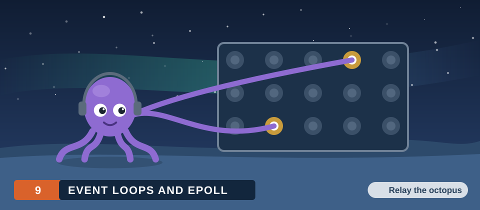
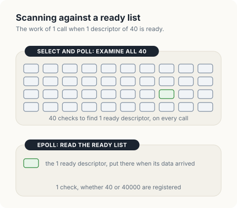
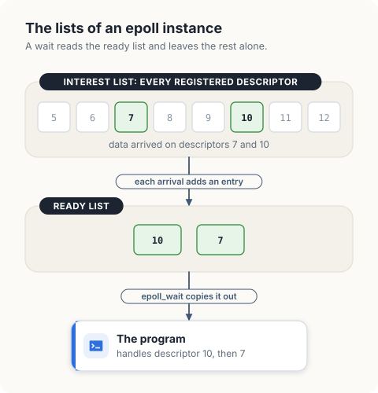
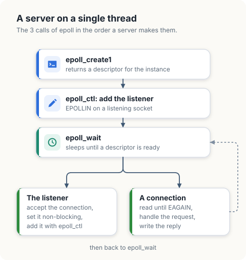
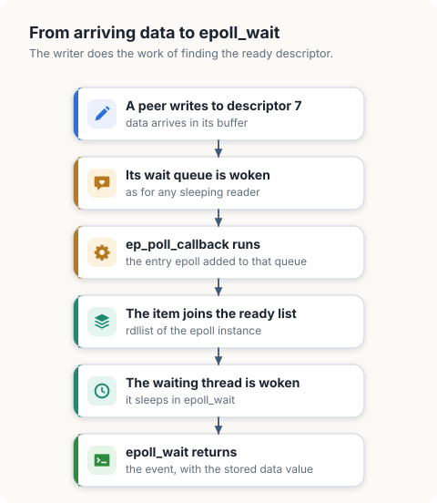
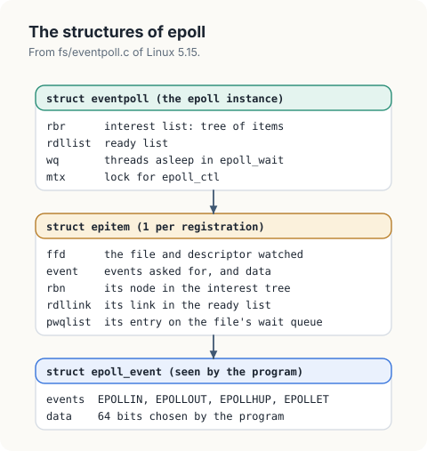
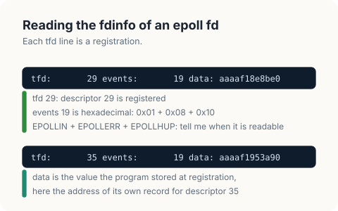
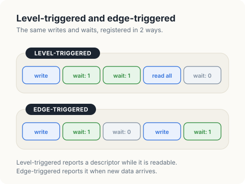
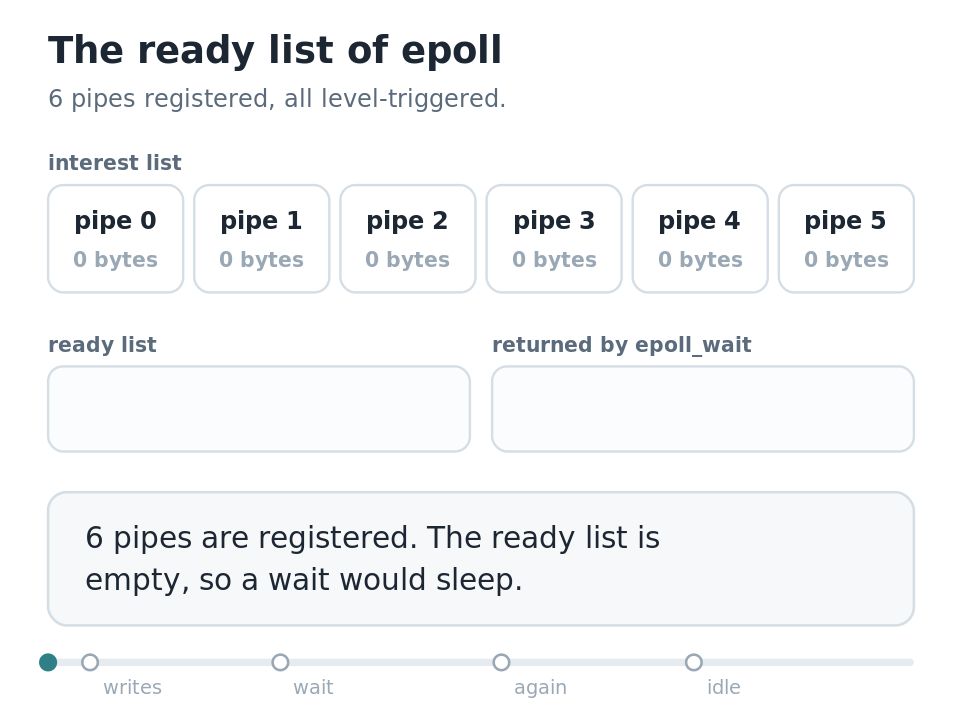

# Event Loops and epoll

An event loop is a program structure in which a single thread waits for activity on
many file descriptors at once and handles each descriptor when it is ready. The kernel
mechanism behind it on Linux is `epoll`: the program registers descriptors with an epoll
instance and then asks which of them are ready. Network servers, the Go runtime and
Rust's async runtimes are all built on this mechanism.

In this chapter, we will learn how epoll finds the ready descriptors without examining
all of them. We will first measure its behaviour on pipes with `epollfacts`. Then we
will write `eventloop`, a model of the interest list and the ready list, check it
against the measurements, and run an event loop on it.

<div class="covers">

This chapter covers

- blocking and non-blocking I/O, and why a blocking `read` on each descriptor does not scale
- the 3 calls of epoll, and the structure of a server built on them
- the path from arriving data to the return of `epoll_wait`
- the kernel structures: `struct eventpoll` and `struct epitem`
- the interest list and the ready list of an epoll instance
- why the cost of a wait depends on the number of ready descriptors
- level-triggered and edge-triggered registrations
- how a closed peer is reported
- the structure of an event loop
- how the Go runtime and Rust's async runtimes use epoll
- how to inspect the registrations of a running process

</div>

## Blocking and readiness

By default a `read` on a pipe or a socket *blocks*: if no data is available, the kernel
puts the calling thread to sleep until some arrives ([chapter 1](01-pipes.md)). A thread
that is asleep in a `read` on 1 descriptor cannot notice that another descriptor has
data.

A descriptor can be switched to *non-blocking mode* with the flag `O_NONBLOCK`. A `read`
that would have to wait then returns the error `EAGAIN` immediately. A program could
call `read` on each of its descriptors in a loop and skip those that return `EAGAIN`,
and it would consume a whole CPU doing nothing. What is needed is a single call that
sleeps until any of a set of descriptors is *ready*, meaning that a `read` or a `write`
on it would not block. That call is the subject of this chapter.

## The problem

A server with 10000 connections has to respond to whichever connection sends data next.
A blocking `read` waits on 1 descriptor. The alternatives each have a cost.

| Approach | Cost |
|---|---|
| a thread per connection, each blocked in `read` | a stack and a scheduler entry for every connection, and a context switch for every message |
| `select` or `poll` with the full list of descriptors | the kernel examines every descriptor on every call, including the idle ones |
| `epoll` | the kernel maintains the list of ready descriptors; a call returns that list |

With `select` and `poll`, the program passes all its descriptors on each call, and the
kernel checks each one. The work per call is proportional to the number of descriptors
registered. On a server most connections are idle at any moment, so most of that work
finds nothing.

<figure>

<figcaption><b>Figure 9.1</b> The work of a single call, with <code>select</code> or <code>poll</code> and with epoll.</figcaption>
</figure>

`epoll` separates registration from waiting. The program registers a descriptor once,
with `epoll_ctl`. From then on the kernel itself records when the descriptor becomes
ready. `epoll_wait` returns the recorded descriptors, and its work is proportional to
the number that are ready.

<figure>

<figcaption><b>Figure 9.2</b> The interest list holds every registration. The ready list holds the descriptors with activity.</figcaption>
</figure>

The ready list is filled at the moment of the event. In chapter 1 a `write` to a pipe
woke the readers sleeping on the pipe's wait queue. Registering a descriptor with epoll
adds an entry to that same wait queue, and the entry's wake-up function puts the
registration on the ready list. The writer does this work as part of its `write`.

## The interface

epoll consists of 3 system calls.

| Call | Purpose |
|---|---|
| `epoll_create1(flags)` | creates an epoll instance and returns a descriptor for it |
| `epoll_ctl(epfd, op, fd, &event)` | adds, changes or removes the registration of `fd` |
| `epoll_wait(epfd, events, max, timeout)` | sleeps until a registered descriptor is ready, and returns up to `max` events |

A registration and an event are both a `struct epoll_event`. This is the definition in
`include/uapi/linux/eventpoll.h`.

```c
struct epoll_event {
        __poll_t events;       /* which conditions: EPOLLIN, EPOLLOUT, ... */
        __u64 data;            /* chosen by the program, returned with each event */
};
```

| Bit in `events` | Meaning |
|---|---|
| `EPOLLIN` | a `read` would not block: data is available, or the peer has closed |
| `EPOLLOUT` | a `write` would not block: there is room in the send buffer |
| `EPOLLHUP`, `EPOLLERR` | the peer has closed, or an error is pending; always reported, without being requested |
| `EPOLLET` | make the registration edge-triggered, explained below |
| `EPOLLONESHOT` | report the descriptor once, then disable the registration until it is re-armed |

`data` is how the program recognises an event. The kernel does not interpret it. A
program stores the descriptor number or a pointer to its own record of the connection,
and gets it back in `epoll_wait`.

A server on a single thread uses the calls in the following pattern.

<figure>

<figcaption><b>Figure 9.3</b> The loop of a server built on epoll.</figcaption>
</figure>

The descriptors are in non-blocking mode. epoll reports that a descriptor is ready, and
the non-blocking mode guarantees that the handler does not sleep if the situation has
changed by the time it reads.

## From arriving data to epoll_wait

The claim that `epoll_wait` does work proportional to the number of ready descriptors
rests on 1 mechanism, which we follow for a registered descriptor 7.

1. At registration, `epoll_ctl` creates an item for descriptor 7 and adds an entry to
   the *wait queue* of the file behind it. A wait queue is the list of sleepers that the
   file wakes when its state changes ([chapter 1](01-pipes.md)). The entry that epoll
   adds is a function in place of a sleeping thread.
2. Later, data arrives for descriptor 7. The code that delivers the data, a `write` by
   another process or the network stack, wakes the wait queue of the file.
3. Waking the queue calls the function, `ep_poll_callback`. It puts the item for
   descriptor 7 on the ready list of the epoll instance.
4. It then wakes any thread that is asleep in `epoll_wait` on this instance.
5. `epoll_wait` takes the items from the ready list, asks each file once more whether it
   is really ready, and copies the events to the program.

<figure>

<figcaption><b>Figure 9.4</b> The event itself puts the descriptor on the ready list.</figcaption>
</figure>

No step searches the registered descriptors. The descriptor announces itself at the
moment it becomes ready.

## The kernel's structures

An epoll instance is a `struct eventpoll`, and each registration is a `struct epitem`.
Both are defined in `fs/eventpoll.c` of Linux 5.15. These are the fields we use.

```c
struct eventpoll {
        struct mutex mtx;                      /* held by epoll_ctl and epoll_wait */
        wait_queue_head_t wq;                  /* threads asleep in epoll_wait */
        struct list_head rdllist;              /* the ready list */
        struct rb_root_cached rbr;             /* the interest list: a tree of epitems */
        /* ... */
};

struct epitem {
        struct rb_node rbn;                    /* its node in rbr */
        struct list_head rdllink;              /* its link in rdllist */
        struct epoll_filefd ffd;               /* the file and descriptor it watches */
        struct eppoll_entry *pwqlist;          /* its entry on the file's wait queue */
        struct eventpoll *ep;                  /* the instance it belongs to */
        struct epoll_event event;              /* the events asked for, and data */
        /* ... */
};
```

| Field | Meaning |
|---|---|
| `rbr` | The interest list. It is a red-black tree keyed by file and descriptor, so that `epoll_ctl` finds an existing registration quickly. |
| `rdllist` | The ready list: a linked list of the items whose files have reported activity. |
| `wq` | The threads that are asleep in `epoll_wait`. Step 4 wakes them. |
| `rdllink` | An item is on the ready list when this link is in use, which also keeps an item from being added a second time. |
| `pwqlist` | The entry of step 1. |
| `event` | The `struct epoll_event` given at registration. |

<figure>

<figcaption><b>Figure 9.5</b> An epoll instance, a registration, and the event the program receives.</figcaption>
</figure>

An epoll instance is itself a file, and the kernel shows its registrations in `/proc`.
This is the session manager of our user account, pid 1203, whose descriptor 4 is an
epoll instance:

```console
$ ls -l /proc/1203/fd | grep eventpoll
4 -> anon_inode:[eventpoll]
$ cat /proc/1203/fdinfo/4
pos:	0
flags:	02000002
tfd:       29 events:       19 data:     aaaaf18e8be0  pos:0 ino:b06c sdev:8
tfd:       35 events:       19 data:     aaaaf1953a90  pos:0 ino:b06e sdev:8
tfd:       15 events:       19 data:     aaaaf173f750  pos:0 ino:b049 sdev:8
```

<figure>

<figcaption><b>Figure 9.6</b> 2 registrations of the listing, field by field.</figcaption>
</figure>

Each `tfd` line is an item of the interest list: the descriptor it watches, the events
in hexadecimal, and `data`. `19` is `EPOLLIN` (1), `EPOLLERR` (8) and `EPOLLHUP` (0x10)
together. The `data` values are addresses in the memory of the program, which stored a
pointer to its own record of each descriptor.

## Measuring epoll

`epollfacts` uses `golang.org/x/sys/unix` in Go and the `nix` crate with the `event` and
`fs` features in Rust.

```console
$ cargo new epollfacts
$ cargo add -p epollfacts nix --features event,fs
```

`watch` creates an epoll instance and a number of pipes, and registers the read end of
each pipe for the event `EPOLLIN`, readability. A registration carries a value chosen by
the program, here the number of the pipe, which the kernel returns with each event.
`ready` calls `epoll_wait` with a timeout of 0, so that it reports the current state
without blocking.

<p class="listing"><b>Listing 9.1</b> The imports of <code>epollfacts</code>, in Go. <a href="https://github.com/arpanpathak/cracking-the-systems-programming-interview/blob/prep-v2/democratizing-linux/code/go/epollfacts/main.go">code/go/epollfacts/main.go</a></p>

```go
{{#include ../code/go/epollfacts/main.go:imports}}
```

<p class="listing"><b>Listing 9.2</b> The imports of <code>epollfacts</code>, in Rust. <a href="https://github.com/arpanpathak/cracking-the-systems-programming-interview/blob/prep-v2/democratizing-linux/code/rust/epollfacts/src/main.rs">code/rust/epollfacts/src/main.rs</a></p>

```rust
{{#include ../code/rust/epollfacts/src/main.rs:imports}}
```

<p class="listing"><b>Listing 9.3</b> Creating an epoll instance and registering pipes, in Go. <a href="https://github.com/arpanpathak/cracking-the-systems-programming-interview/blob/prep-v2/democratizing-linux/code/go/epollfacts/main.go">code/go/epollfacts/main.go</a></p>

```go
{{#include ../code/go/epollfacts/main.go:setup}}
```

<p class="listing"><b>Listing 9.4</b> Creating an epoll instance and registering pipes, in Rust. <a href="https://github.com/arpanpathak/cracking-the-systems-programming-interview/blob/prep-v2/democratizing-linux/code/rust/epollfacts/src/main.rs">code/rust/epollfacts/src/main.rs</a></p>

```rust
{{#include ../code/rust/epollfacts/src/main.rs:setup}}
```


`level` uses the default kind of registration, called level-triggered. It waits before
any write, after a write to pipe 1, a second time without reading the data, after
reading it, and after closing the write end.

<p class="listing"><b>Listing 9.5</b> Level-triggered events, in Go. <a href="https://github.com/arpanpathak/cracking-the-systems-programming-interview/blob/prep-v2/democratizing-linux/code/go/epollfacts/main.go">code/go/epollfacts/main.go</a></p>

```go
{{#include ../code/go/epollfacts/main.go:level}}
```

<p class="listing"><b>Listing 9.6</b> Level-triggered events, in Rust. <a href="https://github.com/arpanpathak/cracking-the-systems-programming-interview/blob/prep-v2/democratizing-linux/code/rust/epollfacts/src/main.rs">code/rust/epollfacts/src/main.rs</a></p>

```rust
{{#include ../code/rust/epollfacts/src/main.rs:level}}
```


`edge` registers a pipe with the flag `EPOLLET`, edge-triggered, and waits 2 times after
a write and again after a further write.

<p class="listing"><b>Listing 9.7</b> Edge-triggered events, in Go. <a href="https://github.com/arpanpathak/cracking-the-systems-programming-interview/blob/prep-v2/democratizing-linux/code/go/epollfacts/main.go">code/go/epollfacts/main.go</a></p>

```go
{{#include ../code/go/epollfacts/main.go:edge}}
```

<p class="listing"><b>Listing 9.8</b> Edge-triggered events, in Rust. <a href="https://github.com/arpanpathak/cracking-the-systems-programming-interview/blob/prep-v2/democratizing-linux/code/rust/epollfacts/src/main.rs">code/rust/epollfacts/src/main.rs</a></p>

```rust
{{#include ../code/rust/epollfacts/src/main.rs:edge}}
```


`many` registers 1000 pipes and writes to pipe 700.

<p class="listing"><b>Listing 9.9</b> 1000 registrations and 1 ready descriptor, in Go. <a href="https://github.com/arpanpathak/cracking-the-systems-programming-interview/blob/prep-v2/democratizing-linux/code/go/epollfacts/main.go">code/go/epollfacts/main.go</a></p>

```go
{{#include ../code/go/epollfacts/main.go:many}}
```

<p class="listing"><b>Listing 9.10</b> 1000 registrations and 1 ready descriptor, in Rust. <a href="https://github.com/arpanpathak/cracking-the-systems-programming-interview/blob/prep-v2/democratizing-linux/code/rust/epollfacts/src/main.rs">code/rust/epollfacts/src/main.rs</a></p>

```rust
{{#include ../code/rust/epollfacts/src/main.rs:many}}
```


```text
{{#include ../code/output/epollfacts.txt}}
```

| Output | Conclusion |
|---|---|
| 0 events with nothing written | A wait reports only descriptors that are ready. |
| 1 event, for pipe 1 | The event carries the value stored at registration, which identifies the descriptor. |
| level-triggered: 1 event again | A level-triggered descriptor is reported for as long as data remains. |
| 0 events after reading | Reading the data ends the condition. |
| `EPOLLHUP` after the write end is closed | The end of the stream is reported as an event, without being requested. |
| edge-triggered: 1 event, then 0 | An edge-triggered descriptor is reported when data arrives and stays silent afterwards, with the data still unread. |
| 1 event after another write | New data produces a new event. |
| 1000 registered, 1 event | The wait returns the ready descriptor and no others. |

<figure>

<figcaption><b>Figure 9.7</b> The measured sequences for both kinds of registration.</figcaption>
</figure>

The choice has a consequence for the handler. With a level-triggered registration, a
handler may read part of the data and return; the descriptor is reported again. With an
edge-triggered registration, a handler has to read until `read` returns `EAGAIN`,
because no further event will announce the data it leaves behind. Edge-triggered
registrations save repeated reports and are used by runtimes that follow this rule
strictly.

## Modelling epoll

<div class="lld">

Low-level design: `eventloop`

| Type | Fields | Meaning |
|---|---|---|
| `pipe` | `buffered`, `registered`, `edge`, `queued` | the bytes waiting; the registration; whether the pipe is on the ready list |
| `kernel` | `pipes`, `ready`, `examined` | the pipes; the ready list in order of arrival; a counter of registrations examined |

| Operation | Behaviour |
|---|---|
| `register(index, edge)` | adds a pipe to the interest list; queues it if it is already readable |
| `write(index, n)` | adds bytes; puts a registered pipe on the ready list |
| `wait()` | empties the ready list; returns the pipes that are still readable; queues the level-triggered ones again |
| `scan()` | examines every registered pipe, as `select` and `poll` do |
| `turn(handle)` | waits, then calls the handler for each ready pipe |

</div>

A pipe is reduced to a count of buffered bytes. The `queued` flag keeps a pipe from
appearing on the ready list more than once.

<p class="listing"><b>Listing 9.11</b> The imports of <code>eventloop</code>, in Go. <a href="https://github.com/arpanpathak/cracking-the-systems-programming-interview/blob/prep-v2/democratizing-linux/code/go/eventloop/main.go">code/go/eventloop/main.go</a></p>

```go
{{#include ../code/go/eventloop/main.go:imports}}
```

<p class="listing"><b>Listing 9.12</b> Pipes, the interest list and the ready list, in Go. <a href="https://github.com/arpanpathak/cracking-the-systems-programming-interview/blob/prep-v2/democratizing-linux/code/go/eventloop/main.go">code/go/eventloop/main.go</a></p>

```go
{{#include ../code/go/eventloop/main.go:types}}
```

<p class="listing"><b>Listing 9.13</b> Pipes, the interest list and the ready list, in Rust. <a href="https://github.com/arpanpathak/cracking-the-systems-programming-interview/blob/prep-v2/democratizing-linux/code/rust/eventloop/src/main.rs">code/rust/eventloop/src/main.rs</a></p>

```rust
{{#include ../code/rust/eventloop/src/main.rs:types}}
```


`write` is where a pipe becomes ready, and it is `write` that queues the pipe. No part
of the model searches for ready pipes.

<p class="listing"><b>Listing 9.14</b> Registering, and queuing on a write, in Go. <a href="https://github.com/arpanpathak/cracking-the-systems-programming-interview/blob/prep-v2/democratizing-linux/code/go/eventloop/main.go">code/go/eventloop/main.go</a></p>

```go
{{#include ../code/go/eventloop/main.go:wake}}
```

<p class="listing"><b>Listing 9.15</b> Registering, and queuing on a write, in Rust. <a href="https://github.com/arpanpathak/cracking-the-systems-programming-interview/blob/prep-v2/democratizing-linux/code/rust/eventloop/src/main.rs">code/rust/eventloop/src/main.rs</a></p>

```rust
{{#include ../code/rust/eventloop/src/main.rs:wake}}
```


`wait` takes the ready list and checks each entry again, since the data may have been
read in the meantime. The difference between the kinds of registration is a single
statement: a level-triggered pipe that is reported is queued again, and an
edge-triggered pipe is left off the list until the next `write` queues it.

<p class="listing"><b>Listing 9.16</b> Waiting, and scanning for comparison, in Go. <a href="https://github.com/arpanpathak/cracking-the-systems-programming-interview/blob/prep-v2/democratizing-linux/code/go/eventloop/main.go">code/go/eventloop/main.go</a></p>

```go
{{#include ../code/go/eventloop/main.go:wait}}
```

<p class="listing"><b>Listing 9.17</b> Waiting, and scanning for comparison, in Rust. <a href="https://github.com/arpanpathak/cracking-the-systems-programming-interview/blob/prep-v2/democratizing-linux/code/rust/eventloop/src/main.rs">code/rust/eventloop/src/main.rs</a></p>

```rust
{{#include ../code/rust/eventloop/src/main.rs:wait}}
```


The model repeats the measurements. `many` also counts how many registrations a wait
and a scan examine.

<p class="listing"><b>Listing 9.18</b> The measurements on the model, in Go. <a href="https://github.com/arpanpathak/cracking-the-systems-programming-interview/blob/prep-v2/democratizing-linux/code/go/eventloop/main.go">code/go/eventloop/main.go</a></p>

```go
{{#include ../code/go/eventloop/main.go:measure}}
```

<p class="listing"><b>Listing 9.19</b> The measurements on the model, in Rust. <a href="https://github.com/arpanpathak/cracking-the-systems-programming-interview/blob/prep-v2/democratizing-linux/code/rust/eventloop/src/main.rs">code/rust/eventloop/src/main.rs</a></p>

```rust
{{#include ../code/rust/eventloop/src/main.rs:measure}}
```


### The loop

An event loop repeats 2 steps: wait for events, then run the handler of each ready
descriptor. A handler must return quickly and must not block, because every other
descriptor waits while it runs.

<p class="listing"><b>Listing 9.20</b> An event loop on the model, in Go. <a href="https://github.com/arpanpathak/cracking-the-systems-programming-interview/blob/prep-v2/democratizing-linux/code/go/eventloop/main.go">code/go/eventloop/main.go</a></p>

```go
{{#include ../code/go/eventloop/main.go:event_loop}}
```

<p class="listing"><b>Listing 9.21</b> An event loop on the model, in Rust. <a href="https://github.com/arpanpathak/cracking-the-systems-programming-interview/blob/prep-v2/democratizing-linux/code/rust/eventloop/src/main.rs">code/rust/eventloop/src/main.rs</a></p>

```rust
{{#include ../code/rust/eventloop/src/main.rs:event_loop}}
```


<figure class="anim">
<video class="motion" src="figures/epoll-ready.mp4" autoplay loop muted playsinline preload="metadata" aria-label="6 pipes are registered with an epoll instance and the ready list is empty. A write of 5 bytes to pipe 4 puts it on the ready list, and a write of 3 bytes to pipe 1 puts it behind pipe 4. epoll_wait returns pipes 4 and 1. The handler reads 4 bytes from each, which empties pipe 1 and leaves 1 byte in pipe 4. Both stay on the list. The next wait drops pipe 1 and reports pipe 4, and the handler reads its last byte. The wait after that drops pipe 4, the list is empty, and the loop sleeps." data-chapters="[[0.0, &quot;&quot;], [2.46, &quot;writes&quot;], [13.62, &quot;wait&quot;], [26.58, &quot;again&quot;], [37.86, &quot;idle&quot;]]"></video>
<figcaption><b>Animation 9.1</b> Writes fill the ready list, and a wait returns it.</figcaption>
</figure>

```text
{{#include ../code/output/eventloop.txt}}
```

| Line | What it shows |
|---|---|
| lines 1 to 7 | The model gives the event counts that `epollfacts` measured. |
| 1 examined by the wait, 1000 by a scan | The wait looked at the ready list. A scan looks at every registration. |
| turn 1 handles `[2 0]` | Events are returned in the order the pipes became ready. |
| turn 2 handles `[2]` | The handler read 4 of the 5 bytes of pipe 2, and a level-triggered pipe with data left is reported again. |
| turn 3 handles `[]` | Nothing is ready. A real loop would sleep in `epoll_wait` here. |

<div class="callout">

**Correspondence with the kernel source.** The model corresponds to `fs/eventpoll.c`.
An epoll instance is `struct eventpoll`, with the interest list in the red-black tree
`rbr` and the ready list in `rdllist`. A registration is `struct epitem`.
`ep_poll_callback` is the wake-up function that queues an item when its file becomes
ready, and `ep_send_events` is the loop of `wait`: it polls each queued item again,
copies the event to the program, and adds the item back to `rdllist` unless `EPOLLET`
is set.

</div>

<div class="crab crab-cute">

A handler must return quickly. Every other descriptor waits while it runs.

</div>

## Epoll inside language runtimes

Go and Rust programs rarely call epoll directly, and nearly all of their network I/O
goes through it.

The Go runtime has a component called the *netpoller*. Every socket a Go program opens
is put in non-blocking mode and registered, edge-triggered, with a single epoll
instance. When a goroutine calls `Read` and the kernel answers `EAGAIN`, the runtime
parks the goroutine, which costs no thread, and runs another. A wake-up from epoll makes
the parked goroutine runnable again. The code reads as if it blocked, and underneath it
is the event loop of this chapter.

In Rust, an async runtime such as Tokio does the same for futures. A future that cannot
make progress registers its descriptor and returns `Pending`. The runtime's reactor
calls `epoll_wait`, and wakes the task that owns a descriptor when its event arrives.

## Inspecting epoll on a live system

| Command | Shows |
|---|---|
| `ls -l /proc/<pid>/fd \| grep eventpoll` | the epoll instances of a process |
| `cat /proc/<pid>/fdinfo/<n>` | for an epoll descriptor: every registration, with its events and data |
| `strace -e trace=epoll_wait,epoll_ctl -p <pid>` | the registrations a process makes and the events it receives |
| `cat /proc/sys/fs/epoll/max_user_watches` | the number of registrations a user may hold: 3563520 here |

## The complete programs

<p class="listing"><b>Listing 9.22</b> The complete <code>epollfacts</code>, in Go. <a href="https://github.com/arpanpathak/cracking-the-systems-programming-interview/blob/prep-v2/democratizing-linux/code/go/epollfacts/main.go">code/go/epollfacts/main.go</a></p>

```go
{{#include ../code/go/epollfacts/main.go}}
```

<p class="listing"><b>Listing 9.23</b> The complete <code>epollfacts</code>, in Rust. <a href="https://github.com/arpanpathak/cracking-the-systems-programming-interview/blob/prep-v2/democratizing-linux/code/rust/epollfacts/src/main.rs">code/rust/epollfacts/src/main.rs</a></p>

```rust
{{#include ../code/rust/epollfacts/src/main.rs}}
```


<p class="listing"><b>Listing 9.24</b> The complete <code>eventloop</code>, in Go. <a href="https://github.com/arpanpathak/cracking-the-systems-programming-interview/blob/prep-v2/democratizing-linux/code/go/eventloop/main.go">code/go/eventloop/main.go</a></p>

```go
{{#include ../code/go/eventloop/main.go}}
```

<p class="listing"><b>Listing 9.25</b> The complete <code>eventloop</code>, in Rust. <a href="https://github.com/arpanpathak/cracking-the-systems-programming-interview/blob/prep-v2/democratizing-linux/code/rust/eventloop/src/main.rs">code/rust/eventloop/src/main.rs</a></p>

```rust
{{#include ../code/rust/eventloop/src/main.rs}}
```


<div class="summary">

## Summary

- An event loop serves many descriptors from a single thread: wait for events, then
  handle each ready descriptor without blocking.
- An epoll instance has an interest list of registrations and a ready list.
- A descriptor is put on the ready list by the code that makes it ready, such as a
  `write` to a pipe. `epoll_wait` returns the ready list.
- The work of a wait is proportional to the number of ready descriptors, where `select`
  and `poll` examine every descriptor on every call.
- A level-triggered descriptor is reported while it is readable. An edge-triggered
  descriptor is reported when new data arrives, and its handler must read until
  `EAGAIN`.
- A closed peer is reported as `EPOLLHUP`.

</div>

## References

- `epoll(7)`, `epoll_ctl(2)` and `epoll_wait(2)`, Linux manual pages:
  <https://man7.org/linux/man-pages/man7/epoll.7.html>
- M. Kerrisk, *The Linux Programming Interface*, No Starch Press, 2010, chapter 63.
- `fs/eventpoll.c`, Linux 5.15:
  <https://elixir.bootlin.com/linux/v5.15/source/fs/eventpoll.c>
