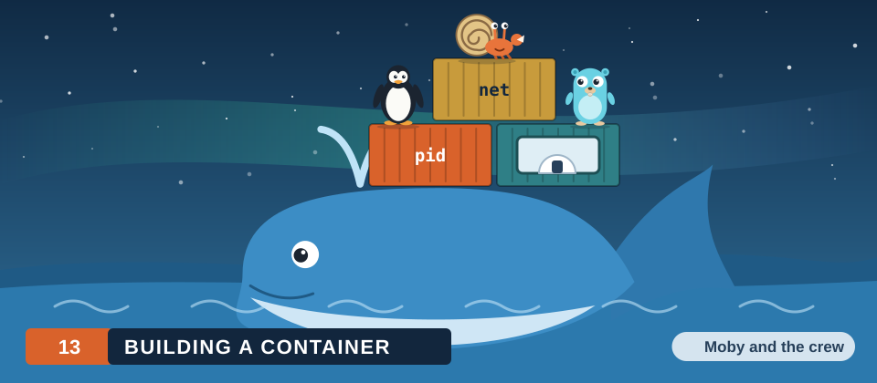
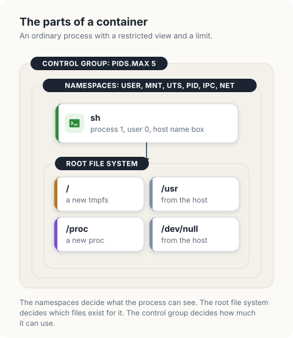
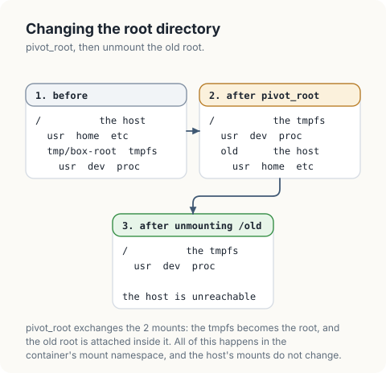
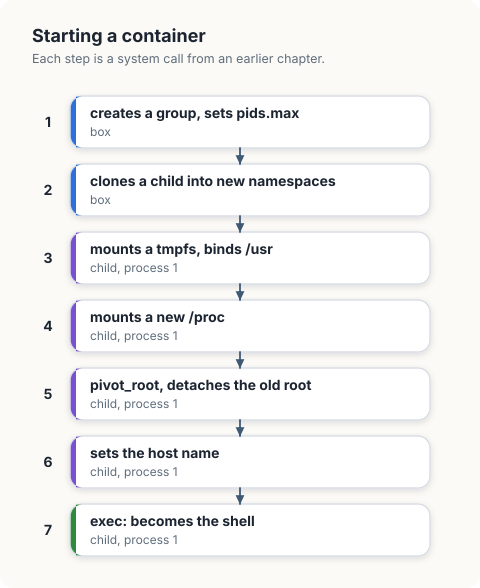
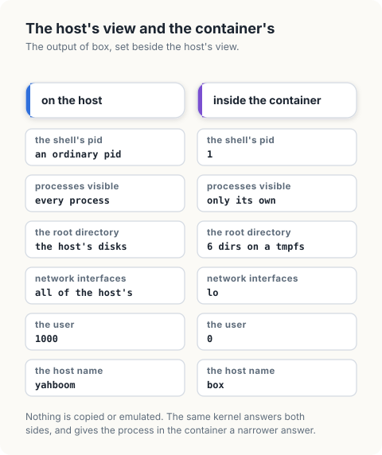
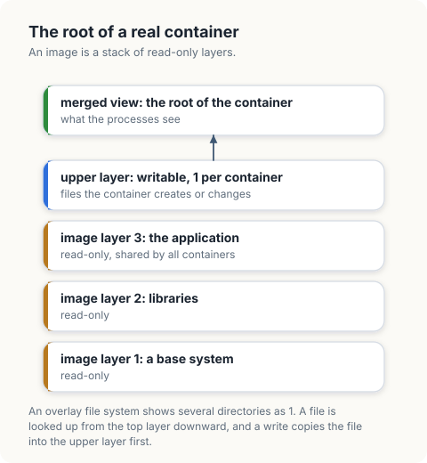
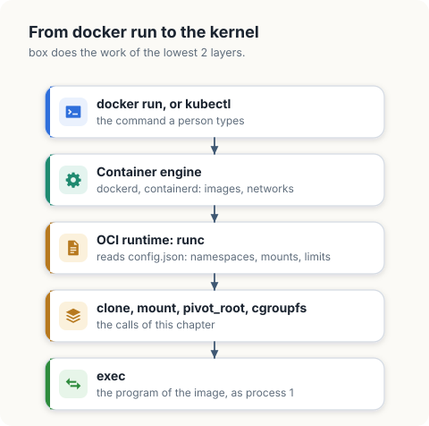

# Building a Container

A container is an ordinary process that runs with a restricted view of the system and
with limits on what it may use. The kernel has no object called a container. A container
runtime builds one from the mechanisms of the previous chapters: namespaces for the
view, a root file system for the files, and a control group for the limits.

In this chapter, we will write `box`, a program that starts a shell in a container. It
needs no privileges and no container software. We will build it in stages: the control
group, the creation of the first process in new namespaces, the root file system, and
the final `exec`.

<div class="covers">

This chapter covers

- the parts of a container and the kernel mechanism behind each
- starting a process directly inside a control group
- assembling a root file system from a tmpfs and bind mounts
- `pivot_root`: replacing the root directory of a mount namespace
- why `/proc` has to be mounted again inside the container
- what happens to the other processes of a container when its first process ends
- what the container sees: its mounts, its network, its capabilities
- what a container image is, and how `docker run` reaches the calls of this chapter

</div>

## The parts

| Part | Mechanism | Covered in |
|---|---|---|
| its own process numbers | PID namespace | chapter 11 |
| its own host name | UTS namespace | chapter 11 |
| user 0 inside, an ordinary user outside | user namespace | chapter 11 |
| its own mounted file systems | mount namespace | this chapter |
| its own network interfaces | network namespace | chapter 11 |
| its own root directory | `pivot_root` | this chapter |
| limits on processes and memory | control group | chapter 12 |
| a first process that runs a program | `clone` and `exec` | chapter 3 |

<figure>

<figcaption><b>Figure 13.1</b> The container that <code>box</code> builds.</figcaption>
</figure>

A *mount namespace* holds the list of mounted file systems that its processes see. A
process in a new mount namespace starts with a copy of its parent's list and can then
mount and unmount without any effect outside. `box` uses that freedom to assemble a
directory tree for the container and to make it the root.

A real container image supplies a complete root file system, with its own programs and
libraries. `box` has no image. It borrows the program directories of the host, which
keeps the example self-contained, and exposes nothing else: the home directories,
`/etc` and `/tmp` of the host do not exist inside.

### Mounts and the root directory

A *mount* attaches a file system at a directory, the *mount point*. The files of the
file system then appear below that directory. What a process sees at `/` is the mount at
the top of its mount namespace, and a path such as `/usr/bin/ls` is resolved by walking
down from there, crossing into another file system at each mount point.

`box` needs 3 kinds of mount, all made with the `mount` system call.

| Kind | Call | Effect |
|---|---|---|
| a new file system | `mount("tmpfs", dir, "tmpfs", ...)` | an empty file system held in memory appears at `dir` |
| a bind mount | `mount("/usr", dir, NULL, MS_BIND, ...)` | the existing directory `/usr` also appears at `dir`; the files are the same files |
| a change of propagation | `mount(NULL, "/", NULL, MS_REC \| MS_PRIVATE, ...)` | mounts made from now on are not copied to other mount namespaces |

The root directory is changed with `pivot_root`, in 3 steps.

<figure>

<figcaption><b>Figure 13.2</b> <code>pivot_root</code> exchanges the root with a prepared directory, and the old root is then unmounted.</figcaption>
</figure>

An older call, `chroot`, also changes what a process sees as `/`. It changes only the
starting point of path lookup and leaves the host's file system mounted, and a process
with privilege can get out of it. `pivot_root` followed by the unmount removes the
host's tree from the mount namespace altogether, which is why container runtimes use it.

## Setting up

`box` uses `golang.org/x/sys/unix` in Go and the `nix` crate with 5 features in Rust.

```console
$ cargo new box
$ cargo add -p box nix --features fs,hostname,mount,sched,user
```

<figure>

<figcaption><b>Figure 13.3</b> The steps of <code>box</code>. Steps 3 to 7 run inside the new namespaces.</figcaption>
</figure>

<div class="lld">

Low-level design: `box`

| Function | Runs in | Behaviour |
|---|---|---|
| `createGroup(pidsMax)` | the parent | creates a control group and sets its limit |
| `launch(group, root, script)` | the parent | starts the first process of the container in new namespaces and in the group |
| `buildRoot(root)` | process 1 | mounts a tmpfs on `root` and populates it |
| `enterRoot(root)` | process 1 | makes `root` the root directory and detaches the host's tree |
| `initialize(root, script)` | process 1 | builds and enters the root, sets the host name, executes the shell |

</div>

## The control group

`createGroup` is the code of chapter 12: it finds the nearest group that passes on the
`pids` controller and creates a directory below it. The group is created before the
container, so that the first process of the container can start inside it.

<p class="listing"><b>Listing 13.1</b> The imports of <code>box</code>, in Go. <a href="https://github.com/arpanpathak/cracking-the-systems-programming-interview/blob/prep-v2/democratizing-linux/code/go/box/main.go">code/go/box/main.go</a></p>

```go
{{#include ../code/go/box/main.go:imports}}
```

<p class="listing"><b>Listing 13.2</b> The imports of <code>box</code>, in Rust. <a href="https://github.com/arpanpathak/cracking-the-systems-programming-interview/blob/prep-v2/democratizing-linux/code/rust/box/src/main.rs">code/rust/box/src/main.rs</a></p>

```rust
{{#include ../code/rust/box/src/main.rs:imports}}
```

<p class="listing"><b>Listing 13.3</b> Creating the control group of the container, in Go. <a href="https://github.com/arpanpathak/cracking-the-systems-programming-interview/blob/prep-v2/democratizing-linux/code/go/box/main.go">code/go/box/main.go</a></p>

```go
{{#include ../code/go/box/main.go:group}}
```

<p class="listing"><b>Listing 13.4</b> Creating the control group of the container, in Rust. <a href="https://github.com/arpanpathak/cracking-the-systems-programming-interview/blob/prep-v2/democratizing-linux/code/rust/box/src/main.rs">code/rust/box/src/main.rs</a></p>

```rust
{{#include ../code/rust/box/src/main.rs:group}}
```


## The first process

`box` starts itself again with the argument `init`, in new user, mount, UTS, PID, IPC
and network namespaces. As in chapter 11, the languages differ in how the namespaces are created.

The Go version passes everything to the call that creates the child. `Cloneflags` names
the namespaces, the mappings make the current user user 0 inside, and `CgroupFD` asks
the kernel to create the child directly in the control group, so there is no interval in
which the child runs outside it.

The Rust version starts a helper process that calls `unshare` and writes the mappings,
and the helper starts the first process. That process then moves itself into the group
by writing `0`, which stands for the writing process, to `cgroup.procs`.

<p class="listing"><b>Listing 13.5</b> Starting the first process of the container, in Go. <a href="https://github.com/arpanpathak/cracking-the-systems-programming-interview/blob/prep-v2/democratizing-linux/code/go/box/main.go">code/go/box/main.go</a></p>

```go
{{#include ../code/go/box/main.go:launch}}
```

<p class="listing"><b>Listing 13.6</b> Starting the first process of the container, in Rust. <a href="https://github.com/arpanpathak/cracking-the-systems-programming-interview/blob/prep-v2/democratizing-linux/code/rust/box/src/main.rs">code/rust/box/src/main.rs</a></p>

```rust
{{#include ../code/rust/box/src/main.rs:launch}}
```


## The root file system

`buildRoot` runs inside the new mount namespace. Its first call sets the propagation of
every mount to private. Without it, mounts made here could be copied back to the host's
namespace, depending on how the host is configured.

It then mounts a *tmpfs*, a file system held in memory, on an empty directory. This is
the future root. It makes the host's program directories visible below it with *bind
mounts*: a bind mount shows an existing directory at a second place. The container also
receives the device `/dev/null`, which shell scripts expect.

The last mount is a new `/proc`. The `/proc` of the host describes the host's PID
namespace. A proc file system mounted from inside the new PID namespace describes that
namespace, and shows the container only its own processes.

`enterRoot` calls `pivot_root`, which makes the new directory the root of the mount
namespace and attaches the previous root at a directory inside it. Unmounting that
directory removes the last path from the container to the host's files.

<p class="listing"><b>Listing 13.7</b> Building the root file system, and entering it, in Go. <a href="https://github.com/arpanpathak/cracking-the-systems-programming-interview/blob/prep-v2/democratizing-linux/code/go/box/main.go">code/go/box/main.go</a></p>

```go
{{#include ../code/go/box/main.go:root}}
```

<p class="listing"><b>Listing 13.8</b> Building the root file system, and entering it, in Rust. <a href="https://github.com/arpanpathak/cracking-the-systems-programming-interview/blob/prep-v2/democratizing-linux/code/rust/box/src/main.rs">code/rust/box/src/main.rs</a></p>

```rust
{{#include ../code/rust/box/src/main.rs:root}}
```


## Becoming the program

`initialize` runs the steps in order and ends with `exec`. The process that set up the
container is replaced by the shell, which is therefore process 1 of the container.

<p class="listing"><b>Listing 13.9</b> The first process: set up, then exec, in Go. <a href="https://github.com/arpanpathak/cracking-the-systems-programming-interview/blob/prep-v2/democratizing-linux/code/go/box/main.go">code/go/box/main.go</a></p>

```go
{{#include ../code/go/box/main.go:init}}
```

<p class="listing"><b>Listing 13.10</b> The first process: set up, then exec, in Rust. <a href="https://github.com/arpanpathak/cracking-the-systems-programming-interview/blob/prep-v2/democratizing-linux/code/rust/box/src/main.rs">code/rust/box/src/main.rs</a></p>

```rust
{{#include ../code/rust/box/src/main.rs:init}}
```


`run` is the parent's side. The script reports what the shell sees and then tries to
start 6 background commands under a `pids.max` of 5.

<p class="listing"><b>Listing 13.11</b> Running the container, and reporting on it, in Go. <a href="https://github.com/arpanpathak/cracking-the-systems-programming-interview/blob/prep-v2/democratizing-linux/code/go/box/main.go">code/go/box/main.go</a></p>

```go
{{#include ../code/go/box/main.go:run}}
```

<p class="listing"><b>Listing 13.12</b> Running the container, and reporting on it, in Rust. <a href="https://github.com/arpanpathak/cracking-the-systems-programming-interview/blob/prep-v2/democratizing-linux/code/rust/box/src/main.rs">code/rust/box/src/main.rs</a></p>

```rust
{{#include ../code/rust/box/src/main.rs:run}}
```


```text
{{#include ../code/output/box.txt}}
```

| Output | What it shows |
|---|---|
| host name `box`, unchanged outside | The UTS namespace contains the change. |
| process number 1 | The shell is the first process of the PID namespace. |
| user number 0 | The user namespace maps the invoking user to user 0. |
| `/proc/1` only | The new `/proc` shows the container's processes. The glob is expanded by the shell itself, so no second process exists at that moment. |
| `/bin /dev /lib /proc /sbin /usr` | The root directory is the tmpfs that `buildRoot` assembled. |
| `mounted:` 4 lines | The mount namespace contains exactly what `buildRoot` made: the tmpfs at `/`, the host's `/usr`, the null device, and the new `/proc`. The disks, `/home` and `/tmp` of the host are absent. |
| network interfaces: `lo` | A new network namespace has only a loopback interface. The container cannot reach the network, and the host's interfaces are invisible. |
| effective capabilities `000001ffffffffff` | Every capability bit is set. They apply inside the user namespace only ([chapter 11](11-namespaces.md)). |
| 4 commands started, 1 fork refused | The shell and 4 commands reach `pids.max` 5, and the next `fork` fails. |
| status 2 | The shell stops at the failed `fork` and exits with an error status. |

<figure>

<figcaption><b>Figure 13.4</b> The container of <code>box</code>, from the host and from inside.</figcaption>
</figure>

The table states the central fact about containers. A container is a view. The process
inside is an ordinary process of the host, scheduled by the same scheduler and using the
same memory, and the kernel answers its questions from a restricted set of objects.

When the shell exits, 4 `sleep` commands are still running. The shell was process 1 of
its PID namespace, and when the first process of a PID namespace ends, the kernel ends
every other process in it. No process of the container survives its first process,
which is why `box` can remove the control group as soon as its count reaches 0.

<div class="callout">

**What a production runtime adds.** `box` leaves out several parts of a container
runtime such as runc. It has no image and shares the host's programs. Its network
namespace has only a loopback interface, where a runtime creates a pair of virtual
Ethernet devices and moves one end into the container to connect it. It keeps all
capabilities inside its user namespace and installs no system call filter, where a
runtime drops most capabilities and applies a *seccomp* filter, a list of permitted
system calls, to reduce what a compromised program can ask of the kernel. And it sets a
single limit, where a runtime sets memory, CPU and I/O limits as well.

</div>

<div class="crab crab-happy">

A container is an ordinary process. `ps`, `/proc` and every other tool of the earlier chapters work on it from the host.

</div>

## Images and runtimes

`box` borrows `/usr` from the host. A real container brings its own files, as an
*image*: an archive of a root file system, built in layers.

<figure>

<figcaption><b>Figure 13.5</b> The layers behind the root directory of a container started from an image.</figcaption>
</figure>

The layers are combined by an *overlay file system*, `overlayfs`. It is mounted with a
list of read-only directories, the *lower* layers, and a single writable directory, the
*upper* layer, and it shows their union. A file is looked up in the upper layer first
and then in each lower layer. A write to a file from a lower layer first copies the file
to the upper layer. The image is not modified, so many containers share its layers,
and each container's changes are confined to its own upper layer. In terms of this
chapter, a runtime replaces the tmpfs and the bind mounts of `buildRoot` with a single
overlay mount, and everything after that is the same.

The software that people call "Docker" is several programs in a chain, and only the last
makes the system calls.

<figure>

<figcaption><b>Figure 13.6</b> From <code>docker run</code> to the system calls.</figcaption>
</figure>

The interface between the engine and the runtime is standardised by the Open Container
Initiative. The engine unpacks the image and writes a file, `config.json`, that lists
the namespaces to create, the mounts to make, the limits to set, and the command to run.
The runtime carries it out. `box` is a runtime with its configuration fixed in the
source.

## Inspecting a container

A container is a set of ordinary processes, so every tool of the earlier chapters
applies to it from the host.

| Command | Shows |
|---|---|
| `ps -ef --forest` | the processes of a container, as children of its runtime, with their pids on the host |
| `ls -l /proc/<pid>/ns` | the namespaces of a container process ([chapter 11](11-namespaces.md)) |
| `cat /proc/<pid>/cgroup` | its control group ([chapter 12](12-control-groups.md)) |
| `cat /proc/<pid>/mountinfo` | the mounts of its mount namespace |
| `cat /proc/<pid>/uid_map` | the user mapping, when it runs in a user namespace |
| `nsenter --target <pid> --all sh` | a shell inside all namespaces of the container |

## The complete program

<p class="listing"><b>Listing 13.13</b> The complete <code>box</code>, in Go. <a href="https://github.com/arpanpathak/cracking-the-systems-programming-interview/blob/prep-v2/democratizing-linux/code/go/box/main.go">code/go/box/main.go</a></p>

```go
{{#include ../code/go/box/main.go}}
```

<p class="listing"><b>Listing 13.14</b> The complete <code>box</code>, in Rust. <a href="https://github.com/arpanpathak/cracking-the-systems-programming-interview/blob/prep-v2/democratizing-linux/code/rust/box/src/main.rs">code/rust/box/src/main.rs</a></p>

```rust
{{#include ../code/rust/box/src/main.rs}}
```


<div class="summary">

## Summary

- A container is a process in its own namespaces, with its own root file system, inside
  a control group. The kernel provides the parts, and a runtime assembles them.
- A user namespace lets an unprivileged user create the other namespaces and act as
  user 0 inside them.
- The root file system is assembled inside a new mount namespace, here from a tmpfs and
  bind mounts, and `pivot_root` makes it the root directory.
- `/proc` is mounted again inside the container so that it describes the new PID
  namespace.
- The first process sets up the container and then calls `exec`, so the program it
  starts is process 1.
- When process 1 of a PID namespace ends, the kernel ends the rest of the namespace.

</div>

## References

- `pivot_root(2)`, `mount_namespaces(7)` and `clone(2)`, Linux manual pages:
  <https://man7.org/linux/man-pages/man2/pivot_root.2.html>
- *Open Container Initiative Runtime Specification*:
  <https://github.com/opencontainers/runtime-spec>
- runc, the reference runtime: <https://github.com/opencontainers/runc>
- L. Rice, *Container Security*, O'Reilly, 2020.
