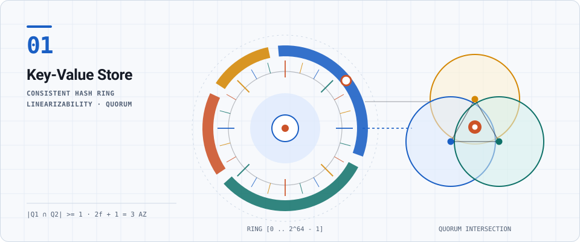
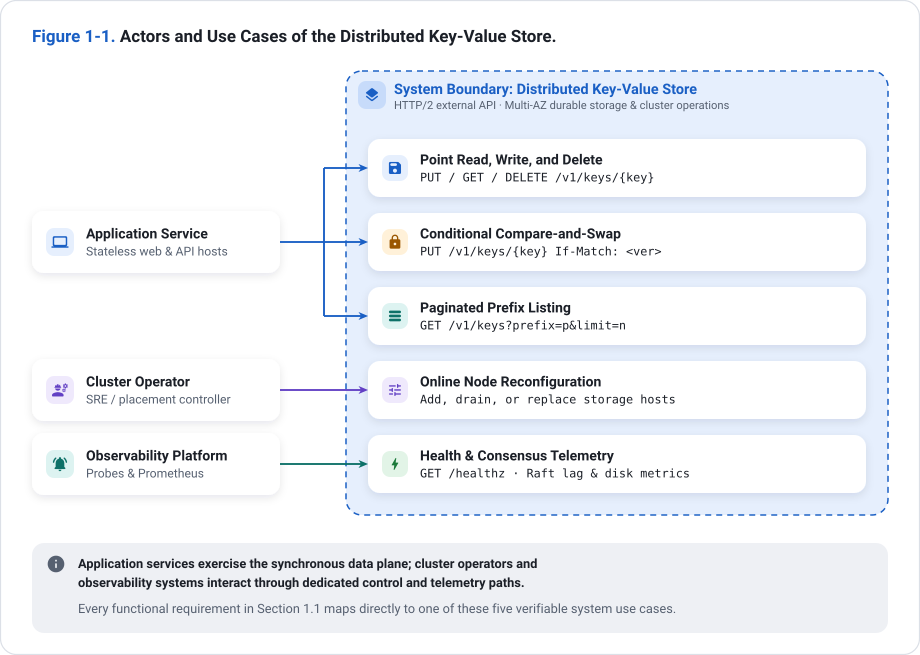
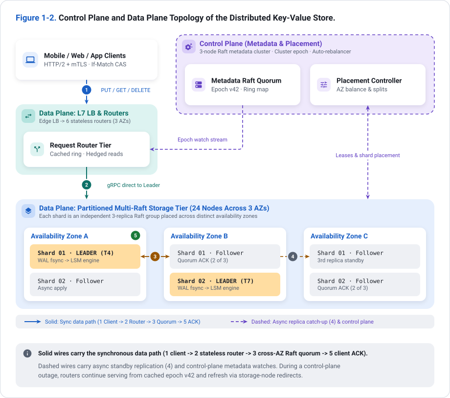
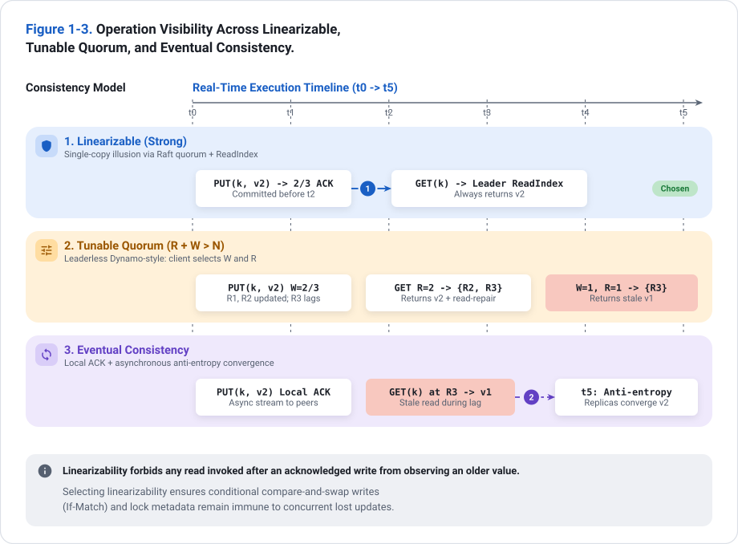
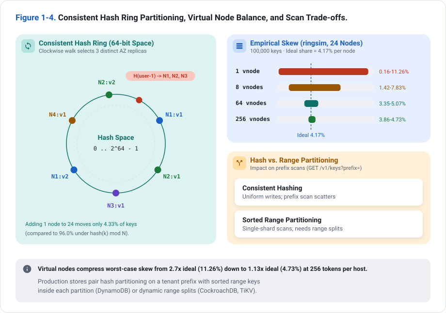
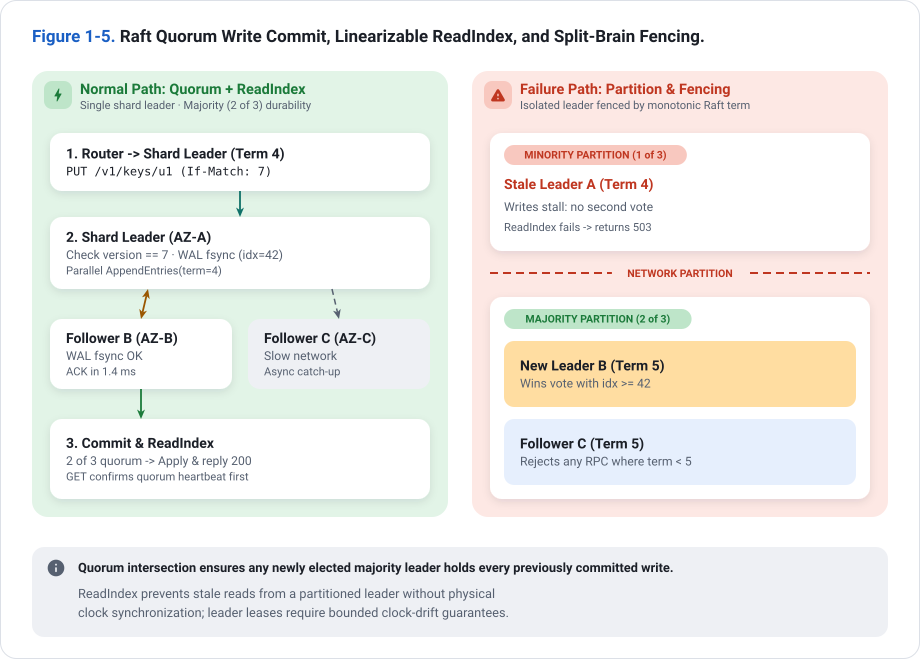

# 1. Key-Value Store: System Design

A distributed key-value store provides durable, strongly consistent storage for opaque byte sequences addressed by primary key. Because the store imposes no schema on values, engineers deploy it as the foundational state layer beneath web session stores, cluster membership registries, distributed configuration engines, and object-store metadata indexes. On a single server, we can satisfy this interface in a few hundred lines of code using an in-memory map backed by an append-only file. Distributed systems engineering begins when data volume exceeds a single disk, request throughput exceeds a single processor core, and service continuity must survive power loss, corrupted storage media, and network partitions.

In this chapter, we derive the architecture of a replicated, sharded key-value store directly from its operational requirements and physical constraints. In Chapters 2 through 6, we implement each component in Rust and verify its invariants under controlled crash and partition injection.

<div class="covers">

In this chapter, we cover

- actors, use cases, verifiable functional requirements, non-functional SLOs, and storage, disk, and network capacity bounds
- the client-facing HTTP/2 contract (conditional writes via `If-Match`, RFC 9457 error objects) and the internal gRPC/Protobuf replication protocol
- separation of the control plane from the data plane using stateless request routers and partitioned Multi-Raft storage groups
- formal consistency models (linearizability, tunable quorums, and eventual consistency) and the cost of strong consistency
- data partitioning via consistent hashing with virtual nodes versus sorted range splits, backed by empirical measurements from `ringsim`
- quorum commit, linearizable `ReadIndex` reads, monotonic term fencing under network partitions, and safe online reconfiguration
- tail-latency engineering, hot-key mitigation, failure recovery matrices, observability SLIs, and production case studies

</div>

## 1.1 Requirements and Capacity Envelope

Modern application tiers achieve horizontal elasticity by remaining stateless: any web or API server can crash, restart, or scale out without losing client state because we offload all durable data to a shared storage tier. That architectural division concentrates operational complexity inside the storage layer. A load balancer absorbs the failure of a stateless node transparently, whereas any corruption or prolonged outage in the storage tier halts every dependent service simultaneously.

### Actors and Use Cases

Three classes of actors interact with the store, each imposing distinct interface and availability contracts (Figure 1-1).

<figure>

<figcaption><b>Figure 1-1</b> Actors, system boundary, and core use cases of the distributed key-value store.</figcaption>
</figure>

| Actor | Operation | Concrete Scenario |
| :--- | :--- | :--- |
| **Application Service** | Point write (`PUT`), point read (`GET`), deletion (`DELETE`) | Persist, retrieve, and expire customer session or shopping-cart records across stateless web servers |
| **Application Service** | Conditional compare-and-swap (`PUT` with `If-Match`) | Update a shared counter or cart record without overwriting concurrent mutations from peer servers |
| **Application Service** | Paginated prefix listing (`GET /v1/keys?prefix=...`) | Enumerate all active session keys belonging to a specific tenant or account |
| **Cluster Operator** | Node addition, graceful drain, host replacement, shard split | Expand storage capacity before peak traffic or replace a host experiencing NVMe hardware faults |
| **Observability Platform** | Readiness probes (`GET /healthz`) and metrics collection | Evict degraded nodes from router pools and alert on latency or error-budget burn rates |

### Functional Requirements

Each functional requirement defines a deterministic contract verifiable by automated integration tests:

| No. | Functional Requirement |
| :--- | :--- |
| 0 | A client can store an opaque byte value (`0` to `1 MiB`) under a key (`1` to `256` ASCII characters in `[A-Za-z0-9._-]`). Every committed mutation assigns a strictly monotonic per-key `version` (`uint64`). |
| 1 | A client can retrieve the latest committed value and its `version` for a given key, or receive `404 Not Found` if the key does not exist or has been deleted. |
| 2 | A client can delete a key by committing a tombstone record in the shard log, advancing the key version so delayed retries cannot resurrect removed state. |
| 3 | A client can make any write conditional on an expected version (`If-Match: "<version>"`) or on the absence of the key (`If-None-Match: *`), guaranteeing atomic compare-and-swap semantics. |
| 4 | A client can enumerate keys matching a prefix in lexicographic order using bounded, cursor-paginated responses (`limit <= 1,000`). |
| 5 | An operator can add, drain, and replace storage nodes across availability zones while the cluster continues serving traffic without downtime. |
| 6 | Every node exposes machine-readable liveness, readiness, consensus lag, and storage-saturation telemetry. |

### Non-Functional Requirements and SLOs

A single-host process with one log file satisfies functional requirements 0 through 4 in full yet fails nearly every operational constraint of production infrastructure. The non-functional bounds below dictate the distributed architecture:

| No. | Property | Target Specification | Architectural Consequence |
| :--- | :--- | :--- | :--- |
| 0 | **Consistency** | Linearizable (strong consistency) per key | Every `GET` invoked after an acknowledged `PUT` returns that write or a newer one; enforced via Raft quorum commit and `ReadIndex` |
| 1 | **Durability** | Zero loss of acknowledged writes across any single node, disk, or availability-zone (AZ) failure | Replication factor `N = 3` across three AZs; synchronous WAL `fsync` on a majority (`2 of 3`) before acknowledging the client |
| 2 | **Availability** | `99.95%` monthly request availability (`<= 21.6` minutes of error budget per 30-day month) | Automated leader election (`< 1.5 s` failover) and active-active multi-AZ stateless routers |
| 3 | **Latency (Intra-Region)** | Writes: `p50 <= 4 ms`, `p99 <= 20 ms`; Reads: `p50 <= 1.5 ms`, `p99 <= 5 ms` | Local NVMe storage, WAL group-commit batching (Chapter 6), and persistent multiplexed gRPC channels |
| 4 | **Scale** | `10^9` keys (`1 KiB` mean value), `20,000` writes/s, `100,000` reads/s sustained (`3x` burst) | Multi-terabyte storage footprint and aggregate `fsync` rate exceeding any single server; mandates Multi-Raft sharding |
| 5 | **Elasticity** | Linear capacity expansion without service interruption | Online partition migration using non-voting learners and joint-consensus membership changes |

Durability and availability govern orthogonal failure modes, so we analyze them separately. Durability protects data that has already been acknowledged: once a client receives `200 OK` or `201 Created`, subsequent hardware failures cannot erase that state. Availability governs incoming requests: whether the cluster can accept new traffic at a given instant. Under a network partition that isolates a shard leader from its peers, we deliberately reject requests on the minority side rather than risking divergent writes. In the PACELC classification, we choose a `PC/EC` design: consistency over availability during partitions, and consistency over minimal latency during normal operation.

### Capacity and Resource Envelope

Before selecting internal algorithms, we size storage, disk IOPS, and network bandwidth to establish our minimum hardware footprint:

| Resource Dimension | Derivation | Provisioned Bound |
| :--- | :--- | :--- |
| **Logical Corpus** | `10^9 keys * (1,024 B value + 64 B key/header)` | `~1.09 TB` logical data |
| **Replicated Disk Footprint** | `1.09 TB * 3 replicas * 1.6` (WAL segments, compaction overhead, filesystem reserve) | `~5.2 TB` usable NVMe |
| **Cluster Write Bandwidth** | `20,000 writes/s * 1.1 KiB * 3` (client ingress plus two follower streams) | `~66 MB/s` aggregate |
| **Cluster Read Bandwidth** | `100,000 reads/s * 1.1 KiB` | `~110 MB/s` aggregate |
| **Disk `fsync` Ceiling** | Commodity NVMe sustains `3,000` to `5,000` unbatched `fsync/s`; `20,000 writes/s * 3 replicas` yields `60,000` log appends/s | Minimum `24` nodes (8 per AZ) combined with WAL group commit (Chapter 6) |
| **Per-Node Load (24 Nodes)** | `~217 GB` disk, `~2,500` replicated appends/s, `~4,167` reads/s (`~12,500` reads/s at `3x` burst) | Commodity hosts (`64 GiB` RAM, `1 TB` NVMe, `10 GbE` NIC) |

Because `217 GB` of per-node storage exceeds `64 GiB` of physical RAM, a storage node cannot pin its full value corpus in memory. Instead, RAM holds active working-set entries, Bloom filters, and index blocks, while cold reads resolve against local NVMe in under `150 microseconds` and writes achieve durability through sequential WAL appends.

## 1.2 External API, Wire Protocol, and Data Contracts

We separate the client-facing HTTP/2 interface from the internal cluster replication protocol. External callers benefit from a stable, language-neutral HTTP/2 API with standard caching and precondition headers, whereas node-to-node replication requires compact binary framing, multiplexed streams, and strict schema evolution via gRPC and Protocol Buffers.

### Client-Facing HTTP/2 Interface

All external endpoints reside under `/v1/`, run over mutual TLS (mTLS), communicate object versions through standard HTTP `ETag` headers, and report failures using RFC 9457 `application/problem+json` payloads:

| Operation | Method and Path | Preconditions / Headers | Success Response | Error Responses |
| :--- | :--- | :--- | :--- | :--- |
| **Upsert** | `PUT /v1/keys/{key}` | `Content-Type: application/octet-stream`; optional `If-Match: "<ver>"` or `If-None-Match: *` | `200 OK` or `201 Created` with `ETag` | `400`, `412 Precondition Failed`, `413 Payload Too Large`, `503` |
| **Read** | `GET /v1/keys/{key}` | Optional `If-None-Match: "<ver>"` | `200 OK` with `ETag`, or `304 Not Modified` | `404 Not Found`, `503 Service Unavailable` |
| **Delete** | `DELETE /v1/keys/{key}` | Optional `If-Match: "<ver>"` | `204 No Content` | `404`, `412 Precondition Failed`, `503` |
| **Prefix List** | `GET /v1/keys?prefix={p}&limit={n}&cursor={c}` | None | `200 OK` (`keys[]`, `next_cursor`) | `400 Bad Request`, `503` |
| **Readiness** | `GET /healthz` | None | `200 OK` | `503` (draining or partitioned) |

#### Optimistic Concurrency Control and Retry Safety

When two stateless application servers read version `7` of a shopping cart, append different items in memory, and issue unconditional `PUT` requests, the second write overwrites the first without raising an error. Conditional writes eliminate this lost-update anomaly. By attaching `If-Match: "7"`, the caller instructs the shard leader to evaluate the version predicate atomically before appending to its write-ahead log:

```http
PUT /v1/keys/cart:41 HTTP/2
Host: kv.internal
If-Match: "7"
Content-Type: application/json

{"items": ["tea", "milk", "bread"]}
```

If the committed version remains `7`, the leader commits version `8` to a majority and returns `200 OK` with `ETag: "8"`. If a concurrent writer has already advanced the key to `8`, the leader rejects the stale write in memory without invoking disk I/O:

```http
HTTP/2 412 Precondition Failed
Content-Type: application/problem+json
ETag: "8"

{
  "type": "/problems/version-mismatch",
  "title": "Precondition Failed",
  "status": 412,
  "detail": "Expected version 7, current committed version is 8."
}
```

Retry safety follows directly from these semantics. `GET` and `DELETE` are naturally idempotent. Conditional `PUT` with `If-Match` is safe to retry after a dropped connection: if the initial attempt committed before the reply packet was lost, the retry observes `412 Precondition Failed` carrying `ETag: "8"` rather than applying the mutation twice. Client SDKs should apply truncated exponential backoff with full jitter on `503 Service Unavailable` and `429 Too Many Requests`, and must never retry deterministic client errors (`400`, `412`, `413`).

### Internal Replication and Topology Protocol (gRPC / Protobuf)

Storage nodes exchange strictly typed Protobuf messages over persistent HTTP/2 streams (`code/proto/store.proto`). Before examining Listings 1.1 through 1.3, note the invariants encoded in the message fields:

- **`Record.sequence` (`uint64`):** The contiguous, strictly monotonic log index assigned by the shard leader. Every replica applies committed records in exact sequence order, guaranteeing identical state-machine convergence.
- **`AppendRequest.term` (`uint64`):** The sender's current Raft election epoch. Any follower observing `request.term < local_term` immediately rejects the RPC and returns its higher term, fencing partitioned former leaders.
- **`AppendRequest.previous_sequence` and `previous_term`:** The log consistency check. A follower accepts `records` only if its own log contains an entry at `previous_sequence` with matching `previous_term`, guaranteeing by induction that all preceding entries match the leader.
- **`Ring.version` (`uint64`):** The strictly increasing topology epoch maintained by the metadata control plane. Routers tag forwarded requests with their cached epoch; storage nodes reject stale routing with a typed redirect carrying the current leader address and epoch.

<p class="listing"><b>Listing 1.1</b> Log record persisted in the write-ahead log and replicated across shard peers. <a href="https://github.com/arpanpathak/cracking-the-systems-programming-interview/blob/prep-v2/distributed-systems-from-the-ground-up/code/proto/store.proto">proto/store.proto</a></p>

```protobuf
{{#include ../code/proto/store.proto:record}}
```

<p class="listing"><b>Listing 1.2</b> Leader-to-follower replication and heartbeat RPC contract. <a href="https://github.com/arpanpathak/cracking-the-systems-programming-interview/blob/prep-v2/distributed-systems-from-the-ground-up/code/proto/store.proto">proto/store.proto</a></p>

```protobuf
{{#include ../code/proto/store.proto:replication}}
```

<p class="listing"><b>Listing 1.3</b> Versioned cluster topology snapshot stored by the metadata control plane. <a href="https://github.com/arpanpathak/cracking-the-systems-programming-interview/blob/prep-v2/distributed-systems-from-the-ground-up/code/proto/store.proto">proto/store.proto</a></p>

```protobuf
{{#include ../code/proto/store.proto:ring}}
```

## 1.3 System Architecture: Control Plane vs. Data Plane

We decouple **topology coordination** (the control plane) from **per-request execution** (the data plane). Routing every `GET` or `PUT` through a centralized coordinator turns that coordinator into both a latency bottleneck and a single blast-radius dependency. Instead, stateless routers maintain an in-memory copy of the topology snapshot (`Ring`) synchronized asynchronously via a watch stream, and forward client operations directly to the responsible shard leader (Figure 1-2).

<figure>

<figcaption><b>Figure 1-2</b> Control-plane versus data-plane architecture across three availability zones.</figcaption>
</figure>

### Component Responsibilities and Failure Domains

| Component | Plane | State Held | Failure Impact and Mitigation |
| :--- | :--- | :--- | :--- |
| **L7 Load Balancer** | Data | Active router pool health | Deployed active-active across three AZs with health-checked failover |
| **Stateless Router Tier (x6)** | Data | Cached `Ring` (epoch `v`), persistent gRPC channels, per-shard circuit breakers | Instant failover to peer routers; continues serving through a full control-plane outage using cached topology and leader redirects |
| **Metadata Raft Cluster (x3)** | Control | Authoritative `Ring`, shard leader directory, node liveness leases | Tolerates one host or AZ loss; if metadata quorum is lost, data-plane traffic continues while membership changes pause |
| **Placement Controller** | Control | Desired vs. observed replica placement, disk and QPS heatmaps | Stateless leader-elected controller; reconstructs state cleanly from the metadata quorum on restart |
| **Multi-Raft Storage Nodes (x24)** | Data | Per-shard WAL (`fsync`), LSM/B-Tree engine, Raft log and vote state | Each shard forms an independent 3-replica Raft group spanning AZ-A, AZ-B, and AZ-C; losing any node or entire AZ leaves a `2 of 3` majority intact |

### End-to-End Request Lifecycle

Tracing a conditional write (`PUT /v1/keys/user-1` with `If-Match: "7"`) clarifies how every tier cooperates without touching the control plane on the hot path:

1. **Ingress and Partition Lookup:** The L7 load balancer routes the HTTP/2 request to an AZ-local stateless router. The router hashes `user-1` and performs an `O(log V)` binary search over its cached `Ring` (Epoch `v42`), resolving Shard `01` and its current leader in AZ-A in under `500 nanoseconds`.
2. **Epoch Validation and Local WAL Append:** The Shard `01` leader verifies shard ownership at Epoch `>= v42`, evaluates `If-Match: "7"` against its in-memory index, allocates log index `42` (key version `8`), appends the record to its local WAL, and flushes via group-commit `fsync`.
3. **Parallel Quorum Replication:** In parallel with its local disk flush, the leader streams `AppendRequest(term=4, seq=42)` to Follower B (AZ-B) and Follower C (AZ-C).
4. **Majority Commit and State-Machine Apply:** As soon as one follower acknowledges durable `fsync` (forming a `2 of 3` majority across two AZs without waiting for the slowest replica), the leader advances `committed_sequence = 42`, applies the entry to its local storage engine, and replies `200 OK` with `ETag: "8"`.
5. **Stale-Epoch Redirect:** If a leader election recently moved Shard `01` to AZ-B while the router still held Epoch `v42`, AZ-A replies immediately with `NOT_LEADER(leader_hint=AZ-B, epoch=43)`. The router updates its local cache and retries against AZ-B transparently within the client deadline.

## 1.4 Consistency Semantics and Trade-Offs

In distributed storage, engineers use the single word "consistency" for three formally incompatible guarantees. We distinguish them cleanly by considering a read invoked immediately after a write has been acknowledged while one replica still lags behind the leader (Figure 1-3).

<figure>
N), and Eventual Consistency models.">
<figcaption><b>Figure 1-3</b> Operation visibility across linearizable, tunable-quorum, and eventual consistency.</figcaption>
</figure>

| Consistency Model | Formal Guarantee | PACELC Behavior | Target Workloads |
| :--- | :--- | :--- | :--- |
| **Linearizability (Strong)** | Every operation takes effect atomically at a single point between its invocation and completion, preserving global real-time recency | `PC/EC`: Quorum round trip required; minority partition rejects traffic | Configuration registries, distributed locks, CAS state machines, session auth, ledgers |
| **Tunable Quorum (`R + W > N`)** | Leaderless overlap ensures at least one read replica intersects the write set (provided strict non-sloppy quorums and synchronous read-repair hold) | `PA/EL` under sloppy quorums; requires version vectors or conflict resolution | High-availability shopping carts, multi-region user profiles |
| **Eventual Consistency** | Replicas converge asynchronously after writes cease; readers may observe arbitrarily stale data during replication lag | `PA/EL`: Local single-node ACK (`< 1 ms`), remains writable across partitions | DNS caches, view counters, social timelines, CDN metadata |

### Why Quorum Intersection (`R + W > N`) Alone Does Not Guarantee Linearizability

In leaderless Dynamo-style stores, engineers frequently assume that configuring `N = 3, W = 2, R = 2` achieves linearizability because any two-node read set overlaps any two-node write set. Three edge cases invalidate that assumption in production:

1. **Sloppy Quorums and Hinted Handoff:** When a primary replica is unreachable and the coordinator writes to a temporary fallback host to preserve availability, the subsequent `R = 2` read against the nominal replica set misses the newly written value entirely.
2. **Non-Monotonic Concurrent Reads:** While a write of `v2` has reached Replica 1 but not yet Replicas 2 and 3, Reader A querying `{R1, R2}` observes `v2`. A later Reader B querying `{R2, R3}` observes `v1`, violating real-time linearizability unless Reader A synchronously repairs `R2` before returning `v2` to its caller.
3. **Physical-Clock Last-Write-Wins (LWW):** Ordering concurrent writes with wall-clock timestamps drops valid updates without detection whenever NTP clock drift exceeds the interval between writes.

Because functional requirement 3 mandates atomic compare-and-swap (`If-Match`), we adopt **leader-based Raft linearizability** per shard. Serializing every mutation for a key through a single term-fenced leader eliminates concurrent write divergence altogether.

## 1.5 Partitioning: Consistent Hashing, Virtual Nodes, and Range Splits

A single Raft consensus group hits a hard vertical ceiling at the `fsync` throughput and network capacity of its leader (`5,000` to `15,000` writes/s even with group commit). To sustain `20,000` writes/s and `100,000` reads/s across `5.2 TB` of replicated storage, the key space is partitioned into hundreds of independent 3-replica Raft groups (**Multi-Raft**) distributed across the 24 physical nodes. Each host acts as leader for a balanced fraction of shards and follower for others, utilizing all 24 NVMe drives and network interfaces concurrently.

### Consistent Hashing and Empirical Virtual-Node Variance

Modulo partitioning (`hash(key) % N`) degrades severely during cluster scaling: expanding a 24-node fleet to 25 nodes alters the modulo divisor for nearly every key, forcing `96%` of the corpus (`~5 TB` of data) to migrate simultaneously across the cluster fabric.

**Consistent hashing** maps keys and physical nodes onto a circular `64`-bit hash ring `[0, 2^64 - 1]`. Walking clockwise from `H(key)` selects the owning primary token, and continuing clockwise while skipping tokens hosted on already-selected physical machines or availability zones selects the `N = 3` fault-isolated replicas (Figure 1-4). Adding one node to a 24-node ring relocates only `1/25 = 4%` of keys directly to the new host.

Placing a single token per physical node leaves large random gaps around the circle, producing severe load imbalance. Assigning `V` **virtual nodes** (tokens) per host averages out random arc lengths. Executing `ringsim` across `100,000` keys and `24` nodes measures this convergence directly:

```console
$ cargo run --release -p ringsim
100000 keys on 24 nodes, ideal share 4.17%
     1 tokens per node: smallest share  0.16%, largest share 11.26%
     8 tokens per node: smallest share  1.42%, largest share  7.83%
    64 tokens per node: smallest share  3.35%, largest share  5.07%
   256 tokens per node: smallest share  3.86%, largest share  4.73%
adding node 25 to a ring with 256 tokens per node, ideal movement 4.00%
  on the ring: 4332 keys changed owner (4.33%), 4332 of them to the new node
  hash mod N : 96001 keys changed owner (96.00%)
replicas of user-1: node-10, node-1, node-6
position of user-1: 0x7c7615c11438e5c9
```

With a single token per node, the fullest machine absorbs `2.7x` its ideal share (`11.26%`), `70x` more data than the lightest host (`0.16%`). Increasing to `256` virtual nodes compresses worst-case load to `4.73%` (`1.13x` ideal), while adding a 25th node moves only `4.33%` of keys compared to `96.00%` under modulo hashing.

<figure>

<figcaption><b>Figure 1-4</b> Consistent hash ring topology, empirical load-skew reduction from <code>ringsim</code>, and hash versus range partitioning trade-offs.</figcaption>
</figure>

### Architectural Trade-Off: Consistent Hashing vs. Range Partitioning

Hash partitioning creates a structural tension with **functional requirement 4 (lexicographic prefix listing)**. Because hashing scatters lexicographically adjacent keys (`user:7:sess1` and `user:7:sess2`) across unrelated shards, answering `GET /v1/keys?prefix=user:7:` requires a **scatter-gather** fan-out across every shard followed by a `K`-way merge at the router. Tail latency then degrades to the slowest shard in the fleet (`p99_total ≈ 1 - (1 - p99_shard)^S`), making broad scans expensive at large cluster sizes.

**Range partitioning** (used by CockroachDB, TiKV, and Google Spanner) keeps keys sorted lexicographically across contiguous ranges so prefix scans execute on a single shard in `O(log N + K)` time. The corresponding liability is write hot-spotting: monotonically increasing keys (timestamps or sequential identifiers) funnel every write onto the rightmost range until the placement controller executes an automated **dynamic range split** once a shard exceeds `64 MiB` or a QPS threshold. Production systems frequently adopt **compound keys** (Amazon DynamoDB style), hashing the tenant or entity partition key for uniform write spread while sorting sub-keys lexicographically within the shard so tenant-scoped prefix scans remain single-shard operations.

### Hot-Key Skew Mitigation

Even with uniform hash distribution, real workloads follow Zipfian popularity curves where a single viral configuration key or celebrity profile attracts `30,000` reads/s on one shard leader. Mitigating hot keys requires explicit workload isolation: read-heavy keys that tolerate milliseconds of staleness can opt into short-TTL router caching or AZ-local **follower reads** (bounded by a Raft safe-timestamp watermark), while hot write keys are bounded by per-key router admission control so one saturated key cannot starve neighboring keys sharing the same Raft log.

## 1.6 Replication, Linearizable Reads, and Split-Brain Fencing

Within every shard, we run a 3-node Raft group to guarantee both durability and linearizable state transitions (implemented in detail in Chapters 3 and 4). Every write passes exclusively through the shard leader, which appends to its local WAL and replicates entries via `AppendRequest` (Figure 1-5).

<figure>

<figcaption><b>Figure 1-5</b> Quorum commit and <code>ReadIndex</code> read path alongside network-partition term fencing.</figcaption>
</figure>

### Quorum Intersection and Term Fencing

For any replication group of size `N = 2f + 1` (`N = 3, f = 1`), any two majorities of size `f + 1 = 2` overlap in at least one replica. Raft's election restriction permits a candidate to win `RequestVote` only if its log is at least as up-to-date as every voter in its majority. By quorum intersection, any leader elected in Term `T + 1` is mathematically guaranteed to possess every record committed in Term `<= T`. Meanwhile, monotonic `term` numbers fence stale leaders: if Leader A (`Term 4`) is isolated in a minority partition while AZ-B and AZ-C elect Leader B (`Term 5`), Leader A cannot assemble a majority for new writes, and any delayed `Term 4` RPC arriving at AZ-B or AZ-C is rejected immediately. When the partition heals, Leader A observes `Term 5` and steps down cleanly, discarding any uncommitted minority entries.

### Linearizable Reads Without Disk Writes (`ReadIndex` vs. Leader Leases)

Serving a `GET` directly from a leader's local memory without checking quorum status violates linearizability: a partitioned leader unaware that a newer leader has committed writes in `Term + 1` would return stale data. Conversely, appending every read to the Raft log preserves linearizability at an unacceptable `fsync` cost.

Two production mechanisms preserve linearizability on reads without touching disk:

1. **`ReadIndex` (Clock-Independent Default):** Upon receiving `GET`, the leader snapshots its `commit_index` as `read_index`, broadcasts a lightweight empty `AppendRequest` heartbeat to confirm it still holds majority authority, waits for its local state machine to apply up to `read_index`, and serves the read from memory. Concurrent reads coalesce into a single heartbeat round trip (`< 1 ms` intra-AZ/cross-AZ RTT) with zero reliance on physical clock synchronization.
2. **Leader Leases (Clock-Dependent Optimization):** The leader avoids the per-read heartbeat RTT by tracking a local time-bounded lease (`lease < election_timeout / (1 + max_clock_drift)`). Because virtual machine live-migration pauses, garbage-collection stalls, or NTP steps can invalidate local clock bounds and expose stale reads, leader leases are safe only when paired with verified monotonic clock bounds (such as `CLOCK_MONOTONIC_RAW` with hardware watchdogs or Spanner's TrueTime uncertainty intervals).

### Storage Engine Internals and Online Membership Changes

Inside each storage node, crash safety rests on an append-only **Write-Ahead Log (WAL)** protected by per-record CRC32C checksums (Chapter 2) and accelerated by **group commit** (Chapter 6), which batches concurrent writes into a single `fsync` call. Once data exceeds RAM, the engine pairs the WAL with either an **LSM-Tree** (in-memory MemTable flushed to immutable sorted SSTables, merged via leveled compaction, and guarded by per-SSTable Bloom filters to avoid disk reads on absent keys) or a copy-on-write **B+Tree** (BoltDB/LMDB style).

When replacing a failed disk or rebalancing shards across hosts, transitioning a Raft group directly from configuration `C_old` to `C_new` risks allowing two disjoint majorities to form simultaneously. Safe online reconfiguration first catches up the replacement node as a non-voting **Learner** until its log lag approaches zero, then commits membership changes either one voting server at a time or via Raft **joint consensus** (`C_old,new`, requiring majorities in both old and new configurations until committed).

## 1.7 Failure Modes, Tail Latency, and Observability

### Failure and Recovery Matrix

| Failure Scenario | Blast Radius | Detection Mechanism | Automated Recovery and Client Impact |
| :--- | :--- | :--- | :--- |
| **Single Storage Node Crash** | Shards led by that host (`~1/24` of cluster) | Missed Raft heartbeats (`300` to `500 ms` timeout) | Surviving majority elects new leader in `< 1.5 s`; clients retry brief `503` responses with zero data loss |
| **Full Availability Zone Outage** | One-third of physical nodes offline | Cross-AZ heartbeat timeout and readiness probes | Every shard retains `2 of 3` replicas across the remaining two AZs; affected leaders fail over in `< 1.5 s` and traffic continues at degraded redundancy |
| **Corrupted NVMe Sector / Bit Rot** | Single replica WAL or SSTable | CRC32C checksum mismatch on replay or read | Node halts the corrupted shard immediately (fail-stop); placement controller rebuilds a clean replica from the healthy leader |
| **Network Partition Isolating Leader** | Isolated leader only | `ReadIndex` / `AppendRequest` quorum timeout | Isolated leader fails quorum checks and returns `503`; majority elects `Term + 1` leader and fences old term |
| **Metadata Control-Plane Outage** | Cluster membership changes only | Control-plane quorum alert | Data plane continues serving uninterrupted via router-cached topology and leader redirects; node joins pause until metadata quorum restores |
| **Slow Disk (Gray Failure)** | Elevated tail latency on one host | Per-node `fsync` p99 monitor | Majority (`2 of 3`) masks a slow follower automatically; if a leader's disk degrades, controller triggers graceful leadership transfer (`TimeoutNow`) |

### Tail-Latency Engineering

At `100,000` reads/s, a `0.1%` tail anomaly affects `100` operations every second. Sustaining `p99 <= 5 ms` reads and `p99 <= 20 ms` writes requires four discipline measures: **group-commit batching** to amortize NVMe `fsync` latency across parallel writers (Chapter 6); **dedicated gRPC channels** separating latency-sensitive Raft heartbeats from bulk gigabyte snapshot transfers so recovery traffic never triggers spurious leader elections; **end-to-end deadline propagation** (`grpc-timeout`) so expired requests are discarded before entering disk queues; and **bounded proposal queues** returning `429 Too Many Requests` under overload rather than accumulating unbounded memory until an out-of-memory kill.

### Observability: SLIs, SLOs, and Operational Alerts

| Signal | SLI Metric | Alert Condition | Primary Investigation |
| :--- | :--- | :--- | :--- |
| **Availability Burn Rate** | `1 - (5xx / total_requests)` across 5m and 1h windows | Multi-window burn rate `> 14.4x` | Inspect AZ connectivity, election storms, or recent rollouts |
| **Operation Latency** | `p50 / p95 / p99 / p999` split by `GET`, `PUT`, `CAS`, `LIST` | `p99 GET > 5 ms` or `p99 PUT > 20 ms` for 5m | Correlate with NVMe `fsync` latency, Raft commit wait, and compaction stalls |
| **Consensus Stability** | `raft_leader_changes_total`, `raft_replication_lag_entries` | `> 2` elections/min on any shard | Check packet drops, CPU throttling, or gray-failure storage media |
| **Storage Headroom** | NVMe utilization `%`, write amplification, LSM L0 file count | Disk `> 75%` or L0 stall active | Trigger shard rebalance or node addition well before the `85%` compaction cliff |

## 1.8 Production Systems Case Studies and Verification

| Production System | Partitioning | Consensus / Replication | Storage Engine | Consistency Default | Architectural Distinction |
| :--- | :--- | :--- | :--- | :--- | :--- |
| **etcd** | Single Raft group (unsharded) | Raft (`ReadIndex` linearizable reads) | BoltDB (CoW B+Tree + MVCC) | Strict Linearizable | Compact metadata store (`<= 8 GB` ceiling) powering Kubernetes control planes |
| **CockroachDB / TiKV** | Lexicographic range splits (`64` to `512 MiB`) | Multi-Raft (one group per range) | Pebble / RocksDB (LSM-Tree) | Serializable / Linearizable | Coalesced heartbeats across thousands of ranges per host; range leases |
| **Amazon DynamoDB** | Partition-key hash plus optional sorted range key | Multi-Paxos per partition across 3 AZs | B-Tree plus SSD WAL | Eventual default; optional Strong Read | Stateless Request Routers backed by a decoupled Storage Metadata Service |
| **FoundationDB** | Dynamic lexicographic range splits | Paxos-based transaction log servers | SQLite / Redwood B-Tree | Strict Serializable | Decouples transaction log servers from storage servers; validated via deterministic simulation |

### Verification in the Repository

<div class="simulation">

**Run the consistent-hashing variance simulation.** Execute `cargo run --release -p ringsim` in `code/` to reproduce the `1`, `8`, `64`, and `256` virtual-node skew measurements and modulo-hashing migration contrast we analyzed in Section 1.5. In Chapters 2 through 6, we implement and fault-test the durable storage node (`kvd`, `crashsim`), quorum replication (`replsim`), Raft leader election (`raftsim`), stateless router (`kvrouter`), and group-commit WAL (`kvgroup`).

</div>

### Engineering Glossary

| Term | Definition |
| :--- | :--- |
| **Linearizability** | Strong consistency property ensuring every operation takes effect atomically at a single point between invocation and completion, preserving real-time ordering across all clients. |
| **Multi-Raft** | Partitioned consensus architecture multiplexing hundreds or thousands of independent per-shard Raft groups across a shared fleet of physical storage nodes. |
| **`ReadIndex`** | Clock-independent Raft protocol serving linearizable reads from leader memory after confirming majority leadership via a single coalesced heartbeat round trip. |
| **Term Fencing** | Rejecting any RPC or mutation tagged with a Raft `term` lower than the receiver's observed term, preventing partitioned former leaders from corrupting committed state. |
| **Virtual Node (VNode)** | Assigning multiple ring tokens per physical server to compress key-distribution variance via statistical averaging. |
| **Group Commit** | Amortizing a single WAL `fsync` across multiple concurrent write requests within a tight batch window to multiply durable write throughput. |

### References

- D. Ongaro and J. Ousterhout, "In Search of an Understandable Consensus Algorithm (Extended Version)", USENIX ATC, 2014.
- D. Karger et al., "Consistent Hashing and Random Trees: Distributed Caching Protocols for Relieving Hot Spots on the World Wide Web", STOC, 1997.
- G. DeCandia et al., "Dynamo: Amazon's Highly Available Key-value Store", SOSP, 2007.
- M. Elhemali et al., "Amazon DynamoDB: A Scalable, Predictably Performant, and Fully Managed NoSQL Database Service", USENIX ATC, 2022.
- R. Taft et al., "CockroachDB: The Resilient Geo-Distributed SQL Database", SIGMOD, 2020.
- M. Herlihy and J. Wing, "Linearizability: A Correctness Condition for Concurrent Objects", ACM TOPLAS, 1990.
- M. Kleppmann, *Designing Data-Intensive Applications*, O'Reilly Media, 2017.
