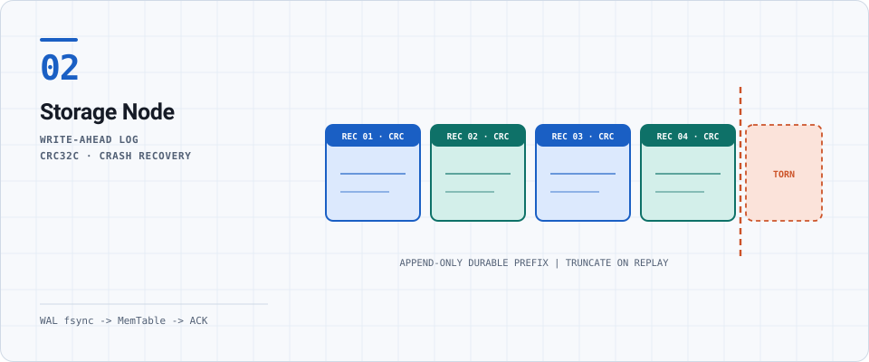
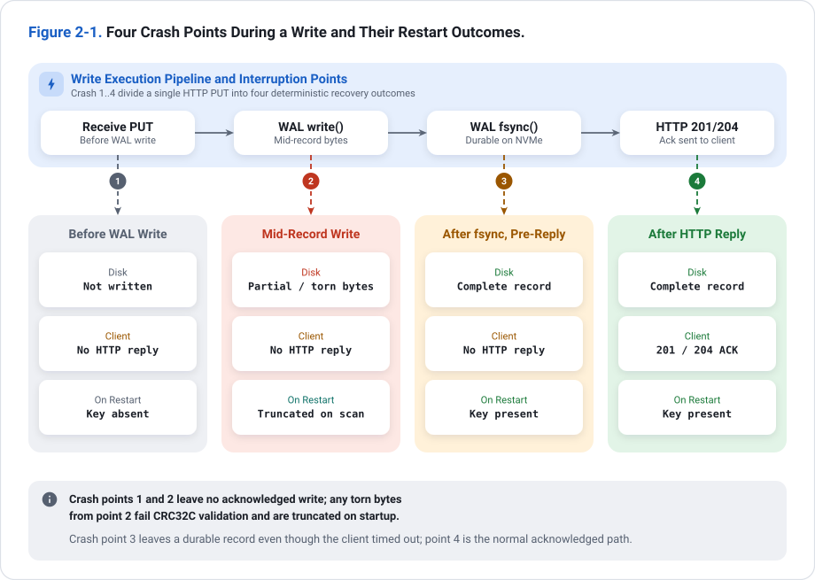
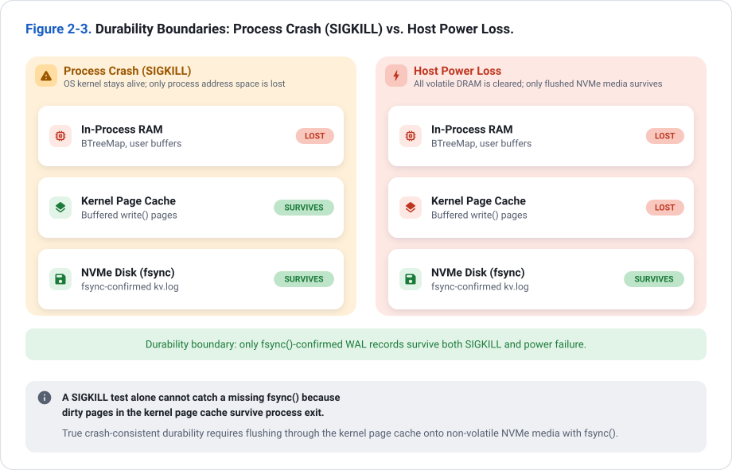
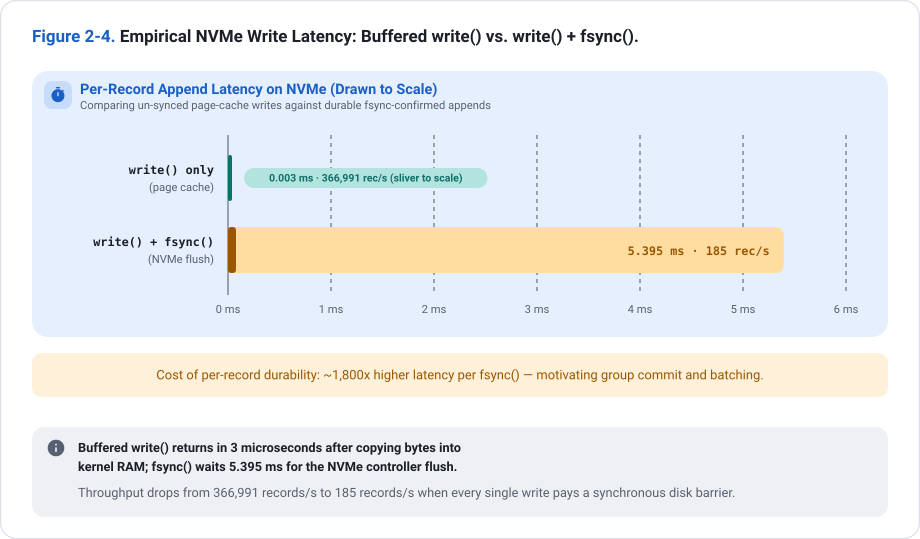
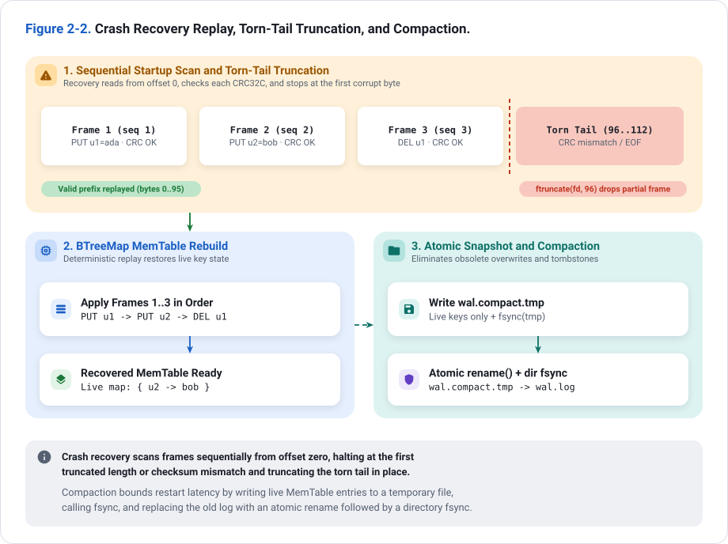
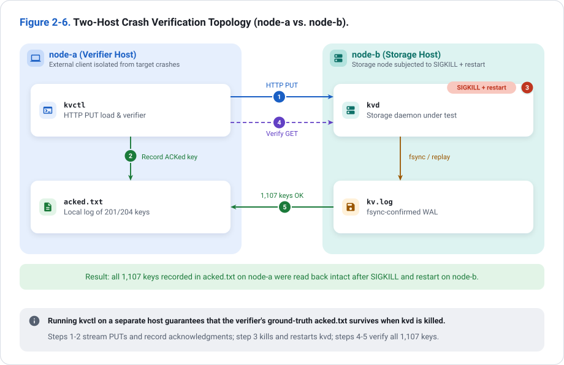

# Chapter 2: Storage Node and Write-Ahead Logging (LLD)



In [Chapter 1](01-key-value-store-system-design.md), we distributed the key-value store across 24 storage nodes, replicated every shard across three independent failure domains, and derived quorum durability bounds under host crashes and network partitions. That entire distributed architecture depends on a single local-storage invariant: once a storage node acknowledges a write to its caller, that write must remain recoverable after the process crashes or the host loses power. If a single node loses an acknowledged record, then a write counted as stored on two of three replicas may survive on only one, invalidating every replication guarantee layered above it.

In this chapter, I implement the *storage node* in Rust so that this durability invariant holds unconditionally. A storage node manages the live key-value map and durable log on one host. Its core engineering complexity concentrates in the few milliseconds during which a mutation is in flight and power may fail. We begin by analyzing what a crash can corrupt at each stage of a write, which motivates append-only write-ahead logging (WAL). We then specify the binary record format, implement CRC-32 checksummed encoding and torn-tail recovery, measure the physical latency of `write` versus `fsync`, and assemble the in-memory store and HTTP/1.1 interface specified in Chapter 1. Finally, we verify crash durability empirically in three complementary ways: by truncating and bit-flipping every byte of a log in `crashsim`, by terminating `kvd` with `SIGKILL` under active client load on one host, and by repeating the crash test across two separate network hosts.

<div class="covers">

In this chapter, we cover

- crash-consistency failure modes at each stage of a mutation and the four invariants of write-ahead logging
- binary record framing with little-endian length prefixes, monotonic sequence numbers, and CRC-32 checksums
- deterministic startup recovery, torn-tail truncation via `set_len`, and parent-directory synchronization
- kernel page-cache buffering versus physical disk durability (`write` versus `fsync`) and empirical NVMe latency via `synccost`
- fail-stop error handling when `write_all` or `sync_data` returns an I/O fault
- the `BTreeMap`-backed `Store` supporting monotonic versions, conditional `If-Match` / `If-None-Match` writes, and cursor-paginated prefix scans
- the asynchronous `axum` HTTP server (`kvd`) offloading blocking disk I/O via `spawn_blocking`
- exhaustive byte-truncation and bit-flip verification (`crashsim`) and live `SIGKILL` recovery verification (`kvctl`) on one host and across two hosts

</div>

## 2.1 Durable Storage and Write-Ahead Logging

A storage node holds its active key-value entries in RAM so that point reads (`GET`) and prefix scans resolve without disk seeks. Because volatile memory disappears when a process terminates or a server loses power, the node must persist every mutation on non-volatile storage in a form from which we can reconstruct the in-memory map deterministically at startup.

Updating a data file in place is unsafe under power loss. Consider replacing a 1 KiB value with a new 1 KiB payload when power fails after half of the new bytes reach disk. On restart, the file contains the first half of the new value concatenated with the second half of the old value. The entry is torn, the prior value is gone, and the raw file carries no structural evidence of corruption.

The defect in an in-place update is that overwriting destroys the old state before the new state becomes complete, creating a vulnerability window in which neither state exists. We eliminate that window by forbidding in-place mutations altogether. Instead, the node appends a self-contained description of each change to the end of an append-only file, called a *log*, and never modifies previously written bytes. Because we record every change durably in the log before mutating any in-memory index, this design is called *write-ahead logging* (WAL).

With an append-only log, a crash mid-write can corrupt at most the single record currently being appended at the tail of the file. Every previously acknowledged record resides at an earlier byte offset that the process never touches again.

We enforce four strict invariants on every storage node, regardless of request interleaving or crash timing:

| No. | Storage Node Invariant | Operational Guarantee |
| :--- | :--- | :--- |
| 0 | Every mutation is appended to the WAL and confirmed by `fsync` before the server returns a response to the client. | Guarantees durability of acknowledged writes across process termination and power loss. |
| 1 | Every mutation reaches the durable WAL before the node applies it to the in-memory `BTreeMap`. | Prevents any concurrent reader from observing uncommitted state that could vanish after a crash. |
| 2 | The in-memory `BTreeMap` equals the exact result of applying all valid WAL records in sequence order. | Ensures that losing RAM loses zero committed state and recovery is deterministic. |
| 3 | The WAL is modified exclusively by appending; bytes belonging to a confirmed record are never overwritten. | Confines crash damage strictly to the tail of the file, where startup recovery detects and truncates incomplete frames. |

## 2.2 Crash Points During a Write

Because invariant 0 and invariant 1 impose a strict total order on the write path (encode frame, append to WAL, call `fsync`, apply to `BTreeMap`, send HTTP response), we can enumerate the exact recovery state for a crash at every stage of a mutation (Figure 2-1).

<figure>

<figcaption><b>Figure 2-1</b> The four execution points at which a crash can occur during a write, and the resulting state after restart.</figcaption>
</figure>

The third case merits explicit analysis. When the node completes `fsync` and terminates before writing the HTTP response socket, the record survives recovery even though the caller received a connection reset rather than a `201 Created` or `204 No Content`. This outcome satisfies invariant 0: durability binds acknowledged writes and makes no promise that an unacknowledged write did not commit. From the caller's perspective, the outcome is indeterminate. As we established in Chapter 1, the caller resolves indeterminate writes safely by retrying with an idempotent `PUT` or a conditional `If-Match` version check. We trigger and observe this exact third case experimentally in Section 2.8.

## 2.3 On-Disk WAL Record Format

When the storage node restarts, the recovery scanner must locate every record boundary across variable-length keys and values, and it must reject any truncated or bit-corrupted record at the end of the file.

We satisfy both requirements by prefixing every serialized payload with an 8-byte *frame header*: a 4-byte little-endian unsigned payload length (`u32`) followed by a 4-byte IEEE CRC-32 checksum computed over the payload bytes. Any single-bit flip, torn sector write, or truncated payload changes either the observed length or the recomputed CRC-32 checksum. Figure 2-2 illustrates both the on-disk binary record layout and the synchronous write path from frame encoding through WAL durability to `BTreeMap` visibility.

<figure class="diagram">

<figcaption><b>Figure 2-2</b> On-disk WAL frame layout and synchronous write path ordering durable append ahead of in-memory state visibility.</figcaption>
</figure>

Inspecting the raw bytes of `data/kv.log` after applying two writes to `user-1` illustrates the exact wire layout:

```console
$ xxd data/kv.log | head -4
00000000: 1400 0000 8dd3 da1d 0100 0000 0000 0000  ................
00000010: 0106 0075 7365 722d 3161 6461 1d00 0000  ...user-1ada....
00000020: cefd 7d53 0200 0000 0000 0000 0106 0075  ..}S...........u
00000030: 7365 722d 3161 6461 206c 6f76 656c 6163  ser-1ada lovelac
```

The first four bytes (`1400 0000`) encode payload length `20` in little-endian byte order, followed by the 4-byte CRC-32 checksum (`8dd3 da1d`). Inside the 20-byte payload, the 8-byte sequence number `1` precedes the 1-byte operation tag (`01` for `Put`), the 2-byte key length (`0600`), the 6-byte UTF-8 key (`user-1`), and the remaining value bytes (`ada`). At byte offset `28` (`0x1c`), the second frame opens with length `1d00 0000` (`29` bytes).

We implement binary framing in `kv/src/record.rs`. Listing 2.1 declares the CRC-32 hasher import required for payload integrity verification.

<p class="listing"><b>Listing 2.1</b> Imports of <code>kv/src/record.rs</code>. <a href="https://github.com/arpanpathak/cracking-the-systems-programming-interview/blob/prep-v2/distributed-systems-from-the-ground-up/code/kv/src/record.rs">kv/src/record.rs</a></p>

```rust
{{#include ../code/kv/src/record.rs:imports}}
```

Before writing the encoder and decoder, we define the core domain types in Listing 2.2. `Change` represents either a `Put` with key and value bytes or a `Delete` tombstone, `Record` pairs a `Change` with its strictly monotonic `u64` log sequence number, and `Decoded` partitions every possible decode result into three mutually exclusive outcomes: `Ok` (a valid record plus byte count consumed), `Incomplete` (buffer ended before frame or payload completion), or `Corrupt` (checksum mismatch, unknown tag, or invalid UTF-8 key). Recovery treats `Incomplete` and `Corrupt` identically by stopping the scan, whereas post-mortem fault inspection benefits from distinguishing an interrupted tail write from on-disk bit corruption.

<p class="listing"><b>Listing 2.2</b> Core record types and three-way decode outcome in <code>kv/src/record.rs</code>. <a href="https://github.com/arpanpathak/cracking-the-systems-programming-interview/blob/prep-v2/distributed-systems-from-the-ground-up/code/kv/src/record.rs">kv/src/record.rs</a></p>

```rust
{{#include ../code/kv/src/record.rs:types}}
```

Listing 2.3 defines `Record::encode`, which serializes the sequence number, operation tag, key length, key bytes, and optional value bytes into a contiguous payload vector, computes its CRC-32 digest, and prepends the 8-byte frame header (`len` and `crc`) in little-endian order. The contract guarantees that every encoded frame is self-delimiting and passes `Record::decode` without allocation ambiguity.

<p class="listing"><b>Listing 2.3</b> Little-endian framing and CRC-32 encoding in <code>kv/src/record.rs</code>. <a href="https://github.com/arpanpathak/cracking-the-systems-programming-interview/blob/prep-v2/distributed-systems-from-the-ground-up/code/kv/src/record.rs">kv/src/record.rs</a></p>

```rust
{{#include ../code/kv/src/record.rs:encode}}
```

Listing 2.4 implements the inverse contract, `Record::decode`. It parses a byte slice defensively without trusting any length field read from disk: if fewer than 8 bytes remain or fewer than `len` payload bytes remain, it returns `Decoded::Incomplete`; if the recomputed CRC-32 fails, an internal field exceeds payload bounds, the key is invalid UTF-8, or the operation tag is unrecognized, it returns `Decoded::Corrupt`. Every fixed-width field uses `split_first_chunk`, ensuring that corrupted length headers never trigger an out-of-bounds panic.

<p class="listing"><b>Listing 2.4</b> Defensive bounds-checked decoding in <code>kv/src/record.rs</code>. <a href="https://github.com/arpanpathak/cracking-the-systems-programming-interview/blob/prep-v2/distributed-systems-from-the-ground-up/code/kv/src/record.rs">kv/src/record.rs</a></p>

```rust
{{#include ../code/kv/src/record.rs:decode}}
```

## 2.4 Measuring the Physical Cost of `fsync`

Invariant 0 requires confirmation from non-volatile storage before replying to a client. Issuing a `write` system call alone does not satisfy this requirement. `write` copies bytes from user-space memory into the operating system kernel's page cache and returns immediately; the kernel flushes dirty pages asynchronously on its own schedule. Calling `fsync` (or `fdatasync`, invoked in Rust via `File::sync_data`) forces the kernel to flush all buffered bytes for that file descriptor to the storage controller and blocks until the device reports completion.

<figure>

<figcaption><b>Figure 2-3</b> Durability boundaries across process termination versus host power failure.</figcaption>
</figure>

To quantify this durability barrier on real hardware, we build the `synccost` microbenchmark. Listing 2.5 imports the filesystem, timing, and record types used by `synccost`.

<p class="listing"><b>Listing 2.5</b> Imports of <code>synccost/src/main.rs</code>. <a href="https://github.com/arpanpathak/cracking-the-systems-programming-interview/blob/prep-v2/distributed-systems-from-the-ground-up/code/synccost/src/main.rs">synccost/src/main.rs</a></p>

```rust
{{#include ../code/synccost/src/main.rs:imports}}
```

Listing 2.6 appends 500 identical records twice to fresh files: once calling `write_all` alone (`sync = false`) and once calling `write_all` followed by `sync_data` (`sync = true`), reporting elapsed time, per-record latency, and sustained throughput for each mode.

<p class="listing"><b>Listing 2.6</b> Measuring buffered versus durable WAL append throughput in <code>synccost/src/main.rs</code>. <a href="https://github.com/arpanpathak/cracking-the-systems-programming-interview/blob/prep-v2/distributed-systems-from-the-ground-up/code/synccost/src/main.rs">synccost/src/main.rs</a></p>

```rust
{{#include ../code/synccost/src/main.rs:measure}}
```

Running `synccost` on an NVMe SSD yields a three-order-of-magnitude latency gap:

```console
$ cargo run --release -p synccost -- /var/tmp/synccost
without fsync: 500 records in      1.4 ms, 0.003 ms per record, 366991 records per second
with fsync   : 500 records in   2697.5 ms, 5.395 ms per record,    185 records per second
```

<figure>

<figcaption><b>Figure 2-4</b> Empirical NVMe latency of buffered writes versus `fsync`-confirmed appends, drawn to scale.</figcaption>
</figure>

Each durable append costs `5.4 ms`, roughly 1,900 times longer than copying into the kernel page cache, capping an unbatched single-writer disk at `185 records/s`. This measurement anchors the hardware provisioning analysis we established in Chapter 1 and motivates the group-commit batching optimization we implement in Chapter 6. Because durability versus throughput is an explicit operational trade-off, `kvd` exposes an optional `--no-sync` flag that skips `sync_data`. Under `--no-sync`, acknowledged writes survive a process crash (`SIGKILL`) via the kernel page cache, yet recent writes can disappear upon host power loss. Defaulting to durable `fsync` ensures that no operator trades away power-loss safety without an explicit configuration flag.

## 2.5 Low-Level Architecture and Workspace Layout

Before examining the log, store, and HTTP server implementations, we summarize the workspace crates, core types, operation complexities, and failure contracts.

<div class="lld">

Low-level design: the storage node

**Crates**

| Crate | Kind | Responsibilities |
| :--- | :--- | :--- |
| `kv` | library | `record` (binary framing and CRC-32), `log` (append-only WAL and crash recovery), `store` (`BTreeMap` state machine and optimistic concurrency checks) |
| `kvd` | library and binary | `api` (RFC 9457 error mapping and conditional headers, reused across Chapters 3 to 6) and the `axum` HTTP server |
| `kvctl` | binary | External load generator and post-crash durability verifier |
| `crashsim` | binary | Deterministic WAL fault injector testing every byte truncation and bit flip |
| `synccost` | binary | Microbenchmark comparing `write` against `write` plus `fsync` |

**Types**

| Type | Key Fields | Responsibility |
| :--- | :--- | :--- |
| `Change` | `Put { key, value }` or `Delete { key }` | Represents a logical state-machine mutation |
| `Record` | `sequence`, `change` | Pairs a mutation with its contiguous WAL index |
| `Log` | `file`, `sync`, `next`, `failed` | Manages durable appends, startup recovery, and fail-stop latching |
| `Entry` | `value`, `version` | Stores the active value bytes and current sequence version of a key |
| `Condition` | `Always`, `Absent`, `Version(n)` | Encodes HTTP `If-Match` and `If-None-Match` preconditions |
| `Store` | `entries: BTreeMap<String, Entry>`, `log` | Enforces check-append-apply ordering and serves memory-resident reads |

**Operations**

| Operation | Execution Steps | Dominant Cost |
| :--- | :--- | :--- |
| `Store::put` | Evaluate precondition, `Log::append`, apply to `BTreeMap` | 1 `fsync` |
| `Store::delete` | Verify key existence and precondition, `Log::append`, remove from `BTreeMap` | 1 `fsync` |
| `Store::get` | Lookup key in `BTreeMap` | `O(log n)` in RAM, zero disk I/O |
| `Store::list` | Range scan from prefix or cursor in `BTreeMap` | `O(log n + limit)` in RAM, zero disk I/O |
| `Store::open` | `Log::open` with torn-tail truncation, replay valid records | Linear in WAL byte size |

**Failure Policy**

| Fault Condition | Deterministic Response |
| :--- | :--- |
| Trailing incomplete or CRC-corrupt record on startup | Truncate the WAL file to the byte offset immediately after the last valid record and `sync_all`. |
| I/O error returned by `write_all` or `sync_data` | Latch `failed = true`, return HTTP `503 Service Unavailable`, and reject all subsequent writes until operator restart. |

</div>

Listing 2.7 presents the workspace `Cargo.toml`, pinning the Rust edition, minimum supported compiler version, and shared dependency versions across all Part I crates.

<p class="listing"><b>Listing 2.7</b> Workspace manifest in <code>Cargo.toml</code>. <a href="https://github.com/arpanpathak/cracking-the-systems-programming-interview/blob/prep-v2/distributed-systems-from-the-ground-up/code/Cargo.toml">Cargo.toml</a></p>

```toml
{{#include ../code/Cargo.toml}}
```

| Dependency | Role in Workspace |
| :--- | :--- |
| `axum`, `tokio` | Asynchronous HTTP/1.1 server and multi-threaded task executor |
| `clap` | Typed command-line argument parsing |
| `crc32fast` | Hardware-accelerated IEEE CRC-32 checksum computation |
| `parking_lot` | Non-poisoning mutex with fast uncontended locking |
| `serde` | JSON serialization for prefix-list responses and RFC 9457 problem payloads |
| `thiserror` | Ergonomic `Error` and `From` trait derivations for `StoreError` |
| `ureq` | Synchronous HTTP client used by `kvctl` |
| `xxhash-rust` | Fast non-cryptographic 64-bit hashing for the consistent-hash ring |

## 2.6 The Write-Ahead Log (`kv::log`)

`Log` owns the open file descriptor for `kv.log` and exposes two public operations: `open`, which recovers the durable prefix and repairs any torn tail, and `append`, which assigns the next contiguous sequence number and persists the framed record.

Listing 2.8 imports the file I/O traits, path types, and `Record` codec used by `kv/src/log.rs`.

<p class="listing"><b>Listing 2.8</b> Imports of <code>kv/src/log.rs</code>. <a href="https://github.com/arpanpathak/cracking-the-systems-programming-interview/blob/prep-v2/distributed-systems-from-the-ground-up/code/kv/src/log.rs">kv/src/log.rs</a></p>

```rust
{{#include ../code/kv/src/log.rs:imports}}
```

Listing 2.9 defines the `Log` struct and `Recovered` return bundle. `Log` tracks the next sequence number to assign (`next`), whether `sync_data` is enabled (`sync`), and the fail-stop latch (`failed`). `Recovered` hands back the open `Log`, the ordered vector of intact `Record` entries, and `truncated_bytes` so operators can observe whether startup repaired a torn tail.

<p class="listing"><b>Listing 2.9</b> <code>Log</code> state and <code>Recovered</code> summary in <code>kv/src/log.rs</code>. <a href="https://github.com/arpanpathak/cracking-the-systems-programming-interview/blob/prep-v2/distributed-systems-from-the-ground-up/code/kv/src/log.rs">kv/src/log.rs</a></p>

```rust
{{#include ../code/kv/src/log.rs:types}}
```

### Startup Scan and Torn-Tail Truncation

At startup, `scan` reads the raw file buffer from byte offset `0` and invokes `Record::decode` repeatedly until either all bytes are consumed or the first `Incomplete` or `Corrupt` frame is encountered. Listing 2.10 implements this pure decoding loop, returning the valid record vector and the exact byte offset where valid data ends.

<p class="listing"><b>Listing 2.10</b> Sequential record scan in <code>kv/src/log.rs</code>. <a href="https://github.com/arpanpathak/cracking-the-systems-programming-interview/blob/prep-v2/distributed-systems-from-the-ground-up/code/kv/src/log.rs">kv/src/log.rs</a></p>

```rust
{{#include ../code/kv/src/log.rs:scan}}
```

Figure 2-5 traces the complete crash-recovery lifecycle: scanning valid CRC-checked frames from byte `0`, truncating the torn tail at the exact valid boundary, replaying the valid prefix into a fresh `BTreeMap`, and bounding long-term log growth via atomic snapshot compaction.

<figure class="diagram">

<figcaption><b>Figure 2-5</b> Startup WAL recovery, torn-tail truncation, deterministic MemTable replay, and snapshot compaction.</figcaption>
</figure>

Listing 2.11 implements `Log::open`. After opening or creating `kv.log`, reading its contents, and running `scan`, it truncates any trailing damaged bytes via `file.set_len(valid_end)`, seeks the write cursor to `valid_end`, calls `file.sync_all()`, and synchronizes the parent directory descriptor (`sync_dir`).

<p class="listing"><b>Listing 2.11</b> Opening the WAL, truncating damaged tails, and syncing the parent directory in <code>kv/src/log.rs</code>. <a href="https://github.com/arpanpathak/cracking-the-systems-programming-interview/blob/prep-v2/distributed-systems-from-the-ground-up/code/kv/src/log.rs">kv/src/log.rs</a></p>

```rust
{{#include ../code/kv/src/log.rs:open}}
```

Truncating the damaged tail before accepting any new write is mandatory for correctness. If trailing garbage remained in the file, subsequent valid records would be appended past the corrupt offset; on the next restart, `scan` would halt at the old damage and discard newly acknowledged writes. Both `sync_all` calls are equally required: synchronizing the file descriptor persists its truncated length and contents, whereas synchronizing the parent directory persists the directory entry linking the filename to its inode. On POSIX filesystems, a newly created log file whose parent directory was never synchronized can vanish entirely after a power loss.

### Durable Appends and Fail-Stop Error Handling

Listing 2.12 implements `Log::append`. Preconditions: `self.failed` must be `false`. The method constructs the next `Record` with sequence number `self.next`, encodes the frame, writes all bytes to disk, and optionally calls `sync_data`. Only after disk confirmation succeeds does `self.next` increment. On any I/O error from `write_all` or `sync_data`, the method sets `self.failed = true` and propagates the error.

<p class="listing"><b>Listing 2.12</b> Durable append with fail-stop latching in <code>kv/src/log.rs</code>. <a href="https://github.com/arpanpathak/cracking-the-systems-programming-interview/blob/prep-v2/distributed-systems-from-the-ground-up/code/kv/src/log.rs">kv/src/log.rs</a></p>

```rust
{{#include ../code/kv/src/log.rs:append}}
```

Latching `self.failed = true` enforces a *fail-stop* policy. When `write_all` or `sync_data` fails, the on-disk tail state is indeterminate: the bytes may be absent, partially written, or written to a failing sector. Continuing to append risks placing a valid record behind a corrupt frame where recovery will never read it. Retrying `fsync` is equally unsafe on Linux and similar kernels: after returning an I/O error from `fsync`, the kernel marks affected page-cache pages clean and discards the error state, so a second `fsync` call can return `Ok(())` even though the data never reached disk. By latching `failed = true`, the node rejects all further mutations with HTTP `503 Service Unavailable`, continues serving in-memory reads, and awaits operator restart or host replacement. In the multi-node cluster of Chapter 1, peer replicas elect a new leader and absorb the failed disk without service outage.

## 2.7 The In-Memory Store (`kv::store`)

`Store` owns both the `BTreeMap<String, Entry>` index and the underlying `Log`, funneling every mutation through a single ordered code path. Listing 2.13 declares the map and error imports for `kv/src/store.rs`.

<p class="listing"><b>Listing 2.13</b> Imports of <code>kv/src/store.rs</code>. <a href="https://github.com/arpanpathak/cracking-the-systems-programming-interview/blob/prep-v2/distributed-systems-from-the-ground-up/code/kv/src/store.rs">kv/src/store.rs</a></p>

```rust
{{#include ../code/kv/src/store.rs:imports}}
```

Listing 2.14 implements `Store::open` and the internal `apply` helper. `Store::open` delegates WAL recovery to `Log::open`, allocates an empty `BTreeMap`, and replays every recovered record through `apply`. Because startup recovery and live writes invoke the exact same `apply` function, invariant 2 holds by construction: live state and recovered state cannot diverge.

<p class="listing"><b>Listing 2.14</b> Store startup replay and single-source state application in <code>kv/src/store.rs</code>. <a href="https://github.com/arpanpathak/cracking-the-systems-programming-interview/blob/prep-v2/distributed-systems-from-the-ground-up/code/kv/src/store.rs">kv/src/store.rs</a></p>

```rust
{{#include ../code/kv/src/store.rs:open}}
```

Listing 2.15 implements `Store::put` and `Store::delete`. Both enforce the exact three-stage contract required by invariants 0 and 1:

1. Validate the caller's `Condition` (`Always`, `Absent`, or `Version(expected)`) against the current `BTreeMap` entry so rejected writes never touch disk.
2. Call `self.log.append(change)?`, returning early on any disk failure before mutating memory.
3. Apply the durable record to `self.entries` and return the assigned version.

Notice that an entry's `version` equals the exact `sequence` number of the WAL record that last updated it. Reusing the WAL sequence number eliminates any secondary version counter that could drift out of synchronization across crashes.

<p class="listing"><b>Listing 2.15</b> Check-append-apply write path in <code>kv/src/store.rs</code>. <a href="https://github.com/arpanpathak/cracking-the-systems-programming-interview/blob/prep-v2/distributed-systems-from-the-ground-up/code/kv/src/store.rs">kv/src/store.rs</a></p>

```rust
{{#include ../code/kv/src/store.rs:write}}
```

Listing 2.16 implements the read path (`Store::get`, `Store::list`, and `page`), which queries `self.entries` exclusively with zero disk I/O. Because `BTreeMap` maintains keys in lexicographic order, `page` executes a bounded range scan starting either at `prefix` or strictly after `cursor`, terminating at the first key that no longer starts with `prefix`. Fetching `limit + 1` keys determines whether a subsequent page exists without scanning the remainder of the keyspace.

<p class="listing"><b>Listing 2.16</b> Point lookups and cursor-paginated prefix scans in <code>kv/src/store.rs</code>. <a href="https://github.com/arpanpathak/cracking-the-systems-programming-interview/blob/prep-v2/distributed-systems-from-the-ground-up/code/kv/src/store.rs">kv/src/store.rs</a></p>

```rust
{{#include ../code/kv/src/store.rs:read}}
```

## 2.8 The HTTP Server (`kvd`)

The `kvd` binary exposes `Store` over the REST/HTTP contract defined in Chapter 1, translating HTTP headers into `Condition` values and mapping `StoreError` variants into RFC 9457 problem documents.

Listing 2.17 lists the `axum`, `tokio`, `parking_lot`, and `kv` imports in `kvd/src/main.rs`.

<p class="listing"><b>Listing 2.17</b> Imports of <code>kvd/src/main.rs</code>. <a href="https://github.com/arpanpathak/cracking-the-systems-programming-interview/blob/prep-v2/distributed-systems-from-the-ground-up/code/kvd/src/main.rs">kvd/src/main.rs</a></p>

```rust
{{#include ../code/kvd/src/main.rs:imports}}
```

Listing 2.18 defines the CLI arguments (`--listen`, `--data`, `--no-sync`) and the thread-safe `AppState` wrapper holding `Arc<Mutex<Store>>`.

<p class="listing"><b>Listing 2.18</b> Command-line configuration and shared server state in <code>kvd/src/main.rs</code>. <a href="https://github.com/arpanpathak/cracking-the-systems-programming-interview/blob/prep-v2/distributed-systems-from-the-ground-up/code/kvd/src/main.rs">kvd/src/main.rs</a></p>

```rust
{{#include ../code/kvd/src/main.rs:options}}
```

### Typed Errors and Precondition Header Parsing

We isolate HTTP error formatting and header parsing in `kvd/src/api.rs` so that the replicated server (Chapter 3), Raft server (Chapter 4), router (Chapter 5), and group-commit server (Chapter 6) reuse identical wire semantics. Listing 2.19 declares the imports for `kvd/src/api.rs`.

<p class="listing"><b>Listing 2.19</b> Imports of <code>kvd/src/api.rs</code>. <a href="https://github.com/arpanpathak/cracking-the-systems-programming-interview/blob/prep-v2/distributed-systems-from-the-ground-up/code/kvd/src/api.rs">kvd/src/api.rs</a></p>

```rust
{{#include ../code/kvd/src/api.rs:imports}}
```

Listing 2.20 defines `ApiError` and its `IntoResponse` and `From<StoreError>` implementations. Every storage failure maps deterministically to its RFC 9457 `application/problem+json` response: invalid keys map to `400`, missing keys to `404`, failed optimistic preconditions to `412` (carrying the current `ETag` when available), and failed WAL I/O to `503`.

<p class="listing"><b>Listing 2.20</b> RFC 9457 error mapping in <code>kvd/src/api.rs</code>. <a href="https://github.com/arpanpathak/cracking-the-systems-programming-interview/blob/prep-v2/distributed-systems-from-the-ground-up/code/kvd/src/api.rs">kvd/src/api.rs</a></p>

```rust
{{#include ../code/kvd/src/api.rs:errors}}
```

Listing 2.21 implements `write_condition` and `parse_etag`, validating HTTP `If-Match` and `If-None-Match` headers before any write reaches `Store`. Unsupported combinations such as `If-Match: *` or malformed version tokens return `400 Bad Request` rather than falling back to an unconditional write; ignoring an unrecognized precondition without returning an error would reintroduce the lost-update anomaly that conditional writes exist to eliminate.

<p class="listing"><b>Listing 2.21</b> Parsing <code>If-Match</code> and <code>If-None-Match</code> preconditions in <code>kvd/src/api.rs</code>. <a href="https://github.com/arpanpathak/cracking-the-systems-programming-interview/blob/prep-v2/distributed-systems-from-the-ground-up/code/kvd/src/api.rs">kvd/src/api.rs</a></p>

```rust
{{#include ../code/kvd/src/api.rs:headers}}
```

### Offloading Blocking `fsync` from the Async Executor

The `tokio` runtime multiplexes thousands of concurrent TCP connections over a small fixed pool of worker threads. Blocking a runtime worker for `5.4 ms` inside `File::sync_data` stalls every other connection scheduled on that thread. Listing 2.22 wraps every blocking write closure in `tokio::task::spawn_blocking`, dispatching disk I/O to Tokio's dedicated blocking thread pool while the HTTP handler suspends cleanly.

<p class="listing"><b>Listing 2.22</b> Offloading blocking WAL operations via <code>spawn_blocking</code> in <code>kvd/src/main.rs</code>. <a href="https://github.com/arpanpathak/cracking-the-systems-programming-interview/blob/prep-v2/distributed-systems-from-the-ground-up/code/kvd/src/main.rs">kvd/src/main.rs</a></p>

```rust
{{#include ../code/kvd/src/main.rs:blocking}}
```

Listing 2.23 implements the `PUT` and `DELETE` HTTP handlers. Both validate the key and conditional headers before dispatching to `spawn_blocking`. `PUT` returns `201 Created` when inserting a new key and `204 No Content` when updating an existing entry, attaching the newly assigned `ETag` version header to both responses.

<p class="listing"><b>Listing 2.23</b> HTTP handlers for <code>PUT</code> and <code>DELETE</code> in <code>kvd/src/main.rs</code>. <a href="https://github.com/arpanpathak/cracking-the-systems-programming-interview/blob/prep-v2/distributed-systems-from-the-ground-up/code/kvd/src/main.rs">kvd/src/main.rs</a></p>

```rust
{{#include ../code/kvd/src/main.rs:put}}
```

### Memory-Resident Read and Health Handlers

Because `Store::get` acquires the mutex only long enough to clone an in-memory entry and performs zero disk I/O, it runs directly on the async worker thread without thread-pool handoff overhead. Listing 2.24 implements the `GET /v1/keys/{key}` handler, including `304 Not Modified` short-circuiting when `If-None-Match` matches the current `ETag`.

<p class="listing"><b>Listing 2.24</b> Point-read handler in <code>kvd/src/main.rs</code>. <a href="https://github.com/arpanpathak/cracking-the-systems-programming-interview/blob/prep-v2/distributed-systems-from-the-ground-up/code/kvd/src/main.rs">kvd/src/main.rs</a></p>

```rust
{{#include ../code/kvd/src/main.rs:get}}
```

Listing 2.25 implements paginated prefix listing (`GET /v1/keys`) and the readiness probe (`GET /healthz`), which reports live key count and last committed sequence number.

<p class="listing"><b>Listing 2.25</b> Prefix-listing and health-check handlers in <code>kvd/src/main.rs</code>. <a href="https://github.com/arpanpathak/cracking-the-systems-programming-interview/blob/prep-v2/distributed-systems-from-the-ground-up/code/kvd/src/main.rs">kvd/src/main.rs</a></p>

```rust
{{#include ../code/kvd/src/main.rs:list}}
```

Listing 2.26 wires the `axum` router, recovers `Store` from disk, prints the recovery summary (`recovered ... keys from ... records, cut ... bytes`), and binds the TCP listener.

<p class="listing"><b>Listing 2.26</b> Server bootstrap and route registration in <code>kvd/src/main.rs</code>. <a href="https://github.com/arpanpathak/cracking-the-systems-programming-interview/blob/prep-v2/distributed-systems-from-the-ground-up/code/kvd/src/main.rs">kvd/src/main.rs</a></p>

```rust
{{#include ../code/kvd/src/main.rs:main}}
```

### Exercising the Running Node

Building the workspace in release mode and starting `kvd` exposes the full API surface:

```console
$ cd code
$ cargo build --release
$ ./target/release/kvd --listen 127.0.0.1:7001 --data /var/tmp/kvd
recovered 0 keys from 0 records, cut 0 bytes from the end of the log
listening on 127.0.0.1:7001
```

Three requests confirm input validation, method enforcement, and readiness telemetry:

```console
$ curl -i -X PUT 'http://127.0.0.1:7001/v1/keys/bad%20key' --data-binary 'x'
HTTP/1.1 400 Bad Request
content-type: application/problem+json
content-length: 153

{"type":"/problems/invalid-key","title":"The key is not valid","status":400,"detail":"a key is 1 to 256 characters from A-Z, a-z, 0-9, '.', '_' and '-'"}
```

```console
$ curl -i -X POST http://127.0.0.1:7001/v1/keys/user-1 --data-binary 'x'
HTTP/1.1 405 Method Not Allowed
allow: GET,HEAD,PUT,DELETE
content-length: 0
```

Both `405 Method Not Allowed` and the `allow` response header are generated automatically by `axum` from the HTTP verbs registered on `/v1/keys/:key`.

```console
$ curl -i http://127.0.0.1:7001/healthz
HTTP/1.1 200 OK
content-type: application/json
content-length: 42

{"status":"ok","keys":2,"last_sequence":5}
```

## 2.9 Exhaustive Crash Simulation (`crashsim`)

A handful of manual unit tests cannot establish that WAL recovery handles every possible tear point or bit flip. To verify recovery exhaustively, we implement `crashsim`, which constructs a 5-record reference log of `152` bytes and subjects copies of that log to every single truncation length (`0` to `152`) and every single-byte bit inversion (`0` to `151`).

Listing 2.27 declares the filesystem and `kv` imports in `crashsim/src/main.rs`.

<p class="listing"><b>Listing 2.27</b> Imports of <code>crashsim/src/main.rs</code>. <a href="https://github.com/arpanpathak/cracking-the-systems-programming-interview/blob/prep-v2/distributed-systems-from-the-ground-up/code/crashsim/src/main.rs">crashsim/src/main.rs</a></p>

```rust
{{#include ../code/crashsim/src/main.rs:imports}}
```

Listing 2.28 constructs the 5-record reference WAL and captures its raw bytes together with the exact byte boundary (`ends`) of each record.

<p class="listing"><b>Listing 2.28</b> Generating the 5-record reference WAL in <code>crashsim/src/main.rs</code>. <a href="https://github.com/arpanpathak/cracking-the-systems-programming-interview/blob/prep-v2/distributed-systems-from-the-ground-up/code/crashsim/src/main.rs">crashsim/src/main.rs</a></p>

```rust
{{#include ../code/crashsim/src/main.rs:build}}
```

Listing 2.29 writes a mutated byte image to a temporary directory, invokes `Log::open`, and asserts that the recovered record sequence matches the exact prefix expected prior to the fault offset.

<p class="listing"><b>Listing 2.29</b> Recovering a damaged WAL copy and asserting exact prefix equality in <code>crashsim/src/main.rs</code>. <a href="https://github.com/arpanpathak/cracking-the-systems-programming-interview/blob/prep-v2/distributed-systems-from-the-ground-up/code/crashsim/src/main.rs">crashsim/src/main.rs</a></p>

```rust
{{#include ../code/crashsim/src/main.rs:recover}}
```

Listing 2.30 implements `cuts`, slicing the reference log at every integer length from `0` to `bytes.len()` and asserting that each recovery returns exactly the records whose full byte span fits within the cut.

<p class="listing"><b>Listing 2.30</b> Exhaustive byte-truncation sweep in <code>crashsim/src/main.rs</code>. <a href="https://github.com/arpanpathak/cracking-the-systems-programming-interview/blob/prep-v2/distributed-systems-from-the-ground-up/code/crashsim/src/main.rs">crashsim/src/main.rs</a></p>

```rust
{{#include ../code/crashsim/src/main.rs:cuts}}
```

Storage devices can also return corrupted bits rather than short files. Listing 2.31 implements `flips`, inverting one bit in each byte offset across the entire 152-byte file in separate runs and verifying that CRC-32 validation halts at the corrupted frame and returns all preceding records intact.

<p class="listing"><b>Listing 2.31</b> Exhaustive single-bit corruption sweep in <code>crashsim/src/main.rs</code>. <a href="https://github.com/arpanpathak/cracking-the-systems-programming-interview/blob/prep-v2/distributed-systems-from-the-ground-up/code/crashsim/src/main.rs">crashsim/src/main.rs</a></p>

```rust
{{#include ../code/crashsim/src/main.rs:flips}}
```

Listing 2.32 executes `cuts`, `flips`, and a post-truncation append check verifying that appending after cutting at byte `63` continues cleanly at sequence number `3`.

<p class="listing"><b>Listing 2.32</b> Entry point of <code>crashsim/src/main.rs</code>. <a href="https://github.com/arpanpathak/cracking-the-systems-programming-interview/blob/prep-v2/distributed-systems-from-the-ground-up/code/crashsim/src/main.rs">crashsim/src/main.rs</a></p>

```rust
{{#include ../code/crashsim/src/main.rs:main}}
```

Executing `crashsim` confirms zero recovery discrepancies across all 305 injected fault states:

```console
$ cargo run -p crashsim
a log of 5 records and 152 bytes, with records ending at 28, 58, 95, 120, 152
cut at every length from 0 to 152: each recovery returned the complete records
  lengths   0 to  27: 0 records
  lengths  28 to  57: 1 records
  lengths  58 to  94: 2 records
  lengths  95 to 119: 3 records
  lengths 120 to 151: 4 records
  length  152       : 5 records
1 bit flipped in each of 152 bytes: each recovery returned the records before the damage
after a cut at 63: 2 records recovered, and the next record has sequence 3
```

| Observed Output | Verified Property |
| :--- | :--- |
| `lengths 28 to 57: 1 records` | A record recovers only when every single byte is present; 29 of 30 bytes of record 2 are truncated cleanly. |
| `each recovery returned the complete records` | No truncation offset yields a partial record, fabricated value, or sequence reordering. |
| `1 bit flipped in each of 152 bytes` | Bit corruption anywhere in the header or payload (including the length prefix) triggers rejection and preserves the valid prefix. |
| `after a cut at 63: 2 records recovered, and the next record has sequence 3` | Truncation repairs the tail on disk so subsequent appends resume with contiguous sequence numbers. |

The bit-flip test also exposes a structural boundary of single-node storage: flipping a bit inside record 2 causes recovery to stop at record 2 and discard records 3 to 5, even though records 3 to 5 remain intact on disk. For tail corruption caused by an interrupted write, stopping and truncating is exact. For mid-file media corruption, the single disk has lost previously acknowledged state that local recovery cannot reconstruct. In our multi-node architecture, peer replicas supply the lost suffix, which is why we add quorum replication in Chapter 3.

## 2.10 Live Crash Testing Under Load (`kvctl`)

Whereas `crashsim` exercises `Log` directly, end-to-end verification must cover the entire stack: HTTP parsing, `tokio` task scheduling, `Store` locking, WAL appends, and OS file descriptors. We implement `kvctl` as an independent external oracle: `kvctl load` issues sequential `PUT` requests and appends each acknowledged key-value pair to a local ledger file (`acked.txt`) only after receiving a `201` or `204` response, and `kvctl verify` reads back every recorded entry after server restart.

Listing 2.33 lists the CLI and HTTP client imports in `kvctl/src/main.rs`.

<p class="listing"><b>Listing 2.33</b> Imports of <code>kvctl/src/main.rs</code>. <a href="https://github.com/arpanpathak/cracking-the-systems-programming-interview/blob/prep-v2/distributed-systems-from-the-ground-up/code/kvctl/src/main.rs">kvctl/src/main.rs</a></p>

```rust
{{#include ../code/kvctl/src/main.rs:imports}}
```

Listing 2.34 implements `load`, which writes keys sequentially, records every acknowledged write to disk via the client ledger, and halts cleanly when the server disconnects.

<p class="listing"><b>Listing 2.34</b> Sequential load generator and external acknowledgement log in <code>kvctl/src/main.rs</code>. <a href="https://github.com/arpanpathak/cracking-the-systems-programming-interview/blob/prep-v2/distributed-systems-from-the-ground-up/code/kvctl/src/main.rs">kvctl/src/main.rs</a></p>

```rust
{{#include ../code/kvctl/src/main.rs:load}}
```

Listing 2.35 implements `verify`, which iterates over every line in `acked.txt`, executes `GET /v1/keys/{key}`, checks exact value equality, and reports any missing or mismatched keys.

<p class="listing"><b>Listing 2.35</b> Post-recovery durability verifier in <code>kvctl/src/main.rs</code>. <a href="https://github.com/arpanpathak/cracking-the-systems-programming-interview/blob/prep-v2/distributed-systems-from-the-ground-up/code/kvctl/src/main.rs">kvctl/src/main.rs</a></p>

```rust
{{#include ../code/kvctl/src/main.rs:verify}}
```

While `kvctl load` streams writes, we terminate `kvd` immediately with `SIGKILL` (`pkill -9`), preventing user-space cleanup handlers or destructors from executing:

```console
$ ./target/release/kvd --data /var/tmp/kvd &
recovered 0 keys from 0 records, cut 0 bytes from the end of the log
listening on 127.0.0.1:7001
$ ./target/release/kvctl load --server http://127.0.0.1:7001 --count 5000 --acked acked.txt &
$ sleep 3; pkill -9 -x kvd
write 495 failed: io: Peer disconnected
494 writes acknowledged
$ ./target/release/kvd --data /var/tmp/kvd &
recovered 495 keys from 495 records, cut 0 bytes from the end of the log
listening on 127.0.0.1:7001
$ ./target/release/kvctl verify --server http://127.0.0.1:7001 --acked acked.txt
494 acknowledged, 494 found, 0 missing
```

| Observed Output | Diagnostic Meaning |
| :--- | :--- |
| `494 acknowledged, 494 found, 0 missing` | Every acknowledged write survived `SIGKILL` and restarted intact. |
| `recovered 495 keys` | Record 495 completed `fsync` before the process terminated, even though the TCP response never reached the client. |
| `cut 0 bytes` | `SIGKILL` arrived outside the brief `write_all` syscall window, leaving zero partial trailing bytes. |

Write `495` reproduces the third crash point of Figure 2-1: durable on disk yet unacknowledged at the client.

### Why Process-Kill Tests Cannot Validate Power-Loss Durability

Running the identical `SIGKILL` experiment with `--no-sync` also passes with zero missing keys:

```console
$ ./target/release/kvd --data /var/tmp/kvd --no-sync &
$ ./target/release/kvctl load --server http://127.0.0.1:7001 --count 200000 --acked acked.txt &
$ sleep 1.5; pkill -9 -x kvd
write 8595 failed: io: Connection reset by peer (os error 104)
8594 writes acknowledged
$ ./target/release/kvd --data /var/tmp/kvd --no-sync &
recovered 8594 keys from 8594 records, cut 0 bytes from the end of the log
$ ./target/release/kvctl verify --server http://127.0.0.1:7001 --acked acked.txt
8594 acknowledged, 8594 found, 0 missing
```

Concluding from this output that `fsync` is unnecessary would be a grave engineering mistake. When `SIGKILL` terminates a user-space process, the operating system kernel continues running and flushes dirty page-cache buffers to disk moments later. Only a fault that halts the kernel itself, such as power loss or a kernel panic, drops unsynchronized page-cache buffers. Consequently, process-kill testing verifies crash-recovery code paths yet provides zero evidence of power-loss durability.

### Running the Crash Verification Across Two Network Hosts

Because `kvd` and `kvctl` communicate strictly over HTTP, we can separate the fault domain of the server from the external oracle by running `kvd` on host `node-b` (`10.0.0.2`) and `kvctl` on host `node-a` (Figure 2-6).

<figure>

<figcaption><b>Figure 2-6</b> Separating the external verification client (`node-a`) from the storage node under test (`node-b`).</figcaption>
</figure>

```console
node-a$ scp target/release/kvd node-b:/tmp/kvd
node-b$ /tmp/kvd --listen 0.0.0.0:7001 --data /tmp/kvd-data &
recovered 0 keys from 0 records, cut 0 bytes from the end of the log
listening on 0.0.0.0:7001

node-a$ ./target/release/kvctl load --server http://10.0.0.2:7001 --count 5000 --acked acked.txt &
node-b$ pkill -9 -x kvd
write 1108 failed: io: Connection reset by peer (os error 104)
1107 writes acknowledged

node-b$ /tmp/kvd --listen 0.0.0.0:7001 --data /tmp/kvd-data &
recovered 1107 keys from 1107 records, cut 0 bytes from the end of the log
node-a$ ./target/release/kvctl verify --server http://10.0.0.2:7001 --acked acked.txt
1107 acknowledged, 1107 found, 0 missing
node-a$ curl http://10.0.0.2:7001/healthz
{"status":"ok","keys":1107,"last_sequence":1107}
```

Keeping `acked.txt` on `node-a` isolates the test oracle from every fault injected on `node-b`. This external-oracle methodology (record acknowledgements outside the system under test, inject a fault, recover, and verify every recorded outcome) generalizes directly to the replication and Raft leader-election experiments we run in Chapters 3 and 4.

| Deployment Topology | Server Command | Client Command |
| :--- | :--- | :--- |
| Single host (loopback) | `kvd --listen 127.0.0.1:7001` | `kvctl ... --server http://127.0.0.1:7001` |
| Two hosts on a LAN | `kvd --listen 0.0.0.0:7001` on `node-b` | `kvctl ... --server http://<node-b-ip>:7001` on `node-a` |
| Two cloud VMs | Same as LAN, with TCP port `7001` allowed in security group | Same as LAN, targeting the private VPC address of `node-b` |

## 2.11 Residual Limitations of a Single Storage Node

Even with crash-safe write-ahead logging verified, five physical limits remain on a single host, each motivating a specific distributed component in subsequent chapters:

| No. | Single-Node Limitation | Failure Consequence | Architectural Mitigation |
| :--- | :--- | :--- | :--- |
| 0 | The WAL resides on one local disk. | Permanent disk or host failure destroys all stored data. | Three-way leader-follower quorum replication (Chapter 3). |
| 1 | The node runs as one process. | Every client request fails during crashes or restarts. | Automated Raft leader election (Chapter 4). |
| 2 | Every write triggers its own `fsync`. | Single-node throughput caps at `~185 writes/s` on NVMe. | WAL group commit (Chapter 6) and horizontal sharding across 24 nodes. |
| 3 | The WAL grows monotonically without compaction. | Disk consumption and startup replay duration increase unboundedly. | Periodic state snapshots followed by log truncation (Chapter 1). |
| 4 | All active entries reside in one host's RAM. | Corpus size cannot exceed single-server memory capacity. | Consistent-hash sharding and request routing (Chapter 5). |

Within these bounds, our single storage node preserves every acknowledged write across `SIGKILL` crashes, arbitrary tail truncations, and single-bit tail corruption. In Chapter 3, we layer leader-follower quorum replication directly onto this WAL foundation.

## 2.12 Complete Source Listings

For reference and reproducibility, Listings 2.36 through 2.45 include the complete source files of the five workspace crates developed in this chapter.

Listing 2.36 declares the public module exports of the `kv` library crate (`log`, `record`, and `store`).

<p class="listing"><b>Listing 2.36</b> Complete <code>kv/src/lib.rs</code>. <a href="https://github.com/arpanpathak/cracking-the-systems-programming-interview/blob/prep-v2/distributed-systems-from-the-ground-up/code/kv/src/lib.rs">kv/src/lib.rs</a></p>

```rust
{{#include ../code/kv/src/lib.rs}}
```

Listing 2.37 presents the complete binary record codec, CRC-32 checksum verification, and unit tests in `kv/src/record.rs`.

<p class="listing"><b>Listing 2.37</b> Complete <code>kv/src/record.rs</code>. <a href="https://github.com/arpanpathak/cracking-the-systems-programming-interview/blob/prep-v2/distributed-systems-from-the-ground-up/code/kv/src/record.rs">kv/src/record.rs</a></p>

```rust
{{#include ../code/kv/src/record.rs}}
```

Listing 2.38 presents the complete append-only WAL, torn-tail recovery, directory sync, and fail-stop error latch in `kv/src/log.rs`.

<p class="listing"><b>Listing 2.38</b> Complete <code>kv/src/log.rs</code>. <a href="https://github.com/arpanpathak/cracking-the-systems-programming-interview/blob/prep-v2/distributed-systems-from-the-ground-up/code/kv/src/log.rs">kv/src/log.rs</a></p>

```rust
{{#include ../code/kv/src/log.rs}}
```

Listing 2.39 presents the complete `BTreeMap`-backed `Store`, optimistic precondition evaluation, and paginated prefix scans in `kv/src/store.rs`.

<p class="listing"><b>Listing 2.39</b> Complete <code>kv/src/store.rs</code>. <a href="https://github.com/arpanpathak/cracking-the-systems-programming-interview/blob/prep-v2/distributed-systems-from-the-ground-up/code/kv/src/store.rs">kv/src/store.rs</a></p>

```rust
{{#include ../code/kv/src/store.rs}}
```

Listing 2.40 re-exports the shared HTTP error and precondition header helpers from the `kvd` library root.

<p class="listing"><b>Listing 2.40</b> Complete <code>kvd/src/lib.rs</code>. <a href="https://github.com/arpanpathak/cracking-the-systems-programming-interview/blob/prep-v2/distributed-systems-from-the-ground-up/code/kvd/src/lib.rs">kvd/src/lib.rs</a></p>

```rust
{{#include ../code/kvd/src/lib.rs}}
```

Listing 2.41 presents the complete RFC 9457 error serialization and `If-Match` / `If-None-Match` parsing module in `kvd/src/api.rs`.

<p class="listing"><b>Listing 2.41</b> Complete <code>kvd/src/api.rs</code>. <a href="https://github.com/arpanpathak/cracking-the-systems-programming-interview/blob/prep-v2/distributed-systems-from-the-ground-up/code/kvd/src/api.rs">kvd/src/api.rs</a></p>

```rust
{{#include ../code/kvd/src/api.rs}}
```

Listing 2.42 presents the complete `axum` HTTP server and blocking WAL dispatch implementation in `kvd/src/main.rs`.

<p class="listing"><b>Listing 2.42</b> Complete <code>kvd/src/main.rs</code>. <a href="https://github.com/arpanpathak/cracking-the-systems-programming-interview/blob/prep-v2/distributed-systems-from-the-ground-up/code/kvd/src/main.rs">kvd/src/main.rs</a></p>

```rust
{{#include ../code/kvd/src/main.rs}}
```

Listing 2.43 presents the complete external load generator and durability verification client in `kvctl/src/main.rs`.

<p class="listing"><b>Listing 2.43</b> Complete <code>kvctl/src/main.rs</code>. <a href="https://github.com/arpanpathak/cracking-the-systems-programming-interview/blob/prep-v2/distributed-systems-from-the-ground-up/code/kvctl/src/main.rs">kvctl/src/main.rs</a></p>

```rust
{{#include ../code/kvctl/src/main.rs}}
```

Listing 2.44 presents the complete byte-truncation and bit-flip crash simulator in `crashsim/src/main.rs`.

<p class="listing"><b>Listing 2.44</b> Complete <code>crashsim/src/main.rs</code>. <a href="https://github.com/arpanpathak/cracking-the-systems-programming-interview/blob/prep-v2/distributed-systems-from-the-ground-up/code/crashsim/src/main.rs">crashsim/src/main.rs</a></p>

```rust
{{#include ../code/crashsim/src/main.rs}}
```

Listing 2.45 presents the complete `write` versus `fsync` microbenchmark in `synccost/src/main.rs`.

<p class="listing"><b>Listing 2.45</b> Complete <code>synccost/src/main.rs</code>. <a href="https://github.com/arpanpathak/cracking-the-systems-programming-interview/blob/prep-v2/distributed-systems-from-the-ground-up/code/synccost/src/main.rs">synccost/src/main.rs</a></p>

```rust
{{#include ../code/synccost/src/main.rs}}
```

## 2.13 End-to-End Write Lifecycle and Storage-Stack Latency Budget

A single-node `PUT /v1/keys/session:901` request traverses seven software and hardware boundaries inside `kvd` before the client receives `201 Created`:

1. **Client to HTTP Ingress (`axum` / Tokio):** The client transmits the HTTP/1.1 or HTTP/2 request over loopback or intra-AZ Ethernet. The Tokio runtime reads the socket via `epoll`/`kqueue` and parses the key, headers (`If-Match`), and body bytes.
2. **Async-to-Blocking Pool Handoff:** Because `fdatasync(2)` blocks the calling OS thread for several milliseconds, `kvd` dispatches the storage operation onto Tokio's dedicated blocking thread pool (`spawn_blocking`), preventing reactor starvation for concurrent readers.
3. **Mutex Acquisition and Precondition Check:** The worker acquires the `Store` mutex, verifies any `If-Match` or `If-None-Match` guard against the in-memory `BTreeMap`, and assigns the next monotonic `sequence`.
4. **Record Encoding and CRC-32 Computation:** `kv::record` serializes the length prefix, CRC-32 checksum, sequence number, operation tag, key, and value into a contiguous stack or heap buffer.
5. **Kernel Page Cache Write (`write(2)`):** The process copies the framed record across the user-kernel boundary into the OS page cache (`~0.003 ms`). At this instant, the bytes reside solely in volatile DRAM.
6. **Durable Storage Barrier (`fdatasync(2)`):** The filesystem flushes dirty WAL blocks and any required extent metadata through the block layer into the NVMe submission queue, issuing a Force Unit Access (FUA) or volatile write-cache flush command to the SSD controller (`~1.0` to `5.4 ms`).
7. **In-Memory Index Update and HTTP Reply:** Only after `fdatasync(2)` returns `0` does `kvd` insert the entry into `BTreeMap`, release the mutex, and serialize the `201 Created` response with `ETag: "<sequence>"`.

| Hop | Subsystem / Boundary | Typical `p50` | Tail `p99` | Primary Source of Tail Latency |
| :--- | :--- | :--- | :--- | :--- |
| 1 | Client -> TCP/HTTP Parse (`axum`) | `0.08 ms` | `0.35 ms` | Kernel TCP buffer contention, HTTP header allocation |
| 2 | Tokio `spawn_blocking` Dispatch | `0.02 ms` | `0.20 ms` | Blocking thread-pool saturation under high concurrency |
| 3 | `Store` Mutex + `BTreeMap` Check | `0.005 ms` | `0.05 ms` | Queueing behind an active writer holding the mutex during `fsync` |
| 4 | Binary Codec + CRC-32 Checksum | `0.004 ms` | `0.02 ms` | Large value payloads exceeding L1/L2 CPU cache |
| 5 | `write(2)` into Kernel Page Cache | `0.003 ms` | `0.04 ms` | Dirty-page throttling (`vm.dirty_ratio`) during memory pressure |
| 6 | `fdatasync(2)` -> Filesystem -> NVMe NAND | `1.40 ms` | `5.80 ms` | SSD garbage collection, metadata journal commits, queue depth spikes |
| 7 | `BTreeMap` Insert + TCP Response Write | `0.05 ms` | `0.25 ms` | Nagle/delayed-ACK interaction if `TCP_NODELAY` is unset |
| **Total** | **Single-Node Durable `PUT`** | **`1.56 ms`** | **`6.71 ms`** | **Physical media flush barrier (`> 85%` of total latency)** |

## 2.14 Production Storage-Engine Case Studies

Production storage nodes extend the single-file WAL and in-memory index architecture of `kvd` to handle terabyte-scale datasets and bounded recovery times:

- **RocksDB (Meta / TiKV / CockroachDB):** RocksDB pairs an append-only WAL with an in-memory **MemTable** (skip list) and immutable sorted disk files (**SSTables**) organized into an LSM-tree. By default, callers choose per-write durability via `WriteOptions::sync`: enabling `sync = true` flushes the WAL on every commit (matching `kvd`), whereas buffered WAL mode achieves `10x` to `50x` higher throughput at the risk of losing recent writes on power failure. RocksDB bounds startup recovery time by rotating WAL files whenever a MemTable flushes to Level-0 SSTables, and uses CRC-32C hardware instructions (`SSE4.2` / `ARMv8 CRC`) to detect torn tails.
- **SQLite WAL Mode:** Traditional SQLite rollback journals overwrite database pages in place after copying originals out, requiring two `fsync` barriers per transaction. In WAL mode (`PRAGMA journal_mode = WAL`), SQLite appends modified pages sequentially to a `-wal` file while indexing page offsets in a memory-mapped `-shm` file. Under `PRAGMA synchronous = FULL`, every commit invokes `fsync` on the `-wal` file; periodic **checkpoints** copy committed frames back into the main B-tree file and reset the WAL offset to zero.
- **BoltDB (`bbolt`, used by etcd):** Rather than mutating B+Tree pages in place with a separate WAL, `bbolt` uses **copy-on-write (CoW) shadow paging**. Every write transaction allocates fresh pages from a freelist, writes the modified tree path, calls `fdatasync(2)` on the data pages, and then atomically flips one of two alternating root meta pages (`meta0` / `meta1`) protected by FNV-1a checksums and a second `fdatasync(2)`. Crash recovery requires zero log replay because the previous meta page remains intact until the new root is durable.
- **PostgreSQL WAL and Full-Page Writes:** PostgreSQL writes `8 KiB` heap pages on top of filesystems and block devices whose atomic sector size is `512 B` or `4 KiB`. A power loss mid-flush can tear an `8 KiB` data page in half, leaving an invalid checksum. PostgreSQL prevents torn-page corruption by enabling `full_page_writes = on`, logging the complete `8 KiB` image of a page to the WAL the first time it is modified after a checkpoint so crash recovery restores the whole page before replaying incremental deltas.

<div class="callout keyidea"><span class="label">Key idea</span>

**`fdatasync(2)` outperforms `fsync(2)` on preallocated append-only logs.** Calling `fsync(2)` forces the filesystem to flush non-essential inode metadata such as modification timestamps (`mtime`) on every write. When a WAL file is preallocated or grown in fixed extents, `fdatasync(2)` flushes only file data and size-critical metadata, cutting per-commit NVMe I/O operations by up to half on ext4 and XFS.

</div>

<div class="callout experiment"><span class="label">Experiment</span>

**Measure buffered vs. durable throughput on local storage.** Execute `cargo run --release -p synccost` in `code/` with default record sizes and again with `4 KiB` and `64 KiB` payloads. Compare the throughput ratio between `write(2)` alone and `write(2)` followed by `sync_data()`; observe that fixed flush latency dominates small writes until payload sizes exceed several hundred kilobytes.

</div>

<div class="callout caution"><span class="label">Common pitfall</span>

**Retrying `fsync(2)` after an `EIO` failure on Linux.** Starting with Linux kernel `4.13`, a failed `fsync(2)` clears the dirty bits on affected page-cache pages and reports the error once per open file description. A second `fsync(2)` call on the same file descriptor can return `0` even though the data never reached disk. Storage engines must latch a fail-stop error state on the first `write` or `fsync` error, as implemented in `kv::log`, and halt further mutations immediately.

</div>

## Further Reading

- T. Pillai et al., "All File Systems Are Not Created Equal: On the Complexity of Crafting Crash-Consistent Applications", OSDI 2014.
- A. Rebello et al., "Can Applications Recover from fsync Failures?", USENIX ATC 2020.
- C. Mohan et al., "ARIES: A Transaction Recovery Method Supporting Fine-Granularity Locking and Partial Rollbacks Using Write-Ahead Logging", ACM Transactions on Database Systems, 1992.
- A. Petrov, *Database Internals*, O'Reilly, 2019.

<div class="summary">

## Summary

- A storage node maintains a `BTreeMap` in RAM for low-latency reads and an append-only WAL on disk for durability, confirming every write with `fsync` before modifying memory or acknowledging the client.
- Append-only logging restricts crash damage exclusively to the trailing record, whereas in-place updates risk tearing previously committed values.
- Every WAL frame begins with a 4-byte little-endian length and a 4-byte CRC-32 checksum, allowing defensive bounds-checked decoding to reject incomplete or corrupted records without panicking.
- Startup recovery scans from offset `0`, retains the valid prefix, truncates any damaged tail via `set_len`, and synchronizes both the log file and its parent directory.
- On NVMe hardware, `write` copies into the kernel page cache in `0.003 ms`, whereas `write` followed by `fsync` requires `5.4 ms` (`185 records/s`).
- Following any `write_all` or `sync_data` error, `Log` latches a fail-stop flag and rejects all further writes, avoiding the hazard of a retried `fsync` reporting false success after the kernel discards dirty pages.
- A crash between `fsync` completion and HTTP response transmission produces a durable yet unacknowledged write, which clients resolve safely via idempotent or conditional retries.
- Process-kill tests (`SIGKILL`) leave the kernel page cache intact and therefore cannot distinguish durable `fsync` writes from buffered `--no-sync` writes under power loss.

</div>
