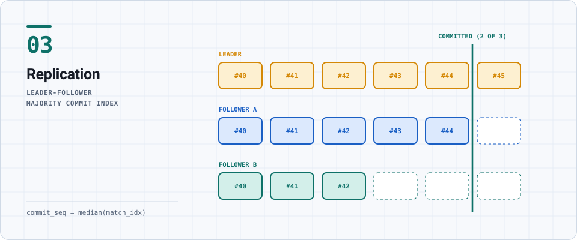
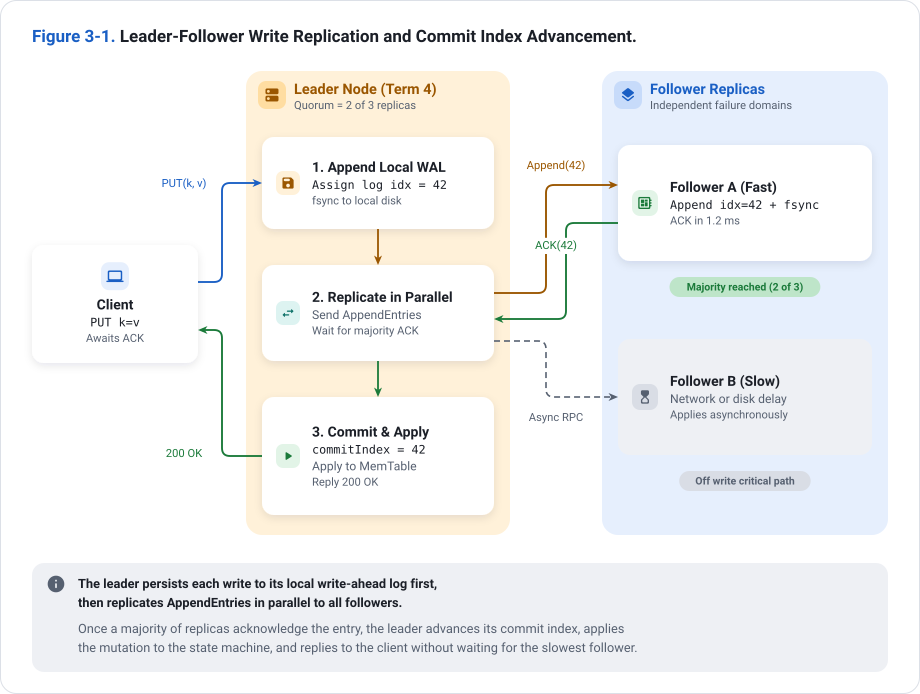
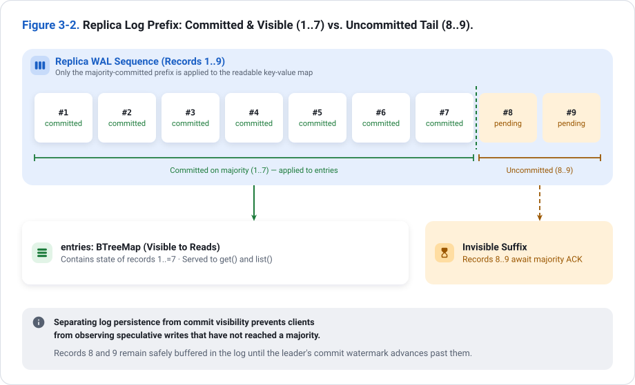
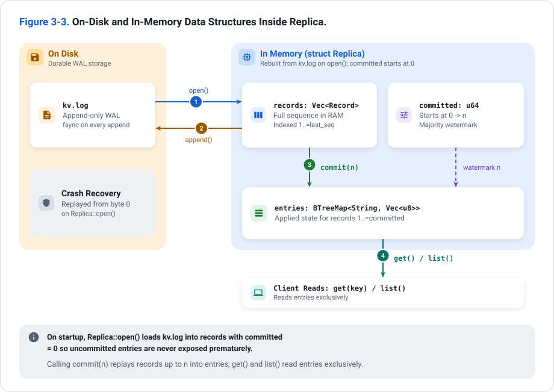
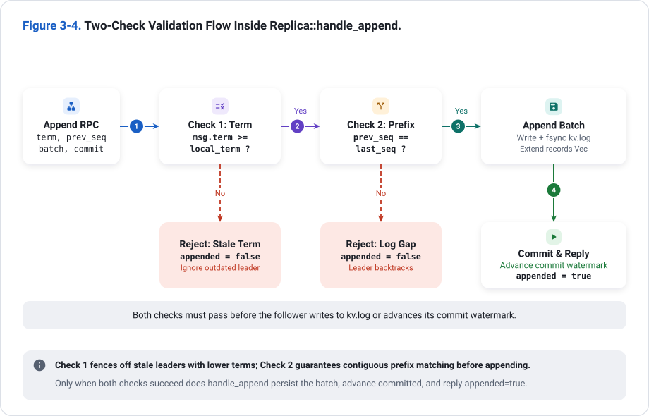
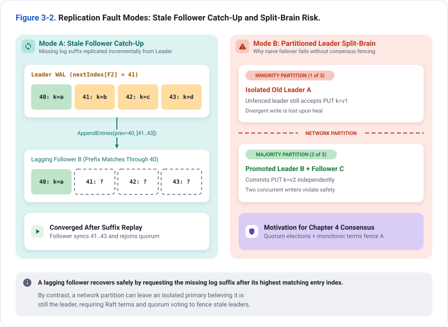
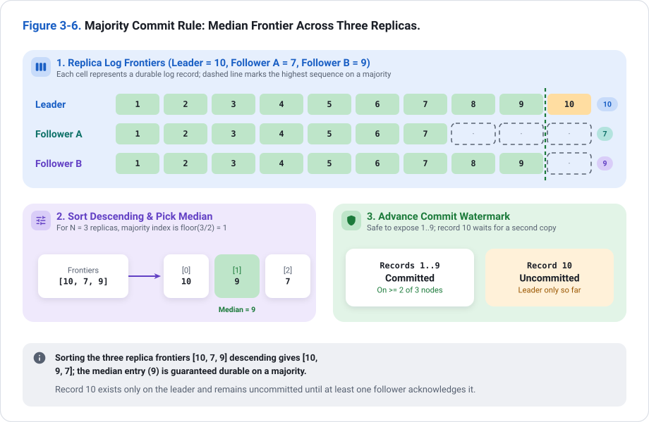
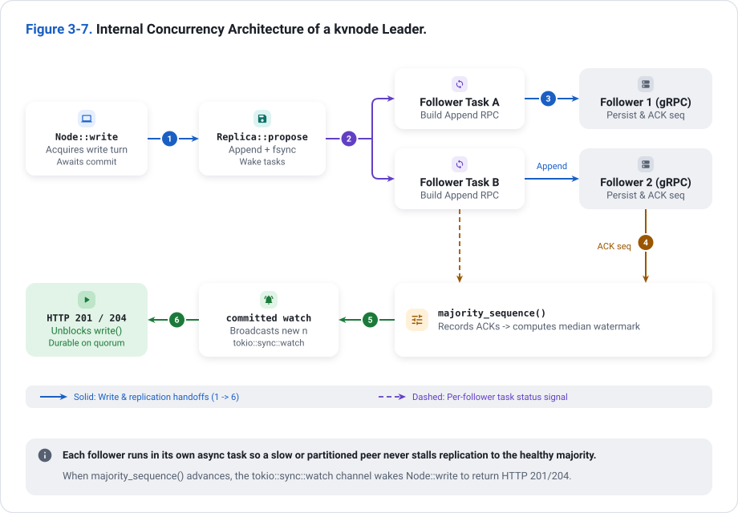

# Chapter 3: Leader-Follower Quorum Replication (LLD)



The single storage node we implemented in [Chapter 2](02-key-value-store-storage-node.md) preserves every acknowledged write across process crashes and torn WAL tails. Against the permanent loss of the host itself, or of its storage device, a single node provides zero protection: a write-ahead log stored on one disk vanishes when that disk fails. As specified in [Chapter 1](01-key-value-store-system-design.md), surviving the loss of any single host, disk, or availability zone requires persisting every acknowledged mutation on at least two independent hosts before replying to the caller.

Copying a log file from one host to another in isolation is trivial. Replication becomes a distributed systems engineering problem because messages traverse an asynchronous network that drops, delays, and reorders both requests and replies while hosts halt and restart at arbitrary moments. Across all of those faults, every replica must converge to the exact same sequence of records in the exact same order. A follower that misses record 7 must not append record 8 on top of record 6. A leader whose acknowledgement packet was dropped must neither assume the follower lacks record 7 nor assume the follower holds it. A deposed leader returning from a network partition must be prevented from mutating followers after a successor has taken over.

In this chapter, I implement leader-follower quorum replication for a three-replica shard in Rust. A single local rule on the follower side resolves missed messages, lost acknowledgements, restarts, and empty replicas uniformly without special-case recovery branches. We first specify the `Append` RPC contract and replica state machine as a pure, network-free library crate (`repl`) so we can verify every combination of message and reply loss deterministically in `replsim` (`4,096` fault patterns). We then build the networked storage server `kvnode` over gRPC (`tonic`) and HTTP (`axum`), and run live three-node fault experiments: killing a follower under load, severing quorum, destroying the leader's disk and promoting a survivor, and testing term fencing against a returning former leader.

<div class="covers">

In this chapter, we cover

- the `Append` gRPC/Protobuf contract and its `last_sequence` self-healing reply invariant
- replica state separation: durable WAL records, uncommitted suffix, committed watermark, and monotonic term
- the two-check follower handler (`term` fencing and exact `previous_sequence` continuity)
- leader write serialization (`is_settled`), per-follower replication streams, and the median majority commit rule
- exhaustive deterministic fault simulation across `4,096` message-loss and reply-loss patterns (`replsim`)
- `kvnode`: Protobuf compilation, `tonic` gRPC service, lock-free network I/O, `watch`-channel commit notifications, and lease-bounded leader reads
- live three-node fault experiments: follower crash and catch-up, quorum loss (`503`), permanent leader loss with manual promotion, and stale-term fencing (`421`)

</div>

## 3.1 Shard Topology and Replication Invariants

Each shard consists of three replicas placed across independent failure domains. One replica serves as the *leader* and accepts client mutations; the other two act as *followers* and persist ordered log batches streamed from the leader. Figure 3-1 traces the end-to-end synchronous replication write path from client ingress through local WAL durability, parallel follower replication, majority commit-index advancement, and in-memory state application.

<figure class="diagram">

<figcaption><b>Figure 3-1</b> Leader-follower write replication path and majority commit-index advancement across a three-replica shard.</figcaption>
</figure>

We enforce four invariants across the replicated shard:

| No. | Replication Invariant | Architectural Guarantee |
| :--- | :--- | :--- |
| 0 | Every follower's log is an exact prefix of its leader's log (identical records in identical sequence order, possibly shorter). | Eliminates gaps, duplicates, and out-of-order entries on followers. |
| 1 | The leader acknowledges a write to the client only after at least two of the three replicas hold its WAL record durably. | Preserves every acknowledged write across any single-host or single-disk failure. |
| 2 | A replica applies a record to its in-memory `BTreeMap` only after that record is known to reside on a majority of replicas. | Prevents reads from returning uncommitted data that could disappear after a failover. |
| 3 | Every replica rejects any `Append` RPC carrying a `term` strictly lower than its own local `term`. | Fences returning former leaders so stale epochs cannot corrupt follower logs. |

In this chapter, an operator appoints the initial leader and manually promotes a follower upon leader failure. In [Chapter 4](04-key-value-store-leader-election.md), we replace manual promotion with automated Raft leader election built directly onto these log and term mechanisms.

## 3.2 Replication Protocol Messages

The internal replication protocol requires a single RPC, `Append`, sent from the leader to each follower for both log shipping and periodic heartbeats. Listing 3.1 specifies the `Replication` service contract in `proto/store.proto`.

<p class="listing"><b>Listing 3.1</b> gRPC <code>Replication</code> service definition in <code>proto/store.proto</code>. <a href="https://github.com/arpanpathak/cracking-the-systems-programming-interview/blob/prep-v2/distributed-systems-from-the-ground-up/code/proto/store.proto">proto/store.proto</a></p>

```protobuf
{{#include ../code/proto/store.proto:replication}}
```

To keep our core replication logic deterministic and testable without network sockets or Protobuf runtime dependencies, we define pure Rust domain types inside the `repl` library crate and translate at the gRPC boundary in `kvnode`. Listing 3.2 declares the `kv` and standard-library imports of `repl/src/lib.rs`.

<p class="listing"><b>Listing 3.2</b> Imports of <code>repl/src/lib.rs</code>. <a href="https://github.com/arpanpathak/cracking-the-systems-programming-interview/blob/prep-v2/distributed-systems-from-the-ground-up/code/repl/src/lib.rs">repl/src/lib.rs</a></p>

```rust
{{#include ../code/repl/src/lib.rs:imports}}
```

Listing 3.3 defines `Append` and `AppendReply`. Every request carries the leader's `term`, the `previous_sequence` immediately preceding the attached `records` slice, and the leader's current `committed_sequence`. Every reply returns `term`, a boolean `appended` indicator, and the follower's exact `last_sequence` after processing the message.

<p class="listing"><b>Listing 3.3</b> Pure domain message types in <code>repl/src/lib.rs</code>. <a href="https://github.com/arpanpathak/cracking-the-systems-programming-interview/blob/prep-v2/distributed-systems-from-the-ground-up/code/repl/src/lib.rs">repl/src/lib.rs</a></p>

```rust
{{#include ../code/repl/src/lib.rs:messages}}
```

| Field | Contract and Semantics |
| :--- | :--- |
| `term` | Monotonic leadership epoch; followers reject any request with `request.term < local.term`. |
| `previous_sequence` | Leader log index immediately before `records[0]`; followers append only when their own log ends at this exact index. |
| `records` | Contiguous suffix of records missing from the follower, or an empty slice for a heartbeat. |
| `committed_sequence` | Highest sequence number known by the leader to reside on a majority; followers advance their local `BTreeMap` up to this bound. |
| `appended` | `true` if both term and prefix checks passed; `false` on any refusal. |
| `last_sequence` | Exact end index of the follower's WAL after handling the RPC, reported on both acceptance and refusal. |

Reporting `last_sequence` unconditionally on every reply is the linchpin of the protocol. Rather than answering with a bare boolean rejection, the follower tells the leader its exact durable log frontier, allowing the leader to realign its per-follower cursor in one round trip.

## 3.3 Replica State Machine

A `Replica` combines its durable WAL (`Log`), an in-memory vector mirroring all WAL records (`records`, where sequence `n` resides at index `n - 1`), the `BTreeMap<String, Entry>` reflecting committed state, and two control integers: `committed` (the highest applied sequence) and `term` (the highest epoch observed). Figure 3-2 illustrates the separation between the committed prefix (`1` to `7`) and the uncommitted tail (`8` and `9`).

<figure>

<figcaption><b>Figure 3-2</b> Separation between the committed, visible prefix (records 1 to 7) and the uncommitted tail (records 8 and 9).</figcaption>
</figure>

A record becomes *committed* once a majority of replicas (`2 of 3`) have persisted it to disk. Any two of three replicas share at least one overlapping member, so a committed record survives the failure of any single host. Keeping uncommitted tail records in the WAL without applying them to `entries` enforces invariant 2: no read can observe a mutation that might vanish after a failover. Figure 3-3 maps each data structure inside `Replica` to the methods that move data between disk, log buffer, and committed index.

<figure>

<figcaption><b>Figure 3-3</b> On-disk and in-memory data structures inside <code>Replica</code> and the transitions between them.</figcaption>
</figure>

Listing 3.4 implements `Replica`, `Replica::open`, `commit`, and the read methods (`get`, `list`). Because `commit` is the sole caller of `kv::store::apply`, no uncommitted record can leak into `entries`. Notice that `Replica::open` intentionally initializes `committed` to `0` and leaves `entries` empty even when `kv.log` already holds records. Upon restart, a single replica cannot determine from its local disk alone which suffix of its log reached a majority before the crash. A follower learns the committed frontier from its leader's next `Append` RPC; a leader re-establishes the committed frontier once followers report their `last_sequence` values.

<p class="listing"><b>Listing 3.4</b> <code>Replica</code> state machine and committed-only state application in <code>repl/src/lib.rs</code>. <a href="https://github.com/arpanpathak/cracking-the-systems-programming-interview/blob/prep-v2/distributed-systems-from-the-ground-up/code/repl/src/lib.rs">repl/src/lib.rs</a></p>

```rust
{{#include ../code/repl/src/lib.rs:replica}}
```

## 3.4 Follower Rules and Self-Healing Catch-Up

A follower evaluates every incoming `Append` message against exactly two sequential preconditions (Figure 3-4):

| Precondition Check | Outcome on Failure / Match | Follower State Action | Reply Returned |
| :--- | :--- | :--- | :--- |
| `msg.term < self.term` | Stale leader detected | None | `appended = false`, `term = self.term`, `last_sequence` |
| `msg.previous_sequence != self.last_sequence()` | Log frontier mismatch | Adopt `msg.term` | `appended = false`, `term = self.term`, `last_sequence` |
| Both checks pass | Exact continuation | Adopt `msg.term`, `append_records` with one `fsync`, `commit(msg.committed_sequence)` | `appended = true`, `term = self.term`, updated `last_sequence` |

<figure>

<figcaption><b>Figure 3-4</b> Sequential term and prefix validation inside <code>Replica::handle_append</code>.</figcaption>
</figure>

Listing 3.5 implements `Replica::handle_append`. Both refusal paths share the `refuse` closure, returning the follower's current `term` and `last_sequence`. When both checks pass, `Log::append_records` writes the entire batch with a single `sync_data` call, appends the records to `self.records`, and invokes `self.commit(msg.committed_sequence)` (which safely clamps to `self.last_sequence()` if the leader's commit watermark exceeds this follower's log length).

<p class="listing"><b>Listing 3.5</b> Follower <code>handle_append</code> validation and batch persistence in <code>repl/src/lib.rs</code>. <a href="https://github.com/arpanpathak/cracking-the-systems-programming-interview/blob/prep-v2/distributed-systems-from-the-ground-up/code/repl/src/lib.rs">repl/src/lib.rs</a></p>

```rust
{{#include ../code/repl/src/lib.rs:follower}}
```

This single exact-continuation check preserves invariant 0 across every network and crash anomaly: restarted followers, dropped requests, dropped replies, and brand-new empty replicas. None requires bespoke recovery logic; all reduce to a single mismatch where the follower reports its actual `last_sequence` and the leader resends the missing suffix from that exact index. Figure 3-5 contrasts this clean stale-follower catch-up (Mode A) against the split-brain hazard that arises if an operator or uncoordinated failover promotes a second leader without consensus term fencing (Mode B).

<figure class="diagram">

<figcaption><b>Figure 3-5</b> Replication fault modes: incremental stale-follower suffix catch-up (Mode A) and split-brain exposure without consensus fencing (Mode B).</figcaption>
</figure>

Follower batch persistence builds directly on `kv::log` from Chapter 2. Listing 3.6 recalls the imports of `kv/src/log.rs`, and Listing 3.7 defines `Log::append_records`, which verifies contiguous incoming sequence numbering, encodes every record in the batch into the file, calls `sync_data` once for the entire batch, and enforces the same fail-stop latch (`self.failed = true`) on any I/O error.

<p class="listing"><b>Listing 3.6</b> Imports of <code>kv/src/log.rs</code>. <a href="https://github.com/arpanpathak/cracking-the-systems-programming-interview/blob/prep-v2/distributed-systems-from-the-ground-up/code/kv/src/log.rs">kv/src/log.rs</a></p>

```rust
{{#include ../code/kv/src/log.rs:imports}}
```

<p class="listing"><b>Listing 3.7</b> Batched follower record persistence in <code>kv/src/log.rs</code>. <a href="https://github.com/arpanpathak/cracking-the-systems-programming-interview/blob/prep-v2/distributed-systems-from-the-ground-up/code/kv/src/log.rs">kv/src/log.rs</a></p>

```rust
{{#include ../code/kv/src/log.rs:replicate}}
```

## 3.5 Leader Proposal, Dispatch, and Majority Commit Rule

The leader orchestrates three responsibilities: validating and appending local proposals, constructing per-follower catch-up or heartbeat messages, and advancing the global commit watermark whenever a majority confirms a sequence number.

### Proposing a Record (`propose`)

Because conditional writes (`If-Match` and `If-None-Match`) evaluate their version preconditions against `self.entries`, and `self.entries` contains only committed records, the leader accepts a new write only when `self.is_settled()` holds (every record in the leader's local WAL is already committed). Accepting a second write while an earlier record remained uncommitted would evaluate the second precondition against stale state, violating linearizability for conditional updates. Listing 3.8 enforces this contract: `propose` verifies `is_settled`, rejects `Delete` on absent keys, validates `Condition` via `kv::store::check`, appends the record to the leader's local WAL, and pushes it onto `self.records` without mutating `self.entries`.

<p class="listing"><b>Listing 3.8</b> Leader proposal validation and local WAL append in <code>repl/src/lib.rs</code>. <a href="https://github.com/arpanpathak/cracking-the-systems-programming-interview/blob/prep-v2/distributed-systems-from-the-ground-up/code/repl/src/lib.rs">repl/src/lib.rs</a></p>

```rust
{{#include ../code/repl/src/lib.rs:propose}}
```

Serializing writes until settled restricts a single shard to one unbatched commit per replication round trip. Production systems can evaluate preconditions against speculative uncommitted tails; in Chapter 6, we recover high write throughput cleanly via WAL group commit.

### Constructing Follower Messages (`append_for`)

For each follower, the leader maintains its last reported sequence number (`after`). Listing 3.9 implements `append_for`, slicing every record after `after` into an `Append` request (yielding an empty `records` vector for heartbeats when the follower is caught up) and clamping `after` to `self.last_sequence()` in case a newly started leader holds a shorter log than a stale hint.

<p class="listing"><b>Listing 3.9</b> Constructing incremental replication and heartbeat messages in <code>repl/src/lib.rs</code>. <a href="https://github.com/arpanpathak/cracking-the-systems-programming-interview/blob/prep-v2/distributed-systems-from-the-ground-up/code/repl/src/lib.rs">repl/src/lib.rs</a></p>

```rust
{{#include ../code/repl/src/lib.rs:append_for}}
```

### The Majority Commit Rule (`majority_sequence`)

Given the leader's own `last_sequence` and each follower's reported `last_sequence`, sorting all replica frontier indices in descending order places the highest majority-replicated sequence at index `n / 2` (Figure 3-6). For a three-replica shard with frontiers `[10, 7, 9]`, descending sort yields `[10, 9, 7]`, and index `3 / 2 = 1` selects `9`: at least two replicas hold records `1` through `9`, whereas record `10` resides on only one replica and stays uncommitted.

<figure>

<figcaption><b>Figure 3-6</b> Median majority commit calculation across three replica log frontiers.</figcaption>
</figure>

Listing 3.10 implements `majority_sequence` generically for any odd or even cluster size `n`.

<p class="listing"><b>Listing 3.10</b> Generalized majority commit calculation in <code>repl/src/lib.rs</code>. <a href="https://github.com/arpanpathak/cracking-the-systems-programming-interview/blob/prep-v2/distributed-systems-from-the-ground-up/code/repl/src/lib.rs">repl/src/lib.rs</a></p>

```rust
{{#include ../code/repl/src/lib.rs:majority}}
```

## 3.6 Exhaustive Deterministic Fault Simulation (`replsim`)

Real network faults occur unpredictably and rarely reproduce on demand. Because `repl` performs zero network I/O, we can embed a three-node cluster inside a single deterministic simulator (`replsim`) that controls the fate of every RPC exchange: delivered cleanly, request dropped, or request persisted on the follower while its reply is dropped.

Listing 3.11 declares the imports for `replsim/src/main.rs`.

<p class="listing"><b>Listing 3.11</b> Imports of <code>replsim/src/main.rs</code>. <a href="https://github.com/arpanpathak/cracking-the-systems-programming-interview/blob/prep-v2/distributed-systems-from-the-ground-up/code/replsim/src/main.rs">replsim/src/main.rs</a></p>

```rust
{{#include ../code/replsim/src/main.rs:imports}}
```

Listing 3.12 defines the in-process `Cluster` harness with one leader, two followers, per-follower cursor tracking, and a three-way fault injector (`Delivery::Ok`, `DropRequest`, `DropReply`).

<p class="listing"><b>Listing 3.12</b> Single-process deterministic cluster harness in <code>replsim/src/main.rs</code>. <a href="https://github.com/arpanpathak/cracking-the-systems-programming-interview/blob/prep-v2/distributed-systems-from-the-ground-up/code/replsim/src/main.rs">replsim/src/main.rs</a></p>

```rust
{{#include ../code/replsim/src/main.rs:cluster}}
```

Listing 3.13 executes targeted scenarios exercising steady-state replication, single-follower outage and one-round-trip catch-up, dropped replies followed by exact-continuation realignment, total quorum loss with deferred commit upon recovery, and stale-term rejection.

<p class="listing"><b>Listing 3.13</b> Scenario verification suite in <code>replsim/src/main.rs</code>. <a href="https://github.com/arpanpathak/cracking-the-systems-programming-interview/blob/prep-v2/distributed-systems-from-the-ground-up/code/replsim/src/main.rs">replsim/src/main.rs</a></p>

```rust
{{#include ../code/replsim/src/main.rs:cases}}
```

Listing 3.14 runs an exhaustive sweep over three sequential writes: each write triggers two follower exchanges, and each of the six exchanges chooses from four 2-bit fault encodings, covering all `4^6 = 4,096` patterns. After every single pattern, the harness asserts invariant 0 (every follower log is a prefix of the leader log) and invariant 1 (every acknowledged record exists on at least two replicas), then heals the network and asserts full three-way log equality.

<p class="listing"><b>Listing 3.14</b> Exhaustive 4,096-pattern fault sweep in <code>replsim/src/main.rs</code>. <a href="https://github.com/arpanpathak/cracking-the-systems-programming-interview/blob/prep-v2/distributed-systems-from-the-ground-up/code/replsim/src/main.rs">replsim/src/main.rs</a></p>

```rust
{{#include ../code/replsim/src/main.rs:exhaustive}}
```

Listing 3.15 invokes both the targeted scenarios and the exhaustive 4,096-pattern verification from `main`.

<p class="listing"><b>Listing 3.15</b> Entry point of <code>replsim/src/main.rs</code>. <a href="https://github.com/arpanpathak/cracking-the-systems-programming-interview/blob/prep-v2/distributed-systems-from-the-ground-up/code/replsim/src/main.rs">replsim/src/main.rs</a></p>

```rust
{{#include ../code/replsim/src/main.rs:main}}
```

Running `replsim` verifies every invariant across all targeted cases and all 4,096 exhaustive fault patterns:

```console
$ cargo run --release -p replsim
3 writes, every message delivered: logs end at [3, 3, 3], committed 3
3 writes while follower 1 is unreachable: logs end at [6, 3, 6], committed 6
follower 1 returns, 1 exchange: logs end at [6, 6, 6], committed 6
3 writes while the answers of follower 1 are lost: logs end at [9, 7, 9], committed 9
  the leader believes that the log of follower 1 ends at 6
  next exchange: the leader sends records 7 to 9, follower 1 refuses and reports 7
  the exchange after it: logs end at [9, 9, 9], committed 9
1 write while both followers are unreachable: acknowledged false, logs end at [10, 9, 9], committed 9
  the leader reads j as None
  the leader accepts another write: false
follower 2 returns: logs end at [10, 9, 10], committed 10
  the leader reads j as Some(10)
a replica at term 2 receives a message of term 1: appended false, its term 2
4096 patterns of lost messages over 3 writes:
  every acknowledged record was in at least 2 of the 3 logs
  every follower's log was the beginning of the leader's log
  after the losses stopped, the 3 logs were equal and every record was committed
  0 of 3 writes acknowledged: 1024 patterns
  1 of 3 writes acknowledged: 1024 patterns
  2 of 3 writes acknowledged: 704 patterns
  3 of 3 writes acknowledged: 1344 patterns
```

| Observed Output | Verified Protocol Behavior |
| :--- | :--- |
| `3 writes while follower 1 is unreachable: logs end at [6, 3, 6], committed 6` | Leader plus one surviving follower maintain write availability under invariant 1. |
| `follower 1 returns, 1 exchange: logs end at [6, 6, 6]` | Leader ships records 4 to 6 in a single batch based on its stored follower frontier. |
| `next exchange: the leader sends records 7 to 9, follower 1 refuses and reports 7` | Exact-continuation check rejects duplicate record 7 and realigns the leader cursor in one round trip. |
| `1 write while both followers are unreachable: acknowledged false, committed 9` | Single-replica record 10 stays uncommitted and invisible to reads (`j` reads as `None`). |
| `follower 2 returns: logs end at [10, 9, 10], committed 10` | Uncommitted record 10 commits automatically upon quorum restoration even though the original caller received an error. |
| `a replica at term 2 receives a message of term 1: appended false` | Term fencing enforces invariant 3 unconditionally. |
| `4096 patterns of lost messages over 3 writes` | Invariants 0 and 1 hold across every possible loss permutation, and all three replicas converge once delivery resumes. |

Notice the operational consequence of record 10: a write that returned an error during quorum loss remained in the leader's WAL and committed later when a follower reconnected. Consequently, clients of a replicated store must treat a `503` timeout as an indeterminate outcome, identical to a dropped TCP connection, and resolve it via read-after-error or idempotent conditional retry.

## 3.7 Low-Level Architecture of `kvnode`

Having verified the pure state machine in `repl`, we wrap it in a networked server binary `kvnode` that pairs an external HTTP API (`axum`) with an internal gRPC replication service (`tonic`).

<div class="lld">

Low-level design: replication

**Crates**

| Crate | Kind | Responsibilities |
| :--- | :--- | :--- |
| `repl` | library | Pure domain messages, `Replica`, follower handler, leader `propose`/`append_for`, and `majority_sequence` |
| `replsim` | binary | Deterministic fault simulator covering targeted anomalies and 4,096 exhaustive loss patterns |
| `kvnode` | binary | Networked replica combining `rpc` (gRPC service), `node` (leader replication tasks, write/read coordination), and `main` (HTTP API) |

**Shared Node State (`kvnode::node::Node`)**

| Field | Type | Responsibility |
| :--- | :--- | :--- |
| `replica` | `Mutex<Replica>` | Synchronizes access to the WAL, in-memory log vector, committed `BTreeMap`, and term |
| `peers` | `Vec<Peer>` | Tracks each follower's gRPC endpoint, last reported sequence, and last contact timestamp |
| `turn` | `tokio::sync::Mutex<()>` | Serializes concurrent client writes so each evaluates preconditions against a settled log |
| `committed` | `watch::Sender<u64>` | Broadcasts commit-index advances to wake awaiting HTTP write handlers |
| `appended` | `Notify` | Signals per-follower replication tasks immediately after a local WAL append |
| `deposed` | `AtomicBool` | Latched when any follower replies with a strictly higher term, halting stale leader writes |

**Timing Constants**

| Constant | Value | Role |
| :--- | :--- | :--- |
| `HEARTBEAT` | `100 ms` | Idle interval between empty heartbeat RPCs to each follower |
| `ANSWER` | `500 ms` | Per-RPC deadline waiting for a single follower's `Append` reply |
| `COMMIT` | `1 s` | Client write quorum timeout and maximum lease window for serving leader reads |

**HTTP Error Semantics**

| Runtime Condition | HTTP Status |
| :--- | :--- |
| Client sends `PUT`, `DELETE`, or `GET` to a follower | `421 Misdirected Request` |
| Client writes to a leader deposed by a higher-term reply | `421 Misdirected Request` |
| Proposed record fails to reach a majority within `1 s` | `503 Service Unavailable` |
| Client reads from a leader without majority contact in the past `1 s` | `503 Service Unavailable` |

</div>

## 3.8 Implementing `kvnode`

Listing 3.16 declares the CLI, gRPC, HTTP, and concurrency imports of `kvnode/src/main.rs`, and Listing 3.17 specifies the command-line flags (`--role`, `--term`, `--listen`, `--replication`, `--follower`, `--data`, `--no-sync`).

<p class="listing"><b>Listing 3.16</b> Imports of <code>kvnode/src/main.rs</code>. <a href="https://github.com/arpanpathak/cracking-the-systems-programming-interview/blob/prep-v2/distributed-systems-from-the-ground-up/code/kvnode/src/main.rs">kvnode/src/main.rs</a></p>

```rust
{{#include ../code/kvnode/src/main.rs:imports}}
```

<p class="listing"><b>Listing 3.17</b> Command-line arguments in <code>kvnode/src/main.rs</code>. <a href="https://github.com/arpanpathak/cracking-the-systems-programming-interview/blob/prep-v2/distributed-systems-from-the-ground-up/code/kvnode/src/main.rs">kvnode/src/main.rs</a></p>

```rust
{{#include ../code/kvnode/src/main.rs:options}}
```

### Protobuf Compilation and the gRPC Boundary (`kvnode/src/rpc.rs`)

Cargo compiles `proto/store.proto` into typed Rust stubs and `tonic` client/server traits at build time via `build.rs` (requiring `protoc` on `PATH`). Listing 3.18 presents `kvnode/build.rs`.

<p class="listing"><b>Listing 3.18</b> Complete <code>kvnode/build.rs</code>. <a href="https://github.com/arpanpathak/cracking-the-systems-programming-interview/blob/prep-v2/distributed-systems-from-the-ground-up/code/kvnode/build.rs">kvnode/build.rs</a></p>

```rust
{{#include ../code/kvnode/build.rs}}
```

Listing 3.19 lists the `tonic`, `kv`, and `repl` imports in `kvnode/src/rpc.rs`, and Listing 3.20 includes the generated Protobuf module.

<p class="listing"><b>Listing 3.19</b> Imports of <code>kvnode/src/rpc.rs</code>. <a href="https://github.com/arpanpathak/cracking-the-systems-programming-interview/blob/prep-v2/distributed-systems-from-the-ground-up/code/kvnode/src/rpc.rs">kvnode/src/rpc.rs</a></p>

```rust
{{#include ../code/kvnode/src/rpc.rs:imports}}
```

<p class="listing"><b>Listing 3.20</b> Generated Protobuf module inclusion in <code>kvnode/src/rpc.rs</code>. <a href="https://github.com/arpanpathak/cracking-the-systems-programming-interview/blob/prep-v2/distributed-systems-from-the-ground-up/code/kvnode/src/rpc.rs">kvnode/src/rpc.rs</a></p>

```rust
{{#include ../code/kvnode/src/rpc.rs:generated}}
```

Listing 3.21 implements bidirectional conversion between generated Protobuf structs and `kv`/`repl` domain types. Any wire `Record` missing its `oneof change` payload is rejected immediately with `Status::invalid_argument`.

<p class="listing"><b>Listing 3.21</b> Wire-to-domain conversions in <code>kvnode/src/rpc.rs</code>. <a href="https://github.com/arpanpathak/cracking-the-systems-programming-interview/blob/prep-v2/distributed-systems-from-the-ground-up/code/kvnode/src/rpc.rs">kvnode/src/rpc.rs</a></p>

```rust
{{#include ../code/kvnode/src/rpc.rs:convert}}
```

Listing 3.22 implements the follower-side `Replication` gRPC server. Because `Replica::handle_append` executes synchronous WAL `fsync`, the handler wraps the critical section inside `tokio::task::block_in_place` so Tokio can migrate sibling async tasks off the blocking worker thread.

<p class="listing"><b>Listing 3.22</b> Follower-side <code>Append</code> gRPC handler in <code>kvnode/src/rpc.rs</code>. <a href="https://github.com/arpanpathak/cracking-the-systems-programming-interview/blob/prep-v2/distributed-systems-from-the-ground-up/code/kvnode/src/rpc.rs">kvnode/src/rpc.rs</a></p>

```rust
{{#include ../code/kvnode/src/rpc.rs:service}}
```

### Leader Replication Tasks and Lock-Free Network I/O (`kvnode/src/node.rs`)

Figure 3-7 traces the internal concurrency structure of a leader node: HTTP write handlers serialize on `turn`, append locally via `propose`, wake per-follower background tasks via `appended`, and await commit advancement on the `committed` watch channel.

<figure>

<figcaption><b>Figure 3-7</b> Internal components and write-path handoffs inside a <code>kvnode</code> leader.</figcaption>
</figure>

Listing 3.23 imports the async primitives and RPC helpers in `kvnode/src/node.rs`, and Listing 3.24 defines `Role`, `Peer`, `Node`, and `NodeError`.

<p class="listing"><b>Listing 3.23</b> Imports of <code>kvnode/src/node.rs</code>. <a href="https://github.com/arpanpathak/cracking-the-systems-programming-interview/blob/prep-v2/distributed-systems-from-the-ground-up/code/kvnode/src/node.rs">kvnode/src/node.rs</a></p>

```rust
{{#include ../code/kvnode/src/node.rs:imports}}
```

<p class="listing"><b>Listing 3.24</b> Node role, peer tracking, and shared concurrency state in <code>kvnode/src/node.rs</code>. <a href="https://github.com/arpanpathak/cracking-the-systems-programming-interview/blob/prep-v2/distributed-systems-from-the-ground-up/code/kvnode/src/node.rs">kvnode/src/node.rs</a></p>

```rust
{{#include ../code/kvnode/src/node.rs:types}}
```

The leader spawns one dedicated `follow` task per follower (Listing 3.25). Each loop iteration follows a strict three-phase lock discipline:

1. Acquire `replica` briefly to build the next `Append` request via `append_for` and immediately release the mutex.
2. Issue the gRPC `Append` call over the network with a `500 ms` timeout while holding zero locks.
3. Pass the reply to `record`; if the follower still lags behind the leader's WAL, loop immediately without sleeping, otherwise await either an `appended` wakeup or the `100 ms` `HEARTBEAT` timer.

Releasing the mutex prior to network I/O is critical for fault isolation: a partitioned or hung follower stalls only its own task while the surviving follower continues committing writes at full speed.

<p class="listing"><b>Listing 3.25</b> Per-follower background replication loop in <code>kvnode/src/node.rs</code>. <a href="https://github.com/arpanpathak/cracking-the-systems-programming-interview/blob/prep-v2/distributed-systems-from-the-ground-up/code/kvnode/src/node.rs">kvnode/src/node.rs</a></p>

```rust
{{#include ../code/kvnode/src/node.rs:follow}}
```

Listing 3.26 implements `record`. If a follower replies with `reply.term > local.term`, the leader immediately latches `deposed = true` so subsequent client writes receive `421 Misdirected Request`. Otherwise, `record` updates the peer's `last_sequence` and contact timestamp, recomputes `majority_sequence`, calls `replica.commit`, and publishes the new watermark on the `committed` watch channel.

<p class="listing"><b>Listing 3.26</b> Recording follower replies, term fencing, and advancing the commit watermark in <code>kvnode/src/node.rs</code>. <a href="https://github.com/arpanpathak/cracking-the-systems-programming-interview/blob/prep-v2/distributed-systems-from-the-ground-up/code/kvnode/src/node.rs">kvnode/src/node.rs</a></p>

```rust
{{#include ../code/kvnode/src/node.rs:record}}
```

### Leader Write and Lease-Bounded Read Paths

Listing 3.27 implements `Node::write`. An HTTP handler acquires the async `turn` mutex, verifies leadership (`!deposed`), waits if necessary for any prior uncommitted record to settle, invokes `Replica::propose` via `block_in_place`, notifies all follower tasks (`appended.notify_waiters()`), and waits up to `COMMIT` (`1 s`) on `committed.wait_for(|&c| c >= seq)`. If quorum does not confirm within `1 s`, the handler returns `503 Service Unavailable`; the record remains in the leader's WAL and commits automatically once a follower reconnects.

<p class="listing"><b>Listing 3.27</b> Leader write coordination in <code>kvnode/src/node.rs</code>. <a href="https://github.com/arpanpathak/cracking-the-systems-programming-interview/blob/prep-v2/distributed-systems-from-the-ground-up/code/kvnode/src/node.rs">kvnode/src/node.rs</a></p>

```rust
{{#include ../code/kvnode/src/node.rs:write}}
```

Listing 3.28 implements `Node::get`, `Node::list`, and the `must_serve_reads` guard. An isolated leader partitioned from both followers cannot detect whether an operator or election has appointed a newer leader. `must_serve_reads` therefore requires two conditions before serving reads from RAM: (1) a majority of replicas (the leader plus at least one follower) responded within the last `COMMIT` (`1 s`) window, and (2) the leader's startup log has fully settled (`committed >= initial_last_sequence`) so a restarted leader never returns stale empty responses before re-establishing its commit watermark. Bounding stale-read exposure to `1 s` assumes no successor leader is promoted sooner than `1 s` after the old leader loses contact; stricter linearizable reads (`ReadIndex`) confirm quorum on every read at the cost of one network round trip.

<p class="listing"><b>Listing 3.28</b> Leader read path and quorum-contact guard in <code>kvnode/src/node.rs</code>. <a href="https://github.com/arpanpathak/cracking-the-systems-programming-interview/blob/prep-v2/distributed-systems-from-the-ground-up/code/kvnode/src/node.rs">kvnode/src/node.rs</a></p>

```rust
{{#include ../code/kvnode/src/node.rs:read}}
```

### Wiring the HTTP Surface (`kvnode/src/main.rs`)

The HTTP handlers reuse `kvd::api` from Chapter 2 for RFC 9457 error formatting and `If-Match` / `If-None-Match` parsing, forwarding requests directly to `Node`. Listing 3.29 implements the `PUT`, `DELETE`, and `GET` handlers.

<p class="listing"><b>Listing 3.29</b> HTTP mutation and point-read handlers in <code>kvnode/src/main.rs</code>. <a href="https://github.com/arpanpathak/cracking-the-systems-programming-interview/blob/prep-v2/distributed-systems-from-the-ground-up/code/kvnode/src/main.rs">kvnode/src/main.rs</a></p>

```rust
{{#include ../code/kvnode/src/main.rs:handlers}}
```

Listing 3.30 implements prefix listing (`GET /v1/keys`) and the `/healthz` endpoint exposing `role`, `term`, `last_sequence`, `committed`, and per-follower match indices.

<p class="listing"><b>Listing 3.30</b> Prefix-listing and health endpoints in <code>kvnode/src/main.rs</code>. <a href="https://github.com/arpanpathak/cracking-the-systems-programming-interview/blob/prep-v2/distributed-systems-from-the-ground-up/code/kvnode/src/main.rs">kvnode/src/main.rs</a></p>

```rust
{{#include ../code/kvnode/src/main.rs:list}}
```

Listing 3.31 bootstraps either a follower (starting the `tonic` gRPC listener alongside HTTP) or a leader (spawning one `follow` task per peer alongside HTTP).

<p class="listing"><b>Listing 3.31</b> Server bootstrap for leader and follower roles in <code>kvnode/src/main.rs</code>. <a href="https://github.com/arpanpathak/cracking-the-systems-programming-interview/blob/prep-v2/distributed-systems-from-the-ground-up/code/kvnode/src/main.rs">kvnode/src/main.rs</a></p>

```rust
{{#include ../code/kvnode/src/main.rs:main}}
```

## 3.9 Live Three-Node Replication Experiments

We start two followers (`7002`/`7102` and `7003`/`7103`) and one leader (`7001`), verifying byte-for-byte WAL convergence and follower write redirection (`421 Misdirected Request`):

```console
$ ./target/release/kvnode --role follower --listen 127.0.0.1:7002 --replication 127.0.0.1:7102 --data /var/tmp/n2 &
term 1, log ends at 0
accepting records on 127.0.0.1:7102
listening on 127.0.0.1:7002
$ ./target/release/kvnode --role follower --listen 127.0.0.1:7003 --replication 127.0.0.1:7103 --data /var/tmp/n3 &
$ ./target/release/kvnode --role leader --listen 127.0.0.1:7001 --data /var/tmp/n1 \
      --follower http://127.0.0.1:7102 --follower http://127.0.0.1:7103 &
term 1, log ends at 0
listening on 127.0.0.1:7001
```

```console
$ curl -i -X PUT http://127.0.0.1:7001/v1/keys/user-1 --data-binary 'ada'
HTTP/1.1 201 Created
etag: "1"
content-length: 0

$ curl -i -X PUT http://127.0.0.1:7002/v1/keys/user-1 --data-binary 'x'
HTTP/1.1 421 Misdirected Request
content-type: application/problem+json
content-length: 117

{"type":"/problems/not-leader","title":"This node is not the leader","status":421,"detail":"this node is a follower"}
$ for port in 7001 7002 7003; do curl http://127.0.0.1:$port/healthz; echo; done
{"role":"leader","term":1,"last_sequence":1,"committed":1,"followers":[1,1]}
{"role":"follower","term":1,"last_sequence":1,"committed":1,"followers":[]}
{"role":"follower","term":1,"last_sequence":1,"committed":1,"followers":[]}
$ cmp /var/tmp/n1/kv.log /var/tmp/n2/kv.log && cmp /var/tmp/n1/kv.log /var/tmp/n3/kv.log && echo identical
identical
```

All three WAL files match byte for byte. In the following four experiments, all three processes share one local NVMe disk; deploying across three separate hosts requires only replacing `127.0.0.1` with each host's network address.

### Experiment 1: Throughput Cost of Synchronous Quorum Replication

```console
$ time ./target/release/kvctl load --server http://127.0.0.1:7001 --count 300 --acked acked.txt
300 writes acknowledged
3.89 s, 77 writes per second
```

Throughput drops from `185 writes/s` (single node, Chapter 2) to `77 writes/s` on the same physical disk because every write now blocks on two sequential `fsync` barriers (first on the leader, then on a follower) plus a gRPC round trip.

### Experiment 2: Single Follower Crash and Automatic Catch-Up

Terminating follower `7002` with `SIGKILL` mid-load causes zero write errors because the leader and follower `7003` maintain a `2 of 3` majority. Restarting `7002` automatically ships the `283` missed records in one exchange:

```console
$ ./target/release/kvctl load --server http://127.0.0.1:7001 --count 400 --acked acked.txt &
$ kill -9 <pid of the node on port 7002>
$ curl http://127.0.0.1:7001/healthz
{"role":"leader","term":1,"last_sequence":435,"committed":434,"followers":[417,434]}
400 writes acknowledged
$ curl http://127.0.0.1:7001/healthz
{"role":"leader","term":1,"last_sequence":700,"committed":700,"followers":[417,700]}

$ ./target/release/kvnode --role follower --listen 127.0.0.1:7002 --replication 127.0.0.1:7102 --data /var/tmp/n2 &
term 1, log ends at 417
$ curl http://127.0.0.1:7001/healthz
{"role":"leader","term":1,"last_sequence":700,"committed":700,"followers":[700,700]}
$ cmp /var/tmp/n1/kv.log /var/tmp/n2/kv.log && echo identical
identical
```

| Observed Output | Verified Fault-Tolerance Behavior |
| :--- | :--- |
| `400 writes acknowledged` | Writes complete uninterrupted with one follower down (`2 of 3` majority intact). |
| `"followers":[417,700]` | Leader preserves the crashed follower's exact last known frontier (`417`). |
| `term 1, log ends at 417` | Restarted follower recovers its intact WAL prefix cleanly. |
| `"followers":[700,700]`, `identical` | Leader streams records `418` to `700` automatically with zero operator intervention. |

### Experiment 3: Total Quorum Loss (`PC/EC` Refusal)

Killing both followers strips the leader of its majority. Writes time out after `1 s` with `503`, subsequent writes reject immediately while record `701` stays unsettled, and reads reject with `503` once the quorum contact window expires. Restarting a single follower commits record `701` automatically:

```console
$ kill -9 <pid of the node on port 7002> <pid of the node on port 7003>
$ curl -o /dev/null -w '%{http_code} in %{time_total} s\n' -X PUT http://127.0.0.1:7001/v1/keys/alone --data-binary 'x'
503 in 1.011346 s
$ curl -X PUT http://127.0.0.1:7001/v1/keys/alone2 --data-binary 'x'
{"type":"/problems/store-unavailable","title":"The node cannot serve the request","status":503,"detail":"record 701 is not on a majority of the replicas"}
$ curl http://127.0.0.1:7001/v1/keys/key-000001
{"type":"/problems/store-unavailable","title":"The node cannot serve the request","status":503,"detail":"this leader cannot reach a majority of the replicas"}
$ curl http://127.0.0.1:7001/healthz
{"role":"leader","term":1,"last_sequence":701,"committed":700,"followers":[700,700]}

$ ./target/release/kvnode --role follower --listen 127.0.0.1:7003 --replication 127.0.0.1:7103 --data /var/tmp/n3 &
$ curl http://127.0.0.1:7001/healthz
{"role":"leader","term":1,"last_sequence":701,"committed":701,"followers":[700,701]}
$ curl -o /dev/null -w '%{http_code}\n' http://127.0.0.1:7001/v1/keys/alone
200
$ curl -o /dev/null -w '%{http_code}\n' -X PUT http://127.0.0.1:7001/v1/keys/after --data-binary 'x'
201
```

| Observed Output | Verified Consistency Behavior |
| :--- | :--- |
| `503 in 1.011346 s` | Leader persisted record `701` locally, failed to obtain a second replica within `COMMIT`, and returned `503`. |
| `record 701 is not on a majority` | Subsequent mutations are rejected while an uncommitted record sits at the tail. |
| `this leader cannot reach a majority` | Leader halts reads rather than risking stale responses on the minority side of a partition. |
| `"committed":701`, `GET alone` returns `200` | Quorum restoration commits pending record `701` automatically without client retransmission. |

### Experiment 4: Permanent Leader Loss, Manual Promotion, and Term Fencing

Killing the leader under load and moving its data directory away (`mv /var/tmp/n1 /var/tmp/n1.lost`) simulates permanent host and disk destruction. We inspect both surviving followers via `/healthz`, promote the follower with the longest log (`last_sequence: 228`) under `term 2`, add a fresh replacement follower, and verify every acknowledged write in `acked.txt`:

```console
$ ./target/release/kvctl load --server http://127.0.0.1:7001 --count 2000 --acked acked.txt &
$ kill -9 <pid of the leader>
write 229 failed: io: Peer disconnected
228 writes acknowledged
$ mv /var/tmp/n1 /var/tmp/n1.lost
$ for port in 7002 7003; do curl http://127.0.0.1:$port/healthz; echo; done
{"role":"follower","term":1,"last_sequence":228,"committed":227,"followers":[]}
{"role":"follower","term":1,"last_sequence":228,"committed":227,"followers":[]}

$ kill -9 <pid of the node on port 7003>
$ ./target/release/kvnode --role follower --listen 127.0.0.1:7001 --replication 127.0.0.1:7101 --data /var/tmp/n1 &
$ ./target/release/kvnode --role leader --term 2 --listen 127.0.0.1:7003 --data /var/tmp/n3 \
      --follower http://127.0.0.1:7102 --follower http://127.0.0.1:7101 &
term 2, log ends at 228
listening on 127.0.0.1:7003
$ for port in 7003 7002 7001; do curl http://127.0.0.1:$port/healthz; echo; done
{"role":"leader","term":2,"last_sequence":228,"committed":228,"followers":[228,228]}
{"role":"follower","term":2,"last_sequence":228,"committed":228,"followers":[]}
{"role":"follower","term":2,"last_sequence":228,"committed":228,"followers":[]}
$ ./target/release/kvctl verify --server http://127.0.0.1:7003 --acked acked.txt
228 acknowledged, 228 found, 0 missing
```

| Observed Output | Verified Failover Property |
| :--- | :--- |
| `both followers: "last_sequence":228,"committed":227` | Followers persisted record `228` before the old leader died, lagging only on the leader's subsequent commit announcement. |
| `term 2, log ends at 228` | Promoted survivor advances the shard epoch to `term 2`. |
| `all 3 nodes: term 2, "committed":228` | Surviving peer adopts `term 2` and the empty replacement node streams all `228` records automatically. |
| `228 acknowledged, 228 found, 0 missing` | Zero acknowledged writes were lost despite permanent destruction of the leader and its disk. |

Promoting the follower with the longest log is mandatory: by invariant 1, every acknowledged write resides on at least one survivor, so the longer log holds all acknowledged records whereas a shorter survivor could miss the most recent writes.

Finally, we start a stale `term 1` leader against the `term 2` followers to verify term fencing:

```console
$ ./target/release/kvnode --role leader --term 1 --listen 127.0.0.1:7009 --data /var/tmp/n9 \
      --follower http://127.0.0.1:7102 --follower http://127.0.0.1:7101 &
$ curl -i -X PUT http://127.0.0.1:7009/v1/keys/stale --data-binary 'x'
HTTP/1.1 421 Misdirected Request
content-type: application/problem+json
content-length: 125

{"type":"/problems/not-leader","title":"This node is not the leader","status":421,"detail":"a leader of a newer term exists"}
$ curl http://127.0.0.1:7002/healthz
{"role":"follower","term":2,"last_sequence":228,"committed":228,"followers":[]}
$ curl -o /dev/null -w '%{http_code}\n' -X PUT http://127.0.0.1:7003/v1/keys/fresh --data-binary 'x'
201
```

Both followers reject the `term 1` messages and echo `term 2`, causing the stale leader to latch `deposed = true` and reject writes with `421` while the legitimate `term 2` leader continues serving traffic uninterrupted.

## 3.10 Residual Limitations

Five structural limitations remain in `kvnode`, each addressed directly in upcoming chapters:

| No. | Current Limitation | Engineering Consequence | Resolution |
| :--- | :--- | :--- | :--- |
| 0 | Leader promotion is manual. | Shard writes halt after leader failure until an operator intervenes, violating our `99.95%` availability SLO. | Automated Raft leader election (Chapter 4). |
| 1 | A returning former leader cannot rejoin with uncommitted conflicting tail records. | Because `Append` checks only `previous_sequence` (not `previous_term`), a former leader with a divergent tail must wipe its disk before rejoining. | Per-record term tagging and Raft log-matching conflict truncation (Chapter 4). |
| 2 | Writes execute strictly one at a time (`is_settled`). | Single-shard write throughput caps at one write per replication round trip (`77 writes/s`). | WAL group commit (Chapter 6). |
| 3 | Every replica retains its entire WAL in RAM (`records: Vec<Record>`). | Memory footprint grows linearly with total historical mutations. | Periodic snapshotting and log compaction (Chapter 1). |
| 4 | Leader reads rely on a `1 s` quorum-contact window. | Linearizability requires that no new leader take over within `1 s` of partition onset. | Raft `ReadIndex` quorum heartbeat validation (Chapters 1 and 4). |

## 3.11 Complete Source Listings

Listings 3.32 through 3.37 present the complete source files for the replication library, deterministic fault simulator, and `kvnode` server (`kv::log` and `kv::store` appear in Chapter 2).

Listing 3.32 presents the complete pure replication state machine (`Append`, `AppendReply`, `Replica`, `handle_append`, `propose`, `append_for`, and `majority_sequence`) in `repl/src/lib.rs`.

<p class="listing"><b>Listing 3.32</b> Complete <code>repl/src/lib.rs</code>. <a href="https://github.com/arpanpathak/cracking-the-systems-programming-interview/blob/prep-v2/distributed-systems-from-the-ground-up/code/repl/src/lib.rs">repl/src/lib.rs</a></p>

```rust
{{#include ../code/repl/src/lib.rs}}
```

Listing 3.33 presents the complete deterministic replication fault simulator in `replsim/src/main.rs`.

<p class="listing"><b>Listing 3.33</b> Complete <code>replsim/src/main.rs</code>. <a href="https://github.com/arpanpathak/cracking-the-systems-programming-interview/blob/prep-v2/distributed-systems-from-the-ground-up/code/replsim/src/main.rs">replsim/src/main.rs</a></p>

```rust
{{#include ../code/replsim/src/main.rs}}
```

Listing 3.34 presents the package manifest and gRPC build dependencies in `kvnode/Cargo.toml`.

<p class="listing"><b>Listing 3.34</b> Complete <code>kvnode/Cargo.toml</code>. <a href="https://github.com/arpanpathak/cracking-the-systems-programming-interview/blob/prep-v2/distributed-systems-from-the-ground-up/code/kvnode/Cargo.toml">kvnode/Cargo.toml</a></p>

```toml
{{#include ../code/kvnode/Cargo.toml}}
```

Listing 3.35 presents the complete gRPC service wrapper and Protobuf conversions in `kvnode/src/rpc.rs`.

<p class="listing"><b>Listing 3.35</b> Complete <code>kvnode/src/rpc.rs</code>. <a href="https://github.com/arpanpathak/cracking-the-systems-programming-interview/blob/prep-v2/distributed-systems-from-the-ground-up/code/kvnode/src/rpc.rs">kvnode/src/rpc.rs</a></p>

```rust
{{#include ../code/kvnode/src/rpc.rs}}
```

Listing 3.36 presents the complete leader replication loop, commit broadcaster, and read/write paths in `kvnode/src/node.rs`.

<p class="listing"><b>Listing 3.36</b> Complete <code>kvnode/src/node.rs</code>. <a href="https://github.com/arpanpathak/cracking-the-systems-programming-interview/blob/prep-v2/distributed-systems-from-the-ground-up/code/kvnode/src/node.rs">kvnode/src/node.rs</a></p>

```rust
{{#include ../code/kvnode/src/node.rs}}
```

Listing 3.37 presents the complete HTTP server entry point and CLI runner in `kvnode/src/main.rs`.

<p class="listing"><b>Listing 3.37</b> Complete <code>kvnode/src/main.rs</code>. <a href="https://github.com/arpanpathak/cracking-the-systems-programming-interview/blob/prep-v2/distributed-systems-from-the-ground-up/code/kvnode/src/main.rs">kvnode/src/main.rs</a></p>

```rust
{{#include ../code/kvnode/src/main.rs}}
```

## 3.12 End-to-End Quorum Write Lifecycle and Cross-AZ Hop Breakdown

Adding three-way leader-follower replication transforms a single-host `PUT` into a coordinated multi-AZ distributed transaction. Tracing a `PUT /v1/keys/acct:774` through `kvnode` exposes each network and storage hop on the critical path:

1. **Client to Shard Leader HTTP Ingress:** The client submits the write over a persistent TCP/HTTP connection to the leader in AZ-1.
2. **Leader Local WAL Append and `fsync`:** The leader checks `is_settled`, validates preconditions, assigns `sequence = N`, appends the record to its local WAL, and calls `fdatasync(2)`.
3. **Parallel Cross-AZ gRPC `Append` Fan-Out:** The leader releases its replica mutex and dispatches `Append` RPCs concurrently over persistent HTTP/2 gRPC channels to Follower A (AZ-2) and Follower B (AZ-3).
4. **Follower Validation, WAL Append, and `fsync`:** Each follower verifies `request.term >= local.term` and `request.previous_sequence == local.last_sequence`, appends the record slice to its local WAL, invokes `fdatasync(2)`, and replies with its updated `last_sequence`.
5. **Quorum Convergence (`majority_sequence`):** As soon as the *first* follower reply arrives (yielding `2 of 3` durable copies: leader plus fastest follower), the leader computes `majority_sequence`, advances `committed_sequence`, applies record `N` to its in-memory `BTreeMap`, and transmits `201 Created` to the client.
6. **Asynchronous Commit Broadcast:** The leader's next heartbeat or subsequent `Append` carries the updated `committed_sequence`, instructing followers to apply record `N` to their local `BTreeMap` instances off the client's critical path.

| Hop | Device / Network Segment | Typical `p50` | Tail `p99` | Primary Source of Tail Latency |
| :--- | :--- | :--- | :--- | :--- |
| 1 | Client -> Leader HTTP/gRPC Ingress | `0.35 ms` | `1.20 ms` | Connection pool exhaustion, TLS record framing |
| 2 | Leader Local WAL `write` + `fdatasync` | `1.40 ms` | `5.80 ms` | Leader NVMe write-amplification or GC stall |
| 3 | Leader (AZ-1) -> Followers (AZ-2, AZ-3) gRPC Send | `0.60 ms` | `1.80 ms` | Cross-AZ optical fiber jitter, TCP congestion window backoff |
| 4 | Fastest Follower `fdatasync` + `AppendReply` Return | `2.00 ms` | `6.40 ms` | Correlated SSD latency across two AZs simultaneously |
| 5 | Leader `majority_sequence` + `BTreeMap` Apply + Reply | `0.25 ms` | `0.80 ms` | Replica mutex contention during bursty read traffic |
| **Total** | **Three-Way Quorum Durable `PUT`** | **`4.60 ms`** | **`16.00 ms`** | **Serial leader `fsync` + cross-AZ RTT + follower `fsync`** |

Note that in `kvnode`, the leader performs its local `fsync` before shipping `Append` RPCs; production Raft implementations pipeline these steps by dispatching `AppendEntries` to followers in parallel with the leader's local `fdatasync(2)`, overlapping both disk barriers and shaving `1.4 ms` to `5.0 ms` off end-to-end write latency.

## 3.13 Production Replication Case Studies

Real-world distributed databases adapt quorum log replication to balance write latency, bandwidth consumption, and read scalability:

- **Apache Kafka (ISR and KRaft Replication):** Each partition maintains an **In-Sync Replica (ISR)** set tracked by the leader. Producers configured with `acks=all` block until every replica currently in the ISR appends the batch to its local log segment, advancing the partition's **High Watermark** (equivalent to `committed_sequence`). To guard against log divergence after rapid leader changes, Kafka tags every message batch with a monotonic **Leader Epoch** (analogous to Raft `term`), allowing recovering followers to truncate uncommitted tails safely via `OffsetsForLeaderEpoch` RPCs.
- **Amazon Aurora (Decoupled Quorum Storage):** Aurora replaces traditional primary-to-replica physical page shipping with a distributed storage layer spanning six copies across three AZs. Compute instances ship only compact **redo log records** (rather than full `8 KiB` or `16 KiB` data pages) and commit as soon as `4 of 6` storage nodes acknowledge durability (`V_w = 4`, `V_r = 3`, satisfying `V_w + V_r > 6`). This architecture tolerates an entire AZ outage plus one additional node failure without losing write availability and reduces inter-node network traffic by roughly an order of magnitude compared to MySQL replication.
- **MySQL Semi-Synchronous Replication (`AFTER_SYNC`):** Standard asynchronous MySQL replication risks losing committed transactions if the primary crashes before binlog events leave the host. Semi-synchronous replication configured with `rpl_semi_sync_master_wait_point = AFTER_SYNC` waits for at least one replica to persist the binlog event to its relay log *before* committing inside InnoDB and acknowledging the client, preventing other sessions from observing uncommitted phantom reads during a primary crash.

<div class="callout keyidea"><span class="label">Key idea</span>

**Parallelizing leader `fsync` with follower replication cuts write latency nearly in half.** Because the leader's WAL write and each follower's WAL write execute on independent disks in separate Availability Zones, dispatching `Append` RPCs immediately after writing to the leader's kernel page cache (while invoking the leader's `fdatasync(2)` concurrently) turns two sequential `5 ms` disk barriers into a single overlapped `~6 ms` barrier without weakening quorum durability.

</div>

<div class="callout experiment"><span class="label">Experiment</span>

**Exhaustively verify quorum invariants under packet loss.** Run `cargo run --release -p replsim` in [`code/`](https://github.com/arpanpathak/cracking-the-systems-programming-interview/tree/prep-v2/distributed-systems-from-the-ground-up/code) to exercise all `4,096` combinations of dropped `Append` requests and dropped `AppendReply` messages across three sequential writes. Verify that invariants 0 (log prefix agreement) and 1 (every acknowledged record persists on a majority) hold across every single schedule.

</div>

<div class="callout caution"><span class="label">Common pitfall</span>

**Holding the replica state mutex across network I/O.** If a leader keeps its `Mutex<Replica>` locked while awaiting gRPC `AppendReply` responses, a single partitioned or slow follower stalls every read, every write, and every health check on the leader until the RPC timeout fires. Releasing the lock before network dispatch and re-acquiring it to merge replies ensures that `2 of 3` healthy replicas proceed at full speed regardless of the third replica's state.

</div>

## Further Reading

- B. Oki and B. Liskov, "Viewstamped Replication: A New Primary Copy Method to Support Highly-Available Distributed Systems", PODC 1988.
- D. Ongaro and J. Ousterhout, "In Search of an Understandable Consensus Algorithm", USENIX ATC 2014.
- R. van Renesse and F. Schneider, "Chain Replication for Supporting High Throughput and Availability", OSDI 2004.

<div class="summary">

## Summary

- A shard leader streams missing WAL suffixes via `Append` RPCs tagged with `term`, `previous_sequence`, and `committed_sequence`.
- A follower appends only when `request.term >= local.term` and `request.previous_sequence == local.last_sequence`, reporting its own `last_sequence` unconditionally on every reply so restarted, empty, or lagging followers realign in one round trip.
- The leader computes the committed watermark via `majority_sequence` (the median of all replica log frontiers sorted descending) and applies only committed records to the in-memory `BTreeMap`.
- Deterministic fault simulation (`replsim`) verified invariants 0 and 1 across all `4,096` combinations of dropped requests and dropped replies over three writes.
- An error returned during quorum loss (`503`) signifies an indeterminate write whose local WAL record can still commit later upon quorum restoration.
- Releasing the replica mutex before awaiting gRPC replies prevents a partitioned follower from stalling the surviving majority.
- Live three-node experiments confirmed zero write interruption on single-follower crash, `PC/EC` refusal on quorum loss, zero loss of 228 acknowledged writes upon permanent leader disk destruction, and immediate `421` fencing of a returning `term 1` leader.

</div>
