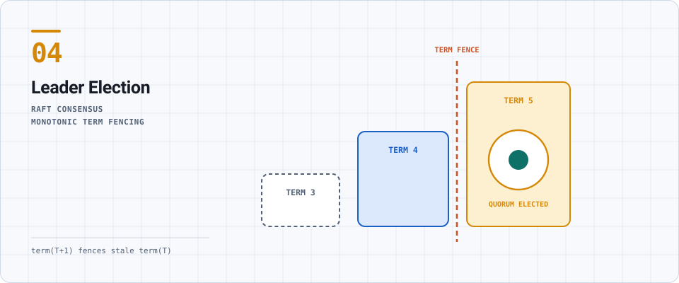
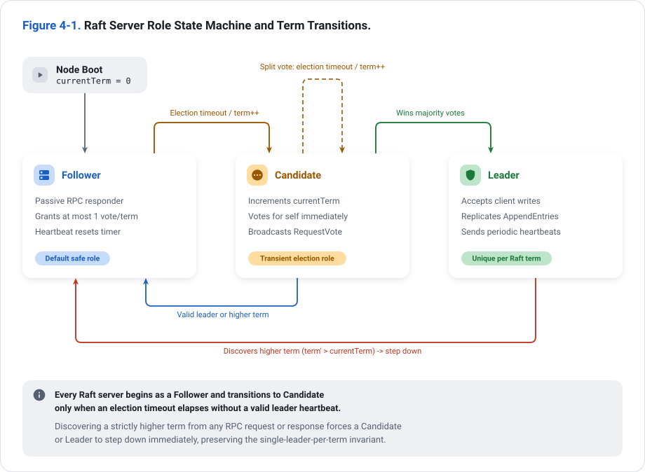
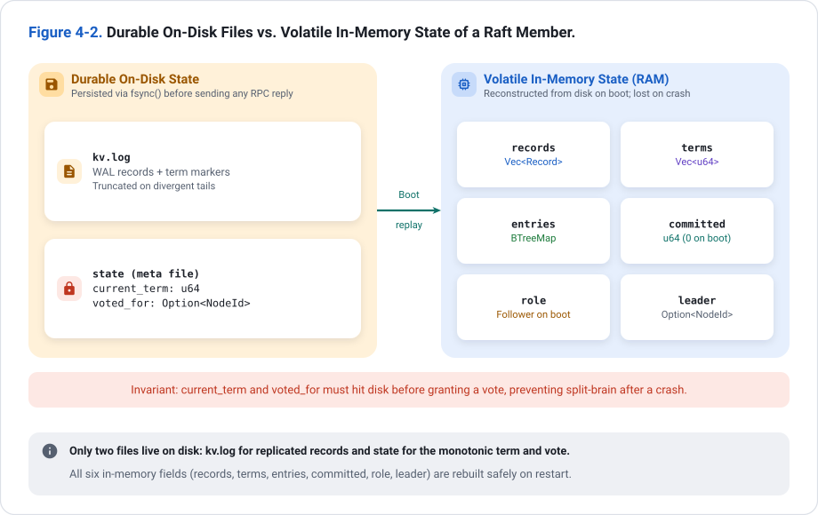
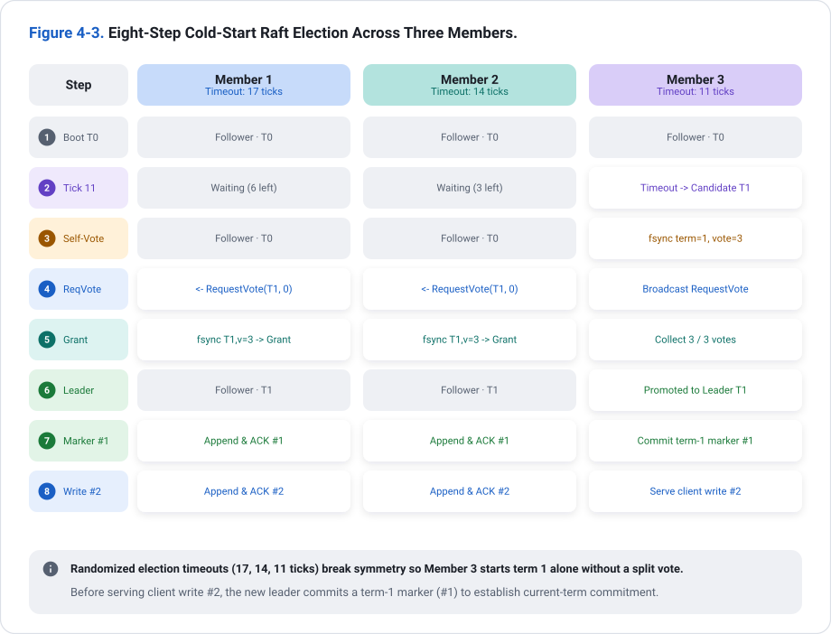
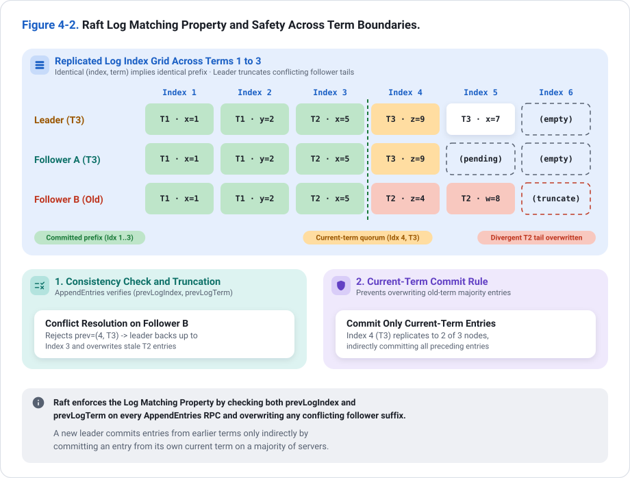
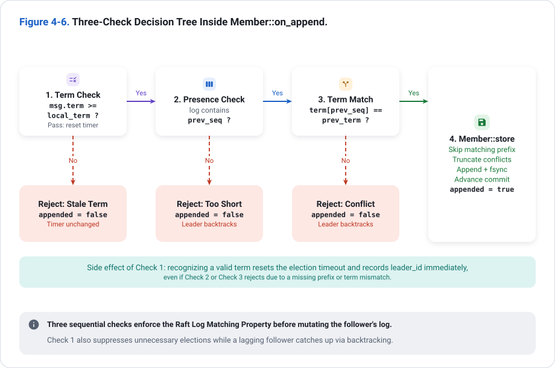
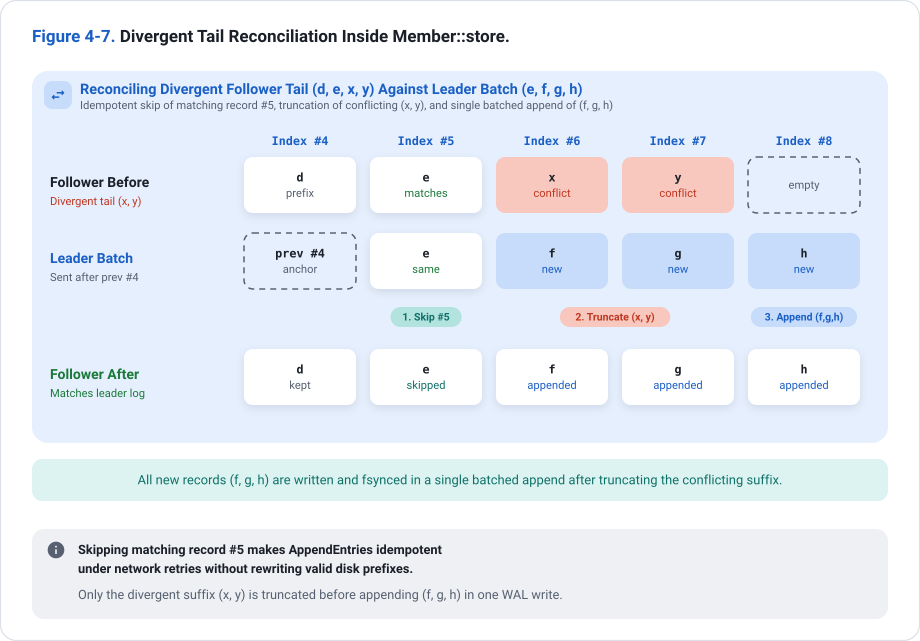
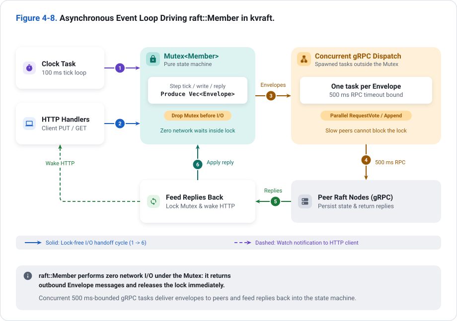
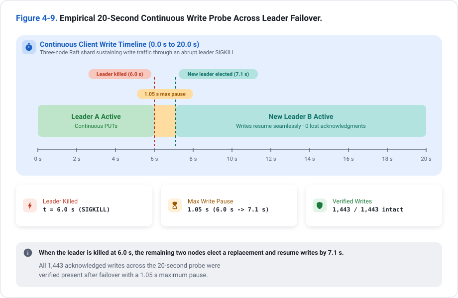

# Chapter 4: Raft Leader Election and Fencing (LLD)



In [Chapter 3](03-key-value-store-replication.md), an operator appointed each shard's leader manually, and when a leader failed the shard rejected every write until someone inspected follower health endpoints and promoted a survivor by hand. Meeting a `99.95%` availability target permits at most `21.6` minutes of unavailability per 30-day month. No manual incident-response workflow can stay within that budget across dozens of shards. The replicas of a shard must elect their own leader automatically.

Stated concisely, automated failover sounds modest; in practice, it is the hardest algorithmic problem in this book. The members of a shard must converge on a single leader even though they communicate solely over an asynchronous network that drops and delays messages, any replica may crash and restart with only its persisted disk state, and no replica can distinguish a crashed peer from a slow or partitioned peer. Two members must never lead the same term concurrently, because split leadership would allow divergent writes. Moreover, every elected leader must already hold every write acknowledged in earlier terms so that new writes never overwrite durable client state. Reaching agreement under these fault assumptions is the problem of distributed *consensus*.

In this chapter, I implement the *Raft* consensus algorithm (Ongaro and Ousterhout, 2014) in Rust, extending the replication engine of Chapter 3 with persistent voting, term-tagged log matching, uncommitted suffix truncation, and current-term commit rules. We first build `raft` as a pure, clock-free, network-free state-machine library so we can drive deterministic fault injection in `raftsim` across 200 randomized runs of 600 steps and validate the simulator itself by disabling safety rules one by one. We then wrap `raft` in the networked server `kvraft` over gRPC and HTTP, and measure real failover pause duration under continuous write load (`probe`) when killing an active leader with `SIGKILL`.

<div class="covers">

In this chapter, we cover

- the three Raft server roles (`Follower`, `Candidate`, `Leader`) and monotonic term transitions
- volatile versus durable state (`kv.log` plus atomic `state` persistence for `term` and `voted_for`)
- deterministic per-term election timeouts and the three-part Raft voting rule
- zero-schema-change term markers that encode record terms inside the Chapter 2 WAL and commit inherited logs
- Raft Log Matching (`previous_term`), suffix conflict resolution, and safe truncation of uncommitted records
- the current-term commit rule and why counting replicas on earlier-term records is unsafe
- deterministic randomized simulation (`raftsim`) plus fault-injection mutation testing of the simulator itself
- `kvraft`: driving the pure `Member` state machine from a `100 ms` clock task and asynchronous gRPC dispatch
- empirical failover measurement (`probe`): recovering from leader `SIGKILL` in `1.05 s` with zero lost writes

</div>

## 4.1 Server Roles, Terms, and Consensus Invariants

Every replica in a Raft shard runs identical code with symmetric startup arguments; no host is statically designated as leader. At any instant, each member occupies one of three roles: *Follower* (passive responder granting votes and appending leader batches), *Candidate* (transient state requesting majority votes after an election timeout), or *Leader* (sole writer replicating logs and broadcasting heartbeats). Figure 4-1 maps the complete server role state machine and its monotonic term transitions.

<figure class="diagram">

<figcaption><b>Figure 4-1</b> Raft server role state machine and monotonic term transitions.</figcaption>
</figure>

Logical time advances in discrete, strictly increasing *terms* starting at `1`. Each term opens with an election; if a candidate secures votes from a majority of members, it leads for the remainder of that term. If votes split without a majority, the term ends with no leader and a new election starts in the next term. Building on the four replication invariants of Chapter 3, we enforce three consensus safety invariants:

| No. | Consensus Invariant | Proof Mechanism |
| :--- | :--- | :--- |
| 0 | **Election Safety:** At most one member leads any given term. | Each member persists at most one vote per term; any two majorities intersect in at least one member, preventing two candidates from both winning a majority. |
| 1 | **Leader Completeness:** Every elected leader holds every record acknowledged in any earlier term. | Enforced by the log-completeness voting predicate (`(last_term, last_sequence)` comparison) combined with quorum intersection. |
| 2 | **Log Safety:** A member truncates a log entry only if that entry was never committed. | Guaranteed by Leader Completeness together with an explicit runtime guard in `Member::truncate` against `index <= committed`. |

## 4.2 Protocol Extension: `RequestVote` and `previous_term`

Automated election adds one new gRPC service (`Election::RequestVote`) and extends the existing `AppendRequest` message from Chapter 3 with two backward-compatible fields (`previous_term` as field `6` and `leader` as field `7`). Listing 4.1 defines the `Election` service in `proto/store.proto`, and Listing 4.2 presents the evolved `Replication` service carrying fields `6` and `7` without renumbering any existing fields.

<p class="listing"><b>Listing 4.1</b> <code>Election</code> gRPC service definition in <code>proto/store.proto</code>. <a href="https://github.com/arpanpathak/cracking-the-systems-programming-interview/blob/prep-v2/distributed-systems-from-the-ground-up/code/proto/store.proto">proto/store.proto</a></p>

```protobuf
{{#include ../code/proto/store.proto:election}}
```

<p class="listing"><b>Listing 4.2</b> Backward-compatible evolution of <code>Replication</code> in <code>proto/store.proto</code>. <a href="https://github.com/arpanpathak/cracking-the-systems-programming-interview/blob/prep-v2/distributed-systems-from-the-ground-up/code/proto/store.proto">proto/store.proto</a></p>

```protobuf
{{#include ../code/proto/store.proto:replication}}
```

Following the pure-library pattern of Chapter 3, `raft/src/lib.rs` defines transport-independent domain message types. Listing 4.3 declares the `kv` and filesystem imports of `raft/src/lib.rs`, and Listing 4.4 specifies the addressed `Envelope` and `Message` enum covering `Append`, `Appended`, `RequestVote`, and `Voted`.

<p class="listing"><b>Listing 4.3</b> Imports of <code>raft/src/lib.rs</code>. <a href="https://github.com/arpanpathak/cracking-the-systems-programming-interview/blob/prep-v2/distributed-systems-from-the-ground-up/code/raft/src/lib.rs">raft/src/lib.rs</a></p>

```rust
{{#include ../code/raft/src/lib.rs:imports}}
```

<p class="listing"><b>Listing 4.4</b> Transport-independent consensus messages in <code>raft/src/lib.rs</code>. <a href="https://github.com/arpanpathak/cracking-the-systems-programming-interview/blob/prep-v2/distributed-systems-from-the-ground-up/code/raft/src/lib.rs">raft/src/lib.rs</a></p>

```rust
{{#include ../code/raft/src/lib.rs:messages}}
```

## 4.3 Persistent Versus Volatile Member State

Correct crash recovery in Raft depends on strictly separating state that must survive restarts on disk from volatile state rebuilt in memory. Listing 4.5 defines `Role`, the deterministic `election_timeout` function, per-follower `Progress` tracking (`next`, `matched`, `last_heard`), and the `Member` struct.

<p class="listing"><b>Listing 4.5</b> Roles, election timeout computation, and <code>Member</code> state in <code>raft/src/lib.rs</code>. <a href="https://github.com/arpanpathak/cracking-the-systems-programming-interview/blob/prep-v2/distributed-systems-from-the-ground-up/code/raft/src/lib.rs">raft/src/lib.rs</a></p>

```rust
{{#include ../code/raft/src/lib.rs:member}}
```

Figure 4-2 partitions `Member` fields into on-disk durable files (`kv.log` and `state`) versus volatile runtime memory rebuilt after every restart.

<figure>

<figcaption><b>Figure 4-2</b> Durable on-disk files versus volatile in-memory state inside a Raft member.</figcaption>
</figure>

| State Category | Struct Fields | Persisted on Disk | Safety Justification |
| :--- | :--- | :--- | :--- |
| Replicated WAL | `log`, `records`, `terms` | Yes (`kv.log`) | Stores all durable mutations and term markers. |
| Election metadata | `term`, `voted_for` | Yes (`state`) | Forgetting a vote across a crash would allow a member to vote twice in the same term, violating Election Safety (invariant 0). |
| Volatile state | `role`, `leader`, `committed`, `entries`, `progress` | No | Rebuilt safely from `kv.log` and live peer messages after restart. |

Persisting `term` and `voted_for` before transmitting any `RequestVote` or `Voted` reply is non-negotiable: a vote is a durable promise, not an ephemeral event. Listing 4.6 implements `Member::open`, loading `kv.log`, reconstructing per-record terms from embedded markers, reading `state`, and resetting volatile fields (`role = Follower`, `committed = 0`, `entries = empty`).

<p class="listing"><b>Listing 4.6</b> Recovering durable WAL and election state in <code>raft/src/lib.rs</code>. <a href="https://github.com/arpanpathak/cracking-the-systems-programming-interview/blob/prep-v2/distributed-systems-from-the-ground-up/code/raft/src/lib.rs">raft/src/lib.rs</a></p>

```rust
{{#include ../code/raft/src/lib.rs:open}}
```

To guarantee that a crash mid-write never leaves `state` half-written, Listing 4.7 persists `(term, voted_for)` via atomic write-sync-rename (`state.tmp` synced and renamed onto `state`, followed by parent-directory synchronization). On POSIX filesystems, intra-directory `rename` is atomic, ensuring startup always reads either the prior state or the complete new state.

<p class="listing"><b>Listing 4.7</b> Atomic write-and-rename persistence for <code>term</code> and <code>voted_for</code> in <code>raft/src/lib.rs</code>. <a href="https://github.com/arpanpathak/cracking-the-systems-programming-interview/blob/prep-v2/distributed-systems-from-the-ground-up/code/raft/src/lib.rs">raft/src/lib.rs</a></p>

```rust
{{#include ../code/raft/src/lib.rs:state}}
```

### Encoding Record Terms Without Changing the WAL Format

Raft requires the term number in which every WAL record was originally written. Rather than altering the binary record schema of Chapter 2, we encode term boundaries via an in-band *term marker*: the very first record every newly elected leader appends is a `Put` with an empty key (`""`) whose 8-byte little-endian value holds the leader's `term`. Because the external HTTP API forbids empty keys (minimum length `1`), markers can never collide with user data. Every subsequent record inherits the term of the most recent marker at or before its index. Listing 4.8 implements marker construction, marker detection, and linear-time reconstruction of the `terms` vector (`terms_of`).

<p class="listing"><b>Listing 4.8</b> In-band term markers and per-record term reconstruction in <code>raft/src/lib.rs</code>. <a href="https://github.com/arpanpathak/cracking-the-systems-programming-interview/blob/prep-v2/distributed-systems-from-the-ground-up/code/raft/src/lib.rs">raft/src/lib.rs</a></p>

```rust
{{#include ../code/raft/src/lib.rs:terms}}
```

## 4.4 Elections, Voting Safety, and Stepping Down

### Deterministic Staggered Election Timeouts

A follower expects a heartbeat or `Append` RPC from its leader every `100 ms` tick. If an entire election timeout elapses without leader contact, the follower transitions to `Candidate` and initiates an election. If all followers shared an identical timeout, they would stand simultaneously, vote for themselves, and deadlock in repeated split votes. In Listing 4.5, `election_timeout(id, term)` deterministically maps `(id, term)` to a value between `10` and `19` ticks (`1.0 s` to `1.9 s`): distinct members receive staggered timeouts within each term, and each member shifts its timeout on every term increment to break accidental alignments while keeping `raftsim` 100% reproducible.

Listing 4.9 implements `Member::stand`, which increments `term`, records a self-vote, flushes `state` to disk via `save_state`, resets the election timer, and broadcasts `RequestVote` carrying the candidate's `(last_sequence, last_term)` to every peer.

<p class="listing"><b>Listing 4.9</b> Initiating a candidacy and persisting self-vote in <code>raft/src/lib.rs</code>. <a href="https://github.com/arpanpathak/cracking-the-systems-programming-interview/blob/prep-v2/distributed-systems-from-the-ground-up/code/raft/src/lib.rs">raft/src/lib.rs</a></p>

```rust
{{#include ../code/raft/src/lib.rs:stand}}
```

Figure 4-3 traces an eight-step initial shard election from cold start (`term 0`) through member 3's timeout, disk-backed vote grants, term-1 marker commitment, and the first client write at sequence `2`.

<figure>

<figcaption><b>Figure 4-3</b> Initial eight-step election of a three-member shard from boot through term-marker commitment.</figcaption>
</figure>

### The Three-Part Voting Rule

A member grants its vote to a candidate if and only if three conditions hold simultaneously:

| No. | Voting Condition | Safety Property Enforced |
| :--- | :--- | :--- |
| 0 | `request.term == self.term` (after stepping up if `request.term > self.term`). | Prevents stale-term candidates from collecting votes. |
| 1 | `self.voted_for` is `None` or already equals `Some(candidate)`. | Guarantees at most one vote per term per member (Election Safety, invariant 0). |
| 2 | `(request.last_term, request.last_sequence) >= (self.last_term(), self.last_sequence())`. | Guarantees the winner holds every record committed in earlier terms (Leader Completeness, invariant 1). |

Listing 4.10 implements `on_vote` (persisting the vote before returning `Voted { granted: true }`) and `on_voted` (tallying grants and invoking `lead` as soon as a majority is reached). Rust's lexicographic tuple ordering directly implements Raft's log-freshness comparison: higher final term wins first, with log length breaking ties within the same term.

<p class="listing"><b>Listing 4.10</b> Vote evaluation, durable vote recording, and quorum tallying in <code>raft/src/lib.rs</code>. <a href="https://github.com/arpanpathak/cracking-the-systems-programming-interview/blob/prep-v2/distributed-systems-from-the-ground-up/code/raft/src/lib.rs">raft/src/lib.rs</a></p>

```rust
{{#include ../code/raft/src/lib.rs:vote}}
```

Figure 4-4 demonstrates why term takes precedence over sequence length: member 2 holds a record from term `2` (reflecting progress from a later leader) and therefore defeats any isolated member that accumulated longer uncommitted logs from term `1`.

<figure>

<figcaption><b>Figure 4-4</b> Log-freshness comparison across three replicas comparing final term before final sequence.</figcaption>
</figure>

Because every acknowledged record resides on a majority and every winning candidate collects votes from a majority, quorum intersection guarantees that at least one voter holds the acknowledged record. That voter refuses any candidate with a less-fresh log, automating the longest-log promotion rule that an operator executed manually in Chapter 3.

### Ascending to Leadership and Stepping Down

Upon collecting a majority of votes, `Member::lead` (Listing 4.11) initializes every peer's `next` guess to `self.last_sequence()`, appends the new term's in-band marker to the WAL, and immediately broadcasts initial `Append` RPCs to assert authority and commit the marker.

<p class="listing"><b>Listing 4.11</b> Transitioning to leader and appending the term marker in <code>raft/src/lib.rs</code>. <a href="https://github.com/arpanpathak/cracking-the-systems-programming-interview/blob/prep-v2/distributed-systems-from-the-ground-up/code/raft/src/lib.rs">raft/src/lib.rs</a></p>

```rust
{{#include ../code/raft/src/lib.rs:lead}}
```

Whenever any member receives any RPC or reply carrying a term strictly greater than `self.term`, Listing 4.12 (`step_down`) immediately adopts the higher term, clears `voted_for`, persists `state`, and reverts to `Follower`. For a partitioned former leader, this single rule immediately terminates stale authority upon reconnection.

<p class="listing"><b>Listing 4.12</b> Adopting a higher term and reverting to follower in <code>raft/src/lib.rs</code>. <a href="https://github.com/arpanpathak/cracking-the-systems-programming-interview/blob/prep-v2/distributed-systems-from-the-ground-up/code/raft/src/lib.rs">raft/src/lib.rs</a></p>

```rust
{{#include ../code/raft/src/lib.rs:step_down}}
```

## 4.5 Log Matching and Conflicting-Tail Repair

In Chapter 3, a returning former leader had to wipe its disk because uncommitted records at the end of its log could conflict with records written by a new leader at the same sequence indices. Raft resolves divergent tails automatically via the *Log Matching Property* (Figure 4-5): if two logs contain an entry with the same `(index, term)`, then both logs are guaranteed identical across every preceding index `1` through `index`.

<figure class="diagram">

<figcaption><b>Figure 4-5</b> Raft Log Matching Property across term boundaries and deterministic truncation of conflicting follower tails.</figcaption>
</figure>

A follower validates every incoming `Append` against three sequential checks (Figure 4-6):

1. Is `msg.term >= self.term`? If not, refuse and report `self.term`.
2. Does the follower hold a record at `msg.previous_sequence`? If not, refuse and report `self.last_sequence()`.
3. Does the follower's record at `msg.previous_sequence` have term equal to `msg.previous_term`? If not, refuse and report `msg.previous_sequence - 1` so the leader steps backward by one index until reaching the highest matching prefix.

<figure>
= local term, verify log contains previous_sequence, verify term at previous_sequence equals previous_term; passing check 1 resets election timeout and records leader id." />
<figcaption><b>Figure 4-6</b> Three-check validation inside <code>Member::on_append</code>.</figcaption>
</figure>

Listing 4.13 implements `Member::on_append`, resetting the election timer upon accepting the current leader's term and invoking `store` plus `apply_committed` once all three checks pass.

<p class="listing"><b>Listing 4.13</b> Three-check <code>Append</code> validation in <code>raft/src/lib.rs</code>. <a href="https://github.com/arpanpathak/cracking-the-systems-programming-interview/blob/prep-v2/distributed-systems-from-the-ground-up/code/raft/src/lib.rs">raft/src/lib.rs</a></p>

```rust
{{#include ../code/raft/src/lib.rs:on_append}}
```

Once all three checks pass, both logs agree up to `previous_sequence`. Listing 4.14 (`store`) walks incoming records forward: identical entries (matching both term and payload) are skipped idempotently; at the first diverging index, `truncate` removes the conflicting tail from memory and disk, and the remaining leader suffix is appended in a single batched `fsync` (Figure 4-7).

<figure>

<figcaption><b>Figure 4-7</b> Idempotent prefix skipping, conflict truncation, and batched suffix append inside <code>Member::store</code>.</figcaption>
</figure>

<p class="listing"><b>Listing 4.14</b> Reconciling matching prefixes and truncating conflicting tails in <code>raft/src/lib.rs</code>. <a href="https://github.com/arpanpathak/cracking-the-systems-programming-interview/blob/prep-v2/distributed-systems-from-the-ground-up/code/raft/src/lib.rs">raft/src/lib.rs</a></p>

```rust
{{#include ../code/raft/src/lib.rs:store}}
```

Listing 4.15 implements `Member::truncate`. Although invariant 2 proves that a legitimate leader will never ask a follower to truncate a committed index, `truncate` asserts `keep >= self.committed` explicitly and returns an error if violated. Defensive invariant checks convert potential latent bugs or disk corruption into immediate fail-stop halts rather than invisible data loss. To find the exact on-disk byte offset for truncation without storing a separate offset table, `truncate` sums the encoded frame lengths of the retained prefix.

<p class="listing"><b>Listing 4.15</b> Guarded uncommitted-tail truncation in <code>raft/src/lib.rs</code>. <a href="https://github.com/arpanpathak/cracking-the-systems-programming-interview/blob/prep-v2/distributed-systems-from-the-ground-up/code/raft/src/lib.rs">raft/src/lib.rs</a></p>

```rust
{{#include ../code/raft/src/lib.rs:truncate}}
```

On-disk truncation extends `kv::log` from Chapter 2 with `Log::truncate`. Listing 4.16 recalls the imports of `kv/src/log.rs`, and Listing 4.17 implements `Log::truncate`, calling `set_len(bytes)`, seeking to the new end, syncing the file via `sync_all`, and resetting `self.next`. This refines invariant 3 of Chapter 2: committed records are never overwritten, whereas uncommitted tail records beyond `committed` may be cleanly excised during Raft log repair.

<p class="listing"><b>Listing 4.16</b> Imports of <code>kv/src/log.rs</code>. <a href="https://github.com/arpanpathak/cracking-the-systems-programming-interview/blob/prep-v2/distributed-systems-from-the-ground-up/code/kv/src/log.rs">kv/src/log.rs</a></p>

```rust
{{#include ../code/kv/src/log.rs:imports}}
```

<p class="listing"><b>Listing 4.17</b> Truncating uncommitted tail bytes in <code>kv/src/log.rs</code>. <a href="https://github.com/arpanpathak/cracking-the-systems-programming-interview/blob/prep-v2/distributed-systems-from-the-ground-up/code/kv/src/log.rs">kv/src/log.rs</a></p>

```rust
{{#include ../code/kv/src/log.rs:truncate}}
```

### Leader Per-Follower Progress (`next` and `matched`)

For every peer, the leader tracks two distinct indices: `next` (optimistic cursor that decrements upon log-mismatch refusal) and `matched` (monotonically increasing confirmed index used exclusively by the commit rule). Listing 4.18 implements `Member::on_appended`, updating peer progress, advancing `committed` via `advance`, and emitting an immediate follow-up `Append` whenever the peer still lags behind the leader's WAL.

<p class="listing"><b>Listing 4.18</b> Processing <code>Appended</code> replies and advancing follower cursors in <code>raft/src/lib.rs</code>. <a href="https://github.com/arpanpathak/cracking-the-systems-programming-interview/blob/prep-v2/distributed-systems-from-the-ground-up/code/raft/src/lib.rs">raft/src/lib.rs</a></p>

```rust
{{#include ../code/raft/src/lib.rs:on_appended}}
```

## 4.6 Current-Term Commit Rule and Pure Event Loop

Listing 4.19 implements `apply_committed` and `advance`. Unlike Chapter 3's single-term `majority_sequence`, Raft's `advance` commits index `candidate` by replica counting **only if** `self.term_of(candidate) == self.term`.

<p class="listing"><b>Listing 4.19</b> Current-term commit rule and state-machine application in <code>raft/src/lib.rs</code>. <a href="https://github.com/arpanpathak/cracking-the-systems-programming-interview/blob/prep-v2/distributed-systems-from-the-ground-up/code/raft/src/lib.rs">raft/src/lib.rs</a></p>

```rust
{{#include ../code/raft/src/lib.rs:commit}}
```

Restricting direct replica-count commits to entries of the current term closes a subtle Raft safety hazard (Figure 8 of the Raft paper): an entry written in an earlier term can be replicated to a majority yet still be overwritten by a future leader elected by a disjoint quorum of peers carrying an intermediate term, until a record from the *current* term reaches a majority. Once a current-term record reaches a majority, the Log Matching Property locks in all preceding entries indirectly. Here the term marker performs its second role: appending and committing the term marker immediately upon election commits every inherited prior-term entry without waiting for a client write to arrive.

Because `raft` owns neither clocks nor sockets, callers drive it through three pure entry points: `tick` (Listing 4.20) advances heartbeat or election timers; `handle` (Listing 4.21) dispatches incoming peer messages and returns outbound `Envelope` batches; and client methods (Listing 4.22) enforce `can_read` (requiring leadership, committed term marker so inherited state is applied, and majority heartbeat contact within the past 10 ticks) and `propose`.

<p class="listing"><b>Listing 4.20</b> Logical clock tick driving heartbeats and election timeouts in <code>raft/src/lib.rs</code>. <a href="https://github.com/arpanpathak/cracking-the-systems-programming-interview/blob/prep-v2/distributed-systems-from-the-ground-up/code/raft/src/lib.rs">raft/src/lib.rs</a></p>

```rust
{{#include ../code/raft/src/lib.rs:tick}}
```

<p class="listing"><b>Listing 4.21</b> Central message dispatcher in <code>raft/src/lib.rs</code>. <a href="https://github.com/arpanpathak/cracking-the-systems-programming-interview/blob/prep-v2/distributed-systems-from-the-ground-up/code/raft/src/lib.rs">raft/src/lib.rs</a></p>

```rust
{{#include ../code/raft/src/lib.rs:handle}}
```

<p class="listing"><b>Listing 4.22</b> Client read guard and write proposal entry points in <code>raft/src/lib.rs</code>. <a href="https://github.com/arpanpathak/cracking-the-systems-programming-interview/blob/prep-v2/distributed-systems-from-the-ground-up/code/raft/src/lib.rs">raft/src/lib.rs</a></p>

```rust
{{#include ../code/raft/src/lib.rs:client}}
```

## 4.7 Deterministic Randomized Simulation (`raftsim`)

Decoupling `Member` from system clocks and TCP sockets lets `raftsim` run three full disk-backed Raft members inside one deterministic process, controlling every tick, message reordering, packet drop, process crash, and restart.

Listing 4.23 declares the imports of `raftsim/src/main.rs`, and Listing 4.24 provides a seeded deterministic pseudo-random generator (`xorshift64`) so any discovered failure replays identically on demand.

<p class="listing"><b>Listing 4.23</b> Imports of <code>raftsim/src/main.rs</code>. <a href="https://github.com/arpanpathak/cracking-the-systems-programming-interview/blob/prep-v2/distributed-systems-from-the-ground-up/code/raftsim/src/main.rs">raftsim/src/main.rs</a></p>

```rust
{{#include ../code/raftsim/src/main.rs:imports}}
```

<p class="listing"><b>Listing 4.24</b> Seeded deterministic pseudo-random generator in <code>raftsim/src/main.rs</code>. <a href="https://github.com/arpanpathak/cracking-the-systems-programming-interview/blob/prep-v2/distributed-systems-from-the-ground-up/code/raftsim/src/main.rs">raftsim/src/main.rs</a></p>

```rust
{{#include ../code/raftsim/src/main.rs:random}}
```

Listing 4.25 implements the in-process `Cluster` harness managing member directories, crash/restart lifecycles, an unordered in-flight message queue, and an external oracle tracking acknowledged writes.

<p class="listing"><b>Listing 4.25</b> In-process Raft cluster harness in <code>raftsim/src/main.rs</code>. <a href="https://github.com/arpanpathak/cracking-the-systems-programming-interview/blob/prep-v2/distributed-systems-from-the-ground-up/code/raftsim/src/main.rs">raftsim/src/main.rs</a></p>

```rust
{{#include ../code/raftsim/src/main.rs:cluster}}
```

After every single simulation step, Listing 4.26 (`check`) asserts all three safety invariants: no two live members lead the same term (Election Safety), every two members with entries committed at the same sequence agree on identical record contents (State Machine Safety), and every write acknowledged by a leader while still leading its proposal term remains intact after recovery (Leader Completeness).

<p class="listing"><b>Listing 4.26</b> Per-step safety invariant checker in <code>raftsim/src/main.rs</code>. <a href="https://github.com/arpanpathak/cracking-the-systems-programming-interview/blob/prep-v2/distributed-systems-from-the-ground-up/code/raftsim/src/main.rs">raftsim/src/main.rs</a></p>

```rust
{{#include ../code/raftsim/src/main.rs:check}}
```

Listing 4.27 runs a deterministic scripted scenario that elects member 3, commits three writes, appends uncommitted record 5 on member 3 and crashes it, elects member 1 in term 2, commits a conflicting write at record 5/6, restarts member 3, and verifies that member 3 truncates its uncommitted record 5 and converges cleanly.

<p class="listing"><b>Listing 4.27</b> Scripted leader-crash and conflicting-tail repair scenario in <code>raftsim/src/main.rs</code>. <a href="https://github.com/arpanpathak/cracking-the-systems-programming-interview/blob/prep-v2/distributed-systems-from-the-ground-up/code/raftsim/src/main.rs">raftsim/src/main.rs</a></p>

```rust
{{#include ../code/raftsim/src/main.rs:cases}}
```

Listing 4.28 executes 200 randomized runs of 600 steps each (40% tick, 42% deliver random in-flight message, 5% drop message, 3% crash member, 4% restart member, 6% client write), healing all members at the end of every run to verify convergence on one leader, identical logs, and every acknowledged key. Listing 4.29 runs both suites from `main`.

<p class="listing"><b>Listing 4.28</b> 200 randomized crash-and-partition runs in <code>raftsim/src/main.rs</code>. <a href="https://github.com/arpanpathak/cracking-the-systems-programming-interview/blob/prep-v2/distributed-systems-from-the-ground-up/code/raftsim/src/main.rs">raftsim/src/main.rs</a></p>

```rust
{{#include ../code/raftsim/src/main.rs:runs}}
```

<p class="listing"><b>Listing 4.29</b> Entry point of <code>raftsim/src/main.rs</code>. <a href="https://github.com/arpanpathak/cracking-the-systems-programming-interview/blob/prep-v2/distributed-systems-from-the-ground-up/code/raftsim/src/main.rs">raftsim/src/main.rs</a></p>

```rust
{{#include ../code/raftsim/src/main.rs:main}}
```

Running `raftsim` exercises 480 elections, 504 acknowledged writes, and 18 divergent uncommitted tail truncations with zero invariant violations:

```console
$ cargo run --release -p raftsim
start:            1: Follower term 0 log 0 | 2: Follower term 0 log 0 | 3: Follower term 0 log 0
after 11 ticks:   1: Follower term 1 log 1 | 2: Follower term 1 log 1 | 3: Leader term 1 log 1
after 3 writes:   1: Follower term 1 log 4 | 2: Follower term 1 log 4 | 3: Leader term 1 log 4, 3 acknowledged
leader 3 appends record 5 and crashes: 1: Follower term 1 log 4 | 2: Follower term 1 log 4 | 3: down
after 10 ticks:   1: Leader term 2 log 5 | 2: Follower term 2 log 5 | 3: down
after 1 write:    1: Leader term 2 log 6 | 2: Follower term 2 log 6 | 3: down, 4 acknowledged
member 3 returns: 1: Leader term 2 log 6 | 2: Follower term 2 log 6 | 3: Follower term 1 log 5
after 2 ticks:    1: Leader term 2 log 6 | 2: Follower term 2 log 6 | 3: Follower term 2 log 6
member 3 discarded 1 record that was never committed, and holds the leader's records in its place
200 runs of 600 random steps:
  480 leaders were elected, and no term had 2 leaders
  504 writes were acknowledged, and every one was present after recovery
  18 uncommitted records were discarded by members whose log differed from a leader's
  the highest term reached in a run was 8
```

| Observed Output | Verified Consensus Property |
| :--- | :--- |
| `after 11 ticks: 3: Leader term 1 log 1` | Shortest deterministic timeout wins term 1 and commits the term-1 marker at index 1. |
| `leader 3 appends record 5 and crashes` | Uncommitted record 5 exists solely on member 3. |
| `after 10 ticks: 1: Leader term 2 log 5` | Surviving quorum elects member 1 in term 2, writing term-2 marker at index 5. |
| `member 3 returns ... after 2 ticks: Follower term 2 log 6` | Returning former leader detects conflict at index 5, truncates its uncommitted record, and adopts the leader's suffix. |
| `480 leaders were elected, and no term had 2 leaders` | Election Safety (invariant 0) held at every step of all 200 runs. |
| `504 writes were acknowledged, and every one was present` | Leader Completeness (invariant 1) held across every failover. |
| `18 uncommitted records were discarded` | Log Matching and conflict truncation resolved 18 divergent tails without losing any acknowledged write. |

### Mutation Testing the Simulator Itself

A passing test suite warrants confidence only when we verify that it detects real protocol violations. We intentionally disabled three Raft safety rules one at a time and re-ran `raftsim`:

| Safety Rule Disabled | Simulator Outcome |
| :--- | :--- |
| Log-completeness check in `on_vote` | **Detected:** `member 2 lost acknowledged write of key-1` |
| Single-vote-per-term check in `on_vote` | **Detected:** `members 1 and 3 both lead term 4` |
| Current-term-only commit check in `advance` | **Not detected:** all 200 three-node runs passed |

That third outcome deserves explicit engineering candor. The current-term commit restriction is mandatory for Raft correctness and remains implemented in `advance`, yet triggering its counterexample (Figure 8 of Ongaro and Ousterhout) typically requires five members and a specific multi-term cascade of crashes. Our 200 three-node runs provide strong empirical validation for voting safety and log repair, and zero empirical coverage of the earlier-term commit edge case. Distinguishing what a test actually exercises from what it leaves uncovered is essential to honest systems verification.

## 4.8 Low-Level Architecture of `kvraft`

We now connect the verified `raft::Member` engine to a real `100 ms` clock, `tonic` gRPC transport, and `axum` HTTP endpoints in `kvraft`.

<div class="lld">

Low-level design: leader election

**Crates**

| Crate | Kind | Responsibilities |
| :--- | :--- | :--- |
| `raft` | library | Pure `Member` state machine: roles, durable voting, term markers, log repair, and current-term commit |
| `raftsim` | binary | Deterministic crash-and-partition simulator (`200` randomized runs + scripted repair test) |
| `kvraft` | binary | Networked Raft node: `rpc` (`Replication` + `Election` gRPC services), `node` (clock, async dispatch, reads/writes), `main` (HTTP API) |
| `probe` | binary | Continuous write-availability client measuring the maximum failover pause across shard members |

**Summary of `Member` Transitions**

| Trigger Event | Deterministic State Action |
| :--- | :--- |
| Any message with `msg.term > self.term` | Adopt `msg.term`, clear `voted_for`, persist `state`, become `Follower` |
| `Append` with `msg.term < self.term` | Refuse and return `self.term` |
| `Append` with missing `previous_sequence` | Refuse and return `self.last_sequence()` |
| `Append` with mismatched `previous_term` | Refuse and return `msg.previous_sequence - 1` |
| Valid `Append` | Skip equal entries, truncate first diverging uncommitted suffix, batch-append remainder, apply up to `committed` |
| `RequestVote` | Grant and persist vote iff term matches, vote is free, and candidate log is at least as fresh |
| Election timeout elapses | Increment `term`, persist self-vote, broadcast `RequestVote` |
| Majority of votes collected | Become `Leader`, append term marker, broadcast `Append` |

**Timing Parameters**

| Parameter | Value |
| :--- | :--- |
| Logical clock tick | `100 ms` |
| Leader heartbeat interval | `1` tick (`100 ms`) |
| Election timeout range | `10` to `19` ticks (`1.0 s` to `1.9 s`) |
| Client write commit timeout | `1 s` |

</div>

## 4.9 Implementing `kvraft`

Listing 4.30 declares the imports of `kvraft/src/main.rs`, and Listing 4.31 defines the symmetric CLI options (`--id`, `--listen`, `--replication`, `--peer <id>=<url>`, `--data`, `--no-sync`).

<p class="listing"><b>Listing 4.30</b> Imports of <code>kvraft/src/main.rs</code>. <a href="https://github.com/arpanpathak/cracking-the-systems-programming-interview/blob/prep-v2/distributed-systems-from-the-ground-up/code/kvraft/src/main.rs">kvraft/src/main.rs</a></p>

```rust
{{#include ../code/kvraft/src/main.rs:imports}}
```

<p class="listing"><b>Listing 4.31</b> Symmetric node CLI arguments in <code>kvraft/src/main.rs</code>. <a href="https://github.com/arpanpathak/cracking-the-systems-programming-interview/blob/prep-v2/distributed-systems-from-the-ground-up/code/kvraft/src/main.rs">kvraft/src/main.rs</a></p>

```rust
{{#include ../code/kvraft/src/main.rs:options}}
```

Listing 4.32 lists the imports of `kvraft/src/rpc.rs`, Listing 4.33 converts between generated Protobuf structs and `raft::Message` variants, and Listing 4.34 implements both the `Replication` and `Election` gRPC server traits by forwarding each incoming RPC directly to `Node::answer`.

<p class="listing"><b>Listing 4.32</b> Imports of <code>kvraft/src/rpc.rs</code>. <a href="https://github.com/arpanpathak/cracking-the-systems-programming-interview/blob/prep-v2/distributed-systems-from-the-ground-up/code/kvraft/src/rpc.rs">kvraft/src/rpc.rs</a></p>

```rust
{{#include ../code/kvraft/src/rpc.rs:imports}}
```

<p class="listing"><b>Listing 4.33</b> Protobuf-to-Raft message conversions in <code>kvraft/src/rpc.rs</code>. <a href="https://github.com/arpanpathak/cracking-the-systems-programming-interview/blob/prep-v2/distributed-systems-from-the-ground-up/code/kvraft/src/rpc.rs">kvraft/src/rpc.rs</a></p>

```rust
{{#include ../code/kvraft/src/rpc.rs:convert}}
```

<p class="listing"><b>Listing 4.34</b> Server implementations for <code>Append</code> and <code>RequestVote</code> in <code>kvraft/src/rpc.rs</code>. <a href="https://github.com/arpanpathak/cracking-the-systems-programming-interview/blob/prep-v2/distributed-systems-from-the-ground-up/code/kvraft/src/rpc.rs">kvraft/src/rpc.rs</a></p>

```rust
{{#include ../code/kvraft/src/rpc.rs:service}}
```

### Driving the Pure State Machine (`kvraft/src/node.rs`)

Figure 4-8 illustrates the asynchronous event loop surrounding `Mutex<Member>`: the `100 ms` clock task, incoming gRPC handlers, and client HTTP handlers all invoke `Member` under a brief lock, collect the returned outbound `Envelope` vector, release the lock, and spawn concurrent `500 ms`-bounded gRPC tasks whose replies feed back into `Member::handle`.

<figure>

<figcaption><b>Figure 4-8</b> Asynchronous event loop connecting <code>raft::Member</code> to the logical clock, gRPC peers, and HTTP handlers.</figcaption>
</figure>

Listing 4.35 declares the imports of `kvraft/src/node.rs`, and Listing 4.36 defines the shared `Node` state and typed `NodeError` variants (including `NotLeader(Option<u64>)` so followers can report the current leader ID).

<p class="listing"><b>Listing 4.35</b> Imports of <code>kvraft/src/node.rs</code>. <a href="https://github.com/arpanpathak/cracking-the-systems-programming-interview/blob/prep-v2/distributed-systems-from-the-ground-up/code/kvraft/src/node.rs">kvraft/src/node.rs</a></p>

```rust
{{#include ../code/kvraft/src/node.rs:imports}}
```

<p class="listing"><b>Listing 4.36</b> Shared <code>Node</code> concurrency wrapper and error types in <code>kvraft/src/node.rs</code>. <a href="https://github.com/arpanpathak/cracking-the-systems-programming-interview/blob/prep-v2/distributed-systems-from-the-ground-up/code/kvraft/src/node.rs">kvraft/src/node.rs</a></p>

```rust
{{#include ../code/kvraft/src/node.rs:types}}
```

Listing 4.37 implements `with_member`, the single choke point into `Mutex<Member>`. It runs the supplied closure inside `block_in_place` (since `Member` may flush `kv.log` or `state`) and unconditionally publishes `member.committed()` on the `watch` channel before returning, guaranteeing no commit advance ever misses a waiting writer.

<p class="listing"><b>Listing 4.37</b> Serialized state-machine entry point <code>with_member</code> in <code>kvraft/src/node.rs</code>. <a href="https://github.com/arpanpathak/cracking-the-systems-programming-interview/blob/prep-v2/distributed-systems-from-the-ground-up/code/kvraft/src/node.rs">kvraft/src/node.rs</a></p>

```rust
{{#include ../code/kvraft/src/node.rs:with_member}}
```

Listing 4.38 implements `dispatch`, `send`, and `deliver`. Each outbound `Envelope` runs in its own Tokio task with a `500 ms` deadline; dropped or timed-out RPCs require no explicit retry queue because the next `100 ms` tick re-emits fresh messages automatically. Listing 4.39 implements the `100 ms` `run_clock` driver and the gRPC `answer` entry point.

<p class="listing"><b>Listing 4.38</b> Concurrent message dispatch and reply delivery in <code>kvraft/src/node.rs</code>. <a href="https://github.com/arpanpathak/cracking-the-systems-programming-interview/blob/prep-v2/distributed-systems-from-the-ground-up/code/kvraft/src/node.rs">kvraft/src/node.rs</a></p>

```rust
{{#include ../code/kvraft/src/node.rs:send}}
```

<p class="listing"><b>Listing 4.39</b> Logical clock loop and incoming gRPC request handler in <code>kvraft/src/node.rs</code>. <a href="https://github.com/arpanpathak/cracking-the-systems-programming-interview/blob/prep-v2/distributed-systems-from-the-ground-up/code/kvraft/src/node.rs">kvraft/src/node.rs</a></p>

```rust
{{#include ../code/kvraft/src/node.rs:clock}}
```

Listing 4.40 implements `Node::write`, `Node::get`, and `Node::list`. Notice one crucial post-wait check added over Chapter 3: after `committed` reaches `seq`, the write handler re-checks that this node *still leads the exact term in which `propose` appended the record*. If leadership changed while the write was waiting, a successor leader might have overwritten the uncommitted slot at `seq` with a different record and committed it; returning `503` prevents acknowledging a displaced write.

<p class="listing"><b>Listing 4.40</b> Term-verified write path and guarded read path in <code>kvraft/src/node.rs</code>. <a href="https://github.com/arpanpathak/cracking-the-systems-programming-interview/blob/prep-v2/distributed-systems-from-the-ground-up/code/kvraft/src/node.rs">kvraft/src/node.rs</a></p>

```rust
{{#include ../code/kvraft/src/node.rs:write}}
```

Listing 4.41 wires the HTTP endpoints (`PUT`, `DELETE`, `GET`, `/v1/keys`, `/healthz`), returning `421 Misdirected Request` with the known leader ID (`the leader is member N`) whenever a non-leader receives client traffic. Listing 4.42 bootstraps the gRPC server, `100 ms` clock task, and `axum` HTTP listener.

<p class="listing"><b>Listing 4.41</b> HTTP handlers and <code>/healthz</code> endpoint in <code>kvraft/src/main.rs</code>. <a href="https://github.com/arpanpathak/cracking-the-systems-programming-interview/blob/prep-v2/distributed-systems-from-the-ground-up/code/kvraft/src/main.rs">kvraft/src/main.rs</a></p>

```rust
{{#include ../code/kvraft/src/main.rs:handlers}}
```

<p class="listing"><b>Listing 4.42</b> Node bootstrap in <code>kvraft/src/main.rs</code>. <a href="https://github.com/arpanpathak/cracking-the-systems-programming-interview/blob/prep-v2/distributed-systems-from-the-ground-up/code/kvraft/src/main.rs">kvraft/src/main.rs</a></p>

```rust
{{#include ../code/kvraft/src/main.rs:main}}
```

## 4.10 Live Three-Node Consensus Experiments

Starting three symmetric `kvraft` instances with zero leader configuration triggers automatic election within two seconds (member 3 wins term 1, appending the term-1 marker at sequence `1`, so the first client `PUT` receives `ETag: "2"`):

```console
$ ./target/release/kvraft --id 1 --listen 127.0.0.1:7001 --replication 127.0.0.1:7101 --data /var/tmp/m1 \
      --peer 2=http://127.0.0.1:7102 --peer 3=http://127.0.0.1:7103 &
member 1, term 0, log ends at 0
listening on 127.0.0.1:7001
$ ./target/release/kvraft --id 2 --listen 127.0.0.1:7002 --replication 127.0.0.1:7102 --data /var/tmp/m2 \
      --peer 1=http://127.0.0.1:7101 --peer 3=http://127.0.0.1:7103 &
$ ./target/release/kvraft --id 3 --listen 127.0.0.1:7003 --replication 127.0.0.1:7103 --data /var/tmp/m3 \
      --peer 1=http://127.0.0.1:7101 --peer 2=http://127.0.0.1:7102 &
$ for port in 7001 7002 7003; do curl http://127.0.0.1:$port/healthz; echo; done
{"id":1,"role":"follower","term":1,"leader":3,"last_sequence":1,"committed":1}
{"id":2,"role":"follower","term":1,"leader":3,"last_sequence":1,"committed":1}
{"id":3,"role":"leader","term":1,"leader":3,"last_sequence":1,"committed":1}
```

```console
$ curl -i -X PUT http://127.0.0.1:7003/v1/keys/user-1 --data-binary 'ada'
HTTP/1.1 201 Created
etag: "2"
content-length: 0

$ curl -i -X PUT http://127.0.0.1:7001/v1/keys/user-1 --data-binary 'x'
HTTP/1.1 421 Misdirected Request
content-type: application/problem+json
content-length: 116

{"type":"/problems/not-leader","title":"This node is not the leader","status":421,"detail":"the leader is member 3"}
```

### Measuring Failover Pause Under Continuous Load (`probe`)

To measure real write unavailability when a leader crashes, we build `probe`, a continuous load client that rotates across all three shard endpoints upon receiving `421`, `503`, or connection errors, recording every acknowledged key and the maximum inter-acknowledgement gap. Listing 4.43 declares the imports of `probe/src/main.rs`, and Listing 4.44 implements the continuous probing loop.

<p class="listing"><b>Listing 4.43</b> Imports of <code>probe/src/main.rs</code>. <a href="https://github.com/arpanpathak/cracking-the-systems-programming-interview/blob/prep-v2/distributed-systems-from-the-ground-up/code/probe/src/main.rs">probe/src/main.rs</a></p>

```rust
{{#include ../code/probe/src/main.rs:imports}}
```

<p class="listing"><b>Listing 4.44</b> Continuous availability probe measuring failover pause in <code>probe/src/main.rs</code>. <a href="https://github.com/arpanpathak/cracking-the-systems-programming-interview/blob/prep-v2/distributed-systems-from-the-ground-up/code/probe/src/main.rs">probe/src/main.rs</a></p>

```rust
{{#include ../code/probe/src/main.rs:probe}}
```

Killing leader member 3 with `SIGKILL` six seconds into a 20-second `probe` run yields automatic recovery in `1.05 s` with zero lost writes (Figure 4-9):

```console
$ ./target/release/probe --seconds 20 --acked acked.txt \
      --server http://127.0.0.1:7001 --server http://127.0.0.1:7002 --server http://127.0.0.1:7003 &
$ sleep 6; kill -9 <pid of member 3, the leader>
$ sleep 3; for port in 7001 7002 7003; do curl http://127.0.0.1:$port/healthz; echo; done
{"id":1,"role":"leader","term":2,"leader":1,"last_sequence":610,"committed":609}
{"id":2,"role":"follower","term":2,"leader":1,"last_sequence":611,"committed":610}
curl: (7) Failed to connect to 127.0.0.1 port 7003
1443 writes acknowledged in 20 seconds, 51 attempts refused
the longest pause between 2 acknowledged writes was 1.05 s, ending 7.1 s after the start
$ ./target/release/kvctl verify --server http://127.0.0.1:7001 --acked acked.txt
1443 acknowledged, 1443 found, 0 missing
```

<figure>

<figcaption><b>Figure 4-9</b> Empirical 20-second failover timeline showing a 1.05 s election pause and zero lost writes.</figcaption>
</figure>

| Observed Output | Operational Significance |
| :--- | :--- |
| `member 1: leader, term 2` | Automated election promoted member 1 with zero operator intervention. |
| `longest pause was 1.05 s` | Matches member 1's 10-tick (`1.0 s`) election timeout plus one round of votes and term-marker commitment. |
| `51 attempts refused` | `probe` rotated across endpoints during the 1.05 s election window until discovering member 1. |
| `1443 acknowledged, 1443 found, 0 missing` | Zero acknowledged writes were lost across the abrupt `SIGKILL` crash. |

Across a 24-node cluster, a `1.05 s` single-node failover consumes roughly `0.04 s` of our `1,296 s` monthly availability error budget, satisfying Chapter 1's `99.95%` availability target.

### Former Leader Rejoining Intact and Minority Isolation

Unlike Chapter 3, restarting the crashed former leader (member 3) with its data directory untouched succeeds cleanly: member 3 adopts term 2, repairs any divergent tail, catches up to sequence `1,447`, and matches both peers byte for byte:

```console
$ ./target/release/kvraft --id 3 --listen 127.0.0.1:7003 --replication 127.0.0.1:7103 --data /var/tmp/m3 \
      --peer 1=http://127.0.0.1:7101 --peer 2=http://127.0.0.1:7102 &
$ for port in 7001 7002 7003; do curl http://127.0.0.1:$port/healthz; echo; done
{"id":1,"role":"leader","term":2,"leader":1,"last_sequence":1447,"committed":1447}
{"id":2,"role":"follower","term":2,"leader":1,"last_sequence":1447,"committed":1447}
{"id":3,"role":"follower","term":2,"leader":1,"last_sequence":1447,"committed":1447}
$ cmp /var/tmp/m1/kv.log /var/tmp/m2/kv.log && cmp /var/tmp/m1/kv.log /var/tmp/m3/kv.log && echo identical
identical
$ cat /var/tmp/m1/state
2 1
```

Finally, killing two members leaves member 1 isolated on the minority side of a partition. Member 1 loops as a `candidate` incrementing its term (`6`, `8`) while rejecting writes with `503 Service Unavailable`; once peers return, the shard immediately elects a leader in `term 9`:

```console
$ kill -9 <pid of member 2, the leader> <pid of member 3>
$ sleep 5; curl http://127.0.0.1:7001/healthz
{"id":1,"role":"candidate","term":6,"leader":null,"last_sequence":1449,"committed":1449}
$ curl -X PUT http://127.0.0.1:7001/v1/keys/alone --data-binary 'x'
{"type":"/problems/store-unavailable","title":"The node cannot serve the request","status":503,"detail":"the shard has no leader at the moment"}
$ sleep 3; curl http://127.0.0.1:7001/healthz
{"id":1,"role":"candidate","term":8,"leader":null,"last_sequence":1449,"committed":1449}

$ (members 2 and 3 are started again)
$ sleep 4; for port in 7001 7002 7003; do curl http://127.0.0.1:$port/healthz; echo; done
{"id":1,"role":"leader","term":9,"leader":1,"last_sequence":1450,"committed":1450}
{"id":2,"role":"follower","term":9,"leader":1,"last_sequence":1450,"committed":1450}
{"id":3,"role":"follower","term":9,"leader":1,"last_sequence":1450,"committed":1450}
```

## 4.11 Residual Limitations

| No. | Current Limitation | Engineering Consequence | Resolution |
| :--- | :--- | :--- | :--- |
| 0 | An isolated candidate increments `term` on every election timeout. | Upon reconnecting, its inflated term forces a healthy leader to step down and triggers an unnecessary election. | Raft *Pre-Vote* extension (verify quorum reachability before incrementing `term`). |
| 1 | Cluster membership is static at process startup. | Adding or replacing hosts requires restarting all members with updated `--peer` flags. | Joint-consensus online reconfiguration (Chapter 1). |
| 2 | Writes execute serially (`~72 writes/s` single-shard). | One unbatched write per replication round trip caps throughput. | WAL group commit (Chapter 6). |
| 3 | Every member holds all WAL records in memory without compaction. | RAM footprint and restart replay time grow unboundedly. | Periodic snapshotting and log compaction (Chapter 1). |
| 4 | Clients must probe shard nodes directly to locate the active leader. | `probe` absorbed 51 refusals discovering the new leader. | Stateless consistent-hash request router (Chapter 5). |
| 5 | Earlier-term commit restriction was not triggered by three-node random runs. | Implemented in `advance`, yet untested by `raftsim` on 3 nodes. | Dedicated five-node adversarial schedule reproducing Raft Figure 8. |

## 4.12 Complete Source Listings

Listings 4.45 through 4.51 present the complete source files for the `raft` library, `raftsim`, `kvraft`, and `probe`.

Listing 4.45 presents the complete clock-free, network-free Raft consensus library in `raft/src/lib.rs`.

<p class="listing"><b>Listing 4.45</b> Complete <code>raft/src/lib.rs</code>. <a href="https://github.com/arpanpathak/cracking-the-systems-programming-interview/blob/prep-v2/distributed-systems-from-the-ground-up/code/raft/src/lib.rs">raft/src/lib.rs</a></p>

```rust
{{#include ../code/raft/src/lib.rs}}
```

Listing 4.46 presents the complete deterministic Raft fault simulator in `raftsim/src/main.rs`.

<p class="listing"><b>Listing 4.46</b> Complete <code>raftsim/src/main.rs</code>. <a href="https://github.com/arpanpathak/cracking-the-systems-programming-interview/blob/prep-v2/distributed-systems-from-the-ground-up/code/raftsim/src/main.rs">raftsim/src/main.rs</a></p>

```rust
{{#include ../code/raftsim/src/main.rs}}
```

Listing 4.47 presents the package manifest and gRPC build configuration in `kvraft/Cargo.toml`.

<p class="listing"><b>Listing 4.47</b> Complete <code>kvraft/Cargo.toml</code>. <a href="https://github.com/arpanpathak/cracking-the-systems-programming-interview/blob/prep-v2/distributed-systems-from-the-ground-up/code/kvraft/Cargo.toml">kvraft/Cargo.toml</a></p>

```toml
{{#include ../code/kvraft/Cargo.toml}}
```

Listing 4.48 presents the complete `Replication` and `Election` gRPC service layer in `kvraft/src/rpc.rs`.

<p class="listing"><b>Listing 4.48</b> Complete <code>kvraft/src/rpc.rs</code>. <a href="https://github.com/arpanpathak/cracking-the-systems-programming-interview/blob/prep-v2/distributed-systems-from-the-ground-up/code/kvraft/src/rpc.rs">kvraft/src/rpc.rs</a></p>

```rust
{{#include ../code/kvraft/src/rpc.rs}}
```

Listing 4.49 presents the complete async event loop, clock driver, and term-verified write path in `kvraft/src/node.rs`.

<p class="listing"><b>Listing 4.49</b> Complete <code>kvraft/src/node.rs</code>. <a href="https://github.com/arpanpathak/cracking-the-systems-programming-interview/blob/prep-v2/distributed-systems-from-the-ground-up/code/kvraft/src/node.rs">kvraft/src/node.rs</a></p>

```rust
{{#include ../code/kvraft/src/node.rs}}
```

Listing 4.50 presents the complete HTTP API server and CLI bootstrap in `kvraft/src/main.rs`.

<p class="listing"><b>Listing 4.50</b> Complete <code>kvraft/src/main.rs</code>. <a href="https://github.com/arpanpathak/cracking-the-systems-programming-interview/blob/prep-v2/distributed-systems-from-the-ground-up/code/kvraft/src/main.rs">kvraft/src/main.rs</a></p>

```rust
{{#include ../code/kvraft/src/main.rs}}
```

Listing 4.51 presents the complete continuous availability and failover-pause measurement tool in `probe/src/main.rs`.

<p class="listing"><b>Listing 4.51</b> Complete <code>probe/src/main.rs</code>. <a href="https://github.com/arpanpathak/cracking-the-systems-programming-interview/blob/prep-v2/distributed-systems-from-the-ground-up/code/probe/src/main.rs">probe/src/main.rs</a></p>

```rust
{{#include ../code/probe/src/main.rs}}
```

## 4.13 End-to-End Failover and Consensus Request Lifecycle

Under Raft consensus (`kvraft`), steady-state writes follow the quorum path of Chapter 3, whereas a leader crash triggers a multi-phase election lifecycle spanning timers, durable vote persistence, and term-marker commitment:

1. **Leader Crash Detection (Election Timeout):** Followers stop receiving periodic `Append` heartbeats (`150 ms` interval). After a randomized election timeout (`600` to `1,200 ms` in `kvraft`), the earliest-expiring follower transitions to `Candidate`.
2. **Durable Vote Persistence:** The candidate increments `current_term`, sets `voted_for = self`, writes the updated `(term, voted_for)` tuple to `state.tmp`, calls `fdatasync(2)` on the temporary file, atomically `rename(2)`s it over `state`, and calls `fsync(2)` on the parent directory (`~2` to `8 ms`).
3. **Cross-AZ `RequestVote` Round Trip:** The candidate broadcasts `RequestVote(term, last_log_term, last_log_sequence)` over gRPC to all peers. Each peer validates term monotonicity and log up-to-dateness, persists its own `(term, voted_for)` via atomic write-and-rename, and replies.
4. **Leadership Acquisition and Term-Marker Commit:** Upon receiving a majority of votes (`2 of 3`), the new leader appends an empty-key **term marker** to its local WAL and replicates it via `Append`. Once a majority persists the marker, all inherited prior-term entries become committed and safe to serve.
5. **Client Reconnection and Write Resumption:** Clients or routers probing the dead leader observe TCP `RST` or connection refused, retry against surviving peers, receive `421` redirects pointing to the new leader, and resume normal quorum writes.

| Path / Phase | Device / Subsystem | Typical `p50` | Tail `p99` | Primary Source of Tail Latency |
| :--- | :--- | :--- | :--- | :--- |
| Steady-State `PUT` | Leader + Cross-AZ Quorum WAL `fsync` | `4.80 ms` | `16.50 ms` | NVMe flush spikes, cross-AZ packet retransmissions |
| Failover Phase 1 | Follower Election Timeout Expiry | `750 ms` | `1,180 ms` | Randomized timeout spread (`[T, 2T]`), split-vote re-election |
| Failover Phase 2 | Candidate Atomic `state` Persist (`2x fsync`) | `3.20 ms` | `12.00 ms` | Directory metadata `fsync` contention on ext4/XFS |
| Failover Phase 3 | Cross-AZ `RequestVote` + Peer `state` Persist | `4.50 ms` | `15.00 ms` | Peer disk flush latency, cross-AZ RTT |
| Failover Phase 4 | Term-Marker Quorum Replication (`Append`) | `4.80 ms` | `16.50 ms` | Divergent uncommitted tail rollback on lagging follower |
| **Total Failover** | **Leader `SIGKILL` to First New-Term Write** | **`~765 ms`** | **`~1,225 ms`** | **Dominated (`> 95%`) by election timeout window** |

## 4.14 Production Consensus Case Studies

Production consensus engines harden textbook Raft and Multi-Paxos against split-brain disruptions, disk stalls, and Multi-Raft scaling bottlenecks:

- **etcd (Kubernetes Control Plane):** etcd runs a single Raft group over `bbolt` with default `heartbeat_interval = 100 ms` and `election_timeout = 1,000 ms`, enabling sub-second failover across three AZs. To eliminate disruptive re-elections when a partitioned node reconnects with an inflated term, etcd enables Raft **Pre-Vote** (requiring a majority pre-check before incrementing `term`) and **CheckQuorum** (stepping down an isolated leader automatically). Linearizable reads use `ReadIndex`, batching concurrent `GET` requests behind a single quorum heartbeat round trip (`~1` to `2 ms` p99).
- **CockroachDB (Multi-Raft with Range Leases):** A single CockroachDB node hosts thousands of `512 MiB` ranges, each backed by its own Raft group. Running independent `100 ms` heartbeat timers per range would consume entire CPU cores; CockroachDB therefore **coalesces heartbeats** per peer node into one RPC per tick. Furthermore, CockroachDB decouples the **Raft leader** from the **range leaseholder** (a time- or epoch-based lease recorded inside the Raft log), allowing the leaseholder to serve linearizable reads locally from RAM with zero network round trips while its lease remains valid.
- **TiKV (`raft-rs` and Hibernated Regions):** TiKV separates Raft log storage from user key-value storage across two dedicated RocksDB instances (or its custom **Raft Engine** append-only log) so heavy user-data LSM compactions never stall consensus heartbeats. Regions that receive zero writes for a configurable idle window enter a **hibernated** state, suspending periodic heartbeats entirely and reducing idle CPU utilization by `> 60%` on large clusters with hundreds of thousands of regions.
- **Google Chubby and Spanner (Multi-Paxos):** Chubby and Spanner implement Multi-Paxos with **master leases** (typically `10 s` in Spanner) that allow the Paxos leader to serve linearizable reads locally without a quorum round trip. When a leader fails, Spanner's Paxos group cannot elect a new leader until the old leader's lease expires unless the old leader explicitly relinquishes it, trading a bounded failover window for zero-RTT local reads in steady state.

<div class="callout keyidea"><span class="label">Key idea</span>

**Separating the pure consensus state machine from clocks and sockets makes safety bugs reproducible.** By structuring `raft::Node` as a deterministic, allocation-light state machine driven by explicit `Tick` and RPC messages, `raftsim` explores hundreds of network partitions, crashes, and message reorderings in seconds on a single core, reproducing any invariant violation deterministically from one 64-bit RNG seed.

</div>

<div class="callout experiment"><span class="label">Experiment</span>

**Trigger randomized elections and verify Election Safety.** Execute `cargo run --release -p raftsim` in `code/` to run 200 randomized three-node fault schedules. Inspect the summary counters for elections held, acknowledged writes preserved, and conflicting uncommitted tails truncated, then deliberately disable durable `voted_for` persistence in a local branch to watch the simulator catch a dual-leader safety violation immediately.

</div>

<div class="callout caution"><span class="label">Common pitfall</span>

**Deploying Raft without Pre-Vote on wide-area or flaky networks.** Without the Pre-Vote extension, a single partitioned follower increments its `term` on every election timeout (`term + 1, term + 2, ...`). The instant the network partition heals, its first message carries a higher term that forces the healthy leader to step down immediately, causing an avoidable cluster-wide write pause even though the reconnecting node's log is stale and cannot win the election.

</div>

## Further Reading

- D. Ongaro and J. Ousterhout, "In Search of an Understandable Consensus Algorithm", USENIX ATC 2014.
- D. Ongaro, *Consensus: Bridging Theory and Practice*, doctoral dissertation, Stanford University, 2014.
- L. Lamport, "Paxos Made Simple", ACM SIGACT News, 2001.
- T. Chandra, R. Griesemer, and J. Redstone, "Paxos Made Live: An Engineering Perspective", PODC 2007.
- M. Fischer, N. Lynch, and M. Paterson, "Impossibility of Distributed Consensus with One Faulty Process", Journal of the ACM, 1985.
- K. Kingsbury, Jepsen Distributed Systems Safety Analyses, jepsen.io.

<div class="summary">

## Summary

- Every Raft replica boots as a follower; upon missing heartbeats for its staggered election timeout, it increments `term`, persists its self-vote via atomic write-and-rename, and requests votes from peers.
- Persisting `(term, voted_for)` before replying enforces Election Safety (at most one leader per term), while comparing `(last_term, last_sequence)` enforces Leader Completeness.
- In-band empty-key term markers encode per-record terms inside the existing WAL format and commit inherited prior-term entries upon quorum replication.
- The Log Matching Property (`previous_sequence`, `previous_term`) lets leaders step back to the highest common prefix and followers safely truncate conflicting uncommitted tails.
- Restricting direct replica-count commits to entries of the leader's current term closes Raft's earlier-term overwrite hazard.
- Across 200 randomized simulation runs (`raftsim`), 480 elections occurred with zero split-term leaders, all 504 acknowledged writes survived, and 18 divergent uncommitted tails were safely truncated.
- Live three-node failover testing (`probe`) recovered from an abrupt leader `SIGKILL` in `1.05 s` with zero loss across `1,443` acknowledged writes.

</div>
