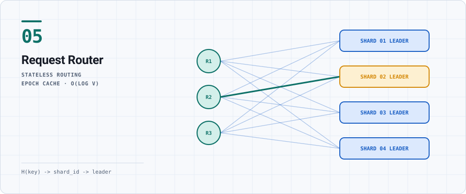
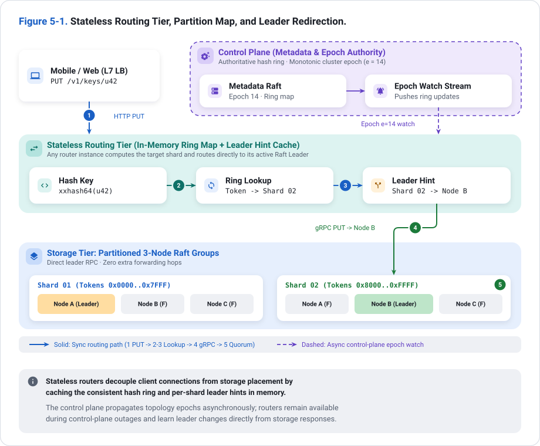
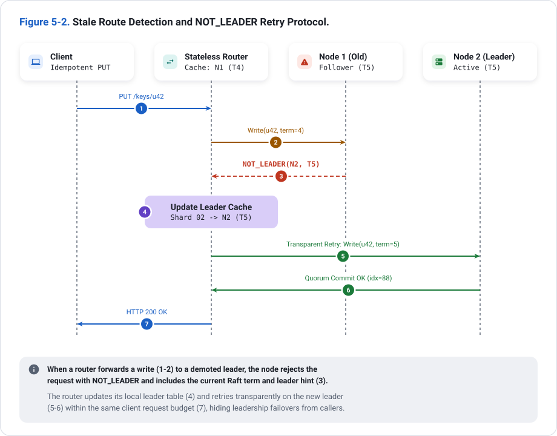

# Chapter 5: Consistent-Hash Request Router (LLD)



With [Chapter 4](04-key-value-store-leader-election.md) complete, a three-node Raft shard survives leader crashes automatically and recovers writes in `1.05 s`. Measured against the system architecture of [Chapter 1](01-key-value-store-system-design.md), two architectural gaps remain. First, clients must currently discover the active shard leader themselves by probing replicas directly, as `probe` did while absorbing `51` `421` and `503` refusals during an election. Second, all keys reside inside a single Raft shard, whereas Chapter 1 scales storage and throughput horizontally by partitioning the keyspace across many independent shards.

A single stateless component closes both gaps: the *request router*. Positioned between external clients and the storage shards, the router receives every client HTTP request at a single stable endpoint, maps the target key to its owning shard on the consistent-hash ring, looks up its cached hint for that shard's active leader, and forwards the request directly. Clients remain completely decoupled from cluster topology, shard count, and Raft leadership transitions.

Although `kvrouter` is the smallest binary in Part I, it encodes one subtle retry-safety boundary that carries severe correctness consequences if misimplemented: deciding when to forward a failed request to another replica. A router that retries blindly after an ambiguous timeout risks executing a non-idempotent mutation twice or reporting a false precondition failure (`412`) on a conditional write that actually succeeded. Conversely, a router that refuses to retry safe rejections (`421` or connection refused) leaks unnecessary errors to clients during failover. In this chapter, I implement `kvrouter` in Rust, formalize its safe-retry invariant, verify multi-shard key distribution across two three-node Raft shards, and repeat the live leader-kill experiment of Chapter 4 with the router shielding clients from failover errors.

<div class="covers">

In this chapter, we cover

- stateless router design and why holding zero authoritative data enables horizontal active-active scaling
- loading the static `ring.json` topology map (`256` virtual nodes per shard) and resolving keys in `O(log V)` time
- leader-hint caching, `421 Misdirected Request` redirection, and `503 no-leader` backoff during elections
- the safe-retry invariant: distinguishing guaranteed zero-effect failures from ambiguous timeouts
- empirical key distribution across two independent three-node Raft shards (`400` keys split `205` to `195`)
- shielding clients during live leader `SIGKILL`: reducing client-visible errors from `51` refusals to `0`

</div>

## 5.1 Stateless Routing Topology

A router stores zero durable client data and participates in zero consensus groups. Its entire runtime state consists of the immutable hash ring loaded at boot and a lightweight, per-shard atomic integer hinting at which member last answered as leader. Because that hint is purely a cache, any number of router instances can run active-active behind a load balancer, and any router can crash or restart at any instant without data loss; a freshly booted router repopulates its leader hints from its first few redirected responses. Figure 5-1 illustrates the stateless routing tier, consistent-hash ring lookup, and direct leader forwarding across partitioned three-node Raft shards.

<figure class="diagram">

<figcaption><b>Figure 5-1</b> Stateless request routing from client ingress through consistent-hash ring lookup and leader-hint cache to partitioned Raft shards.</figcaption>
</figure>

## 5.2 Topology Configuration and `O(log V)` Ring Lookup

In Chapter 1, an authoritative control plane distributes versioned ring updates dynamically. To isolate data-plane routing mechanics in this chapter, `kvrouter` loads its shard map once at startup from `ring.json`, listing each three-node `kvraft` group in member-ID order:

```console
$ cat ring.json
{
  "virtual_nodes": 256,
  "shards": [
    { "name": "shard-a", "members": ["http://127.0.0.1:7011", "http://127.0.0.1:7012", "http://127.0.0.1:7013"] },
    { "name": "shard-b", "members": ["http://127.0.0.1:7021", "http://127.0.0.1:7022", "http://127.0.0.1:7023"] }
  ]
}
```

Listing 5.1 declares the `axum`, `reqwest`, `serde`, and consistent-hash ring imports in `kvrouter/src/main.rs`.

<p class="listing"><b>Listing 5.1</b> Imports of <code>kvrouter/src/main.rs</code>. <a href="https://github.com/arpanpathak/cracking-the-systems-programming-interview/blob/prep-v2/distributed-systems-from-the-ground-up/code/kvrouter/src/main.rs">kvrouter/src/main.rs</a></p>

```rust
{{#include ../code/kvrouter/src/main.rs:imports}}
```

Listing 5.2 defines the JSON schema (`RingFile`, `ShardConfig`) and the runtime `Shard` struct holding the shard name, member base URLs, and an `AtomicUsize` leader hint. Notice the core architectural property of that hint: an outdated leader hint costs at most one extra intra-cluster HTTP hop and can never cause an incorrect result because followers enforce Raft term checks and refuse writes with `421`.

<p class="listing"><b>Listing 5.2</b> Ring configuration schema and per-shard leader-hint state in <code>kvrouter/src/main.rs</code>. <a href="https://github.com/arpanpathak/cracking-the-systems-programming-interview/blob/prep-v2/distributed-systems-from-the-ground-up/code/kvrouter/src/main.rs">kvrouter/src/main.rs</a></p>

```rust
{{#include ../code/kvrouter/src/main.rs:config}}
```

Listing 5.3 constructs the consistent-hash ring (`256` virtual nodes per shard) from `ring.json` and implements `RouterState::shard_for(key)`, which hashes the key via `xxhash64`, locates the owning shard name in `O(log V)` binary search time, and returns a reference to that shard's descriptor.

<p class="listing"><b>Listing 5.3</b> Building the consistent-hash ring and resolving key ownership in <code>kvrouter/src/main.rs</code>. <a href="https://github.com/arpanpathak/cracking-the-systems-programming-interview/blob/prep-v2/distributed-systems-from-the-ground-up/code/kvrouter/src/main.rs">kvrouter/src/main.rs</a></p>

```rust
{{#include ../code/kvrouter/src/main.rs:load}}
```

## 5.3 Leader Redirection and the Safe-Retry Invariant

When forwarding a request, the router targets its cached leader index first. Under steady state, that single hop reaches the active leader and completes with minimal latency. When leadership has shifted, the contacted replica's response tells the router whether retrying on another member is provably safe (Figure 5-2).

<figure class="diagram">

<figcaption><b>Figure 5-2</b> Stale route detection, leader-hint cache update, and transparent retry on the active Raft leader.</figcaption>
</figure>

Every backend outcome is governed by a single invariant: **the router forwards the request to another member if and only if the prior attempt provably modified zero state.**

| Backend Outcome | State Mutation Guarantee | Router Action |
| :--- | :--- | :--- |
| `200`, `201`, `204`, `304`, `400`, `404`, `412` | Definitive leader response | Return response verbatim to the client. |
| `421 Misdirected Request` (`the leader is member N`) | Follower touched zero WAL bytes | Update cached leader hint to member `N` (or next peer) and retry immediately. |
| `503` with `/problems/no-leader` | Shard is mid-election; zero WAL bytes touched | Advance to next member; pause `150 ms` after cycling all members so elections are not flooded. |
| TCP connection refused | Target process is down; zero bytes accepted | Advance cached hint to next member and retry immediately. |
| Other `503` (e.g., quorum commit timeout) or read/write timeout | **Indeterminate:** leader may have persisted and committed the record | Return `503` to the client immediately; never guess or duplicate the request on the client's behalf. |

This distinction resolves the lost-response ambiguity we analyzed in Chapters 1 through 3. Only the caller holds semantic context on whether repeating an indeterminate write is safe (for instance, via idempotent `PUT` or conditional `If-Match`).

Listing 5.4 models the three mutually exclusive forwarding outcomes in `Attempt`: `Answer` (definitive response ready for the client), `TryOther(Option<usize>)` (guaranteed zero-effect refusal carrying an optional leader index hint), and `Uncertain` (ambiguous timeout or post-append error that must propagate as `503`).

<p class="listing"><b>Listing 5.4</b> Three-way forwarding classification enum in <code>kvrouter/src/main.rs</code>. <a href="https://github.com/arpanpathak/cracking-the-systems-programming-interview/blob/prep-v2/distributed-systems-from-the-ground-up/code/kvrouter/src/main.rs">kvrouter/src/main.rs</a></p>

```rust
{{#include ../code/kvrouter/src/main.rs:attempt}}
```

Listing 5.5 implements `ask`, dispatching the HTTP method, key path, conditional headers (`If-Match`, `If-None-Match`), and body to one shard member, inspecting RFC 9457 error bodies on `421` and `503` responses, and classifying transport failures into `TryOther` (connection refused) versus `Uncertain` (timeout or mid-stream reset).

<p class="listing"><b>Listing 5.5</b> Single-member HTTP forwarding and outcome classification in <code>kvrouter/src/main.rs</code>. <a href="https://github.com/arpanpathak/cracking-the-systems-programming-interview/blob/prep-v2/distributed-systems-from-the-ground-up/code/kvrouter/src/main.rs">kvrouter/src/main.rs</a></p>

```rust
{{#include ../code/kvrouter/src/main.rs:ask}}
```

Listing 5.6 implements `forward`, looping over `ask` until receiving a definitive `Answer`, an `Uncertain` error, or exhausting the overall forwarding deadline. Upon `TryOther(hint)`, `forward` updates the shard's `AtomicUsize` hint immediately so concurrent requests converge on the new leader without redundant hops; after one full pass across all members fails during an election, it backs off `150 ms` between rounds.

<p class="listing"><b>Listing 5.6</b> Leader-discovery retry loop with election backoff in <code>kvrouter/src/main.rs</code>. <a href="https://github.com/arpanpathak/cracking-the-systems-programming-interview/blob/prep-v2/distributed-systems-from-the-ground-up/code/kvrouter/src/main.rs">kvrouter/src/main.rs</a></p>

```rust
{{#include ../code/kvrouter/src/main.rs:forward}}
```

Listing 5.7 wires the external `PUT`, `DELETE`, `GET`, and `/healthz` HTTP handlers and boots the `axum` server.

<p class="listing"><b>Listing 5.7</b> HTTP handlers and router bootstrap in <code>kvrouter/src/main.rs</code>. <a href="https://github.com/arpanpathak/cracking-the-systems-programming-interview/blob/prep-v2/distributed-systems-from-the-ground-up/code/kvrouter/src/main.rs">kvrouter/src/main.rs</a></p>

```rust
{{#include ../code/kvrouter/src/main.rs:handlers}}
```

## 5.4 Multi-Shard and Failover Experiments

### Experiment 1: Two Three-Node Shards Behind One Router

We launch six `kvraft` processes forming two independent three-node shards (`shard-a` on ports `7011` to `7013`, `shard-b` on ports `7021` to `7023`), start `kvrouter` on port `7000`, and write `400` keys through the single router endpoint:

```console
$ ./target/release/kvrouter --listen 127.0.0.1:7000 --ring ring.json &
routing to 2 shards
listening on 127.0.0.1:7000
$ ./target/release/kvctl load --server http://127.0.0.1:7000 --count 400 --acked acked.txt
400 writes acknowledged
$ for port in 7013 7023; do curl http://127.0.0.1:$port/healthz; echo; done
{"id":3,"role":"leader","term":1,"leader":3,"last_sequence":206,"committed":206}
{"id":3,"role":"leader","term":1,"leader":3,"last_sequence":196,"committed":196}
$ ./target/release/kvctl verify --server http://127.0.0.1:7000 --acked acked.txt
400 acknowledged, 400 found, 0 missing
```

| Observed Output | Verified Sharding Property |
| :--- | :--- |
| `last_sequence: 206` and `196` | Consistent hashing with `256` virtual nodes partitioned `400` keys evenly (`205` to `195`, plus one term marker per shard). |
| `400 acknowledged, 400 found, 0 missing` | Every read routed deterministically to the exact owning shard with zero client knowledge of topology. |

### Experiment 2: Killing a Shard Leader Behind the Router

We repeat the live `probe` failover benchmark of Chapter 4, pointing `probe` solely at `http://127.0.0.1:7000` and killing `shard-a`'s leader four seconds into a 12-second run:

```console
$ ./target/release/probe --seconds 12 --acked acked.txt --server http://127.0.0.1:7000 &
$ sleep 4; kill -9 <pid of member 3 of shard-a, its leader>
780 writes acknowledged in 12 seconds, 0 attempts refused
the longest pause between 2 acknowledged writes was 1.08 s, ending 5.2 s after the start
$ curl http://127.0.0.1:7000/healthz
{"shards":[{"leader":"http://127.0.0.1:7011","name":"shard-a"},{"leader":"http://127.0.0.1:7023","name":"shard-b"}],"status":"ok"}
$ ./target/release/kvctl verify --server http://127.0.0.1:7000 --acked acked.txt
780 acknowledged, 780 found, 0 missing
```

| Observed Output | Comparison Against Direct Client Probing (Chapter 4) |
| :--- | :--- |
| `0 attempts refused` | Eliminated all `51` client-visible refusals observed without a router in Chapter 4. |
| `longest pause 1.08 s` | Raft election duration stays unchanged (`~1.0 s`), yet the router absorbs the election pause transparently as tail latency rather than client errors. |
| `leader` of `shard-a` updated to `7011` | Router discovered member 1 via `421` redirection and updated its atomic leader hint automatically. |
| `780 acknowledged, 780 found, 0 missing` | Zero acknowledged writes lost across failover. |

From a fault-isolation standpoint, `shard-b` experienced zero interruption during `shard-a`'s election. Because `probe` issues writes sequentially, it waited behind one in-flight request to `shard-a`; independent concurrent clients targeting `shard-b` would have observed uninterrupted sub-20 ms writes throughout the failover.

## 5.5 Residual Limitations

| No. | Current Limitation | Engineering Consequence | Architectural Mitigation (Chapter 1) |
| :--- | :--- | :--- | :--- |
| 0 | Ring topology loads statically from `ring.json` at boot. | Adding a shard requires restarting routers and does not migrate existing keys. | Control-plane metadata Raft streaming monotonic ring epochs to routers. |
| 1 | Storage nodes do not validate key-to-shard ownership or ring epoch. | A router carrying an outdated `ring.json` could write a key to the wrong shard. | Tag forwarded requests with `ring_version` and reject stale epochs at storage nodes. |
| 2 | Paginated prefix scans (`GET /v1/keys?prefix=...`) are not routed. | Hash-partitioned prefix scans require scatter-gather across all shards with k-way merge. | Scatter-gather coordinator or lexicographic range-partitioned shards. |

## 5.6 Complete Source Listings

Listings 5.8 and 5.9 present the complete package manifest and source code of `kvrouter`.

Listing 5.8 presents the crate dependencies of `kvrouter` in `kvrouter/Cargo.toml`.

<p class="listing"><b>Listing 5.8</b> Complete <code>kvrouter/Cargo.toml</code>. <a href="https://github.com/arpanpathak/cracking-the-systems-programming-interview/blob/prep-v2/distributed-systems-from-the-ground-up/code/kvrouter/Cargo.toml">kvrouter/Cargo.toml</a></p>

```toml
{{#include ../code/kvrouter/Cargo.toml}}
```

Listing 5.9 presents the complete stateless consistent-hash request router implementation in `kvrouter/src/main.rs`.

<p class="listing"><b>Listing 5.9</b> Complete <code>kvrouter/src/main.rs</code>. <a href="https://github.com/arpanpathak/cracking-the-systems-programming-interview/blob/prep-v2/distributed-systems-from-the-ground-up/code/kvrouter/src/main.rs">kvrouter/src/main.rs</a></p>

```rust
{{#include ../code/kvrouter/src/main.rs}}
```

## 5.7 End-to-End Routed Request Lifecycle and Hop Latency Budget

Adding `kvrouter` inserts one stateless network hop in front of every shard while shielding clients from cluster topology and leader churn. A routed `PUT /v1/keys/user:4210` traverses five stages:

1. **Client to L7 Load Balancer / Stateless Router:** The client sends the request over a pooled HTTP/2 connection to any active-active `kvrouter` instance.
2. **Consistent-Hash Ring Lookup (`O(log V)`):** The router hashes the key with `FNV-1a` or `xxHash`, binary-searches the sorted virtual-node table in RAM (`< 1 us`), and reads the shard's cached leader index atomically.
3. **Router to Shard Leader (Pooled HTTP/gRPC):** The router forwards the payload over a persistent connection pool to the cached leader. On a stale hint, the contacted follower replies `421 Misdirected Request` with the active leader hint, and the router updates its atomic cache and retries safely.
4. **Shard Quorum Commit:** The shard leader executes local WAL `fdatasync(2)` and cross-AZ quorum replication.
5. **Response Relay:** The router streams `201 Created` and `ETag` back to the client with zero extra disk I/O.

| Hop | Device / Subsystem | Typical `p50` | Tail `p99` | Primary Source of Tail Latency |
| :--- | :--- | :--- | :--- | :--- |
| 1 | Client -> TLS/L7 LB -> `kvrouter` | `0.45 ms` | `1.50 ms` | Load-balancer queueing, TLS handshake on cold connections |
| 2 | `kvrouter` Ring Binary Search + Leader Hint Load | `0.01 ms` | `0.05 ms` | CPU scheduler preemption under high connection counts |
| 3 | `kvrouter` -> Shard Leader Forward (fast path) | `0.25 ms` | `1.10 ms` | Stale leader hint incurring one `421` redirect (`+0.8 ms`) |
| 4 | Shard Leader Quorum Write (WAL + Cross-AZ) | `4.50 ms` | `16.00 ms` | NVMe `fsync` stalls, leader election pause (`~1.0 s`) |
| 5 | `kvrouter` -> Client Response Relay | `0.20 ms` | `0.60 ms` | Upstream socket buffer backpressure |
| **Total** | **End-to-End Routed `PUT`** | **`5.41 ms`** | **`19.25 ms`** | **Shard quorum flush; router adds `< 0.5 ms` steady-state overhead** |

## 5.8 Production Request-Routing Case Studies

Production distributed stores choose between stateless proxy fleets and topology-aware smart clients depending on language heterogeneity and latency budgets:

- **Amazon DynamoDB Request Routers:** DynamoDB routes every API call through a horizontally scaled fleet of stateless Request Routers that terminate TLS, authenticate IAM signatures, and consult an in-memory partition metadata cache (**MemDS**) with a `> 99.99%` hit rate. Decoupling routing from storage lets DynamoDB split hot partitions and migrate replicas transparently across tens of thousands of storage hosts without exposing topology changes to SDKs.
- **TiKV Placement Driver (PD) and Smart-Client Routing:** TiKV eliminates the extra proxy hop by caching region-to-leader mappings inside the client SDK. When a region splits or elects a new leader, the contacted TiKV node returns `NotLeader` or `EpochNotMatch`, prompting the client to refresh only the stale region entry from PD and retry automatically.
- **Redis Cluster and Envoy Proxy:** Redis Cluster partitions the keyspace into `16,384` CRC-16 hash slots and distinguishes permanent ownership changes (`MOVED` redirect) from live slot migrations (`ASK` one-shot redirect). Organizations supporting polyglot clients often place **Envoy**'s Redis proxy filter in front of the cluster, trading `~0.3 ms` of proxy latency for centralized connection pooling and zero client-side cluster logic.

<div class="callout keyidea"><span class="label">Key idea</span>

**Stateless routers trade sub-millisecond forwarding overhead for complete topology isolation.** Keeping zero authoritative state on `kvrouter` allows operators to scale the routing tier horizontally behind any L4/L7 load balancer and absorb shard leader failovers without modifying client applications.

</div>

<div class="callout experiment"><span class="label">Experiment</span>

**Observe zero-error failover behind `kvrouter`.** Launch two three-node `kvraft` shards behind `kvrouter`, run `probe --seconds 12 --server http://127.0.0.1:7000`, and terminate `shard-a`'s leader mid-run with `SIGKILL`. Confirm that client-visible refusals drop from `51` (direct client probing) to `0`, while `GET /healthz` updates `shard-a`'s leader hint automatically.

</div>

<div class="callout caution"><span class="label">Common pitfall</span>

**Retrying ambiguous `503` or connection-reset errors on non-idempotent writes.** A router may retry automatically only after guaranteed zero-effect failures (`421 Misdirected Request`, `503 no-leader`, or TCP connection refused). Retrying after a post-append timeout risks executing a mutation twice if the first attempt committed before the connection dropped; propagating `503` leaves conditional retry (`If-Match`) to the caller.

</div>

<div class="summary">

## Summary

- A stateless request router hashes each key onto the consistent-hash ring (`O(log V)`), resolves the owning shard, and forwards requests directly to its cached Raft leader hint.
- Because the router holds zero authoritative data, multiple router instances scale active-active and recover from crashes by repopulating leader hints from initial redirects.
- The safe-retry invariant permits retrying on another replica only after guaranteed zero-effect failures (`421 Misdirected Request`, `503 no-leader`, or TCP connection refused).
- Ambiguous timeouts and post-append `503` errors must never be retried automatically by the router; propagating `503` leaves duplicate-safety decisions to the caller.
- Across two three-node Raft shards, consistent hashing distributed `400` keys evenly (`205` to `195`) behind one endpoint.
- Under live leader `SIGKILL`, `kvrouter` shielded `probe` completely, reducing client-visible errors from `51` refusals (Chapter 4) to `0` while preserving all `780` acknowledged writes across a `1.08 s` election pause.

</div>
