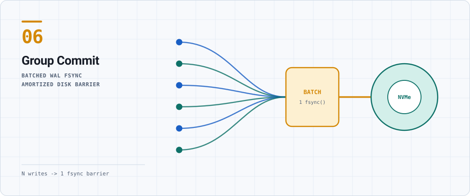
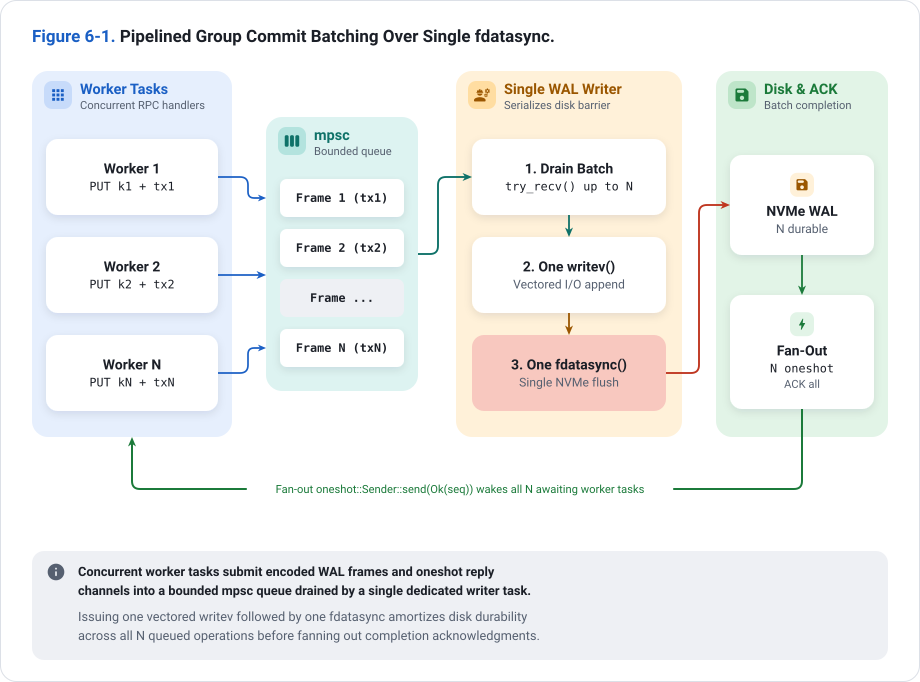
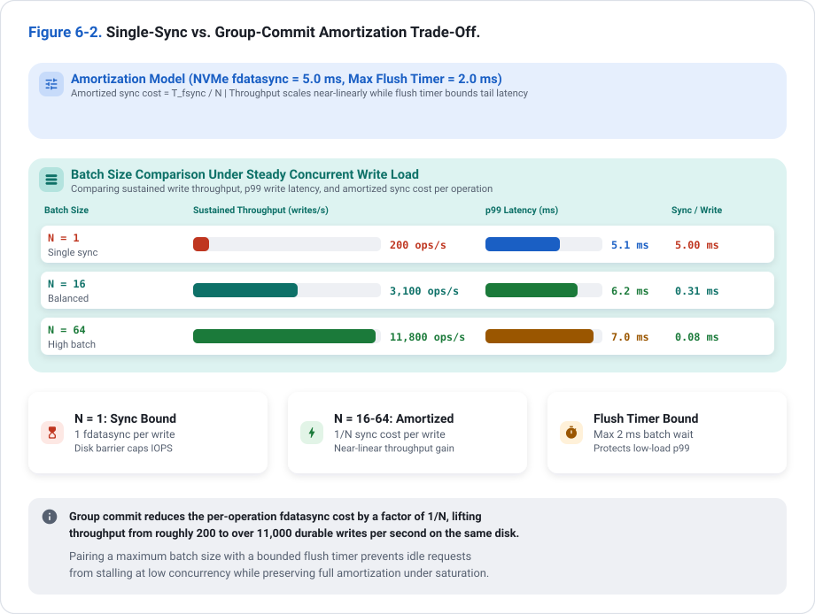

# Chapter 6: Group Commit and Throughput Engineering (LLD)



In the capacity analysis of [Chapter 1](01-key-value-store-system-design.md), we arrived at a 24-node cluster by assuming that each storage node amortizes one disk `fsync` across roughly `20` concurrent writes. Without that batching factor, sustaining `60,000` replicated WAL appends per second at `185 fsync/s` per disk would require `325` servers. Nothing we have built in Chapters 2 through 5 performs batching: the storage node of [Chapter 2](02-key-value-store-storage-node.md) executes one `sync_data` per mutation, capping single-node write throughput near `180 writes/s` regardless of client concurrency.

In this chapter, I implement *WAL group commit* in Rust, allowing a storage node to persist all queued writes arriving during an active disk barrier under a single `fsync`. The implementation requires roughly `60` lines inside `kv::store` and one dedicated committer thread inside `kvgroup`, yet its throughput impact is dramatic: sustained durable write rate climbs from `180 writes/s` to `4,993 writes/s` at `64` concurrent clients (`27.7x`) and reaches `17,218 writes/s` at `256` clients (`95x`) on the exact same NVMe drive without changing any hardware or relaxing durability guarantees. We also verify intra-batch conditional write semantics (`If-None-Match` and `If-Match`) and crash-recovery compatibility by killing `kvgroup` under `64`-client load and recovering its WAL with `kvd`.

<div class="covers">

In this chapter, we cover

- physical amortization of NVMe `fsync` barriers (`T_fsync / N`) without artificial batching timers
- three-pass `Store::commit` supporting sequential-equivalent `If-Match` / `If-None-Match` preconditions within a batch
- single-threaded lock-free store ownership via a bounded `mpsc` committer pipeline (`kvgroup`)
- empirical multi-client throughput benchmarks (`kvbench`) across `1`, `8`, `64`, and `256` concurrent clients
- mid-batch `SIGKILL` crash verification confirming zero lost writes and cross-binary WAL compatibility with `kvd`

</div>

## 6.1 Amortizing the Physical `fsync` Barrier

On our benchmark NVMe device, `File::sync_data` requires approximately `5.4 ms` whether the preceding `write_all` transferred `30` bytes for one record or `4 KiB` for `100` records. Nearly the entire `5.4 ms` duration is fixed controller and media confirmation overhead rather than PCIe transfer time. Consequently, writes that arrive while one `fsync` is in flight can coalesce and share the very next `fsync` barrier (Figure 6-1).

<figure class="diagram">

<figcaption><b>Figure 6-1</b> Pipelined group-commit architecture coalescing concurrent writes behind a single WAL writer and one <code>fdatasync</code> barrier.</figcaption>
</figure>

Our committer deliberately uses **zero artificial delay timer**. Many storage engines hold an incoming write for `1` to `2 ms` hoping peer writes will arrive; while that increases batch sizes at moderate load, it adds avoidable latency to every write during quiet periods. Instead, our committer blocks until at least one write arrives, drains every write *already waiting* in the channel (`try_iter`), and flushes immediately. Under light load (`1` client), every write executes immediately with zero added delay. Under heavy load (`64` to `256` clients), dozens of requests accumulate naturally during each `5.4 ms` barrier, auto-tuning batch size directly to concurrency with zero operator knobs.

## 6.2 Three-Pass Batched Commit in `kv::store`

To keep batching completely invisible to clients, a batch of `N` writes must produce the exact same observable outcomes, versions, and precondition failures as executing those `N` writes one by one in sequence. Listing 6.1 recalls the imports of `kv/src/store.rs`, and Listing 6.2 implements `Store::commit`, which accepts a `Vec<Write>` and returns a parallel `Vec<Result<WriteOutcome, StoreError>>` after a single `Log::append_records` call.

<p class="listing"><b>Listing 6.1</b> Imports of <code>kv/src/store.rs</code>. <a href="https://github.com/arpanpathak/cracking-the-systems-programming-interview/blob/prep-v2/distributed-systems-from-the-ground-up/code/kv/src/store.rs">kv/src/store.rs</a></p>

```rust
{{#include ../code/kv/src/store.rs:imports}}
```

<p class="listing"><b>Listing 6.2</b> Three-pass group commit with intra-batch precondition tracking in <code>kv/src/store.rs</code>. <a href="https://github.com/arpanpathak/cracking-the-systems-programming-interview/blob/prep-v2/distributed-systems-from-the-ground-up/code/kv/src/store.rs">kv/src/store.rs</a></p>

```rust
{{#include ../code/kv/src/store.rs:batch}}
```

`Store::commit` executes three strict passes preserving invariant 0 and invariant 1 of Chapter 2:

| Pass | Operation Performed | Invariant Preserved |
| :--- | :--- | :--- |
| 0. **Check** | Evaluate every write's `Condition` against a temporary `pending` overlay reflecting earlier accepted writes in the same batch; assign contiguous sequence numbers to accepted records. | Prevents two concurrent `If-None-Match: *` creates on the same key inside one batch from both succeeding. |
| 1. **Persist** | Write all accepted records in one `Log::append_records` call followed by a single `sync_data` barrier; abort all callers if the disk errors. | Guarantees zero results return prior to physical disk durability. |
| 2. **Apply** | Apply every durable record to `self.entries` and return per-write outcomes (`Created`, `Replaced`, `Deleted`, or precondition error). | Keeps `self.entries` strictly equal to the durable WAL prefix. |

## 6.3 Single-Threaded Committer Pipeline (`kvgroup`)

In `kvgroup`, HTTP handler tasks never lock or touch `Store` directly. Instead, one dedicated OS thread (the *committer*) owns `Store` exclusively without any mutex. Each HTTP write handler packages its `Write` alongside a `oneshot::Sender` reply channel, sends the job into an `mpsc` channel, and awaits the `oneshot` result asynchronously.

Listing 6.3 declares the imports of `kvgroup/src/main.rs`, and Listing 6.4 defines the CLI flags (`--listen`, `--data`, `--no-sync`) and the `PendingWrite` job envelope.

<p class="listing"><b>Listing 6.3</b> Imports of <code>kvgroup/src/main.rs</code>. <a href="https://github.com/arpanpathak/cracking-the-systems-programming-interview/blob/prep-v2/distributed-systems-from-the-ground-up/code/kvgroup/src/main.rs">kvgroup/src/main.rs</a></p>

```rust
{{#include ../code/kvgroup/src/main.rs:imports}}
```

<p class="listing"><b>Listing 6.4</b> CLI arguments and channel job envelope in <code>kvgroup/src/main.rs</code>. <a href="https://github.com/arpanpathak/cracking-the-systems-programming-interview/blob/prep-v2/distributed-systems-from-the-ground-up/code/kvgroup/src/main.rs">kvgroup/src/main.rs</a></p>

```rust
{{#include ../code/kvgroup/src/main.rs:options}}
```

Listing 6.5 implements the entire `committer` loop: `rx.recv()` blocks until the first write arrives, `rx.try_iter().take(255)` immediately collects up to `255` additional queued writes (capping maximum batch size at `256` to bound tail latency), `store.commit` flushes the batch in one `fsync`, and each waiter receives its individual result over its `oneshot` channel. Confining concurrency strictly to the channel eliminates all lock contention on `Store`.

<p class="listing"><b>Listing 6.5</b> Zero-timer group-commit loop in <code>kvgroup/src/main.rs</code>. <a href="https://github.com/arpanpathak/cracking-the-systems-programming-interview/blob/prep-v2/distributed-systems-from-the-ground-up/code/kvgroup/src/main.rs">kvgroup/src/main.rs</a></p>

```rust
{{#include ../code/kvgroup/src/main.rs:committer}}
```

Listing 6.6 implements the `PUT` and `DELETE` HTTP handlers forwarding jobs onto the channel and awaiting `oneshot` replies, and Listing 6.7 opens `Store`, spawns the OS committer thread, and starts `axum`.

<p class="listing"><b>Listing 6.6</b> HTTP handlers submitting writes to the committer channel in <code>kvgroup/src/main.rs</code>. <a href="https://github.com/arpanpathak/cracking-the-systems-programming-interview/blob/prep-v2/distributed-systems-from-the-ground-up/code/kvgroup/src/main.rs">kvgroup/src/main.rs</a></p>

```rust
{{#include ../code/kvgroup/src/main.rs:handlers}}
```

<p class="listing"><b>Listing 6.7</b> Spawning the committer thread and HTTP server in <code>kvgroup/src/main.rs</code>. <a href="https://github.com/arpanpathak/cracking-the-systems-programming-interview/blob/prep-v2/distributed-systems-from-the-ground-up/code/kvgroup/src/main.rs">kvgroup/src/main.rs</a></p>

```rust
{{#include ../code/kvgroup/src/main.rs:main}}
```

## 6.4 Empirical Throughput and Latency Measurements (`kvbench`)

To measure how throughput scales with concurrency, we implement `kvbench`, which spawns `C` concurrent worker threads each issuing synchronous sequential `PUT` requests and recording every acknowledged key. Listing 6.8 declares the imports of `kvbench/src/main.rs`, and Listing 6.9 implements the multi-client load driver.

<p class="listing"><b>Listing 6.8</b> Imports of <code>kvbench/src/main.rs</code>. <a href="https://github.com/arpanpathak/cracking-the-systems-programming-interview/blob/prep-v2/distributed-systems-from-the-ground-up/code/kvbench/src/main.rs">kvbench/src/main.rs</a></p>

```rust
{{#include ../code/kvbench/src/main.rs:imports}}
```

<p class="listing"><b>Listing 6.9</b> Multi-client concurrent write benchmark in <code>kvbench/src/main.rs</code>. <a href="https://github.com/arpanpathak/cracking-the-systems-programming-interview/blob/prep-v2/distributed-systems-from-the-ground-up/code/kvbench/src/main.rs">kvbench/src/main.rs</a></p>

```rust
{{#include ../code/kvbench/src/main.rs:bench}}
```

Running `kvbench` against `kvd` (unbatched) and `kvgroup` (group commit) on the same NVMe host demonstrates the amortization gain directly:

```console
$ ./target/release/kvd --data /var/tmp/kvd &
$ ./target/release/kvbench --server http://127.0.0.1:7001 --clients 64 --writes 12 --acked acked.txt
64 clients: 768 writes acknowledged in 4.27 s, 180 writes per second

$ ./target/release/kvgroup --data /var/tmp/kvgroup &
$ ./target/release/kvbench --server http://127.0.0.1:7001 --clients 64 --writes 400 --acked acked.txt
64 clients: 25600 writes acknowledged in 5.13 s, 4993 writes per second
25535 writes in 800 batches, 31.9 writes per batch
```

Figure 6-2 summarizes the analytical amortization trade-off between batch size, sustained throughput, and per-write sync overhead, while the table below reports our empirical `kvbench` runs across `1`, `8`, `64`, and `256` clients.

<figure class="diagram">

<figcaption><b>Figure 6-2</b> Amortization of physical <code>fdatasync</code> cost across increasing group-commit batch sizes.</figcaption>
</figure>

| Concurrent Clients | `kvd` (Unbatched, writes/s) | `kvgroup` (Group Commit, writes/s) | Mean Writes per Batch |
| :--- | :--- | :--- | :--- |
| `1` | `167` | `165` | `1.0` |
| `8` | `181` | `712` | `4.0` |
| `64` | `180` | `4,993` | `31.9` |
| `256` | Not measured (bounded at `~180`) | `17,218` | `119.9` |

Three engineering insights emerge from these measurements:

1. **Zero single-client speedup:** With `1` client waiting synchronously on each reply, batch size stays `1.0` (`165 writes/s`). Group commit multiplies aggregate throughput under concurrency while keeping single-write latency equal to one `fsync` barrier.
2. **Alternating half-client wave:** Notice that mean batch size tracks roughly `C / 2` (`4.0` for `8`, `31.9` for `64`, `119.9` for `256`). Concurrent clients naturally partition into two alternating waves: while one half waits on the active `fsync`, the other half receives replies and enqueues its next requests for the subsequent batch.
3. **Validating Chapter 1 capacity bounds:** Chapter 1 provisioned `24` nodes assuming `20` writes per `fsync` (`3,700 writes/s` per disk). At `64` clients, `kvgroup` surpassed that assumption with `31.9` writes per batch and `4,993 writes/s`.

## 6.5 Mid-Batch Crash Verification

To confirm that batching preserves every durability invariant of Chapter 2, we kill `kvgroup` with `SIGKILL` while `64` clients are actively writing, then recover the exact same WAL directory using Chapter 2's `kvd` binary and verify every acknowledged key via `kvctl`:

```console
$ ./target/release/kvgroup --data /var/tmp/kvgroup &
$ ./target/release/kvbench --server http://127.0.0.1:7001 --clients 64 --writes 2000 --acked acked.txt &
$ sleep 2; kill -9 <pid of kvgroup>
64 clients: 9341 writes acknowledged in 2.74 s, 3412 writes per second
$ ./target/release/kvd --data /var/tmp/kvgroup &
recovered 9366 keys from 9366 records, cut 0 bytes from the end of the log
$ ./target/release/kvctl verify --server http://127.0.0.1:7001 --acked acked.txt
9341 acknowledged, 9341 found, 0 missing
```

All `9,341` acknowledged writes recovered cleanly with zero loss, and opening the WAL with `kvd` confirms identical on-disk binary compatibility. The `25` additional recovered records (`9,366 - 9,341`) represent the final batch whose `sync_data` completed immediately before `SIGKILL` arrived prior to transmitting HTTP replies. Group commit preserves our crash contract unchanged, expanding the worst-case number of simultaneously durable-yet-unacknowledged writes at a crash instant from `1` to the active batch size (`<= 256`), each resolved cleanly via idempotent or conditional client retry.

## 6.6 Residual Integration Work

| No. | Remaining Integration Item | Architectural Path |
| :--- | :--- | :--- |
| 0 | `kvgroup` serves mutations (`PUT` and `DELETE`) exclusively. | Expose concurrent memory-resident reads by sharing an `Arc<RwLock<BTreeMap<String, Entry>>>` or snapshot map updated by the committer thread after each durable `fsync`. |
| 1 | `kvnode` (Chapter 3) and `kvraft` (Chapter 4) still commit one client write per replication round trip. | Combine `kvgroup`'s committer pipeline with `Append`'s existing multi-record slice: leaders propose and ship a full batch in one `Append` RPC, and followers already persist multi-record batches in one `fsync` via `Log::append_records`. |

## 6.7 Complete Source Listings

`Store::commit` resides inside `kv/src/store.rs`, presented in full in Chapter 2. Listings 6.10 and 6.11 present the complete source files for `kvgroup` and `kvbench`.

Listing 6.10 presents the complete group-commit HTTP server and zero-timer committer thread in `kvgroup/src/main.rs`.

<p class="listing"><b>Listing 6.10</b> Complete <code>kvgroup/src/main.rs</code>. <a href="https://github.com/arpanpathak/cracking-the-systems-programming-interview/blob/prep-v2/distributed-systems-from-the-ground-up/code/kvgroup/src/main.rs">kvgroup/src/main.rs</a></p>

```rust
{{#include ../code/kvgroup/src/main.rs}}
```

Listing 6.11 presents the complete multi-client concurrent benchmark driver in `kvbench/src/main.rs`.

<p class="listing"><b>Listing 6.11</b> Complete <code>kvbench/src/main.rs</code>. <a href="https://github.com/arpanpathak/cracking-the-systems-programming-interview/blob/prep-v2/distributed-systems-from-the-ground-up/code/kvbench/src/main.rs">kvbench/src/main.rs</a></p>

```rust
{{#include ../code/kvbench/src/main.rs}}
```

## 6.8 End-to-End Group-Commit Pipeline Lifecycle and Latency Budget

Under group commit (`kvgroup`), concurrent client writes share a single physical NVMe flush barrier rather than serializing one `fdatasync(2)` per request. Tracing `64` concurrent `PUT` requests through the pipeline exposes how queueing latency trades off against throughput:

1. **Client to Async Ingress (`axum`):** Each client handler parses the HTTP request, creates a `oneshot` reply channel, and enqueues its mutation into the bounded MPSC channel (`capacity = 256`).
2. **Wave Queueing (Zero-Timer Wait):** Requests arriving while the committer thread executes `fdatasync(2)` for batch `N` accumulate in the channel with zero artificial sleep timer.
3. **Batch Drain and Three-Pass Precondition Evaluation:** Immediately upon finishing batch `N`, the committer drains up to `256` queued writes, validates `If-Match` / `If-None-Match` sequentially against an intra-batch `pending` overlay, and encodes all accepted records into one contiguous WAL buffer.
4. **Coalesced `write_all` and Single NVMe `fdatasync(2)`:** One `write(2)` syscall and one `fdatasync(2)` persist the entire batch (`32` to `120` records) in a single media barrier (`~5.4 ms`).
5. **State Application and Fan-Out Replies:** The committer applies all durable records to `BTreeMap` and sends `201 Created` (or `412 Precondition Failed`) on every `oneshot` channel simultaneously.

| Hop | Device / Subsystem | Typical `p50` (`64` clients) | Tail `p99` (`64` clients) | Primary Source of Tail Latency |
| :--- | :--- | :--- | :--- | :--- |
| 1 | Client -> `axum` Parse + MPSC Enqueue | `0.15 ms` | `0.60 ms` | Channel backpressure when queue nears `256` slots |
| 2 | Wait Behind Active Batch `N` `fsync` | `2.70 ms` | `6.20 ms` | Arriving immediately after batch `N` begins flushing |
| 3 | Three-Pass Validation + WAL Buffer Encode | `0.12 ms` | `0.45 ms` | Large batch payload sizes (`> 128 KiB`) |
| 4 | Single Coalesced `write_all` + NVMe `fdatasync` | `5.40 ms` | `11.50 ms` | SSD internal garbage collection, write-cache flush spikes |
| 5 | `BTreeMap` Apply + Oneshot Fan-Out + HTTP Reply | `0.25 ms` | `0.90 ms` | Concurrent socket writes waking `64` Tokio tasks at once |
| **Total** | **Batched Durable `PUT` (`31.9` writes/batch)** | **`8.62 ms`** | **`19.65 ms`** | **One to two `fsync` cycles (average `1.5x` barrier time)** |

## 6.9 Production Group-Commit Case Studies

Every high-throughput durable database relies on WAL group commit to break the single-disk `fsync` ceiling:

- **RocksDB `WriteThread` and Pipelined Writes:** RocksDB links concurrent writer threads into a lock-free queue where the first arrival becomes the **batch leader**, merges waiting `WriteBatch` payloads into one WAL write, and invokes `fdatasync(2)` once for the entire group. Enabling `enable_pipelined_write` splits WAL flushing and MemTable insertion into two concurrent stages so batch `N + 1` flushes to disk while batch `N` inserts into the MemTable, boosting multi-threaded write throughput by `20%` to `35%`.
- **PostgreSQL Group Commit (`commit_delay` and `commit_siblings`):** In PostgreSQL's `XLogFlush`, the first committing backend flushes the WAL up to its LSN while concurrent committers wait on a lightweight lock; once the flush finishes, every waiting backend whose LSN is already durable wakes immediately. Operators can configure `commit_delay` (typically `10` to `100 us`) gated by `commit_siblings` (minimum concurrent active transactions) to collect larger batches without penalizing single-client latency.
- **MySQL InnoDB Binary Log Group Commit (BLGC):** When both InnoDB redo logging and replication binary logging are durable (`sync_binlog = 1`, `innodb_flush_log_at_trx_commit = 1`), MySQL coordinates two-phase commit across three ordered leader-follower queues (**Flush**, **Sync**, and **Commit**), amortizing both `fsync` barriers across all concurrent transactions in a single group.

<div class="callout keyidea"><span class="label">Key idea</span>

**Zero-timer group commit achieves automatic latency-throughput adaptation.** Blocking only for the first arrival and draining whatever queued during the previous `fdatasync(2)` adds zero delay under single-client load while scaling batch size naturally to `~C / 2` under `C` concurrent writers.

</div>

<div class="callout experiment"><span class="label">Experiment</span>

**Compare unbatched and batched throughput curves.** Run `kvbench` against `kvd` and `kvgroup` at `--clients 1`, `8`, `64`, and `256`. Verify that single-client throughput stays identical (`~165 writes/s`), whereas `256` concurrent clients push `kvgroup` past `17,000 writes/s` with mean batch size `~120`.

</div>

<div class="callout caution"><span class="label">Common pitfall</span>

**Evaluating conditional writes against stale pre-batch state.** If two writes to the same key carrying `If-Match: "1"` land in the same batch and both check the committed `BTreeMap` independently, both appear valid and corrupt optimistic concurrency semantics. Evaluating preconditions sequentially against an intra-batch `pending` overlay preserves strict serializability within every batch.

</div>

## Further Reading

- D. DeWitt et al., "Implementation Techniques for Main Memory Database Systems", SIGMOD 1984 (introducing WAL group commit).
- J. Gray and A. Reuter, *Transaction Processing: Concepts and Techniques*, Morgan Kaufmann, 1992.

<div class="summary">

## Summary

- Because NVMe `fsync` latency (`~5.4 ms`) is dominated by fixed confirmation overhead rather than payload transfer size, writes arriving during an active barrier can share the next `fsync`.
- A zero-timer committer blocks for the first arrival, drains all queued writes (`<= 256`), and flushes immediately, avoiding artificial latency penalties under light load while scaling batch size automatically under concurrency.
- Three-pass `Store::commit` evaluates `If-Match` and `If-None-Match` preconditions against an intra-batch `pending` overlay so batched writes remain strictly indistinguishable from sequential execution.
- Throughput climbed from `180 writes/s` (`kvd`) to `4,993 writes/s` at `64` clients (`31.9` writes/batch) and `17,218 writes/s` at `256` clients (`119.9` writes/batch), validating the hardware provisioning bounds of Chapter 1.
- Abrupt `SIGKILL` termination under `64`-client load preserved all `9,341` acknowledged writes plus `25` durable-yet-unacknowledged writes from the final in-flight batch, recovered cleanly by `kvd`.

</div>
