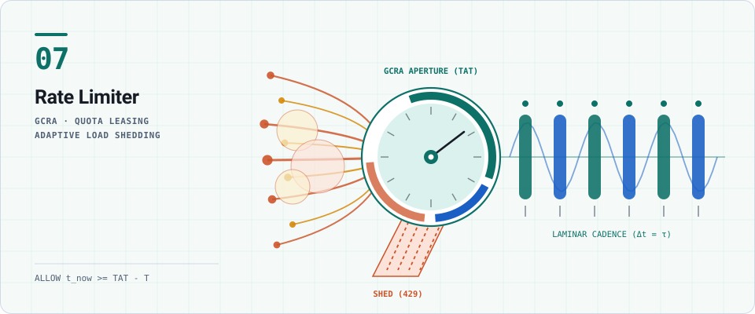
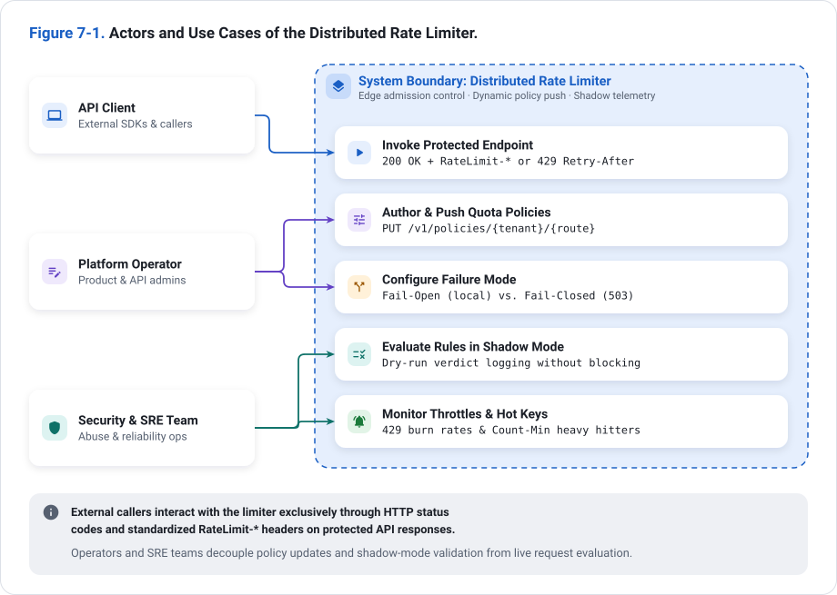
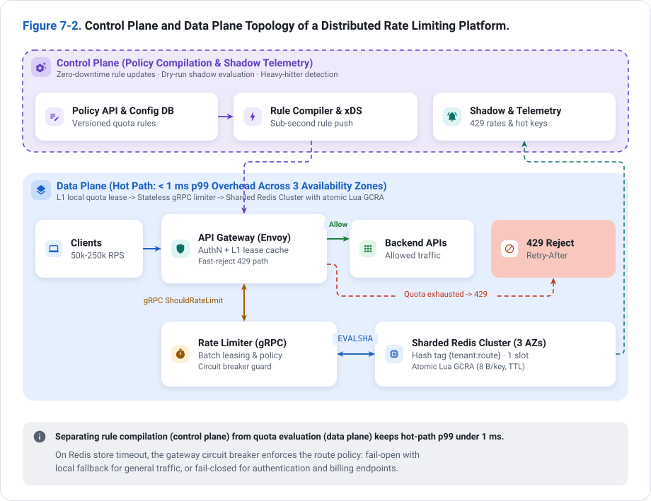
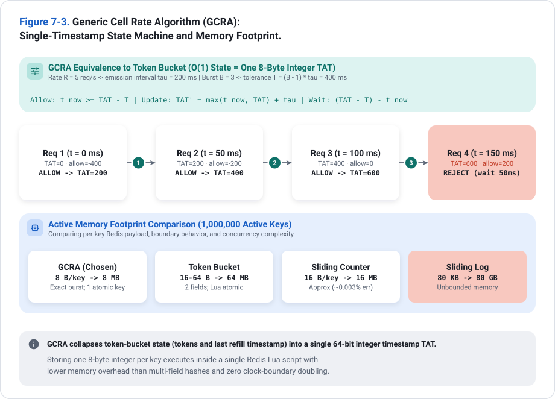
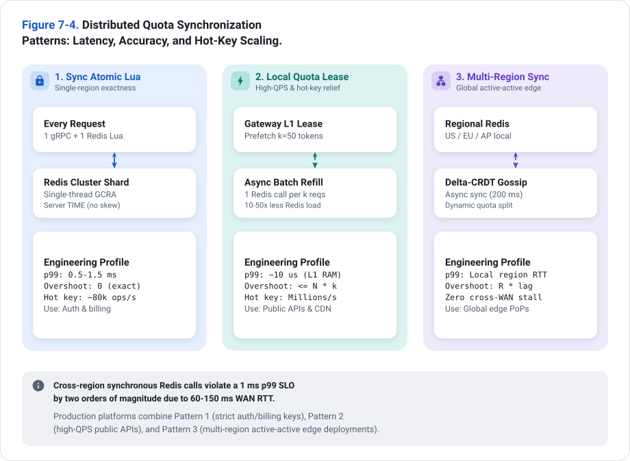
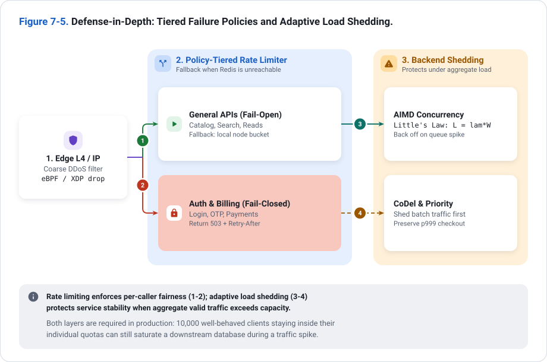

# 7. Rate Limiter: System Design

A distributed rate limiter enforces explicit per-caller traffic budgets at the ingress boundary of an API platform. Without per-identity admission control, the availability of every tenant couples directly to the worst-behaved caller on the network: a single client running an unthrottled retry loop fills shared request queues, inflates latency for all neighboring tenants, and triggers cascading client timeouts that amplify the overload. By rejecting excess requests at the edge before application workers or databases allocate resources, a rate limiter converts a shared outage into an isolated refusal addressed exclusively to the offending caller.

Rate limiting operates alongside, rather than in place of, backend load shedding. Load shedding drops aggregate traffic reactively when a service approaches saturation regardless of caller identity, whereas a rate limiter enforces declared per-caller fairness, abuse, and cost budgets proactively even when backend capacity is idle.

<div class="covers">

In this chapter, we cover

- actors, use cases, verifiable functional requirements, sub-millisecond latency SLOs, and memory and CPU capacity bounds
- HTTP caller contracts (`429 Too Many Requests`, IETF `RateLimit-*` headers, jittered `Retry-After`), internal Envoy-style gRPC checks, and policy control APIs
- separation of policy compilation (control plane) from sub-millisecond evaluation (data plane), including shadow-mode rollout
- formal and empirical comparison of rate-limiting algorithms via [`code/ratelimit`](https://github.com/arpanpathak/cracking-the-systems-programming-interview/tree/prep-v2/distributed-systems-from-the-ground-up/code/ratelimit) and interactive traces, culminating in the O(1) Generic Cell Rate Algorithm (GCRA) and its atomic Redis Lua implementation
- distributed quota synchronization across single-region Redis Clusters, L1 local quota leasing for hot keys, and multi-region asynchronous convergence
- defense-in-depth failure policies (fail-open versus fail-closed tiers), composite key selection, and backend adaptive load shedding (AIMD and CoDel)
- operational SLIs, production architectures (Stripe, Cloudflare, Envoy, Kong), and verification

</div>

## 7.1 Requirements and Capacity Envelope

### Actors and Use Cases

We organize the rate limiter around three distinct actors (Figure 7-1).

<figure>

<figcaption><b>Figure 7-1</b> Actors, system boundary, and core use cases of the distributed rate limiter.</figcaption>
</figure>

| Actor | Operation | Concrete Scenario |
| :--- | :--- | :--- |
| **API Client** | Invoke protected endpoint (`GET /v1/orders`) | Request passes transparently with quota-status headers when within budget, or terminates at the gateway with `429` and `Retry-After` when throttled |
| **Platform Operator** | Author and update per-tenant, per-route rules (`PUT /v1/policies/...`) | Increase an enterprise customer's sustained rate and burst allowance without restarting edge gateways |
| **Security and Reliability Team** | Evaluate candidate rules in shadow mode and monitor throttle telemetry | Verify stricter authentication or scraping quotas against live production traffic prior to enforcement |

### Functional Requirements

| No. | Functional Requirement |
| :--- | :--- |
| 0 | The system enforces configurable sustained rates (`R` requests/s) and burst allowances (`B` requests) keyed by tenant or API key, user identifier, IP address, HTTP route, or weighted request cost (such as GraphQL query complexity or token count). |
| 1 | A request within its applicable quota passes unchanged to upstream services, carrying standardized quota-status headers on the response. |
| 2 | A request exceeding its quota is rejected at the edge with `429 Too Many Requests`, a jittered `Retry-After` interval, and an RFC 9457 error payload. |
| 3 | Policy additions, updates, and emergency overrides propagate from the control plane to all edge gateways within `5 seconds` without process restarts. |
| 4 | Every rule supports a non-blocking shadow mode (dry run) that evaluates live traffic and emits hypothetical throttle metrics without rejecting requests. |
| 5 | Every route declares an explicit counter-store failure policy: either **fail-open** (availability-prioritized) or **fail-closed** (security- or cost-prioritized). |

### Non-Functional Requirements and SLOs

| No. | Property | Target Specification | Architectural Consequence |
| :--- | :--- | :--- | :--- |
| 0 | **Added Latency** | `p50 <= 0.3 ms`, `p99 <= 1.0 ms`, `p999 <= 3.0 ms` (intra-region) | Eliminates disk-backed consensus and cross-region synchronous calls on the request path; mandates in-memory stores and L1 local quota leasing |
| 1 | **Availability** | `99.99%` effective data-plane availability (`<= 4.3` minutes/month) | Active-active stateless gateways across three AZs; gateway circuit breakers engage local fallback buckets within `5 ms` on counter-store faults |
| 2 | **Consistency** | Bounded eventual consistency (exact within a single region under synchronous Lua) | Cross-region strong consistency adds `60-150 ms` WAN RTT; accepting bounded overshoot (`<= 2-5%`) under concurrent bursts keeps protection cheaper than the API it guards |
| 3 | **Scale** | `10,000,000` registered clients (`1,000,000` active concurrently), `50,000` sustained RPS (`250,000` peak burst RPS) | Requires `O(1)` per-key state (`8-64 bytes/key`) and horizontally sharded counter clusters |
| 4 | **Hot-Key Resilience** | Absorb `100,000+` RPS targeting a single key without saturating a counter shard | Requires L1 gateway token leasing and short-TTL local negative caching after `429` verdicts |

Choosing bounded eventual consistency reflects a deliberate risk asymmetry. Unlike a financial ledger, where an off-by-one anomaly loses real money, admitting `103` requests under a nominal `100` req/s ceiling during a brief network skew still shields upstream services from a `5,000` req/s flood while preserving sub-millisecond latency.

### Capacity and Resource Envelope

Sizing memory and CPU upfront eliminates algorithms whose per-key storage grows linearly with traffic volume:

| Resource Dimension | Derivation | Provisioned Bound |
| :--- | :--- | :--- |
| **Active Working Set** | `1,000,000` concurrently active `{tenant:route}` keys with TTL eviction | `10^6` live keys |
| **GCRA Counter Memory** | `10^6 keys * (40 B key + 8 B TAT int64 + ~40 B Redis dict overhead)` | `~88 MB` total (`8 B` state payload/key) |
| **Token Bucket Memory** | `10^6 keys * (40 B key + 16 B tokens/ts + ~64 B hash overhead)` | `~120 MB` total |
| **Sliding Window Log (Rejected)** | `10^6 keys * 10,000 timestamps/hr * 8 B` | `~80 GB` (unviable memory footprint) |
| **Rule Snapshot Memory** | `100,000` compiled rules `* 256 B` | `~25 MB` (fits entirely in every gateway's RAM) |
| **Counter Cluster CPU** | `250,000` peak RPS; one Redis core sustains `~60,000-80,000` Lua `EVALSHA` ops/s | `6` Redis Cluster primaries plus `6` cross-AZ replicas (`~360k-480k` ops/s capacity) |
| **Internal Network Fabric** | `250,000` peak ops/s `* ~250 B` request and reply | `~62.5 MB/s` (`0.5 Gbps`) |

Because `88 MB` of active state fits comfortably in RAM, the counter tier is **CPU- and hot-key-bound** rather than memory-bound. Sharding across six primary nodes supplies CPU headroom and limits blast radius, while L1 local quota leasing absorbs single-key floods that exceed one Redis core.

## 7.2 API, Wire Protocol, and Data Contracts

A rate limiting platform exposes an inline HTTP response contract to external API consumers, a binary gRPC evaluation contract between gateways and limiter services, and an administrative REST contract for policy management.

### External Caller Contract

External callers never invoke the rate limiter directly; they observe its decisions through response status codes and standardized draft-IETF `RateLimit` headers. Before examining the transcripts below, note the contract of each header:

- **`RateLimit-Limit`:** The maximum request allowance per window for the matched rule.
- **`RateLimit-Remaining`:** The estimated number of remaining request slots available immediately before throttling engages, allowing well-behaved SDKs to self-pace smoothly.
- **`RateLimit-Reset`:** The number of seconds until the caller's burst budget fully replenishes.
- **`Retry-After` (on `429`):** The minimum wait duration in seconds before retrying. When thousands of callers exhaust a shared quota simultaneously, returning identical integer wait durations triggers a **synchronized retry storm** at the next second boundary. Gateways therefore inject small random jitter (`+0` to `250 ms` on sub-second resets or randomized backoff spreads) and client SDKs apply full-jitter exponential backoff.

**Allowed response:**

```http
HTTP/2 200 OK
RateLimit-Limit: 100
RateLimit-Remaining: 42
RateLimit-Reset: 1
```

**Throttled response (terminated at the gateway before reaching backend servers):**

```http
HTTP/2 429 Too Many Requests
Retry-After: 2
RateLimit-Limit: 100
RateLimit-Remaining: 0
RateLimit-Reset: 2
Content-Type: application/problem+json

{
  "type": "/problems/rate-limit-exceeded",
  "title": "Too Many Requests",
  "status": 429,
  "detail": "Quota of 100 requests/s (burst 200) exceeded for route GET /v1/orders."
}
```

### Internal Evaluation RPC and Policy Management API

Gateways query the stateless Rate Limiter Service over persistent HTTP/2 gRPC channels (`ShouldRateLimitRequest` carrying typed descriptors such as `tenant=acct_42`, `route=GET:/v1/orders`, and `cost=1`, returning `{decision, remaining, reset_ms, leased_tokens}`).

Operators manage policies through an idempotent control-plane API backed by durable relational or etcd storage:

```http
PUT /v1/policies/acct_42/routes/orders HTTP/2
Host: ratelimit-control.internal
Content-Type: application/json

{
  "rate_per_second": 100,
  "burst_capacity": 200,
  "cost_unit": "requests",
  "failure_mode": "fail_open",
  "enforcement_mode": "enforce"
}
```

Separating durable **Policy** configuration from ephemeral **QuotaState** counters is foundational. Policy records change rarely, must survive restarts, and are read millions of times per second from gateway RAM. QuotaState mutates on every request and carries an automatic expiration TTL (`ceil(burst / rate) + margin`): losing a counter shard resets active callers to a fresh burst without corrupting any persistent business state.

## 7.3 System Architecture: Control Plane vs. Data Plane

We decouple rule authoring and compilation (control plane) from per-request quota enforcement (data plane) so that a control-plane database upgrade or outage never degrades hot-path latency or availability (Figure 7-2).

<figure>

<figcaption><b>Figure 7-2</b> Control-plane versus data-plane topology of the distributed rate limiting platform.</figcaption>
</figure>

### Component Responsibilities and Failure Domains

| Component | Plane | State Held | Failure Impact and Mitigation |
| :--- | :--- | :--- | :--- |
| **Policy API and Config DB** | Control | Authoritative versioned tenant and route rules | Data plane continues enforcing its last compiled snapshot indefinitely; only policy edits pause |
| **Rule Compiler and xDS Push** | Control | Immutable compiled rule trie/hash bundles | Streams rule revisions to gateways over persistent gRPC/xDS connections with polling fallback |
| **Shadow and Telemetry Pipeline** | Control | Sampled allow/deny counters and Count-Min Sketch heavy-hitter maps | Decoupled via non-blocking ring buffers; never delays request handling |
| **API Gateway (Envoy)** | Data | AuthN verifier, compiled rules, L1 local quota leases, circuit breaker | Stateless multi-AZ fleet; rejects `429` traffic at ingress before upstream connection allocation |
| **Rate Limiter Service (gRPC)** | Data | Stateless evaluator, Redis Cluster slot map, request coalescing buffers | Horizontally auto-scaled across three AZs; may also run embedded inside the gateway process |
| **Sharded Redis Cluster (3 AZs)** | Data | Per-key GCRA `TAT` timestamps with TTL (`8 B` payload/key) | Six primaries plus six cross-AZ replicas; gateway circuit breaker triggers route fallback within `5 ms` on shard fault |

### Request Path Walkthrough

1. **Pre-Authentication Coarse Filter:** Edge L4/L7 filters enforce generous per-IP/CIDR ceilings (via `eBPF/XDP` or gateway-local memory) to discard volumetric floods before JWT parsing or TLS handshake amplification consumes CPU.
2. **Identity and Key Derivation:** The API Gateway authenticates the caller and constructs the canonical composite key (for example, `{acct_42}:GET:/v1/orders`).
3. **L1 Local Quota Lease Check:** If the route permits local leasing and the gateway holds unexpired prefetched tokens in L1 RAM, it decrements atomically in `~10 microseconds` and forwards immediately, refilling asynchronously in the background.
4. **Centralized Atomic Evaluation:** For strict single-region routes or on an L1 lease miss, the gateway issues `ShouldRateLimit` (gRPC) to the Rate Limiter Service, which executes a pre-loaded Redis Lua script (`EVALSHA`) against the owning Redis Cluster shard.
5. **Enforcement and Response Headers:** On `ALLOW`, the gateway forwards the request upstream and injects `RateLimit-*` headers into the reply. On `DENY`, the gateway returns `429 Too Many Requests` immediately and optionally sets a short-TTL local negative cache entry if the caller is actively flooding.

## 7.4 Rate-Limiting Algorithms and GCRA Formulation

The natural-language specification "5 requests per second" admits multiple incompatible implementations until two degrees of freedom are fixed: **burst tolerance** (whether all 5 requests may arrive in the same millisecond or must be spaced evenly every `200 ms`) and **window alignment** (calendar-aligned clock seconds versus every rolling `1,000 ms` span).

### Empirical Comparison of Classical Algorithms

The repository's [`code/ratelimit`](https://github.com/arpanpathak/cracking-the-systems-programming-interview/tree/prep-v2/distributed-systems-from-the-ground-up/code/ratelimit) simulation subjects five classical algorithms to identical traffic at `5` requests/s (`20` simultaneous requests, `10` requests straddling the `1,000 ms` clock boundary, and `30` requests arriving at `10` req/s over `3` seconds):

```console
$ cargo run --release -p ratelimit
the limit for every algorithm: 5 requests per second

20 requests in the same instant: 20 requests
  algorithm               forwarded  most in any second  first 5 forwarded at (ms)
  fixed window                    5                   5  0 0 0 0 0
  sliding window log              5                   5  0 0 0 0 0
  sliding window counter          5                   5  0 0 0 0 0
  token bucket                    5                   5  0 0 0 0 0
  leaky bucket                    5                   5  0 200 400 600 800

5 requests before the 1 second mark and 5 after it: 10 requests
  algorithm               forwarded  most in any second  first 5 forwarded at (ms)
  fixed window                   10                  10  900 920 940 960 980
  sliding window log              5                   5  900 920 940 960 980
  sliding window counter          5                   5  900 920 940 960 980
  token bucket                    5                   5  900 920 940 960 980
  leaky bucket                    6                   5  900 1100 1300 1500 1700

10 requests per second for 3 seconds: 30 requests
  algorithm               forwarded  most in any second  first 5 forwarded at (ms)
  fixed window                   15                   5  0 100 200 300 400
  sliding window log             15                   5  0 100 200 300 400
  sliding window counter         13                   5  0 100 200 300 400
  token bucket                   19                   9  0 100 200 300 400
  leaky bucket                   20                   5  0 200 400 600 800
```

| Algorithm | Memory per Key | Boundary Doubling | Burst Behavior | Engineering Verdict |
| :--- | :--- | :--- | :--- | :--- |
| **Fixed Window Counter** | `8 B` | Admits up to `2x` limit across clock edges (`10` in `200 ms`) | Permits instant bursts | Unsuitable for strict backend protection; acceptable only for coarse usage analytics |
| **Sliding Window Log** | `O(limit)` (`80 KB` at 10k/hr) | None (exact) | Permits bursts up to limit | Memory-prohibitive at high quotas |
| **Sliding Window Counter** | `16 B` (two counters) | Bounded approximation (`~0.003%` empirical error per Cloudflare) | Permits smooth bursts | Strong choice for rolling-window HTTP quotas |
| **Token Bucket** | `16-64 B` (`tokens`, `last_ts`) | None | Decouples burst `B` from sustained rate `R` | Industry standard for API gateways |
| **Leaky Bucket (Queue)** | `O(queue_depth)` | None | Strictly smooths egress to exact `1 / R` pacing | Ideal for shaping downstream queues; adds queueing delay |
| **GCRA (Chosen)** | `8 B` (single `TAT` int64) | None | Mathematically isomorphic to Token Bucket with half the state | Optimal production choice (Stripe, Envoy, `redis-cell`) |

### Interactive Step-by-Step Algorithm Walkthroughs

Advancing through the interactive traces below illustrates how four algorithms respond to the same `11` requests arriving between `600 ms` and `1,250 ms` across the `1,000 ms` clock boundary under a `5` req/s quota:

<figure class="steps" data-prefix="figures/steps-limiter-fixed" data-count="13" data-version="4f0b5cf9">

<figcaption><b>Interactive Trace 7.A</b> Fixed window counter: resets at <code>t = 1,000 ms</code>, admitting 10 requests in 650 ms (boundary doubling). Use Next and Back to step through.</figcaption>
</figure>

<figure class="steps" data-prefix="figures/steps-limiter-counter" data-count="13" data-version="6ead65b4">

<figcaption><b>Interactive Trace 7.B</b> Sliding window counter: weights the preceding window by remaining overlap fraction, eliminating boundary doubling in O(1) space.</figcaption>
</figure>

<figure class="steps" data-prefix="figures/steps-limiter-token" data-count="13" data-version="4309ceba">

<figcaption><b>Interactive Trace 7.C</b> Token bucket: accommodates an initial burst of 5 tokens, then admits 1 request per 200 ms refill interval.</figcaption>
</figure>

<figure class="steps" data-prefix="figures/steps-limiter-leaky" data-count="13" data-version="d4541bfc">

<figcaption><b>Interactive Trace 7.D</b> Leaky bucket: queues arriving bursts and drains requests to upstream servers at a uniform 200 ms cadence.</figcaption>
</figure>

### Formal Derivation: Generic Cell Rate Algorithm (GCRA)

Standardized originally for Asynchronous Transfer Mode (ATM) networks, the **Generic Cell Rate Algorithm (GCRA)** is mathematically isomorphic to a continuous-refill token bucket while collapsing its two mutable variables (`tokens` and `last_refill_timestamp`) into a single 64-bit integer timestamp termed the **Theoretical Arrival Time (`TAT`)** (Figure 7-3).

Given sustained rate `R` (requests/s) and burst capacity `B` (requests), we define the **emission interval** `tau = 1 / R` (the time required to earn one request slot) and the **burst tolerance** `T = B * tau` (when deducting `cost` prior to admission, or `(B - 1) * tau` when checking prior to incrementing). Intuitively, `TAT` records the instant at which the caller's bucket will next be completely full. When a request of weight `cost` arrives at time `t_now`:

1. **Initialization:** If no `TAT` exists (the caller has been idle longer than `T`), we initialize `TAT = t_now`.
2. **Candidate Advance:** We compute `new_tat = max(t_now, TAT) + cost * tau` and the earliest admissible arrival time `allow_at = new_tat - T`.
3. **Admission Decision:** We permit the request if and only if `t_now >= allow_at`. Upon admission, we persist `new_tat` with expiration TTL `new_tat - t_now`. Upon refusal, we leave `TAT` unchanged and return exact wait time `retry_after = allow_at - t_now`.

<figure>

<figcaption><b>Figure 7-3</b> GCRA state evolution using a single 8-byte <code>TAT</code> integer and active memory comparison across 1,000,000 keys.</figcaption>
</figure>

#### Atomic Redis Lua Contract and Implementation

Executing `GET`, computing `new_tat` inside a stateless gateway, and writing back via `SET` introduces a distributed **Read-Modify-Write (RMW) race**: two concurrent gateways reading an identical `TAT` both admit requests and overwrite one another's updates, doubling effective burst allowance under concurrency.

Embedding GCRA inside a pre-cached Redis Lua script (`EVALSHA`) eliminates the RMW race because Redis executes Lua scripts atomically on its single-threaded event loop in one network round trip. Before examining the script below, note its input and output contract:

- **`KEYS[1]`:** Composite key wrapped in a Redis Cluster hash tag (`{tenant_id:route_id}`) so multi-key policies hash to the exact same slot (`CRC16(tag) mod 16384`).
- **`ARGV[1..3]`:** `emission_interval_us` (`tau` in microseconds), `burst_tolerance_us` (`T` in microseconds), and integer request `cost` (default `1`).
- **Time Source:** Calling `redis.call("TIME")` reads the Redis server's clock directly, preventing NTP skew across gateway hosts from corrupting quotas.
- **Return Tuple:** `{allowed (0|1), remaining_tokens, retry_after_us}`.

```lua
local now_parts = redis.call("TIME")
local now_us = tonumber(now_parts[1]) * 1000000 + tonumber(now_parts[2])

local tau   = tonumber(ARGV[1])
local tol   = tonumber(ARGV[2])
local cost  = tonumber(ARGV[3])
local incr  = cost * tau

local tat = tonumber(redis.call("GET", KEYS[1])) or now_us
local new_tat = math.max(tat, now_us) + incr
local allow_at = new_tat - tol

if now_us < allow_at then
    local retry_after_us = allow_at - now_us
    return { 0, 0, retry_after_us }
end

local ttl_ms = math.max(1000, math.ceil((new_tat - now_us) / 1000))
redis.call("PSETEX", KEYS[1], ttl_ms, new_tat)

local remaining = math.floor((now_us - (new_tat - tol)) / tau)
return { 1, remaining, 0 }
```

Self-cleaning TTLs via `PSETEX` ensure that idle keys disappear automatically once their burst capacity has replenished (`new_tat - now_us`), bounding Redis memory strictly to currently active callers.

## 7.5 Distributed Synchronization, Hot Keys, and Multi-Region Scaling

Synchronous Redis Lua evaluation satisfies `50,000-250,000` RPS within a single geographic region, but two operational regimes exceed its bounds: **extreme hot keys** (a single tenant driving `100,000+` RPS onto one Redis primary core) and **multi-region active-active deployments** (where synchronous cross-WAN RTT of `60-150 ms` breaks the `1 ms` latency SLO by two orders of magnitude). We select among three synchronization topologies by route tier (Figure 7-4).

<figure>

<figcaption><b>Figure 7-4</b> Trade-offs across synchronous Redis Lua, L1 local quota leasing, and multi-region asynchronous synchronization.</figcaption>
</figure>

### Local Quota Leasing (Batch Token Prefetching)

Under **local quota leasing**, each gateway amortizes network round trips by reserving a small batch of `k` tokens (for example, `k = 50` or `1%` of the tenant's per-second quota, capped at a `100 ms` lease TTL) in one Redis Lua invocation (`cost = k`). Subsequent requests decrement a lock-free atomic counter (`AtomicI64`) in gateway RAM in `~10 microseconds`, triggering an asynchronous background refill when remaining local tokens fall below `20%`.

This pattern reduces Redis QPS by `10x-50x` and lifts single-key ceilings into millions of RPS. Its cost is an explicit, mathematically bounded overshoot: if `N` gateways simultaneously hold unexpired leases of size `k`, instantaneous overshoot cannot exceed `N * k`. Gateways therefore adapt `k` dynamically from observed per-key QPS (`k = 1` for low-rate security endpoints, scaling upward only for hot public-API keys).

### Multi-Region Global Quotas

Active-active deployments across US-East, EU-West, and AP-Southeast execute all hot-path checks against regional Redis Clusters (`< 1 ms` RTT) and reconcile global usage off the request path through two mechanisms:

1. **Asynchronous Delta-CRDT / Gossip Sync:** Each region broadcasts compact per-key usage deltas (`PN-Counter` or window increments) to peer regions every `100-500 ms`. Worst-case global overshoot during a simultaneous multi-region spike is bounded linearly by `R_burst * sync_interval`.
2. **Dynamic Regional Quota Allocation:** A control-plane loop monitors each region's traffic proportion every few seconds and assigns proportional local sub-budgets (for example, `US: 60%`, `EU: 30%`, `AP: 10%`), rapidly shifting unused quota when traffic moves across continents.

## 7.6 Defense-in-Depth: Failure Policies, Keying, and Load Shedding

Rate limiting is one layer in a broader traffic-control hierarchy (Figure 7-5). Applying one blanket fallback rule to every endpoint, or expecting per-caller quotas to prevent aggregate overload, leads directly to avoidable outages.

<figure>

<figcaption><b>Figure 7-5</b> Defense-in-depth layering across edge IP filtering, tiered fail-open/fail-closed policies, and backend adaptive load shedding.</figcaption>
</figure>

### Tiered Failure Policies (Fail-Open vs. Fail-Closed)

When a Redis shard becomes unreachable, the gateway circuit breaker opens within `5 ms` and executes the route's declared failure contract:

- **Fail-Open with Local Fallback (General and Revenue APIs):** Catalog, search, and read endpoints continue serving traffic guarded by an in-process per-gateway local token bucket configured to `max(1, global_limit / active_gateway_count)`. A counter-store fault never disrupts normal business traffic.
- **Fail-Closed (Security and High-Cost Endpoints):** Login, OTP verification, password reset, and high-cost compute or payment creation routes reject calls with `503 Service Unavailable` and `Retry-After` if global enforcement is blind, preventing credential-stuffing attacks or unbounded third-party billing.

### Composite Key Selection

Key design governs both fairness and abuse resistance. Keying exclusively by IP address fails in both directions: corporate proxies, universities, and carrier-grade NAT (CGNAT) aggregate thousands of legitimate users behind one IP address (causing widespread collateral refusals), whereas distributed botnets rotate across tens of thousands of residential IPs. Production gateways reserve IP-keyed limits strictly for coarse pre-authentication DDoS defense, authenticate callers first, and key primary quotas on `(tenant_id, route_group)` weighted by explicit request cost (`cost = 1` for a point lookup, `cost = 25` for a bulk export).

### Rate Limiting vs. Adaptive Load Shedding

Even if every tenant respects its individual quota, `10,000` legitimate tenants arriving concurrently during a global traffic spike can saturate a downstream database. Backend services therefore complement ingress rate limiting with **adaptive concurrency limiting** grounded in **Little's Law** (`L = lambda * W`, relating concurrency `L`, arrival rate `lambda`, and service time `W`):

- **AIMD Concurrency Control:** Services continuously track baseline minimum latency (`RTT_noload`) against current queueing latency, increasing their in-flight concurrency ceiling additively while latency stays flat and reducing it multiplicatively as soon as queue depth builds.
- **CoDel and Priority Shedding:** Controlled Delay (CoDel) monitors request sojourn time inside work queues and sheds queued work exceeding a latency threshold, prioritizing `P0` interactive checkout calls over `P3` batch exports and scrapers to bound `p999` tail latency.

## 7.7 Failure Modes, Observability, Production Systems, and Verification

### Failure and Recovery Matrix

| Failure Mode | Operational Symptom | Automated Mitigation |
| :--- | :--- | :--- |
| **Redis Primary Node Crash** | Lua `EVALSHA` timeouts across one-sixth of keys | Gateway circuit breaker opens after `3` consecutive `5 ms` timeouts -> activates per-route local fallback or fail-closed; Redis Cluster promotes cross-AZ replica in `3-10 s` |
| **Single Hot-Key Flood (`100k+` RPS)** | One Redis shard core saturates at `100%` CPU, elevating p99 for co-located tenants | Gateway activates L1 local quota leasing (`k = 50`) plus `500 ms` local negative caching on rejected keys, shielding the shard |
| **Defective Policy Rollout (Quota = 0)** | Sudden spike in `429` refusals for healthy tenants | Shadow-mode dry-run validation catches regressions before enforcement; automated rollback triggers if global `429` rate jumps `> 5x` baseline within `60 s` |
| **Control-Plane DB Outage** | Administrative `PUT /v1/policies/...` calls fail | Zero data-plane impact; gateways enforce immutable in-memory rule snapshots until the control plane recovers |
| **Gateway NTP Clock Step** | Would skew gateway-timestamped windows | Eliminated structurally by sourcing timestamps inside Redis via `redis.call("TIME")` |

### Observability: SLIs and Alerts

Four operational signals govern day-two reliability: **hot-path latency SLI** (`p99` check duration alerted above `1.0 ms` for `5 minutes`), **circuit-breaker activation alerts** (`ratelimit_circuit_breaker_open_total > 0`, ensuring fail-open fallback never masks a prolonged counter outage), **per-route throttle ratios paired with a Count-Min Sketch** of top-throttled keys (distinguishing one runaway client from a misconfigured global rule), and **shadow-mode delta dashboards** verifying hypothetical `429` volume before promoting any policy from `shadow` to `enforce`.

### How Production Systems Implement Rate Limiting

| Production System | Core Algorithm | Counter Architecture | Architectural Distinction |
| :--- | :--- | :--- | :--- |
| **Stripe** | GCRA / Token Bucket plus Concurrency Limiter | Sharded Redis Cluster with atomic Lua | Layers four specialized limiters: Request Rate Limiter, Concurrent Request Limiter, Fleet Usage Load Shedder, and Worker Utilization Shedder |
| **Cloudflare** | Sliding Window Counter | Per-PoP local RAM plus asynchronous global sync | Sustains microsecond overhead across `300+` edge PoPs with `~0.003%` empirical deviation from exact sliding logs |
| **Envoy (`ratelimit`)** | Token / Fixed Bucket (`local` + `global`) | Local per-proxy filter plus external gRPC `ShouldRateLimit` -> Redis | Clean hierarchical descriptor matching separating L1 local protection from L2 global quotas |
| **Kong / Redis-Cell** | GCRA (`CL.THROTTLE` native Redis module) | Native compiled Redis module executing GCRA in-memory | Single atomic Redis command returning `{denied, limit, remaining, retry_after, reset_after}` without Lua interpreter overhead |

### Verification in the Repository

<div class="simulation">

**Run the algorithm comparison simulation.** Execute `cargo run --release -p ratelimit` in [`code/`](https://github.com/arpanpathak/cracking-the-systems-programming-interview/tree/prep-v2/distributed-systems-from-the-ground-up/code) to reproduce the simultaneous-burst, boundary-straddling, and sustained-overload results across all five algorithms reported in Section 7.4.

</div>

### Engineering Glossary

| Term | Definition |
| :--- | :--- |
| **GCRA (Generic Cell Rate Algorithm)** | O(1)-space token-bucket equivalent representing quota state as a single Theoretical Arrival Time (`TAT`) timestamp per key. |
| **Local Quota Leasing** | Prefetching a bounded batch of tokens from Redis into gateway L1 RAM to amortize network RTT and absorb hot-key traffic. |
| **Fail-Open / Fail-Closed** | Per-route failure contract selecting either local-bucket pass-through (availability priority) or `503` rejection (security/cost priority) when the shared counter store is unreachable. |
| **Shadow Mode (Dry Run)** | Evaluating candidate policies against live production traffic and recording hypothetical `429` telemetry without blocking callers. |
| **Adaptive Load Shedding** | Backend concurrency control (AIMD and CoDel) grounded in Little's Law that sheds excess work based on live queue latency rather than per-caller quotas. |

### End-to-End Rate-Check Request Lifecycle and Latency Budget

Keeping the global rate-limit check under `p99 <= 1.0 ms` requires minimizing network hops and executing quota math atomically inside in-memory storage. Tracing an API call `POST /v1/payments` through the gateway illustrates both the L1 lease fast path and the L2 Redis synchronization path:

1. **Client to Edge / API Gateway (TLS Termination):** The caller submits an authenticated HTTP/2 request. The gateway extracts `(tenant_id, route_group)` and looks up the immutable in-memory rule snapshot (`< 1 us`).
2. **L1 Local Quota Lease Check:** If the gateway holds prefetched tokens in local RAM for a hot key, it decrements its atomic counter (`~0.01 ms`) and forwards the request upstream immediately with zero network RTT.
3. **L2 Regional Redis Cluster `EVALSHA` (On Lease Miss or Exact Quota):** On a lease miss or strict global quota, the gateway hashes the composite key to one Redis Cluster slot and sends a pipelined `EVALSHA` over a persistent intra-AZ TCP connection.
4. **Single-Threaded Redis Lua GCRA Execution:** Redis reads its local clock (`redis.call("TIME")`), computes the updated Theoretical Arrival Time (`TAT`), sets the key TTL, and returns `{allowed, remaining, retry_after}` in `~0.08 ms` with zero disk `fsync`.
5. **Enforcement Decision:** The gateway either proxies the call to the upstream service (attaching `RateLimit-*` headers) or short-circuits with `429 Too Many Requests` and `Retry-After`, protecting backend capacity before application workers touch the request.

| Hop | Device / Subsystem | Typical `p50` | Tail `p99` | Primary Source of Tail Latency |
| :--- | :--- | :--- | :--- | :--- |
| 1 | Gateway Policy Lookup + Key Extraction | `0.02 ms` | `0.08 ms` | Regex route matching, JWT claim parsing |
| 2 | L1 Local Lease Check (hot-key fast path) | `0.01 ms` | `0.03 ms` | Atomic cache-line contention on extreme hot keys |
| 3 | Gateway -> Regional Redis Cluster TCP RTT | `0.25 ms` | `0.65 ms` | Intra-AZ switch microbursts, connection pool queueing |
| 4 | Redis Single-Threaded Lua `EVALSHA` (GCRA) | `0.08 ms` | `0.22 ms` | Co-located slow commands (`KEYS`, large Lua loops), AOF rewrite forks |
| 5 | Header Injection + Upstream Forward / `429` | `0.04 ms` | `0.12 ms` | Response serialization, circuit-breaker state transition |
| **Total** | **L2 Synchronized Rate Check** | **`0.40 ms`** | **`1.10 ms`** | **Intra-AZ network jitter and Redis single-core queuing** |

### Deep-Dive Production Rate-Limiting Case Studies

Expanding on the summary table above, three production deployments highlight the operational trade-offs behind global rate limiting:

- **Stripe (Four-Layer Defense):** Stripe combines Redis-backed GCRA request rate limiters with a **Concurrent Request Limiter** (tracking in-flight requests per API key so slow endpoints cannot exhaust worker pools), a **Fleet Usage Load Shedder** (reserving capacity for critical payment traffic over lower-priority test-mode calls), and a **Worker Utilization Shedder** driven by live queue depth. Layering quota enforcement with adaptive load shedding keeps core payment endpoints above `99.99%` availability during sudden merchant flash sales.
- **Cloudflare (Edge Sliding-Window Counters):** Operating across `300+` global edge Points of Presence (PoPs), Cloudflare avoids cross-region synchronous round trips by maintaining compact sliding-window counters in each PoP's local RAM and synchronizing aggregates asynchronously. Empirical measurements on production HTTP traffic showed that the weighted sliding-window approximation diverges from an exact sliding log by only `~0.003%` while sustaining microsecond per-request overhead.
- **Envoy Global Rate Limit (`envoyproxy/ratelimit`):** Envoy splits rate limiting into an in-process **Local Rate Limit** token-bucket filter (absorbing volumetric floods with zero network hops) and an external gRPC `ShouldRateLimit` service backed by Redis. Envoy defaults to `failure_mode_deny: false` (fail-open) so a Redis outage degrades quota precision rather than causing a site-wide API blackout, while allowing security-sensitive routes such as authentication endpoints to override the policy to fail-closed.

<div class="callout keyidea"><span class="label">Key idea</span>

**GCRA reduces exact leaky-bucket rate limiting to a single timestamp per key.** Storing only the Theoretical Arrival Time (`TAT`, `8` bytes) instead of a timestamp log eliminates `O(N)` memory growth under high request rates while enforcing exact burst and steady-state emission intervals in one atomic Redis Lua script.

</div>

<div class="callout experiment"><span class="label">Experiment</span>

**Expose fixed-window boundary bursts empirically.** Execute `cargo run --release -p ratelimit` in [`code/`](https://github.com/arpanpathak/cracking-the-systems-programming-interview/tree/prep-v2/distributed-systems-from-the-ground-up/code) to replay identical burst and boundary-straddling workloads against Fixed Window, Sliding Log, Sliding Counter, Token Bucket, and GCRA. Verify that Fixed Window admits `2x` the configured quota across a window boundary, whereas GCRA bounds both instantaneous burst and sustained rate cleanly.

</div>

<div class="callout caution"><span class="label">Common pitfall</span>

**Stamping rate-limit windows with API gateway wall clocks.** Under even `50` to `200 ms` of NTP clock skew across a fleet of stateless gateways, one gateway can overwrite a newer `TAT` or extend a bucket's expiry inconsistently. Sourcing timestamps exclusively inside Redis via `redis.call("TIME")` eliminates inter-gateway clock skew at zero additional network cost.

</div>

### References

- P. Tarjan, "Scaling your API with rate limiters", Stripe Engineering Blog, 2017.
- J. Graham-Cumming, "How we built rate limiting capable of scaling to millions of domains", Cloudflare Engineering Blog, 2017.
- Brandur Leach, "Rate Limiting, Cells, and GCRA", brandur.org, 2017.
- Envoy Proxy Documentation, "Global and Local Rate Limiting Architecture".
- IETF HTTP Working Group, "RateLimit Header Fields for HTTP" (draft-ietf-httpapi-ratelimit-headers) and RFC 9457 ("Problem Details for HTTP APIs").
- K. Nichols and V. Jacobson, "Controlling Queue Delay (CoDel)", ACM Queue, 2012.
